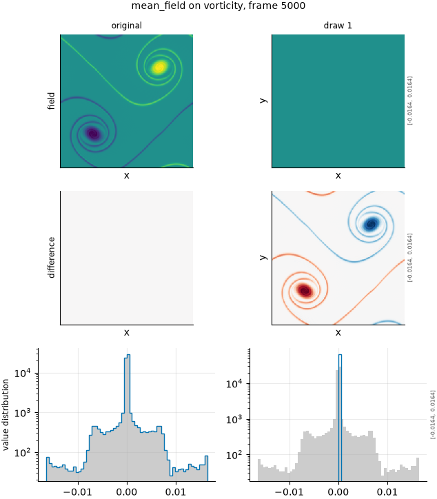

## Definition

Every cell of each channel is replaced by that channel's mean over the domain:

$$
g(x) = \bar f = \frac{1}{|\Omega|} \int_\Omega f(y)\, dy \tag{1}
$$

On the grid the integral is the mean over cells. The mean is taken over the frame being
degraded, so the operator needs no other frame.

This operator is declared ``ordinal=False``: it has one level and no order, and it is
excluded from every rank correlation.

### Boundary handling

None is needed. The mean over the domain does not depend on what lies outside it, so the
result is the same on a periodic domain and between walls.

## Intuition

This one is not imitating a model failure. It is the reference forecast that the damage
scale is measured against: the prediction that knows the field's mean value and nothing
about where anything is. Forecast verification calls this the climatological reference,
and skill scores built on the mean square error are measured against it [@murphy1988];
data-driven weather benchmarks report climatology as a baseline every model must beat
[@rasp2020].

The suite reports damage on a scale where zero is the reference and one is what this
anchor scores. A damage of 0.3 therefore says that a degradation took the prediction 30% of
the way from the truth to knowing nothing but the mean. For the mean squared error the
anchor is exactly the reference's spatial variance, so damage is the error as a fraction of
the field's own fluctuation energy.

On the four-by-four test field (produced by running the operator):

```
before                 after
0 0 0 0                0.25 0.25 0.25 0.25
0 1 1 0                0.25 0.25 0.25 0.25
0 1 1 0                0.25 0.25 0.25 0.25
0 0 0 0                0.25 0.25 0.25 0.25
```

Four ones among sixteen cells average to 0.25 everywhere. The mean is kept; the feature,
its position, its size and its sharpness are all gone.

What this degradation leaves untouched is the spatial mean, and nothing else.

## Severity scale

There is no severity. The configuration entry ``mean_field`` runs one level, numbered 0,
and that level removes every fluctuation.

## Limitations

The anchor replaced the large random translation (``random_large_translation``, entry
``uncorrelated``), which was meant to be a statistically identical but unrelated copy of
the field. On fields whose energy sits in the largest scales the translated copy is
anti-correlated with the reference rather than unrelated to it, and on a domain with walls
it is a mirrored window rather than a copy: the scale it set was off by up to a factor of
about 1.7, in a direction that depended on the field (`judgements/001`). This anchor is exact by construction, which is why it
replaced that one. The translation is still run, as a probe of how a metric scores the
right statistics in the wrong place.

The mean is a mean over space. For a statistically homogeneous flow it is the climatology;
for an inhomogeneous one, such as a shock tube, it is still "a prediction that knows the
mean and nothing else", but it is not the time-mean at each location that climatology
means in weather verification.

A metric that is undefined on a constant field cannot use this anchor. The increment
flatness is one: the increments of a constant are all zero, so the ratio that defines it
is zero over zero. Such a metric's span is undefined, ``degenerate`` is true, and the
analysis reads its responses against the largest ladder response instead, as it already
did for a metric invariant to the old anchor.

## What the degradation looks like

### The picture

<!-- GENERATED exemplars: written by `python -m fmeval.cards exemplars mean_field`, do not edit -->



**mean_field** on vorticity, frame 5000 of `kinet_re5e4`. The original beside its mean field. There is one level and nothing random, so one column is the whole operator. The difference row is the reference's own fluctuation, which is exactly what damage 1 measures a metric against; the pdf row collapses to a single value.

1 independent random draws, seeded from the run seed so that every draw reproduces exactly.

<!-- END GENERATED exemplars -->

The field column is a single flat colour, which is the whole operator. The difference row
is the reference's own fluctuation with its sign reversed: that pattern, measured by each
metric, is what damage 1 means. In the pdf row the distribution of values collapses to a
single spike at the mean.

## References

\bibliography
