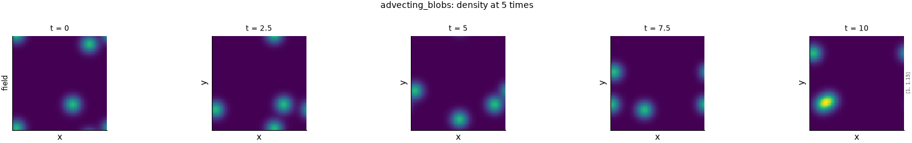

# Advecting Gaussian blobs

!!! note "Computed, not simulated"
    This dataset is a formula evaluated whenever a frame is read. It tests the machinery for
    time-dependent degradations and for metrics that read how a prediction evolves, not physics.
    It is not evidence about a flow, so no metric's page cites it.

## The problem

Three bumps of density on a uniform background, each carried at its own constant velocity
across a doubly periodic square. Each bump moves rigidly, so the field is the exact solution of
the advection equation, bump by bump. The velocities differ, so the bumps' positions relative to
one another change from frame to frame. That is the property the dataset exists for. Under one
fixed blur, MSE varies by 7.5% across the 21 frames with the default seed, and by 0.7% to 7.5%
over seeds 0 to 3. With a single bump, or one shared velocity, every frame would be a translated
copy of the first, and every frame would give the same error to round-off
(`tests/test_analytic_datasets.py`).

The figure shows the density at five times across the window, on shared colour limits. It was
drawn by `python -m fmeval.cards dynamics advecting_blobs`, and the numbers behind it are in the
JSON beside it under `docs/datasets/_generated/`.

## Configurations

| Configuration | What it is | Readable here |
|---|---|---|
| `advecting_blobs` | Three bumps of width 0.06 and height 0.1 on $64^2$ cells, 21 frames from $t = 0$ to $t = 10$, velocities $(0.05, 0)$, $(0, 0.08)$ and $(-0.06, 0.04)$ domain lengths per unit time, starting centres drawn from seed 0 | Yes, computed |

The grid, window, velocities, width, height and seed are reader options, for example
`+dataset.reader.seed=1`. One bump per velocity.

## Equations

On the unit square $[0, 1)^2$, with $N_b$ bumps of starting centre $\mathbf{c}_b$, velocity
$\mathbf{u}_b$, height $a$ and width $w$:

$$
\rho(\mathbf{x}, t) = 1 + a \sum_{b=1}^{N_b}
\exp\!\left(-\frac{\lvert \mathbf{x} - \mathbf{c}_b - \mathbf{u}_b t \rvert^2}{2 w^2}\right), \tag{1}
$$

where $\lvert \cdot \rvert$ is the periodic (minimum-image) distance. Each term satisfies
$\partial_t \rho_b + \mathbf{u}_b \cdot \nabla \rho_b = 0$ for its own velocity. The total is a
sum of such solutions, not a solution for one velocity field. At $w = 0.06$, a bump has fallen to
$8.3 \times 10^{-16}$ of its height half a domain away, so the minimum image leaves a seam of
round-off size there.

## What it is for

- **Time-dependent degradations.** A ladder entry of an uncalibrated operator may set
  `per_unit_time: true`. Its severity is then a rate, multiplied by each frame's time: a
  translation becomes a wrong advection speed, a displacement growing linearly in time, and
  noise an error growing in time. At $t = 0$ such an entry does nothing, and its rows there are
  flagged as no experiment. The `response_along_time` figure shows the result, one line per
  level against time.
- **The dynamics family.** The valid prediction time, the decorrelation time, the temporal
  autocorrelation and the invariant measure are recorded in
  [issue 094](https://github.com/khegazy/pde_metrics/blob/main/issues/094-dynamics-family-has-a-test-bed-but-no-rollout-input.md),
  which names this dataset as their test bed.

## Boundaries

Both axes are periodic.
