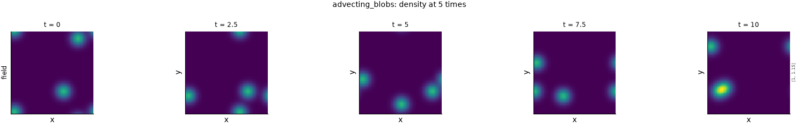

# Advecting Gaussian blobs

!!! note "Computed, not simulated"
    This dataset is a formula evaluated whenever a frame is read. It tests the machinery for
    time-dependent degradations and for metrics that read how a prediction evolves, not physics.
    It is not evidence about a flow, so no metric's page cites it.

## The problem

Three bumps of density on a uniform background, each carried at its own constant velocity
across a doubly periodic square. Each bump moves rigidly, so the field is the exact solution of
the advection equation, bump by bump. The velocities differ, so the bumps' positions relative to
one another change from frame to frame. That is the property the dataset exists for. Under one
fixed blur, MSE varies by 7.5% across the 21 frames with the default seed, and by 0.7% to 7.5%
over seeds 0 to 3. With a single bump, or one shared velocity, every frame would be a translated
copy of the first, and every frame would give the same error to round-off
(`tests/test_analytic_datasets.py`).

The figure shows the density at five times across the window, on shared colour limits. It was
drawn by `python -m fmeval.cards dynamics advecting_blobs`, and the numbers behind it are in the
JSON beside it under `docs/datasets/_generated/`.

## Configurations

| Configuration | What it is | Readable here |
|---|---|---|
| `advecting_blobs` | Three bumps of width 0.06 and height 0.1 on $64^2$ cells, 21 frames from $t = 0$ to $t = 10$, velocities $(0.05, 0)$, $(0, 0.08)$ and $(-0.06, 0.04)$ domain lengths per unit time, starting centres drawn from seed 0 | Yes, computed |
| `feature_population` | One static frame on $128^2$ cells: four density bumps of height 1, 0.8, 0.6 and 0.3, four vortices of peak vorticity $+1$, $-1$, $-0.5$ and $+0.5$ with their velocity, all of width 0.03 on cell centres 0.5 apart, and three pressure fronts of jump 1.5 (a circle of radius 0.1, an ellipse 0.12 by 0.06 at 30°, a straight stripe of half-width 0.03), described below | Yes, computed |
| `transport_pairs` | The default blobs at height 3 against their density pulled back through Saumier's periodic potential, a pair whose quadratic Wasserstein distance is known exactly in each of the 21 frames (0.0497 to 0.0515), described below | Yes, computed |

The grid, window, velocities, width, height, diffusivity and seed are reader options, for
example `+dataset.reader.seed=1`. One bump per velocity. The diffusivity is zero by default.
The options of the feature population are listed in its section below.

## Equations

On the unit square $[0, 1)^2$, with $N_b$ bumps of starting centre $\mathbf{c}_b$, velocity
$\mathbf{u}_b$, height $a$, width $w$ and diffusivity $\kappa$:

$$
\rho(\mathbf{x}, t) = 1 + a \frac{w^2}{s} \sum_{b=1}^{N_b}
\exp\!\left(-\frac{\lvert \mathbf{x} - \mathbf{c}_b - \mathbf{u}_b t \rvert^2}{2 s}\right),
\qquad s = w^2 + 2 \kappa t, \tag{1}
$$

where $\lvert \cdot \rvert$ is the periodic (minimum-image) distance. Each term satisfies
$\partial_t \rho_b + \mathbf{u}_b \cdot \nabla \rho_b = \kappa \nabla^2 \rho_b$ for its own
velocity: the heat kernel of variance $2\kappa t$ widens a Gaussian of variance $w^2$ to one of
variance $s$ and keeps its mass $2\pi a w^2$. The total is a sum of such solutions, not a
solution for one velocity field. At $w = 0.06$, a bump has fallen to $8.3 \times 10^{-16}$ of
its height half a domain away, so the minimum image leaves a seam of round-off size there.
Diffusion widens the seam with the bump, to $e^{-1/(8s)}$ of its height: $5 \times 10^{-15}$
at $s = 0.0038$.

### Candidates with a known error

The reader option `candidate` names parameters to change. The reader then supplies the same
bumps with those parameters, and `evaluate.py` scores them against its own frames at every
step as it scores a forecast: the rows are labelled `forecast` with their step and time since
the first frame, and of the ladder only the clean entry and the damage anchor `mean_field`
(the climatology reference) are run.

| Override | Candidate |
|---|---|
| `'+dataset.reader.candidate={velocities:[[0.07,0.0],[0.0,0.08],[-0.06,0.04]]}'` | A wrong advection speed for the first bump |
| `'+dataset.reader.candidate={diffusivity:1e-5}'` | A wrong diffusivity |
| `'+dataset.reader.candidate={velocities:[[0,0],[0,0],[0,0]]}'` | Persistence: the first frame at every step, when the window starts at $t = 0$ and $\kappa = 0$ |
| `'+dataset.reader.candidate={seed:1}'` | An unrelated realisation: bumps from other starting centres |

For one bump the mean squared error is closed-form. With $s_i$ and heights
$a_i = a w^2 / s_i$ for the truth and the candidate, and centres
$\boldsymbol\Delta = (\mathbf{u}' - \mathbf{u}) t$ apart (our derivation, from the integral of
a product of two Gaussians):

$$
\mathrm{MSE} = \pi a_1^2 s_1 + \pi a_2^2 s_2 - \frac{4 \pi a_1 a_2 s_1 s_2}{s_1 + s_2}
\exp\!\left(-\frac{\lvert \boldsymbol\Delta \rvert^2}{2 (s_1 + s_2)}\right). \tag{2}
$$

`tests/test_analytic_datasets.py` asserts eq. (2) through the pipeline for a wrong speed, a
wrong diffusivity and both, to $10^{-10}$ relative; the density's background of 1 limits the
round-off to about $2 \times 10^{-12}$.

## The feature population

The same reader places a list of features, each in its own field, so that the answer of a metric
to a change of one feature is known before the run
(specification 06 (`dataset_specs/06_feature_population_generator.md`),
Sect. 3). Each option is either one value shared by every feature or one value per velocity,
and the number of velocities is the number of features. With the defaults the reader is the
three blobs above, bit for bit (`tests/test_analytic_datasets.py`).

| Option | Meaning | Default |
|---|---|---|
| `kinds` | `bump` (added to density), `vortex` (added to vorticity; its velocity follows) or `front` (added to pressure) | `bump` |
| `centres` | The starting centre $\mathbf{c}_j$ of each feature | drawn from `seed` |
| `width`, `amplitude` | $w_j$ and $a_j$: a Gaussian's width and peak (signed for a vortex), a front's radius or half-width and pressure jump | 0.06, 0.1 |
| `aspect`, `orientation` | $\epsilon_j > 0$, the width along $y'$ over the width along $x'$, and the angle $\phi_j$ of $x'$ from the $x$ axis | 1, 0 |
| `directions` | For a front, coprime integers $(p, q)$ along which a straight stripe runs, or $(0, 0)$ for a closed curve | closed curves |
| `front_thickness` | $\delta$, in cells of the finer axis | 0.25 |
| `background` | `{rms: {density, vorticity, pressure}, slope, k_min, k_max}`: a static Gaussian random field added to the fields named | none |

With $(x', y')$ the minimum-image offset from the centre $\mathbf{c}_j + \mathbf{u}_j t$
rotated by $-\phi_j$, a bump or a vortex is the Gaussian

$$
g_j = a_j \frac{w_j^2 \epsilon_j}{\sqrt{s_1 s_2}}
\exp\!\left(-\frac{x'^2}{2 s_1} - \frac{y'^2}{2 s_2}\right),
\qquad s_1 = w_j^2 + 2\kappa t, \quad s_2 = (\epsilon_j w_j)^2 + 2\kappa t, \tag{3}
$$

which is eq. (1) when $\epsilon_j = 1$. A Gaussian vortex whose width grows as
$w^2 + 2\nu t$ is the Lamb–Oseen vortex (Gallay and Wayne 2005, *Commun. Math. Phys.* 255,
97–129, [doi:10.1007/s00220-004-1254-9](https://doi.org/10.1007/s00220-004-1254-9),
Eqs. (7)–(8), with the viscosity restored), so the diffusivity is then the viscosity. A torus
holds no net circulation, so the stored vorticity is the sum of the vortices minus its mean,
and the velocity is its periodic Biot–Savart inversion, computed spectrally:

$$
\nabla^2 \psi = -\omega, \qquad \mathbf{u} = (\partial_y \psi, -\partial_x \psi). \tag{4}
$$

A front adds $a_j \tfrac12[1 + \tanh(-\varphi_j / \delta)]$ to the pressure, where the level set
$\varphi_j$ is negative inside: $\sqrt{\epsilon_j}\,(\sqrt{x'^2 + (y'/\epsilon_j)^2} - w_j)$ for a
closed curve, the signed distance from a circle of radius $w_j$ when $\epsilon_j = 1$; and
$\lvert ((d + P/2) \bmod P) - P/2 \rvert - w_j$ for a stripe of half-width $w_j$, with $d$ the
offset along the stripe's unit normal and $P = 1/\sqrt{p^2 + q^2}$ the spacing of its periodic
images. Density and pressure sit on the level 1. Nothing here solves the Euler equations: the
vortices neither strain nor merge, the pressure is not in balance with the velocity, and the
fronts carry no Rankine–Hugoniot states. The diffusivity is refused with a front, whose tanh
profile it would not keep.

The background draws white noise from `seed` for each field it names, filters it with
`_apply_filter` (`degradations/_shared/filters.py`) so that the modes with
$k_{\min} \le \lvert\mathbf{k}\rvert \le k_{\max}$ (cycles per domain) have variance in proportion
to $\lvert\mathbf{k}\rvert^{-(\beta + 1)}$ and the rest none, and scales it to an expected rms of
`rms`. The field is exactly Gaussian, and its shell spectrum falls as $k^{-\beta}$ up to the
count of modes per shell. A density or pressure that the background makes non-positive is
refused when the frame is read.

### Single-feature candidates

A candidate changes one entry of a per-feature list, through the same `candidate` option as
above. On `feature_population`:

| Candidate | Override |
|---|---|
| Remove the weakest bump | `'+dataset.reader.candidate={amplitude:[1.0,0.8,0.6,0,1.0,-1.0,-0.5,0.5,1.5,1.5,1.5]}'` |
| Rescale one bump | the same with `0.8` replaced, for example by `0.88` |
| Flip one vortex's sign | the same with `-0.5` replaced by `0.5` |
| Move one feature | `centres` with one pair changed |
| Give one feature a wrong velocity | `velocities` with one pair changed |
| Rotate the ellipse, or turn the stripe | `orientation` or `directions` with one entry changed |
| Add a feature | the reference holds it at amplitude 0, which adds exactly nothing to any cell; the candidate gives it its height |

A candidate that moves, scales, blurs or adds noise to everything at once is a degradation
(`translate`, `gain`, ...), run on the ladder without a candidate.

### Known answers asserted by the tests

`tests/test_analytic_datasets.py` asserts each through the pipeline on non-square grids,
following specification 06 (`dataset_specs/06_feature_population_generator.md`),
Sect. 3.5, with features at least 20 widths apart so that their tails do not overlap above
round-off:

- **The double penalty.** A bump of height $a$ moved by $s$ costs
  $\mathrm{MSE} = 2\pi w^2 a^2 (1 - e^{-s^2/4w^2})$ and removing it costs $\pi w^2 a^2$, so the
  moved bump scores worse than no bump once $s > 2\sqrt{\ln 2}\, w = 1.665\, w$; to $10^{-12}$.
- **Persistence.** Removing a bump that is not the tallest, or adding one, changes the
  bottleneck distance by half its height; a whole-cell move changes nothing; to $10^{-12}$.
- **Increments.** `increment_w1` is exactly 0 for a whole-cell move of one bump and 0 to
  round-off ($10^{-15}$) for the sign flip of a vortex centred on a cell centre, whose MSE is
  $4\pi w^2 a^2 - 4\Gamma^2$ with $\Gamma = 2\pi w^2 \lvert a\rvert$; removing a bump gives its
  exact discrete value.
- **Shock sets.** A straight front moved by $s$ whole cells has `shock_set_distance`
  $(s - \tfrac12)\Delta x$ when it lies on cell faces and $s\,\Delta x$ when it passes through
  cell centres, and `shock_set_hausdorff` $s\,\Delta x$; to $10^{-12}$.
- **Vortices and background.** The harness's spectral curl of the velocity returns the stored
  vorticity to $10^{-12}$ of its peak, with zero mean and divergence; a background has no power
  outside its band, its rms within 10% of the requested one, and cancels from a pointwise error.

## Transport pairs with a known distance

The option `potential` turns the density into one side of a pair whose quadratic Wasserstein
distance is known before any transport metric runs
(specification 07 (`dataset_specs/07_transport_known_answer_pairs.md`), Sect. 3.1). It lists
modes $[m_x, m_y, a, \varphi]$ of a periodic potential (spec 07, Eq. 4),

$$
u(\mathbf{x}) = -\sum_j \frac{a_j}{\lvert\mathbf{k}_j\rvert^2}
\cos(\mathbf{k}_j \cdot \mathbf{x} + \varphi_j), \qquad
\mathbf{k}_j = 2\pi (m_{x,j}, m_{y,j}), \qquad \sum_j \lvert a_j \rvert < 1, \tag{5}
$$

with integers $m$, and the density $g$ of eq. (1) becomes the source density of the periodic
Monge–Ampère equation in the form of Saumier, Agueh and Khouider (2015, *IMA J. Appl. Math.*
80(1), 135–157, [doi:10.1093/imamat/hxt032](https://doi.org/10.1093/imamat/hxt032), Eq. 4):

$$
f(\mathbf{x}) = g\bigl(\mathbf{x} + \nabla u(\mathbf{x})\bigr)\,
\det\bigl(I + D^2 u(\mathbf{x})\bigr). \tag{6}
$$

$\nabla u$ and $D^2 u$ are evaluated in closed form, and each bump of $g$ exactly at the displaced
point. The bound on the $a_j$ keeps $I + D^2 u$ positive definite, so
$\mathbf{x} + \nabla u$ is the optimal map from $f$ to $g$ on the torus and its displacement is
the shortest one (spec 07, Sect. 3.1, its author's argument from McCann's and
Cordero-Erausquin's theorems). The distance is then (Saumier et al., Eq. 3)

$$
W_2(f, g)^2 = \frac{\langle f\, \lvert \nabla u \rvert^2 \rangle}{\langle f \rangle}, \tag{7}
$$

with $\langle\cdot\rangle$ the mean over the domain; the reader exposes $\nabla u$ at the cell
centres as `displacement`, and the tests evaluate eq. (7) on a grid refined four times. Only the
density is mapped; a density `background`, which has no closed form at the displaced points, is
refused with a potential. The other side of the pair is the `candidate`
`{potential: null}`, or, the other way round, a plain reference with a `potential` candidate,
which is how `transport_pairs` is set up. Two special cases, with height 0 so that $g = 1$:

- **One mode** gives $f = 1 + a\cos(\mathbf{k}\cdot\mathbf{x} + \varphi)$ and (spec 07, Eq. 5)

  $$
  W_2 = \frac{a}{\sqrt 2\, \lvert\mathbf{k}\rvert} = \lVert f - 1 \rVert_{\dot H^{-1}}, \tag{8}
  $$

  for every lattice wavevector, so `wasserstein` and `h_minus_one` agree exactly at every
  amplitude, up to a density ratio of $(1 + a)/(1 - a)$.
- **Two axis modes** make $D^2 u$ diagonal and $f = p(x)\,q(y)$ a product of one-mode
  profiles. Against another product (spec 07, Eq. 8, its author's derivation),

  $$
  W_2^2(p \otimes q,\; p' \otimes q') = W_2^2(p, p') + W_2^2(q, q'), \tag{9}
  $$

  each term a distance on the circle, which `circle_w2` in `tests/analytic_fields.py` computes
  exactly (Delon, Salomon and Sobolevski 2010, *SIAM J. Appl. Math.* 70(7), 2239–2258,
  [doi:10.1137/090772708](https://doi.org/10.1137/090772708), Eq. 14, integrated piece by piece).
  A translation is the existing `translate` degradation: a product moved along one axis is at
  that axis's circle distance, below the shift on the torus.

| Pair | Overrides |
|---|---|
| Saumier's map from the blobs at height 3 (the configuration) | `dataset=transport_pairs` |
| One mode against the uniform density, eq. (8) | `dataset=transport_pairs dataset.reader.amplitude=0 'dataset.reader.candidate={potential:[[2,1,0.3,0.4]]}' +dataset.reader.n_frames=1` |
| The same from the deformed side | as above with `'+dataset.reader.potential=[[2,1,0.3,0.4]]'` and `'dataset.reader.candidate={potential:null}'` |
| A product pair, eq. (9) | `dataset=transport_pairs dataset.reader.amplitude=0 '+dataset.reader.potential=[[1,0,0.5,0],[0,2,0.3,1]]' 'dataset.reader.candidate={potential:[[1,0,0.2,2],[0,1,0.4,0]]}' +dataset.reader.n_frames=1` |

### Known answers asserted by the tests

`tests/test_analytic_datasets.py`, through the pipeline on non-square grids:

- **One mode, eq. (8).** From the deformed side `wasserstein` and `h_minus_one` equal
  $a/(\sqrt2\lvert\mathbf{k}\rvert)$ to $10^{-12}$ along an axis and obliquely, up to $a = 0.998$
  (density ratio 999); the solve is one Laplacian step. From the uniform side the solve iterates:
  within $10^{-5}$ at $a = 0.3$ on $64 \times 48$, and at least ten times closer on
  $128 \times 96$ (measured 15 to 16 times).
- **Saumier's example**, $u = (1/k)\cos(2\pi x)\sin(2\pi y)$ at $\lambda = (2\pi)^2/k = 0.45$:
  with $g = 1$ eq. (7) equals $\lambda/(2\sqrt2\,\pi)$ (spec 07, Eq. 6) to $10^{-14}$ and the
  metric matches it to $10^{-12}$; with the three moving blobs at height 3 (density ratio 25) the
  distance changes from frame to frame and the metric matches eq. (7) to $10^{-5}$ both ways
  round.
- **A product pair, eq. (9)**, to $10^{-5}$ both ways round.
- **Translations.** A translated product is at its circle distance to $10^{-5}$; the translated
  blobs, which have no closed form, lie strictly inside the certified bracket of spec 07,
  Sect. 3.3: above the circle distance of their x-marginals and below the shift.

Where the solve stops: from the uniform side it returns NaN, with its warning, from a one-mode
amplitude between 0.94 and 0.965 (density ratio 32 to 56), on four grids and two wavevectors,
and not monotonically in between, so no test pins the threshold
([the log](logs/advecting_blobs.md) has the scan).

## What it is for

- **Time-dependent degradations.** A ladder entry of an ordinal, uncalibrated operator whose
  severity 0 is the identity may set `per_unit_time: true`. Its severity is then a rate,
  multiplied by the time elapsed since the trajectory's first frame: a translation becomes a
  wrong advection speed, a displacement growing linearly in time, and noise an error growing in
  time. On the first frame such an entry does nothing, and its rows there are flagged as no
  experiment. The `response_along_time` figure shows the result, one line per
  level against time.
- **The dynamics family.** The valid prediction time, the decorrelation time, the temporal
  autocorrelation and the invariant measure are recorded in
  [issue 094](https://github.com/khegazy/pde_metrics/blob/main/issues/094-dynamics-family-has-a-test-bed-but-no-rollout-input.md),
  which names this dataset as their test bed.

## Boundaries

Both axes are periodic.
