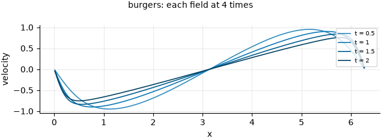

# Viscous Burgers' equation (periodic, one-dimensional)

!!! note "`burgers` is computed, not simulated"
    This configuration is the exact solution of a textbook problem, computed on the fly
    whenever a frame is read. Its purpose is the grid-refinement experiment of numerical
    analysis: a numerical scheme run on a sequence of grids is scored against the exact
    solution, and its error must fall at the scheme's known order. It is registered as
    evidence, as an analytic check (`evidence_datasets` in `configs/cards/default.yaml`), and
    it says nothing about turbulence.

## The problem

Burgers' equation is the simplest equation with both nonlinear steepening and viscous
smoothing. Started from one sine wave on a periodic interval, the wave steepens into a smooth
front of width set by the viscosity, which then decays. With the viscosity used here the front
stays resolved on a 64-cell grid, so every grid of the sequence is in the range where a
second-order scheme shows second-order convergence.

*The velocity at the four evaluated times: the front at $x = 0$ (the same point as $x = 2\pi$)
steepens and the wave decays. Drawn by `python -m fmeval.cards dynamics burgers`; the numbers are
in `docs/datasets/_generated/burgers.json`.*

## Variations of this problem in the repository

| Configuration | What it is | Readable here |
|---|---|---|
| `burgers` | $u(x, 0) = -\sin x$ on the periodic $[0, 2\pi)$, $\nu = 0.1$, on 256 cells, 4 frames from $t = 0.5$ to $t = 2$ | Yes, computed |

**Other cases are reader overrides:**

- `'+dataset.reader.candidate={scheme:central}'`: the numerical solution of a second-order
  centred-difference scheme on the same cells, scored against the exact solution. Its error
  falls as $h^2$, $h$ the cell width.
- `'+dataset.reader.grid=[64],[128],[256],[512]'` with `-m`: the grid sequence of ratio 2, one
  run per grid, each scored on its own cells. The rows carry `param_resolution`.
- `'+dataset.reader.candidate={nu:0.11}'`: the exact solution at a wrong viscosity.

## Equations

The equation on the periodic interval $[0, 2\pi)$, with viscosity $\nu$, is

$$
\partial_t u + u\,\partial_x u = \nu\,\partial_{xx} u, \qquad u(x, 0) = -\sin x. \tag{1}
$$

The Cole–Hopf transformation $u = -2\nu\,\partial_x\psi / \psi$ turns every positive solution
of the heat equation $\partial_t \psi = \nu\,\partial_{xx}\psi$ into a solution of Equation (1)
(Gesztesy and Holden 1998, Lemma 3.1, Eqs. 3.1 and 3.2). The initial condition needs
$\psi(x, 0) = \exp(-\cos x / 2\nu)$. With $a = 1/(2\nu)$ this is $\exp(a \cos(x - \pi))$, which
the expansion $e^{z\cos\theta} = I_0(z) + 2\sum_{n \ge 1} I_n(z)\cos n\theta$ (DLMF 10.35.2)
writes as a Fourier series in the modified Bessel functions $I_n$. The heat equation damps each
mode by $e^{-\nu n^2 t}$, so

$$
u(x, t) = \frac{4\nu \sum_{n \ge 1} n\,(-1)^n I_n(a)\, e^{-\nu n^2 t} \sin nx}
{I_0(a) + 2 \sum_{n \ge 1} (-1)^n I_n(a)\, e^{-\nu n^2 t} \cos nx}. \tag{2}
$$

Equation (2) is the derivation of `dataset_specs/02_grid_refinement_known_solution.md`
(Sect. 4.5), re-derived here; it was checked numerically against the same transformation
written as a heat-kernel integral (largest difference $5 \times 10^{-13}$), and the tests check
that it satisfies Equation (1).

**The candidate scheme.** On cells of width $h$ the scheme replaces the derivatives in
Equation (1) by centred differences,

$$
\frac{du_i}{dt} = -\frac{u_{i+1}^2 - u_{i-1}^2}{4h} + \nu\,\frac{u_{i+1} - 2u_i + u_{i-1}}{h^2}, \tag{3}
$$

and integrates in time to a tolerance whose error is far below the spatial one ($7 \times
10^{-12}$ against $5 \times 10^{-5}$ on 512 cells). Both differences are second order, so the
error against Equation (2) falls as $h^2$. On a sequence of grids refined by $r = 2$ the
observed order between grids $k$ and $k + 1$ is (Roy 2005, Eq. 8)

$$
p = \frac{\ln\left(L_k / L_{k+1}\right)}{\ln r}, \tag{4}
$$

with $L$ the `rmse` or the `max_error` of the candidate, and its known value is 2.

## How it is sampled

- **Domain and grid.** The periodic interval $[0, 2\pi)$ on 256 cells. Every value is the
  solution at a cell centre, and the scheme's cells are the same, so no node offset enters.
- **Viscosity.** $\nu = 0.1$, a Reynolds number of 10 on the domain, the spec's choice: the front
  is resolved on every grid of the sequence. The reader refuses $\nu < 0.05$, where the series
  of Equation (2) cancels and loses its precision.
- **Time window.** Four frames, $t = 0.5$, 1, 1.5 and 2.

## Boundaries

The axis is **periodic**, which is the problem's own boundary condition.

## What the evaluation sees

- **The grid sequence reaches the known order.** Against the exact solution the scheme's
  observed order is 1.93 to 2.02 between 64 and 128 cells, and within 0.006 of 2 between 128,
  256 and 512 cells, for both `rmse` and `max_error` at all four times
  (`tests/test_analytic_datasets.py`). The analysis computes Equation (4) from the rows of the
  four runs, `fmeval.analysis.observed_order(fmeval.io.load_runs(<folders>),
  anchor_label="mean_field")`, with the change of the order between pairs beside it.
- **Twenty metrics run on a one-dimensional velocity.** The pointwise errors, the gradient and
  negative-norm metrics, the spectral, increment and tail metrics, and `kinetic_energy`. The
  metrics of density, vorticity or pressure, the transport and persistence metrics among them,
  and the ensemble metrics produce no rows. The calibration puts almost all the velocity's
  energy in the first mode, so several filter severities collapse onto one another. Costs and
  the calibration are in its log, `docs/datasets/logs/burgers.md`.

## References

- Gesztesy, F. and Holden, H. (1998). The Cole–Hopf and Miura transformations revisited.
  arXiv:solv-int/9812025. Lemma 3.1 and Eqs. 3.1–3.2, read on ar5iv.
- Hopf, E. (1950). The partial differential equation $u_t + u u_x = \mu u_{xx}$.
  *Communications on Pure and Applied Mathematics* 3, 201–230. Cole, J. D. (1951). On a
  quasi-linear parabolic equation occurring in aerodynamics. *Quarterly of Applied
  Mathematics* 9, 225–236. Not opened; cited through Gesztesy and Holden.
- NIST Digital Library of Mathematical Functions, Eq. 10.35.2. <https://dlmf.nist.gov/10.35>.
- Roy, C. J. (2005). Review of code and solution verification procedures for computational
  simulation. *Journal of Computational Physics* 205(1), 131–156.
  <https://doi.org/10.1016/j.jcp.2004.10.036>. Eqs. 5, 7 and 8, as read for
  `dataset_specs/02`.
