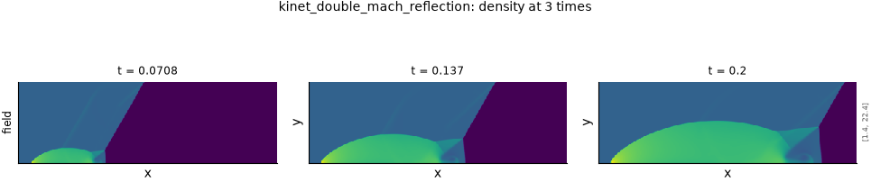
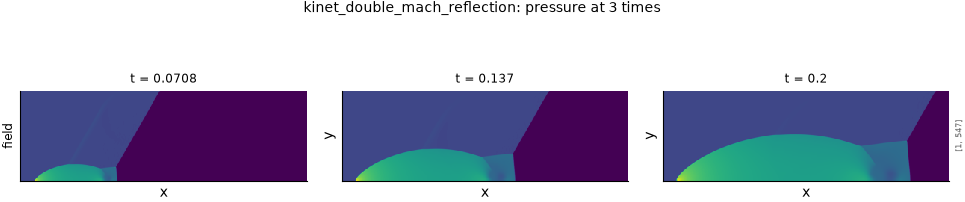

# Double Mach reflection

!!! note "Simulated, with no exact answer"
    `kinet_double_mach_reflection` is one run of kinet's finite-volume solver at a large
    viscosity. It is a two-dimensional pattern of several interacting shocks from that solver,
    useful to the metrics that detect and compare shocks; it is not the inviscid benchmark
    picture, and no closed form exists to score it against. The degradation ladder is applied to
    it as to any simulated reference. It says nothing about turbulence.

## The problem

A strong planar shock, at Mach number 10 in a gas with $\gamma = 1.4$, meets a wall at an angle
of 60 degrees. Too strong and too steep to reflect regularly, it forms a pattern of three shocks
meeting at a point, the triple point: the incident shock, the reflected shock curving back over
the shocked gas, and a short Mach stem standing on the wall, with a second, weaker triple point
and a jet of gas along the wall behind it. Woodward and Colella (1984) introduced the
configuration to compare schemes, and it remains a standard test of a shock-capturing method
(Kemm 2014).

**Set-up** (Woodward & Colella 1984, Sect. IV, not opened here; as printed by Kemm 2014,
arXiv:1404.6510, read for `dataset_specs/03_two_dimensional_shocks.md`, Sect. 4.2). The domain is
$[0, 4] \times [0, 1]$, the wall is the bottom face from $x_0 = 1/6$, and the shock's foot is at
$x_0$ at $t = 0$, so it crosses the row $y$ at

$$
x_s(y, t) = \frac16 + \frac{y + 20t}{\sqrt3}, \tag{1}
$$

a shock moving at speed 10 along its normal (the spec's derivation, which kinet's top boundary
uses, `front0` $= 1/6 + 1/\sqrt3$). Ahead of it the gas is $(\rho, u, v, p) = (1.4, 0, 0, 1)$;
behind it $(8, 7.1447, -4.125, 116.5)$, Kemm's conserved post-shock state
$\rho = 8$, $\rho u = 57.1597$, $\rho v = -33.0012$, $E = 563.544$ in primitive variables (spec 03's
arithmetic). The left face lets in the post-shock gas, the right face is an outflow, the bottom
face holds the post-shock state for $x < 1/6$ and is a reflecting wall beyond, and the top face
holds the exact position of the moving shock, Eq. (1) at $y = 1$, with each state on its side.
Kemm's default grid is $\Delta x = 1/480$, and the standard final time is $t = 0.2$.

## The run

kinet's case `double_mach_reflection/default`, run by its finite-volume PonD solver (16 discrete
velocities, kinet's DUGKS transport with MP5 reconstruction, Courant number 0.2, an adaptive time
step) to $t = 0.2$. Its boundaries are the set-up's: a fixed post-shock state on the left face,
zero gradient on the right, on the bottom the fixed state for $x \le 1/6$ and a reflecting wall
beyond, and on the top the moving shock blended over two cells. The case's viscosity is
$\mu = 0.01$ (Prandtl number 0.71); the inviscid benchmark has none.

**The stored field is a $960 \times 240$ run reduced to $480 \times 120$** (since 2026-11-28). The
run took 5992 steps on cells of $1/240$; kinet's coarse graining reduced it to cells of $1/120$ by a
mean over each block of $2 \times 2$ cells, with no averaging in time, and the frames saved nearest
the three evaluated times were kept ($t = 0.0708$, 0.1367 and 0.2). The block mean is part of the
dataset's definition. An earlier run on $480 \times 120$ cells, the coarser run of the same problem,
is kept beside it. The runs, their commands and checks are archived under
`docs/datasets/logs/kinet_runs/shocks_2d/`.

**What it is, and is not.** At $\mu = 0.01$ this is a viscous flow, and the stored field is an
improvement on the coarser run, not a clean one. At the stored resolution, at the three evaluated
times (the dataset's log, decisions 6 and 7):

- the incident shock trails the exact straight shock of Eq. (1) by 0.75 to 1.16 cells on the rows
  $y = 0.6$ to $0.9$ (1.4 to 2.2 on the coarser run), and its density rises from 10 % to 90 % over
  1.4 to 1.8 cells (1.7 to 2.8);
- two bands of excess density lie in gas the exact solution holds uniform at the post-shock
  state: one left where the initial shock stood, whose top end is the thin feature above the
  reflected shock near $x = 1.3$, $y = 0.5$ to $0.7$ at $t = 0.2$ (3.3 % above the post-shock density
  8, against 5.6 % on the coarser run), and one trailing the incident shock (4.8 %, against 8.5 %);
- the stored field differs from the coarser run by 2.5 to 4.8 % (relative L2 in the window, over
  density, pressure and velocity), so its own error is probably of that size;
- the stored frames stay above the unshocked state (density 1.4, pressure 1); 12 of the run's 2997
  saved frames do not (density down to 1.23), from undershoots at the foot of the incident shock.

So a metric that locates shocks against the exact front reads about one cell of solver error, and
a detector of features or a comparison of the uniform regions may respond to the two bands, which
are the solver's and not the flow's. The foot of the Mach stem moves along the wall at a steady
rate, from $x = 0.169$ at $t = 0$ to 1.079 at $t = 0.071$ and 2.761 at $t = 0.2$, so the pattern grows
about linearly in time.





*Density and pressure at the three evaluated times, on shared colour limits, in the window read.
Drawn by `python -m fmeval.cards dynamics kinet_double_mach_reflection`; the two velocity
components are drawn beside them, and the numbers behind each figure are in the JSON beside it
under `docs/datasets/_generated/`.* The curved reflected shock, the incident shock entering from
the top, the Mach stem at the right end of the pattern and the jet along the wall grow together.

## Variations of this problem in the repository

| Configuration | What it is | Readable here |
|---|---|---|
| `kinet_double_mach_reflection` | The run above, read in the window $x < 3.2$, at $t = 0.071$, 0.137 and 0.2 | Yes, converted (7.4 MB) |

The file is `/global/cfs/cdirs/m4790/Data/kinet/double_mach_reflection/compressible_fluids/Pr-71en2_vuy-1.4_visc-1en2/N240_coarse-480-120.h5`:
the initial condition and steps 2050, 4054 and 5992, density, velocity and the absolute pressure
the solver writes. Beside it, `N120.h5` holds the coarser run at steps 1000, 2000 and 2967
($t = 0.0708$, 0.1368, 0.2); no configuration reads it.

## The window, and what the faces are

The dataset reads cells $x$ 0 to 383 ($x < 3.2$) and every $y$, by the `kinet_raw` option `window`.
Beyond $x = 3.2$ the gas is the undisturbed pre-shock state at every kept frame (to
$2 \times 10^{-16}$), so the 96 columns left out would add only a
constant region to every statistic. The window's mirror extension, $768 \times 240$, divides by
16, so every level of the default ladder's coarsening runs.

No face of the run is a zero-gradient face everywhere, but `neumann`, the mirror extension, is the
declaration that adds the least that is false, face by face:

- *Left*, the fixed post-shock inflow: the first three columns hold that state to
  $3 \times 10^{-14}$ in density and velocity and $4 \times 10^{-13}$ in pressure at every kept
  frame, so the mirror is the flow itself.
- *Right*, the cut at $x = 3.2$: inside the still pre-shock gas, so the mirror is exact.
- *Bottom*: for $x > 1/6$ a reflecting wall, where the mirror is exact for density, pressure and
  the tangential velocity, and extends the normal velocity with the wrong sign (a reflecting
  wall makes it odd). A degradation reads that only within its kernel width of the wall; in the
  row of cells next to the wall the normal velocity is at most 0.64, about a seventh of its largest
  value in the window (4.7). For $x < 1/6$, kinet holds the post-shock state there; the reflected shock meets the
  bottom near $x = 0.15$, so a few cells near that corner are not the uniform state the mirror
  copies.
- *Top*, the imposed moving incident shock: the mirror reflects the straight shock about $y = 1$,
  a kink at the face that a degradation sees within its kernel width.

`periodic` would join the post-shock inflow to the pre-shock gas, and the wall to the imposed top,
with jumps the degradations would smear into false shocks. A new boundary type is not added: the
two departures above are confined to a kernel width of a face, and a reflecting wall's odd
normal velocity is the open question 1 of `dataset_specs/BUILD_ORDER.md`, whose default is
`neumann`. Every metric that needs a periodic domain is not run (12 of the deterministic panel).

## What the evaluation sees

Measured on the coarser run, the stored field until 2026-11-28, and not yet remeasured on the
present one: the shock detector of `shock_set_distance` flags 644, 785 and 941 cells of the
reference at the three times, the incident, reflected and stem shocks together, growing with the
pattern; the default ladder resolves its smoothing widths on characteristic scales of 210 to 240
cells (density 240, velocity 210, pressure 214; `data/calibration.csv` of the run below), and the
mildest level of `highpass_ideal` leaves every field unchanged and is excluded. The metric cards'
runs on this dataset were made on that file too, and describe it until they are rerun.
The window is not square, so the spectral degradations' cutoffs are anisotropic (issue 046).

```bash
python evaluate.py dataset=kinet_double_mach_reflection 'metrics=[rmse,shock_set_distance]' \
    paths.results=<results root>
```

The costs measured on a login node, and what part is evaluated and why, are in the dataset's log.

## References

- Woodward, P. & Colella, P. (1984). The numerical simulation of two-dimensional fluid flow with
  strong shocks. *Journal of Computational Physics* 54(1), 115–173.
  <https://doi.org/10.1016/0021-9991(84)90142-6> (metadata only, as recorded in spec 03; the
  set-up is as Kemm prints it).
- Kemm, F. (2014). On the proper setup of the double Mach reflection as a test case for the
  resolution of gas dynamics codes. arXiv:1404.6510 (read for `dataset_specs/03`, Sect. 4.2).
