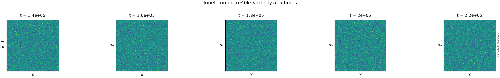

# Forced stationary two-dimensional turbulence

!!! note "Simulated; registered as evidence, not yet cited by any metric's page"
    One kinet run, readable as `kinet_forced_re40k` and registered as evidence
    (`evidence_datasets` in `configs/cards/default.yaml`). No metric has been run on it for its
    page yet. It is the repository's first statistically stationary flow: every other flow
    here decays.

## The problem

A two-dimensional, weakly compressible, isothermal flow on a doubly periodic square of
$1024^2$ cells, driven by a random force confined to a shell of wavenumbers and held in a
statistically steady state by a linear drag. In two dimensions energy injected at a forcing
scale moves to larger scales (the *inverse cascade*) while enstrophy, the mean squared
vorticity, moves to smaller ones (the *direct cascade*); without a drag the energy would pile
up at the box scale and grow without bound (`dataset_specs/04_forced_stationary_turbulence.md`,
Sect. 1, citing Chertkov et al. 2007). The drag removes energy at large scales so that the flow
reaches a steady state with both ranges present. This is the setting in which the metrics of
spectra, spectral fluxes, increments and tails are defined by their own fields (spec 04,
Sect. 1).

It was simulated with the kinet lattice-Boltzmann solver: D2Q9 lattice, plain BGK collision
with the polynomial equilibrium, in lattice units (a cell and a solver step are the units of
length and time), at Mach number 0.1 and Reynolds number 40 000 (kinematic viscosity
$\nu = 1.478 \times 10^{-3}$ cells² per step), from kinet's random-mode initial condition
(`k0: 4`, seed 42). The force is kinet's `random_modes` law: an Ornstein–Uhlenbeck process
(a random signal that forgets its past over a correlation time) for each Fourier mode with
$31 \le |\mathbf n| \le 33$, $\mathbf n$ the integer wavenumber, correlation time 10 steps,
variance $2.55 \times 10^{-11}$, seed 1729, projected onto its divergence-free part. The drag is
kinet's `linear` law with the constant rate $-5 \times 10^{-5}$ per step. The run is 220 000
steps, saved every 500th.

**Two additions to kinet were needed**, a negative rate on the `linear` law (a drag) and the
`minimum_mode` key that turns the ball of forced modes into a shell. They live on the kinet
branch `datasets/forced-drag`, which is not pushed; a run of unmodified kinet cannot reproduce
this dataset. The patches, every configuration and the command are in
`docs/datasets/logs/kinet_runs/forced_turbulence_2d/`.

**The settings differ from the specification's plan** (Re 2700, drag $2.26 \times 10^{-4}$).
At the planned viscosity, a 60 000-step pilot lost 77% of the injected energy to viscosity at
the forcing scale, its spectrum peaked at shell 32, and no inverse range formed. Five more
pilots raised the Reynolds number and lowered the drag (`calibration_summary.txt` in the
folder above; the log, decision 1).

## Governing equations

kinet's weakly compressible physics on D2Q9 recovers the isothermal compressible Navier–Stokes
equations with a body force (kinet's guide, Sect. 1, as recorded in spec 04, Eq. 7):

$$\partial_t\rho + \nabla\cdot(\rho\mathbf u) = 0, \qquad
\partial_t(\rho\mathbf u) + \nabla\cdot(\rho\mathbf u\mathbf u) = -\nabla p + \nabla\cdot\boldsymbol\tau
+ \rho\,\mathbf a(\mathbf x, t) - \alpha\,\rho\,(\mathbf u - \langle\mathbf u\rangle) \tag{1}$$

with $\rho$ the density, $\mathbf u$ the velocity, $p = c_s^2\rho$ the pressure with
$c_s^2 = 1/3$, $\boldsymbol\tau$ the viscous stress of viscosity $\nu$, $\mathbf a$ the
`random_modes` acceleration, $\alpha = 5 \times 10^{-5}$ per step the drag rate and
$\langle\cdot\rangle$ the average over the domain. The drag term is the `linear` law's
`carrier * rate * (u - mean)` with the density as carrier and a negative rate (kinet
`kinet/forcing/laws/linear.py` on the branch). In the incompressible limit Eq. (1) becomes the
vorticity equation of forced two-dimensional turbulence with linear friction (Boffetta and
Musacchio 2010, *Phys. Rev. E* 82, 016307, Eq. 1, as read in spec 04, Sect. 3.1):

$$\partial_t \omega + \mathbf{u}\cdot\nabla\omega = \nu \nabla^2 \omega - \alpha\,\omega + f_\omega \tag{2}$$

with $\omega$ the vorticity and $f_\omega$ the curl of the force. Multiplying the
incompressible momentum equation by $\mathbf u$ and averaging gives the stationary energy
balance (a standard derivation, not taken from a source)

$$\epsilon_I = \epsilon_\alpha + \epsilon_\nu, \qquad \epsilon_\alpha = 2\alpha E, \qquad
\epsilon_\nu = 2\nu Z \tag{3}$$

with $\epsilon_I$ the injection rate, $E = \langle|\mathbf u|^2\rangle/2$ the kinetic energy and
$Z = \langle\omega^2\rangle/2$ the enstrophy. At Mach 0.1 these hold up to compressible
corrections, which nobody has quantified for this run.

## What the dual cascade predicts

For incompressible forced two-dimensional turbulence with a friction, at a forcing wavenumber
$k_f$:

- **Spectra.** $E(k) = C\,\epsilon^{2/3} k^{-5/3}$ for $k \ll k_f$ and
  $E(k) = C'\,\eta^{2/3} k^{-3}[\ln(k/k_f)]^{-1/3}$ for $k \gg k_f$, with $C \approx 6$ and
  $\eta$ the enstrophy flux (Boffetta and Ecke 2012, *Annu. Rev. Fluid Mech.* 44, 427–451,
  Eqs. 12–13; **not opened here**: cited as recorded in `metrics/spectrum_l2/card.md` and spec 04,
  Eq. 2).
- **The friction steepens the direct range.** Boffetta and Musacchio (2010, Table I) report a
  correction $\delta$ to the exponent $-3$ of 1.8, 1.1, 0.75, 0.50 and 0.35 as the resolution
  rises from $2048^2$ to $32768^2$ (as read in spec 04, Sect. 3.1, caveat (i)).
- **Fluxes.** The energy flux is $\Pi_E(k) = -\epsilon_\alpha$ below $k_f$ (inverse) and the
  enstrophy flux $\Pi_Z(k) = \eta_\nu$ above it (direct), $\eta_\nu$ the viscous enstrophy
  dissipation (Boffetta 2007, *J. Fluid Mech.* 589, 253–260, text after Eq. 2, as read in
  spec 04, Sect. 3.1; no equation number).
- **Third-order structure function** of the longitudinal velocity increment $\delta_r u_L$:
  $S_3(r) = \tfrac32\,\epsilon_\alpha r$ for $r \gg \ell_f$ and $S_3(r) = \tfrac18\,\eta_\nu r^3$
  for $r \ll \ell_f$, both positive (Boffetta and Musacchio 2010, Eqs. 4–5, as read in spec 04).
- **Arrest scale** of the inverse cascade, $\ell_\alpha \simeq \epsilon_\alpha^{1/2}\alpha^{-3/2}$
  (Boffetta and Musacchio 2010, text after Table I, as read in spec 04, Eq. 4).

## What this run shows, and what it does not

Measured by the job's check over the saved frames from step 50 000 on, every second one
(`docs/datasets/logs/kinet_runs/forced_turbulence_2d/checks/final_220000.txt`, made by
`check_forced.py` beside it):

| Quantity | Value |
|---|---|
| Spin-up | over by step 50 000; the drag's energy relaxation time $1/(2\alpha)$ is 10 000 steps |
| Kinetic energy after spin-up | mean $1.535 \times 10^{-3}$, standard deviation 1.2% of the mean |
| rms speed, rms Mach number | 0.0554, 0.096 |
| Largest speed, largest local Mach number | 0.216, 0.37 |
| Density range | 0.935 to 1.028 |
| Inverse range | slope $-1.53$ over shells 6 to 28 (prediction $-5/3$) |
| Direct range | slope $-4.48$ over shells 40 to 120 (prediction $-3$, steeper with friction) |
| Spectrum peak | shell 4; shells $\lvert\mathbf n\rvert < 3$ hold 3.3% of the energy, the same in both halves of the window |
| Energy budget, Eq. (3) | drag 74% of the injection, viscosity 26% ($\epsilon_I = 2.08 \times 10^{-7}$ per step) |
| Integral scale, large-eddy time | 141 cells, 2550 steps |
| Correlation time of the velocity field | about 2150 steps |
| Correlation time of the total energy | about 16 000 steps (6 000 in a 150 000-step pilot, so uncertain) |

What it does **not** show:

- The inverse range is under a decade (shells 6 to 28) and its slope, $-1.53$, is shallower
  than $-5/3$. The direct range is short and steep, $-4.48$; it is a friction-steepened range at
  this resolution, not a $k^{-3}$ one.
- The arrest scale above, with the measured rates, is 1108 cells, larger than the box (1024
  cells), so the friction does not arrest the cascade inside the domain; the spectrum peaks at
  shell 4 instead. The lowest shells do not grow, so no condensate (a box-size vortex pair)
  forms over the record.
- It is weakly compressible: local Mach numbers reach 0.37 and the density varies by 6.5%
  below and 2.8% above its mean. How much that moves the incompressible laws above has not been
  quantified. It is not the Mach 0.3 to 0.5 compressible flux loop of
  `proposals/EXP-spectral_energy_flux-forced-2d-compressible-flux-loop.md`, and it has no shocks.
- The stored pressure is the solver's gauge $(\rho - 1)c_s^2$, which carries nothing beyond the
  density, so it is not converted (issue 101); no shock metric runs here.
- The constants $C$ and $S_3$ have not been measured on it. The reference's energy flux on the
  evaluated frames is negative below the forcing shell and of the drag's size, but grows in
  magnitude up to the forcing shell instead of standing on a plateau; that is an observation in
  issue 150, not a check the evaluation runs.

## Configurations

| Configuration | What it is |
|---|---|
| `kinet_forced_re40k` | The run, identity key `7a817df3`, steps 140 000 to 220 000 evaluated on a $256^2$ analysis grid |

The converted file keeps the initial condition and every 8th saved frame, steps 4 000, 8 000,
..., 220 000 (56 frames, 1.88 GB), written by

```bash
python -m fmeval.data.convert_kinet <rollout.h5> \
    <data>/kinet/homogeneous_isotropic_turbulence/weakly_compressible_isoT_fluids/sys_Re-40k_Ma-1en1_forced_drag/7a817df3.h5 --every 8
```

The reader option `cell: 1` reads it in cells and solver steps, so a frame's time is its solver
step. Two disjoint periods are on disk: a **base period**, steps 52 000 to 128 000 (frames 13 to
32), kept for a test that sets a threshold from it (not built: issue 095), and the **evaluation
period**, steps 140 000 to 220 000 (frames 35 to 55), the configuration's time selection. Their
mean energies are $1.525 \times 10^{-3}$ and $1.548 \times 10^{-3}$, 1.5% apart, within the slow
wander of the total energy: each period holds about five independent samples of the total energy
and about 37 of the velocity field. Frames 4 000 steps apart are nearly independent samples of the
velocity field (autocorrelation 0.05 at that lag in the check).

```bash
python evaluate.py 'metrics=[mse]' dataset=kinet_forced_re40k
python evaluate.py 'metrics=[mse]' dataset=kinet_forced_re40k dataset.analysis_resolution=512
```

The second line keeps the direct range nearly whole at about four times the cost; the measured
costs and the reasoning are in the log, `docs/datasets/logs/forced_turbulence_2d.md`.

## The dynamics



*Drawn by `python -m fmeval.cards dynamics kinet_forced_re40k` from five frames spread over the
evaluated period, on the native grid; density and the two velocity components are drawn beside
it, and the numbers behind each are in `docs/datasets/_generated/kinet_forced_re40k_*.json`.*

## References

- Boffetta, G. (2007). Energy and enstrophy fluxes in the double cascade of two-dimensional
  turbulence. *J. Fluid Mech.* 589, 253–260. doi:10.1017/S0022112007008014.
- Boffetta, G. and Ecke, R. E. (2012). Two-dimensional turbulence. *Annu. Rev. Fluid Mech.* 44,
  427–451. doi:10.1146/annurev-fluid-120710-101240. Not opened by this page's author or by
  spec 04's.
- Boffetta, G. and Musacchio, S. (2010). Evidence for the double cascade scenario in
  two-dimensional turbulence. *Phys. Rev. E* 82, 016307. doi:10.1103/PhysRevE.82.016307.
- Chertkov, M., Connaughton, C., Kolokolov, I. and Lebedev, V. (2007). Dynamics of energy
  condensation in two-dimensional turbulence. *Phys. Rev. Lett.* 99, 084501.
  doi:10.1103/PhysRevLett.99.084501.

The first, third and fourth were read in full by the author of spec 04 (via ar5iv); this page
cites them as that specification records them.
