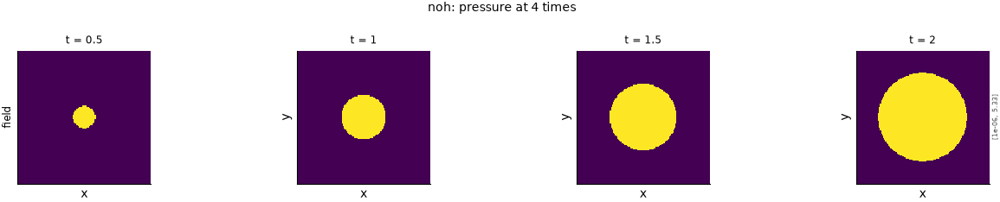

# Noh implosion (cylindrical)

!!! note "`noh` is computed, not simulated"
    This configuration is the exact solution of a textbook problem, computed on the fly
    whenever a frame is read. It tests the metrics that need a shock or pressure against an
    answer known in advance, on a circular front whose jump never changes. It is registered as
    evidence, as an analytic check (`evidence_datasets` in `configs/cards/default.yaml`), and
    it says nothing about turbulence. A metric that needs a
    periodic domain is not run on it.

## The problem

Cold gas (zero pressure) streams radially inward at a uniform speed toward an axis. At the
axis it stagnates, and a circular shock runs outward at constant speed, leaving the gas behind
it at rest, compressed and hot. Noh (1987) posed it to expose the errors that artificial
viscosity makes at strong shocks; it is a standard test because the exact solution is
piecewise constant behind the shock and closed-form ahead of it.

*The pressure at the four evaluated times: the shock moves out at constant speed and the post-shock pressure is the same at every time. Drawn by
`python -m fmeval.cards dynamics noh`, which also draws density and both velocity
components; the numbers behind each are in `docs/datasets/_generated/noh_*.json`.*

## Variations of this problem in the repository

| Configuration | What it is | Readable here |
|---|---|---|
| `noh` | Sutherland's (2010) case: $\gamma = 5/3$, inflow density 1 and speed 1, pressure $10^{-6}$ ahead of the shock, at the centre of $[0, 2)^2$ on $128^2$ cells, 4 frames from $t = 0.5$ to $t = 2$ | Yes, computed |

**Other cases are reader overrides:**

- `'+dataset.reader.candidate={time_offset:0.3}'`: the solution at $t + 0.3$, every point of
  the shock displaced outward by $0.3/3 = 0.1$ at every time, with the jump unchanged.
- `+dataset.reader.gamma=1.4`: the same construction at the detector's $\gamma$, shock speed
  0.2, post-shock density 36 and pressure 7.2.
- `+dataset.reader.t_start=0 +dataset.reader.n_frames=5`: adds the frame at $t = 0$, which
  holds no shock (`dataset_specs/03_two_dimensional_shocks.md`, Sect. 2, need (d)).

## Equations

Sutherland (2010), Sect. 6.1.6, Table 9, prints the exact solution in the plane at
$\gamma = 5/3$, inflow density $\rho_0 = 1$ and speed $u_0 = 1$:

$$
r < t/3:\ \rho = 16,\ u = 0,\ p = 16/3; \qquad
r > t/3:\ \rho = 1 + t/r,\ u_r = -1,\ p = 0. \tag{1}
$$

For any $\gamma$, $\rho_0$ and $u_0$ the reader uses the same construction (this repository's
derivation, which the tests check against the jump conditions and the continuity equation):

1. **Ahead of the shock.** The inflow feels no pressure, so it keeps its speed, and steady
   radial inflow at speed $u_0$ conserves mass only if

   $$
   \rho = \rho_0\left(1 + \frac{u_0 t}{r}\right). \tag{2}
   $$

2. **The shock.** A shock at $r = D t$ that brings the gas to rest balances the fluxes of
   mass, momentum and energy only if

   $$
   D = \frac{\gamma - 1}{2}\,u_0, \qquad
   \rho_2 = \rho_0\left(\frac{\gamma + 1}{\gamma - 1}\right)^2, \qquad
   p_2 = \rho_2 D u_0. \tag{3}
   $$

   At $\gamma = 5/3$, $\rho_0 = u_0 = 1$ these are $1/3$, $16$ and $16/3$, Equation (1).

The post-shock state is the same at every time, so the pressure jump the detector reads never
changes while the front grows.

## How it is sampled

- **Domain and grid.** The square $[0, 2)^2$ with the axis at its centre, on $128^2$ cells:
  the full plane of Sutherland's quarter domain $(0, 1)^2$, which he closes with reflecting
  walls on the axes. Every value is the solution at a cell centre.
- **Pressure ahead of the shock.** The exact solution has zero pressure there. Sutherland's
  Table 10 sets $10^{-6}$ "as an approximation to zero pressure", and the detector needs a
  positive pressure (`dataset_specs/03_two_dimensional_shocks.md`, Sect. 2), so the reader
  stores $10^{-6}$ ahead of the shock. No pressure is derived from the density.
- **Time window.** Four frames from $t = 0.5$ to $2$, Sutherland's end time: the shock grows
  from 11 to 43 cells in radius. The reader refuses a window in which it reaches the edge.

## Boundaries

Both axes are **Neumann** (zero-gradient). The exact solution at the edge of the domain is the
inflow itself, which a solver would impose as a time-dependent boundary condition (Sutherland's
Table 10, "special" boundaries); the reader needs no boundary to evaluate it, and the
degradations act on the field extended by its mirror image, as on
[the Sod shock tube](sod_shock_tube.md#boundaries).

## What the evaluation sees

- **The shock set is a closed ring.** The detector flags 124 cells at $t = 0.5$ and 484 at
  $t = 2$, every one within one cell of the front. Its threshold is fixed at $\gamma = 1.4$
  (a Mach-1.3 ratio of 1.805), not this gas's $5/3$, so on this field it corresponds to
  another Mach number; it fires all the same, since $p_2/p_0 = 5.3 \times 10^6$.
- **A displaced front is read at cell resolution.** Against the candidate at a later time the
  average surface distance is the radius change less about half a cell, and the Hausdorff
  distance the change plus up to half a cell, at every time (`tests/test_analytic_datasets.py`).
- **Costs and calibration** are in its log, `docs/datasets/logs/noh.md`.

## References

- Noh, W. F. (1987). Errors for calculations of strong shocks using an artificial viscosity and
  an artificial heat flux. *Journal of Computational Physics* 72(1), 78–120.
  <https://doi.org/10.1016/0021-9991(87)90074-X>. Not opened.
- Sutherland, R. S. (2010). A new computational fluid dynamics code I: Fyris Alpha.
  *Astrophysics and Space Science* 327, 173–206. arXiv:1003.0724, read on ar5iv: Sect. 6.1.6,
  Tables 9 and 10.
- Liska, R. and Wendroff, B. (2003). Comparison of several difference schemes on 1D and 2D test
  problems for the Euler equations. *SIAM Journal on Scientific Computing* 25(3), 995–1017.
  <https://doi.org/10.1137/S1064827502402120>. Sect. 4.5, as `dataset_specs/03` reads it.
