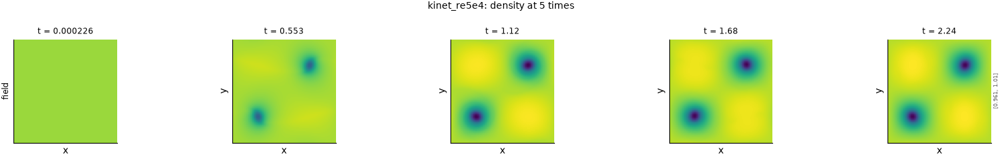
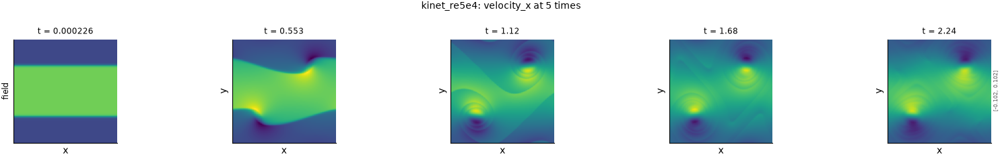
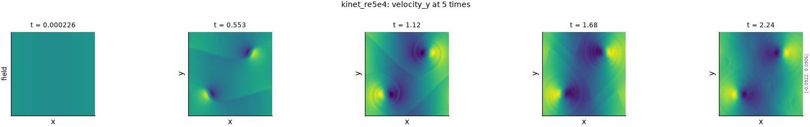
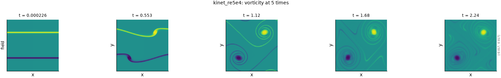
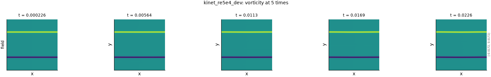

# Doubly periodic weakly compressible flow

!!! note "Simulated: the evidence on the metric pages"
    This is the simulation every measured number on a metric's page comes from, through the
    `kinet_re5e4` configuration below.

## The problem

A two-dimensional, weakly compressible, isothermal flow on a doubly periodic square. It was
simulated with the kinet lattice-Boltzmann solver: D2Q9 lattice, entropic BGK collision, on
$256^2$ cells, in dimensionless units. The Reynolds number is $5 \times 10^4$ and the Mach
number 0.1.

The flow starts as two thin, opposite shear layers, visible as the two lines of vorticity in
the first frame. They roll up into a pair of counter-rotating vortices, wrapped in thin
filaments of vorticity that keep winding around them. The density varies by a few percent
and is lowest in the vortex cores. The pressure is not used, because for this isothermal
solver it is exactly the density divided by 3 and so carries no further information.

The figures show each field at five times spread over the whole trajectory, on colour limits
shared across the row. They were drawn by `python -m fmeval.cards dynamics kinet_re5e4`, and
the numbers behind each are in the JSON beside it under `docs/datasets/_generated/`.

## Variations of this problem in the repository

| Configuration | What it is |
|---|---|
| `kinet_re5e4` | The production trajectory: 10001 frames, 167 GiB. Evaluated by default on every 50th frame. A run that a metric's page cites starts at frame 2000, where the flow is developed |
| `kinet_re5e4_dev` | The first 101 frames of the same run, 1.7 GB, for checking that code runs. **Not physically representative**: the shear layers have not yet rolled up (figure below) |
| `well_re5e4` | The same simulation in the PolymathicAI Well format, in float32 and without the distribution functions. A data-marked test reads it beside `kinet_re5e4` and requires identical values, so it is not drawn separately |
| Reynolds ladder (`configs/dataset_family/reynolds_ladder_2d.yaml`) | Five runs at $\mathrm{Re} = 5 \times 10^4$ to $10^5$ with the same Mach number and initial condition, on disk but without dataset configs yet ([issue 011](https://github.com/khegazy/pde_metrics/blob/main/issues/011-cross-dataset-comparison.md)). When they are added they belong on this page |

*The development dataset covers only the first 100 solver steps: the shear layers are still
straight.* The other fields of `kinet_re5e4_dev` are drawn beside these figures under
`docs/datasets/_generated/`.

## What the evaluation sees

These limits come from the data itself, recorded in `CLAUDE.md` from earlier runs.

- **Density concentrates its energy in a few modes.** Its fluctuation keeps 69% of its energy
  in the four diagonal modes at $|k| = \sqrt{2}$, and only $3 \times 10^{-5}$ in the axis
  modes at $|k| = 1$. A sharp spectral filter therefore has few distinct cutoffs available,
  and cannot produce four distinct severity levels on density.
- **The high-pass axis is squeezed** between doing nothing below those diagonal modes and
  near-total damage above them.
- **The flow decays.** The variance falls over the trajectory, which is why the damage scale
  is anchored on a translated copy of the same frame and never on a distant frame.

Every axis is periodic, so every metric and degradation runs on this dataset without boundary
handling.
