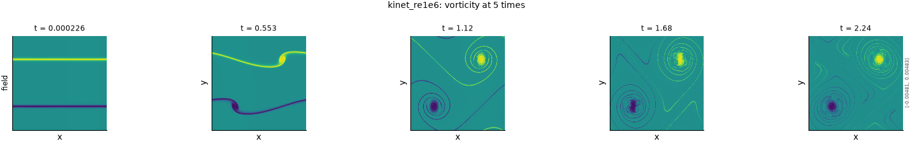

# Doubly periodic weakly compressible flow

!!! note "Simulated: the evidence on the metric pages"
    This is the simulation every measured number on a metric's page comes from, through the
    `kinet_re5e4` configuration below.

## The problem

A two-dimensional, weakly compressible, isothermal flow on a doubly periodic square. It was
simulated with the kinet lattice-Boltzmann solver: D2Q9 lattice, entropic BGK collision, on
$256^2$ cells, in dimensionless units. The Reynolds number is $5 \times 10^4$ and the Mach
number 0.1.

The flow starts as two thin, opposite shear layers, visible as the two lines of vorticity in
the first frame. They roll up into a pair of counter-rotating vortices, wrapped in thin
filaments of vorticity that keep winding around them. The density varies by a few percent
and is lowest in the vortex cores. The pressure is not used, because for this isothermal
solver it is exactly the density divided by 3 and so carries no further information.

The figures show each field at five times spread over the whole trajectory, on colour limits
shared across the row. They were drawn by `python -m fmeval.cards dynamics kinet_re5e4`, and
the numbers behind each are in the JSON beside it under `docs/datasets/_generated/`.


## Variations of this problem in the repository

| Configuration | What it is |
|---|---|
| `kinet_re5e4` | The production trajectory: 10001 frames, 167 GiB. Evaluated by default on every 50th frame. A run that a metric's page cites starts at frame 2000, where the flow is developed |
| `kinet_re5e4_dev` | The first 101 frames of the same run, 1.7 GB, for checking that code runs. **Not physically representative**: the shear layers have not yet rolled up (figure below) |
| `well_re5e4` | The same simulation in the PolymathicAI Well format, in float32 and without the distribution functions. A data-marked test reads it beside `kinet_re5e4` and requires identical values, so it is not drawn separately |
| `kinet_re1e6` | The same flow at $\mathrm{Re} = 10^6$, on $1024^2$ cells: 40001 frames, 11.4 TB. Read every fourth stored frame, so its frame $i$ is the same physical time as frame $i$ of `kinet_re5e4` (below) |



*The $\mathrm{Re} = 10^6$ run at the same five times as `kinet_re5e4` above. The other fields
of `kinet_re1e6` are drawn beside these figures under `docs/datasets/_generated/`.*


*The development dataset covers only the first 100 solver steps: the shear layers are still
straight.* The other fields of `kinet_re5e4_dev` are drawn beside these figures under
`docs/datasets/_generated/`.

## The Reynolds ladder

`kinet_re5e4` and `kinet_re1e6` differ only in Reynolds number and grid: the same two shear
layers ($\lambda = 80$, $\epsilon = 0.05$, density 1), the same Mach number and the same
dimensionless end time, 2.2553. They are run together, as one sweep, with

```bash
python evaluate.py -m dataset_family=reynolds_ladder_2d 'metrics=[mse]' dataset.time.start=2000
```

which remaps both onto one $128^2$ analysis grid, evaluates the same 161 physical times on each
(frames 2000 to 10000, every 50th, on `kinet_re5e4`'s clock), and gathers them into one
`reynolds_ladder_2d_<time>` folder. Its report draws section 12, which sets each member's rank
correlation, Gaussian-impostor damage and sensitivity level against its rank; raw values are not
compared across members. Four more members planned at $\mathrm{Re} = 6.25 \times 10^4$ to
$10^5$ exist on disk but cannot be read ([issue 011](https://github.com/khegazy/pde_metrics/blob/main/issues/011-cross-dataset-comparison.md));
`judgements/007` records why the ladder runs on these two meanwhile.

At the $128^2$ grid (run `reynolds_ladder_2d_1793783563`) the characteristic scale is 69 and 68
cells for density, 95 and 92 for velocity, and 18 and 11 for vorticity, at
$\mathrm{Re} = 5 \times 10^4$ and $10^6$. On vorticity the mildest strength of the box and median
kernels therefore rounds to no smoothing and is excluded on both members, as are those of the
disk and Epanechnikov kernels at $\mathrm{Re} = 10^6$, where the box and median kernels' third
strength also repeats their second. That is a property of a field with an 11-to-18-cell scale on
a 128-cell grid. It leaves the median blur on vorticity at $\mathrm{Re} = 10^6$ with one usable
level of three, so no rank correlation there; every other axis keeps at least two on every field
of both members (issue 011 says what would change it).

## What the evaluation sees

These limits come from the data itself, recorded in `CLAUDE.md` from earlier runs.

- **Density concentrates its energy in a few modes.** Its fluctuation keeps 69% of its energy
  in the four diagonal modes at $|k| = \sqrt{2}$, and only $3 \times 10^{-5}$ in the axis
  modes at $|k| = 1$. A sharp spectral filter therefore has few distinct cutoffs available,
  and cannot produce four distinct severity levels on density.
- **The high-pass axis is squeezed** between doing nothing below those diagonal modes and
  near-total damage above them.
- **The flow decays.** The variance falls over the trajectory, which is why the damage scale
  is anchored on the same frame's own spatial mean (`judgements/001`) and never on a distant
  frame.

Every axis is periodic, so every metric and degradation runs on this dataset without boundary
handling.
