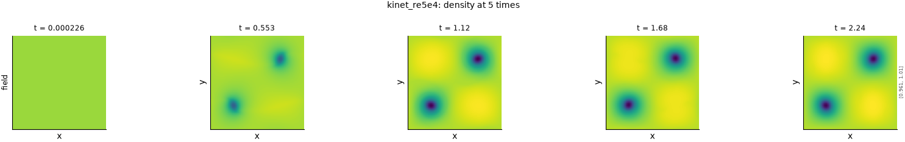
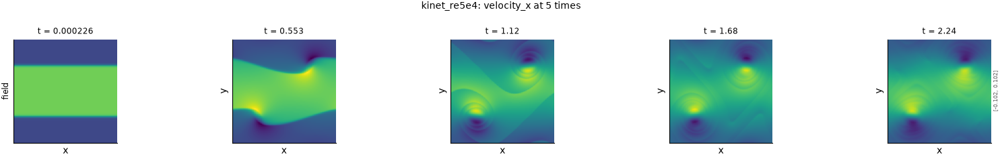
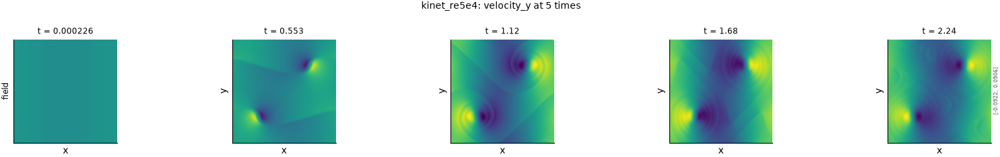
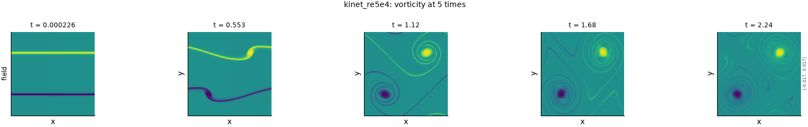
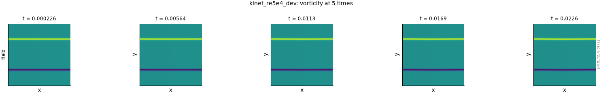

# Doubly periodic weakly compressible flow

!!! note "Simulated: the evidence on the metric pages"
    This is the simulation every measured number on a metric's page comes from, through the
    `kinet_re5e4` configuration below.

## The problem

A two-dimensional, weakly compressible, isothermal flow on a doubly periodic square. It was
simulated with the kinet lattice-Boltzmann solver: D2Q9 lattice, entropic BGK collision, on
$256^2$ cells, in dimensionless units. The Reynolds number is $5 \times 10^4$ and the Mach
number 0.1.

The flow starts as two thin, opposite shear layers, visible as the two lines of vorticity in
the first frame. They roll up into a pair of counter-rotating vortices, wrapped in thin
filaments of vorticity that keep winding around them. The density varies by a few percent
and is lowest in the vortex cores. The pressure is not used, because for this isothermal
solver it is exactly the density divided by 3 and so carries no further information.

The figures show each field at five times spread over the whole trajectory, on colour limits
shared across the row. They were drawn by `python -m fmeval.cards dynamics kinet_re5e4`, and
the numbers behind each are in the JSON beside it under `docs/datasets/_generated/`.









## Variations of this problem in the repository

| Configuration | What it is |
|---|---|
| `kinet_re5e4` | The production trajectory: 10001 frames, 167 GiB. Evaluated by default on every 50th frame. A run that a metric's page cites starts at frame 2000, where the flow is developed |
| `kinet_re5e4_dev` | The first 101 frames of the same run, 1.7 GB, for checking that code runs. **Not physically representative**: the shear layers have not yet rolled up (figure below) |
| `well_re5e4` | The same simulation in the PolymathicAI Well format, in float32 and without the distribution functions. A data-marked test reads it beside `kinet_re5e4` and requires identical values, so it is not drawn separately |
| `forecast_re5e4` | Real predictions of this flow paired with their targets, at ten prediction steps from two starting times, in three runs at $256^2$, $128^2$ and $64^2$. Who produced the predictions is not recorded. Described under [Forecast pairs](#forecast-pairs) below |
| Reynolds ladder (`configs/dataset_family/reynolds_ladder_2d.yaml`) | Five runs at $\mathrm{Re} = 5 \times 10^4$ to $10^5$ with the same Mach number and initial condition, on disk but without dataset configs yet ([issue 011](https://github.com/khegazy/pde_metrics/blob/main/issues/011-cross-dataset-comparison.md)). When they are added they belong on this page |



*The development dataset covers only the first 100 solver steps: the shear layers are still
straight.* The other fields of `kinet_re5e4_dev` are drawn beside these figures under
`docs/datasets/_generated/`.

## What the evaluation sees

These limits come from the data itself, recorded in `CLAUDE.md` from earlier runs.

- **Density concentrates its energy in a few modes.** Its fluctuation keeps 69% of its energy
  in the four diagonal modes at $|k| = \sqrt{2}$, and only $3 \times 10^{-5}$ in the axis
  modes at $|k| = 1$. A sharp spectral filter therefore has few distinct cutoffs available,
  and cannot produce four distinct severity levels on density.
- **The high-pass axis is squeezed** between doing nothing below those diagonal modes and
  near-total damage above them.
- **The flow decays.** The variance falls over the trajectory, which is why the damage scale
  is anchored on the same frame's own spatial mean (`judgements/001`) and never on a distant
  frame.

Every axis is periodic, so every metric and degradation runs on this dataset without boundary
handling.

## Forecast pairs

`forecast_re5e4` holds real predictions of this flow, each paired with the target it should
have reproduced. It is the only dataset here on which a metric scores a real prediction rather
than a damaged copy of the reference.

**What is on disk.** Three runs under `results/entropic_D2Q9/`, each with two files
`forecast_t0-<start>.h5`, one per starting solver step. Every file holds the density, the
velocity and the vorticity of the prediction and of the target at ten prediction steps, with the
physical time and the absolute solver step of each.

| Run | Grid | Prediction steps (solver steps since the start) | Starts |
|---|---|---|---|
| `F-906861_64` | $256^2$ | 500 to 5000, every 500 | 0 and 5000 |
| `F-906861_64_Re_50k_from_256_to128` | $128^2$ | 250 to 2500, every 250 | 0 and 2500 |
| `F-906861_64_Re_50k_from_256_to_64` | $64^2$ | 125 to 1250, every 125 | 0 and 1250 |

A coarser run takes half as many steps of twice the length, so the same ten physical lead times,
0.1128 to 1.1276, appear in all three, and the two starts are at physical time 0 and 1.1276,
to within the clock offsets below.

**Who produced the predictions is not recorded.** The files carry no attributes, and the run
names do not say whether a trained model or a solver on the coarser grid made them. Every page
that cites a run on this dataset says so.

**What the targets are.** Measured from the files on 2026-11-04:

- The targets of the $256^2$ run are frames of `kinet_re5e4`, at the same solver step: the
  largest difference over all 20 is $1.9 \times 10^{-9}$ in density and $1.4 \times 10^{-8}$ in
  velocity.
- The targets of the coarser runs are close to, but not exactly, the block average of the
  $256^2$ targets. At the first prediction step the largest density difference is
  $5.7 \times 10^{-6}$ at $128^2$ and $1.7 \times 10^{-5}$ at $64^2$, against a density
  standard deviation of $6.4 \times 10^{-4}$.
- The two clocks of a pair disagree on the coarser runs' first forecast. Both sides name the
  same solver step, but the target's time lags the prediction's by $1.13 \times 10^{-4}$ at
  $128^2$ and $3.38 \times 10^{-4}$ at $64^2$: half a $256^2$ step and one and a half. Their
  second forecasts agree with their targets, but start that much earlier than the $256^2$ run's.
  The reader puts both sides on the prediction's clock and records the largest disagreement.
- The stored vorticity of the two sides of a coarse run is computed on different grid spacings.
  At the first prediction step of the $128^2$ run, the target's matches a spectral curl of its
  velocity at the physical spacing (2, for a domain 256 wide) to 2.1% rms, and the prediction's
  matches one at spacing 1 to 5.3%, so the stored prediction vorticity is about 1.9 times the
  target's for the same velocity. The evaluation never reads it: vorticity is recomputed from
  velocity on the analysis grid, as on every dataset, and the reader refuses a run that asks for
  vorticity without velocity, since only then would the stored field be used (issue 099).

**How it is evaluated.** The prediction takes the place of the degradation ladder. Each frame
is one prediction step of one forecast; the prediction is scored against its target under the
row label `forecast`, and the only ladder entry run is the anchor, the target's spatial mean, so
the damage reads as the forecast's error over the error of that mean. Ensemble metrics are not
run, since each frame holds one prediction. Each result row records the forecast file it came
from (`trajectory`), its run's grid (`param_resolution`), and its prediction step (`lead_step`,
and `lead_time` in physical time). The ordering statistics of the ladder are not computed on a
forecast, because its prediction step is not a strength chosen in advance; the error against
lead time is drawn instead. Machine-learning benchmarks score a rollout step by step:
PDEBench computes its errors at every time step (Takamoto et al. 2022, *NeurIPS Datasets and
Benchmarks*, Sect. 3.3, and its code, as read in `metrics/max_error/research_notes.md`).

```bash
python evaluate.py metrics=[mse,nrmse,enstrophy] dataset=forecast_re5e4 analysis_grid.resolution=64
python evaluate.py metrics=[mse] dataset=forecast_re5e4 \
    'dataset.reader.files=[F-906861_64/forecast_t0-0,F-906861_64/forecast_t0-5000]'
```

The first compares the three runs on one $64^2$ grid, block-averaging the finer ones; a run
that pools frames from different grids without a common analysis grid stops and says so. The
second scores one run at its own resolution.

No dynamics figure is drawn for this configuration: `python -m fmeval.cards dynamics` draws one
grid per figure, and these runs are on three. The $256^2$ targets are the frames of
`kinet_re5e4` drawn at the top of this page.

### Can the three runs be read as a grid-refinement sequence?

Not as they stand, for three reasons. This is the agent's reading of the measurements below,
not a published analysis of these files.

The standard procedure takes the discretisation error $E_h$ of one quantity on grids of
spacing $h$ and $rh$ and reads the observed order of accuracy from their ratio,

$$
\hat{p} = \frac{\ln \left( \lVert E_{rh} \rVert / \lVert E_{h} \rVert \right)}{\ln r}, \tag{1}
$$

where the error is measured against the exact solution (Roy 2005, *Journal of Computational
Physics* 205(1), 131–156, <https://doi.org/10.1016/j.jcp.2004.10.036>, Sect. 2.5, Eq. 8, as
read in `metrics/max_error/research_notes.md`). The runs have the right shape for it: one flow,
a refinement ratio $r = 2$, and a common $64^2$ grid on which to compare them.

1. **The finest run is not a third grid.** Its target is the $256^2$ reference itself, and its
   prediction matches it to $4 \times 10^{-8}$ rms in density at the first step, so its error is
   not a discretisation error. Equation (1) on the $128^2$ and $256^2$ runs gives
   $\hat{p} = 7$ to $8$ at the first step on every field, which is not an order of accuracy.
2. **Only a discretisation has an order.** Equation (1) assumes the predictions come from a
   numerical method converging with $h$. That is unknown here, and a trained model evaluated at
   three resolutions is not refining anything (`docs/ideas/infrastructure/grid_convergence.md`,
   Pitfalls).
3. **The asymptotic range does not last.** On the two coarse runs, each scored against its own
   target, $\hat{p}$ is 1.3 to 2.0 at the first prediction step and falls along the forecast,
   to 0.1 to 1.2 at the last, as the errors saturate. The flow is chaotic, so the instantaneous
   fields decorrelate. (On the $64^2$ grid the coarse targets lie within $8 \times 10^{-6}$ rms
   of the $256^2$ reference in density, measured at the first, fifth and last steps: a third of
   the smallest error and far below the rest, so scoring against the reference changes little.)

What remains legitimate is the pair of coarse runs scored against the $256^2$ reference at short
lead, if their predictions are found to come from a solver. [Issue 126](https://github.com/khegazy/pde_metrics/blob/main/issues/126-forecast-runs-as-a-refinement-sequence.md)
records the numbers and what would settle it; the order is not computed here.
