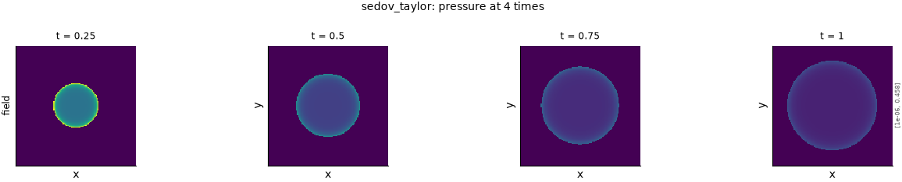

# Sedov–Taylor blast wave (cylindrical)

!!! note "`sedov_taylor` is computed, not simulated"
    This configuration is the exact similarity solution of a textbook problem, computed on the
    fly whenever a frame is read. It tests the metrics that need a shock or pressure against
    an answer known in advance, on a front that is curved and so oblique to the grid at every
    angle. It is registered as evidence, as an analytic check (`evidence_datasets` in
    `configs/cards/default.yaml`), and it says nothing about turbulence. A metric
    that needs a periodic domain is not run on it.

## The problem

A large energy $E$ per unit length is released instantly along a line in a gas of uniform
density $\rho_0$ at rest with negligible pressure. A circular shock runs outward and slows
down as it sweeps up gas. Because no length or time scale enters except through $E$ and
$\rho_0$, the flow is self-similar: every profile is a fixed shape stretched to the current
shock radius (Taylor 1950; Sedov 1959). This is the two-dimensional (cylindrical) form of the
blast wave Taylor used for the first atomic explosion, and it is a standard verification
problem for compressible codes (Kamm and Timmes 2007).

*The pressure at the four evaluated times: the front grows as $t^{1/2}$ and its jump falls as $1/t$; behind it the pressure falls smoothly to a finite value on the axis. Drawn by
`python -m fmeval.cards dynamics sedov_taylor`, which also draws density and both velocity
components; the numbers behind each are in `docs/datasets/_generated/sedov_taylor_*.json`.*

## Variations of this problem in the repository

| Configuration | What it is | Readable here |
|---|---|---|
| `sedov_taylor` | Kamm and Timmes's standard cylindrical case: $\gamma = 1.4$, $\rho_0 = 1$, $E = 0.311357$, ambient pressure $10^{-6}$, at the centre of $[0, 2)^2$ on $128^2$ cells, 4 frames from $t = 0.25$ to $t = 1$ | Yes, computed |

**Candidates with a known answer** are reader overrides; both sides are exact:

- `'+dataset.reader.candidate={time_offset:0.2}'`: the solution at $t + 0.2$. Every point of
  the front moves out by $r_2(t + 0.2) - r_2(t)$, and every jump keeps its exact size.
- `'+dataset.reader.candidate={energy:0.6}'`: a blast of the wrong energy, a pure size
  error: the front is $(0.6/0.311357)^{1/4} = 1.178$ times the reference's radius at every time.

## Equations

### Governing equations

The Euler equations of an ideal gas in cylindrical symmetry, for density $\rho$, radial
velocity $u$ and pressure $p$ (Kamm and Timmes 2007, Eqs. 1–3 with geometry index $j = 2$):

$$
\rho_t + (\rho u)_r + \frac{\rho u}{r} = 0, \qquad
u_t + u u_r + \frac{p_r}{\rho} = 0, \qquad
\left(\partial_t + u\,\partial_r\right) \ln\frac{p}{\rho^{\gamma}} = 0. \tag{1}
$$

### The front and the jump

The shock radius and speed are (Kamm and Timmes 2007, Eqs. 12–13 at $j = 2$)

$$
r_2(t) = \left(\frac{E\,t^2}{\alpha\,\rho_0}\right)^{1/4}, \qquad u_s = \frac{r_2}{2t}, \tag{2}
$$

and immediately behind it the strong-shock state (their Eqs. 14–16)

$$
\rho_2 = \rho_0\,\frac{\gamma + 1}{\gamma - 1}, \qquad
u_2 = \frac{2 u_s}{\gamma + 1}, \qquad
p_2 = \frac{2 \rho_0 u_s^2}{\gamma + 1}. \tag{3}
$$

### The profile behind the front

With $\lambda = r/r_2$, the similarity variable $V$ runs from $V_0 = 1/(2\gamma)$ on the axis to
$V_2 = 1/(\gamma + 1)$ at the shock. Writing $s = 2\gamma V - 1$ and

$$
x_1 = (\gamma + 1) V, \quad x_2 = \frac{\gamma + 1}{\gamma - 1}\, s, \quad
x_3 = (\gamma + 1)(1 - \gamma V), \quad x_4 = \frac{\gamma + 1}{\gamma - 1}(1 - 2V), \tag{4}
$$

the solution is, in parametric form,

$$
\lambda = x_1^{-1/2}\, x_2^{(\gamma - 1)/(2\gamma)}\, x_3^{-1/2}, \qquad
\frac{u}{u_2} = x_1 \lambda, \qquad
\frac{\rho}{\rho_2} = x_2^{1/\gamma} \left(\frac{x_3}{x_4}\right)^{2/(2 - \gamma)}, \qquad
\frac{p}{p_2} = x_1 \left(\frac{x_3}{x_4}\right)^{\gamma/(2 - \gamma)}. \tag{5}
$$

These are Kamm and Timmes's general expressions (their Eqs. 29–47, numbered as in Timmes's
public implementation `sedov_library_qp.f90`, which was read; the report's PDF could not be
rendered here) specialised to $j = 2$ and a uniform ambient density. The specialisation is
this repository's algebra, checked numerically against the general expressions to
$2 \times 10^{-15}$. The reader inverts $\lambda(s)$ by bisection in $\log s$, which resolves
the axis, where $\lambda \propto s^{(\gamma - 1)/(2\gamma)}$.

### The energy constant

$\alpha$ makes the energy behind the front equal $E$. Equating $E$ with
$\int_0^{r_2} \left(\tfrac12 \rho u^2 + p/(\gamma - 1)\right) 2\pi r\,dr$ and using Equations (2)
and (3) gives

$$
\alpha = \frac{\pi}{\gamma^2 - 1} \int_0^1 \left(\frac{\rho}{\rho_2}\frac{u^2}{u_2^2}
+ \frac{p}{p_2}\right) \lambda\, d\lambda, \tag{6}
$$

which is the code's $(j - 1)\pi\,(J_1 + 2J_2/(\gamma - 1))$ (their Eq. 57). The reader integrates
it by 128-point Gauss–Legendre quadrature. The same integral at $j = 3$ reproduces Kamm and
Timmes's spherical value 0.851072 to seven digits.

### Values

| quantity | value | where from |
|---|---|---|
| $\alpha$ at $\gamma = 1.4$ | 0.9840740 | Equation (6), computed here |
| $\alpha$ implied by Kamm and Timmes's printed $E = 0.311357$ and $r_2(1) = 0.75$ | 0.98404 | their Sect. 4.1, as `dataset_specs/03_two_dimensional_shocks.md`, Sect. 3.1 reads it |
| $r_2(1)$ with $E = 0.311357$ | 0.749994 | Equation (2) |
| $\rho_2 / \rho_0$ | 6 | Equation (3) |
| $p$ on the axis over $p_2$ | 0.3729 | Equation (5) at $V = V_0$ |

The two values of $\alpha$ differ by $3.3 \times 10^{-5}$, so the front sits 6 millionths short
of 0.75 at $t = 1$. The spherical check above says the integral is right; the printed cylindrical
energy carries the difference.

## How it is sampled

- **Domain and grid.** The square $[0, 2)^2$ with the blast at its centre, on $128^2$ cells;
  every value is the solution at a cell centre.
- **Ambient pressure.** The similarity solution assumes zero pressure ahead of the front. The
  shock detector needs a positive one (`dataset_specs/03_two_dimensional_shocks.md`, Sect. 2),
  so the gas ahead of the front holds $p_0 = 10^{-6}$ and the profile behind it is the
  zero-pressure one. The mismatch is of order $p_0/p_2$, $10^{-5}$ at the last frame.
- **Time window.** Four frames from $t = 0.25$ to $1$: the front grows from 24 to 48 cells in
  radius. The reader refuses a window in which the front reaches the edge of the domain.
- **No pressure is derived.** The pressure is the closed form's own, Equation (5).

## Boundaries

Both axes are **Neumann** (zero-gradient). Within the window the front never reaches the
edge, so the gas at the boundary is uniform and at rest and the boundary type does not change
the solution. The degradations act on the field extended by its mirror image, as on
[the Sod shock tube](sod_shock_tube.md#boundaries).

## What the evaluation sees

- **The shock set is a closed ring.** The detector flags 268 cells at $t = 0.25$ and 540 at
  $t = 1$, every one within one cell of the front, at every angle to the grid. The post-shock
  pressure exceeds the ambient one by a factor above $10^5$, so the detector's threshold (a Mach-1.3 ratio of 1.805 at
  $\gamma = 1.4$) is far exceeded; the smooth profile behind it flags nothing.
- **A displaced front is read at cell resolution.** Against the candidate at a later time or with
  a larger energy, the average surface distance is the radius change less about half a cell, and
  the Hausdorff distance the change plus about half a cell (`tests/test_analytic_datasets.py`),
  as a straight front's $(s - \tfrac12)\Delta x$ and $s\Delta x$ are.
- **Costs and calibration** are in its log, `docs/datasets/logs/sedov_taylor.md`.

## References

- Kamm, J. R. and Timmes, F. X. (2007). On efficient generation of numerically robust Sedov
  solutions. Los Alamos report LA-UR-07-2849. <https://cococubed.com/papers/la-ur-07-2849.pdf>;
  code at <https://cococubed.com/research_pages/sedov.shtml>.
- Sedov, L. I. (1959). *Similarity and Dimensional Methods in Mechanics*. Academic Press. Not
  opened; reproduced by Kamm and Timmes.
- Taylor, G. I. (1950). The formation of a blast wave by a very intense explosion. I.
  Theoretical discussion. *Proceedings of the Royal Society A* 201(1065), 159–174.
  <https://doi.org/10.1098/rspa.1950.0049>. Not opened here; read by the author of
  `dataset_specs/03_two_dimensional_shocks.md` (summary and Eq. 38).
