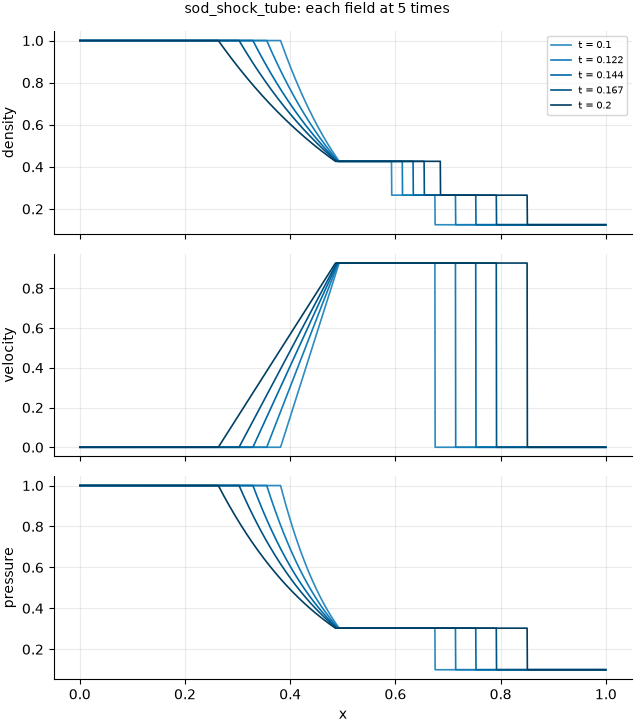

# Sod shock tube

!!! note "Computed, not simulated: an analytic check"
    This dataset is the exact solution of a textbook problem, computed on the fly whenever a
    frame is read. It tests the evaluation harness, and the metrics that need a shock or
    pressure, against an answer known in advance. A metric's page may cite it as an
    **analytic check**: its evidence says the metric locates and scores a known shock
    correctly, and nothing about turbulence. Every page citing it says so in its run summary.
    A metric that needs a periodic domain is not run on it.

## The problem

A tube of gas at rest is divided by a diaphragm at $x = 0.5$. The left half holds gas at high
pressure and density; the right half holds gas at low pressure and density. At $t = 0$ the
diaphragm is removed. Three waves leave the diaphragm: a **rarefaction** (a smooth expansion)
moving left, a **contact discontinuity** (a jump in density only, carried with the flow)
moving right, and a **shock** (a jump in density, velocity and pressure) moving right
faster. The problem was posed by Sod (1978) to compare numerical methods. It is the standard
first test for any method that has to capture a shock, because every one of its features has
a closed form.



*Each field at five times across the evaluated window, from the configuration below. Drawn by
`python -m fmeval.cards dynamics sod_shock_tube`; the numbers behind it are in
`docs/datasets/_generated/sod_shock_tube.json`.* From left to right: the left state, the
rarefaction fan where all three fields fall smoothly, a plateau, the contact where only the
density jumps, a second plateau, the shock where all three jump, and the undisturbed right
state.

## Variations of this problem in the repository

| Configuration | What it is | Readable here |
|---|---|---|
| `sod_shock_tube` | The exact solution below, with Sod's data: $\gamma = 1.4$, left $(\rho, p) = (1, 1)$, right $(0.125, 0.1)$, on 2048 cells, 10 frames from $t = 0.1$ to $t = 0.2$ | Yes, computed |
| `kinet/sod/compressible_fluids/Pr-71en2_vuy-1.4_visc-1en4/` | Lattice-Boltzmann simulation on 3001 × 5 cells, $\gamma = 1.4$, viscosity $10^{-4}$, Prandtl number 0.71, left $(\rho, p) = (1, 0.2)$, right $(0.125, 0.02)$, 1000 frames to $t = 200$, Neumann walls | Not yet: its HDF5 layout has no reader |
| `kinet/sod/compressible_fluids/Pr-71en2_vuy-2_visc-25en3/` (two runs) | The same solver with $\gamma = 2$, viscosity 0.025, left $(\rho, p) = (0.5, 0.1)$, right $(2, 0.05)$ | Not yet, as above |

The exact solution can be evaluated for any of these by overriding the reader's options, for
example `+dataset.reader.gamma=2 '+dataset.reader.left=[0.5,0.1]' '+dataset.reader.right=[2,0.05]'`.
It covers any pair of states at rest with the higher pressure on the left. Scoring the
simulations against it waits for a reader of their layout.

## Equations

### Governing equations

The gas obeys the one-dimensional Euler equations of an inviscid, non-conducting ideal gas, in
conservation form (Toro 2009, Sect. 3.1):

$$
\partial_t \rho + \partial_x(\rho u) = 0, \qquad
\partial_t(\rho u) + \partial_x(\rho u^2 + p) = 0, \qquad
\partial_t E + \partial_x\big(u (E + p)\big) = 0, \tag{1}
$$

with total energy $E = p/(\gamma - 1) + \rho u^2/2$, density $\rho$, velocity $u$, pressure
$p$ and ratio of specific heats $\gamma$. The sound speed is $a = \sqrt{\gamma p/\rho}$.

### Initial data

Sod's problem is Test 1 of Toro (2009), Table 4.1, which the text calls "the so called Sod
test problem":

$$
(\rho, u, p) = \begin{cases} (1,\ 0,\ 1) & x < 0.5 \\ (0.125,\ 0,\ 0.1) & x > 0.5 \end{cases},
\qquad \gamma = 1.4. \tag{2}
$$

### The exact solution

The solution depends on $x$ and $t$ only through $\xi = (x - 0.5)/t$, and it is fixed by the
pressure $p_*$ and velocity $u_*$ of the region between the two outer waves, the *star
region*. With both states at rest and $p_L > p_R$, the left wave is a rarefaction and the
right wave a shock. Then $p_*$ is the root of (Toro 2009, Prop. 4.1, eqs. 4.5–4.8)

$$
f_L(p_*) + f_R(p_*) = 0, \qquad
f_L(p) = \frac{2 a_L}{\gamma - 1}\left[\left(\frac{p}{p_L}\right)^{\frac{\gamma - 1}{2\gamma}} - 1\right], \qquad
f_R(p) = (p - p_R)\sqrt{\frac{A_R}{p + B_R}}, \tag{3}
$$

with $A_R = 2/\big((\gamma + 1)\rho_R\big)$ and $B_R = p_R(\gamma - 1)/(\gamma + 1)$. The left
branch is the rarefaction form of eq. (4.6) and the right branch the shock form of eq. (4.7).
The function is increasing, negative at $p_R$ and positive at $p_L$, so the root is
bracketed by the two initial pressures and found by Brent's method to $10^{-14}$. The star
velocity is Toro's eq. (4.9), which reduces here to

$$
u_* = f_R(p_*). \tag{4}
$$

The star densities follow from the isentropic law across the rarefaction (eq. 4.53) and the
shock relation (eq. 4.57):

$$
\rho_{*L} = \rho_L\left(\frac{p_*}{p_L}\right)^{1/\gamma}, \qquad
\rho_{*R} = \rho_R\,\frac{p_*/p_R + \frac{\gamma - 1}{\gamma + 1}}{\frac{\gamma - 1}{\gamma + 1}\,p_*/p_R + 1}. \tag{5}
$$

The waves travel at these speeds. The rarefaction head and tail are eq. (4.55), with the sound
speed behind the fan $a_{*L} = a_L (p_*/p_L)^{(\gamma - 1)/(2\gamma)}$ of eq. (4.54). The
contact travels at $u_*$, and the shock speed is eq. (4.59):

$$
S_{HL} = -a_L, \qquad S_{TL} = u_* - a_{*L}, \qquad
S_R = a_R\sqrt{\frac{\gamma + 1}{2\gamma}\frac{p_*}{p_R} + \frac{\gamma - 1}{2\gamma}}. \tag{6}
$$

Inside the fan, $S_{HL} < \xi < S_{TL}$, the state is eq. (4.56):

$$
a = \frac{2}{\gamma + 1}\left(a_L - \frac{\gamma - 1}{2}\,\xi\right), \qquad
u = \frac{2}{\gamma + 1}\left(a_L + \xi\right), \qquad
\rho = \rho_L\left(\frac{a}{a_L}\right)^{\frac{2}{\gamma - 1}}, \qquad
p = p_L\left(\frac{a}{a_L}\right)^{\frac{2\gamma}{\gamma - 1}}. \tag{7}
$$

Every cell is assigned to one of five regions by comparing its $\xi$ with $S_{HL}$, $S_{TL}$,
$u_*$ and $S_R$, as in Toro (2009), Sect. 4.5.

### Values

For the data of eq. (2), computed here and checked by the tests against the published exact
solution:

| quantity | value | published in |
|---|---|---|
| $p_*$ | 0.30313 | Toro (2009), Table 4.3 |
| $u_*$ | 0.92745 | Toro (2009), Table 4.3 |
| $\rho_{*L}$ | 0.42632 | Toro (2009), Table 4.3 |
| $\rho_{*R}$ | 0.26557 | Toro (2009), Table 4.3 |
| fan head $S_{HL}$ | −1.18322 | Marzouk (2020), Table 2 |
| fan tail $S_{TL}$ | −0.07027 | Marzouk (2020), Table 2 |
| shock $S_R$ | 1.75216 | Marzouk (2020), Table 2 |

## How it is sampled

- **Domain and grid.** The domain is $[0, 1)$ on 2048 cells, and each value is the solution at
  a cell centre.
- **Cell averages, if wanted.** Point values place each jump within half a cell. To get cell
  averages instead, set a finer grid with `dataset.reader.grid` and a coarser
  `analysis_grid.resolution`; the conservative remap then averages the fine values.
- **Time window.** The window is 10 frames from $t = 0.1$ to $t = 0.2$.
  - **Start.** The window starts once every discontinuity is well separated on the grid. The
    narrowest region lies between the contact and the shock, and the width of every region
    grows linearly in $t$.
  - **Measured widths, in cells on 2048 cells:**

    | $t$ | fan | fan tail to contact | contact to shock |
    |---|---|---|---|
    | 0.05 | 114 | 102 | 84 |
    | 0.10 | 228 | 204 | 169 |
    | 0.20 | 456 | 409 | 338 |

  - **Why $t = 0.1$.** There the narrowest region is more than ten times the largest
    translation in the default ladder (16 cells), so no degradation can merge two waves.
  - **End.** The window ends at $t = 0.2$, the time at which Marzouk (2020) evaluates the
    problem; Toro (2009) shows $t = 0.25$.
- **Validity.** The exact solution holds until the first wave reaches an end of the domain:
  the shock reaches $x = 1$ at $t = 0.5/S_R = 0.2854$. The reader refuses any later time.

## Boundaries

Both ends of the tube are **Neumann** (zero-gradient) boundaries. Within the window no wave
reaches them, so the solution does not depend on the boundary type. Neumann matches the
simulations listed above.

The boundary matters for the degradations. Every degradation operator wraps at the edge of
the array, so on this dataset the harness first extends each field by its mirror image. That
is the ghost-cell rule $q_0 = q_1,\ q_{-1} = q_2, \ldots$, which LeVeque (2002), Sect. 7.3.3,
eqs. (7.16)–(7.17), gives for the pressure at a solid wall. It is applied to every field
alike, so it is a zero-gradient wall rather than a solid wall for the velocity, whose normal
component LeVeque mirrors with a change of sign. Within the window the velocity is zero near
both ends, so the two agree there. The harness then applies the operator and crops the
result back to the domain. In practice:

- **A translation** reflects at the wall rather than bringing in the far end of the domain.
- **A blur** sees a mirrored neighbour at the wall.
- **The severity calibration** is measured on the same extended field.

A metric that needs a periodic domain is **not run** on this dataset. That covers every metric
built on a Fourier transform or a wrap-around difference; the
[catalogue](../catalogue.md) and each metric's page say which.

## What the evaluation sees

Measured with `python evaluate.py 'metrics=[mse,mae,nrmse]' dataset=sod_shock_tube` and the
default ladder on 2026-10-20. These are facts about this field, not defects.

- **Characteristic length.** The calibrated length is longer than the domain: about 3000
  cells for density and pressure, and 740 for velocity, measured on the extended field of
  4096 cells. Most of the energy of a step sits in its largest scale. The calibrated blur
  widths, which are fractions of this length, are therefore wide: the harsher ones smooth
  over much of the tube.
- **Median blur.** It leaves every field unchanged at every level and is excluded as
  degenerate. A median filter preserves a step and a constant plateau exactly.
- **The sharp high-pass** leaves density and pressure unchanged at every level.
- **The spectral filters repeat.** On density and pressure several low- and high-pass levels
  repeat a milder level's experiment, because nearly all of their energy is in a few
  shells.
- **The damage anchor is exact here; the large-translation probe is not a twin.** Damage 1 is
  the value each metric gives the field's spatial mean (`mean_field`), which needs no boundary
  handling: for mean squared error it is the spatial variance of each frame exactly. The probe
  that moves the reference by a large random offset (`uncorrelated`) rolls the mirror-extended
  tube and crops it, which flips the step, so the moved copy is anti-correlated with the
  reference rather than unrelated to it. Measured with `python evaluate.py
  'metrics=[mse,mae,nrmse]' dataset=sod_shock_tube paths.data_url=null` on 2026-10-29 (run
  `comparison_1793302112`): its median `energy_changed`, 2 for an unrelated field of the same
  variance, is 3.46 on density and 3.49 on pressure, and its mean squared error damage is 3.29
  on both, against 1.98 and 1.86 for the Gaussian impostor. Read the probe as the score of that
  mirrored copy, not of an unrelated field (`judgements/001`).

## Citing it as evidence

A metric that needs a shock or pressure, which `kinet_re5e4` lacks, takes its page's
evidence from a run on this dataset, with the reader's own 10 frames and the default ladder:

```bash
python evaluate.py metrics=[<name>] dataset=sod_shock_tube paths.data_url=null
python -m fmeval.cards evidence <name> --results results/<name>_<stamp>
```

The page's run summary then calls the numbers an analytic check, in the words
`evidence_datasets` in `configs/cards/default.yaml` gives: they say the metric locates and
scores a known shock correctly, and nothing about turbulence. A metric declaring
`requires_periodic` is not run here, and `evaluate.py` writes no folder for it.

## References

- Sod, G. A. (1978). A survey of several finite difference methods for systems of nonlinear
  hyperbolic conservation laws. *Journal of Computational Physics* 27(1), 1–31.
  <https://doi.org/10.1016/0021-9991(78)90023-2>
- Toro, E. F. (2009). *Riemann Solvers and Numerical Methods for Fluid Dynamics: A Practical
  Introduction*, 3rd ed. Springer. Chapter 4, "The Riemann Problem for the Euler Equations";
  Sect. 3.1 for eq. (1). <https://doi.org/10.1007/b79761>
- Marzouk, O. A. (2020). The Sod gasdynamics problem as a tool for benchmarking face flux
  construction in the finite volume method. *Scientific African* 10, e00573.
  <https://doi.org/10.1016/j.sciaf.2020.e00573>
- LeVeque, R. J. (2002). *Finite Volume Methods for Hyperbolic Problems*. Cambridge University
  Press. Sect. 7.3.3, "Solid Walls". <https://doi.org/10.1017/CBO9780511791253>
