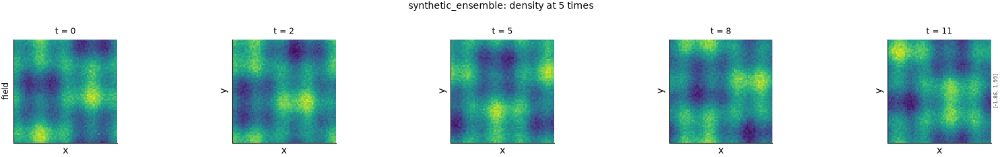

# Synthetic exchangeable ensemble

!!! note "Generated, not simulated"
    This dataset is computed from a formula and a seed. It is not a flow. It exists so that
    the probabilistic metrics have a case whose right answer is known in closed form, and the
    cards of those metrics cite it for that purpose only.

## The problem

No ensemble of independent simulations of the same flow exists yet
([issue 004](https://github.com/khegazy/pde_metrics/blob/main/issues/004-independent-realizations.md)).
A probabilistic metric scores a set of predictions, an *ensemble*, against one truth. It
therefore needs a case where the correct score is known before anything is measured. This
dataset builds one. Each frame holds a truth and $N$ ensemble members, all drawn from the same
distribution:

$$
\text{truth} = b(\mathbf{x}, t) + \sigma\,\varepsilon_0, \qquad
m_i = b(\mathbf{x}, t) + \sigma\,\varepsilon_i, \quad i = 1, \dots, N. \tag{1}
$$

Every $\varepsilon$ is an independent standard normal value per cell. The deterministic part
$b$ is a periodic field with one large and one small scale, whose phase advances by a fixed
amount from frame to frame. Because the truth uses the same $\sigma$ as the members and is
drawn independently of them, it is indistinguishable from one more member. That single
property fixes the right answers:

- **Rank histogram.** The truth's rank among the members is uniform, so a rank histogram
  is flat.
- **Spread and skill.** The spread of the ensemble matches the error of its mean, so the
  spread-to-skill ratio is one, up to a finite-ensemble factor.
- **CRPS.** The continuous ranked probability score matches its closed form for a normal
  distribution.

The construction and its parameters are in `fmeval/data/synthetic_ensemble.py`.

*The truth at five frames: the two-scale pattern drifting from frame to frame, under the
noise. Drawn by `python -m fmeval.cards dynamics synthetic_ensemble`.*

## Variations of this problem in the repository

| Configuration | What it is |
|---|---|
| `synthetic_ensemble` | 16 members, 12 frames, $64^2$ cells, density only. $\sigma$ and the phase step keep the reader's defaults; every option can be overridden, for example `+dataset.reader.n_members=32` |

The ensemble's seed is the reader's own, not the run's
([issue 044](https://github.com/khegazy/pde_metrics/blob/main/issues/044-synthetic-ensemble-ignores-the-run-seed.md)).

## What the evaluation sees

- **Periodic axes.** Every axis is periodic, so every metric and degradation runs on it.
- **Ensemble degradations.** On an ensemble dataset the degradations damage the members and
  never the truth.
- **Deterministic metrics** score the ensemble mean.
