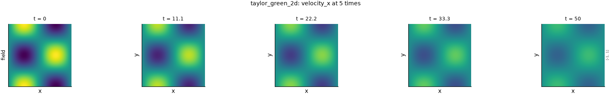
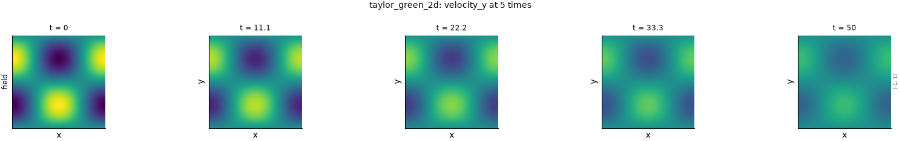
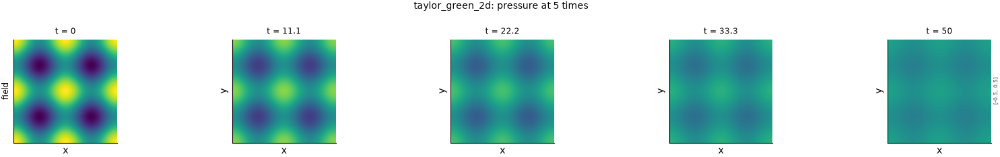
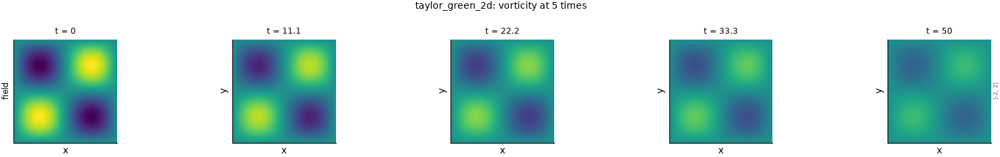

# Taylor–Green vortex

!!! note "Computed, not simulated"
    This dataset is the exact solution of a textbook problem, computed on the fly whenever a
    frame is read. It tests the evaluation harness against an answer known in advance. It is
    not evidence about a simulated flow, so no metric's page cites it.

## The problem

A periodic array of counter-rotating vortices in an incompressible viscous fluid. The pattern
never changes shape: viscosity only shrinks its amplitude, exponentially in time. Because the
nonlinear term is balanced exactly by the pressure, the Navier–Stokes equations are solved in
closed form. That makes this the standard check that a solver, or a diagnostic, gets
derivatives, decay rates and pressure right. Taylor (1923) gave the two-dimensional solution.
Taylor and Green (1937) studied the three-dimensional flow that grows from a related initial
condition, and its compressible, low-Mach version is a common benchmark (DeBonis 2013). That
three-dimensional flow becomes turbulent and has no closed form.

The figures show each field at five times across the evaluated window, on shared colour
limits, so the decay is visible as fading. They were drawn by
`python -m fmeval.cards dynamics taylor_green_2d`, and the numbers behind each are in the JSON
beside it under `docs/datasets/_generated/`.

## Variations of this problem in the repository

| Configuration | What it is | Readable here |
|---|---|---|
| `taylor_green_2d` | The exact solution below, viscosity $\nu = 0.01$, on $256^2$ cells, 10 frames from $t = 0$ to $t = 50$, when the velocity has fallen to $1/e$ of its initial size | Yes, computed |
| `helmholtz_mixture_2d` | The same vortex plus its curl-free mirror image, an exact acoustic mode at sound speed 2 (section "An acoustic part"), on $64^2$ cells, 9 frames over half an acoustic period, $t = 0$ to $1.1$ | Yes, computed |
| `kinet/taylor_green_vortex/` | A directory for lattice-Boltzmann runs (`Re-50k_Ma-1en1`, `weakly_compressible_isoT_fluids`). On 2026-10-20 it held no trajectory, only a decomposition file | No data yet |

The viscosity, grid and window are reader options, for example `+dataset.reader.nu=0.05`.

### Candidates with a known error

The reader option `candidate` names parameters of the solution to change. The reader then
supplies, beside its own frames, the same solution with those parameters, and `evaluate.py`
scores it against the frames at every step as it scores a forecast: the rows are labelled
`forecast` and carry the step and time since the first frame (`lead_step`, `lead_time`), and
the ladder is not run except for its clean entry and the damage anchor `mean_field`, which is
itself the climatology reference (the field's spatial mean). Both sides are exact, so every
metric's error at every step is known in advance. With $D = e^{-2\nu t}$:

| Override | Candidate | Exact error on velocity |
|---|---|---|
| `'+dataset.reader.candidate={nu:0.02}'` | A wrong viscosity $\nu'$, so $D' = e^{-2\nu' t}$ | The candidate is the truth times $D'/D$: mean squared error $\tfrac14 (D - D')^2$, `nrmse` $\lvert 1 - D'/D \rvert$, `spectrum_l2` $\lvert 1 - (D'/D)^2 \rvert$ |
| `'+dataset.reader.candidate={drift:[0.03,-0.05]}'` | A phase drift: the truth translated by $\boldsymbol\delta = \mathbf{U} t$, $\mathbf{U}$ the drift | Mean squared error $\tfrac12 D^2 (1 - \cos\delta_x \cos\delta_y)$; kinetic energy, enstrophy, palinstrophy and `spectrum_l2` equal the truth's at every step |
| `'+dataset.reader.candidate={nu:0}'` | Persistence, the first frame at every step, when the window starts at $t = 0$ | The wrong-viscosity row with $D' = 1$ |

The derivations are in `dataset_specs/05_initial_conditions_and_degraded_solver_runs.md`,
Sect. 3.3, and `tests/test_analytic_datasets.py` asserts them through the pipeline for the
thirteen metrics whose cards report an error per step, on two non-square grids, to $10^{-12}$
relative. The translated vortex solves eq. (1) only with the uniform flow $\mathbf{U}$ added,
so `drift` is meant for the candidate and the reader's own frames keep its default of zero.

## An acoustic part

The vortex is purely solenoidal: its velocity has no divergence. The reader options
`amplitude`, `sound_speed`, `longitudinal_viscosity` and `acoustic` add an exact dilatational
(curl-free) part, so the two parts of the Helmholtz split of the velocity are set in closed
form with any energy fraction. On such a field a curl-based metric must read only the vortex,
and the degradation `scale_dilatational`, which multiplies the dilatational part by a known
factor, has an exact answer for every metric. This follows
`dataset_specs/10_acoustic_and_helmholtz_fields.md`, Sect. 3, whose derivations are its
author's.

### Equations

The acoustic part solves the linearised isothermal equations about a fluid at rest at density
1, with density perturbation $\rho'$, velocity $\mathbf{u}_d = \nabla\phi$, sound speed $c$ and
longitudinal viscosity $\nu_L$ (the coefficient that damps compression):

$$
\partial_t \rho' = -\nabla^2\phi, \qquad
\partial_t \phi = -c^2\rho' + \nu_L\nabla^2\phi. \tag{7}
$$

The linearised compressible equations split into a vorticity mode and a sound mode that do
not interact (Chu and Kovásznay 1958, abstract; an isothermal gas has no entropy mode), so the
vortex of eq. (3) and this field add to an exact solution of the linear equations. Each Fourier
mode of eq. (7) is a $2\times2$ linear system. With $k = |\mathbf{k}|$, $\gamma = \nu_L k^2/2$
and $\Omega = \sqrt{c^2k^2 - \gamma^2}$, its matrix exponential is

$$
\hat\rho'(t) = e^{-\gamma t}\Bigl[\hat\rho'_0\cos\Omega t + \bigl(\gamma\hat\rho'_0 + k^2\hat\phi_0\bigr)\frac{\sin\Omega t}{\Omega}\Bigr],
\quad
\hat\phi(t) = e^{-\gamma t}\Bigl[\hat\phi_0\cos\Omega t - \bigl(\gamma\hat\phi_0 + c^2\hat\rho'_0\bigr)\frac{\sin\Omega t}{\Omega}\Bigr], \tag{8}
$$

which is spec 10's Eq. (3) at $\rho_0 = 1$. The reader returns the velocity
$U\,\mathbf{u}_{TG} + \nabla\phi$, the pressure of eq. (5) times $U^2$ plus $c^2\rho'$, and the
vortex's own vorticity, which the acoustic part does not change. It stores no density. The
default $\nu_L = 2\nu$ is the value of kinet's D2Q9 lattice-Boltzmann scheme (spec 10, Sect.
3.1); a mode with $\nu_L k \ge 2c$ would be damped past oscillation, and the reader refuses a
grid that holds one.

Each entry of `acoustic` is a starting condition sampled at the cell centres:

- `{kind: plane, mode: [m, n], amplitude: eps}`, a travelling wave
  $\rho' = \varepsilon\cos(\mathbf{k}\cdot\mathbf{x} - ckt)$ without viscosity, $\mathbf{k} = (m, n)$;
  a standing wave is two of them with opposite modes;
- `{kind: potential, mode: [m, n], amplitude: A}`, $\phi = A\cos mx\cos ny$ at rest density. At
  $m = n = 1$ its velocity at $t = 0$ is $-A(\sin x\cos y,\ \cos x\sin y)$, the mirror image of
  the vortex's;
- `{kind: pulse, centre: [x, y], width: sigma, amplitude: eps}`, a Gaussian pulse of density at
  rest, the two-dimensional benchmark of the first computational-aeroacoustics workshop (spec
  10, Sect. 3.3), including every periodic image. Its width must lie between three cells and
  0.35, where its sampling and minimum image are exact to round-off.

### Known answers

With the mirror image at amplitude $A$ beside the vortex at $U$, $E_s = U^2e^{-4\nu t}/4$ and
$E_d = A^2 f^2/4$, $f = e^{-\gamma t}(\cos\Omega t - (\gamma/\Omega)\sin\Omega t)$ at $k^2 = 2$.
`tests/test_analytic_datasets.py` asserts each through the pipeline on two non-square grids:

| Quantity | Exact value |
|---|---|
| `enstrophy`, `palinstrophy` | the vortex's alone, $U^2e^{-4\nu t}/2$ and $U^2e^{-4\nu t}$; 0 with $U = 0$ |
| `kinetic_energy` | $E_s + E_d$: the parts are orthogonal mode by mode |
| `fmeval.derived.helmholtz_split` | each part, to $10^{-14}$ |
| `scale_dilatational` at severity $s$ | velocity $\mathbf{u}_s + \lambda\mathbf{u}_d$, $\lambda = 1 \mp s$: `kinetic_energy` $E_s + \lambda^2E_d$, `mse` on velocity $(\lambda - 1)^2E_d$; vorticity and pressure unchanged, so their `mse` is exactly 0 |
| candidate `'+dataset.reader.candidate={sound_speed:2.5}'` | the twin at the wrong frequency: `mse` on velocity $A^2(f_c - f_{c'})^2/4$, vorticity unchanged, and the error has no solenoidal part |

The test also checks eq. (7) itself with time derivatives taken by finite differences of the
reader, and the constant acoustic energy at $\nu_L = 0$. With `longitudinal_viscosity` left at
its default, a candidate with another `nu` changes both parts.

### `helmholtz_mixture_2d`

The vortex at $U = 1$ plus its mirror image at $A = 1$, $c = 2$, $\nu = 0.01$: the two halves
of the kinetic energy are equal at $t = 0$, where the $x$-velocity is exactly zero, and the
dilatational fraction falls to nearly zero at a quarter of an acoustic period and returns as
the mode reverses. The window is half an acoustic period ($\pi/\Omega = 1.11$), in which the
mirror image's factor runs from 1 to $-1$. Run the dilatational ladder with
`degradation.ladder.scale_dilatational_down.enabled=true
degradation.ladder.scale_dilatational_up.enabled=true`. Measured on 2026-11-27: every
dilatational level is a distinct experiment; vorticity and pressure read `mse` exactly 0 at every
level; the sharp filters collapse as on `taylor_green_2d`, every mode sitting at $|k| = \sqrt2$
or 2. Other fields with an acoustic part are overrides, for example a pulse alone:
`dataset=taylor_green_2d +dataset.reader.amplitude=0 +dataset.reader.sound_speed=1
'+dataset.reader.acoustic=[{kind:pulse,centre:[3.14,3.14],width:0.1,amplitude:0.01}]'
+dataset.reader.nu=0.0001`.

## Equations

### Governing equations

The incompressible Navier–Stokes equations at unit density, with velocity $\mathbf{u} = (u, v)$,
pressure $p$ and kinematic viscosity $\nu$:

$$
\partial_t \mathbf{u} + (\mathbf{u}\cdot\nabla)\,\mathbf{u} = -\nabla p + \nu\,\nabla^2\mathbf{u},
\qquad \nabla\cdot\mathbf{u} = 0. \tag{1}
$$

### Taylor's solution

Taylor (1923) writes the flow through a stream function $\psi$, with $u = -\partial_y\psi$ and
$v = \partial_x\psi$ (p. 672). For a square array of cells of side $d$ he gives (p. 674)

$$
\psi = A\cos\frac{\pi x}{d}\,\cos\frac{\pi y}{d}\;\exp\!\left(-\frac{2\pi^2\nu t}{d^2}\right). \tag{2}
$$

With $d = \pi$ and $A = 1$, this is the velocity used here on the periodic box $[0, 2\pi)^2$,
translated by $(\pi/2, -\pi/2)$:

$$
u = \sin x\,\cos y\;e^{-2\nu t}, \qquad v = -\cos x\,\sin y\;e^{-2\nu t}. \tag{3}
$$

The translation is our derivation, checked numerically: Taylor's $u(x - \pi/2,\ y + \pi/2)$
equals eq. (3) to round-off.

### Pressure (derived)

Taylor gives no pressure, so it is derived here from eq. (1).

1. **The time derivative and the viscous term cancel.** Each component of eq. (3) satisfies
   $\nabla^2 u = -2u$, so $\nu\nabla^2\mathbf{u} = -2\nu\mathbf{u} = \partial_t\mathbf{u}$.
   Eq. (1) then reduces to $(\mathbf{u}\cdot\nabla)\mathbf{u} = -\nabla p$.
2. **The advection term.** With $F = e^{-2\nu t}$,

    $$
    (\mathbf{u}\cdot\nabla)\,u = F^2\left(\sin x\cos x\cos^2 y + \sin x\cos x\sin^2 y\right)
    = \tfrac{1}{2}F^2\sin 2x, \tag{4}
    $$

    and likewise $(\mathbf{u}\cdot\nabla)\,v = \tfrac{1}{2}F^2\sin 2y$.
3. **Integrate.** From $-\partial_x p = \tfrac{1}{2}F^2\sin 2x$ and the $y$ equivalent,

    $$
    p = p_0 + \tfrac{1}{4}\left(\cos 2x + \cos 2y\right)e^{-4\nu t}. \tag{5}
    $$

The sign is positive for the velocity of eq. (3). A negative sign belongs to the other common
convention, $u = \cos x\sin y$, $v = -\sin x\cos y$. The tests check eq. (5) directly: the
full residual of eq. (1), with $\partial_t\mathbf{u}$ taken by a finite difference in time,
is below $10^{-10}$, while the opposite sign leaves a residual of 0.88. The dataset uses
$p_0 = 0$.

### Vorticity and energy

$$
\omega = \partial_x v - \partial_y u = 2\sin x\,\sin y\;e^{-2\nu t}, \qquad
\tfrac{1}{2}\langle |\mathbf{u}|^2 \rangle = \tfrac{1}{4}\,e^{-4\nu t}. \tag{6}
$$

Here $\langle\cdot\rangle$ is the average over the box. The dataset stores the closed-form
vorticity. The evaluation recomputes vorticity from the velocity with its own spectral
operator, as it does for every dataset, and a test checks that the two agree to $10^{-12}$.

## How it is sampled

- **Grid and boundaries.** Values are taken at cell centres of a $256^2$ grid, periodic on
  both axes, so every metric and degradation runs on it.
- **Cost.** Eq. (3) and eq. (5) are a fixed spatial pattern times a decay factor. The reader
  therefore computes the pattern once and only rescales it per frame.

## What the evaluation sees

These are facts about a single Fourier mode, not defects. They were measured with
`python evaluate.py 'metrics=[mse,mae,nrmse,h1_seminorm,spectrum_l2]' dataset=taylor_green_2d`
and the default ladder on 2026-10-20.

- **Every frame is a scalar multiple of the first.** The frames add no independent evidence,
  and a statistic computed per frame takes the same value in each.
- **One energy shell.**
  - All the energy of velocity and vorticity sits at $|k| = \sqrt{2}$, and all of pressure's
    at $|k| = 2$.
  - Every calibrated cutoff therefore falls between two shells. A sharp high-pass leaves the
    field unchanged at every level, and every sharp low-pass level after the first repeats
    the first. Both are flagged and excluded.
  - The characteristic length is 181 cells for velocity and vorticity and 128 for pressure.
- **Band-limited coarsening** leaves every field unchanged at every level, because a single
  low mode survives it exactly.
- **The impostor.** The Gaussian impostor keeps each mode's amplitude and randomises its
  phase. On a single mode that is a translation, so the check for phase blindness does not
  test what it is meant to test here.
- **The large-translation probe.** It translates the field by a large random offset. A single
  mode stays partly correlated with itself after such a translation, so the probe varies
  strongly between draws, which is one reason it is not the damage anchor
  (`judgements/001`). In the measured run, the
  median mean squared error of the six draws spans a factor of 1.8 for velocity, 1.7 for
  vorticity and 5 for pressure.

## References

- Taylor, G. I. (1923). On the decay of vortices in a viscous fluid. *Philosophical Magazine*
  (6) 46(274), 671–674. <https://doi.org/10.1080/14786442308634295>
- Chu, B.-T. and Kovásznay, L. S. G. (1958). Non-linear interactions in a viscous
  heat-conducting compressible gas. *Journal of Fluid Mechanics* 3(5), 494–514.
  <https://doi.org/10.1017/S0022112058000148> (abstract read)
- Taylor, G. I. and Green, A. E. (1937). Mechanism of the production of small eddies from
  large ones. *Proceedings of the Royal Society A* 158, 499–521.
  <https://doi.org/10.1098/rspa.1937.0036>
- DeBonis, J. R. (2013). Solutions of the Taylor–Green vortex problem using high-resolution
  explicit finite difference methods. NASA/TM-2013-217850, eqs. (7)–(10) for the
  three-dimensional initial condition. <https://ntrs.nasa.gov/citations/20130011044>
