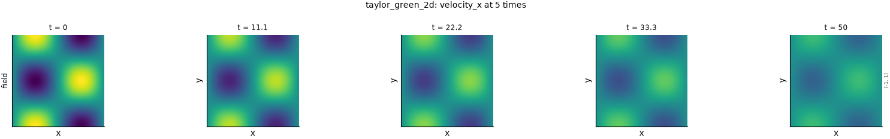
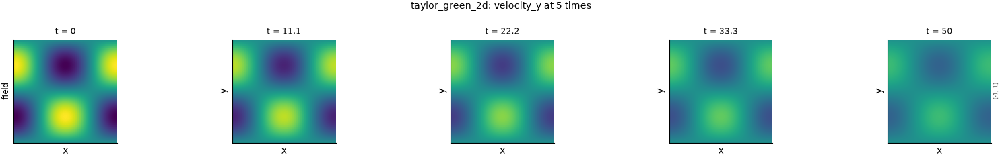
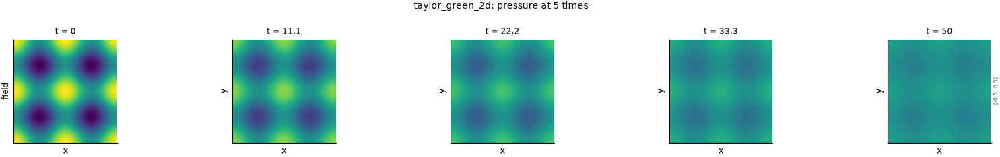
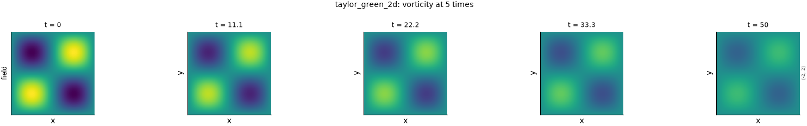

# Taylor–Green vortex

!!! note "Computed, not simulated"
    This dataset is the exact solution of a textbook problem, computed on the fly whenever a
    frame is read. It tests the evaluation harness against an answer known in advance. It is
    not evidence about a simulated flow, so no metric's page cites it.

## The problem

A periodic array of counter-rotating vortices in an incompressible viscous fluid. The pattern
never changes shape: viscosity only shrinks its amplitude, exponentially in time. Because the
nonlinear term is balanced exactly by the pressure, the Navier–Stokes equations are solved in
closed form. That makes this the standard check that a solver, or a diagnostic, gets
derivatives, decay rates and pressure right. Taylor (1923) gave the two-dimensional solution.
Taylor and Green (1937) studied the three-dimensional flow that grows from a related initial
condition, and its compressible, low-Mach version is a common benchmark (DeBonis 2013). That
three-dimensional flow becomes turbulent and has no closed form.

The figures show each field at five times across the evaluated window, on shared colour
limits, so the decay is visible as fading. They were drawn by
`python -m fmeval.cards dynamics taylor_green_2d`, and the numbers behind each are in the JSON
beside it under `docs/datasets/_generated/`.

## Variations of this problem in the repository

| Configuration | What it is | Readable here |
|---|---|---|
| `taylor_green_2d` | The exact solution below, viscosity $\nu = 0.01$, on $256^2$ cells, 10 frames from $t = 0$ to $t = 50$, when the velocity has fallen to $1/e$ of its initial size | Yes, computed |
| `kinet/taylor_green_vortex/` | A directory for lattice-Boltzmann runs (`Re-50k_Ma-1en1`, `weakly_compressible_isoT_fluids`). On 2026-10-20 it held no trajectory, only a decomposition file | No data yet |

The viscosity, grid and window are reader options, for example `+dataset.reader.nu=0.05`.

## Equations

### Governing equations

The incompressible Navier–Stokes equations at unit density, with velocity $\mathbf{u} = (u, v)$,
pressure $p$ and kinematic viscosity $\nu$:

$$
\partial_t \mathbf{u} + (\mathbf{u}\cdot\nabla)\,\mathbf{u} = -\nabla p + \nu\,\nabla^2\mathbf{u},
\qquad \nabla\cdot\mathbf{u} = 0. \tag{1}
$$

### Taylor's solution

Taylor (1923) writes the flow through a stream function $\psi$, with $u = -\partial_y\psi$ and
$v = \partial_x\psi$ (p. 672). For a square array of cells of side $d$ he gives (p. 674)

$$
\psi = A\cos\frac{\pi x}{d}\,\cos\frac{\pi y}{d}\;\exp\!\left(-\frac{2\pi^2\nu t}{d^2}\right). \tag{2}
$$

With $d = \pi$ and $A = 1$, this is the velocity used here on the periodic box $[0, 2\pi)^2$,
translated by $(\pi/2, -\pi/2)$:

$$
u = \sin x\,\cos y\;e^{-2\nu t}, \qquad v = -\cos x\,\sin y\;e^{-2\nu t}. \tag{3}
$$

The translation is our derivation, checked numerically: Taylor's $u(x - \pi/2,\ y + \pi/2)$
equals eq. (3) to round-off.

### Pressure (derived)

Taylor gives no pressure, so it is derived here from eq. (1).

1. **The time derivative and the viscous term cancel.** Each component of eq. (3) satisfies
   $\nabla^2 u = -2u$, so $\nu\nabla^2\mathbf{u} = -2\nu\mathbf{u} = \partial_t\mathbf{u}$.
   Eq. (1) then reduces to $(\mathbf{u}\cdot\nabla)\mathbf{u} = -\nabla p$.
2. **The advection term.** With $F = e^{-2\nu t}$,

    $$
    (\mathbf{u}\cdot\nabla)\,u = F^2\left(\sin x\cos x\cos^2 y + \sin x\cos x\sin^2 y\right)
    = \tfrac{1}{2}F^2\sin 2x, \tag{4}
    $$

    and likewise $(\mathbf{u}\cdot\nabla)\,v = \tfrac{1}{2}F^2\sin 2y$.
3. **Integrate.** From $-\partial_x p = \tfrac{1}{2}F^2\sin 2x$ and the $y$ equivalent,

    $$
    p = p_0 + \tfrac{1}{4}\left(\cos 2x + \cos 2y\right)e^{-4\nu t}. \tag{5}
    $$

The sign is positive for the velocity of eq. (3). A negative sign belongs to the other common
convention, $u = \cos x\sin y$, $v = -\sin x\cos y$. The tests check eq. (5) directly: the
full residual of eq. (1), with $\partial_t\mathbf{u}$ taken by a finite difference in time,
is below $10^{-10}$, while the opposite sign leaves a residual of 0.88. The dataset uses
$p_0 = 0$.

### Vorticity and energy

$$
\omega = \partial_x v - \partial_y u = 2\sin x\,\sin y\;e^{-2\nu t}, \qquad
\tfrac{1}{2}\langle |\mathbf{u}|^2 \rangle = \tfrac{1}{4}\,e^{-4\nu t}. \tag{6}
$$

Here $\langle\cdot\rangle$ is the average over the box. The dataset stores the closed-form
vorticity. The evaluation recomputes vorticity from the velocity with its own spectral
operator, as it does for every dataset, and a test checks that the two agree to $10^{-12}$.

## How it is sampled

- **Grid and boundaries.** Values are taken at cell centres of a $256^2$ grid, periodic on
  both axes, so every metric and degradation runs on it.
- **Cost.** Eq. (3) and eq. (5) are a fixed spatial pattern times a decay factor. The reader
  therefore computes the pattern once and only rescales it per frame.

## What the evaluation sees

These are facts about a single Fourier mode, not defects. They were measured with
`python evaluate.py 'metrics=[mse,mae,nrmse,h1_seminorm,spectrum_l2]' dataset=taylor_green_2d`
and the default ladder on 2026-10-20.

- **Every frame is a scalar multiple of the first.** The frames add no independent evidence,
  and a statistic computed per frame takes the same value in each.
- **One energy shell.**
  - All the energy of velocity and vorticity sits at $|k| = \sqrt{2}$, and all of pressure's
    at $|k| = 2$.
  - Every calibrated cutoff therefore falls between two shells. A sharp high-pass leaves the
    field unchanged at every level, and every sharp low-pass level after the first repeats
    the first. Both are flagged and excluded.
  - The characteristic length is 181 cells for velocity and vorticity and 128 for pressure.
- **Band-limited coarsening** leaves every field unchanged at every level, because a single
  low mode survives it exactly.
- **The impostor.** The Gaussian impostor keeps each mode's amplitude and randomises its
  phase. On a single mode that is a translation, so the check for phase blindness does not
  test what it is meant to test here.
- **The large-translation probe.** It translates the field by a large random offset. A single
  mode stays partly correlated with itself after such a translation, so the probe varies
  strongly between draws, which is one reason it is not the damage anchor
  (`judgements/001`). In the measured run, the
  median mean squared error of the six draws spans a factor of 1.8 for velocity, 1.7 for
  vorticity and 5 for pressure.

## References

- Taylor, G. I. (1923). On the decay of vortices in a viscous fluid. *Philosophical Magazine*
  (6) 46(274), 671–674. <https://doi.org/10.1080/14786442308634295>
- Taylor, G. I. and Green, A. E. (1937). Mechanism of the production of small eddies from
  large ones. *Proceedings of the Royal Society A* 158, 499–521.
  <https://doi.org/10.1098/rspa.1937.0036>
- DeBonis, J. R. (2013). Solutions of the Taylor–Green vortex problem using high-resolution
  explicit finite difference methods. NASA/TM-2013-217850, eqs. (7)–(10) for the
  three-dimensional initial condition. <https://ntrs.nasa.gov/citations/20130011044>
