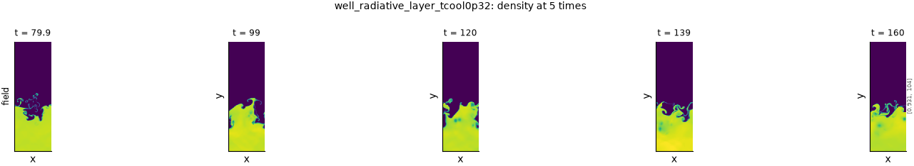

# Turbulent radiative mixing layer

!!! note "Simulated; not yet cited by any metric's page"
    One published run is readable. It is not registered as evidence, and its developed-flow
    window is a proposal awaiting a person's decision.

## The problem

Dense cold gas lies below hot dilute gas, and the two slide past each other at a subsonic
speed. The shear rolls the interface up (the Kelvin–Helmholtz instability), the two phases mix,
and the mixed gas at intermediate temperature cools radiatively, so the layer is a turbulent,
compressible, two-phase flow with a stored pressure that is not a function of density. The
problem is that of Fielding et al. (2020), and the data are the 2D set of The Well
(Ohana et al. 2024), simulated with Athena++. The Well's page for the set gives the equations:
the compressible Euler equations with an energy sink,

$$
\partial_t E + \nabla \cdot \big((E + P)\,\mathbf{v}\big) = -\frac{E}{t_\mathrm{cool}},
\qquad E = \frac{P}{\gamma - 1},\quad \gamma = \frac{5}{3},
$$

where $E$ is the energy density, $P$ the pressure, $\mathbf{v}$ the velocity and
$t_\mathrm{cool}$ the cooling time, the one parameter of the set. Nine values are published,
from 0.03 to 3.16; a shorter cooling time removes the mixed gas faster. Every quantity is
dimensionless.

*Drawn by `python -m fmeval.cards dynamics well_radiative_layer_tcool0p32`; the numbers behind
it, and the same figure for each velocity component and the pressure, are in
`docs/datasets/_generated/`.* The dense layer (density 100 at $t = 0$) is at the bottom and the
dilute one (density 1) at the top.

## Variations of this problem in the repository

| Configuration | What it is |
|---|---|
| `well_radiative_layer_tcool0p32` | The test-split run at $t_\mathrm{cool} = 0.32$, the middle of the nine published values: 101 frames from $t = 0$ to 159.7, saved every 1.597 |

The file is read in place from The Well's test split, through the `well` reader; nothing is
converted. Another cooling time is the same configuration with
`dataset.trajectory=turbulent_radiative_layer_tcool_<value>` and the matching `complexity`
parameter.

## Grid, boundaries and fields

The grid is $128 \times 384$ cells on $[-0.5, 0.5] \times [-1, 2]$. The published coordinate
arrays run from each bound to the other inclusive (128 points from $-0.5$ to $0.5$), but the last
periodic column is the neighbour of the first, not a copy of it, and the cells are square only
if each axis holds $N$ cells of size $L/N = 1/128$ rather than $N - 1$. The configuration sets the
reader option `coordinates_span_domain: true` for this; without it the two axes would get the
unequal spacings $1/127$ and $3/383$.

The file declares $x$ periodic and $y$ `OPEN` (zero-gradient outflow, as The Well's page states).
The reader maps `OPEN`, and the `WALL` type of other Well sets, to `neumann`: on $y$ the
degradations act on the field extended evenly across each end. Metrics that need a periodic
domain are not run on this dataset; in a smoke run `spectrum_l2` and `wasserstein` were skipped
for that reason and `mse` ran on every degradation of the default ladder.

Fields are `density`, `velocity` and `pressure`. The pressure is the solver's own, so the
configuration exposes it (`include_redundant: true`, whose default drops the isothermal kinet
pressure). Vorticity is not listed: the spectral curl refuses a grid that is not periodic.

## The proposed window

From frame 0 to frame 50 ($t = 80$) the fraction of cells at intermediate density
($2 < \rho < 50$) grows from 0.003 to 0.045 and the rms vertical velocity from 0.005 to 0.030;
after that both fluctuate, about 0.03 and 0.025, with no trend to the end of the run. The
configuration therefore starts at frame 50. That is an agent's proposal from these two numbers,
for a person to confirm (`docs/recipes/add-a-dataset.md`, step 3).

## What the evaluation sees

On the 64-cell analysis grid (coarsened by two, to $64 \times 192$), the severity calibration
resolves the characteristic scale of density to 20 cells, velocity to 18 and pressure to 7. The
density's energy sits in the lowest modes (half of it at $|k| \le 1$), so the high-pass filters
cannot resolve all their severity levels on it, and several smoothing levels leave the pressure
unchanged.

## References

- Fielding, D. B., Ostriker, E. C., Bryan, G. L. & Jermyn, A. S. (2020). Multiphase gas and the
  fractal nature of radiative turbulent mixing layers. *Astrophys. J. Lett.* 894, L24.
  <https://ui.adsabs.harvard.edu/abs/2020ApJ...894L..24F> — not opened; the source The Well cites.
- Ohana, R. et al. (2024). The Well: a large-scale collection of diverse physics simulations
  for machine learning. *NeurIPS*. <https://arxiv.org/abs/2412.00568>; the set's page,
  <https://polymathic-ai.org/the_well/datasets/turbulent_radiative_layer_2D/>, read 2026-11-26
  for the equations, domain, boundaries and cooling times.
