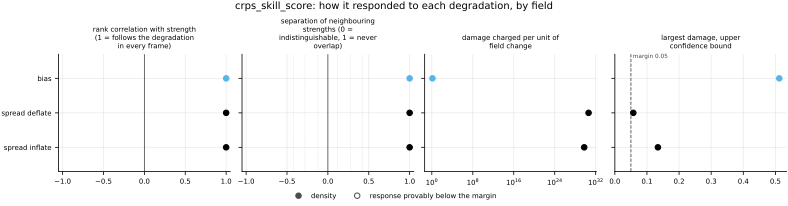
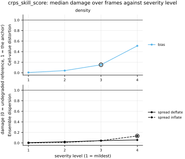

## Definition

The skill score compares the mean CRPS of the ensemble with the mean CRPS of a reference
forecast. Gneiting and Raftery define a skill score for any score $S$ averaged over a set of
cases [@gneitingraftery2007]:

$$
S^{\mathrm{skill}} = \frac{\bar S^{\mathrm{fcst}} - \bar S^{\mathrm{ref}}}
{\bar S^{\mathrm{opt}} - \bar S^{\mathrm{ref}}} \tag{1}
$$

which is their Equation (8), with $\bar S$ the mean score over the cases. For the CRPS, lower
is better and the optimum is zero, so Equation (1) becomes

$$
\mathrm{CRPSS} = 1 - \frac{\overline{\mathrm{CRPS}}}{\overline{\mathrm{UNC}}} \tag{2}
$$

a ratio of the two means, not a mean of per-cell ratios. The numerator is the fair ensemble
CRPS that [crps](../../metrics/crps/card.md) registers, averaged over channels and cells.

**The reference is climatology**, which Gneiting and Raftery describe as "an estimate of the
marginal distribution of the predictand" [@gneitingraftery2007]. Here it is the empirical
distribution of the reference's own values over the whole domain of the same frame, one per
channel (`judgements/011`). For channel $c$ with values $y_{c,1} \dots y_{c,n}$, the mean CRPS
of that distribution over the same values is

$$
\mathrm{UNC}_c = \frac{1}{2n^2}\sum_{i=1}^{n}\sum_{j=1}^{n} |y_{c,i} - y_{c,j}| \tag{3}
$$

which follows from the kernel form of the CRPS (Equation (2) of the `crps` card) with $F$ the
empirical distribution, its expectations taken exactly. It is the uncertainty term
$\mathrm{UNC}_0$ shared by every decomposition of the mean CRPS (Arnold and colleagues,
Equation (10) of the published version, Equation (11) of the arXiv version) [@arnold2024], so
Equation (2) reads the ensemble's score as a fraction of the uncertainty of the field's values.
$\overline{\mathrm{UNC}}$ is the mean of $\mathrm{UNC}_c$ over channels, so the two components
of a velocity each have their own climatology and are never pooled into one distribution.
Equation (3) is evaluated by sorting each channel's values, with the same helper `crps` uses
for its pair sum.

Two consequences of the definitions are worth stating. Equation (3) includes the self-pairs,
because the climatological forecast *is* the empirical distribution rather than a sample of
one, while the fair CRPS of the numerator excludes them. So an ensemble whose members are
exactly the $n$ climatological values, at every cell, does not score zero: its fair CRPS
averages $\Sigma/n^2 - \Sigma/(2n(n-1))$ for $\Sigma$ the double sum of Equation (3), and its
skill score is $1/(n-1)$ (a derivation of this card's, pinned by this bundle's tests). With
$n = 4096$ cells that is $2.4 \times 10^{-4}$. And the score is undefined where every channel
of the reference is constant, since climatology is then exact; the metric returns NaN there.

### Boundary handling

None. Both the CRPS and the climatological score are computed from values at single cells; the
climatology pools every cell of the domain without regard to where it sits, so the edge of the
domain and its periodicity never enter.

### How its field reports it

The field is probabilistic forecast verification.

- **The object and its normalisation.** Equation (1), a ratio of mean scores over a set of
  cases with a climatological reference (Gneiting and Raftery, Section 2.3) [@gneitingraftery2007].
  The CRPS decompositions fix the reference as the empirical distribution of the observations
  in the verification set, whose mean score is $\mathrm{UNC}_0$ (Arnold and colleagues,
  Equation (10)) [@arnold2024]. Here the verification set is the cells of one frame and channel,
  which is why the climatology is that frame's values.
- **The statistics reported beside it.** Gneiting and Raftery note that skill scores of the form
  of Equation (1) "are generally improper, even if the underlying scoring rule $S$ is proper"
  (Section 2.3) [@gneitingraftery2007]: a forecaster can gain skill-score points without
  improving the mean score when the reference changes from case to case. Ranking ensembles
  therefore uses the mean CRPS, [crps](../../metrics/crps/card.md); the skill score is its reading on a
  scale where zero is climatology. Arnold and colleagues define no skill score; they report
  the mean CRPS beside $\mathrm{UNC}_0$ and the miscalibration and discrimination terms (Table
  1) [@arnold2024], which are not built here
  ([issue 127](https://github.com/khegazy/pde_metrics/blob/main/issues/127-crps-decomposition-has-no-settled-form-for-a-fair-ensemble-score.md)).
- **The figure.** The skill score against lead time, one line per forecasting system, is the
  usual reading of a skill score; this card found no primary source that fixes it, so it is
  named here as practice rather than as a cited standard. It cannot be drawn on the data that
  exists: `synthetic_ensemble` has no lead time.
- **The experiment.** As for `crps`: many forecast cases against observations, at each lead
  time, and forecasters of known calibration and sharpness. Only the calibrated null of
  `synthetic_ensemble` exists here; real ensembles wait on
  [issue 004](https://github.com/khegazy/pde_metrics/blob/main/issues/004-independent-realizations.md).
  The missing experiments are
  [EXP-crps-gneiting-forecaster-suite](https://github.com/khegazy/pde_metrics/blob/main/proposals/EXP-crps-gneiting-forecaster-suite.md),
  whose climatological forecaster is the reference of Equation (2) by construction, and
  [EXP-spread_skill-perturbed-initial-condition-ensemble](https://github.com/khegazy/pde_metrics/blob/main/proposals/EXP-spread_skill-perturbed-initial-condition-ensemble.md),
  which has lead times.

## Performance

<!-- GENERATED performance: written by `python -m fmeval.cards evidence crps_skill_score --results results/comparison_1793812401`, do not edit -->

No field-standard figure: an ensemble score with no curve or point set behind it; its field draws it against lead time, which the synthetic ensemble, one spread at every frame, cannot show.



Four measured statistics for crps_skill_score, one row per degradation grouped by family and one marker per field. From left: the rank correlation between the metric and the applied strength within a frame, with the line showing the resampling interval; the separation of neighbouring strengths as Cliff's delta, where 0 means the metric cannot tell one strength from the next and the faint ticks at 0.12, 0.28 and 0.42 are Vargha and Delaney's small, medium and large anchors, for scale and not as grades; the damage charged per unit of field change at the harshest strength; and the upper confidence bound on the largest damage, beside the fixed margin of 0.05. A hollow marker is a field and degradation on which that bound lies below the margin, so the response is provably small. A missing marker is a statistic the analysis withheld, as the rank correlation is on an axis the metric is invariant to.



Median damage over frames against severity level for crps_skill_score, one row per family of degradation and one column per field, on one shared scale. The solid grey line is damage 1, the anchor (by default the field's own mean); the dotted black line is the damage assigned to the fake prediction with the right spectrum, where the run included it. The hollow black ring marks the first level at which the metric has moved a tenth of the way to the anchor. Hollow grey markers are strengths excluded for repeating a milder one or for doing nothing. Degradations with three or fewer usable levels are drawn as markers only; points beyond 2 either side are drawn as triangles at the edge. Damage is negative where a degradation moves the metric away from the anchor, as noise raises a single-field quantity the field's mean sets to zero.

**Trend: does the response follow the degradation?**

| test family | field | degradations | rank correlation | fraction of frames in order | weakest gap between neighbouring strengths |
|---|---|---|---|---|---|
| Ensemble dispersion | density | 2 | 1 | 1 | 1 |
| Cell-value distortion | density | 1 | 1 | 1 | 1 |

**Reactivity: how far does it move?**

| test family | field | change from clean at the harshest strength | elasticity | first strength detected |
|---|---|---|---|---|
| Ensemble dispersion | density | -0.206 to -0.0881 | 1.8 | level 4 |
| Cell-value distortion | density | -0.793 | 1.91 | level 3 |

**Consistency: how much does it vary from snapshot to snapshot?**

| test family | field | consistency, in the strength's units | snapshots per independent block |
|---|---|---|---|
| Ensemble dispersion | density | 0.00446 to 0.0155 | 1 |
| Cell-value distortion | density | 0.00145 | 1 |

One row per family of degradation and physical field; a cell gives the range over the degradations in that family. **Trend.** The rank correlation is the Spearman correlation between the strength and how far the metric has moved from its value on the undegraded field of the same frame, in the one direction it moves under that degradation, computed inside a single frame. A value of 1 means every strength moved it further than the last in every frame, whichever way it moves; a response that scatters to both sides scores near 0. The fraction of frames in order counts the frames with no exception. The weakest gap is the smallest Mann-Whitney overlap between two neighbouring strengths across frames: 1 means they never overlap, 0.5 that they cannot be told apart. **Reactivity.** The change from clean is the median, at the harshest strength, of the departure from the undegraded value of the same frame over the size of that value: 0.3 means 30%. The elasticity is the percentage change of that departure per percentage change in strength over the mildest strengths. First strength detected is the mildest at which the metric has moved a tenth of the way to the anchor; **damage** reads that 0-to-1 scale as a number. A dash means the measurement is not defined there. A metric's reactivity scales with the power it is expressed in: mean squared error's elasticity is twice root-mean-square error's, though the two carry the same information, so compare magnitudes across metrics with that in mind. **Consistency** is how much the response varies from snapshot to snapshot relative to its size, in the strength's units; the snapshots of one trajectory are correlated, and the last column is how many consecutive snapshots one independent block spans.

These tables report what was measured and grade none of the measurements. What the numbers mean for this metric is written in the subsections below, beside the test that produced each number.

**Profile.**

| field | selectivity | charges most for | charges least for | response provably below 0.05 at 90% on | elasticity to a sub-pixel shift | compute cost (x cheapest in this run) |
|---|---|---|---|---|---|---|
| density | 0.574 | `spread_deflate` | `bias` | — | — | 587 |

One row per physical field. **Selectivity** is how concentrated the metric's response is on a few degradations, measured per unit of field change: 0 means it charges every degradation the same, as mean squared error does by construction, and values toward 1 that one degradation carries most of it. **Charges most and least for** name the two ends of that profile. **Response provably below** lists degradations on which the upper confidence bound of the largest damage lies below the margin -- an equivalence test, so an entry says the response is provably small, not merely not significant; a dash means no degradation met the bound. **Elasticity** is the slope of log damage against log shift over the smallest shifts: 1 means damage grows in proportion to the shift, 2 with its square. **Compute cost** is wall-clock per evaluation over the cheapest metric and field in the same run.

<!-- END GENERATED performance -->

## Intuition

This number says how much better an ensemble does than a forecast that knows only which values
the field takes, not where it takes them. The comparison forecast, climatology, predicts at
every point the whole spread of values seen across the field. An ensemble that has learned the
field's structure narrows that down at each point; the skill score is the fraction of
climatology's error it removes.

It is built from the continuous ranked probability score, which scores a set of predicted
values against the truth by rewarding members near the truth and honest spread. Scoring
climatology the same way gives the error of knowing nothing about position. One minus the
ratio of the two is the skill: one for a perfect ensemble, zero for one no better than
climatology, negative for one that is worse, for example an ensemble that is confidently in the
wrong place.

A worked example on one channel of two cells, whose reference values are 0 and 2, with two
members per cell:

```
reference        member 1        member 2        result
0  2             1  2            1  4            0.0
```

Climatology predicts "0 or 2, equally likely" at both cells; its score is half the average
distance between the field's values, 0.5. The first cell's members both say 1 against a truth
of 0: a score of 1. The second cell's members, 2 and 4, straddle the truth of 2 in a way that
the spread credit exactly cancels: a score of 0. The ensemble's mean score is 0.5, the same as
climatology's, so its skill is zero.

What it ignores is the same as the CRPS: position. A feature drawn in the right shape one cell
away is penalised at both places, and climatology, which ignores position entirely, is no
help.

## Reading the output

The value is dimensionless, at most one, and unbounded below; higher is better. One is a
perfect ensemble, zero is the climatological score, and a negative value means the ensemble
scores worse than predicting the field's distribution of values everywhere.

What counts as good depends on how much of the field's variation is predictable. On a field
whose structure is known and whose noise is not, skill is high even for an ensemble that is no
better than chance about the noise; on a field that is mostly noise, the same ensemble scores
near zero. Read it as the fraction of the climatological score removed, and compare across
models on the same dataset, where the denominator is the same for every model, frame by frame.

Comparisons across datasets and fields are weaker than they look: the denominator is each
frame's own climatology, so a field with a wider spread of values has a larger denominator and,
for the same CRPS, a higher skill. Comparisons across ensemble sizes of two or more inherit the
fairness of the numerator. Because the skill score is a ratio, it is not itself a proper
score, so to rank ensembles on one dataset use `crps`; this number says where that ranking
sits between climatology and perfection.

## Limitations

The reference changes from frame to frame, so the skill score of one ensemble can rise between
two frames while its CRPS rises too, because the field's spread of values grew faster. Averaging
skill scores over frames, rather than taking the ratio of averaged scores, mixes those
denominators; the number on each row is a per-frame ratio and should be read that way.

Climatology here knows nothing about position, so on any field with large-scale structure it is
a weak reference, and skill near one says only that the ensemble knows the structure. It does
not say that the ensemble's spread is honest: an ensemble that has the structure right and is
badly overconfident about the small-scale noise still scores high, because the structure carries
most of the climatological score. `spread_skill` and `rank_histogram` see that failure; this
does not.

On a nearly constant reference the denominator is tiny and the ratio is dominated by it: a
CRPS that is not equally small becomes a large negative skill. The metric is undefined, and returns NaN,
only when every channel is exactly constant.

## Results

<!-- GENERATED run: written by `python -m fmeval.cards evidence crps_skill_score --results results/comparison_1793812401`, do not edit -->

Measured on `synthetic_ensemble`, frames 0 to 11 (12 frames of a calibrated null: evidence that the estimator computes what it claims to compute, and nothing about turbulence), on the 64 analysis grid, seed 20260807, at commit `adbdc88e4950`. Run `comparison_1793812401`.

Every number in this section comes from that one run. Regenerate with `python -m fmeval.cards evidence <name> --results results/comparison_1793812401`.

<!-- END GENERATED run -->

<!-- GENERATED experiments: written by `python -m fmeval.cards catalog`, do not edit -->

**Across the experiments.**

| experiment | what a run on it is evidence of | on this card |
|---|---|---|
| `kinet_re5e4` | developed flow | not applicable: needs an ensemble, and this dataset has one realisation per frame |
| `kinet_re1e6` | developed flow at Re = 1e6, twenty times the Reynolds number of kinet_re5e4, from the same initial condition | not applicable: needs an ensemble, and this dataset has one realisation per frame |
| `synthetic_ensemble` | a calibrated null: evidence that the estimator computes what it claims to compute, and nothing about turbulence | measured, run `comparison_1793812401`: the main results |
| `sod_shock_tube` | an analytic check: evidence that the metric locates and scores a known shock correctly, and nothing about turbulence | not applicable: needs an ensemble, and this dataset has one realisation per frame |
| `forecast_re5e4` | real predictions scored against their targets at each prediction step; who produced the predictions, a trained model or a coarser solver, is not recorded | not applicable: needs an ensemble, and this dataset has one realisation per frame |

One row per dataset a card may cite (`configs/cards/default.yaml`). *Measured* names the run the card cites: the main results are `## Performance` and the subsections below, and every other run has its own subsection headed with its dataset. *Not applicable* gives the reason: one that follows from what the metric declares and what the dataset offers, or one a person wrote on the card (`not_run` in `card.yaml`) because the result would carry no information. *Not yet run* means the metric can run there and the card cites no run on it yet.

<!-- END GENERATED experiments -->

The skill score scores an ensemble, so the synthetic ensemble is the one experiment in this
repository it can run on; the experiments its field relies on are listed in the Definition.

### Ensemble dispersion

[spread_inflate](../../degradations/spread_inflate/card.md) ·
[spread_deflate](../../degradations/spread_deflate/card.md)

<!-- GENERATED results_ensemble: written by `python -m fmeval.cards evidence crps_skill_score --results results/comparison_1793812401`, do not edit -->

| degradation | field | strengths | rank correlation | fraction of frames in the right order | weakest gap between neighbouring strengths |
|---|---|---|---|---|---|
| `spread_deflate` | density | 4 | 1 | 1 | 1 |
| `spread_inflate` | density | 4 | 1 | 1 | 1 |

<!-- END GENERATED results_ensemble -->

The calibrated ensemble has a skill of 0.761 (median over frames): it removes about three
quarters of the climatological score. That number is set mainly by how much of the field's
variation the deterministic pattern of this dataset explains, which the ensemble knows and
climatology does not, and says little about the ensemble's spread (this card's reasoning; see
Limitations).

Both directions lower the skill, with a rank correlation of 1 and no overlap between
neighbouring strengths on either axis. At the harshest strengths the skill has fallen by 0.206
of its clean value for inflation, to four times the calibrated width, and by 0.0881 for
deflation, to a fifth of it (the reactivity table). As on the `crps` card, the mildest
inflation scores marginally better than the calibrated ensemble in most frames, which is why
the inflation axis's largest value, 0.767, lies above the clean median: the ladder widens the
members about their own sample mean, and the fair score's optimum then sits at a slightly
inflated spread. Within one frame the climatology is fixed, because the ladder changes only
the members, so the skill score is a decreasing linear function of the CRPS there, and the
statistics computed inside a frame, the rank correlation and the fraction of frames in order,
are those of `crps` (a consequence of Equation (2), not a separate measurement).

On the damage scale the dispersion axes are small. The anchor, each member replaced by its own
spatial mean, has a skill of −0.422: an ensemble collapsed onto one number per frame scores
worse than climatology, which at least spreads its prediction over the field's values. Against
it the harshest inflation reaches a damage of 0.137 and the harshest deflation 0.0592 (the
largest in any frame); the skill first moves a tenth of the way to the anchor at the harshest
inflation (level 4) and never does on the deflation axis.

The `bias` axis, in the Performance tables, moves the ensemble mean, and the skill falls by
0.793 of its clean value at the harshest offset, to a lowest single value of 0.154; it reaches
a damage of 0.513 and is first detected at level 3. This card has no subsection of its own for
that axis; the numbers are those of the Performance tables and the card's fingerprint.

The profile row above ranks the degradations by damage per unit of field change, but the two
dispersion axes leave the ensemble mean, and so the measured field change, unchanged to
round-off; its "charges most for", "charges least for" and selectivity are therefore not
meaningful for this metric ([issue 111](https://github.com/khegazy/pde_metrics/blob/main/issues/111-damage-per-change-divides-by-round-off-on-ensemble-axes.md)).

## References

\bibliography
