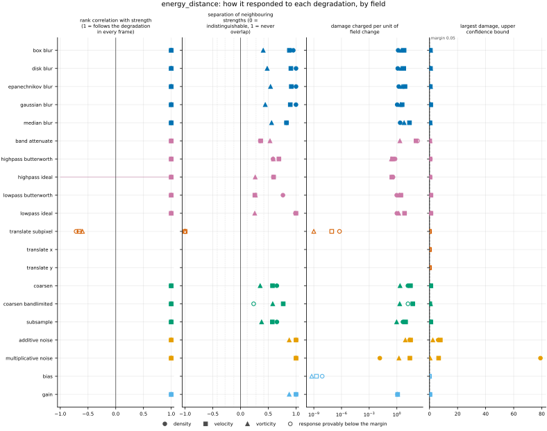
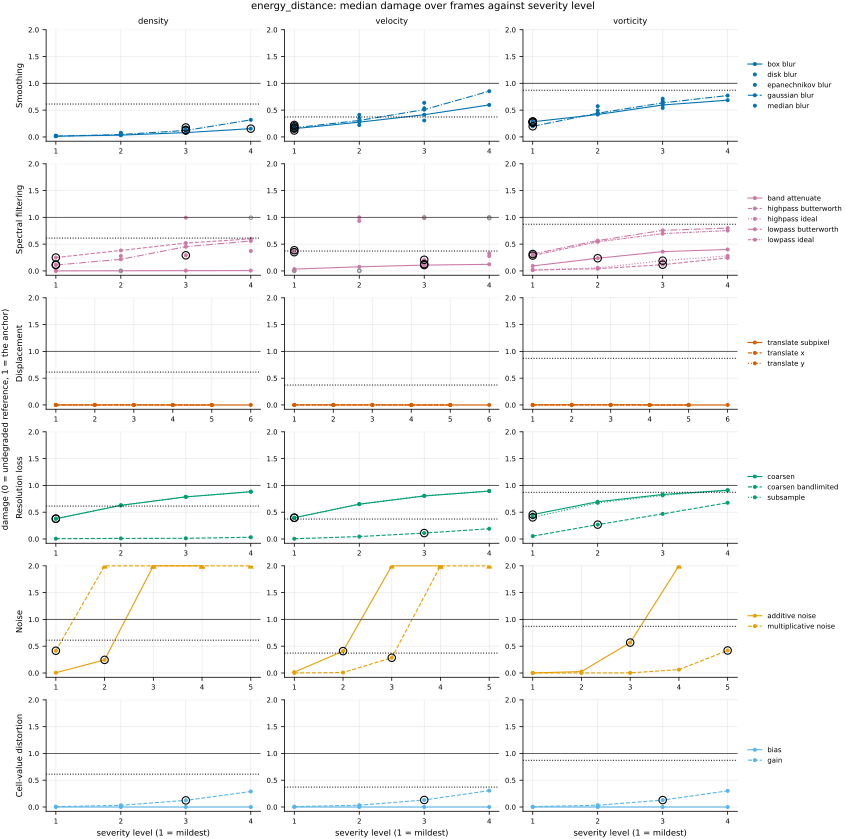
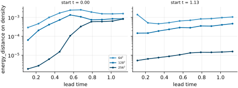
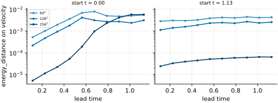
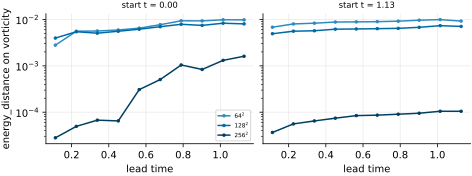

## Definition

Let $f$ be one channel of a field on a periodic grid of $N$ cells, $\mathbf{e}_j$ the unit
step along spatial axis $j$, and take the increment at a separation of one cell,

$$
(\delta_j f)_{\mathbf{n}} = f_{\mathbf{n} + \mathbf{e}_j} - f_{\mathbf{n}} \tag{1}
$$

the definition `increment_flatness` and `increment_w1` use, imported rather than restated.
For two real random variables $X \sim F$ and $Y \sim G$ with independent copies $X'$ and
$Y'$, the squared energy distance is

$$
D^2(F, G) = 2\,\mathbb{E}|X - Y| - \mathbb{E}|X - X'| - \mathbb{E}|Y - Y'| \tag{2}
$$

([@szekely2013], Definition 1, Eq. (2.4), where this squared form is itself called the energy
distance), and the energy distance is its square root $D(F, G)$, the form that satisfies the
axioms of a metric on distributions ([@rizzo2016], p. 27). On the line Equation (2) is twice
the integrated squared gap between the two cumulative distribution functions ([@szekely2013],
the display immediately before Eq. (2.3)),

$$
D^2(F, G) = 2 \int_{-\infty}^{\infty} \bigl( F(x) - G(x) \bigr)^2 \, dx \tag{3}
$$

Collecting Equation (1) over all $N$ cells gives an empirical distribution with $N$ equally
weighted atoms, $F^{(c,j)}_N$ for the reference and $G^{(c,j)}_N$ for the candidate. The
distance along axis $j$ of channel $c$ is Equation (3) between those two empirical
distributions,

$$
D^{(c, j)} = \Bigl( 2 \int_{-\infty}^{\infty} \bigl( F^{(c,j)}_N(x) - G^{(c,j)}_N(x) \bigr)^2 \, dx \Bigr)^{1/2} \tag{4}
$$

which equals the square root of the two-sample V-statistic of [@szekely2013], Eq. (6.1),
the average of Equation (2)'s distances over all pairs including a sample with itself. The
V-statistic is used rather than the unbiased U-statistic because it is never negative
([@szekely2013], Sect. 1) and is zero for identical samples, where the U-statistic is
negative; the increments of one frame are, besides, the whole population compared, not a
random sample of it. Both empirical cumulative functions are step functions, so Equation (4)
is exact. `scipy.stats.energy_distance` [@scipyenergy] evaluates it: its documentation gives
the identity, and its source (`scipy.stats._stats_py._cdf_distance`) sorts the pooled
samples and evaluates both empirical cumulative functions between consecutive values by
binary search, so the cost is a few sorts of $2N$ values. The reported value averages
Equation (4) over the set $P$ of channel-and-axis pairs that `increment_w1` reads, as it
averages its transport distances:

$$
D = \frac{1}{|P|} \sum_{(c, j) \in P} D^{(c, j)} \tag{5}
$$

For velocity, whose channel $c$ is its component along axis $c$, $P$ holds the
**longitudinal** pairs $j = c$ only, the component parallel to the separation, as
structure-function theory reads velocity increments ([@boffetta2012], Eq. (4);
[@granero2024], Eq. (1)); for a scalar field such as density or two-dimensional vorticity,
which has no orientation, $P$ is every channel along every axis. For velocity the same average
over the **transverse** pairs $j \ne c$ is the companion `energy_distance.transverse`, a curve
with the one point $\ell = 1$; it is empty for a scalar field.

**Where it sits among distances between distributions.** Both the energy distance and the
1-Wasserstein distance of `increment_w1` belong to the *integral probability metrics*, the
largest difference in expectation over a class of test functions [@muller1997]. The energy
distance is, up to a factor, the maximum mean discrepancy [@gretton2012] (Definition 2,
Eq. (1)) for one particular kernel: the squared form of Equation (2) equals twice the
squared maximum mean discrepancy for any kernel that generates the distance $|x - y|$
([@sejdinovic2013], Theorem 22), such as $k(x, y) = \tfrac{1}{2}(|x| + |y| - |x - y|)$
([@sejdinovic2013], Eq. (4.2)). Equation (4) is therefore $\sqrt{2}$ times the biased
estimate of [@gretton2012], Eq. (5), with that kernel. The kernel has no bandwidth to choose.
Its only parameter is the exponent on $|x - y|$, which may lie anywhere in $(0, 2)$
([@szekely2013], Proposition 2, Eq. (5.1)) and is fixed at 1, the value of Definition 1.

**How it differs from the transport distance on the same samples.** On the line the
1-Wasserstein distance is the integral of the *absolute* gap $|F - G|$, where Equation (3)
integrates its *square*. A rare increment far out in a tail moves the cumulative functions by
only $1/N$ per atom, and squaring shrinks that further. The following derivation is mine,
not a source's, and `test_metric.py` pins both halves of it.

1. *A change confined to the tails.* Moving two of $N$ atoms outward by $h$, one in each
   tail, costs $W_1 = 2h/N$ in transport distance and $D^2 = 4h/N^2$ in Equation (3), so
   $D^2/W_1 = 2/N$ whatever the size of $h$.
2. *A broad change.* Stretching every increment by a factor $1 + \epsilon$ moves the
   cumulative function by about $\epsilon x f(x)$ at each value $x$, where $f$ is the
   density, so $D^2 \approx 2\epsilon^2 \int x^2 f(x)^2 \, dx$ while
   $W_1 = \epsilon\,\mathbb{E}|X|$. A broad change is suppressed too, by its own relative
   size: for a Gaussian $f$, $D^2/W_1 = \epsilon/(2\sqrt{2})$.
3. *At equal transport cost*, the tail change therefore costs
   $(2/N)/(\epsilon/(2\sqrt{2})) = 4\sqrt{2}/(N\epsilon)$ of the broad change in Equation (3),
   and the square root of that in the registered $D$.

On one axis of a 256 by 256 grid with a Gaussian bulk, a tail change of the same transport
cost as a 1% to 10% stretch of the whole distribution is charged about 9% to 3% of what the
stretch is charged in $D$ (about 0.9% to 0.09% in $D^2$). This is the sense in which the
energy distance averages, and is the property it is registered beside `increment_w1` to
expose. Two caveats: the ratio depends on the shape of the bulk, and it is a statement about
one (channel, axis) term; the registered mean over terms can mix terms of different sizes.

### Boundary handling

Periodic wrap on every axis: the increment of the last cell along an axis is taken against
the first, so every cell contributes exactly one increment per axis and both samples in
Equation (4) have $N$ atoms. It therefore declares `requires_periodic`, and the harness does
not run it on a dataset with a non-periodic axis, such as the Sod shock tube.

### How its field reports it

The distance comes from statistics, and the samples it compares from the statistical theory
of turbulence.

- **Statistics.** The energy distance is reported as the statistic of a two-sample test of
  equal distributions: for independent random samples of sizes $n_1$ and $n_2$, the
  V-statistic of Equation (4) squared, $\mathcal{E}_{n_1, n_2}$ ([@szekely2013], Eq. (6.1)),
  scaled to $T = \frac{n_1 n_2}{n_1 + n_2} \mathcal{E}_{n_1, n_2}$, whose null distribution
  depends on the two distributions, so the test is run as a permutation test and equality is
  rejected for large $T$ ([@szekely2013], Sect. 6.1; [@rizzo2016], p. 28, "Testing for equal
  distributions"). The report is the statistic and its permutation p-value; there is no
  standard figure. The same distance is the maximum mean discrepancy of [@gretton2012] for
  the kernel of [@sejdinovic2013], Eq. (4.2) (Definition, above).
- **Turbulence** reads increments of the longitudinal velocity at many separations
  ([@granero2024], Sect. 2.1, Eq. (1); [@boffetta2012], Eq. (4), p. 430, which splits the
  structure function into longitudinal and transverse parts), and the one source here that
  compares a model's increment distributions with a reference's does so by the Jeffreys
  distance between the densities of the standardised increments at octave separations,
  against $\log \ell$ ([@granero2024], App. A, Fig. A4), on records of wind-tunnel turbulence
  (Sect. 2.2). [increment_w1](../../metrics/increment_w1/card.md) sets out that practice and
  how this family differs from it.

**What this bundle reports, and why no p-value.** The registered number is the distance $D$,
not $T$ and not a p-value. A permutation test needs samples that are exchangeable under the
null hypothesis, and the increments of one field are neither independent nor a random sample:
they are every increment of one spatially correlated field, the whole population compared.
With 65536 correlated increments per axis on a $256^2$ grid, a permutation p-value would treat
neighbouring cells as independent evidence, and its size would not be the stated one (the
agent's reasoning; no source examined here tests it). The suite also reports measurements, not
accept-or-reject decisions (`AGENTS.md`, §1). The number is read at one separation; no source
fixes one, and the one cell used here is the repository's convention, `issues/128`.

**No companion for the cumulative functions.** The object behind the number is the gap
between the two empirical cumulative distribution functions, against the increment value,
Equation (4). It is not stored as a curve: a curve companion needs coordinates fixed across
rows, and the increment value is in the field's units and moves with every frame, field and
strength. Fixing the coordinates would mean evaluating the gap at standardised increment
values, a transformation neither source uses for this distance, and the statistics field
reports the statistic without a figure. The transverse distance is the only companion.

**The experiments here.** The field's experiment, independent samples, has no counterpart in
one flow; the turbulence experiment, stationary turbulence with an inertial range, does not
exist here:
[EXP-increment_flatness-isotropic-3d-turbulence-cutouts](https://github.com/khegazy/pde_metrics/blob/main/proposals/EXP-increment_flatness-isotropic-3d-turbulence-cutouts.md)
writes it up, and
[EXP-energy_distance-tail-only-degradation](https://github.com/khegazy/pde_metrics/blob/main/proposals/EXP-energy_distance-tail-only-degradation.md)
the degradation this metric's weakness on tails calls for. The metric runs on the degradation
ladder on `kinet_re5e4`, on the forecasts of `forecast_re5e4` against their targets and on the
Reynolds ladder. It is not run on the member mean of `synthetic_ensemble` (reason under
Results) or on `sod_shock_tube`, whose walls rule out a periodic increment.

## Performance

<!-- GENERATED performance: written by `python -m fmeval.cards evidence energy_distance --results results/comparison_1793829127 --results results/comparison_1793811840 --results results/comparison_1793829231`, do not edit -->

No field-standard figure: energy_distance has no curve companion.



Four measured statistics for energy_distance, one row per degradation grouped by family and one marker per field. From left: the rank correlation between the metric and the applied strength within a frame, with the line showing the resampling interval; the separation of neighbouring strengths as Cliff's delta, where 0 means the metric cannot tell one strength from the next and the faint ticks at 0.12, 0.28 and 0.42 are Vargha and Delaney's small, medium and large anchors, for scale and not as grades; the damage charged per unit of field change at the harshest strength; and the upper confidence bound on the largest damage, beside the fixed margin of 0.05. A hollow marker is a field and degradation on which that bound lies below the margin, so the response is provably small. A missing marker is a statistic the analysis withheld, as the rank correlation is on an axis the metric is invariant to.



Median damage over frames against severity level for energy_distance, one row per family of degradation and one column per field, on one shared scale. The solid grey line is damage 1, the anchor (by default the field's own mean); the dotted black line is the damage assigned to the fake prediction with the right spectrum, where the run included it. The hollow black ring marks the first level at which the metric has moved a tenth of the way to the anchor. Hollow grey markers are strengths excluded for repeating a milder one or for doing nothing. Degradations with three or fewer usable levels are drawn as markers only; points beyond 2 either side are drawn as triangles at the edge. Damage is negative where a degradation moves the metric away from the anchor, as noise raises a single-field quantity the field's mean sets to zero.

**Trend: does the response follow the degradation?**

| test family | field | degradations | rank correlation | fraction of frames in order | weakest gap between neighbouring strengths |
|---|---|---|---|---|---|
| Displacement | density | 3 | -0.714 | 0 | 0 |
| Displacement | velocity | 3 | -0.657 | 0 | 0 |
| Displacement | vorticity | 3 | -0.6 | 0 | 0 |
| Cell-value distortion | density | 2 | 1 | 1 | 1 |
| Cell-value distortion | velocity | 2 | 1 | 1 | 1 |
| Cell-value distortion | vorticity | 2 | 1 | 1 | 0.939 |
| Resolution loss | density | 3 | 1 | 0.988 to 1 | 0.618 to 0.828 |
| Resolution loss | velocity | 3 | 1 | 1 | 0.787 to 0.885 |
| Resolution loss | vorticity | 3 | 1 | 0.764 to 1 | 0.677 to 0.79 |
| Smoothing | density | 5 | 1 | 1 | 0.916 to 1 |
| Smoothing | velocity | 5 | 1 | 1 | 0.914 to 0.958 |
| Smoothing | vorticity | 5 | 1 | 1 | 0.704 to 0.78 |
| Spectral filtering | density | 5 | 1 | 0.932 to 1 | 0.678 to 0.995 |
| Spectral filtering | velocity | 5 | 1 | 0.683 to 1 | 0.629 to 1 |
| Spectral filtering | vorticity | 5 | 1 | 0.739 to 1 | 0.628 to 0.796 |
| Noise | density | 2 | 1 | 1 | 1 |
| Noise | velocity | 2 | 1 | 1 | 1 |
| Noise | vorticity | 2 | 1 | 1 | 0.939 to 1 |

**Reactivity: how far does it move?**

| test family | field | change from clean at the harshest strength | elasticity | first strength detected |
|---|---|---|---|---|
| Displacement | density | — | 0.313 | level — |
| Displacement | velocity | — | 0.256 | level — |
| Displacement | vorticity | — | 0.29 | level — |
| Cell-value distortion | density | — | 0.981 | level 3 |
| Cell-value distortion | velocity | — | 0.982 | level 3 |
| Cell-value distortion | vorticity | — | 0.981 | level 3 |
| Resolution loss | density | — | 0.481 to 0.529 | level 1 |
| Resolution loss | velocity | — | 0.509 to 2.32 | level 1 |
| Resolution loss | vorticity | — | 0.433 to 1.57 | level 1 |
| Smoothing | density | — | 0.958 to 1.44 | level 3 |
| Smoothing | velocity | — | 0.679 to 0.731 | level 1 |
| Smoothing | vorticity | — | 0.485 to 0.732 | level 1 |
| Spectral filtering | density | — | 0.772 to 8.86 | level 1 |
| Spectral filtering | velocity | — | 0.548 to 4.75 | level 1 |
| Spectral filtering | vorticity | — | 0.492 to 3.2 | level 1 |
| Noise | density | — | 0.712 to 1.31 | level 1 |
| Noise | velocity | — | 1.14 to 1.29 | level 2 |
| Noise | vorticity | — | 0.556 to 1.38 | level 3 |
| trap test: fake prediction, right spectrum | density | — | — | damage 0.613 |
| trap test: fake prediction, right spectrum | velocity | — | — | damage 0.372 |
| trap test: fake prediction, right spectrum | vorticity | — | — | damage 0.871 |

**Consistency: how much does it vary from snapshot to snapshot?**

| test family | field | consistency, in the strength's units | snapshots per independent block |
|---|---|---|---|
| Displacement | density | 0.116 | 1 to 21 |
| Displacement | velocity | 0.279 | 1 to 20 |
| Displacement | vorticity | 0.271 | 1 to 21 |
| Cell-value distortion | density | 0.0154 | 16 to 21 |
| Cell-value distortion | velocity | 0.0201 | 1 to 21 |
| Cell-value distortion | vorticity | 0.0515 | 21 to 22 |
| Resolution loss | density | 0.486 to 1.95 | 21 |
| Resolution loss | velocity | 0.425 to 1.22 | 21 to 22 |
| Resolution loss | vorticity | 1.49 to 2.91 | 21 to 22 |
| Smoothing | density | 0.00385 to 0.0133 | 14 to 20 |
| Smoothing | velocity | 0.00854 to 0.0199 | 20 to 21 |
| Smoothing | vorticity | 0.0273 to 0.0567 | 22 |
| Spectral filtering | density | 0.0188 to 0.0924 | 15 to 22 |
| Spectral filtering | velocity | 0.0267 to 0.0891 | 19 to 22 |
| Spectral filtering | vorticity | 0.024 to 0.146 | 20 to 22 |
| Noise | density | 0.000195 to 0.00931 | 18 to 19 |
| Noise | velocity | 0.0024 to 0.00267 | 21 to 22 |
| Noise | vorticity | 0.0137 to 0.0161 | 15 to 22 |

One row per family of degradation and physical field; a cell gives the range over the degradations in that family. **Trend.** The rank correlation is the Spearman correlation between the strength and how far the metric has moved from its value on the undegraded field of the same frame, in the one direction it moves under that degradation, computed inside a single frame. A value of 1 means every strength moved it further than the last in every frame, whichever way it moves; a response that scatters to both sides scores near 0. The fraction of frames in order counts the frames with no exception. The weakest gap is the smallest Mann-Whitney overlap between two neighbouring strengths across frames: 1 means they never overlap, 0.5 that they cannot be told apart. **Reactivity.** The change from clean is the median, at the harshest strength, of the departure from the undegraded value of the same frame over the size of that value: 0.3 means 30%. It does not exist for this metric, whose undegraded value is exactly zero; the damage below is its relative reading. The elasticity is the percentage change of that departure per percentage change in strength over the mildest strengths. First strength detected is the mildest at which the metric has moved a tenth of the way to the anchor; **damage** reads that 0-to-1 scale as a number. A dash means the measurement is not defined there. A metric's reactivity scales with the power it is expressed in: mean squared error's elasticity is twice root-mean-square error's, though the two carry the same information, so compare magnitudes across metrics with that in mind. **Consistency** is how much the response varies from snapshot to snapshot relative to its size, in the strength's units; the snapshots of one trajectory are correlated, and the last column is how many consecutive snapshots one independent block spans.

These tables report what was measured and grade none of the measurements. What the numbers mean for this metric is written in the subsections below, beside the test that produced each number.

**Profile.**

| field | selectivity | charges most for | charges least for | response provably below 0.05 at 90% on | elasticity to a sub-pixel shift, against severity (distance) | compute cost (x cheapest in this run) |
|---|---|---|---|---|---|---|
| density | 0.904 | `band_attenuate` | `translate_x` | `band_attenuate` `bias` `coarsen_bandlimited` `translate_subpixel` `translate_x` `translate_y` | 0.313 | 187 |
| velocity | 0.74 | `band_attenuate` | `translate_x` | `bias` `translate_subpixel` `translate_x` `translate_y` | 0.256 | 191 |
| vorticity | 0.508 | `additive_noise` | `translate_x` | `bias` `translate_subpixel` `translate_x` `translate_y` | 0.29 | 202 |

One row per physical field. **Selectivity** is how concentrated the metric's response is on a few degradations, measured per unit of field change: 0 means it charges every degradation the same, as mean squared error does by construction, and values toward 1 that one degradation carries most of it. **Charges most and least for** name the two ends of that profile. **Response provably below** lists degradations on which the upper confidence bound of the largest damage lies below the margin -- an equivalence test, so an entry says the response is provably small, not merely not significant; a dash means no degradation met the bound. **Elasticity** is the slope of log damage against log shift over the smallest shifts: 1 means damage grows in proportion to the shift, 2 with its square. **Compute cost** is wall-clock per evaluation over the cheapest metric and field in the same run.

<!-- END GENERATED performance -->

## Intuition

This metric compares two fields by the statistics of how much they change from one cell to
the next, and by nothing else. It collects every neighbour-to-neighbour difference of the
reference into one pile and does the same for the prediction. It then compares the two piles
through average distances: how far apart a value from one pile and a value from the other
typically are, against how far apart two values from the same pile typically are. When the
piles have the same make-up these averages balance and the result is zero; the more the piles
differ, the more the cross distances exceed the within-pile ones.

An equivalent reading makes its character plain. Line each pile up into a running tally of
the fraction of values below each level. The metric squares the gap between the two tallies,
adds it up over all levels, and takes a square root at the end. Squaring is what sets it apart
from a transport distance on the same piles, which adds up the gap itself. A handful of
extreme values in one pile shift its tally by only a sliver, and the square of a sliver is
smaller still. A broad change in the typical size of the differences is squared too, but it
shifts the tally by a little everywhere rather than by a sliver in one place, so for the same
amount of moving it counts for far more than a difference confined to the rare extremes.

A worked example, four cells by four cells. On the left the reference: the top row is zero and
the rest is one, so reading down any column there is a single step. On the right the
prediction: the value alternates every row, so reading down a column there is a step at every
position.

```
reference        candidate        energy_distance
0 0 0 0          0 0 0 0
1 1 1 1          1 1 1 1              0.25
1 1 1 1          0 0 0 0
1 1 1 1          1 1 1 1
```

Reading down the columns, the reference's changes are one step up, two flat and one step down
where the grid wraps, while the prediction's are up, down, up, down. The prediction has twice
as many steps of each sign and no flat stretches, which puts the two tallies a quarter apart
over two unit-wide ranges; squaring, summing and doubling gives one quarter, whose square root
is one half. Reading across the rows both fields are flat and that direction costs nothing.
The reported number averages the two directions, one quarter.

What it ignores: position, entirely, and a constant added everywhere. Of what it does see, it
largely ignores differences confined to a few extreme values.

## Reading the output

Zero and unbounded above, in the square root of the field's own units, because each distance
inside it is averaged and then square-rooted. Lower is better, and zero means the increment
statistics match, not that the fields match. Multiplying both fields by a constant multiplies
the value by the square root of its size.

The units make three comparisons invalid. Raw values cannot be compared across fields: on
this data density fluctuates by parts in ten thousand while vorticity is of order one. They
cannot be compared with `increment_w1`, which is in the field's own units, so only the
normalised damage columns of an evaluation put the two side by side. And because some
implementations, and [@szekely2013] itself, report the squared form of Equation (2) under
the same name, a value from another code must be checked for which of the two it is. For a
single (channel, axis) term the choice changes no ranking and exactly doubles the
elasticity; for the registered mean over several terms, the mean of square roots and the mean
of squares can in principle order two strengths differently, so neither statement is exact
there.

Comparison across analysis-grid resolutions is invalid for the same reason as for
`increment_w1`: the separation in Equation (1) is one cell, so a finer grid compares
increments at a physically smaller separation.

The value is a distance between two fixed sets of increments, not a test statistic and not a
p-value (Definition, "How its field reports it").

For velocity the number compares the longitudinal increments only. A velocity value from a run
recorded before the bundle read the orientation averaged the longitudinal and transverse pairs
together and is a different quantity; density and vorticity read every axis, and their values
did not change. The transverse distance is in the run's `companions.csv`, in rows labelled
`energy_distance.transverse` with `coordinate` 1, in the same units as the number.

## Limitations

The blind spot to position is total. A prediction with every structure in the wrong place, or
a spatially scrambled rearrangement of the truth, is at distance zero, and so is one offset by
a constant. A panel holding this metric and no pointwise control would score a badly wrong
field perfectly.

It is weak exactly where intermittency lives. A prediction that has lost the rare, extreme
increments of the reference, the intense thin structures, and kept the bulk of the
distribution right, is charged far less than a prediction whose whole increment distribution
is slightly too wide or too narrow, even when `increment_w1` charges the two the same: on one
axis of a 256 by 256 grid with a Gaussian bulk, a few percent to about a tenth as much (the
derivation under Definition). Read a small value as "the typical increments match",
never as "the tails match".

Within one axis, a prediction too smooth in one region and too noisy in another can produce
an increment distribution close to the reference's while matching it nowhere locally; the
single number cannot tell that apart from a faithful prediction.

## Results

<!-- GENERATED run: written by `python -m fmeval.cards evidence energy_distance --results results/comparison_1793829127 --results results/comparison_1793811840 --results results/comparison_1793829231`, do not edit -->

Measured on `kinet_re5e4`, frames 2000 to 10000 (161 frames of developed flow), on the 256 analysis grid, seed 20260807, at commit `adbdc88e4950`. Run `comparison_1793829127`.

Every number in this section comes from that run, except in the subsections headed with another experiment and in a figure whose caption names another run, each of which names its own run. Regenerate with `python -m fmeval.cards evidence <name> --results results/comparison_1793829127 --results results/comparison_1793811840 --results results/comparison_1793829231`.

<!-- END GENERATED run -->

<!-- GENERATED experiments: written by `python -m fmeval.cards catalog`, do not edit -->

**Across the experiments.**

| experiment | what a run on it is evidence of | on this card |
|---|---|---|
| `kinet_re5e4` | developed flow | measured, run `comparison_1793829127`: the main results |
| `kinet_re1e6` | developed flow at Re = 1e6, twenty times the Reynolds number of kinet_re5e4, from the same initial condition | measured, run `comparison_1793829231`: under *On `kinet_re1e6`* |
| `synthetic_ensemble` | a calibrated null: evidence that the estimator computes what it claims to compute, and nothing about turbulence | not applicable: every axis there leaves the member mean's increments unchanged (dispersion scales members about their mean; a bias cancels in an increment) |
| `sod_shock_tube` | an analytic check: evidence that the metric locates and scores a known shock correctly, and nothing about turbulence | not applicable: needs a periodic domain, and this dataset is not periodic |
| `forecast_re5e4` | real predictions scored against their targets at each prediction step; who produced the predictions, a trained model or a coarser solver, is not recorded | measured, run `comparison_1793811840`: under *On `forecast_re5e4`* |

One row per dataset a card may cite (`configs/cards/default.yaml`). *Measured* names the run the card cites: the main results are `## Performance` and the subsections below, and every other run has its own subsection headed with its dataset. *Not applicable* gives the reason: one that follows from what the metric declares and what the dataset offers, or one a person wrote on the card (`not_run` in `card.yaml`) because the result would carry no information. *Not yet run* means the metric can run there and the card cites no run on it yet.

<!-- END GENERATED experiments -->

### Smoothing

[gaussian_blur](../../degradations/gaussian_blur/card.md) ·
[box_blur](../../degradations/box_blur/card.md) ·
[median_blur](../../degradations/median_blur/card.md)

<!-- GENERATED results_smoothing: written by `python -m fmeval.cards evidence energy_distance --results results/comparison_1793829127 --results results/comparison_1793811840 --results results/comparison_1793829231`, do not edit -->

| degradation | field | strengths | rank correlation | fraction of frames in the right order | weakest gap between neighbouring strengths |
|---|---|---|---|---|---|
| `box_blur` | density | 4 | 1 | 1 | 0.975 |
| `box_blur` | velocity | 4 | 1 | 1 | 0.94 |
| `box_blur` | vorticity | 4 | 1 | 1 | 0.704 |
| `disk_blur` | density | 3 | 1 | 1 | 1 |
| `disk_blur` | velocity | 3 | 1 | 1 | 0.954 |
| `disk_blur` | vorticity | 3 | 1 | 1 | 0.74 |
| `epanechnikov_blur` | density | 3 | 1 | 1 | 1 |
| `epanechnikov_blur` | velocity | 3 | 1 | 1 | 0.958 |
| `epanechnikov_blur` | vorticity | 3 | 1 | 1 | 0.77 |
| `gaussian_blur` | density | 4 | 1 | 1 | 1 |
| `gaussian_blur` | velocity | 4 | 1 | 1 | 0.948 |
| `gaussian_blur` | vorticity | 4 | 1 | 1 | 0.723 |
| `median_blur` | density | 3 | 1 | 1 | 0.916 |
| `median_blur` | velocity | 3 | 1 | 1 | 0.914 |
| `median_blur` | vorticity | 3 | 1 | 1 | 0.78 |

<!-- END GENERATED results_smoothing -->

All three kernels are ordered perfectly on all three fields, as pre-registered. Neighbouring
strengths separate least on vorticity (0.704 under `box_blur`), the field whose increments sit
at the smallest scales, where even the mildest calibrated width already moves most of them. In
damage the smoothing axes are mild on density: `median_blur` never reaches a tenth of the way
to the anchor there (the Reactivity table's "first strength detected" is level 3 for the
family on density and level 1 on the other two fields).

### Spectral filtering

[lowpass_ideal](../../degradations/lowpass_ideal/card.md) ·
[lowpass_butterworth](../../degradations/lowpass_butterworth/card.md) ·
[highpass_ideal](../../degradations/highpass_ideal/card.md) ·
[highpass_butterworth](../../degradations/highpass_butterworth/card.md)

<!-- GENERATED results_spectral: written by `python -m fmeval.cards evidence energy_distance --results results/comparison_1793829127 --results results/comparison_1793811840 --results results/comparison_1793829231`, do not edit -->

| degradation | field | strengths | rank correlation | fraction of frames in the right order | weakest gap between neighbouring strengths |
|---|---|---|---|---|---|
| `band_attenuate` | density | 4 | 1 | 1 | 0.678 |
| `band_attenuate` | velocity | 4 | 1 | 1 | 0.682 |
| `band_attenuate` | vorticity | 4 | 1 | 1 | 0.766 |
| `highpass_butterworth` | density | 4 | 1 | 0.932 | 0.793 |
| `highpass_butterworth` | velocity | 3 | 1 | 0.795 | 0.846 |
| `highpass_butterworth` | vorticity | 4 | 1 | 0.801 | 0.796 |
| `highpass_ideal` | density | 3 | 1 | 1 | 0.796 |
| `highpass_ideal` | velocity | 2 | 1 | 0.683 | 0.798 |
| `highpass_ideal` | vorticity | 4 | 1 | 0.739 | 0.632 |
| `lowpass_butterworth` | density | 4 | 1 | 1 | 0.882 |
| `lowpass_butterworth` | velocity | 3 | 1 | 1 | 0.629 |
| `lowpass_butterworth` | vorticity | 4 | 1 | 1 | 0.634 |
| `lowpass_ideal` | density | 3 | 1 | 1 | 0.995 |
| `lowpass_ideal` | velocity | 2 | 1 | 1 | 1 |
| `lowpass_ideal` | vorticity | 4 | 1 | 0.764 | 0.628 |

<!-- END GENERATED results_spectral -->

Both low-passes, which were pre-registered, and both high-passes, which were not, are ordered
with a rank correlation of 1 on every field. The high-passes are the less regular: some frames
fall out of order, down to a fraction of 0.739 under `highpass_ideal` on vorticity. Where a
row lists fewer than four strengths, the others resolved to a repeated or a do-nothing
severity on that field and were excluded, as the calibration of a sharp filter on these
spectra predicts (see the degradation pages).

### Displacement

[translate_x](../../degradations/translate/card.md) ·
[translate_subpixel](../../degradations/translate_subpixel/card.md)

<!-- GENERATED results_geometric: written by `python -m fmeval.cards evidence energy_distance --results results/comparison_1793829127 --results results/comparison_1793811840 --results results/comparison_1793829231`, do not edit -->

| degradation | field | strengths | rank correlation | fraction of frames in the right order | weakest gap between neighbouring strengths |
|---|---|---|---|---|---|
| `translate_subpixel` | density | 6 | -0.714 | 0 | 0 |
| `translate_subpixel` | velocity | 6 | -0.657 | 0 | 0 |
| `translate_subpixel` | vorticity | 6 | -0.6 | 0 | 0 |
| `translate_x` | density | 5 | — | — | — |
| `translate_x` | velocity | 5 | — | — | — |
| `translate_x` | vorticity | 5 | — | — | — |
| `translate_y` | density | 5 | — | — | — |
| `translate_y` | velocity | 5 | — | — | — |
| `translate_y` | vorticity | 5 | — | — | — |

<!-- END GENERATED results_geometric -->

The metric is exactly blind to `translate_x`, as pre-registered: an integer shift permutes the
increments, every value is exactly zero and the rank correlation is withheld. The profile table
lists it among the degradations with a provably small response on every field. The sub-pixel
shift interpolates and so changes the increments slightly; that residual is not ordered with
the shift (rank correlation -0.714 on density and velocity, -0.6 on vorticity) and it is tiny,
at most 0.00745 in damage on vorticity, so it is also listed as provably small. Displacement
is the failure this metric does not see.

### Resolution loss

[coarsen](../../degradations/coarsen/card.md) ·
[coarsen_bandlimited](../../degradations/coarsen_bandlimited/card.md)

<!-- GENERATED results_resolution: written by `python -m fmeval.cards evidence energy_distance --results results/comparison_1793829127 --results results/comparison_1793811840 --results results/comparison_1793829231`, do not edit -->

| degradation | field | strengths | rank correlation | fraction of frames in the right order | weakest gap between neighbouring strengths |
|---|---|---|---|---|---|
| `coarsen` | density | 4 | 1 | 1 | 0.827 |
| `coarsen` | velocity | 4 | 1 | 1 | 0.788 |
| `coarsen` | vorticity | 4 | 1 | 1 | 0.677 |
| `coarsen_bandlimited` | density | 4 | 1 | 0.988 | 0.618 |
| `coarsen_bandlimited` | velocity | 4 | 1 | 1 | 0.885 |
| `coarsen_bandlimited` | vorticity | 4 | 1 | 0.764 | 0.79 |
| `subsample` | density | 4 | 1 | 1 | 0.828 |
| `subsample` | velocity | 4 | 1 | 1 | 0.787 |
| `subsample` | vorticity | 4 | 1 | 1 | 0.69 |

<!-- END GENERATED results_resolution -->

Both coarsenings follow the factor with a rank correlation of 1 on every field, as
pre-registered, but they differ in size. The staircase reconstruction of `coarsen` turns most
one-cell increments into exact zeros, which moves the increment distribution almost as far as
the anchor does (its largest damage is 0.960 on density). The band-limited reconstruction
removes only the content above the coarse grid's resolution, and on density, whose fluctuation
sits in the largest scales, that leaves the increment distribution nearly intact: the largest
damage there is 0.0487, and the profile table lists `coarsen_bandlimited` on density among the
degradations with a provably small response, although its ordering is still perfect.

### Noise

[additive_noise](../../degradations/additive_noise/card.md)

<!-- GENERATED results_stochastic: written by `python -m fmeval.cards evidence energy_distance --results results/comparison_1793829127 --results results/comparison_1793811840 --results results/comparison_1793829231`, do not edit -->

| degradation | field | strengths | rank correlation | fraction of frames in the right order | weakest gap between neighbouring strengths |
|---|---|---|---|---|---|
| `additive_noise` | density | 4 | 1 | 1 | 1 |
| `additive_noise` | velocity | 4 | 1 | 1 | 1 |
| `additive_noise` | vorticity | 4 | 1 | 1 | 0.939 |
| `multiplicative_noise` | density | 5 | 1 | 1 | 1 |
| `multiplicative_noise` | velocity | 5 | 1 | 1 | 1 |
| `multiplicative_noise` | vorticity | 5 | 1 | 1 | 1 |

<!-- END GENERATED results_stochastic -->

Ordered perfectly on every field, as pre-registered, with no overlap between neighbouring
strengths on density and velocity. Noise is the degradation this metric charges most for on
density and vorticity (the profile table), and at the harshest amplitude it goes far past the
anchor, to a largest damage of 6.37 on density. The anchor's distance is fixed by the
reference: its increments are a point mass at zero, whose distance from the reference's
increment distribution is set by that distribution alone. Noise of growing amplitude widens the
whole increment distribution without bound, so its distance is not capped by the anchor's.

### Trap tests

[gaussian_impostor](../../degradations/gaussian_impostor/card.md) ·
[uncorrelated](../../degradations/random_large_translation/card.md)

<!-- GENERATED results_canaries: written by `python -m fmeval.cards evidence energy_distance --results results/comparison_1793829127 --results results/comparison_1793811840 --results results/comparison_1793829231`, do not edit -->

| field | damage assigned to the fake prediction | closest real degradation | damage of the reference moved far away | value on the anchor |
|---|---|---|---|---|
| density | 0.613 | `coarsen=4` | 0 | 0.00727 |
| velocity | 0.372 | `lowpass_butterworth=2.97527` | 0 | 0.0144 |
| vorticity | 0.871 | `subsample=16` | 0 | 0.01 |

The fake prediction here has exactly the reference field's amplitude spectrum and completely scrambled structure. Damage 1 is what the anchor scores, by default the reference's own spatial mean, a prediction that knows the mean and nothing else. The damage column therefore says how close to useless this metric considers that fake prediction: a low number means the metric was fooled. The third column translates the same number into an ordinary degradation whose damage the fake prediction matches, which is easier to picture. The fourth is the reference moved by a large random offset, the right statistics in the wrong place; where a field's energy sits in its largest scales that copy stays partly correlated with the reference, so it is not the score of an unrelated field.

<!-- END GENERATED results_canaries -->

The fake prediction with the right spectrum scores a median damage of 0.613 on density, 0.289
on velocity and 0.871 on vorticity. On velocity the metric is largely fooled: it charges the
phase-scrambled field about what it charges `highpass_ideal` at the level whose cutoff resolves
to wavenumber 2.14 on velocity. This run does not show why velocity scores lower than
vorticity. A difference in tail weight is not the explanation on the evidence available:
`increment_flatness`'s card reports nearly the same one-cell increment flatness for the
velocity and vorticity references, and the fake prediction keeps the reference's spectrum and
therefore the variance of its increments, so what this metric sees is a difference of shape
that flatness does not separate between those two fields. The reference moved far away scores
exactly 0 on every field, for the reason given under Displacement.

This run held only this metric, so the comparison with `increment_w1` on the same samples, the
point of building it, is not in these tables; it needs a run of both metrics together.

### On `forecast_re5e4`

<!-- GENERATED results_on_forecast_re5e4: written by `python -m fmeval.cards evidence energy_distance --results results/comparison_1793829127 --results results/comparison_1793811840 --results results/comparison_1793829231`, do not edit -->

**Real predictions scored against their targets at each prediction step; who produced the predictions, a trained model or a coarser solver, is not recorded.**

Measured on `forecast_re5e4`, frames 0 to 59 (60 frames of real predictions scored against their targets at each prediction step; who produced the predictions, a trained model or a coarser solver, is not recorded), on the 64 analysis grid, seed 20260807, at commit `adbdc88e4950`. Run `comparison_1793811840`.

[mean_field](../../degradations/mean_field/card.md)



energy_distance on density against lead time, the physical time since the forecast started, one panel per start and one line per run, darker the finer the run's grid. Each point is one prediction step of one forecast.



energy_distance on velocity against lead time, the physical time since the forecast started, one panel per start and one line per run, darker the finer the run's grid. Each point is one prediction step of one forecast.



energy_distance on vorticity against lead time, the physical time since the forecast started, one panel per start and one line per run, darker the finer the run's grid. Each point is one prediction step of one forecast.

**density, energy_distance on the prediction, at each lead time.**

| lead time | 64², start 0 | 128², start 0 | 256², start 0 | 64², start 1.13 | 128², start 1.13 | 256², start 1.13 |
|---|---|---|---|---|---|---|
| 0.1128 | 0.000292 | 6.34e-05 | 1.87e-06 | 0.00141 | 0.000147 | 5.22e-06 |
| 0.2255 | 0.000467 | 0.000206 | 2.75e-06 | 0.000515 | 0.000148 | 6.36e-06 |
| 0.3383 | 0.001 | 0.000417 | 6.14e-06 | 0.000459 | 0.000191 | 7.44e-06 |
| 0.4511 | 0.00172 | 0.000738 | 1.52e-05 | 0.000529 | 0.000233 | 8.66e-06 |
| 0.5638 | 0.00243 | 0.00135 | 0.000107 | 0.00065 | 0.00029 | 1.05e-05 |
| 0.6766 | 0.00254 | 0.00108 | 0.000329 | 0.000705 | 0.000284 | 1.32e-05 |
| 0.7893 | 0.00193 | 0.000752 | 0.000594 | 0.000835 | 0.000354 | 1.42e-05 |
| 0.9021 | 0.00156 | 0.000769 | 0.000604 | 0.000864 | 0.000347 | 1.41e-05 |
| 1.015 | 0.00155 | 0.000845 | 0.000639 | 0.000977 | 0.000405 | 1.47e-05 |
| 1.128 | 0.00159 | 0.000848 | 0.000826 | 0.00106 | 0.000468 | 1.56e-05 |

**density, energy_distance damage, at each lead time.**

| lead time | 64², start 0 | 128², start 0 | 256², start 0 | 64², start 1.13 | 128², start 1.13 | 256², start 1.13 |
|---|---|---|---|---|---|---|
| 0.1128 | 0.0508 | 0.0111 | 0.000327 | 0.0924 | 0.00962 | 0.000342 |
| 0.2255 | 0.0937 | 0.041 | 0.000546 | 0.0353 | 0.0102 | 0.000436 |
| 0.3383 | 0.147 | 0.0612 | 0.000903 | 0.0314 | 0.013 | 0.000508 |
| 0.4511 | 0.177 | 0.0758 | 0.00156 | 0.0354 | 0.0156 | 0.000579 |
| 0.5638 | 0.249 | 0.139 | 0.0109 | 0.0466 | 0.0208 | 0.000751 |
| 0.6766 | 0.204 | 0.0872 | 0.0265 | 0.047 | 0.019 | 0.000882 |
| 0.7893 | 0.151 | 0.0587 | 0.0463 | 0.0583 | 0.0247 | 0.000991 |
| 0.9021 | 0.112 | 0.0553 | 0.0434 | 0.0591 | 0.0237 | 0.000969 |
| 1.015 | 0.104 | 0.0568 | 0.0429 | 0.0643 | 0.0266 | 0.000967 |
| 1.128 | 0.113 | 0.06 | 0.0584 | 0.0741 | 0.0328 | 0.0011 |

**velocity, energy_distance on the prediction, at each lead time.**

| lead time | 64², start 0 | 128², start 0 | 256², start 0 | 64², start 1.13 | 128², start 1.13 | 256², start 1.13 |
|---|---|---|---|---|---|---|
| 0.1128 | 0.000515 | 0.000216 | 5.21e-06 | 0.00282 | 0.00112 | 2.4e-05 |
| 0.2255 | 0.00101 | 0.000471 | 1.13e-05 | 0.00304 | 0.0014 | 3.3e-05 |
| 0.3383 | 0.00194 | 0.000932 | 2.21e-05 | 0.00297 | 0.00157 | 3.9e-05 |
| 0.4511 | 0.00361 | 0.0018 | 5.27e-05 | 0.00322 | 0.00187 | 4.45e-05 |
| 0.5638 | 0.00686 | 0.00413 | 0.000191 | 0.00385 | 0.00231 | 5.09e-05 |
| 0.6766 | 0.0079 | 0.00312 | 0.000961 | 0.00419 | 0.00244 | 5.4e-05 |
| 0.7893 | 0.00498 | 0.0027 | 0.00229 | 0.004 | 0.00227 | 5.84e-05 |
| 0.9021 | 0.00474 | 0.00272 | 0.00415 | 0.00445 | 0.00268 | 6.03e-05 |
| 1.015 | 0.00502 | 0.00236 | 0.00573 | 0.0041 | 0.00235 | 6.41e-05 |
| 1.128 | 0.00548 | 0.0031 | 0.00571 | 0.00429 | 0.00256 | 6.35e-05 |

**velocity, energy_distance damage, at each lead time.**

| lead time | 64², start 0 | 128², start 0 | 256², start 0 | 64², start 1.13 | 128², start 1.13 | 256², start 1.13 |
|---|---|---|---|---|---|---|
| 0.1128 | 0.072 | 0.0301 | 0.000726 | 0.0981 | 0.0389 | 0.000837 |
| 0.2255 | 0.0934 | 0.0437 | 0.00105 | 0.105 | 0.0484 | 0.00114 |
| 0.3383 | 0.134 | 0.0642 | 0.00152 | 0.102 | 0.0538 | 0.00134 |
| 0.4511 | 0.2 | 0.0996 | 0.00291 | 0.11 | 0.0638 | 0.00151 |
| 0.5638 | 0.318 | 0.191 | 0.00882 | 0.131 | 0.0786 | 0.00174 |
| 0.6766 | 0.319 | 0.126 | 0.0388 | 0.149 | 0.0864 | 0.00192 |
| 0.7893 | 0.189 | 0.103 | 0.0869 | 0.148 | 0.084 | 0.00216 |
| 0.9021 | 0.179 | 0.103 | 0.156 | 0.163 | 0.0977 | 0.0022 |
| 1.015 | 0.187 | 0.0878 | 0.213 | 0.146 | 0.0841 | 0.00229 |
| 1.128 | 0.196 | 0.111 | 0.204 | 0.152 | 0.0906 | 0.00225 |

**vorticity, energy_distance on the prediction, at each lead time.**

| lead time | 64², start 0 | 128², start 0 | 256², start 0 | 64², start 1.13 | 128², start 1.13 | 256², start 1.13 |
|---|---|---|---|---|---|---|
| 0.1128 | 0.00279 | 0.00398 | 2.81e-05 | 0.00681 | 0.00493 | 3.66e-05 |
| 0.2255 | 0.00558 | 0.00544 | 4.96e-05 | 0.00801 | 0.00559 | 5.6e-05 |
| 0.3383 | 0.00564 | 0.00506 | 6.74e-05 | 0.00831 | 0.00571 | 6.49e-05 |
| 0.4511 | 0.00593 | 0.00557 | 6.5e-05 | 0.0088 | 0.00618 | 7.44e-05 |
| 0.5638 | 0.0065 | 0.00616 | 0.000308 | 0.00888 | 0.00624 | 8.44e-05 |
| 0.6766 | 0.00772 | 0.00698 | 0.000506 | 0.00897 | 0.00634 | 8.65e-05 |
| 0.7893 | 0.00936 | 0.00788 | 0.00104 | 0.00918 | 0.00644 | 9.06e-05 |
| 0.9021 | 0.00932 | 0.00746 | 0.000836 | 0.00964 | 0.00678 | 9.51e-05 |
| 1.015 | 0.00985 | 0.0083 | 0.00131 | 0.00993 | 0.00735 | 0.000105 |
| 1.128 | 0.00981 | 0.00804 | 0.00161 | 0.00923 | 0.00709 | 0.000105 |

**vorticity, energy_distance damage, at each lead time.**

| lead time | 64², start 0 | 128², start 0 | 256², start 0 | 64², start 1.13 | 128², start 1.13 | 256², start 1.13 |
|---|---|---|---|---|---|---|
| 0.1128 | 0.276 | 0.393 | 0.00276 | 0.375 | 0.271 | 0.00201 |
| 0.2255 | 0.529 | 0.515 | 0.00469 | 0.452 | 0.316 | 0.00316 |
| 0.3383 | 0.539 | 0.484 | 0.00644 | 0.49 | 0.336 | 0.00382 |
| 0.4511 | 0.515 | 0.484 | 0.00564 | 0.516 | 0.362 | 0.00437 |
| 0.5638 | 0.509 | 0.483 | 0.0241 | 0.541 | 0.38 | 0.00514 |
| 0.6766 | 0.529 | 0.479 | 0.0347 | 0.556 | 0.393 | 0.00536 |
| 0.7893 | 0.568 | 0.478 | 0.0633 | 0.578 | 0.405 | 0.0057 |
| 0.9021 | 0.557 | 0.445 | 0.0499 | 0.611 | 0.429 | 0.00602 |
| 1.015 | 0.551 | 0.465 | 0.0735 | 0.634 | 0.47 | 0.0067 |
| 1.128 | 0.544 | 0.445 | 0.0893 | 0.624 | 0.479 | 0.00709 |

Every prediction of every forecast, nothing pooled: a cell is one prediction step of one forecast, a row the lead time (the physical time since the forecast started) and a column the forecast, named by its run's native grid and its starting time (`64², start 0` is `F-906861_64_Re_50k_from_256_to_64/forecast_t0-0`; `128², start 0` is `F-906861_64_Re_50k_from_256_to128/forecast_t0-0`; `256², start 0` is `F-906861_64/forecast_t0-0`; `64², start 1.13` is `F-906861_64_Re_50k_from_256_to_64/forecast_t0-1250`; `128², start 1.13` is `F-906861_64_Re_50k_from_256_to128/forecast_t0-2500`; `256², start 1.13` is `F-906861_64/forecast_t0-5000`). **Damage** is the prediction's departure from the target as a fraction of the anchor's in the same frame, by default the target's own spatial mean, so each step is scaled by its own target. A dash means no value there.

<!-- END GENERATED results_on_forecast_re5e4 -->

### On `kinet_re1e6`

<!-- GENERATED results_on_kinet_re1e6: written by `python -m fmeval.cards evidence energy_distance --results results/comparison_1793829127 --results results/comparison_1793811840 --results results/comparison_1793829231`, do not edit -->

**Developed flow at Re = 1e6, twenty times the Reynolds number of kinet_re5e4, from the same initial condition.**

Measured on `kinet_re1e6`, frames 2000 to 10000 (161 frames of developed flow at Re = 1e6, twenty times the Reynolds number of kinet_re5e4, from the same initial condition), on the 128 analysis grid, seed 20260807, at commit `adbdc88e4950`. Run `comparison_1793829231`.

[additive_noise](../../degradations/additive_noise/card.md) ·
[band_attenuate](../../degradations/band_attenuate/card.md) ·
[bias](../../degradations/bias/card.md) ·
[box_blur](../../degradations/box_blur/card.md) ·
[coarsen](../../degradations/coarsen/card.md) ·
[coarsen_bandlimited](../../degradations/coarsen_bandlimited/card.md) ·
[disk_blur](../../degradations/disk_blur/card.md) ·
[epanechnikov_blur](../../degradations/epanechnikov_blur/card.md) ·
[gain](../../degradations/gain/card.md) ·
[gaussian_blur](../../degradations/gaussian_blur/card.md) ·
[gaussian_impostor](../../degradations/gaussian_impostor/card.md) ·
[highpass_butterworth](../../degradations/highpass_butterworth/card.md) ·
[highpass_ideal](../../degradations/highpass_ideal/card.md) ·
[lowpass_butterworth](../../degradations/lowpass_butterworth/card.md) ·
[lowpass_ideal](../../degradations/lowpass_ideal/card.md) ·
[mean_field](../../degradations/mean_field/card.md) ·
[median_blur](../../degradations/median_blur/card.md) ·
[multiplicative_noise](../../degradations/multiplicative_noise/card.md) ·
[subsample](../../degradations/subsample/card.md) ·
[translate_subpixel](../../degradations/translate_subpixel/card.md) ·
[translate_x](../../degradations/translate/card.md) ·
[translate_y](../../degradations/translate/card.md) ·
[uncorrelated](../../degradations/random_large_translation/card.md)

**Smoothing.**

| degradation | field | strengths | rank correlation | fraction of frames in the right order | weakest gap between neighbouring strengths |
|---|---|---|---|---|---|
| `box_blur` | density | 4 | 1 | 1 | 1 |
| `box_blur` | velocity | 4 | 1 | 1 | 0.932 |
| `box_blur` | vorticity | 2 | 1 | 1 | 0.753 |
| `disk_blur` | density | 3 | 1 | 1 | 1 |
| `disk_blur` | velocity | 3 | 1 | 1 | 0.949 |
| `disk_blur` | vorticity | 2 | 1 | 1 | 0.745 |
| `epanechnikov_blur` | density | 3 | 1 | 1 | 1 |
| `epanechnikov_blur` | velocity | 3 | 1 | 1 | 0.952 |
| `epanechnikov_blur` | vorticity | 2 | 1 | 1 | 0.741 |
| `gaussian_blur` | density | 4 | 1 | 1 | 1 |
| `gaussian_blur` | velocity | 4 | 1 | 1 | 0.943 |
| `gaussian_blur` | vorticity | 4 | 1 | 0.95 | 0.721 |
| `median_blur` | density | 3 | 1 | 1 | 1 |
| `median_blur` | velocity | 3 | 1 | 1 | 0.851 |
| `median_blur` | vorticity | 1 | — | — | — |

**Spectral filtering.**

| degradation | field | strengths | rank correlation | fraction of frames in the right order | weakest gap between neighbouring strengths |
|---|---|---|---|---|---|
| `band_attenuate` | density | 4 | 1 | 1 | 0.704 |
| `band_attenuate` | velocity | 4 | 1 | 1 | 0.74 |
| `band_attenuate` | vorticity | 4 | 1 | 1 | 0.737 |
| `highpass_butterworth` | density | 4 | 1 | 0.932 | 0.815 |
| `highpass_butterworth` | velocity | 3 | 1 | 0.776 | 0.835 |
| `highpass_butterworth` | vorticity | 4 | 1 | 0.919 | 0.827 |
| `highpass_ideal` | density | 3 | 1 | 1 | 0.759 |
| `highpass_ideal` | velocity | 2 | 1 | 0.702 | 0.862 |
| `highpass_ideal` | vorticity | 4 | 1 | 0.801 | 0.813 |
| `lowpass_butterworth` | density | 4 | 1 | 1 | 0.887 |
| `lowpass_butterworth` | velocity | 3 | 1 | 0.988 | 0.938 |
| `lowpass_butterworth` | vorticity | 4 | 1 | 0.708 | 0.666 |
| `lowpass_ideal` | density | 3 | 1 | 1 | 0.982 |
| `lowpass_ideal` | velocity | 3 | 1 | 0.863 | 0.81 |
| `lowpass_ideal` | vorticity | 4 | 1 | 0.857 | 0.612 |

**Displacement.**

| degradation | field | strengths | rank correlation | fraction of frames in the right order | weakest gap between neighbouring strengths |
|---|---|---|---|---|---|
| `translate_subpixel` | density | 6 | -0.6 | 0 | 0 |
| `translate_subpixel` | velocity | 6 | -0.6 | 0 | 0 |
| `translate_subpixel` | vorticity | 6 | -0.543 | 0 | 0 |
| `translate_x` | density | 5 | — | — | — |
| `translate_x` | velocity | 5 | — | — | — |
| `translate_x` | vorticity | 5 | — | — | — |
| `translate_y` | density | 5 | — | — | — |
| `translate_y` | velocity | 5 | — | — | — |
| `translate_y` | vorticity | 5 | — | — | — |

**Resolution loss.**

| degradation | field | strengths | rank correlation | fraction of frames in the right order | weakest gap between neighbouring strengths |
|---|---|---|---|---|---|
| `coarsen` | density | 4 | 1 | 1 | 0.836 |
| `coarsen` | velocity | 4 | 1 | 1 | 0.776 |
| `coarsen` | vorticity | 4 | 1 | 1 | 0.639 |
| `coarsen_bandlimited` | density | 4 | 1 | 1 | 1 |
| `coarsen_bandlimited` | velocity | 4 | 1 | 1 | 0.96 |
| `coarsen_bandlimited` | vorticity | 4 | 1 | 0.851 | 0.703 |
| `subsample` | density | 4 | 1 | 1 | 0.835 |
| `subsample` | velocity | 4 | 1 | 1 | 0.776 |
| `subsample` | vorticity | 4 | 1 | 1 | 0.675 |

**Noise.**

| degradation | field | strengths | rank correlation | fraction of frames in the right order | weakest gap between neighbouring strengths |
|---|---|---|---|---|---|
| `additive_noise` | density | 4 | 1 | 1 | 1 |
| `additive_noise` | velocity | 4 | 1 | 1 | 1 |
| `additive_noise` | vorticity | 4 | 1 | 1 | 0.998 |
| `multiplicative_noise` | density | 5 | 1 | 1 | 1 |
| `multiplicative_noise` | velocity | 5 | 1 | 1 | 1 |
| `multiplicative_noise` | vorticity | 5 | 1 | 1 | 1 |

**Cell-value distortion.**

| degradation | field | strengths | rank correlation | fraction of frames in the right order | weakest gap between neighbouring strengths |
|---|---|---|---|---|---|
| `bias` | density | 4 | — | — | — |
| `bias` | velocity | 4 | — | — | — |
| `bias` | vorticity | 4 | — | — | — |
| `gain` | density | 4 | 1 | 1 | 1 |
| `gain` | velocity | 4 | 1 | 1 | 1 |
| `gain` | vorticity | 4 | 1 | 1 | 0.959 |

**Trap tests.**

| field | damage assigned to the fake prediction | closest real degradation | damage of the reference moved far away | value on the anchor |
|---|---|---|---|---|
| density | 0.672 | `highpass_butterworth=4.42261` | 0 | 0.0102 |
| velocity | 0.432 | `box_blur=23.1207` | 0 | 0.0207 |
| vorticity | 0.787 | `coarsen=4` | 0 | 0.00873 |

The fake prediction here has exactly the reference field's amplitude spectrum and completely scrambled structure. Damage 1 is what the anchor scores, by default the reference's own spatial mean, a prediction that knows the mean and nothing else. The damage column therefore says how close to useless this metric considers that fake prediction: a low number means the metric was fooled. The third column translates the same number into an ordinary degradation whose damage the fake prediction matches, which is easier to picture. The fourth is the reference moved by a large random offset, the right statistics in the wrong place; where a field's energy sits in its largest scales that copy stays partly correlated with the reference, so it is not the score of an unrelated field.

<!-- END GENERATED results_on_kinet_re1e6 -->

## References

\bibliography
