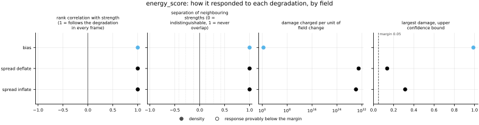
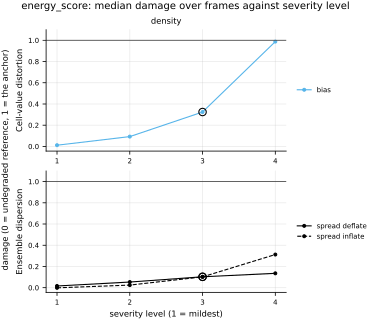

## Definition

Let the reference field be the vector $\mathbf{y}$ of all its values, every channel of every
cell, and let $\mathbf{X}$ and $\mathbf{X}'$ be independent draws from the forecast
distribution $F$ of that vector. With $\|\cdot\|$ the Euclidean norm, the energy score is

$$
\mathrm{ES}(F, \mathbf{y}) = \mathbb{E}\,\|\mathbf{X} - \mathbf{y}\|
- \tfrac{1}{2}\,\mathbb{E}\,\|\mathbf{X} - \mathbf{X}'\| \tag{1}
$$

which is Equation (22) of Gneiting and Raftery with the index $\beta = 1$ and the sign
reversed, so that lower is better [@gneitingraftery2007]. It is strictly proper for any
$\beta \in (0, 2)$: in expectation over the reference, the true distribution of the whole
field scores lower than any other forecast [@gneitingraftery2007]. With one value per field,
$\beta = 1$ turns Equation (1) into the kernel form of the continuous ranked probability score,
their Equation (21), and the score is the [crps](../crps/card.md).

From an ensemble $\mathbf{x}_1 \dots \mathbf{x}_M$ both expectations are estimated without
bias, the pair term over distinct members only [@pacchiardi2024]:

$$
\widehat{\mathrm{ES}} = \frac{1}{M}\sum_{i=1}^{M} \|\mathbf{x}_i - \mathbf{y}\|
- \frac{1}{2M(M-1)}\sum_{i=1}^{M}\sum_{j \ne i} \|\mathbf{x}_i - \mathbf{x}_j\| \tag{2}
$$

Pacchiardi and colleagues write the estimator, in their Appendix C.1.1, for twice the score of
their Equation (33); Equation (2) is half of it. Because its expectation over members drawn
independently from a distribution is that distribution's score, an ensemble drawn from the
truth's own distribution scores best on average at any ensemble size of two or more, which is
what makes the score *fair* in Ferro's sense [@ferro2014]. On a single cell Equation (2) is
exactly the fair estimator `crps` uses. The plug-in form, dividing the pair sum by $2M^2$,
would reward underdispersed ensembles and depend on $M$. At $M = 1$ the pair term cannot be
estimated and is dropped, so the score is $\|\mathbf{x}_1 - \mathbf{y}\|$, whose
expectation is the first term of Equation (1) alone. For a calibrated forecast that is exactly
twice its score with two or more members, since the two expectations of Equation (1) are then
equal (pinned on Gaussian draws by this bundle's tests), and the term alone is not proper. Ferro shows that no non-trivial score is fair for a one-member ensemble [@ferro2014].

The index $\beta = 1$ is the one at which the score reduces to the CRPS; it is fixed, not a
parameter. A vector field's components are pooled into one vector, so the norm of a velocity
error is the root of the summed squares of both components over all cells. The score has no
per-cell decomposition, because a norm is not a sum over cells, so the metric has no
companion map.

Equation (2) is never negative: by the triangle inequality
$\|\mathbf{x}_i - \mathbf{x}_j\| \le \|\mathbf{x}_i - \mathbf{y}\| + \|\mathbf{x}_j -
\mathbf{y}\|$, and summing over the $M(M-1)$ ordered pairs bounds the pair term by the first
term. It reaches zero for a perfect ensemble, every member equal to the reference, and also
whenever the reference lies on the straight segment between every pair of members.

### Boundary handling

None. Equation (2) uses only norms of whole-field differences; no stencil, transform or
neighbourhood is involved, so the domain edge is never consulted and periodicity is
irrelevant.

## Performance

<!-- GENERATED performance: written by `python -m fmeval.cards evidence energy_score --results results/energy_score_1793356825`, do not edit -->



Four measured statistics for energy_score, one row per degradation grouped by family and one marker per field. From left: the rank correlation between the metric and the applied strength within a frame, with the line showing the resampling interval; the separation of neighbouring strengths as Cliff's delta, where 0 means the metric cannot tell one strength from the next and the faint ticks at 0.12, 0.28 and 0.42 are Vargha and Delaney's small, medium and large anchors, for scale and not as grades; the damage charged per unit of field change at the harshest strength; and the upper confidence bound on the largest damage, beside the fixed margin of 0.05. A hollow marker is a field and degradation on which that bound lies below the margin, so the response is provably small. A missing marker is a statistic the analysis withheld, as the rank correlation is on an axis the metric is invariant to.



Median damage over frames against severity level for energy_score, one row per family of degradation and one column per field, on one shared scale. The solid grey line is damage 1, the anchor (by default the field's own mean); the dotted black line is the damage assigned to the fake prediction with the right spectrum, where the run included it. The hollow black ring marks the first level at which the metric has moved a tenth of the way to the anchor. Hollow grey markers are strengths excluded for repeating a milder one or for doing nothing. Degradations with three or fewer usable levels are drawn as markers only; points beyond 2 either side are drawn as triangles at the edge. Damage is negative where a degradation moves the metric away from the anchor, as noise raises a single-field quantity the field's mean sets to zero.

**Trend: does the response follow the degradation?**

| test family | field | degradations | rank correlation | fraction of frames in order | weakest gap between neighbouring strengths |
|---|---|---|---|---|---|
| Ensemble dispersion | density | 2 | 1 | 1 | 1 |
| Cell-value distortion | density | 1 | 1 | 1 | 1 |

**Reactivity: how far does it move?**

| test family | field | change from clean at the harshest strength | elasticity | first strength detected |
|---|---|---|---|---|
| Ensemble dispersion | density | 0.284 to 0.655 | 1.78 | level 3 |
| Cell-value distortion | density | 2.08 | 1.87 | level 3 |

**Consistency: how much does it vary from snapshot to snapshot?**

| test family | field | consistency, in the strength's units | snapshots per independent block |
|---|---|---|---|
| Ensemble dispersion | density | 0.00139 to 0.0142 | 1 |
| Cell-value distortion | density | 0.00119 | 1 |

One row per family of degradation and physical field; a cell gives the range over the degradations in that family. **Trend.** The rank correlation is the Spearman correlation between the strength and how far the metric has moved from its value on the undegraded field of the same frame, in the one direction it moves under that degradation, computed inside a single frame. A value of 1 means every strength moved it further than the last in every frame, whichever way it moves; a response that scatters to both sides scores near 0. The fraction of frames in order counts the frames with no exception. The weakest gap is the smallest Mann-Whitney overlap between two neighbouring strengths across frames: 1 means they never overlap, 0.5 that they cannot be told apart. **Reactivity.** The change from clean is the median, at the harshest strength, of the departure from the undegraded value of the same frame over the size of that value: 0.3 means 30%. The elasticity is the percentage change of that departure per percentage change in strength over the mildest strengths. First strength detected is the mildest at which the metric has moved a tenth of the way to the anchor; **damage** reads that 0-to-1 scale as a number. A dash means the measurement is not defined there. A metric's reactivity scales with the power it is expressed in: mean squared error's elasticity is twice root-mean-square error's, though the two carry the same information, so compare magnitudes across metrics with that in mind. **Consistency** is how much the response varies from snapshot to snapshot relative to its size, in the strength's units; the snapshots of one trajectory are correlated, and the last column is how many consecutive snapshots one independent block spans.

These tables report what was measured and grade none of the measurements. What the numbers mean for this metric is written in the subsections below, beside the test that produced each number.

**Profile.**

| field | selectivity | charges most for | charges least for | response provably below 0.05 at 90% on | elasticity to a sub-pixel shift | compute cost (x cheapest in this run) |
|---|---|---|---|---|---|---|
| density | 0.575 | `spread_deflate` | `bias` | — | — | 1 |

One row per physical field. **Selectivity** is how concentrated the metric's response is on a few degradations, measured per unit of field change: 0 means it charges every degradation the same, as mean squared error does by construction, and values toward 1 that one degradation carries most of it. **Charges most and least for** name the two ends of that profile. **Response provably below** lists degradations on which the upper confidence bound of the largest damage lies below the margin -- an equivalence test, so an entry says the response is provably small, not merely not significant; a dash means no degradation met the bound. **Elasticity** is the slope of log damage against log shift over the smallest shifts: 1 means damage grows in proportion to the shift, 2 with its square. **Compute cost** is wall-clock per evaluation over the cheapest metric and field in the same run.

<!-- END GENERATED performance -->

## Intuition

This metric scores a prediction that is a set of possible whole fields rather than one field.
Like the continuous ranked probability score it asks two things at once — were the
possibilities close to what happened, and was their range honest — but it asks them of the
whole field together instead of one cell at a time.

It takes each member as one long list of numbers, all the values of the field, and measures
how far each member lies from the reference as a single straight-line distance through all
of them. The average of those distances rewards members that land near the truth. From it
the score subtracts half the average distance between pairs of members, which pays back
spread: a collapsed ensemble, all members on one guess, gets no credit, while an ensemble whose
members differ as much as the truth differs from them gets exactly the right amount. The
balance is struck so that, on average, nothing scores better than an ensemble drawn from the
same process as the truth.

A worked example, with fields of two cells and two members:

```
reference        member 1        member 2        result
0, 0             3, 4            0, 4            3
```

Member 1 lies 5 from the reference and member 2 lies 4, an average of 4.5. The two members
lie 3 apart; the pair term counts that distance once in each order and divides by four, a
credit of 1.5. The score is 4.5 − 1.5 = 3. Scored cell by cell with the continuous ranked
probability score, the same ensemble averages 2: the first cell's members straddle the truth
and score zero there, and only the whole-field distance sees that the member which is right
in one cell is wrong in the other.

What it ignores is position: a feature drawn in the right shape one cell away counts as two
errors, exactly as a cell-by-cell metric counts it.

## Reading the output

The score is in the field's own units, runs from zero upward, and lower is better. Zero is
reached by a perfect ensemble and also by an imperfect one whose reference lies between its
members on a straight line, such as two members placed either side of it: with few members
the floor does not single out the perfect forecast, which is the price of an estimator that
is unbiased at every ensemble size.

There is no absolute threshold for a good value. For members and a reference drawn
independently from one Gaussian process with standard deviation $\sigma$ per value and $d$
values in the field, the expected score is $\sigma\,\Gamma\bigl(\tfrac{d+1}{2}\bigr) /
\Gamma\bigl(\tfrac{d}{2}\bigr)$, close to $\sigma\sqrt{d/2}$ (a derivation of this card's,
from the mean of a chi distribution, pinned at $d = 4$ by the bundle's test of the fair
estimator): the score grows with the square root of the number of values, so it rises with
resolution and with the number of channels. Compare models only
on the same analysis grid and field. Comparisons across ensemble sizes of two or more are valid
because the estimator is fair, which is why `n_members` is recorded on every row. A
one-member prediction is not comparable with an ensemble: for a deterministic prediction the
score is the Euclidean distance between the two fields, twice what a calibrated forecast
would score as an ensemble, and says nothing a pointwise norm does not.

Read it beside `crps`. Both are proper and both reward accuracy and honest spread together;
`crps` averages the error cell by cell, and the energy score sees how errors in different
cells combine in one member. The two weigh the same per-cell errors differently, a norm across
cells against a mean of absolute values, so they can move apart with no change in how the
members vary together: three identical members at (1, 1) and at (2, 0) against a reference of
(0, 0) both have a mean CRPS of 1, while their energy scores are 1.41 and 2.

## Limitations

The energy score is weak at the one thing a whole-field score is wanted for: telling a
forecast with the right spatial correlation from one with the wrong correlation but the same
spread at each cell. Scheuerer and Hamill's simulations show it detecting a wrong mean well and
a wrong correlation strength hardly at all, with the calibrated and miscorrelated ensembles'
scores overlapping [@scheuererhamill2015]. An ensemble whose members carry independent noise
at every cell, where the truth has smooth correlated structure, can therefore score nearly as
well as a correctly correlated one. A low energy score does not certify the ensemble's spatial
structure.

On a large field the score is dominated by the bulk of the values, as every norm over the
whole field is: an ensemble excellent everywhere except a small region near a shock reads as
good, because the error in that region is a small part of the total distance.

It also cannot say which of accuracy or dispersion moved. An accurate overconfident ensemble
and an inaccurate honest one can score the same; `spread_skill` and `rank_histogram` say which
half changed.

## Results

<!-- GENERATED run: written by `python -m fmeval.cards evidence energy_score --results results/energy_score_1793356825`, do not edit -->

Measured on `synthetic_ensemble`, frames 0 to 11 (12 frames of a calibrated null: evidence that the estimator computes what it claims to compute, and nothing about turbulence), on the 64 analysis grid, seed 20260807, at commit `394c34c7d4f7`. Run `energy_score_1793356825`.

Every number in this section comes from that one run. Regenerate with `python -m fmeval.cards evidence <name> --results results/energy_score_1793356825`.

<!-- END GENERATED run -->

### Ensemble dispersion

[spread_inflate](../../degradations/spread_inflate/card.md) ·
[spread_deflate](../../degradations/spread_deflate/card.md)

<!-- GENERATED results_ensemble: written by `python -m fmeval.cards evidence energy_score --results results/energy_score_1793356825`, do not edit -->

| degradation | field | strengths | rank correlation | fraction of frames in the right order | weakest gap between neighbouring strengths |
|---|---|---|---|---|---|
| `spread_deflate` | density | 4 | 1 | 1 | 1 |
| `spread_inflate` | density | 4 | 1 | 1 | 1 |

<!-- END GENERATED results_ensemble -->

Both directions raise the score, in every frame and at every strength but one: narrowing the
ensemble and widening it are both penalised, which is propriety seen in a measurement. The
harshest inflation costs more, 0.655 of the clean value against 0.284 for the harshest
deflation in the reactivity table. The exception is the mildest inflation, whose per-frame
median in the run's results sits slightly *below* the clean value; it is still ranked first,
because the ordering is of departures from clean. That dip is a property of how the
degradation widens the ensemble, not of the score: scaling the members about their own
sample mean, which is itself a noisy estimate of the truth, moves the expected minimum of any
fair kernel score a little above the calibrated width at sixteen members (a derivation of
this card's, recorded with the bundle's PR; the `crps` card's ladder has the same
construction).

The profile row above ranks the degradations by damage per unit of field change, but the two
dispersion axes leave the ensemble mean, and so the measured field change, unchanged to
round-off; its "charges most for", "charges least for" and selectivity are therefore not
meaningful for this metric ([issue 111](https://github.com/khegazy/pde_metrics/blob/main/issues/111-damage-per-change-divides-by-round-off-on-ensemble-axes.md)).

On this dataset the noise in every cell is independent of every other cell, so the energy
score and the mean CRPS have the same dependence on the spread factor up to a constant, and
their relative changes on the two dispersion axes agree closely. The run therefore shows that
the estimator is right; it cannot show that the energy score sees anything the CRPS does not,
because the synthetic ensemble has no spatial correlation for it to see.

### Cell-value distortion

[bias](../../degradations/bias/card.md)

<!-- GENERATED results_pointwise: written by `python -m fmeval.cards evidence energy_score --results results/energy_score_1793356825`, do not edit -->

| degradation | field | strengths | rank correlation | fraction of frames in the right order | weakest gap between neighbouring strengths |
|---|---|---|---|---|---|
| `bias` | density | 4 | 1 | 1 | 1 |

<!-- END GENERATED results_pointwise -->

A uniform offset raises the score in every frame, by 2.08 times the clean value at the
harshest offset, with an elasticity of 1.87 over the mildest offsets: close to quadratic,
because the offset adds to every member's distance from the reference in quadrature with the
members' own scatter, and the root of a sum of squares grows with the square of the smaller
term while that term is small.

## References

\bibliography
