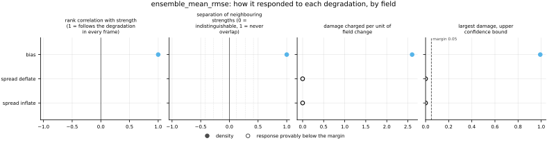
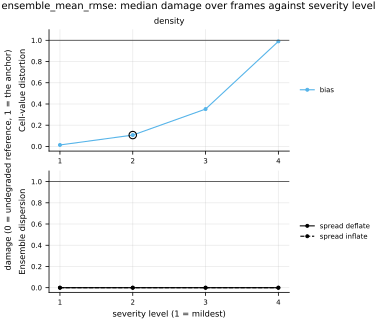

## Definition

For an ensemble $x_{1} \dots x_{M}$ and a reference $y$, both on the analysis grid with $C$
channels and $N$ cells per channel, collapse the ensemble to its mean and score that:

$$
\bar{x}_{c,i} = \frac{1}{M}\sum_{m=1}^{M} x_{m,c,i} \tag{1}
$$

$$
\mathrm{RMSE}_{\bar{x}} = \sqrt{ \frac{1}{CN} \sum_{c=1}^{C} \sum_{i=1}^{N}
\bigl( \bar{x}_{c,i} - y_{c,i} \bigr)^2 } \tag{2}
$$

The order of the two operations is the whole content of the definition. Averaging the
members first and scoring second, as in Equations (1) and (2), is not the same as scoring
each member and averaging the scores: by Jensen's inequality the second is never smaller,
and the gap is exactly the ensemble variance. What is reported here is the error of the
consensus, not the typical error of a member.

The implementation calls this repository's `rmse` on the member mean rather than repeating
the sum, so the two cannot drift apart; a test asserts the equality.

### Boundary handling

None. Both the mean over members and the mean over cells are taken pointwise, so no cell
consults its neighbours and the domain edge never enters.

## Performance

<!-- GENERATED performance: written by `python -m fmeval.cards evidence ensemble_mean_rmse --results results/ensemble_mean_rmse_1787800137`, do not edit -->



Four measured statistics for ensemble_mean_rmse, one row per degradation grouped by family and one marker per field. From left: the rank correlation between the metric and the applied strength within a frame, with the line showing the resampling interval; the separation of neighbouring strengths as Cliff's delta, where 0 means the metric cannot tell one strength from the next and the faint ticks at 0.12, 0.28 and 0.42 are Vargha and Delaney's small, medium and large anchors, for scale and not as grades; the damage charged per unit of field change at the harshest strength; and the upper confidence bound on the largest damage, beside the fixed margin of 0.05. A hollow marker is a field and degradation on which that bound lies below the margin, so the response is provably small. A missing marker is a statistic the analysis withheld, as the rank correlation is on an axis the metric is invariant to.



Median damage over frames against severity level for ensemble_mean_rmse, one row per family of degradation and one column per field, on one shared scale. The solid grey line is damage 1, the anchor (by default the field's own mean); the dotted black line is the damage assigned to the fake prediction with the right spectrum, where the run included it. The hollow black ring marks the first level at which the metric has moved a tenth of the way to the anchor. Hollow grey markers are strengths excluded for repeating a milder one or for doing nothing. Degradations with three or fewer usable levels are drawn as markers only; points beyond 2 either side are drawn as triangles at the edge. Damage is negative where a degradation moves the metric away from the anchor, as noise raises a single-field quantity the field's mean sets to zero.

**Trend: does the response follow the degradation?**

| test family | field | degradations | rank correlation | fraction of frames in order | weakest gap between neighbouring strengths |
|---|---|---|---|---|---|
| Ensemble dispersion | density | 2 | — | — | — |
| Cell-value distortion | density | 1 | 1 | 1 | 1 |

**Reactivity: how far does it move?**

| test family | field | change from clean at the harshest strength | elasticity | first strength detected |
|---|---|---|---|---|
| Ensemble dispersion | density | 0 | — | level — |
| Cell-value distortion | density | 1.63 | 1.82 | level 2 |

**Consistency: how much does it vary from snapshot to snapshot?**

| test family | field | consistency, in the strength's units | snapshots per independent block |
|---|---|---|---|
| Ensemble dispersion | density | — | 1 |
| Cell-value distortion | density | 0.00125 | 1 |

One row per family of degradation and physical field; a cell gives the range over the degradations in that family. **Trend.** The rank correlation is the Spearman correlation between the strength and how far the metric has moved from its value on the undegraded field of the same frame, in the one direction it moves under that degradation, computed inside a single frame. A value of 1 means every strength moved it further than the last in every frame, whichever way it moves; a response that scatters to both sides scores near 0. The fraction of frames in order counts the frames with no exception. The weakest gap is the smallest Mann-Whitney overlap between two neighbouring strengths across frames: 1 means they never overlap, 0.5 that they cannot be told apart. **Reactivity.** The change from clean is the median, at the harshest strength, of the departure from the undegraded value of the same frame over the size of that value: 0.3 means 30%. The elasticity is the percentage change of that departure per percentage change in strength over the mildest strengths. First strength detected is the mildest at which the metric has moved a tenth of the way to the anchor; **damage** reads that 0-to-1 scale as a number. A dash means the measurement is not defined there. A metric's reactivity scales with the power it is expressed in: mean squared error's elasticity is twice root-mean-square error's, though the two carry the same information, so compare magnitudes across metrics with that in mind. **Consistency** is how much the response varies from snapshot to snapshot relative to its size, in the strength's units; the snapshots of one trajectory are correlated, and the last column is how many consecutive snapshots one independent block spans.

These tables report what was measured and grade none of the measurements. What the numbers mean for this metric is written in the subsections below, beside the test that produced each number.

**Profile.**

| field | selectivity | charges most for | charges least for | response provably below 0.05 at 90% on | elasticity to a sub-pixel shift | compute cost (x cheapest in this run) |
|---|---|---|---|---|---|---|
| density | 0.667 | `bias` | `spread_deflate` | `spread_deflate` `spread_inflate` | — | 1 |

One row per physical field. **Selectivity** is how concentrated the metric's response is on a few degradations, measured per unit of field change: 0 means it charges every degradation the same, as mean squared error does by construction, and values toward 1 that one degradation carries most of it. **Charges most and least for** name the two ends of that profile. **Response provably below** lists degradations on which the upper confidence bound of the largest damage lies below the margin -- an equivalence test, so an entry says the response is provably small, not merely not significant; a dash means no degradation met the bound. **Elasticity** is the slope of log damage against log shift over the smallest shifts: 1 means damage grows in proportion to the shift, 2 with its square. **Compute cost** is wall-clock per evaluation over the cheapest metric and field in the same run.

<!-- END GENERATED performance -->

## Intuition

This measures how good an ensemble's single best guess is, and deliberately nothing else.
Average the members together into one field, then score that field the ordinary way. It is
the number to quote when someone asks what happens if you ignore the uncertainty and just
use the prediction.

Its value on the panel comes from what it refuses to see. Widening or narrowing an ensemble
about its own centre does not move this number at all — a test in this bundle pins that
across a factor of fifty in spread. So when it and a probabilistic score disagree, the
disagreement is informative: if this stays put while CRPS rises, the ensemble's centre is
fine and its uncertainty has gone wrong. If both rise together, the prediction itself has
drifted.

There is a second, less obvious reason the number is worth having. Averaging is a smoothing
operation, so the ensemble mean is systematically flatter than any of its members. On a
turbulent field that means the consensus can score better on this metric than any individual
member does, while looking less like real turbulence than any of them — the mean of many
plausible flows is not itself a plausible flow. A model tuned to this number alone will
learn to blur.

A worked example, two members against a reference of 1 on a small uniform field:

```
reference        members              result
1 1              0 0    and   4 4     1.0
1 1              0 0          4 4
```

The mean of 0 and 4 is 2 everywhere, the error is 1 everywhere, and the root mean square of
that is 1. Note that each member individually is off by 1 and 3 respectively, so the typical
member error is 2 — twice what the consensus achieves.

It ignores dispersion entirely, and therefore cannot distinguish a confident prediction from
a vague one.

## Reading the output

The value is in the field's own units, runs from zero upward with no upper bound, and lower
is better. Zero means the ensemble mean matched the reference exactly.

What counts as good depends entirely on the field's own scale, so the number is only
meaningful in comparison. The most useful comparison is against `rmse` computed on a
deterministic prediction of the same system: if an ensemble's consensus cannot beat a single
deterministic run, the ensemble is not earning its cost.

Comparisons across models on one dataset are valid. Comparisons across resolutions are not
directly, since the metric is resolution dependent. Comparison across ensemble sizes is
valid but requires care in interpretation rather than in the estimator: the mean of more
members is smoother, so this number tends to improve with ensemble size for reasons that
have nothing to do with the model being better.

## Limitations

The metric is blind to uncertainty by construction, which is its purpose and also its
principal danger: a model that reports a wildly overconfident ensemble and one that reports
an honest one score identically here. It must not be read alone on a probabilistic panel.

It rewards smoothing. Because the ensemble mean of a set of plausible turbulent fields is
smoother than any of them, this metric prefers a blurred consensus to a sharp one even when
the sharp members are individually more realistic. That is the same pathology that makes
mean squared error a poor training loss for turbulence, arriving by a different route.

And it inherits every blindness of the pointwise family: it compares each cell with the same
cell, so a consensus that is correct in shape but slightly displaced is penalised twice, once
for the missing feature and once for the spurious one.

## Results

<!-- GENERATED run: written by `python -m fmeval.cards evidence ensemble_mean_rmse --results results/ensemble_mean_rmse_1787800137`, do not edit -->

Measured on `synthetic_ensemble`, frames 0 to 11 (12 frames of a calibrated null: evidence that the estimator computes what it claims to compute, and nothing about turbulence), on the 64 analysis grid, seed 20260807, at commit `c49b363765d7` (working tree dirty). Run `ensemble_mean_rmse_1787800137`.

Every number in this section comes from that one run. Regenerate with `python -m fmeval.cards evidence <name> --results results/ensemble_mean_rmse_1787800137`.

<!-- END GENERATED run -->

**What these numbers are evidence of, and what they are not.** The run behind them is on
`synthetic_ensemble`, which is generated rather than simulated: the reference is drawn from
the same process as the members, with the same dispersion, so the two are exchangeable and
every quantity below has a value derivable in advance. That is what makes the run worth
citing — an estimator agreeing with arithmetic it could not have fitted to is a real
result, and it is the claim a first implementation has to establish.

It is not evidence about turbulence. The fields have no shocks, no intermittency and no
coherent structure, so nothing here says how this metric behaves on the flows this
repository exists to evaluate. The degradation families a physical run would exercise —
smoothing, spectral filtering, displacement, resolution loss — are absent from these
tables for that reason, and so are the trap tests. When an ensemble of real runs exists
([issue 004](https://github.com/khegazy/pde_metrics/blob/main/issues/004-independent-realizations.md)), this card should be
regenerated against it and this section will say something different.

### Ensemble dispersion

[spread_inflate](../../degradations/spread_inflate/card.md) ·
[spread_deflate](../../degradations/spread_deflate/card.md)

<!-- GENERATED results_ensemble: written by `python -m fmeval.cards evidence ensemble_mean_rmse --results results/ensemble_mean_rmse_1787800137`, do not edit -->

| degradation | field | strengths | rank correlation | fraction of frames in the right order | weakest gap between neighbouring strengths |
|---|---|---|---|---|---|
| `spread_deflate` | density | 4 | — | — | — |
| `spread_inflate` | density | 4 | — | — | — |

<!-- END GENERATED results_ensemble -->

The metric returns 0.1553 at every severity of both axes, to four decimals, against 0.1553
at the clean severity level. That is the control working exactly as intended, and it is the
sharpest statement in this bundle: an ensemble can go from honestly dispersed to four times
too wide, or be collapsed to a fifth of its proper width, and this metric cannot tell.

The absence of a rank correlation on these two axes is therefore correct rather than
missing. There is no ordering to detect, so the analysis withholds the statistic instead of
reporting a correlation computed on round-off.

Read beside `crps` on the same run, this is what the probabilistic panel buys: CRPS moves
from 0.085 to 0.141 and 0.109 across the same two axes while this number does not move at
all. A panel carrying only mean-based scores would have reported both of those ensembles as
identical to the calibrated one.

## References

\bibliography
