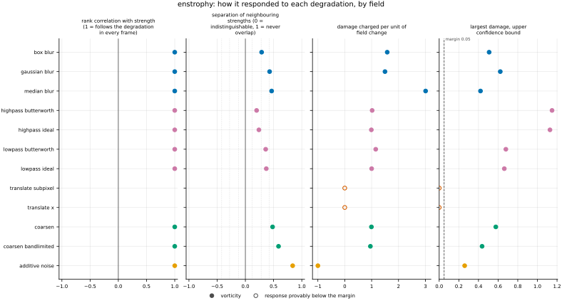
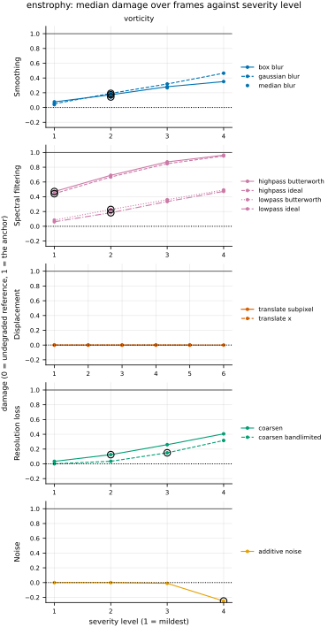
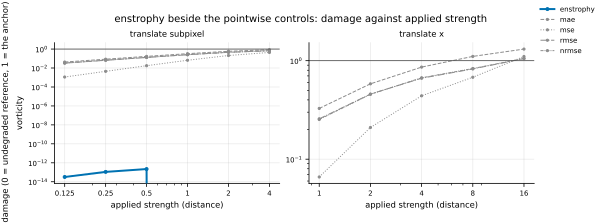

## Definition

For a vorticity field $\omega$ on the analysis grid with $C$ components and $N$ cells,

$$
\mathcal{E}(\omega) = \frac{1}{2N} \sum_{i=1}^{N} \sum_{c=1}^{C}
\omega_{c,i}^{2} \tag{1}
$$

Components are summed before the average over cells, so in 2D the single component is
used and in 3D all three contribute. Equation (1) takes one field and returns one number:
it is a diagnostic, not a comparison, and the pipeline evaluates it on the reference and
on every degraded variant so that the drift between them can be read downstream.

The vorticity itself is recomputed on the analysis grid from the velocity rather than
block-averaged from a finer one, because the average of a curl is not the curl of the
average. Mixing the two produces a field that is not the curl of the velocity beside it.

### Boundary handling

None in this metric: it reads cell values and never a neighbourhood. The vorticity it
consumes does involve a stencil, and the boundary treatment there belongs to the field's
construction — the domain is doubly periodic and the derivative wraps accordingly.

## Performance

<!-- GENERATED performance: written by `python -m fmeval.cards evidence enstrophy --results results/comparison_1793434653`, do not edit -->



Four measured statistics for enstrophy, one row per degradation grouped by family and one marker per field. From left: the rank correlation between the metric and the applied strength within a frame, with the line showing the resampling interval; the separation of neighbouring strengths as Cliff's delta, where 0 means the metric cannot tell one strength from the next and the faint ticks at 0.12, 0.28 and 0.42 are Vargha and Delaney's small, medium and large anchors, for scale and not as grades; the damage charged per unit of field change at the harshest strength; and the upper confidence bound on the largest damage, beside the fixed margin of 0.05. A hollow marker is a field and degradation on which that bound lies below the margin, so the response is provably small. A missing marker is a statistic the analysis withheld, as the rank correlation is on an axis the metric is invariant to.



Median damage over frames against severity level for enstrophy, one row per family of degradation and one column per field, on one shared scale. The solid grey line is damage 1, the anchor (by default the field's own mean); the dotted black line is the damage assigned to the fake prediction with the right spectrum, where the run included it. The hollow black ring marks the first level at which the metric has moved a tenth of the way to the anchor. Hollow grey markers are strengths excluded for repeating a milder one or for doing nothing. Degradations with three or fewer usable levels are drawn as markers only; points beyond 2 either side are drawn as triangles at the edge. Damage is negative where a degradation moves the metric away from the anchor, as noise raises a single-field quantity the field's mean sets to zero.

**Trend: does the response follow the degradation?**

| test family | field | degradations | rank correlation | fraction of frames in order | weakest gap between neighbouring strengths |
|---|---|---|---|---|---|
| Displacement | vorticity | 2 | — | — | — |
| Resolution loss | vorticity | 2 | 1 | 1 | 0.741 to 0.794 |
| Smoothing | vorticity | 3 | 1 | 1 | 0.644 to 0.733 |
| Spectral filtering | vorticity | 4 | 1 | 1 | 0.599 to 0.685 |
| Noise | vorticity | 1 | 1 | 0.919 | 0.919 |

**Reactivity: how far does it move?**

| test family | field | change from clean at the harshest strength | elasticity | first strength detected |
|---|---|---|---|---|
| Displacement | vorticity | 0 | — | level — |
| Resolution loss | vorticity | -0.41 to -0.294 | 1.47 to 3.74 | level 2 |
| Smoothing | vorticity | -0.465 to -0.234 | 0.915 to 1.48 | level 2 |
| Spectral filtering | vorticity | -0.971 to -0.473 | 0.823 to 0.955 | level 1 |
| Noise | vorticity | 0.25 | — | level 4 |
| trap test: fake prediction, right spectrum | vorticity | — | — | damage 0 |

**Consistency: how much does it vary from snapshot to snapshot?**

| test family | field | consistency, in the strength's units | snapshots per independent block |
|---|---|---|---|
| Displacement | vorticity | — | 1 to 18 |
| Resolution loss | vorticity | 1.16 to 1.51 | 22 |
| Smoothing | vorticity | 0.0138 to 0.0321 | 22 |
| Spectral filtering | vorticity | 0.0364 to 0.0404 | 22 |
| Noise | vorticity | 0.00635 | 1 |

One row per family of degradation and physical field; a cell gives the range over the degradations in that family. **Trend.** The rank correlation is the Spearman correlation between the strength and how far the metric has moved from its value on the undegraded field of the same frame, in the one direction it moves under that degradation, computed inside a single frame. A value of 1 means every strength moved it further than the last in every frame, whichever way it moves; a response that scatters to both sides scores near 0. The fraction of frames in order counts the frames with no exception. The weakest gap is the smallest Mann-Whitney overlap between two neighbouring strengths across frames: 1 means they never overlap, 0.5 that they cannot be told apart. **Reactivity.** The change from clean is the median, at the harshest strength, of the departure from the undegraded value of the same frame over the size of that value: 0.3 means 30%. The elasticity is the percentage change of that departure per percentage change in strength over the mildest strengths. First strength detected is the mildest at which the metric has moved a tenth of the way to the anchor; **damage** reads that 0-to-1 scale as a number. A dash means the measurement is not defined there. A metric's reactivity scales with the power it is expressed in: mean squared error's elasticity is twice root-mean-square error's, though the two carry the same information, so compare magnitudes across metrics with that in mind. **Consistency** is how much the response varies from snapshot to snapshot relative to its size, in the strength's units; the snapshots of one trajectory are correlated, and the last column is how many consecutive snapshots one independent block spans.

These tables report what was measured and grade none of the measurements. What the numbers mean for this metric is written in the subsections below, beside the test that produced each number.

**Profile.**

| field | selectivity | charges most for | charges least for | response provably below 0.05 at 90% on | elasticity to a sub-pixel shift, against severity (distance) | compute cost (x cheapest in this run) |
|---|---|---|---|---|---|---|
| vorticity | 0.31 | `median_blur` | `translate_subpixel` | `translate_subpixel` `translate_x` | — | 1.02 |

One row per physical field. **Selectivity** is how concentrated the metric's response is on a few degradations, measured per unit of field change: 0 means it charges every degradation the same, as mean squared error does by construction, and values toward 1 that one degradation carries most of it. **Charges most and least for** name the two ends of that profile. **Response provably below** lists degradations on which the upper confidence bound of the largest damage lies below the margin -- an equivalence test, so an entry says the response is provably small, not merely not significant; a dash means no degradation met the bound. **Elasticity** is the slope of log damage against log shift over the smallest shifts: 1 means damage grows in proportion to the shift, 2 with its square. **Compute cost** is wall-clock per evaluation over the cheapest metric and field in the same run.

<!-- END GENERATED performance -->

## Intuition

Enstrophy measures how much rotation a flow contains, by squaring the local rotation rate
everywhere and averaging. Squaring means the direction of the swirl does not matter and
that vigorous small eddies count for far more than gentle large ones, which is why
enstrophy is usually read as a measure of small-scale activity.

Because enstrophy needs only one field, the number says nothing about accuracy on its own.
It is evaluated on the true flow and on the prediction, and the useful quantity is the
difference: a prediction that has lost its small eddies to numerical smoothing will report
noticeably less enstrophy than the flow it is imitating.

On a four-by-four grid with four rotating cells, two turning each way:

```
vorticity        enstrophy
0  0  0  0
0  1 -1  0       0.125
0 -1  1  0
0  0  0  0
```

Four cells of unit magnitude out of sixteen, halved, gives 0.125. Moving those same four
cells into a corner gives 0.125 as well, and so does reflecting the field.

That last point is what this quantity ignores, and the omission is not a small one:
enormously many different flows share any given enstrophy. It can tell you that rotation
has been lost, never that a prediction is right.

## Reading the output

The value runs from zero upwards with no upper limit, in the square of the vorticity
units. There is no direction in which it is better: it is a property of a flow, not an
error, and it is read by comparing the prediction's value against the reference's on the
same frame. Equal is good; the sign of a departure tells you which way the prediction
went wrong.

A prediction reporting less enstrophy than the reference has lost small-scale rotation,
which is what excessive numerical dissipation or an over-smooth surrogate looks like. More
enstrophy than the reference usually means noise or a numerical instability adding
spurious small-scale structure.

Comparisons are only meaningful between fields on the same analysis grid, because a
coarser grid cannot represent the small scales where most of the enstrophy sits and will
report less of it regardless of the prediction's quality. Comparing the absolute value
across datasets is not meaningful; comparing the drift from each dataset's own reference
is.

## Limitations

One number summarising a whole field is degenerate on a scale that is easy to
underestimate: a flow with its vorticity redistributed arbitrarily, reflected, rotated or
translated has exactly the same enstrophy. A prediction can match the reference here while
being wrong in every other respect, so a matching value is not evidence of anything. This
is why it belongs in a panel as a rough alarm and never alone.

The resolution dependence is the trap most likely to catch a real user. Enstrophy lives at
the smallest resolved scales, so it falls simply from evaluating on a coarser grid, and a
comparison that mixes grids will read that as a physical loss of rotation. Fix the
analysis grid before drawing any conclusion.

## Results

<!-- GENERATED run: written by `python -m fmeval.cards evidence enstrophy --results results/comparison_1793434653`, do not edit -->

Measured on `kinet_re5e4`, frames 2000 to 10000 (161 frames of developed flow), on the 256 analysis grid, seed 20260807, at commit `a9a8b7f86aca`. Run `comparison_1793434653`.

Every number in this section comes from that one run. Regenerate with `python -m fmeval.cards evidence <name> --results results/comparison_1793434653`.

<!-- END GENERATED run -->

Each subsection links to the degradations that subsection reports. What those degradations
do, and what their strength numbers mean, is documented on their own pages. A single-field
diagnostic is evaluated on the reference and on every degraded variant alike, so what is
read here is the drift away from the reference value rather than an error. On the damage scale
the anchor is the field's own spatial mean, which has zero enstrophy, so damage is the
enstrophy lost as a fraction of the median reference value over snapshots: positive when the value
falls and negative when it rises. The reference's enstrophy varies by a factor of 2.2 over the
run, so the fraction of each snapshot's own enstrophy lost, the change from clean in the tables,
differs from the damage.

### Smoothing

[gaussian_blur](../../degradations/gaussian_blur/card.md) ·
[box_blur](../../degradations/box_blur/card.md) ·
[median_blur](../../degradations/median_blur/card.md)

<!-- GENERATED results_smoothing: written by `python -m fmeval.cards evidence enstrophy --results results/comparison_1793434653`, do not edit -->

| degradation | field | strengths | rank correlation | fraction of frames in the right order | weakest gap between neighbouring strengths |
|---|---|---|---|---|---|
| `box_blur` | vorticity | 4 | 1 | 1 | 0.644 |
| `gaussian_blur` | vorticity | 4 | 1 | 1 | 0.715 |
| `median_blur` | vorticity | 3 | 1 | 1 | 0.733 |

<!-- END GENERATED results_smoothing -->

### Spectral filtering

[lowpass_ideal](../../degradations/lowpass_ideal/card.md) ·
[lowpass_butterworth](../../degradations/lowpass_butterworth/card.md) ·
[highpass_ideal](../../degradations/highpass_ideal/card.md) ·
[highpass_butterworth](../../degradations/highpass_butterworth/card.md)

<!-- GENERATED results_spectral: written by `python -m fmeval.cards evidence enstrophy --results results/comparison_1793434653`, do not edit -->

| degradation | field | strengths | rank correlation | fraction of frames in the right order | weakest gap between neighbouring strengths |
|---|---|---|---|---|---|
| `highpass_butterworth` | vorticity | 4 | 1 | 1 | 0.599 |
| `highpass_ideal` | vorticity | 4 | 1 | 1 | 0.62 |
| `lowpass_butterworth` | vorticity | 4 | 1 | 1 | 0.68 |
| `lowpass_ideal` | vorticity | 4 | 1 | 1 | 0.685 |

<!-- END GENERATED results_spectral -->

### Displacement

[translate_x](../../degradations/translate/card.md) ·
[translate_subpixel](../../degradations/translate_subpixel/card.md)

<!-- GENERATED results_geometric: written by `python -m fmeval.cards evidence enstrophy --results results/comparison_1793434653`, do not edit -->

| degradation | field | strengths | rank correlation | fraction of frames in the right order | weakest gap between neighbouring strengths |
|---|---|---|---|---|---|
| `translate_subpixel` | vorticity | 6 | — | — | — |
| `translate_x` | vorticity | 5 | — | — | — |

<!-- END GENERATED results_geometric -->

A translation moves the field without changing any of its values, so a quantity built from
those values alone cannot see it at all. Measured, it is flat: on every frame and at every
shift the value matches the reference's to within 1e-12 of it, which is why the table has
no rank correlation. A measurement showing otherwise would indicate the translation is not
conserving what it should — which is one of the things a reference-free diagnostic is
useful for.

### Resolution loss

[coarsen](../../degradations/coarsen/card.md) ·
[coarsen_bandlimited](../../degradations/coarsen_bandlimited/card.md)

<!-- GENERATED results_resolution: written by `python -m fmeval.cards evidence enstrophy --results results/comparison_1793434653`, do not edit -->

| degradation | field | strengths | rank correlation | fraction of frames in the right order | weakest gap between neighbouring strengths |
|---|---|---|---|---|---|
| `coarsen` | vorticity | 4 | 1 | 1 | 0.741 |
| `coarsen_bandlimited` | vorticity | 4 | 1 | 1 | 0.794 |

<!-- END GENERATED results_resolution -->

Both coarsenings take the value steadily below its clean value, so each follows its
degradation with a rank correlation of 1; it falls because detail is removed. `coarsen` removes more at every factor: 4%, 14%, 26% and 40% of the
enstrophy at factors 2 to 16, against 0.1%, 5%, 17% and 31% under `coarsen_bandlimited`. The
two keep the same block means; the staircase additionally flattens each block, discarding the
variance inside it that the band-limited reconstruction keeps wherever the coarse grid can
represent it.

### Noise

[additive_noise](../../degradations/additive_noise/card.md)

<!-- GENERATED results_stochastic: written by `python -m fmeval.cards evidence enstrophy --results results/comparison_1793434653`, do not edit -->

| degradation | field | strengths | rank correlation | fraction of frames in the right order | weakest gap between neighbouring strengths |
|---|---|---|---|---|---|
| `additive_noise` | vorticity | 4 | 1 | 0.919 | 0.919 |

<!-- END GENERATED results_stochastic -->

### Trap tests

[gaussian_impostor](../../degradations/gaussian_impostor/card.md) ·
[uncorrelated](../../degradations/random_large_translation/card.md)

<!-- GENERATED results_canaries: written by `python -m fmeval.cards evidence enstrophy --results results/comparison_1793434653`, do not edit -->

| field | damage assigned to the fake prediction | closest real degradation | damage of the reference moved far away | value on the anchor |
|---|---|---|---|---|
| vorticity | 0 | `translate_subpixel=1` | 0 | 0 |

The fake prediction here has exactly the reference field's amplitude spectrum and completely scrambled structure. Damage 1 is what the anchor scores, by default the reference's own spatial mean, a prediction that knows the mean and nothing else. The damage column therefore says how close to useless this metric considers that fake prediction: a low number means the metric was fooled. The third column translates the same number into an ordinary degradation whose damage the fake prediction matches, which is easier to picture. The fourth is the reference moved by a large random offset, the right statistics in the wrong place; where a field's energy sits in its largest scales that copy stays partly correlated with the reference, so it is not the score of an unrelated field.

<!-- END GENERATED results_canaries -->

Both score exactly the reference's enstrophy, damage 0. The fake prediction has the
reference's amplitude spectrum, and by Parseval's theorem Equation (1) is proportional to the
sum of that spectrum's squares, so the two cannot differ; the moved copy is a translation of
the reference. The trap therefore records this metric as fooled, which for a single-field
quantity follows from the definition rather than from the data.

### Compared with the other metrics

<!-- GENERATED results_summary: written by `python -m fmeval.cards evidence enstrophy --results results/comparison_1793434653`, do not edit -->

| compared with | rank correlation over every degradation |
|---|---|
| `kinetic_energy` | 0.86 |
| `palinstrophy` | 0.758 |
| `h1_seminorm` | 0.25 |
| `tail_index` | 0.205 |
| `increment_flatness` | 0.0202 |
| `mae` | -0.103 |
| `rmse` | -0.116 |
| `mse` | -0.116 |
| `nrmse` | -0.154 |
| `max_error` | -0.175 |
| `h_minus_one` | -0.183 |
| `increment_w1` | -0.495 |
| `energy_distance` | -0.526 |
| `spectral_energy_flux` | -0.602 |
| `increment_w1_by_separation` | -0.608 |
| `spectrum_l2` | -0.828 |

Computed on the median value at each combination of degradation and strength, over every degradation and physical field in the run, with the undegraded reference excluded. Two metrics correlating near 1 put the degradations in the same order, but the two may still weight those degradations very differently. A correlation near 1 therefore means the two metrics are redundant for ranking models, not that the two are interchangeable as training losses.

<!-- END GENERATED results_summary -->

### Damage beside the other metrics

<!-- GENERATED results_damage_by_level: written by `python -m fmeval.cards evidence enstrophy --results results/comparison_1793434653`, do not edit -->



Median damage over frames against the applied strength, log-log, for enstrophy (bold, in colour) and the pointwise controls mae, mse, rmse, nrmse (thin, grey), one column per displacement degradation and one row per field. The grey line is damage 1, the anchor (by default the field's own mean). Parallel lines charge in the same proportion at every strength; a steeper line charges relatively more for the larger shifts, which is what decides whether two metrics are interchangeable as training losses. These are the same numbers as the table beneath.

**Displacement, density, `translate_subpixel`** (strength: distance).

| metric | 0.125 | 0.25 | 0.5 | 1 | 2 | 4 |
|---|---|---|---|---|---|---|
| `enstrophy` | — | — | — | — | — | — |
| `mae` | 0.00383 | 0.00767 | 0.0153 | 0.0306 | 0.061 | 0.121 |
| `mse` | 2.17e-05 | 8.68e-05 | 0.000347 | 0.00138 | 0.00551 | 0.0219 |
| `rmse` | 0.00466 | 0.00931 | 0.0186 | 0.0372 | 0.0743 | 0.148 |
| `nrmse` | 0.00463 | 0.00926 | 0.0185 | 0.037 | 0.0738 | 0.147 |

**Displacement, density, `translate_x`** (strength: distance).

| metric | 1 | 2 | 4 | 8 | 16 |
|---|---|---|---|---|---|
| `enstrophy` | — | — | — | — | — |
| `mae` | 0.0306 | 0.061 | 0.121 | 0.24 | 0.469 |
| `mse` | 0.00138 | 0.00551 | 0.0219 | 0.0849 | 0.307 |
| `rmse` | 0.0372 | 0.0743 | 0.148 | 0.291 | 0.555 |
| `nrmse` | 0.037 | 0.0738 | 0.147 | 0.29 | 0.55 |

**Displacement, velocity, `translate_subpixel`** (strength: distance).

| metric | 0.125 | 0.25 | 0.5 | 1 | 2 | 4 |
|---|---|---|---|---|---|---|
| `enstrophy` | — | — | — | — | — | — |
| `mae` | 0.00279 | 0.00559 | 0.0112 | 0.0223 | 0.0441 | 0.0859 |
| `mse` | 1.45e-05 | 5.81e-05 | 0.000232 | 0.000924 | 0.0036 | 0.0136 |
| `rmse` | 0.00381 | 0.00762 | 0.0152 | 0.0304 | 0.06 | 0.117 |
| `nrmse` | 0.00382 | 0.00763 | 0.0153 | 0.0304 | 0.06 | 0.117 |

**Displacement, velocity, `translate_x`** (strength: distance).

| metric | 1 | 2 | 4 | 8 | 16 |
|---|---|---|---|---|---|
| `enstrophy` | — | — | — | — | — |
| `mae` | 0.0223 | 0.0441 | 0.0859 | 0.163 | 0.31 |
| `mse` | 0.000924 | 0.0036 | 0.0136 | 0.0489 | 0.165 |
| `rmse` | 0.0304 | 0.06 | 0.117 | 0.221 | 0.406 |
| `nrmse` | 0.0304 | 0.06 | 0.117 | 0.221 | 0.406 |

**Displacement, vorticity, `translate_subpixel`** (strength: distance).

| metric | 0.125 | 0.25 | 0.5 | 1 | 2 | 4 |
|---|---|---|---|---|---|---|
| `enstrophy` | 3.49e-14 | 1.19e-13 | 2.38e-13 | -0 | -0 | -0 |
| `mae` | 0.0428 | 0.0854 | 0.169 | 0.328 | 0.582 | 0.86 |
| `mse` | 0.00112 | 0.00448 | 0.0176 | 0.066 | 0.21 | 0.44 |
| `rmse` | 0.0335 | 0.0669 | 0.133 | 0.257 | 0.458 | 0.663 |
| `nrmse` | 0.0328 | 0.0654 | 0.13 | 0.253 | 0.456 | 0.67 |

**Displacement, vorticity, `translate_x`** (strength: distance).

| metric | 1 | 2 | 4 | 8 | 16 |
|---|---|---|---|---|---|
| `enstrophy` | -0 | -0 | -0 | -0 | -0 |
| `mae` | 0.328 | 0.582 | 0.86 | 1.1 | 1.31 |
| `mse` | 0.066 | 0.21 | 0.44 | 0.679 | 1.1 |
| `rmse` | 0.257 | 0.458 | 0.663 | 0.824 | 1.05 |
| `nrmse` | 0.253 | 0.456 | 0.67 | 0.832 | 1.05 |

Median damage over frames at every strength, this metric in the first row and the pointwise controls beneath it, all on the same 0-to-1 scale where 0 is the undegraded reference and 1 the anchor (by default the field's own mean); a dash means no damage scale on that field. The rank correlations under *Compared with the other metrics* say whether two metrics put the strengths in the same order; this table says how much each one charges for the same strength, which decides whether two metrics are interchangeable as training losses.

<!-- END GENERATED results_damage_by_level -->

## References

\bibliography
