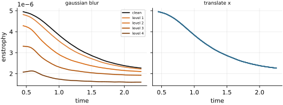
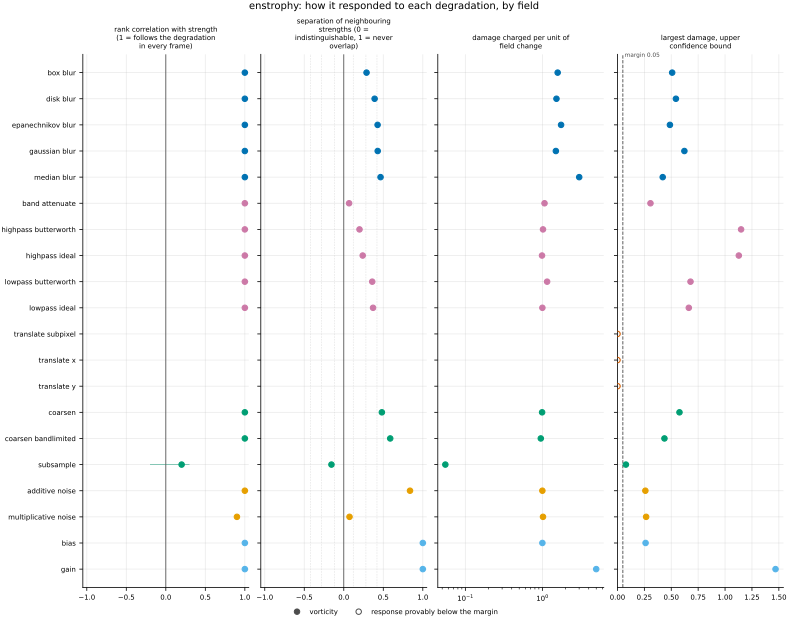
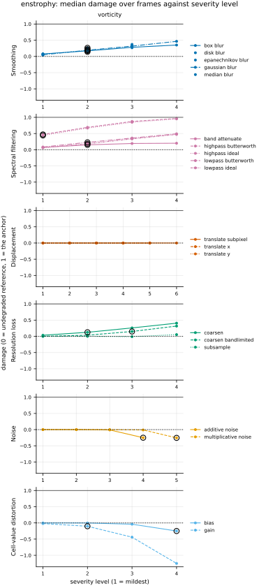
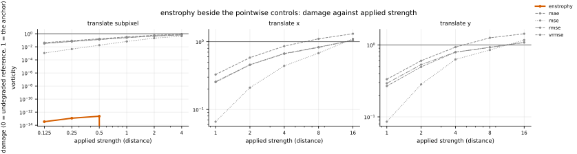
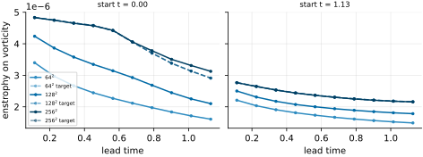

## Definition

For a vorticity field $\omega$ on the analysis grid with $C$ components and $N$ cells,

$$
\mathcal{E}(\omega) = \frac{1}{2N} \sum_{i=1}^{N} \sum_{c=1}^{C}
\omega_{c,i}^{2} \tag{1}
$$

Components are summed before the average over cells, so in 2D the single component is
used and in 3D all three contribute. Equation (1) is the enstrophy of two-dimensional
turbulence theory, $\Omega = \tfrac12 \langle \omega^2 \rangle$ with the average over the
domain, including its factor of one half ([@boffetta2012], p. 430). It takes one field and
returns one number: it is a diagnostic, not a comparison, and the pipeline evaluates it on the
reference and on every degraded variant so that the drift between them can be read downstream.

The vorticity itself is recomputed on the analysis grid from the velocity rather than
block-averaged from a finer one, because the average of a curl is not the curl of the
average. Mixing the two produces a field that is not the curl of the velocity beside it.

### Boundary handling

None in this metric: it reads cell values and never a neighbourhood. The vorticity it
consumes is the spectral curl of the velocity on the analysis grid
(`fmeval/derived.py::vorticity_from_velocity`), not the solver's stored stencil vorticity. A
Fourier transform wraps around every axis, so that recomputation refuses a grid that is not
periodic on every axis; on such a dataset there is no vorticity for this metric to read.

### How its field reports it

**Turbulence theory** defines the enstrophy as the second quadratic invariant of the inviscid,
unforced two-dimensional equations, $\Omega = \tfrac12 \langle \omega^2 \rangle = \int k^2
E(k)\,dk$ with the isotropic spectrum $E(k)$ of their Eq. (3), and its decay without forcing or
friction by their Eq. (6), $d\Omega/dt = -2\nu P$, with $P$ the
[palinstrophy](../../metrics/palinstrophy/card.md) ([@boffetta2012], p. 430). Equation (5)
there makes it also the rate at which viscosity removes [kinetic energy](../../metrics/kinetic_energy/card.md).
The quantity is read as a time series and as the balance of that budget.

**Learned turbulence models** report it as a time series: the enstrophy of each model's
rollout against time, with the direct numerical simulation's curve overlaid
([@frezat2022], Fig. 4 for decaying and Fig. 6 for forced turbulence, beside the energy). The
paper does not reduce the two curves to a number; the relative error of the integral,
$(\Omega_{\mathrm{prediction}} - \Omega_{\mathrm{reference}}) / \Omega_{\mathrm{reference}}$ at
each time, is this repository's reading of them (Reading the output).

**The figure** is the enstrophy against time with the reference's curve overlaid, the card's
first figure. On a run of real forecasts it is the field's figure exactly, the prediction's
enstrophy beside its target's at each prediction step. On the degradation ladder it is the
reference's decay beside each degradation applied at each time, which is not a rollout.

**The experiments.** Rollouts of a model scored against the truth: `forecast_re5e4` holds one
model's rollouts from two starting times, ten prediction steps each; many initial conditions are
written up in
[EXP-nrmse-rollouts-over-many-initial-conditions](https://github.com/khegazy/pde_metrics/blob/main/proposals/EXP-nrmse-rollouts-over-many-initial-conditions.md).
The budget closure $d\Omega/dt = -2\nu P$ needs consecutive states of the same trajectory to
difference in time: `kinet_re5e4` read at reduction 1 holds consecutive solver steps of the
reference, but no candidate trajectory has them, so the experiment is written up in
[EXP-enstrophy-budget-closure-from-consecutive-states](https://github.com/khegazy/pde_metrics/blob/main/proposals/EXP-enstrophy-budget-closure-from-consecutive-states.md)
and not built. The metric also runs on the degradation ladder on `kinet_re5e4` and on the
Reynolds ladder. `sod_shock_tube` and `synthetic_ensemble` hold no vorticity.

## Performance

<!-- GENERATED performance: written by `python -m fmeval.cards evidence enstrophy --results results/comparison_1793846511 --results results/comparison_1793811840 --results results/comparison_1793846600`, do not edit -->



*As this metric's own field draws it.* enstrophy on vorticity against the frame's physical time, one line per strength of each degradation the run chose for its detailed views, or whose applied strength grows with time; the clean field in black is the quantity's own history. A degraded line is the operator applied to each frame on its own, not a rollout: it says what the operator does at each time, not how an error would grow. Median over frames at each time.



Four measured statistics for enstrophy, one row per degradation grouped by family and one marker per field. From left: the rank correlation between the metric and the applied strength within a frame, with the line showing the resampling interval; the separation of neighbouring strengths as Cliff's delta, where 0 means the metric cannot tell one strength from the next and the faint ticks at 0.12, 0.28 and 0.42 are Vargha and Delaney's small, medium and large anchors, for scale and not as grades; the damage charged per unit of field change at the harshest strength; and the upper confidence bound on the largest damage, beside the fixed margin of 0.05. A hollow marker is a field and degradation on which that bound lies below the margin, so the response is provably small. A missing marker is a statistic the analysis withheld, as the rank correlation is on an axis the metric is invariant to.



Median damage over frames against severity level for enstrophy, one row per family of degradation and one column per field, on one shared scale. The solid grey line is damage 1, the anchor (by default the field's own mean); the dotted black line is the damage assigned to the fake prediction with the right spectrum, where the run included it. The hollow black ring marks the first level at which the metric has moved a tenth of the way to the anchor. Hollow grey markers are strengths excluded for repeating a milder one or for doing nothing. Degradations with three or fewer usable levels are drawn as markers only; points beyond 2 either side are drawn as triangles at the edge. Damage is negative where a degradation moves the metric away from the anchor, as noise raises a single-field quantity the field's mean sets to zero.

**Trend: does the response follow the degradation?**

| test family | field | degradations | rank correlation | fraction of frames in order | weakest gap between neighbouring strengths |
|---|---|---|---|---|---|
| Displacement | vorticity | 3 | — | — | — |
| Cell-value distortion | vorticity | 2 | 1 | 1 | 1 |
| Resolution loss | vorticity | 3 | 0.2 to 1 | 0.143 to 1 | 0.422 to 0.794 |
| Smoothing | vorticity | 5 | 1 | 1 | 0.644 to 0.733 |
| Spectral filtering | vorticity | 5 | 1 | 1 | 0.534 to 0.685 |
| Noise | vorticity | 2 | 0.9 to 1 | 0.317 to 0.919 | 0.536 to 0.919 |

**Reactivity: how far does it move?**

| test family | field | change from clean at the harshest strength | elasticity | first strength detected |
|---|---|---|---|---|
| Displacement | vorticity | 0 | — | level — |
| Cell-value distortion | vorticity | 0.25 to 1.25 | 1.03 to 2 | level 2 |
| Resolution loss | vorticity | -0.41 to -0.0545 | 1.47 to 3.74 | level 2 |
| Smoothing | vorticity | -0.465 to -0.234 | 0.915 to 1.48 | level 2 |
| Spectral filtering | vorticity | -0.971 to -0.188 | 0.72 to 0.955 | level 1 |
| Noise | vorticity | 0.246 to 0.25 | 1.4 | level 4 |
| trap test: fake prediction, right spectrum | vorticity | — | — | damage 0 |

**Consistency: how much does it vary from snapshot to snapshot?**

| test family | field | consistency, in the strength's units | snapshots per independent block |
|---|---|---|---|
| Displacement | vorticity | — | 1 to 18 |
| Cell-value distortion | vorticity | 7.32e-17 to 6.11e-16 | 1 to 14 |
| Resolution loss | vorticity | 1.16 to 34.3 | 1 to 22 |
| Smoothing | vorticity | 0.0138 to 0.0321 | 22 |
| Spectral filtering | vorticity | 0.0363 to 0.113 | 22 |
| Noise | vorticity | 0.00682 to 0.0283 | 1 |

One row per family of degradation and physical field; a cell gives the range over the degradations in that family. **Trend.** The rank correlation is the Spearman correlation between the strength and how far the metric has moved from its value on the undegraded field of the same frame, in the one direction it moves under that degradation, computed inside a single frame. A value of 1 means every strength moved it further than the last in every frame, whichever way it moves; a response that scatters to both sides scores near 0. The fraction of frames in order counts the frames with no exception. The weakest gap is the smallest Mann-Whitney overlap between two neighbouring strengths across frames: 1 means they never overlap, 0.5 that they cannot be told apart. **Reactivity.** The change from clean is the median, at the harshest strength, of the departure from the undegraded value of the same frame over the size of that value: 0.3 means 30%. The elasticity is the percentage change of that departure per percentage change in strength over the mildest strengths. First strength detected is the mildest at which the metric has moved a tenth of the way to the anchor; **damage** reads that 0-to-1 scale as a number. A dash means the measurement is not defined there. A metric's reactivity scales with the power it is expressed in: mean squared error's elasticity is twice root-mean-square error's, though the two carry the same information, so compare magnitudes across metrics with that in mind. **Consistency** is how much the response varies from snapshot to snapshot relative to its size, in the strength's units; the snapshots of one trajectory are correlated, and the last column is how many consecutive snapshots one independent block spans.

These tables report what was measured and grade none of the measurements. What the numbers mean for this metric is written in the subsections below, beside the test that produced each number.

**Profile.**

| field | selectivity | charges most for | charges least for | response provably below 0.05 at 90% on | elasticity to a sub-pixel shift, against severity (distance) | compute cost (x cheapest in this run) |
|---|---|---|---|---|---|---|
| vorticity | 0.446 | `gain` | `translate_subpixel` | `translate_subpixel` `translate_x` `translate_y` | — | 1.33 |

One row per physical field. **Selectivity** is how concentrated the metric's response is on a few degradations, measured per unit of field change: 0 means it charges every degradation the same, as mean squared error does by construction, and values toward 1 that one degradation carries most of it. **Charges most and least for** name the two ends of that profile. **Response provably below** lists degradations on which the upper confidence bound of the largest damage lies below the margin -- an equivalence test, so an entry says the response is provably small, not merely not significant; a dash means no degradation met the bound. **Elasticity** is the slope of log damage against log shift over the smallest shifts: 1 means damage grows in proportion to the shift, 2 with its square. **Compute cost** is wall-clock per evaluation over the cheapest metric and field in the same run.

<!-- END GENERATED performance -->

## Intuition

Enstrophy measures how much rotation a flow contains, by squaring the local rotation rate
everywhere and averaging. Squaring means the direction of the swirl does not matter and
that vigorous small eddies count for far more than gentle large ones, which is why
enstrophy is usually read as a measure of small-scale activity.

Because enstrophy needs only one field, the number says nothing about accuracy on its own.
It is evaluated on the true flow and on the prediction, and the useful quantity is the
difference: a prediction that has lost its small eddies to numerical smoothing will report
noticeably less enstrophy than the flow it is imitating.

On a four-by-four grid with four rotating cells, two turning each way:

```
vorticity        enstrophy
0  0  0  0
0  1 -1  0       0.125
0 -1  1  0
0  0  0  0
```

Four cells of unit magnitude out of sixteen, halved, gives 0.125. Moving those same four
cells into a corner gives 0.125 as well, and so does reflecting the field.

That last point is what this quantity ignores, and the omission is not a small one:
enormously many different flows share any given enstrophy. It can tell you that rotation
has been lost, never that a prediction is right.

## Reading the output

The value runs from zero upwards with no upper limit, in the square of the vorticity
units. There is no direction in which it is better: it is a property of a flow, not an
error, and it is read by comparing the prediction's value against the reference's on the
same frame. Equal is good; the sign of a departure tells you which way the prediction
went wrong.

**The reading is the relative error of the integral**,
$(\Omega_{\mathrm{prediction}} - \Omega_{\mathrm{reference}}) / \Omega_{\mathrm{reference}}$ on
the same frame, which the tables give as the *change from clean*: 0 is a prediction with the
reference's enstrophy, $-0.3$ one that has lost three tenths of it. On a run of real forecasts
it is the relative error at each prediction step, and the figure shows the two enstrophies
against time. Unlike the raw value, its size is comparable across frames of a decaying flow.

A prediction reporting less enstrophy than the reference has lost small-scale rotation,
which is what excessive numerical dissipation or an over-smooth surrogate looks like. More
enstrophy than the reference usually means noise or a numerical instability adding
spurious small-scale structure.

Comparisons are only meaningful between fields on the same analysis grid, because a
coarser grid cannot represent the small scales where most of the enstrophy sits and will
report less of it regardless of the prediction's quality. Comparing the absolute value
across datasets is not meaningful; comparing the drift from each dataset's own reference
is.

## Limitations

One number summarising a whole field is degenerate on a scale that is easy to
underestimate: a flow with its vorticity redistributed arbitrarily, reflected, rotated or
translated has exactly the same enstrophy. A prediction can match the reference here while
being wrong in every other respect, so a matching value is not evidence of anything. This
is why it belongs in a panel as a rough alarm and never alone.

The resolution dependence is the trap most likely to catch a real user. Enstrophy lives at
the smallest resolved scales, so it falls simply from evaluating on a coarser grid, and a
comparison that mixes grids will read that as a physical loss of rotation. Fix the
analysis grid before drawing any conclusion.

## Results

<!-- GENERATED run: written by `python -m fmeval.cards evidence enstrophy --results results/comparison_1793846511 --results results/comparison_1793811840 --results results/comparison_1793846600`, do not edit -->

Measured on `kinet_re5e4`, frames 2000 to 10000 (161 frames of developed flow), on the 256 analysis grid, seed 20260807, at commit `adbdc88e4950`. Run `comparison_1793846511`.

Every number in this section comes from that run, except in the subsections headed with another experiment and in a figure whose caption names another run, each of which names its own run. Regenerate with `python -m fmeval.cards evidence <name> --results results/comparison_1793846511 --results results/comparison_1793811840 --results results/comparison_1793846600`.

<!-- END GENERATED run -->

Each subsection links to the degradations that subsection reports. What those degradations
do, and what their strength numbers mean, is documented on their own pages. A single-field
diagnostic is evaluated on the reference and on every degraded variant alike, so what is
read here is the drift away from the reference value rather than an error. On the damage scale
the anchor is the field's own spatial mean, which has zero enstrophy, so damage is the
enstrophy lost as a fraction of the median reference value over snapshots: positive when the value
falls and negative when it rises. The reference's enstrophy runs from 2.27e-6 to 4.95e-6 over
the run (the range of the value under the translations, which leave it unchanged), so the
fraction of each snapshot's own enstrophy lost, the *change from clean* in the tables and the
relative error of the integral of `### How its field reports it`, differs from the damage.

<!-- GENERATED experiments: written by `python -m fmeval.cards catalog`, do not edit -->

**Across the experiments.**

| experiment | what a run on it is evidence of | on this card |
|---|---|---|
| `kinet_re5e4` | developed flow | measured, run `comparison_1793846511`: the main results |
| `kinet_re1e6` | developed flow at Re = 1e6, twenty times the Reynolds number of kinet_re5e4, from the same initial condition | measured, run `comparison_1793846600`: under *On `kinet_re1e6`* |
| `synthetic_ensemble` | a calibrated null: evidence that the estimator computes what it claims to compute, and nothing about turbulence | not applicable: needs vorticity, which this dataset does not provide |
| `sod_shock_tube` | an analytic check: evidence that the metric locates and scores a known shock correctly, and nothing about turbulence | not applicable: needs vorticity, which this dataset does not provide |
| `forecast_re5e4` | real predictions scored against their targets at each prediction step; who produced the predictions, a trained model or a coarser solver, is not recorded | measured, run `comparison_1793811840`: under *On `forecast_re5e4`* |

One row per dataset a card may cite (`configs/cards/default.yaml`). *Measured* names the run the card cites: the main results are `## Performance` and the subsections below, and every other run has its own subsection headed with its dataset. *Not applicable* gives the reason: one that follows from what the metric declares and what the dataset offers, or one a person wrote on the card (`not_run` in `card.yaml`) because the result would carry no information. *Not yet run* means the metric can run there and the card cites no run on it yet.

<!-- END GENERATED experiments -->

### Smoothing

[gaussian_blur](../../degradations/gaussian_blur/card.md) ·
[box_blur](../../degradations/box_blur/card.md) ·
[median_blur](../../degradations/median_blur/card.md)

<!-- GENERATED results_smoothing: written by `python -m fmeval.cards evidence enstrophy --results results/comparison_1793846511 --results results/comparison_1793811840 --results results/comparison_1793846600`, do not edit -->

| degradation | field | strengths | rank correlation | fraction of frames in the right order | weakest gap between neighbouring strengths |
|---|---|---|---|---|---|
| `box_blur` | vorticity | 4 | 1 | 1 | 0.644 |
| `disk_blur` | vorticity | 3 | 1 | 1 | 0.695 |
| `epanechnikov_blur` | vorticity | 3 | 1 | 1 | 0.714 |
| `gaussian_blur` | vorticity | 4 | 1 | 1 | 0.715 |
| `median_blur` | vorticity | 3 | 1 | 1 | 0.733 |

<!-- END GENERATED results_smoothing -->

Every blur lowers the enstrophy, and each stronger blur lowers it further on every frame (rank
correlation 1, every frame in order). The relative error of the integral at the harshest
strength runs from $-0.234$ under `median_blur` to $-0.465$ under `gaussian_blur`. Neighbouring
strengths overlap across frames (weakest gaps 0.644 to 0.733) although they never swap within
a frame: the reference's own enstrophy varies across the run by more than one strength moves
it.

### Spectral filtering

[lowpass_ideal](../../degradations/lowpass_ideal/card.md) ·
[lowpass_butterworth](../../degradations/lowpass_butterworth/card.md) ·
[highpass_ideal](../../degradations/highpass_ideal/card.md) ·
[highpass_butterworth](../../degradations/highpass_butterworth/card.md)

<!-- GENERATED results_spectral: written by `python -m fmeval.cards evidence enstrophy --results results/comparison_1793846511 --results results/comparison_1793811840 --results results/comparison_1793846600`, do not edit -->

| degradation | field | strengths | rank correlation | fraction of frames in the right order | weakest gap between neighbouring strengths |
|---|---|---|---|---|---|
| `band_attenuate` | vorticity | 4 | 1 | 1 | 0.534 |
| `highpass_butterworth` | vorticity | 4 | 1 | 1 | 0.599 |
| `highpass_ideal` | vorticity | 4 | 1 | 1 | 0.62 |
| `lowpass_butterworth` | vorticity | 4 | 1 | 1 | 0.68 |
| `lowpass_ideal` | vorticity | 4 | 1 | 1 | 0.685 |

<!-- END GENERATED results_spectral -->

Every filter lowers the enstrophy in order of strength on every frame. The high-pass filters
remove nearly all of it at their harshest strength (relative error $-0.971$ under
`highpass_butterworth` and $-0.962$ under `highpass_ideal`, fingerprint), the low-pass filters
about half ($-0.492$ and $-0.473$), and `band_attenuate` $-0.188$. As under smoothing, the
neighbouring strengths overlap across frames (weakest gaps 0.534 to 0.685) because the
reference's enstrophy varies across the run.

### Displacement

[translate_x](../../degradations/translate/card.md) ·
[translate_subpixel](../../degradations/translate_subpixel/card.md)

<!-- GENERATED results_geometric: written by `python -m fmeval.cards evidence enstrophy --results results/comparison_1793846511 --results results/comparison_1793811840 --results results/comparison_1793846600`, do not edit -->

| degradation | field | strengths | rank correlation | fraction of frames in the right order | weakest gap between neighbouring strengths |
|---|---|---|---|---|---|
| `translate_subpixel` | vorticity | 6 | — | — | — |
| `translate_x` | vorticity | 5 | — | — | — |
| `translate_y` | vorticity | 5 | — | — | — |

<!-- END GENERATED results_geometric -->

A translation moves the field without changing any of its values, so a quantity built from
those values alone cannot see it at all. Measured, it is flat: the largest damage over every
frame and shift is 1.02e-12 under `translate_subpixel` and 5.50e-16 under the whole-cell shifts
(fingerprint), which is why the table has no rank correlation. A measurement showing otherwise would indicate the translation is not
conserving what it should — which is one of the things a reference-free diagnostic is
useful for.

### Resolution loss

[coarsen](../../degradations/coarsen/card.md) ·
[coarsen_bandlimited](../../degradations/coarsen_bandlimited/card.md)

<!-- GENERATED results_resolution: written by `python -m fmeval.cards evidence enstrophy --results results/comparison_1793846511 --results results/comparison_1793811840 --results results/comparison_1793846600`, do not edit -->

| degradation | field | strengths | rank correlation | fraction of frames in the right order | weakest gap between neighbouring strengths |
|---|---|---|---|---|---|
| `coarsen` | vorticity | 4 | 1 | 1 | 0.741 |
| `coarsen_bandlimited` | vorticity | 4 | 1 | 1 | 0.794 |
| `subsample` | vorticity | 4 | 0.2 | 0.143 | 0.422 |

<!-- END GENERATED results_resolution -->

Both coarsenings lower the enstrophy in order of strength on every frame. At the harshest
strength `coarsen` removes more of it (relative error $-0.410$) than `coarsen_bandlimited`
($-0.294$), both far more than they remove of the
[kinetic energy](../../metrics/kinetic_energy/card.md). My reading, not a measurement: the two
keep the same large scales, and the staircase of `coarsen` additionally flattens each block,
discarding the variance inside it that the band-limited reconstruction keeps wherever the coarse
grid can represent it.

`subsample` does not order its strengths: rank correlation 0.2, with 0.143 of frames in order
and a weakest gap of 0.422. Its median relative error at the harshest strength is small
($-0.0545$), but its values scatter widely, up to 8.30e-6 against a reference that never exceeds
4.95e-6 (fingerprint), so on single frames it can add enstrophy as well as remove it.

### Noise

[additive_noise](../../degradations/additive_noise/card.md)

<!-- GENERATED results_stochastic: written by `python -m fmeval.cards evidence enstrophy --results results/comparison_1793846511 --results results/comparison_1793811840 --results results/comparison_1793846600`, do not edit -->

| degradation | field | strengths | rank correlation | fraction of frames in the right order | weakest gap between neighbouring strengths |
|---|---|---|---|---|---|
| `additive_noise` | vorticity | 4 | 1 | 0.919 | 0.919 |
| `multiplicative_noise` | vorticity | 5 | 0.9 | 0.317 | 0.536 |

<!-- END GENERATED results_stochastic -->

Noise raises the enstrophy: the relative error at the harshest strength is $+0.250$ under
`additive_noise` and $+0.246$ under `multiplicative_noise` (fingerprint), and it first moves by
a tenth of the distance between the reference and the anchor at the harshest level of each
(levels 4 and 5). Additive noise raises it in order (rank correlation 1, 0.919 of frames in
order). Multiplicative noise does so less cleanly: rank correlation 0.9, 0.317 of frames in
order, neighbouring strengths overlapping (weakest gap 0.536).

### Cell-value distortion

[gain](../../degradations/gain/card.md) ·
[bias](../../degradations/bias/card.md)

<!-- GENERATED results_pointwise: written by `python -m fmeval.cards evidence enstrophy --results results/comparison_1793846511 --results results/comparison_1793811840 --results results/comparison_1793846600`, do not edit -->

| degradation | field | strengths | rank correlation | fraction of frames in the right order | weakest gap between neighbouring strengths |
|---|---|---|---|---|---|
| `bias` | vorticity | 4 | 1 | 1 | 1 |
| `gain` | vorticity | 4 | 1 | 1 | 1 |

<!-- END GENERATED results_pointwise -->

### Trap tests

[gaussian_impostor](../../degradations/gaussian_impostor/card.md) ·
[uncorrelated](../../degradations/random_large_translation/card.md)

<!-- GENERATED results_canaries: written by `python -m fmeval.cards evidence enstrophy --results results/comparison_1793846511 --results results/comparison_1793811840 --results results/comparison_1793846600`, do not edit -->

| field | damage assigned to the fake prediction | closest real degradation | damage of the reference moved far away | value on the anchor |
|---|---|---|---|---|
| vorticity | 0 | `translate_subpixel=1` | 0 | 0 |

The fake prediction here has exactly the reference field's amplitude spectrum and completely scrambled structure. Damage 1 is what the anchor scores, by default the reference's own spatial mean, a prediction that knows the mean and nothing else. The damage column therefore says how close to useless this metric considers that fake prediction: a low number means the metric was fooled. The third column translates the same number into an ordinary degradation whose damage the fake prediction matches, which is easier to picture. The fourth is the reference moved by a large random offset, the right statistics in the wrong place; where a field's energy sits in its largest scales that copy stays partly correlated with the reference, so it is not the score of an unrelated field.

<!-- END GENERATED results_canaries -->

Both score exactly the reference's enstrophy, damage 0. The fake prediction has the
reference's amplitude spectrum, and by Parseval's theorem Equation (1) is proportional to the
sum of that spectrum's squares, so the two cannot differ; the moved copy is a translation of
the reference. The trap therefore records this metric as fooled, which for a single-field
quantity follows from the definition rather than from the data.

### Compared with the other metrics

<!-- GENERATED results_summary: written by `python -m fmeval.cards evidence enstrophy --results results/comparison_1793846511 --results results/comparison_1793811840 --results results/comparison_1793846600`, do not edit -->

| compared with | vorticity |
|---|---|
| `palinstrophy` | 0.795 |
| `tail_index` | 0.477 |
| `h1_seminorm` | 0.00852 |
| `h1_relative` | -0.0286 |
| `max_error` | -0.202 |
| `max_error_channel_mean` | -0.202 |
| `vrmse` | -0.243 |
| `nrmse` | -0.243 |
| `mae` | -0.245 |
| `rmse` | -0.252 |
| `rmse_channel_mean` | -0.252 |
| `mse` | -0.252 |
| `h_minus_one` | -0.255 |
| `increment_flatness` | -0.399 |
| `increment_w1` | -0.5 |
| `energy_distance` | -0.51 |
| `persistence_distance` | -0.574 |
| `tail_exceedance` | -0.61 |
| `increment_w1_by_separation` | -0.654 |
| `spectrum_l2` | -0.723 |

Rank correlation over every degradation, computed separately for each physical field on the median value at each combination of degradation and strength, with the undegraded reference excluded. A dash marks a metric that does not run on that field. A metric with a target value enters by its distance from the target. Two metrics correlating near 1 put the degradations in the same order, but the two may still weight those degradations very differently. A correlation near 1 therefore means the two metrics are redundant for ranking models, not that the two are interchangeable as training losses.

<!-- END GENERATED results_summary -->

The enstrophy orders the degradations most like
[palinstrophy](../../metrics/palinstrophy/card.md), the other single-field integral of the
vorticity budget, and next like `tail_index`. Its correlations with the two $H^1$ errors are
near zero, and with every other pairwise metric they are negative, most strongly with
`spectrum_l2`. It enters by its raw value, which falls under smoothing and filtering while every
error rises; that the sign follows from this is my reading of the definitions.

### Damage beside the other metrics

<!-- GENERATED results_damage_by_level: written by `python -m fmeval.cards evidence enstrophy --results results/comparison_1793846511 --results results/comparison_1793811840 --results results/comparison_1793846600`, do not edit -->



Median damage over frames against the applied strength, log-log, for enstrophy (bold, in colour) and the pointwise controls mae, mse, rmse, vrmse (thin, grey), one column per displacement degradation and one row per field. The grey line is damage 1, the anchor (by default the field's own mean). Parallel lines charge in the same proportion at every strength; a steeper line charges relatively more for the larger shifts, which is what decides whether two metrics are interchangeable as training losses. These are the same numbers as the table beneath.

**Displacement, density, `translate_subpixel`** (strength: distance).

| metric | 0.125 | 0.25 | 0.5 | 1 | 2 | 4 |
|---|---|---|---|---|---|---|
| `enstrophy` | — | — | — | — | — | — |
| `mae` | 0.00383 | 0.00767 | 0.0153 | 0.0306 | 0.061 | 0.121 |
| `mse` | 2.17e-05 | 8.68e-05 | 0.000347 | 0.00138 | 0.00551 | 0.0219 |
| `rmse` | 0.00466 | 0.00931 | 0.0186 | 0.0372 | 0.0743 | 0.148 |
| `vrmse` | 0.00463 | 0.00926 | 0.0185 | 0.037 | 0.0738 | 0.147 |

**Displacement, density, `translate_x`** (strength: distance).

| metric | 1 | 2 | 4 | 8 | 16 |
|---|---|---|---|---|---|
| `enstrophy` | — | — | — | — | — |
| `mae` | 0.0306 | 0.061 | 0.121 | 0.24 | 0.469 |
| `mse` | 0.00138 | 0.00551 | 0.0219 | 0.0849 | 0.307 |
| `rmse` | 0.0372 | 0.0743 | 0.148 | 0.291 | 0.555 |
| `vrmse` | 0.037 | 0.0738 | 0.147 | 0.29 | 0.55 |

**Displacement, density, `translate_y`** (strength: distance).

| metric | 1 | 2 | 4 | 8 | 16 |
|---|---|---|---|---|---|
| `enstrophy` | — | — | — | — | — |
| `mae` | 0.031 | 0.0616 | 0.122 | 0.244 | 0.476 |
| `mse` | 0.00142 | 0.00565 | 0.0224 | 0.0869 | 0.316 |
| `rmse` | 0.0377 | 0.0752 | 0.15 | 0.295 | 0.562 |
| `vrmse` | 0.0376 | 0.075 | 0.149 | 0.294 | 0.56 |

**Displacement, velocity, `translate_subpixel`** (strength: distance).

| metric | 0.125 | 0.25 | 0.5 | 1 | 2 | 4 |
|---|---|---|---|---|---|---|
| `enstrophy` | — | — | — | — | — | — |
| `mae` | 0.00279 | 0.00559 | 0.0112 | 0.0223 | 0.0441 | 0.0859 |
| `mse` | 1.45e-05 | 5.81e-05 | 0.000232 | 0.000924 | 0.0036 | 0.0136 |
| `rmse` | 0.00381 | 0.00762 | 0.0152 | 0.0304 | 0.06 | 0.117 |
| `vrmse` | 0.00365 | 0.00729 | 0.0146 | 0.029 | 0.0574 | 0.111 |

**Displacement, velocity, `translate_x`** (strength: distance).

| metric | 1 | 2 | 4 | 8 | 16 |
|---|---|---|---|---|---|
| `enstrophy` | — | — | — | — | — |
| `mae` | 0.0223 | 0.0441 | 0.0859 | 0.163 | 0.31 |
| `mse` | 0.000924 | 0.0036 | 0.0136 | 0.0489 | 0.165 |
| `rmse` | 0.0304 | 0.06 | 0.117 | 0.221 | 0.406 |
| `vrmse` | 0.029 | 0.0574 | 0.111 | 0.209 | 0.383 |

**Displacement, velocity, `translate_y`** (strength: distance).

| metric | 1 | 2 | 4 | 8 | 16 |
|---|---|---|---|---|---|
| `enstrophy` | — | — | — | — | — |
| `mae` | 0.0223 | 0.0442 | 0.0856 | 0.16 | 0.295 |
| `mse` | 0.000935 | 0.00366 | 0.0138 | 0.0473 | 0.158 |
| `rmse` | 0.0306 | 0.0605 | 0.117 | 0.218 | 0.397 |
| `vrmse` | 0.0303 | 0.0599 | 0.115 | 0.212 | 0.384 |

**Displacement, vorticity, `translate_subpixel`** (strength: distance).

| metric | 0.125 | 0.25 | 0.5 | 1 | 2 | 4 |
|---|---|---|---|---|---|---|
| `enstrophy` | 3.49e-14 | 1.19e-13 | 2.38e-13 | -0 | -0 | -0 |
| `mae` | 0.0428 | 0.0854 | 0.169 | 0.328 | 0.582 | 0.86 |
| `mse` | 0.00112 | 0.00448 | 0.0176 | 0.066 | 0.21 | 0.44 |
| `rmse` | 0.0335 | 0.0669 | 0.133 | 0.257 | 0.458 | 0.663 |
| `vrmse` | 0.0329 | 0.0656 | 0.13 | 0.253 | 0.455 | 0.671 |

**Displacement, vorticity, `translate_x`** (strength: distance).

| metric | 1 | 2 | 4 | 8 | 16 |
|---|---|---|---|---|---|
| `enstrophy` | -0 | -0 | -0 | -0 | -0 |
| `mae` | 0.328 | 0.582 | 0.86 | 1.1 | 1.31 |
| `mse` | 0.066 | 0.21 | 0.44 | 0.679 | 1.1 |
| `rmse` | 0.257 | 0.458 | 0.663 | 0.824 | 1.05 |
| `vrmse` | 0.253 | 0.455 | 0.671 | 0.832 | 1.05 |

**Displacement, vorticity, `translate_y`** (strength: distance).

| metric | 1 | 2 | 4 | 8 | 16 |
|---|---|---|---|---|---|
| `enstrophy` | -0 | -0 | -0 | -0 | -0 |
| `mae` | 0.333 | 0.603 | 0.93 | 1.25 | 1.43 |
| `mse` | 0.0858 | 0.283 | 0.628 | 0.849 | 1.17 |
| `rmse` | 0.293 | 0.532 | 0.793 | 0.922 | 1.08 |
| `vrmse` | 0.268 | 0.495 | 0.793 | 0.927 | 1.08 |

Median damage over frames at every strength, this metric in the first row and the pointwise controls beneath it, all on the same 0-to-1 scale where 0 is the undegraded reference and 1 the anchor (by default the field's own mean); a dash means no damage scale on that field. The rank correlations under *Compared with the other metrics* say whether two metrics put the strengths in the same order; this table says how much each one charges for the same strength, which decides whether two metrics are interchangeable as training losses.

<!-- END GENERATED results_damage_by_level -->

The enstrophy has a damage scale on vorticity only. On every shift its row is zero or a
round-off residue, far below the pointwise controls, which grow with the shift: it charges
nothing for a displacement of any size.

### On `forecast_re5e4`

<!-- GENERATED results_on_forecast_re5e4: written by `python -m fmeval.cards evidence enstrophy --results results/comparison_1793846511 --results results/comparison_1793811840 --results results/comparison_1793846600`, do not edit -->

**Real predictions scored against their targets at each prediction step; who produced the predictions, a trained model or a coarser solver, is not recorded.**

Measured on `forecast_re5e4`, frames 0 to 59 (60 frames of real predictions scored against their targets at each prediction step; who produced the predictions, a trained model or a coarser solver, is not recorded), on the 64 analysis grid, seed 20260807, at commit `adbdc88e4950`. Run `comparison_1793811840`.

[mean_field](../../degradations/mean_field/card.md)



enstrophy on vorticity against lead time, the physical time since the forecast started, one panel per start and one line per run, darker the finer the run's grid. Dashed lighter lines are the target's own value. Each point is one prediction step of one forecast.

**vorticity, enstrophy on the prediction, at each lead time.**

| lead time | 64², start 0 | 128², start 0 | 256², start 0 | 64², start 1.13 | 128², start 1.13 | 256², start 1.13 |
|---|---|---|---|---|---|---|
| 0.1128 | 3.4e-06 | 4.24e-06 | 4.83e-06 | 2.21e-06 | 2.5e-06 | 2.76e-06 |
| 0.2255 | 2.97e-06 | 3.86e-06 | 4.75e-06 | 2.03e-06 | 2.31e-06 | 2.64e-06 |
| 0.3383 | 2.67e-06 | 3.58e-06 | 4.65e-06 | 1.91e-06 | 2.17e-06 | 2.53e-06 |
| 0.4511 | 2.44e-06 | 3.35e-06 | 4.57e-06 | 1.81e-06 | 2.07e-06 | 2.44e-06 |
| 0.5638 | 2.27e-06 | 3.14e-06 | 4.43e-06 | 1.73e-06 | 2e-06 | 2.36e-06 |
| 0.6766 | 2.11e-06 | 2.93e-06 | 4.06e-06 | 1.67e-06 | 1.94e-06 | 2.3e-06 |
| 0.7893 | 1.97e-06 | 2.68e-06 | 3.78e-06 | 1.61e-06 | 1.89e-06 | 2.25e-06 |
| 0.9021 | 1.84e-06 | 2.45e-06 | 3.51e-06 | 1.56e-06 | 1.85e-06 | 2.21e-06 |
| 1.015 | 1.71e-06 | 2.25e-06 | 3.31e-06 | 1.52e-06 | 1.81e-06 | 2.18e-06 |
| 1.128 | 1.61e-06 | 2.1e-06 | 3.13e-06 | 1.49e-06 | 1.78e-06 | 2.16e-06 |

**vorticity, enstrophy on the target, at each lead time.**

| lead time | 64², start 0 | 128², start 0 | 256², start 0 | 64², start 1.13 | 128², start 1.13 | 256², start 1.13 |
|---|---|---|---|---|---|---|
| 0.1128 | 4.83e-06 | 4.83e-06 | 4.83e-06 | 2.77e-06 | 2.77e-06 | 2.77e-06 |
| 0.2255 | 4.75e-06 | 4.75e-06 | 4.75e-06 | 2.65e-06 | 2.65e-06 | 2.65e-06 |
| 0.3383 | 4.66e-06 | 4.66e-06 | 4.66e-06 | 2.53e-06 | 2.53e-06 | 2.53e-06 |
| 0.4511 | 4.58e-06 | 4.58e-06 | 4.58e-06 | 2.44e-06 | 2.44e-06 | 2.44e-06 |
| 0.5638 | 4.42e-06 | 4.42e-06 | 4.42e-06 | 2.37e-06 | 2.37e-06 | 2.37e-06 |
| 0.6766 | 4.06e-06 | 4.06e-06 | 4.05e-06 | 2.3e-06 | 2.3e-06 | 2.3e-06 |
| 0.7893 | 3.7e-06 | 3.7e-06 | 3.7e-06 | 2.25e-06 | 2.25e-06 | 2.25e-06 |
| 0.9021 | 3.38e-06 | 3.38e-06 | 3.38e-06 | 2.21e-06 | 2.21e-06 | 2.21e-06 |
| 1.015 | 3.13e-06 | 3.13e-06 | 3.13e-06 | 2.18e-06 | 2.18e-06 | 2.18e-06 |
| 1.128 | 2.91e-06 | 2.91e-06 | 2.91e-06 | 2.16e-06 | 2.16e-06 | 2.16e-06 |

**vorticity, enstrophy damage, at each lead time.**

| lead time | 64², start 0 | 128², start 0 | 256², start 0 | 64², start 1.13 | 128², start 1.13 | 256², start 1.13 |
|---|---|---|---|---|---|---|
| 0.1128 | 0.297 | 0.123 | 0.000545 | 0.201 | 0.0958 | 0.000507 |
| 0.2255 | 0.375 | 0.187 | 0.00105 | 0.232 | 0.128 | 0.000869 |
| 0.3383 | 0.427 | 0.232 | 0.00146 | 0.247 | 0.142 | 0.00111 |
| 0.4511 | 0.466 | 0.27 | 0.00167 | 0.258 | 0.15 | 0.00136 |
| 0.5638 | 0.487 | 0.289 | -0.00173 | 0.268 | 0.155 | 0.00148 |
| 0.6766 | 0.479 | 0.278 | -0.00102 | 0.277 | 0.159 | 0.00157 |
| 0.7893 | 0.467 | 0.275 | -0.0206 | 0.285 | 0.161 | 0.00156 |
| 0.9021 | 0.457 | 0.277 | -0.0368 | 0.293 | 0.166 | 0.00162 |
| 1.015 | 0.453 | 0.282 | -0.0566 | 0.302 | 0.17 | 0.00167 |
| 1.128 | 0.448 | 0.278 | -0.0738 | 0.311 | 0.175 | 0.00176 |

Every prediction of every forecast, nothing pooled: a cell is one prediction step of one forecast, a row the lead time (the physical time since the forecast started) and a column the forecast, named by its run's native grid and its starting time (`64², start 0` is `F-906861_64_Re_50k_from_256_to_64/forecast_t0-0`; `128², start 0` is `F-906861_64_Re_50k_from_256_to128/forecast_t0-0`; `256², start 0` is `F-906861_64/forecast_t0-0`; `64², start 1.13` is `F-906861_64_Re_50k_from_256_to_64/forecast_t0-1250`; `128², start 1.13` is `F-906861_64_Re_50k_from_256_to128/forecast_t0-2500`; `256², start 1.13` is `F-906861_64/forecast_t0-5000`). **Damage** is the prediction's departure from the target as a fraction of the anchor's in the same frame, by default the target's own spatial mean, so each step is scaled by its own target. A dash means no value there.

<!-- END GENERATED results_on_forecast_re5e4 -->

This is the field's own experiment and figure: each forecast's enstrophy against lead time, with
its target's dashed. The target's own enstrophy decays over the window, from 4.83e-6 to 2.91e-6
from start 0 and from 2.77e-6 to 2.16e-6 from start 1.13. The anchor has zero enstrophy, so the
damage reads as the relative error of the integral with its sign reversed: the fraction of the
target's enstrophy the prediction lacks.

- **The coarser forecasts lack much of it from the first step.** At lead time 0.1128 the 64²
  forecasts lack 0.297 (start 0) and 0.201 (start 1.13) of their targets' enstrophy and the
  128² forecasts 0.123 and 0.0958; the 256² forecasts lack 0.000545 and 0.000507.
- **From start 1.13 the shortfall grows at every step** on all three grids, to 0.311, 0.175 and
  0.00176 at lead time 1.128.
- **From start 0 it does not.** The 64² and 128² forecasts' shortfall peaks at lead time 0.5638
  (0.487 and 0.289) and then eases slightly (0.448 and 0.278 at 1.128), while the target's
  enstrophy falls fastest over the same steps. The 256² forecast crosses its target at the same
  lead time and ends above it: damage $-0.0738$ at 1.128, a prediction with more enstrophy than
  its target.

Against [kinetic energy](../../metrics/kinetic_energy/card.md) on the same forecasts, the
shortfall here is several times larger at every step of the 64² and 128² forecasts.

### On `kinet_re1e6`

<!-- GENERATED results_on_kinet_re1e6: written by `python -m fmeval.cards evidence enstrophy --results results/comparison_1793846511 --results results/comparison_1793811840 --results results/comparison_1793846600`, do not edit -->

**Developed flow at Re = 1e6, twenty times the Reynolds number of kinet_re5e4, from the same initial condition.**

Measured on `kinet_re1e6`, frames 2000 to 10000 (161 frames of developed flow at Re = 1e6, twenty times the Reynolds number of kinet_re5e4, from the same initial condition), on the 128 analysis grid, seed 20260807, at commit `adbdc88e4950`. Run `comparison_1793846600`.

[additive_noise](../../degradations/additive_noise/card.md) ·
[band_attenuate](../../degradations/band_attenuate/card.md) ·
[bias](../../degradations/bias/card.md) ·
[box_blur](../../degradations/box_blur/card.md) ·
[coarsen](../../degradations/coarsen/card.md) ·
[coarsen_bandlimited](../../degradations/coarsen_bandlimited/card.md) ·
[disk_blur](../../degradations/disk_blur/card.md) ·
[epanechnikov_blur](../../degradations/epanechnikov_blur/card.md) ·
[gain](../../degradations/gain/card.md) ·
[gaussian_blur](../../degradations/gaussian_blur/card.md) ·
[gaussian_impostor](../../degradations/gaussian_impostor/card.md) ·
[highpass_butterworth](../../degradations/highpass_butterworth/card.md) ·
[highpass_ideal](../../degradations/highpass_ideal/card.md) ·
[lowpass_butterworth](../../degradations/lowpass_butterworth/card.md) ·
[lowpass_ideal](../../degradations/lowpass_ideal/card.md) ·
[mean_field](../../degradations/mean_field/card.md) ·
[median_blur](../../degradations/median_blur/card.md) ·
[multiplicative_noise](../../degradations/multiplicative_noise/card.md) ·
[subsample](../../degradations/subsample/card.md) ·
[translate_subpixel](../../degradations/translate_subpixel/card.md) ·
[translate_x](../../degradations/translate/card.md) ·
[translate_y](../../degradations/translate/card.md) ·
[uncorrelated](../../degradations/random_large_translation/card.md)

**Smoothing.**

| degradation | field | strengths | rank correlation | fraction of frames in the right order | weakest gap between neighbouring strengths |
|---|---|---|---|---|---|
| `box_blur` | vorticity | 2 | 1 | 1 | 0.792 |
| `disk_blur` | vorticity | 2 | 1 | 1 | 0.765 |
| `epanechnikov_blur` | vorticity | 2 | 1 | 1 | 0.819 |
| `gaussian_blur` | vorticity | 4 | 1 | 1 | 0.792 |
| `median_blur` | vorticity | 1 | — | — | — |

**Spectral filtering.**

| degradation | field | strengths | rank correlation | fraction of frames in the right order | weakest gap between neighbouring strengths |
|---|---|---|---|---|---|
| `band_attenuate` | vorticity | 4 | 1 | 1 | 0.543 |
| `highpass_butterworth` | vorticity | 4 | 1 | 1 | 0.615 |
| `highpass_ideal` | vorticity | 4 | 1 | 1 | 0.628 |
| `lowpass_butterworth` | vorticity | 4 | 1 | 1 | 0.739 |
| `lowpass_ideal` | vorticity | 4 | 1 | 1 | 0.74 |

**Displacement.**

| degradation | field | strengths | rank correlation | fraction of frames in the right order | weakest gap between neighbouring strengths |
|---|---|---|---|---|---|
| `translate_subpixel` | vorticity | 6 | -0.698 | 0 | 0 |
| `translate_x` | vorticity | 5 | — | — | — |
| `translate_y` | vorticity | 5 | — | — | — |

**Resolution loss.**

| degradation | field | strengths | rank correlation | fraction of frames in the right order | weakest gap between neighbouring strengths |
|---|---|---|---|---|---|
| `coarsen` | vorticity | 4 | 1 | 1 | 0.798 |
| `coarsen_bandlimited` | vorticity | 4 | 1 | 1 | 0.87 |
| `subsample` | vorticity | 4 | 0.4 | 0.217 | 0.374 |

**Noise.**

| degradation | field | strengths | rank correlation | fraction of frames in the right order | weakest gap between neighbouring strengths |
|---|---|---|---|---|---|
| `additive_noise` | vorticity | 4 | 1 | 0.677 | 0.678 |
| `multiplicative_noise` | vorticity | 5 | 0.7 | 0.211 | 0.486 |

**Cell-value distortion.**

| degradation | field | strengths | rank correlation | fraction of frames in the right order | weakest gap between neighbouring strengths |
|---|---|---|---|---|---|
| `bias` | vorticity | 4 | 1 | 1 | 1 |
| `gain` | vorticity | 4 | 1 | 1 | 1 |

**Trap tests.**

| field | damage assigned to the fake prediction | closest real degradation | damage of the reference moved far away | value on the anchor |
|---|---|---|---|---|
| vorticity | 0 | `translate_x=1` | 0 | 0 |

The fake prediction here has exactly the reference field's amplitude spectrum and completely scrambled structure. Damage 1 is what the anchor scores, by default the reference's own spatial mean, a prediction that knows the mean and nothing else. The damage column therefore says how close to useless this metric considers that fake prediction: a low number means the metric was fooled. The third column translates the same number into an ordinary degradation whose damage the fake prediction matches, which is easier to picture. The fourth is the reference moved by a large random offset, the right statistics in the wrong place; where a field's energy sits in its largest scales that copy stays partly correlated with the reference, so it is not the score of an unrelated field.

<!-- END GENERATED results_on_kinet_re1e6 -->

At twenty times the Reynolds number, on a 128² grid instead of 256², the enstrophy responds as
on `kinet_re5e4` to every blur and filter with more than one usable strength, to both
coarsenings and to the cell-value distortions (rank correlation 1, every frame in order), and
the trap tests again score it damage 0. The reference's median enstrophy is 2.29e-7. What
differs:

- **Fewer usable blur strengths on this grid.** `box_blur`, `disk_blur` and
  `epanechnikov_blur` keep two strengths each and `median_blur` one, so `median_blur` has no rank
  correlation; its single strength lowers the enstrophy by 0.216 of its value (fingerprint).
- **The coarsenings remove more.** The relative error at the harshest strength is $-0.698$
  under `coarsen` and $-0.637$ under `coarsen_bandlimited`, against $-0.410$ and $-0.294$ on
  `kinet_re5e4`. The grid also differs between the two runs, so this does not separate the
  Reynolds number from the resolution.
- **`subsample` raises the enstrophy** instead of lowering it: relative error $+0.895$ at the
  harshest strength, rank correlation 0.4, with 0.217 of frames in order.
- **Noise orders less cleanly.** Additive noise keeps rank correlation 1 but only 0.677 of
  frames in order; multiplicative noise falls to rank correlation 0.7 with 0.211 of frames in
  order.
- **`translate_subpixel` is no longer flat to round-off**: its damage reaches 0.000150 at most,
  and the departure does not grow with the shift (rank correlation $-0.698$, no frame in order).

## References

\bibliography
