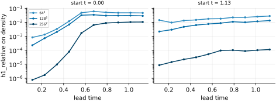
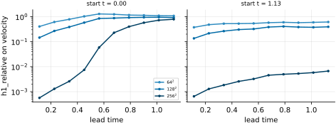
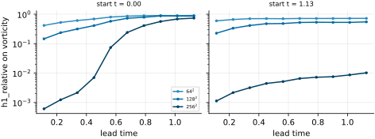
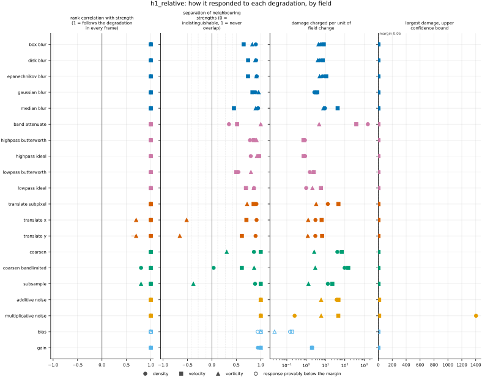
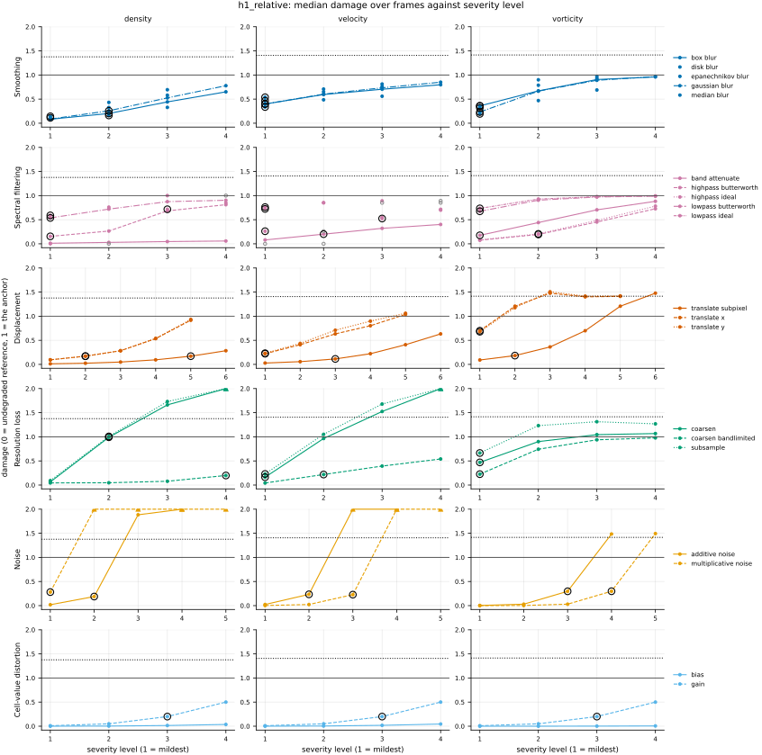
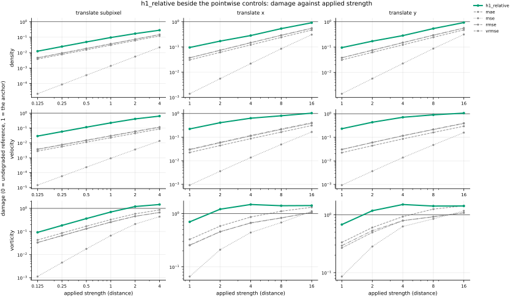

## Definition

Write $f$ for the reference and $g$ for the candidate, each with $C$ channels on a periodic grid
of $N_j$ cells along axis $j$, and $e = g - f$ for the error. For one channel $v$, the
discrete H^1 norm used here sums the squares of the field and of its centred first differences
over all cells $\mathbf{i}$,

$$
\| v \|_{H^1}^2 = \sum_{\mathbf{i}} v_{\mathbf{i}}^2
+ \sum_j \sum_{\mathbf{i}} \Bigl( \frac{N_j}{2}
\bigl( v_{\mathbf{i} + \mathbf{e}_j} - v_{\mathbf{i} - \mathbf{e}_j} \bigr) \Bigr)^2 \tag{1}
$$

where $\mathbf{e}_j$ is one cell along axis $j$ and indices wrap around. The factor $N_j/2$ is
$1/(2h_j)$ with $h_j = 1/N_j$: the domain is taken as one unit long on every axis, whatever the
analysis grid's spacing. The metric is the relative norm of the error, summed over channels,

$$
\mathrm{H}^1_{\mathrm{rel}}(f, g) = \sum_{c=1}^{C}
\frac{\| e^{(c)} \|_{H^1}}{\| f^{(c)} \|_{H^1} + 10^{-8}} \tag{2}
$$

Equations (1) and (2) are what `H1Loss` of the neural-operator library computes with its
defaults, line for line [@neuraloperator2026]: the zeroth-order term and the first derivatives
(`compute_terms`), periodic centred differences (`FiniteDiff`), the spacing `measure / N` with
`measure = 1.0` (`uniform_quadrature`), the ratio of square roots with `eps = 1e-8` added to the
denominator (`rel`), and the sum over channels (`reduction="sum"`). Nothing in them is this
repository's choice. Two of the library's conventions are worth naming because they change the
number. The sums are not divided by the cell count, which cancels in the ratio except against the
$10^{-8}$. And taking the domain as one unit long makes a mode with $m$ periods across the box
weigh about $(2\pi m)^2$ in the derivative term against 1 in the value term, so on any field
with structure the derivative term dominates. Taking the derivative in the dataset's own length
unit instead would make the weight depend on that unit; the choice and its reversal are in
`judgements/017`.

The derivative of the error is the difference of the derivatives, so Equation (2) is also the
ratio of the H^1 distance between the two fields to the reference's H^1 norm.

### Boundary handling

Periodic on every axis: the centred difference wraps around the domain (`np.roll`), as the
library's default `periodic_in_x=True` does with `torch.roll`. The metric therefore declares
`requires_periodic` and is not run on a dataset with a non-periodic axis, such as the Sod shock
tube. The library also offers one-sided third-order differences at a wall
(`periodic_in_x=False`); they are not built here, because the only non-periodic dataset is Sod,
whose shock is not in H^1, so the derivative term there would measure the grid spacing rather
than the fields (see [h1_seminorm](../../metrics/h1_seminorm/card.md), Limitations).

### How its field reports it

**Neural-operator learning.** The relative inhomogeneous H^1 error is that field's Sobolev
error, used both as a training loss and as a reported test error.

- **The object and its normalisation.** Equation (2), per test sample, then averaged over the
  test set: the library's `Trainer.evaluate` sums the loss over batches and divides by the
  number of samples [@neuraloperator2026]. The Markov neural operator paper defines the Sobolev
  norm of the error with the sum over derivative orders starting at zero, so inhomogeneous
  ([@li2022mno], Sect. 3, Eq. (3), with its Fourier form in Eq. (4)), and trains with relative
  losses ([@li2022mno], Sect. 4). Its authors' own code takes the derivatives spectrally, with
  integer wavenumbers; the library takes centred differences, which this bundle follows. The two
  share the value term and differ in how the slope term is weighted, and which of them produced
  a published table is not stated (`issues/138`).
- **What is reported beside it.** A table of test errors per model, an H^1 column beside the
  relative L^2 one ([@li2022mno], App. A.3, Table 3, Kolmogorov flow at Re = 40, and Table 5;
  [@kossaifi2023], Tables 3 and 4), or the two side by side in a figure across models
  ([@kossaifi2023], Fig. 1). Dropping the derivative terms from both sums of Equation (2)
  leaves the relative L^2 error, the error the Fourier neural operator papers report ([@li2021fno], Sects.
  5.1-5.3; defined in [@kovachki2023], Sect. 6); PDEBench's per-channel form of it is
  [nrmse](../../metrics/nrmse/card.md), which averages over channels where this bundle sums.
- **The experiment.** Held-out test samples of a parametric problem or test trajectories of a
  dynamical one, predicted one step ahead and rolled out (the Kolmogorov flow of [@li2022mno], App. A.3). The repository
  has `forecast_re5e4`: one model's rollouts from two starting times, ten prediction steps each,
  in three runs, where the error is drawn against lead time. Many test trajectories are written
  up in
  [EXP-nrmse-rollouts-over-many-initial-conditions](https://github.com/khegazy/pde_metrics/blob/main/proposals/EXP-nrmse-rollouts-over-many-initial-conditions.md).
  The metric also runs on the degradation ladder on `kinet_re5e4`, on the Reynolds ladder and on
  the member mean of `synthetic_ensemble`.
- **The other field.** Finite-element analysis reports the absolute H^1 *seminorm* of the error
  against mesh size, with no zeroth-order term and no division by the solution's norm:
  [h1_seminorm](../../metrics/h1_seminorm/card.md).

## Performance

<!-- GENERATED performance: written by `python -m fmeval.cards evidence h1_relative --results results/comparison_1793829127 --results results/comparison_1793812401 --results results/comparison_1793811840 --results results/comparison_1793829231`, do not edit -->



*As this metric's own field draws it, from run `comparison_1793811840`.* h1_relative on density against lead time, the physical time since the forecast started, one panel per start and one line per run, darker the finer the run's grid. Each point is one prediction step of one forecast.



*As this metric's own field draws it, from run `comparison_1793811840`.* h1_relative on velocity against lead time, the physical time since the forecast started, one panel per start and one line per run, darker the finer the run's grid. Each point is one prediction step of one forecast.



*As this metric's own field draws it, from run `comparison_1793811840`.* h1_relative on vorticity against lead time, the physical time since the forecast started, one panel per start and one line per run, darker the finer the run's grid. Each point is one prediction step of one forecast.



Four measured statistics for h1_relative, one row per degradation grouped by family and one marker per field. From left: the rank correlation between the metric and the applied strength within a frame, with the line showing the resampling interval; the separation of neighbouring strengths as Cliff's delta, where 0 means the metric cannot tell one strength from the next and the faint ticks at 0.12, 0.28 and 0.42 are Vargha and Delaney's small, medium and large anchors, for scale and not as grades; the damage charged per unit of field change at the harshest strength; and the upper confidence bound on the largest damage, beside the fixed margin of 0.05. A hollow marker is a field and degradation on which that bound lies below the margin, so the response is provably small. A missing marker is a statistic the analysis withheld, as the rank correlation is on an axis the metric is invariant to.



Median damage over frames against severity level for h1_relative, one row per family of degradation and one column per field, on one shared scale. The solid grey line is damage 1, the anchor (by default the field's own mean); the dotted black line is the damage assigned to the fake prediction with the right spectrum, where the run included it. The hollow black ring marks the first level at which the metric has moved a tenth of the way to the anchor. Hollow grey markers are strengths excluded for repeating a milder one or for doing nothing. Degradations with three or fewer usable levels are drawn as markers only; points beyond 2 either side are drawn as triangles at the edge. Damage is negative where a degradation moves the metric away from the anchor, as noise raises a single-field quantity the field's mean sets to zero.

**Trend: does the response follow the degradation?**

| test family | field | degradations | rank correlation | fraction of frames in order | weakest gap between neighbouring strengths |
|---|---|---|---|---|---|
| Displacement | density | 3 | 1 | 1 | 0.947 to 0.957 |
| Displacement | velocity | 3 | 1 | 1 | 0.807 to 0.927 |
| Displacement | vorticity | 3 | 0.7 to 1 | 0.0683 to 1 | 0.172 to 0.86 |
| Cell-value distortion | density | 2 | 1 | 1 | 0.969 to 0.971 |
| Cell-value distortion | velocity | 2 | 1 | 1 | 1 |
| Cell-value distortion | vorticity | 2 | 1 | 1 | 1 |
| Resolution loss | density | 3 | 0.8 to 1 | 0.348 to 1 | 0.518 to 0.942 |
| Resolution loss | velocity | 3 | 1 | 1 | 0.806 to 1 |
| Resolution loss | vorticity | 3 | 0.8 to 1 | 0.23 to 1 | 0.311 to 0.932 |
| Smoothing | density | 5 | 1 | 1 | 0.946 to 0.973 |
| Smoothing | velocity | 5 | 1 | 1 | 0.726 to 0.915 |
| Smoothing | vorticity | 5 | 1 | 1 | 0.913 to 0.979 |
| Spectral filtering | density | 5 | 1 | 1 | 0.675 to 0.931 |
| Spectral filtering | velocity | 5 | 1 | 1 | 0.75 to 0.983 |
| Spectral filtering | vorticity | 5 | 1 | 1 | 0.9 to 1 |
| Noise | density | 2 | 1 | 1 | 1 |
| Noise | velocity | 2 | 1 | 1 | 1 |
| Noise | vorticity | 2 | 1 | 1 | 1 |

**Reactivity: how far does it move?**

| test family | field | change from clean at the harshest strength | elasticity | first strength detected |
|---|---|---|---|---|
| Displacement | density | — | 0.786 to 0.993 | level 2 |
| Displacement | velocity | — | 0.755 to 0.994 | level 1 |
| Displacement | vorticity | — | 0.541 to 0.991 | level 1 |
| Cell-value distortion | density | — | 1 | level 3 |
| Cell-value distortion | velocity | — | 1 | level 3 |
| Cell-value distortion | vorticity | — | 1 | level 3 |
| Resolution loss | density | — | 0.417 to 2.35 | level 2 |
| Resolution loss | velocity | — | 1.44 to 1.62 | level 1 |
| Resolution loss | vorticity | — | 0.492 to 1.03 | level 1 |
| Smoothing | density | — | 1.03 to 1.16 | level 1 |
| Smoothing | velocity | — | 0.291 to 0.404 | level 1 |
| Smoothing | vorticity | — | 0.655 to 0.986 | level 1 |
| Spectral filtering | density | — | 0.271 to 8.06 | level 1 |
| Spectral filtering | velocity | — | 0.119 to 1.2 | level 1 |
| Spectral filtering | vorticity | — | 0.165 to 2.55 | level 1 |
| Noise | density | — | 1 | level 1 |
| Noise | velocity | — | 1 | level 2 |
| Noise | vorticity | — | 1 | level 3 |
| trap test: fake prediction, right spectrum | density | — | — | damage 1.38 |
| trap test: fake prediction, right spectrum | velocity | — | — | damage 1.41 |
| trap test: fake prediction, right spectrum | vorticity | — | — | damage 1.41 |

**Consistency: how much does it vary from snapshot to snapshot?**

| test family | field | consistency, in the strength's units | snapshots per independent block |
|---|---|---|---|
| Displacement | density | 0.105 to 0.504 | 12 to 20 |
| Displacement | velocity | 0.143 to 0.91 | 21 to 22 |
| Displacement | vorticity | 0.144 to 9.06 | 20 to 21 |
| Cell-value distortion | density | 0.023 to 0.0265 | 17 to 20 |
| Cell-value distortion | velocity | 0.000341 to 0.0159 | 1 to 21 |
| Cell-value distortion | vorticity | 0.0139 to 0.018 | 21 to 22 |
| Resolution loss | density | 0.614 to 1.76 | 17 to 20 |
| Resolution loss | velocity | 0.25 to 1.1 | 20 to 22 |
| Resolution loss | vorticity | 0.552 to 3.16 | 21 |
| Smoothing | density | 0.00786 to 0.0173 | 13 to 14 |
| Smoothing | velocity | 0.00749 to 0.0331 | 21 to 22 |
| Smoothing | vorticity | 0.00688 to 0.0329 | 20 to 21 |
| Spectral filtering | density | 0.0272 to 0.0976 | 14 to 20 |
| Spectral filtering | velocity | 0.0109 to 0.088 | 18 to 22 |
| Spectral filtering | vorticity | 0.0434 to 0.0704 | 21 |
| Noise | density | 0.000239 to 0.0159 | 1 to 20 |
| Noise | velocity | 0.000307 to 0.00534 | 1 to 19 |
| Noise | vorticity | 0.00461 to 0.00835 | 22 |

One row per family of degradation and physical field; a cell gives the range over the degradations in that family. **Trend.** The rank correlation is the Spearman correlation between the strength and how far the metric has moved from its value on the undegraded field of the same frame, in the one direction it moves under that degradation, computed inside a single frame. A value of 1 means every strength moved it further than the last in every frame, whichever way it moves; a response that scatters to both sides scores near 0. The fraction of frames in order counts the frames with no exception. The weakest gap is the smallest Mann-Whitney overlap between two neighbouring strengths across frames: 1 means they never overlap, 0.5 that they cannot be told apart. **Reactivity.** The change from clean is the median, at the harshest strength, of the departure from the undegraded value of the same frame over the size of that value: 0.3 means 30%. It does not exist for this metric, whose undegraded value is exactly zero; the damage below is its relative reading. The elasticity is the percentage change of that departure per percentage change in strength over the mildest strengths. First strength detected is the mildest at which the metric has moved a tenth of the way to the anchor; **damage** reads that 0-to-1 scale as a number. A dash means the measurement is not defined there. A metric's reactivity scales with the power it is expressed in: mean squared error's elasticity is twice root-mean-square error's, though the two carry the same information, so compare magnitudes across metrics with that in mind. **Consistency** is how much the response varies from snapshot to snapshot relative to its size, in the strength's units; the snapshots of one trajectory are correlated, and the last column is how many consecutive snapshots one independent block spans.

These tables report what was measured and grade none of the measurements. What the numbers mean for this metric is written in the subsections below, beside the test that produced each number.

**Profile.**

| field | selectivity | charges most for | charges least for | response provably below 0.05 at 90% on | elasticity to a sub-pixel shift, against severity (distance) | compute cost (x cheapest in this run) |
|---|---|---|---|---|---|---|
| density | 0.933 | `band_attenuate` | `bias` | `bias` | 0.993 | 13.2 |
| velocity | 0.8 | `band_attenuate` | `bias` | `bias` | 0.994 | 20.2 |
| vorticity | 0.297 | `median_blur` | `bias` | `bias` | 0.991 | 11 |

One row per physical field. **Selectivity** is how concentrated the metric's response is on a few degradations, measured per unit of field change: 0 means it charges every degradation the same, as mean squared error does by construction, and values toward 1 that one degradation carries most of it. **Charges most and least for** name the two ends of that profile. **Response provably below** lists degradations on which the upper confidence bound of the largest damage lies below the margin -- an equivalence test, so an entry says the response is provably small, not merely not significant; a dash means no degradation met the bound. **Elasticity** is the slope of log damage against log shift over the smallest shifts: 1 means damage grows in proportion to the shift, 2 with its square. **Compute cost** is wall-clock per evaluation over the cheapest metric and field in the same run.

<!-- END GENERATED performance -->

## Intuition

This metric measures how wrong a prediction is as a fraction of how large the true field is,
counting both the values and the slopes. A prediction whose values are close but whose slopes are
wrong, such as a correct pattern drawn slightly too smooth or too jagged, is charged for the
slopes, which a plain relative error would not see.

It works by adding up, over every cell, the square of the error and the squares of how fast the
error changes from one neighbour to the next, taking the root, and dividing by the same total for
the true field. The slopes are measured as if the box were one unit wide, so a pattern that
repeats several times across the box has slopes many times its height, and on most real fields
the slopes dominate the total. Each component of a field is scored on its own and the scores are
added.

A worked example on a four by four grid whose rows are all the same.

```
one row of each field (every row the same)    h1_relative    relative L2 error
reference        1     0    -1     0
moved one cell   0     1     0    -1             1.414           1.414
checkerboard     1.5  -0.5  -0.5  -0.5           0.1715          0.7071
added
```

Moving the pattern by one cell gives the same score as the plain relative error, because the
error is the same single wave in its values and in its slopes. Adding a checkerboard that
alternates every cell gives a much smaller score than the plain relative error: the slope at each
cell is taken from its two neighbours, which for a checkerboard are equal, so the slopes of that
error are zero, while the true field's slopes still enlarge the denominator.

What it ignores: the error that alternates from cell to cell, in its slope term, and anything
about where the error sits, since it is a sum over the whole domain.

## Reading the output

- **Range and units.** Zero and up, dimensionless. A prediction of zero scores one per channel,
  so a two-component velocity field scores up to about two for a prediction of zero and a
  one-channel field about one.
- **Direction.** Lower is better. Identical fields score zero.
- **What is a good value.** A fraction of the reference's own size in this norm, so 0.05 means an
  error a twentieth of the reference's H^1 norm. Where a field's mean is much larger than its
  fluctuation, as density's is here, the mean sets most of the denominator's value term, and the
  number reads small for an error that is large against the fluctuation; read it beside
  [vrmse](../../metrics/vrmse/card.md), which divides by the fluctuation.
- **Valid comparisons.** Models scored against the same reference field on the same analysis
  grid. Across fields only with the channel count in mind, because channels are summed, not
  averaged. Across analysis grids for structure both grids resolve: the domain is one unit long on
  every grid, so a smooth mode's slope does not depend on the cell count, but the centred
  difference weighs modes near each grid's own finest scale differently.
- **Not symmetric.** The reference's norm is the denominator, so the arguments cannot be swapped.

## Limitations

- **A checkerboard error is free in the slope term.** The centred difference of the alternating
  mode is exactly zero, so error at the grid scale is charged only through the value term, which
  is small next to a reference whose slopes dominate its norm. The worked example scores such an
  error at 0.17 where the plain relative error reads 0.71. A prediction with grid-scale ringing
  can therefore score better here than under a plain relative error, the opposite of what a
  Sobolev norm is chosen for.
- **The derivative weight depends on the domain convention.** On the unit domain the slope term
  of a mode with $m$ periods across the box weighs about $(2\pi m)^2$ against 1, so on these
  fields the number is close to a relative gradient error. The same formula with the derivative
  taken in the dataset's own unit of length (`judgements/017`) would make the slope term negligible
  on kinet, whose box is 256 long, and the number would be the relative L^2 error.
- **At a shock the slope term measures the grid.** A discontinuity is not in H^1; the centred
  difference across a jump grows with the cell count, so on a shocked flow the value depends on
  the resolution as much as on the prediction.
- **Channels are summed.** A velocity error and a density error of the same relative size score
  in a ratio of two to one.

## Results

<!-- GENERATED run: written by `python -m fmeval.cards evidence h1_relative --results results/comparison_1793829127 --results results/comparison_1793812401 --results results/comparison_1793811840 --results results/comparison_1793829231`, do not edit -->

Measured on `kinet_re5e4`, frames 2000 to 10000 (161 frames of developed flow), on the 256 analysis grid, seed 20260807, at commit `adbdc88e4950`. Run `comparison_1793829127`.

Every number in this section comes from that run, except in the subsections headed with another experiment and in a figure whose caption names another run, each of which names its own run. Regenerate with `python -m fmeval.cards evidence <name> --results results/comparison_1793829127 --results results/comparison_1793812401 --results results/comparison_1793811840 --results results/comparison_1793829231`.

<!-- END GENERATED run -->

Each subsection links to the degradations that subsection reports. What those degradations
do, and what their strength numbers mean, is documented on their own pages.

<!-- GENERATED experiments: written by `python -m fmeval.cards catalog`, do not edit -->

**Across the experiments.**

| experiment | what a run on it is evidence of | on this card |
|---|---|---|
| `kinet_re5e4` | developed flow | measured, run `comparison_1793829127`: the main results |
| `kinet_re1e6` | developed flow at Re = 1e6, twenty times the Reynolds number of kinet_re5e4, from the same initial condition | measured, run `comparison_1793829231`: under *On `kinet_re1e6`* |
| `synthetic_ensemble` | a calibrated null: evidence that the estimator computes what it claims to compute, and nothing about turbulence | measured, run `comparison_1793812401`: under *On `synthetic_ensemble`*; on this dataset the metric scores the member mean of the ensemble |
| `sod_shock_tube` | an analytic check: evidence that the metric locates and scores a known shock correctly, and nothing about turbulence | not applicable: needs a periodic domain, and this dataset is not periodic |
| `forecast_re5e4` | real predictions scored against their targets at each prediction step; who produced the predictions, a trained model or a coarser solver, is not recorded | measured, run `comparison_1793811840`: under *On `forecast_re5e4`* |

One row per dataset a card may cite (`configs/cards/default.yaml`). *Measured* names the run the card cites: the main results are `## Performance` and the subsections below, and every other run has its own subsection headed with its dataset. *Not applicable* gives the reason: one that follows from what the metric declares and what the dataset offers, or one a person wrote on the card (`not_run` in `card.yaml`) because the result would carry no information. *Not yet run* means the metric can run there and the card cites no run on it yet.

<!-- END GENERATED experiments -->

### Smoothing

[gaussian_blur](../../degradations/gaussian_blur/card.md) ·
[box_blur](../../degradations/box_blur/card.md) ·
[median_blur](../../degradations/median_blur/card.md)

<!-- GENERATED results_smoothing: written by `python -m fmeval.cards evidence h1_relative --results results/comparison_1793829127 --results results/comparison_1793812401 --results results/comparison_1793811840 --results results/comparison_1793829231`, do not edit -->

| degradation | field | strengths | rank correlation | fraction of frames in the right order | weakest gap between neighbouring strengths |
|---|---|---|---|---|---|
| `box_blur` | density | 4 | 1 | 1 | 0.95 |
| `box_blur` | velocity | 4 | 1 | 1 | 0.825 |
| `box_blur` | vorticity | 4 | 1 | 1 | 0.913 |
| `disk_blur` | density | 3 | 1 | 1 | 0.952 |
| `disk_blur` | velocity | 3 | 1 | 1 | 0.871 |
| `disk_blur` | vorticity | 3 | 1 | 1 | 0.943 |
| `epanechnikov_blur` | density | 3 | 1 | 1 | 0.959 |
| `epanechnikov_blur` | velocity | 3 | 1 | 1 | 0.87 |
| `epanechnikov_blur` | vorticity | 3 | 1 | 1 | 0.956 |
| `gaussian_blur` | density | 4 | 1 | 1 | 0.946 |
| `gaussian_blur` | velocity | 4 | 1 | 1 | 0.915 |
| `gaussian_blur` | vorticity | 4 | 1 | 1 | 0.979 |
| `median_blur` | density | 3 | 1 | 1 | 0.973 |
| `median_blur` | velocity | 3 | 1 | 1 | 0.726 |
| `median_blur` | vorticity | 3 | 1 | 1 | 0.949 |

<!-- END GENERATED results_smoothing -->

### Spectral filtering

[lowpass_ideal](../../degradations/lowpass_ideal/card.md) ·
[lowpass_butterworth](../../degradations/lowpass_butterworth/card.md) ·
[highpass_ideal](../../degradations/highpass_ideal/card.md) ·
[highpass_butterworth](../../degradations/highpass_butterworth/card.md)

<!-- GENERATED results_spectral: written by `python -m fmeval.cards evidence h1_relative --results results/comparison_1793829127 --results results/comparison_1793812401 --results results/comparison_1793811840 --results results/comparison_1793829231`, do not edit -->

| degradation | field | strengths | rank correlation | fraction of frames in the right order | weakest gap between neighbouring strengths |
|---|---|---|---|---|---|
| `band_attenuate` | density | 4 | 1 | 1 | 0.675 |
| `band_attenuate` | velocity | 4 | 1 | 1 | 0.758 |
| `band_attenuate` | vorticity | 4 | 1 | 1 | 1 |
| `highpass_butterworth` | density | 4 | 1 | 1 | 0.89 |
| `highpass_butterworth` | velocity | 3 | 1 | 1 | 0.928 |
| `highpass_butterworth` | vorticity | 4 | 1 | 1 | 0.958 |
| `highpass_ideal` | density | 3 | 1 | 1 | 0.898 |
| `highpass_ideal` | velocity | 2 | 1 | 1 | 0.983 |
| `highpass_ideal` | vorticity | 4 | 1 | 1 | 0.96 |
| `lowpass_butterworth` | density | 4 | 1 | 1 | 0.771 |
| `lowpass_butterworth` | velocity | 3 | 1 | 1 | 0.75 |
| `lowpass_butterworth` | vorticity | 4 | 1 | 1 | 0.9 |
| `lowpass_ideal` | density | 3 | 1 | 1 | 0.931 |
| `lowpass_ideal` | velocity | 2 | 1 | 1 | 0.849 |
| `lowpass_ideal` | vorticity | 4 | 1 | 1 | 0.928 |

<!-- END GENERATED results_spectral -->

### Displacement

[translate_x](../../degradations/translate/card.md) ·
[translate_subpixel](../../degradations/translate_subpixel/card.md)

<!-- GENERATED results_geometric: written by `python -m fmeval.cards evidence h1_relative --results results/comparison_1793829127 --results results/comparison_1793812401 --results results/comparison_1793811840 --results results/comparison_1793829231`, do not edit -->

| degradation | field | strengths | rank correlation | fraction of frames in the right order | weakest gap between neighbouring strengths |
|---|---|---|---|---|---|
| `translate_subpixel` | density | 6 | 1 | 1 | 0.956 |
| `translate_subpixel` | velocity | 6 | 1 | 1 | 0.927 |
| `translate_subpixel` | vorticity | 6 | 1 | 1 | 0.86 |
| `translate_x` | density | 5 | 1 | 1 | 0.957 |
| `translate_x` | velocity | 5 | 1 | 1 | 0.853 |
| `translate_x` | vorticity | 5 | 0.7 | 0.186 | 0.242 |
| `translate_y` | density | 5 | 1 | 1 | 0.947 |
| `translate_y` | velocity | 5 | 1 | 1 | 0.807 |
| `translate_y` | vorticity | 5 | 0.7 | 0.0683 | 0.172 |

<!-- END GENERATED results_geometric -->

### Resolution loss

[coarsen](../../degradations/coarsen/card.md) ·
[coarsen_bandlimited](../../degradations/coarsen_bandlimited/card.md)

<!-- GENERATED results_resolution: written by `python -m fmeval.cards evidence h1_relative --results results/comparison_1793829127 --results results/comparison_1793812401 --results results/comparison_1793811840 --results results/comparison_1793829231`, do not edit -->

| degradation | field | strengths | rank correlation | fraction of frames in the right order | weakest gap between neighbouring strengths |
|---|---|---|---|---|---|
| `coarsen` | density | 4 | 1 | 1 | 0.93 |
| `coarsen` | velocity | 4 | 1 | 1 | 1 |
| `coarsen` | vorticity | 4 | 1 | 0.925 | 0.652 |
| `coarsen_bandlimited` | density | 4 | 0.8 | 0.348 | 0.518 |
| `coarsen_bandlimited` | velocity | 4 | 1 | 1 | 0.806 |
| `coarsen_bandlimited` | vorticity | 4 | 1 | 1 | 0.932 |
| `subsample` | density | 4 | 1 | 1 | 0.942 |
| `subsample` | velocity | 4 | 1 | 1 | 1 |
| `subsample` | vorticity | 4 | 0.8 | 0.23 | 0.311 |

<!-- END GENERATED results_resolution -->

### Noise

[additive_noise](../../degradations/additive_noise/card.md)

<!-- GENERATED results_stochastic: written by `python -m fmeval.cards evidence h1_relative --results results/comparison_1793829127 --results results/comparison_1793812401 --results results/comparison_1793811840 --results results/comparison_1793829231`, do not edit -->

| degradation | field | strengths | rank correlation | fraction of frames in the right order | weakest gap between neighbouring strengths |
|---|---|---|---|---|---|
| `additive_noise` | density | 4 | 1 | 1 | 1 |
| `additive_noise` | velocity | 4 | 1 | 1 | 1 |
| `additive_noise` | vorticity | 4 | 1 | 1 | 1 |
| `multiplicative_noise` | density | 5 | 1 | 1 | 1 |
| `multiplicative_noise` | velocity | 5 | 1 | 1 | 1 |
| `multiplicative_noise` | vorticity | 5 | 1 | 1 | 1 |

<!-- END GENERATED results_stochastic -->

### Trap tests

[gaussian_impostor](../../degradations/gaussian_impostor/card.md) ·
[uncorrelated](../../degradations/random_large_translation/card.md)

<!-- GENERATED results_canaries: written by `python -m fmeval.cards evidence h1_relative --results results/comparison_1793829127 --results results/comparison_1793812401 --results results/comparison_1793811840 --results results/comparison_1793829231`, do not edit -->

| field | damage assigned to the fake prediction | closest real degradation | damage of the reference moved far away | value on the anchor |
|---|---|---|---|---|
| density | 1.38 | `coarsen=8` | 1.38 | 0.0908 |
| velocity | 1.41 | `coarsen=8` | 1.49 | 2 |
| vorticity | 1.41 | `translate_y=8` | 1.41 | 1 |

The fake prediction here has exactly the reference field's amplitude spectrum and completely scrambled structure. Damage 1 is what the anchor scores, by default the reference's own spatial mean, a prediction that knows the mean and nothing else. The damage column therefore says how close to useless this metric considers that fake prediction: a low number means the metric was fooled. The third column translates the same number into an ordinary degradation whose damage the fake prediction matches, which is easier to picture. The fourth is the reference moved by a large random offset, the right statistics in the wrong place; where a field's energy sits in its largest scales that copy stays partly correlated with the reference, so it is not the score of an unrelated field.

<!-- END GENERATED results_canaries -->

### Compared with the other metrics

<!-- GENERATED results_summary: written by `python -m fmeval.cards evidence h1_relative --results results/comparison_1793829127 --results results/comparison_1793812401 --results results/comparison_1793811840 --results results/comparison_1793829231`, do not edit -->

| compared with | density | velocity | vorticity |
|---|---|---|---|
| `h1_seminorm` | 0.935 | 0.939 | 0.964 |
| `max_error` | 0.869 | 0.876 | 0.794 |
| `max_error_channel_mean` | 0.869 | 0.878 | 0.794 |
| `rmse` | 0.814 | 0.726 | 0.755 |
| `rmse_channel_mean` | 0.814 | 0.723 | 0.755 |
| `mse` | 0.815 | 0.726 | 0.755 |
| `vrmse` | 0.812 | 0.725 | 0.753 |
| `nrmse` | 0.815 | 0.725 | 0.751 |
| `mae` | 0.789 | 0.704 | 0.71 |
| `wasserstein` | 0.696 | — | — |
| `h_minus_one` | 0.702 | 0.639 | 0.633 |
| `increment_w1` | 0.479 | 0.407 | 0.137 |
| `energy_distance` | 0.466 | 0.401 | 0.112 |
| `increment_w1_by_separation` | 0.467 | 0.386 | 0.0664 |
| `spectral_energy_flux` | — | 0.363 | — |
| `tail_exceedance` | 0.336 | 0.3 | 0.0421 |
| `spectrum_l2` | 0.24 | 0.263 | -0.0648 |
| `persistence_distance` | 0.32 | — | -0.0505 |
| `tail_index` | 0.188 | 0.0627 | -0.0116 |
| `enstrophy` | — | — | -0.0286 |
| `palinstrophy` | — | — | -0.0389 |
| `increment_flatness` | -0.21 | -0.142 | 0.159 |
| `kinetic_energy` | — | -0.181 | — |

Rank correlation over every degradation, computed separately for each physical field on the median value at each combination of degradation and strength, with the undegraded reference excluded. A dash marks a metric that does not run on that field. A metric with a target value enters by its distance from the target. Two metrics correlating near 1 put the degradations in the same order, but the two may still weight those degradations very differently. A correlation near 1 therefore means the two metrics are redundant for ranking models, not that the two are interchangeable as training losses.

<!-- END GENERATED results_summary -->

### Damage beside the other metrics

<!-- GENERATED results_damage_by_level: written by `python -m fmeval.cards evidence h1_relative --results results/comparison_1793829127 --results results/comparison_1793812401 --results results/comparison_1793811840 --results results/comparison_1793829231`, do not edit -->



Median damage over frames against the applied strength, log-log, for h1_relative (bold, in colour) and the pointwise controls mae, mse, rmse, vrmse (thin, grey), one column per displacement degradation and one row per field. The grey line is damage 1, the anchor (by default the field's own mean). Parallel lines charge in the same proportion at every strength; a steeper line charges relatively more for the larger shifts, which is what decides whether two metrics are interchangeable as training losses. These are the same numbers as the table beneath.

**Displacement, density, `translate_subpixel`** (strength: distance).

| metric | 0.125 | 0.25 | 0.5 | 1 | 2 | 4 |
|---|---|---|---|---|---|---|
| `h1_relative` | 0.0124 | 0.0248 | 0.0492 | 0.0955 | 0.171 | 0.284 |
| `mae` | 0.00383 | 0.00767 | 0.0153 | 0.0306 | 0.061 | 0.121 |
| `mse` | 2.17e-05 | 8.68e-05 | 0.000347 | 0.00138 | 0.00551 | 0.0219 |
| `rmse` | 0.00466 | 0.00931 | 0.0186 | 0.0372 | 0.0743 | 0.148 |
| `vrmse` | 0.00463 | 0.00926 | 0.0185 | 0.037 | 0.0738 | 0.147 |

**Displacement, density, `translate_x`** (strength: distance).

| metric | 1 | 2 | 4 | 8 | 16 |
|---|---|---|---|---|---|
| `h1_relative` | 0.0955 | 0.171 | 0.284 | 0.535 | 0.916 |
| `mae` | 0.0306 | 0.061 | 0.121 | 0.24 | 0.469 |
| `mse` | 0.00138 | 0.00551 | 0.0219 | 0.0849 | 0.307 |
| `rmse` | 0.0372 | 0.0743 | 0.148 | 0.291 | 0.555 |
| `vrmse` | 0.037 | 0.0738 | 0.147 | 0.29 | 0.55 |

**Displacement, density, `translate_y`** (strength: distance).

| metric | 1 | 2 | 4 | 8 | 16 |
|---|---|---|---|---|---|
| `h1_relative` | 0.095 | 0.171 | 0.284 | 0.539 | 0.932 |
| `mae` | 0.031 | 0.0616 | 0.122 | 0.244 | 0.476 |
| `mse` | 0.00142 | 0.00565 | 0.0224 | 0.0869 | 0.316 |
| `rmse` | 0.0377 | 0.0752 | 0.15 | 0.295 | 0.562 |
| `vrmse` | 0.0376 | 0.075 | 0.149 | 0.294 | 0.56 |

**Displacement, velocity, `translate_subpixel`** (strength: distance).

| metric | 0.125 | 0.25 | 0.5 | 1 | 2 | 4 |
|---|---|---|---|---|---|---|
| `h1_relative` | 0.0287 | 0.0574 | 0.114 | 0.222 | 0.409 | 0.633 |
| `mae` | 0.00279 | 0.00559 | 0.0112 | 0.0223 | 0.0441 | 0.0859 |
| `mse` | 1.45e-05 | 5.81e-05 | 0.000232 | 0.000924 | 0.0036 | 0.0136 |
| `rmse` | 0.00381 | 0.00762 | 0.0152 | 0.0304 | 0.06 | 0.117 |
| `vrmse` | 0.00365 | 0.00729 | 0.0146 | 0.029 | 0.0574 | 0.111 |

**Displacement, velocity, `translate_x`** (strength: distance).

| metric | 1 | 2 | 4 | 8 | 16 |
|---|---|---|---|---|---|
| `h1_relative` | 0.222 | 0.409 | 0.633 | 0.802 | 1.04 |
| `mae` | 0.0223 | 0.0441 | 0.0859 | 0.163 | 0.31 |
| `mse` | 0.000924 | 0.0036 | 0.0136 | 0.0489 | 0.165 |
| `rmse` | 0.0304 | 0.06 | 0.117 | 0.221 | 0.406 |
| `vrmse` | 0.029 | 0.0574 | 0.111 | 0.209 | 0.383 |

**Displacement, velocity, `translate_y`** (strength: distance).

| metric | 1 | 2 | 4 | 8 | 16 |
|---|---|---|---|---|---|
| `h1_relative` | 0.232 | 0.436 | 0.709 | 0.897 | 1.06 |
| `mae` | 0.0223 | 0.0442 | 0.0856 | 0.16 | 0.295 |
| `mse` | 0.000935 | 0.00366 | 0.0138 | 0.0473 | 0.158 |
| `rmse` | 0.0306 | 0.0605 | 0.117 | 0.218 | 0.397 |
| `vrmse` | 0.0303 | 0.0599 | 0.115 | 0.212 | 0.384 |

**Displacement, vorticity, `translate_subpixel`** (strength: distance).

| metric | 0.125 | 0.25 | 0.5 | 1 | 2 | 4 |
|---|---|---|---|---|---|---|
| `h1_relative` | 0.0918 | 0.183 | 0.363 | 0.698 | 1.21 | 1.48 |
| `mae` | 0.0428 | 0.0854 | 0.169 | 0.328 | 0.582 | 0.86 |
| `mse` | 0.00112 | 0.00448 | 0.0176 | 0.066 | 0.21 | 0.44 |
| `rmse` | 0.0335 | 0.0669 | 0.133 | 0.257 | 0.458 | 0.663 |
| `vrmse` | 0.0329 | 0.0656 | 0.13 | 0.253 | 0.455 | 0.671 |

**Displacement, vorticity, `translate_x`** (strength: distance).

| metric | 1 | 2 | 4 | 8 | 16 |
|---|---|---|---|---|---|
| `h1_relative` | 0.698 | 1.21 | 1.48 | 1.4 | 1.41 |
| `mae` | 0.328 | 0.582 | 0.86 | 1.1 | 1.31 |
| `mse` | 0.066 | 0.21 | 0.44 | 0.679 | 1.1 |
| `rmse` | 0.257 | 0.458 | 0.663 | 0.824 | 1.05 |
| `vrmse` | 0.253 | 0.455 | 0.671 | 0.832 | 1.05 |

**Displacement, vorticity, `translate_y`** (strength: distance).

| metric | 1 | 2 | 4 | 8 | 16 |
|---|---|---|---|---|---|
| `h1_relative` | 0.678 | 1.18 | 1.51 | 1.42 | 1.42 |
| `mae` | 0.333 | 0.603 | 0.93 | 1.25 | 1.43 |
| `mse` | 0.0858 | 0.283 | 0.628 | 0.849 | 1.17 |
| `rmse` | 0.293 | 0.532 | 0.793 | 0.922 | 1.08 |
| `vrmse` | 0.268 | 0.495 | 0.793 | 0.927 | 1.08 |

Median damage over frames at every strength, this metric in the first row and the pointwise controls beneath it, all on the same 0-to-1 scale where 0 is the undegraded reference and 1 the anchor (by default the field's own mean); a dash means no damage scale on that field. The rank correlations under *Compared with the other metrics* say whether two metrics put the strengths in the same order; this table says how much each one charges for the same strength, which decides whether two metrics are interchangeable as training losses.

<!-- END GENERATED results_damage_by_level -->

### On `synthetic_ensemble`

<!-- GENERATED results_on_synthetic_ensemble: written by `python -m fmeval.cards evidence h1_relative --results results/comparison_1793829127 --results results/comparison_1793812401 --results results/comparison_1793811840 --results results/comparison_1793829231`, do not edit -->

**A calibrated null: evidence that the estimator computes what it claims to compute, and nothing about turbulence.**

Measured on `synthetic_ensemble`, frames 0 to 11 (12 frames of a calibrated null: evidence that the estimator computes what it claims to compute, and nothing about turbulence), on the 64 analysis grid, seed 20260807, at commit `adbdc88e4950`. Run `comparison_1793812401`.

[bias](../../degradations/bias/card.md) ·
[mean_field](../../degradations/mean_field/card.md) ·
[spread_deflate](../../degradations/spread_deflate/card.md) ·
[spread_inflate](../../degradations/spread_inflate/card.md)

**Cell-value distortion.**

| degradation | field | strengths | rank correlation | fraction of frames in the right order | weakest gap between neighbouring strengths |
|---|---|---|---|---|---|
| `bias` | density | 4 | 1 | 1 | 1 |

**Ensemble dispersion.**

| degradation | field | strengths | rank correlation | fraction of frames in the right order | weakest gap between neighbouring strengths |
|---|---|---|---|---|---|
| `spread_deflate` | density | 4 | — | — | — |
| `spread_inflate` | density | 4 | — | — | — |

**Trap tests.**

| field | damage assigned to the fake prediction | closest real degradation | damage of the reference moved far away | value on the anchor |
|---|---|---|---|---|
| density | — | — | — | 1 |

The fake prediction here has exactly the reference field's amplitude spectrum and completely scrambled structure. Damage 1 is what the anchor scores, by default the reference's own spatial mean, a prediction that knows the mean and nothing else. The damage column therefore says how close to useless this metric considers that fake prediction: a low number means the metric was fooled. The third column translates the same number into an ordinary degradation whose damage the fake prediction matches, which is easier to picture. The fourth is the reference moved by a large random offset, the right statistics in the wrong place; where a field's energy sits in its largest scales that copy stays partly correlated with the reference, so it is not the score of an unrelated field.

<!-- END GENERATED results_on_synthetic_ensemble -->

### On `forecast_re5e4`

<!-- GENERATED results_on_forecast_re5e4: written by `python -m fmeval.cards evidence h1_relative --results results/comparison_1793829127 --results results/comparison_1793812401 --results results/comparison_1793811840 --results results/comparison_1793829231`, do not edit -->

**Real predictions scored against their targets at each prediction step; who produced the predictions, a trained model or a coarser solver, is not recorded.**

Measured on `forecast_re5e4`, frames 0 to 59 (60 frames of real predictions scored against their targets at each prediction step; who produced the predictions, a trained model or a coarser solver, is not recorded), on the 64 analysis grid, seed 20260807, at commit `adbdc88e4950`. Run `comparison_1793811840`.

[mean_field](../../degradations/mean_field/card.md)


h1_relative on density against lead time, the physical time since the forecast started, one panel per start and one line per run, darker the finer the run's grid. Each point is one prediction step of one forecast.


h1_relative on velocity against lead time, the physical time since the forecast started, one panel per start and one line per run, darker the finer the run's grid. Each point is one prediction step of one forecast.


h1_relative on vorticity against lead time, the physical time since the forecast started, one panel per start and one line per run, darker the finer the run's grid. Each point is one prediction step of one forecast.

**density, h1_relative on the prediction, at each lead time.**

| lead time | 64², start 0 | 128², start 0 | 256², start 0 | 64², start 1.13 | 128², start 1.13 | 256², start 1.13 |
|---|---|---|---|---|---|---|
| 0.1128 | 0.000829 | 0.000229 | 7.74e-07 | 0.0143 | 0.00219 | 8.65e-06 |
| 0.2255 | 0.00132 | 0.000732 | 1.73e-06 | 0.00955 | 0.00298 | 1.45e-05 |
| 0.3383 | 0.00335 | 0.00206 | 9.71e-06 | 0.0133 | 0.00478 | 2.24e-05 |
| 0.4511 | 0.012 | 0.00696 | 8.05e-05 | 0.0148 | 0.00634 | 3.16e-05 |
| 0.5638 | 0.0481 | 0.0321 | 0.00171 | 0.0177 | 0.00757 | 5.26e-05 |
| 0.6766 | 0.0603 | 0.0343 | 0.00641 | 0.0181 | 0.00868 | 9.64e-05 |
| 0.7893 | 0.0512 | 0.0299 | 0.00886 | 0.0224 | 0.0109 | 0.000103 |
| 0.9021 | 0.0476 | 0.0302 | 0.0097 | 0.0226 | 0.00997 | 8.81e-05 |
| 1.015 | 0.0477 | 0.0304 | 0.0104 | 0.0253 | 0.0117 | 0.000102 |
| 1.128 | 0.0466 | 0.0288 | 0.0105 | 0.0281 | 0.0134 | 0.000114 |

**density, h1_relative damage, at each lead time.**

| lead time | 64², start 0 | 128², start 0 | 256², start 0 | 64², start 1.13 | 128², start 1.13 | 256², start 1.13 |
|---|---|---|---|---|---|---|
| 0.1128 | 0.131 | 0.0365 | 0.000124 | 0.156 | 0.024 | 9.46e-05 |
| 0.2255 | 0.273 | 0.15 | 0.000351 | 0.11 | 0.0343 | 0.000167 |
| 0.3383 | 0.333 | 0.206 | 0.000974 | 0.15 | 0.0537 | 0.000251 |
| 0.4511 | 0.5 | 0.29 | 0.00335 | 0.165 | 0.0707 | 0.000352 |
| 0.5638 | 0.793 | 0.528 | 0.0281 | 0.2 | 0.0857 | 0.000595 |
| 0.6766 | 0.702 | 0.4 | 0.0746 | 0.205 | 0.098 | 0.00109 |
| 0.7893 | 0.586 | 0.343 | 0.102 | 0.253 | 0.124 | 0.00116 |
| 0.9021 | 0.528 | 0.335 | 0.108 | 0.258 | 0.114 | 0.00101 |
| 1.015 | 0.519 | 0.33 | 0.113 | 0.283 | 0.13 | 0.00114 |
| 1.128 | 0.521 | 0.322 | 0.118 | 0.32 | 0.153 | 0.0013 |

**velocity, h1_relative on the prediction, at each lead time.**

| lead time | 64², start 0 | 128², start 0 | 256², start 0 | 64², start 1.13 | 128², start 1.13 | 256², start 1.13 |
|---|---|---|---|---|---|---|
| 0.1128 | 0.405 | 0.145 | 0.000563 | 0.374 | 0.135 | 0.000648 |
| 0.2255 | 0.612 | 0.268 | 0.0013 | 0.478 | 0.216 | 0.00129 |
| 0.3383 | 0.784 | 0.386 | 0.0026 | 0.525 | 0.264 | 0.00183 |
| 0.4511 | 1.03 | 0.577 | 0.00744 | 0.527 | 0.304 | 0.00257 |
| 0.5638 | 1.29 | 0.846 | 0.0585 | 0.537 | 0.321 | 0.00323 |
| 0.6766 | 1.24 | 0.874 | 0.228 | 0.575 | 0.384 | 0.00454 |
| 0.7893 | 1.16 | 0.918 | 0.398 | 0.595 | 0.406 | 0.00495 |
| 0.9021 | 1.13 | 0.938 | 0.574 | 0.575 | 0.383 | 0.00529 |
| 1.015 | 1.1 | 0.949 | 0.722 | 0.592 | 0.375 | 0.00579 |
| 1.128 | 1.08 | 0.919 | 0.786 | 0.612 | 0.392 | 0.00666 |

**velocity, h1_relative damage, at each lead time.**

| lead time | 64², start 0 | 128², start 0 | 256², start 0 | 64², start 1.13 | 128², start 1.13 | 256², start 1.13 |
|---|---|---|---|---|---|---|
| 0.1128 | 0.202 | 0.0726 | 0.000282 | 0.187 | 0.0677 | 0.000324 |
| 0.2255 | 0.306 | 0.134 | 0.000649 | 0.239 | 0.108 | 0.000643 |
| 0.3383 | 0.392 | 0.193 | 0.0013 | 0.263 | 0.132 | 0.000915 |
| 0.4511 | 0.514 | 0.289 | 0.00372 | 0.264 | 0.152 | 0.00128 |
| 0.5638 | 0.643 | 0.423 | 0.0292 | 0.268 | 0.161 | 0.00161 |
| 0.6766 | 0.622 | 0.437 | 0.114 | 0.287 | 0.192 | 0.00227 |
| 0.7893 | 0.579 | 0.459 | 0.199 | 0.298 | 0.203 | 0.00248 |
| 0.9021 | 0.567 | 0.469 | 0.287 | 0.287 | 0.192 | 0.00264 |
| 1.015 | 0.548 | 0.474 | 0.361 | 0.296 | 0.188 | 0.00289 |
| 1.128 | 0.54 | 0.459 | 0.393 | 0.306 | 0.196 | 0.00333 |

**vorticity, h1_relative on the prediction, at each lead time.**

| lead time | 64², start 0 | 128², start 0 | 256², start 0 | 64², start 1.13 | 128², start 1.13 | 256², start 1.13 |
|---|---|---|---|---|---|---|
| 0.1128 | 0.416 | 0.146 | 0.000609 | 0.596 | 0.226 | 0.00113 |
| 0.2255 | 0.525 | 0.236 | 0.00124 | 0.661 | 0.334 | 0.00217 |
| 0.3383 | 0.61 | 0.314 | 0.00216 | 0.704 | 0.414 | 0.00318 |
| 0.4511 | 0.689 | 0.41 | 0.00703 | 0.709 | 0.476 | 0.00444 |
| 0.5638 | 0.799 | 0.577 | 0.0739 | 0.703 | 0.482 | 0.00516 |
| 0.6766 | 0.859 | 0.728 | 0.24 | 0.716 | 0.523 | 0.00653 |
| 0.7893 | 0.889 | 0.787 | 0.41 | 0.716 | 0.533 | 0.0072 |
| 0.9021 | 0.9 | 0.875 | 0.567 | 0.717 | 0.527 | 0.00753 |
| 1.015 | 0.893 | 0.87 | 0.687 | 0.72 | 0.528 | 0.00865 |
| 1.128 | 0.905 | 0.863 | 0.737 | 0.722 | 0.548 | 0.0102 |

**vorticity, h1_relative damage, at each lead time.**

| lead time | 64², start 0 | 128², start 0 | 256², start 0 | 64², start 1.13 | 128², start 1.13 | 256², start 1.13 |
|---|---|---|---|---|---|---|
| 0.1128 | 0.416 | 0.146 | 0.000609 | 0.596 | 0.226 | 0.00113 |
| 0.2255 | 0.525 | 0.236 | 0.00124 | 0.661 | 0.334 | 0.00217 |
| 0.3383 | 0.61 | 0.314 | 0.00216 | 0.704 | 0.414 | 0.00318 |
| 0.4511 | 0.689 | 0.41 | 0.00703 | 0.709 | 0.476 | 0.00444 |
| 0.5638 | 0.799 | 0.577 | 0.0739 | 0.703 | 0.482 | 0.00516 |
| 0.6766 | 0.859 | 0.728 | 0.24 | 0.716 | 0.523 | 0.00653 |
| 0.7893 | 0.889 | 0.787 | 0.41 | 0.716 | 0.533 | 0.0072 |
| 0.9021 | 0.9 | 0.875 | 0.567 | 0.717 | 0.527 | 0.00753 |
| 1.015 | 0.893 | 0.87 | 0.687 | 0.72 | 0.528 | 0.00865 |
| 1.128 | 0.905 | 0.863 | 0.737 | 0.722 | 0.548 | 0.0102 |

Every prediction of every forecast, nothing pooled: a cell is one prediction step of one forecast, a row the lead time (the physical time since the forecast started) and a column the forecast, named by its run's native grid and its starting time (`64², start 0` is `F-906861_64_Re_50k_from_256_to_64/forecast_t0-0`; `128², start 0` is `F-906861_64_Re_50k_from_256_to128/forecast_t0-0`; `256², start 0` is `F-906861_64/forecast_t0-0`; `64², start 1.13` is `F-906861_64_Re_50k_from_256_to_64/forecast_t0-1250`; `128², start 1.13` is `F-906861_64_Re_50k_from_256_to128/forecast_t0-2500`; `256², start 1.13` is `F-906861_64/forecast_t0-5000`). **Damage** is the prediction's departure from the target as a fraction of the anchor's in the same frame, by default the target's own spatial mean, so each step is scaled by its own target. A dash means no value there.

<!-- END GENERATED results_on_forecast_re5e4 -->

### On `kinet_re1e6`

<!-- GENERATED results_on_kinet_re1e6: written by `python -m fmeval.cards evidence h1_relative --results results/comparison_1793829127 --results results/comparison_1793812401 --results results/comparison_1793811840 --results results/comparison_1793829231`, do not edit -->

**Developed flow at Re = 1e6, twenty times the Reynolds number of kinet_re5e4, from the same initial condition.**

Measured on `kinet_re1e6`, frames 2000 to 10000 (161 frames of developed flow at Re = 1e6, twenty times the Reynolds number of kinet_re5e4, from the same initial condition), on the 128 analysis grid, seed 20260807, at commit `adbdc88e4950`. Run `comparison_1793829231`.

[additive_noise](../../degradations/additive_noise/card.md) ·
[band_attenuate](../../degradations/band_attenuate/card.md) ·
[bias](../../degradations/bias/card.md) ·
[box_blur](../../degradations/box_blur/card.md) ·
[coarsen](../../degradations/coarsen/card.md) ·
[coarsen_bandlimited](../../degradations/coarsen_bandlimited/card.md) ·
[disk_blur](../../degradations/disk_blur/card.md) ·
[epanechnikov_blur](../../degradations/epanechnikov_blur/card.md) ·
[gain](../../degradations/gain/card.md) ·
[gaussian_blur](../../degradations/gaussian_blur/card.md) ·
[gaussian_impostor](../../degradations/gaussian_impostor/card.md) ·
[highpass_butterworth](../../degradations/highpass_butterworth/card.md) ·
[highpass_ideal](../../degradations/highpass_ideal/card.md) ·
[lowpass_butterworth](../../degradations/lowpass_butterworth/card.md) ·
[lowpass_ideal](../../degradations/lowpass_ideal/card.md) ·
[mean_field](../../degradations/mean_field/card.md) ·
[median_blur](../../degradations/median_blur/card.md) ·
[multiplicative_noise](../../degradations/multiplicative_noise/card.md) ·
[subsample](../../degradations/subsample/card.md) ·
[translate_subpixel](../../degradations/translate_subpixel/card.md) ·
[translate_x](../../degradations/translate/card.md) ·
[translate_y](../../degradations/translate/card.md) ·
[uncorrelated](../../degradations/random_large_translation/card.md)

**Smoothing.**

| degradation | field | strengths | rank correlation | fraction of frames in the right order | weakest gap between neighbouring strengths |
|---|---|---|---|---|---|
| `box_blur` | density | 4 | 1 | 1 | 0.951 |
| `box_blur` | velocity | 4 | 1 | 1 | 0.876 |
| `box_blur` | vorticity | 2 | 1 | 1 | 0.97 |
| `disk_blur` | density | 3 | 1 | 1 | 0.953 |
| `disk_blur` | velocity | 3 | 1 | 1 | 0.939 |
| `disk_blur` | vorticity | 2 | 1 | 1 | 0.937 |
| `epanechnikov_blur` | density | 3 | 1 | 1 | 0.96 |
| `epanechnikov_blur` | velocity | 3 | 1 | 1 | 0.958 |
| `epanechnikov_blur` | vorticity | 2 | 1 | 1 | 0.95 |
| `gaussian_blur` | density | 4 | 1 | 1 | 0.948 |
| `gaussian_blur` | velocity | 4 | 1 | 1 | 0.961 |
| `gaussian_blur` | vorticity | 4 | 1 | 1 | 0.986 |
| `median_blur` | density | 3 | 1 | 1 | 0.973 |
| `median_blur` | velocity | 3 | 1 | 1 | 0.798 |
| `median_blur` | vorticity | 1 | — | — | — |

**Spectral filtering.**

| degradation | field | strengths | rank correlation | fraction of frames in the right order | weakest gap between neighbouring strengths |
|---|---|---|---|---|---|
| `band_attenuate` | density | 4 | 1 | 1 | 0.702 |
| `band_attenuate` | velocity | 4 | 1 | 1 | 0.839 |
| `band_attenuate` | vorticity | 4 | 1 | 1 | 0.98 |
| `highpass_butterworth` | density | 4 | 1 | 1 | 0.895 |
| `highpass_butterworth` | velocity | 3 | 1 | 1 | 0.958 |
| `highpass_butterworth` | vorticity | 4 | 1 | 1 | 0.949 |
| `highpass_ideal` | density | 3 | 1 | 1 | 0.9 |
| `highpass_ideal` | velocity | 2 | 1 | 1 | 0.994 |
| `highpass_ideal` | vorticity | 4 | 1 | 1 | 0.958 |
| `lowpass_butterworth` | density | 4 | 1 | 1 | 0.796 |
| `lowpass_butterworth` | velocity | 3 | 1 | 1 | 0.858 |
| `lowpass_butterworth` | vorticity | 4 | 1 | 1 | 0.98 |
| `lowpass_ideal` | density | 3 | 1 | 1 | 0.932 |
| `lowpass_ideal` | velocity | 3 | 1 | 1 | 0.535 |
| `lowpass_ideal` | vorticity | 4 | 1 | 1 | 0.974 |

**Displacement.**

| degradation | field | strengths | rank correlation | fraction of frames in the right order | weakest gap between neighbouring strengths |
|---|---|---|---|---|---|
| `translate_subpixel` | density | 6 | 1 | 1 | 0.967 |
| `translate_subpixel` | velocity | 6 | 1 | 1 | 0.958 |
| `translate_subpixel` | vorticity | 6 | 0.943 | 0.348 | 0.274 |
| `translate_x` | density | 5 | 1 | 1 | 0.944 |
| `translate_x` | velocity | 5 | 1 | 1 | 0.958 |
| `translate_x` | vorticity | 5 | 0.3 | 0.137 | 0.274 |
| `translate_y` | density | 5 | 1 | 1 | 0.94 |
| `translate_y` | velocity | 5 | 1 | 0.994 | 0.886 |
| `translate_y` | vorticity | 5 | 0.1 | 0 | 0.09 |

**Resolution loss.**

| degradation | field | strengths | rank correlation | fraction of frames in the right order | weakest gap between neighbouring strengths |
|---|---|---|---|---|---|
| `coarsen` | density | 4 | 1 | 1 | 0.886 |
| `coarsen` | velocity | 4 | 1 | 1 | 0.988 |
| `coarsen` | vorticity | 4 | 0.8 | 0.379 | 0.424 |
| `coarsen_bandlimited` | density | 4 | 1 | 1 | 0.975 |
| `coarsen_bandlimited` | velocity | 4 | 1 | 1 | 0.9 |
| `coarsen_bandlimited` | vorticity | 4 | 1 | 1 | 0.991 |
| `subsample` | density | 4 | 1 | 1 | 0.957 |
| `subsample` | velocity | 4 | 1 | 0.988 | 0.97 |
| `subsample` | vorticity | 4 | 0.8 | 0.286 | 0.355 |

**Noise.**

| degradation | field | strengths | rank correlation | fraction of frames in the right order | weakest gap between neighbouring strengths |
|---|---|---|---|---|---|
| `additive_noise` | density | 4 | 1 | 1 | 1 |
| `additive_noise` | velocity | 4 | 1 | 1 | 1 |
| `additive_noise` | vorticity | 4 | 1 | 1 | 1 |
| `multiplicative_noise` | density | 5 | 1 | 1 | 1 |
| `multiplicative_noise` | velocity | 5 | 1 | 1 | 1 |
| `multiplicative_noise` | vorticity | 5 | 1 | 1 | 1 |

**Cell-value distortion.**

| degradation | field | strengths | rank correlation | fraction of frames in the right order | weakest gap between neighbouring strengths |
|---|---|---|---|---|---|
| `bias` | density | 4 | 1 | 1 | 0.97 |
| `bias` | velocity | 4 | 1 | 1 | 1 |
| `bias` | vorticity | 4 | 1 | 1 | 1 |
| `gain` | density | 4 | 1 | 1 | 0.971 |
| `gain` | velocity | 4 | 1 | 1 | 1 |
| `gain` | vorticity | 4 | 1 | 1 | 1 |

**Trap tests.**

| field | damage assigned to the fake prediction | closest real degradation | damage of the reference moved far away | value on the anchor |
|---|---|---|---|---|
| density | 1.39 | `multiplicative_noise=0.001` | 1.38 | 0.0956 |
| velocity | 1.39 | `coarsen=8` | 1.49 | 2 |
| vorticity | 1.41 | `translate_y=16` | 1.41 | 1 |

The fake prediction here has exactly the reference field's amplitude spectrum and completely scrambled structure. Damage 1 is what the anchor scores, by default the reference's own spatial mean, a prediction that knows the mean and nothing else. The damage column therefore says how close to useless this metric considers that fake prediction: a low number means the metric was fooled. The third column translates the same number into an ordinary degradation whose damage the fake prediction matches, which is easier to picture. The fourth is the reference moved by a large random offset, the right statistics in the wrong place; where a field's energy sits in its largest scales that copy stays partly correlated with the reference, so it is not the score of an unrelated field.

<!-- END GENERATED results_on_kinet_re1e6 -->

## References

\bibliography
