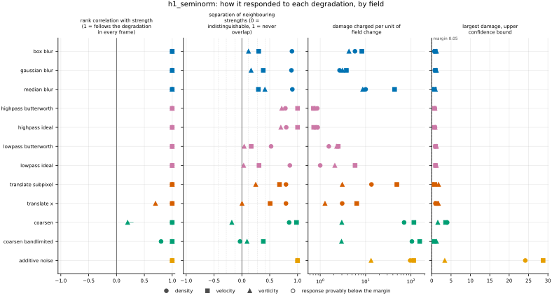
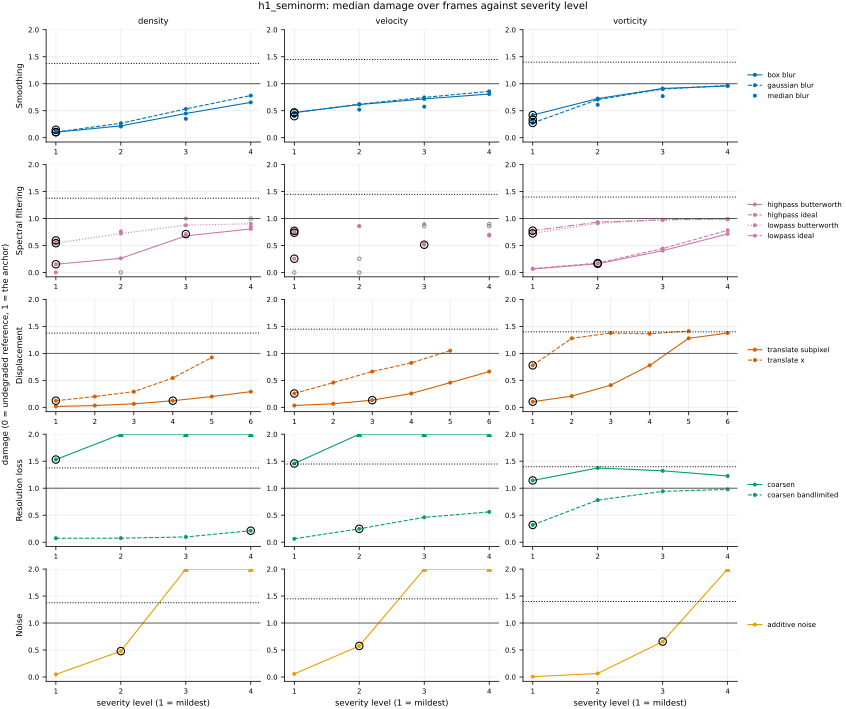
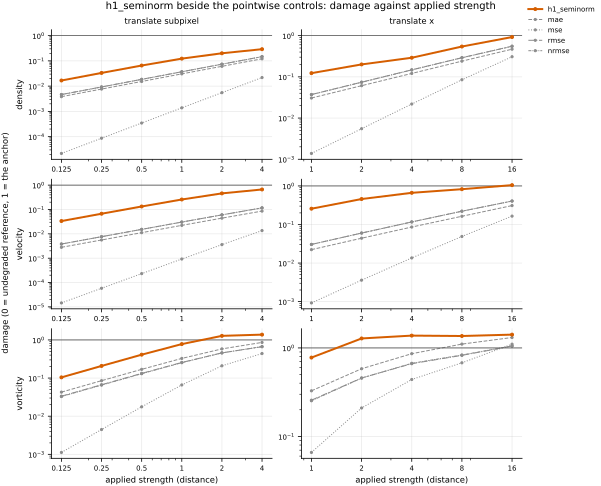

## Definition

For the error field $d = f - g$ on a periodic grid, the homogeneous $\dot{H}^1$ seminorm is
the root mean square of its gradient,

$$
\mathrm{H}^1(f, g) = \left(
\frac{1}{C} \Bigl\langle \sum_{c=1}^{C} \sum_j
\bigl( \partial_j d^{(c)} \bigr)^2 \Bigr\rangle \right)^{1/2} \tag{1}
$$

with $j$ over the spatial directions, $c$ over the $C$ channels and $\langle \cdot \rangle$
the average over cells. Derivatives are spectral, $\partial_j \to i k_j$ with
$k_j = 2\pi \, \mathrm{fftfreq}(N_j, h_j)$ [@pope2000], the convention used throughout this
repository.

Equation (1) is normalised as a root *mean* square, deliberately matching
[h_minus_one](../../metrics/h_minus_one/card.md) rather than following an integral convention, and the
payoff is an exact identity. For an error carried by a single Fourier mode of wavenumber
magnitude $|\mathbf{k}|$,

$$
\mathrm{H}^1 = |\mathbf{k}| \cdot \mathrm{rms}(d),
\qquad
\mathrm{H}^{-1} = \frac{\mathrm{rms}(d)}{|\mathbf{k}|},
\qquad
\mathrm{H}^1 \cdot \mathrm{H}^{-1} = \mathrm{rms}(d)^2 = \mathrm{MSE} \tag{2}
$$

for any $|\mathbf{k}|$ whatsoever. Equation (2) is the cleanest statement of what the pair
is: one error, weighted by $|\mathbf{k}|$ and by $|\mathbf{k}|^{-1}$, on one scale, with
[mse](../../metrics/mse/card.md) sitting exactly between them.

The gradient annihilates constants, so this seminorm is blind to a uniform offset between
the two fields. That is the same blindness [h_minus_one](../../metrics/h_minus_one/card.md) has, arrived
at differently — there by excluding the zero mode from a sum, here by differentiating — and
it makes both pseudometrics rather than metrics.

### Boundary handling

Periodic on every axis, inherited from the spectral derivative. The spacing is read from the
analysis grid rather than assumed, because the value carries an inverse length: on a grid
coarsened by a factor, using the native spacing would inflate the result by exactly that
factor.

It therefore declares `requires_periodic`, and the harness does not run it on a dataset with a
non-periodic axis, such as the Sod shock tube; it reports why in the run log.

## Performance

<!-- GENERATED performance: written by `python -m fmeval.cards evidence h1_seminorm --results results/comparison_1793434653`, do not edit -->



Four measured statistics for h1_seminorm, one row per degradation grouped by family and one marker per field. From left: the rank correlation between the metric and the applied strength within a frame, with the line showing the resampling interval; the separation of neighbouring strengths as Cliff's delta, where 0 means the metric cannot tell one strength from the next and the faint ticks at 0.12, 0.28 and 0.42 are Vargha and Delaney's small, medium and large anchors, for scale and not as grades; the damage charged per unit of field change at the harshest strength; and the upper confidence bound on the largest damage, beside the fixed margin of 0.05. A hollow marker is a field and degradation on which that bound lies below the margin, so the response is provably small. A missing marker is a statistic the analysis withheld, as the rank correlation is on an axis the metric is invariant to.



Median damage over frames against severity level for h1_seminorm, one row per family of degradation and one column per field, on one shared scale. The solid grey line is damage 1, the anchor (by default the field's own mean); the dotted black line is the damage assigned to the fake prediction with the right spectrum, where the run included it. The hollow black ring marks the first level at which the metric has moved a tenth of the way to the anchor. Hollow grey markers are strengths excluded for repeating a milder one or for doing nothing. Degradations with three or fewer usable levels are drawn as markers only; points beyond 2 either side are drawn as triangles at the edge. Damage is negative where a degradation moves the metric away from the anchor, as noise raises a single-field quantity the field's mean sets to zero.

**Trend: does the response follow the degradation?**

| test family | field | degradations | rank correlation | fraction of frames in order | weakest gap between neighbouring strengths |
|---|---|---|---|---|---|
| Displacement | density | 2 | 1 | 1 | 0.896 |
| Displacement | velocity | 2 | 1 | 1 | 0.754 to 0.838 |
| Displacement | vorticity | 2 | 0.7 to 1 | 0.186 to 1 | 0.501 to 0.625 |
| Resolution loss | density | 2 | 0.8 to 1 | 0.317 to 1 | 0.483 to 0.924 |
| Resolution loss | velocity | 2 | 1 | 1 | 0.693 to 0.991 |
| Resolution loss | vorticity | 2 | 0.2 to 1 | 0 to 1 | 0.41 to 0.546 |
| Smoothing | density | 3 | 1 | 1 | 0.945 to 0.953 |
| Smoothing | velocity | 3 | 1 | 1 | 0.648 to 0.692 |
| Smoothing | vorticity | 3 | 1 | 1 | 0.56 to 0.707 |
| Spectral filtering | density | 4 | 1 | 1 | 0.762 to 0.931 |
| Spectral filtering | velocity | 4 | 1 | 1 | 0.584 to 1 |
| Spectral filtering | vorticity | 4 | 1 | 1 | 0.516 to 0.858 |
| Noise | density | 1 | 1 | 1 | 1 |
| Noise | velocity | 1 | 1 | 1 | 1 |
| Noise | vorticity | 1 | 1 | 1 | 1 |

**Reactivity: how far does it move?**

| test family | field | change from clean at the harshest strength | elasticity | first strength detected |
|---|---|---|---|---|
| Displacement | density | — | 0.621 to 0.984 | level 1 |
| Displacement | velocity | — | 0.684 to 0.993 | level 1 |
| Displacement | vorticity | — | 0.412 to 0.988 | level 1 |
| Resolution loss | density | — | 0.205 to 0.499 | level 1 |
| Resolution loss | velocity | — | 0.444 to 1.44 | level 1 |
| Resolution loss | vorticity | — | 0.105 to 0.78 | level 1 |
| Smoothing | density | — | 0.636 to 1.02 | level 1 |
| Smoothing | velocity | — | 0.285 to 0.305 | level 1 |
| Smoothing | vorticity | — | 0.552 to 0.757 | level 1 |
| Spectral filtering | density | — | 0.266 to 8.07 | level 1 |
| Spectral filtering | velocity | — | 0.112 to 1.2 | level 1 |
| Spectral filtering | vorticity | — | 0.133 to 2.55 | level 1 |
| Noise | density | — | 1 | level 2 |
| Noise | velocity | — | 1 | level 2 |
| Noise | vorticity | — | 0.999 | level 3 |
| trap test: fake prediction, right spectrum | density | — | — | damage 1.38 |
| trap test: fake prediction, right spectrum | velocity | — | — | damage 1.45 |
| trap test: fake prediction, right spectrum | vorticity | — | — | damage 1.4 |

**Consistency: how much does it vary from snapshot to snapshot?**

| test family | field | consistency, in the strength's units | snapshots per independent block |
|---|---|---|---|
| Displacement | density | 0.108 to 0.896 | 19 to 20 |
| Displacement | velocity | 0.141 to 1.04 | 21 |
| Displacement | vorticity | 0.161 to 8.88 | 21 |
| Resolution loss | density | 0.206 to 2.99 | 20 |
| Resolution loss | velocity | 0.2 to 1.36 | 22 |
| Resolution loss | vorticity | 0.864 to 5.22 | 21 to 22 |
| Smoothing | density | 0.00679 to 0.0195 | 20 to 21 |
| Smoothing | velocity | 0.0106 to 0.0388 | 21 to 22 |
| Smoothing | vorticity | 0.00963 to 0.0215 | 21 |
| Spectral filtering | density | 0.0105 to 0.0122 | 19 to 20 |
| Spectral filtering | velocity | 0.00718 to 0.0297 | 20 to 22 |
| Spectral filtering | vorticity | 0.0319 to 0.0653 | 21 to 22 |
| Noise | density | 0.000467 | 3 |
| Noise | velocity | 0.00035 | 1 |
| Noise | vorticity | 0.000424 | 1 |

One row per family of degradation and physical field; a cell gives the range over the degradations in that family. **Trend.** The rank correlation is the Spearman correlation between the strength and how far the metric has moved from its value on the undegraded field of the same frame, in the one direction it moves under that degradation, computed inside a single frame. A value of 1 means every strength moved it further than the last in every frame, whichever way it moves; a response that scatters to both sides scores near 0. The fraction of frames in order counts the frames with no exception. The weakest gap is the smallest Mann-Whitney overlap between two neighbouring strengths across frames: 1 means they never overlap, 0.5 that they cannot be told apart. **Reactivity.** The change from clean is the median, at the harshest strength, of the departure from the undegraded value of the same frame over the size of that value: 0.3 means 30%. It does not exist for this metric, whose undegraded value is exactly zero; the damage below is its relative reading. The elasticity is the percentage change of that departure per percentage change in strength over the mildest strengths. First strength detected is the mildest at which the metric has moved a tenth of the way to the anchor; **damage** reads that 0-to-1 scale as a number. A dash means the measurement is not defined there. A metric's reactivity scales with the power it is expressed in: mean squared error's elasticity is twice root-mean-square error's, though the two carry the same information, so compare magnitudes across metrics with that in mind. **Consistency** is how much the response varies from snapshot to snapshot relative to its size, in the strength's units; the snapshots of one trajectory are correlated, and the last column is how many consecutive snapshots one independent block spans.

These tables report what was measured and grade none of the measurements. What the numbers mean for this metric is written in the subsections below, beside the test that produced each number.

**Profile.**

| field | selectivity | charges most for | charges least for | response provably below 0.05 at 90% on | elasticity to a sub-pixel shift, against severity (distance) | compute cost (x cheapest in this run) |
|---|---|---|---|---|---|---|
| density | 0.685 | `coarsen_bandlimited` | `highpass_butterworth` | — | 0.984 | 43.1 |
| velocity | 0.613 | `coarsen_bandlimited` | `highpass_butterworth` | — | 0.993 | 85.6 |
| vorticity | 0.455 | `additive_noise` | `highpass_butterworth` | — | 0.988 | 42.8 |

One row per physical field. **Selectivity** is how concentrated the metric's response is on a few degradations, measured per unit of field change: 0 means it charges every degradation the same, as mean squared error does by construction, and values toward 1 that one degradation carries most of it. **Charges most and least for** name the two ends of that profile. **Response provably below** lists degradations on which the upper confidence bound of the largest damage lies below the margin -- an equivalence test, so an entry says the response is provably small, not merely not significant; a dash means no degradation met the bound. **Elasticity** is the slope of log damage against log shift over the smallest shifts: 1 means damage grows in proportion to the shift, 2 with its square. **Compute cost** is wall-clock per evaluation over the cheapest metric and field in the same run.

<!-- END GENERATED performance -->

## Intuition

This metric measures how wrong a prediction is, weighted so that errors which vary rapidly
from cell to cell count for much more than errors spread smoothly over a large region. It is
the exact opposite trade to a norm that divides by frequency: instead of forgiving fine-grained
disagreement it punishes it, more harshly than a plain cell-by-cell average does.

The mechanism is that it compares the *slopes* of the two fields rather than their values.
Take the difference between prediction and reference, measure how steeply that difference
changes from each cell to its neighbour, and average the square of that steepness. A smooth
offset between the two fields has gentle slopes and costs little. A difference made of rapid
wiggles has steep slopes everywhere and costs a great deal.

That has a consequence worth stating plainly, because it is the reason this metric is recorded
here rather than recommended. A sharp feature that is correct in shape and amplitude but sits
slightly off its true position produces a difference made entirely of steep, rapidly varying
error concentrated at the feature's edges, which is exactly what this metric weights most.
Measured against what each metric charges for an unrelated field, a small shift costs a larger
share here than under a plain cell-by-cell norm, which is already bad at it; Limitations gives
the conditions under which that holds for every field. There is a deeper version of the same
objection:
a genuinely discontinuous field does not belong to the function space this norm is defined on
at all, so at a true shock the value is set by how finely the grid resolves the jump rather
than by anything physical.

Its weighting points the right way for the opposite failure. A prediction that is too smooth,
or one carrying grid-scale noise, differs from the reference in exactly the rapidly varying way
this metric weights most heavily. How that compares with a pointwise norm on the real flow is
measured under Results rather than asserted here.

A worked example on an eight by eight grid. The reference is flat at zero and the prediction is
a single wave with one full oscillation across the box.

```
reference        candidate        h1_seminorm    rmse
0 0 0 0 ...       1.00 ...
0 0 0 0 ...       0.71 ...            0.5554     0.7071
0 0 0 0 ...       0.00 ...
0 0 0 0 ...      -0.71 ...
```

Squeeze the same wave to three oscillations across the box and the cell-by-cell error is
unchanged at 0.7071, while this metric triples to 1.666. The ratio between the two metrics is
exactly the number of oscillations, which is the whole of its behaviour.

What it ignores: the average level of the error. A prediction uniformly too high everywhere
has no slope to its error and scores zero, however large the offset.

## Reading the output

Zero and unbounded above, in the field's units divided by a length, so a value means nothing
until the field and the domain are named. Lower is better. Identical fields score zero, and so
do fields differing by a constant.

Comparison across analysis-grid resolutions is invalid and more strongly so than for most
metrics here: the gradient is dominated by the finest scales the grid resolves, so a finer grid
admits steeper error that a coarser one cannot represent, and the value moves for reasons that
have nothing to do with the prediction.

The comparison that is always meaningful is against [h_minus_one](../../metrics/h_minus_one/card.md) and
[mse](../../metrics/mse/card.md) on the same pair of fields, because Equation (2) fixes their relationship
exactly. Reading the three together says immediately whether a prediction's error sits at large
scales or small ones: error concentrated at fine scales makes this metric large and
`h_minus_one` small, and error at coarse scales does the reverse.

## Limitations

The metric is at its worst on the failure this repository exists to address, and for small
displacements that can be shown rather than argued. Shift a field $f$ by a small $\delta$ along
$x$, so the error is $d \approx \delta\,\partial_x f$, and compare with an unrelated field of the
same statistics, for which the cross terms average away. Writing $\langle \cdot \rangle_f$ for
an average over wavevectors weighted by $|\hat f(\mathbf{k})|^2$, the share of its
unrelated-field value that the shift costs is

$$
\frac{\mathrm{H}^1(f, f_\delta)}{\mathrm{H}^1(f, g)}
\approx \frac{\delta}{\sqrt 2}
\left( \frac{\langle k_x^2 |\mathbf{k}|^2 \rangle_f}{\langle |\mathbf{k}|^2 \rangle_f} \right)^{1/2},
\qquad
\frac{\mathrm{RMSE}(f, f_\delta)}{\mathrm{RMSE}(f, g)}
\approx \frac{\delta}{\sqrt 2} \, \langle k_x^2 \rangle_f^{1/2} \tag{3}
$$

If the spectrum is isotropic, so that the direction of $\mathbf{k}$ is independent of its
magnitude under that weight, $\langle k_x^2 |\mathbf{k}|^2 \rangle_f = c\,\langle |\mathbf{k}|^4
\rangle_f$ and $\langle k_x^2 \rangle_f = c\,\langle |\mathbf{k}|^2 \rangle_f$ with the same
$c$, and the ratio of the two shares in Equation (3) is
$\langle |\mathbf{k}|^4 \rangle_f^{1/2} / \langle |\mathbf{k}|^2 \rangle_f \ge 1$ by the
Cauchy–Schwarz inequality, with equality only when all the energy sits at one wavenumber
magnitude. This derivation is ours rather than taken from a citation, and it needs the
isotropy assumption: a strongly anisotropic spectrum can break it. Measured against the
field's own mean, which is the damage scale under Results, both denominators in Equation (3)
are smaller by the same factor $\sqrt 2$, so the two shares become damages and their ratio is
unchanged. `test_metric.py` checks the ordering on a field varying in one direction, and
Results records it on the real flow.
A model-selection procedure using this metric would therefore prefer a blurred prediction to a
correctly sharp but slightly misplaced one more strongly than a pointwise norm does — the
double-penalty pathology made worse rather than better.

The second limitation is structural rather than a matter of degree. At a true discontinuity the
$\dot{H}^1$ seminorm of the error does not converge as the grid is refined: the gradient at the
jump grows without bound as the cell size shrinks. Any value reported for a shocked flow is
therefore a statement about the mesh as much as about the fields, and two runs at different
resolutions are not measuring the same quantity even approximately. This is the structural
reason the tracker rates the idea Low, and it is not repairable by normalisation.

Finally, its sensitivity to fine scales makes it sensitive to numerical artefacts of the
prediction rather than to its physics. Grid-scale ringing that a viewer would dismiss produces a
large value here.

## Results

<!-- GENERATED run: written by `python -m fmeval.cards evidence h1_seminorm --results results/comparison_1793434653`, do not edit -->

Measured on `kinet_re5e4`, frames 2000 to 10000 (161 frames of developed flow), on the 256 analysis grid, seed 20260807, at commit `a9a8b7f86aca`. Run `comparison_1793434653`.

Every number in this section comes from that one run. Regenerate with `python -m fmeval.cards evidence <name> --results results/comparison_1793434653`.

<!-- END GENERATED run -->

### Smoothing

[gaussian_blur](../../degradations/gaussian_blur/card.md) ·
[box_blur](../../degradations/box_blur/card.md)

<!-- GENERATED results_smoothing: written by `python -m fmeval.cards evidence h1_seminorm --results results/comparison_1793434653`, do not edit -->

| degradation | field | strengths | rank correlation | fraction of frames in the right order | weakest gap between neighbouring strengths |
|---|---|---|---|---|---|
| `box_blur` | density | 4 | 1 | 1 | 0.95 |
| `box_blur` | velocity | 4 | 1 | 1 | 0.651 |
| `box_blur` | vorticity | 4 | 1 | 1 | 0.56 |
| `gaussian_blur` | density | 4 | 1 | 1 | 0.945 |
| `gaussian_blur` | velocity | 4 | 1 | 1 | 0.692 |
| `gaussian_blur` | vorticity | 4 | 1 | 1 | 0.583 |
| `median_blur` | density | 3 | 1 | 1 | 0.953 |
| `median_blur` | velocity | 3 | 1 | 1 | 0.648 |
| `median_blur` | vorticity | 3 | 1 | 1 | 0.707 |

<!-- END GENERATED results_smoothing -->

Ordered correctly on every smoothing axis and field. Relative to its own value on the field's
mean, this metric departs from clean sooner than `rmse` does: at the mildest `gaussian_blur`
it has reached 0.10, 0.46 and 0.27 of that value on density, velocity and vorticity, against
0.02, 0.04 and 0.07 for `rmse`. Blur removes exactly the rapidly varying part of the field
that the gradient weights most.

### Spectral filtering

[lowpass_ideal](../../degradations/lowpass_ideal/card.md) ·
[highpass_ideal](../../degradations/highpass_ideal/card.md)

<!-- GENERATED results_spectral: written by `python -m fmeval.cards evidence h1_seminorm --results results/comparison_1793434653`, do not edit -->

| degradation | field | strengths | rank correlation | fraction of frames in the right order | weakest gap between neighbouring strengths |
|---|---|---|---|---|---|
| `highpass_butterworth` | density | 4 | 1 | 1 | 0.891 |
| `highpass_butterworth` | velocity | 3 | 1 | 1 | 1 |
| `highpass_butterworth` | vorticity | 4 | 1 | 1 | 0.858 |
| `highpass_ideal` | density | 3 | 1 | 1 | 0.898 |
| `highpass_ideal` | velocity | 2 | 1 | 1 | 1 |
| `highpass_ideal` | vorticity | 4 | 1 | 1 | 0.85 |
| `lowpass_butterworth` | density | 4 | 1 | 1 | 0.762 |
| `lowpass_butterworth` | velocity | 3 | 1 | 1 | 0.584 |
| `lowpass_butterworth` | vorticity | 4 | 1 | 1 | 0.521 |
| `lowpass_ideal` | density | 3 | 1 | 1 | 0.931 |
| `lowpass_ideal` | velocity | 2 | 1 | 1 | 0.654 |
| `lowpass_ideal` | vorticity | 4 | 1 | 1 | 0.516 |

<!-- END GENERATED results_spectral -->

The response splits by which end of the spectrum is removed. At the mildest `lowpass_ideal`
the metric stands at 0.59 to 0.78 of its value on the field's mean against 0.23 to 0.25 for
`rmse`. At the mildest `highpass_ideal` on vorticity, which removes 45% of the energy from
the lowest shells, it reads 0.07 against 0.66 for `rmse`: error at large scales has shallow
gradients and costs little here. This is the mirror image of `h_minus_one`, which is gentlest
on exactly the errors this metric charges most.

### Displacement

[translate_x](../../degradations/translate/card.md) ·
[translate_subpixel](../../degradations/translate_subpixel/card.md)

<!-- GENERATED results_geometric: written by `python -m fmeval.cards evidence h1_seminorm --results results/comparison_1793434653`, do not edit -->

| degradation | field | strengths | rank correlation | fraction of frames in the right order | weakest gap between neighbouring strengths |
|---|---|---|---|---|---|
| `translate_subpixel` | density | 6 | 1 | 1 | 0.896 |
| `translate_subpixel` | velocity | 6 | 1 | 1 | 0.838 |
| `translate_subpixel` | vorticity | 6 | 1 | 1 | 0.625 |
| `translate_x` | density | 5 | 1 | 1 | 0.896 |
| `translate_x` | velocity | 5 | 1 | 1 | 0.754 |
| `translate_x` | vorticity | 5 | 0.7 | 0.186 | 0.501 |

<!-- END GENERATED results_geometric -->

The ordering is correct on five of the six rows, and the magnitude confirms Equation (3) on
the real flow. A one-cell `translate_x` costs this metric 0.12, 0.26 and 0.78 of its value on
the field's mean on density, velocity and vorticity, against 0.04, 0.03 and 0.26 for `rmse` and
0.03, 0.02 and 0.03 for `h_minus_one`. On vorticity a two-cell shift already costs 1.28, more
than the field's mean does, and a four-cell shift costs 1.38, level with the 1.41 of the
reference moved far away, which is why the vorticity `translate_x` row reads 0.7: the metric
has saturated, and the remaining strengths differ only by frame-to-frame scatter. This is the double penalty made worse, measured.

### Resolution loss

[coarsen](../../degradations/coarsen/card.md) ·
[coarsen_bandlimited](../../degradations/coarsen_bandlimited/card.md)

<!-- GENERATED results_resolution: written by `python -m fmeval.cards evidence h1_seminorm --results results/comparison_1793434653`, do not edit -->

| degradation | field | strengths | rank correlation | fraction of frames in the right order | weakest gap between neighbouring strengths |
|---|---|---|---|---|---|
| `coarsen` | density | 4 | 1 | 1 | 0.924 |
| `coarsen` | velocity | 4 | 1 | 1 | 0.991 |
| `coarsen` | vorticity | 4 | 0.2 | 0 | 0.41 |
| `coarsen_bandlimited` | density | 4 | 0.8 | 0.317 | 0.483 |
| `coarsen_bandlimited` | velocity | 4 | 1 | 1 | 0.693 |
| `coarsen_bandlimited` | vorticity | 4 | 1 | 1 | 0.546 |

<!-- END GENERATED results_resolution -->

Ordered correctly on density and velocity, but not on vorticity, where the rank correlation is
0.2 and no single frame is in the right order. The median value rises from factor 2 to 4 and
then falls at 8 and 16, while `mse` and `h_minus_one` rise throughout. The degradation expands
each block back to the fine grid as a constant, and on a field that varies as quickly as
vorticity the metric ends up measuring the jumps between blocks rather than the detail
coarsening removed. A test on synthetic fields, recorded in `issues/039`, shows the peak
moving to larger factors as the field gets smoother, which matches that account.

`coarsen_bandlimited` settles it. It keeps the same block means without adding edges, and under
it vorticity is in the right order in every frame, with a rank correlation of 1. The size of
the staircase's contribution is plain at the mildest factor: coarsening by 2 costs 1.53, 1.46
and 1.14 of the value on the field's mean on density, velocity and vorticity under `coarsen` —
on every field, more than the mean does — against 0.073, 0.063 and 0.32 under the
band-limited operator. Density is the exception under the band-limited operator, in the right
order in only 32% of frames with a rank correlation of 0.8: its values at factors 2 and 4 are
2.6e-5 and 2.7e-5, nearly equal and ordered differently from frame to frame. The pointwise
metrics and `spectrum_l2` show the same density pattern, and its cause is not established
(`issues/039`).

### Noise

[additive_noise](../../degradations/additive_noise/card.md)

<!-- GENERATED results_stochastic: written by `python -m fmeval.cards evidence h1_seminorm --results results/comparison_1793434653`, do not edit -->

| degradation | field | strengths | rank correlation | fraction of frames in the right order | weakest gap between neighbouring strengths |
|---|---|---|---|---|---|
| `additive_noise` | density | 4 | 1 | 1 | 1 |
| `additive_noise` | velocity | 4 | 1 | 1 | 1 |
| `additive_noise` | vorticity | 4 | 1 | 1 | 1 |

<!-- END GENERATED results_stochastic -->

Ordered correctly with complete separation. Noise is where the weighting by wavenumber is
most extreme: at the strongest level the metric reads 24 to 29 times its value on the field's
mean on density and velocity, and 3.3 times on vorticity, where `rmse` reads 0.50. Uncorrelated
cell-to-cell noise is almost pure gradient.

### Trap tests

[gaussian_impostor](../../degradations/gaussian_impostor/card.md) ·
[uncorrelated](../../degradations/random_large_translation/card.md)

<!-- GENERATED results_canaries: written by `python -m fmeval.cards evidence h1_seminorm --results results/comparison_1793434653`, do not edit -->

| field | damage assigned to the fake prediction | closest real degradation | damage of the reference moved far away | value on the anchor |
|---|---|---|---|---|
| density | 1.38 | `coarsen=2` | 1.38 | 0.000357 |
| velocity | 1.45 | `coarsen=2` | 1.54 | 0.00175 |
| vorticity | 1.4 | `translate_x=16` | 1.41 | 0.000962 |

The fake prediction here has exactly the reference field's amplitude spectrum and completely scrambled structure. Damage 1 is what the anchor scores, by default the reference's own spatial mean, a prediction that knows the mean and nothing else. The damage column therefore says how close to useless this metric considers that fake prediction: a low number means the metric was fooled. The third column translates the same number into an ordinary degradation whose damage the fake prediction matches, which is easier to picture. The fourth is the reference moved by a large random offset, the right statistics in the wrong place; where a field's energy sits in its largest scales that copy stays partly correlated with the reference, so it is not the score of an unrelated field.

<!-- END GENERATED results_canaries -->

The fake prediction scores farther from the truth than the field's own mean, with damage
between 1.38 and 1.45 on all three fields, close to the 1.38 to 1.54 of the reference moved far
away, so this metric rejects it firmly. That is expected of a phase-sensitive
error metric and says nothing about the displacement problem.

### Compared with the other metrics

<!-- GENERATED results_summary: written by `python -m fmeval.cards evidence h1_seminorm --results results/comparison_1793434653`, do not edit -->

| compared with | rank correlation over every degradation |
|---|---|
| `rmse` | 0.708 |
| `mse` | 0.708 |
| `max_error` | 0.707 |
| `mae` | 0.677 |
| `nrmse` | 0.661 |
| `h_minus_one` | 0.515 |
| `enstrophy` | 0.25 |
| `increment_w1` | 0.225 |
| `energy_distance` | 0.22 |
| `kinetic_energy` | 0.147 |
| `spectral_energy_flux` | 0.141 |
| `increment_w1_by_separation` | 0.126 |
| `palinstrophy` | 0.11 |
| `tail_index` | 0.0283 |
| `spectrum_l2` | -0.132 |
| `increment_flatness` | -0.139 |

Computed on the median value at each combination of degradation and strength, over every degradation and physical field in the run, with the undegraded reference excluded. Two metrics correlating near 1 put the degradations in the same order, but the two may still weight those degradations very differently. A correlation near 1 therefore means the two metrics are redundant for ranking models, not that the two are interchangeable as training losses.

<!-- END GENERATED results_summary -->

This metric ranks the ladder most like the pointwise family, at 0.66 to 0.71 with `nrmse`,
`mae`, `mse` and `rmse`, and less like `h_minus_one`, at 0.52. The two Sobolev orders agree on
direction for most degradations and disagree on which ones are severe, which is the whole
content of Equation (2).

### Damage beside the other metrics

<!-- GENERATED results_damage_by_level: written by `python -m fmeval.cards evidence h1_seminorm --results results/comparison_1793434653`, do not edit -->



Median damage over frames against the applied strength, log-log, for h1_seminorm (bold, in colour) and the pointwise controls mae, mse, rmse, nrmse (thin, grey), one column per displacement degradation and one row per field. The grey line is damage 1, the anchor (by default the field's own mean). Parallel lines charge in the same proportion at every strength; a steeper line charges relatively more for the larger shifts, which is what decides whether two metrics are interchangeable as training losses. These are the same numbers as the table beneath.

**Displacement, density, `translate_subpixel`** (strength: distance).

| metric | 0.125 | 0.25 | 0.5 | 1 | 2 | 4 |
|---|---|---|---|---|---|---|
| `h1_seminorm` | 0.0168 | 0.0334 | 0.0656 | 0.123 | 0.2 | 0.291 |
| `mae` | 0.00383 | 0.00767 | 0.0153 | 0.0306 | 0.061 | 0.121 |
| `mse` | 2.17e-05 | 8.68e-05 | 0.000347 | 0.00138 | 0.00551 | 0.0219 |
| `rmse` | 0.00466 | 0.00931 | 0.0186 | 0.0372 | 0.0743 | 0.148 |
| `nrmse` | 0.00463 | 0.00926 | 0.0185 | 0.037 | 0.0738 | 0.147 |

**Displacement, density, `translate_x`** (strength: distance).

| metric | 1 | 2 | 4 | 8 | 16 |
|---|---|---|---|---|---|
| `h1_seminorm` | 0.123 | 0.2 | 0.291 | 0.544 | 0.924 |
| `mae` | 0.0306 | 0.061 | 0.121 | 0.24 | 0.469 |
| `mse` | 0.00138 | 0.00551 | 0.0219 | 0.0849 | 0.307 |
| `rmse` | 0.0372 | 0.0743 | 0.148 | 0.291 | 0.555 |
| `nrmse` | 0.037 | 0.0738 | 0.147 | 0.29 | 0.55 |

**Displacement, velocity, `translate_subpixel`** (strength: distance).

| metric | 0.125 | 0.25 | 0.5 | 1 | 2 | 4 |
|---|---|---|---|---|---|---|
| `h1_seminorm` | 0.0335 | 0.0669 | 0.133 | 0.257 | 0.458 | 0.663 |
| `mae` | 0.00279 | 0.00559 | 0.0112 | 0.0223 | 0.0441 | 0.0859 |
| `mse` | 1.45e-05 | 5.81e-05 | 0.000232 | 0.000924 | 0.0036 | 0.0136 |
| `rmse` | 0.00381 | 0.00762 | 0.0152 | 0.0304 | 0.06 | 0.117 |
| `nrmse` | 0.00382 | 0.00763 | 0.0153 | 0.0304 | 0.06 | 0.117 |

**Displacement, velocity, `translate_x`** (strength: distance).

| metric | 1 | 2 | 4 | 8 | 16 |
|---|---|---|---|---|---|
| `h1_seminorm` | 0.257 | 0.458 | 0.663 | 0.824 | 1.05 |
| `mae` | 0.0223 | 0.0441 | 0.0859 | 0.163 | 0.31 |
| `mse` | 0.000924 | 0.0036 | 0.0136 | 0.0489 | 0.165 |
| `rmse` | 0.0304 | 0.06 | 0.117 | 0.221 | 0.406 |
| `nrmse` | 0.0304 | 0.06 | 0.117 | 0.221 | 0.406 |

**Displacement, vorticity, `translate_subpixel`** (strength: distance).

| metric | 0.125 | 0.25 | 0.5 | 1 | 2 | 4 |
|---|---|---|---|---|---|---|
| `h1_seminorm` | 0.104 | 0.208 | 0.411 | 0.778 | 1.28 | 1.38 |
| `mae` | 0.0428 | 0.0854 | 0.169 | 0.328 | 0.582 | 0.86 |
| `mse` | 0.00112 | 0.00448 | 0.0176 | 0.066 | 0.21 | 0.44 |
| `rmse` | 0.0335 | 0.0669 | 0.133 | 0.257 | 0.458 | 0.663 |
| `nrmse` | 0.0328 | 0.0654 | 0.13 | 0.253 | 0.456 | 0.67 |

**Displacement, vorticity, `translate_x`** (strength: distance).

| metric | 1 | 2 | 4 | 8 | 16 |
|---|---|---|---|---|---|
| `h1_seminorm` | 0.778 | 1.28 | 1.38 | 1.36 | 1.41 |
| `mae` | 0.328 | 0.582 | 0.86 | 1.1 | 1.31 |
| `mse` | 0.066 | 0.21 | 0.44 | 0.679 | 1.1 |
| `rmse` | 0.257 | 0.458 | 0.663 | 0.824 | 1.05 |
| `nrmse` | 0.253 | 0.456 | 0.67 | 0.832 | 1.05 |

Median damage over frames at every strength, this metric in the first row and the pointwise controls beneath it, all on the same 0-to-1 scale where 0 is the undegraded reference and 1 the anchor (by default the field's own mean); a dash means no damage scale on that field. The rank correlations under *Compared with the other metrics* say whether two metrics put the strengths in the same order; this table says how much each one charges for the same strength, which decides whether two metrics are interchangeable as training losses.

<!-- END GENERATED results_damage_by_level -->

## References

\bibliography
