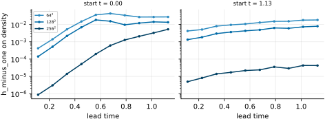
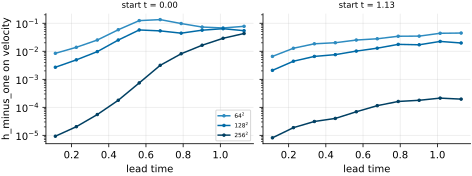
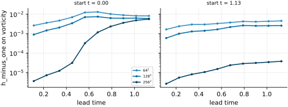
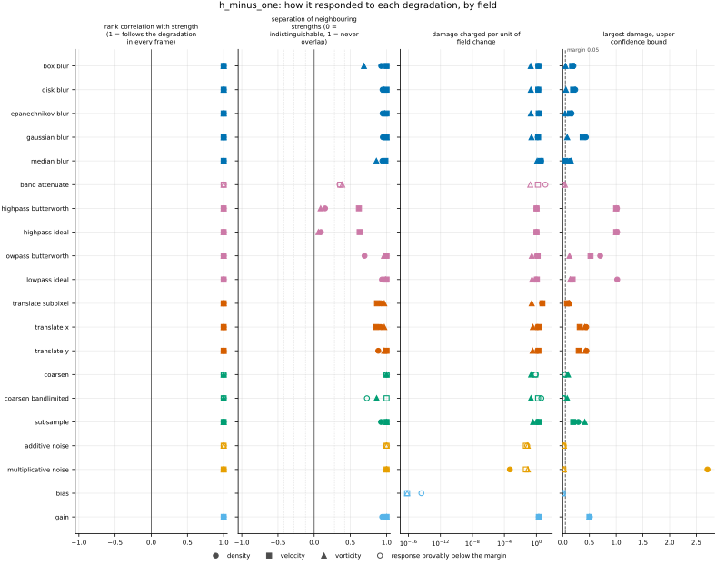
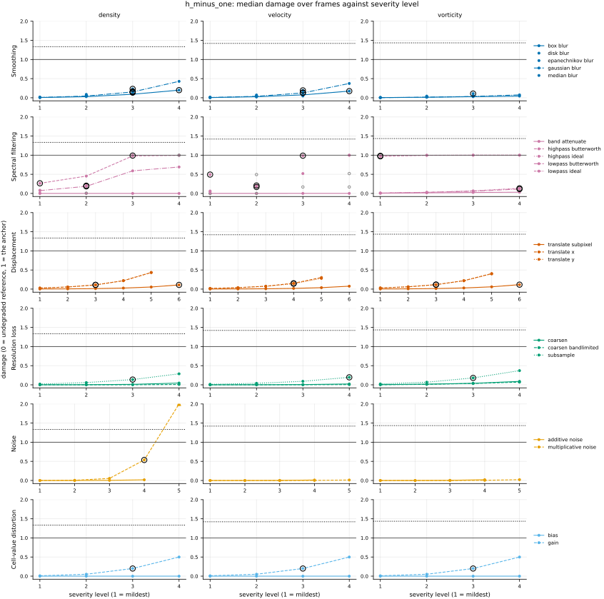
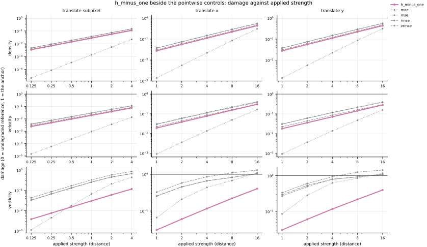

## Definition

Write the error field as $d = f - g$ on a periodic box of $N = \prod_j N_j$ cells with
spacing $h_j$ and side lengths $L_j = N_j h_j$. Its discrete Fourier coefficients, indexed
by the integer mode vector $\mathbf{m}$, are taken with the $1/N$ normalisation

$$
\hat{d}_{\mathbf{m}} = \frac{1}{N} \sum_{\mathbf{n}} d_{\mathbf{n}} \,
\exp\left( -2\pi i \sum_j \frac{m_j n_j}{N_j} \right) \tag{1}
$$

so that Parseval reads $\sum_{\mathbf{m}} |\hat{d}_{\mathbf{m}}|^2 = \langle d^2 \rangle$,
the mean square over cells. The physical wavevector of mode $\mathbf{m}$ is

$$
k_j(\mathbf{m}) = \frac{2\pi m_j}{L_j},
\qquad
|\mathbf{k}| = \Bigl( \sum_j k_j^2 \Bigr)^{1/2} \tag{2}
$$

and the metric is the homogeneous Sobolev seminorm of order $-1$, pooled over the $C$
channels:

$$
\mathrm{H}^{-1}(f, g) = \left(
\frac{1}{C} \sum_{c=1}^{C} \sum_{\mathbf{m} \neq 0}
\frac{\bigl| \hat{d}^{(c)}_{\mathbf{m}} \bigr|^2}{|\mathbf{k}(\mathbf{m})|^2}
\right)^{1/2} \tag{3}
$$

Two things about Equation (3) are choices rather than consequences. The $1/C$ and the
mean-square normalisation inherited from Equation (1) are picked so that replacing the
exponent $-1$ by $0$ returns exactly [rmse](../../metrics/rmse/card.md) — the two numbers are then on
one scale and their ratio is the factor this metric applies and a pointwise norm does not.
And the mode $\mathbf{m} = \mathbf{0}$ is omitted because $|\mathbf{k}|^{-2}$ is undefined
there. That omission is what makes this a *homogeneous* seminorm, and it has a consequence
large enough to belong in the definition: the sum is blind to the mean of $d$, so two
fields differing by a constant are at distance zero.

Equivalently, and this is what the implementation computes, let $w = (-\Delta)^{-1/2} d$ be
the field whose Fourier coefficients are $\hat{d}_{\mathbf{m}} / |\mathbf{k}(\mathbf{m})|$
with the zero mode set to zero. Then

$$
\mathrm{H}^{-1}(f, g) = \left(
\frac{1}{C} \Bigl\langle \sum_{c=1}^{C} \bigl( w^{(c)} \bigr)^2 \Bigr\rangle
\right)^{1/2} \tag{4}
$$

where $\langle \cdot \rangle$ averages over cells. Equations (3) and (4) agree by Parseval.
Equation (4) is the reason this norm has a per-cell map at all: the quantity inside the
average is a density over the domain even though the transform that produced it is not
local.

The reason to want a negative-order norm here is its relation to optimal transport.
Theorem 1 of [@peyre2018] bounds the quadratic Wasserstein distance between measures
$\mu, \nu$ by

$$
W_2(\mu, \nu) \;\le\; 2 \, \| \mu - \nu \|_{\dot{H}^{-1}(\mu)} \tag{5}
$$

and its Equation (5) gives the infinitesimal statement $W_2(\mu, \mu + d\mu) = \| d\mu
\|_{\dot{H}^{-1}(\mu)} + o(d\mu)$ that Equation (5) here integrates. Note the weight: the
norms in that paper are taken against $\mu$, while Equation (3) is the unweighted
$\dot{H}^{-1}(dx)$ that a single FFT gives. The two are related through upper and lower
bounds on the density, and the relation degrades as the lower bound approaches zero. The
equation and theorem numbers above are those of the preprint, arXiv:1104.4631v2; the
publisher's page could not be read, so the published version's numbering is not confirmed
here.

The wavevectors of Equation (2) come from the same
$k_j = 2\pi \, \mathrm{fftfreq}(N_j, h_j)$ convention the repository already uses for its
spectral derivatives [@pope2000]. This is deliberately not the integer-cycle magnitude in
`fmeval/wavenumbers.py`, which exists so that filter cutoffs and the energy calibration
agree about which side of a shell a mode falls on; that quantity is a mode index and this
one carries units of inverse length.

### Boundary handling

Periodic on every axis, inherited from the discrete Fourier transform in Equation (1). The
spacing used in Equation (2) is read from the analysis grid rather than assumed, because
the norm carries a length: on a grid coarsened by a factor, using the native spacing would
scale the result by exactly that factor. On a domain that is not periodic the transform
would wrap the field onto itself and the resulting number would be meaningless rather than
merely approximate.

It therefore declares `requires_periodic`, and the harness does not run it on a dataset with a
non-periodic axis, such as the Sod shock tube; it reports why in the run log.

### How its field reports it

**Optimal transport**, the field this bundle's source belongs to, uses the $\dot{H}^{-1}$
distance between two densities as the linearisation of the quadratic Wasserstein distance:
Equation (5) above ([@peyre2018], Theorem 1), the infinitesimal equality ([@peyre2018],
Eq. (5)), and the lower bound by $W_2$ for bounded densities on a manifold of nonnegative
curvature such as the flat torus ([@peyre2018], Theorem 5, Eq. (17)). Its check of this number
is therefore the comparison with $W_2$ on the same pair of positive densities. The paper is
purely theoretical: it draws no figure and runs no experiment, so the comparison is the
standard and no figure is. This repository makes it: [wasserstein](../../metrics/wasserstein/card.md)
computes $W_2$ between the mass-normalised densities, and both metrics run on density in the
same runs, so the two cards' tables and the cross-metric correlation of the comparison run are
the check. Two differences must be held in mind when reading them: Equation (3) is unweighted
where the theorems weight by the reference density (Definition), and it is not mass-normalised,
so on density the two differ also by the factor of the mean density.

**The shift test** of the seismic-inversion literature, a misfit drawn against the shift of a
signal ([@engquist2014], Fig. 1), is the comparison by which a transport-like distance is told
apart from a pointwise one, and is the card's first figure: the damage against the applied
translation beside the pointwise errors.

**The mixing literature** also uses negative Sobolev norms, but of *one* scalar field tracked
in time, rescaled by its initial value, as a measure of how mixed it is ([@thiffeault2011],
Sect. 3.1, Eq. (3.3), and Fig. 4). That is a single-field norm, not this two-field distance,
and is not built here.

**The experiments.** Misfit against shift: the translation axes of the degradation ladder on
`kinet_re5e4` (`translate_x`, `translate_subpixel`). Known-answer transport, where the distance
between two densities is known in closed form:
[EXP-wasserstein-known-answer-transport](https://github.com/khegazy/pde_metrics/blob/main/proposals/EXP-wasserstein-known-answer-transport.md).
A density whose fluctuation is not small against its mean, where the linearisation and the
bounds separate:
[EXP-wasserstein-background-ratio-sweep](https://github.com/khegazy/pde_metrics/blob/main/proposals/EXP-wasserstein-background-ratio-sweep.md).
The metric also runs on every field of the degradation ladder, on the Reynolds ladder and on
`forecast_re5e4`, where its first figure is the error against lead time.

## Performance

<!-- GENERATED performance: written by `python -m fmeval.cards evidence h_minus_one --results results/comparison_1793829127 --results results/comparison_1793811840 --results results/comparison_1793829231`, do not edit -->



*As this metric's own field draws it, from run `comparison_1793811840`.* h_minus_one on density against lead time, the physical time since the forecast started, one panel per start and one line per run, darker the finer the run's grid. Each point is one prediction step of one forecast.



*As this metric's own field draws it, from run `comparison_1793811840`.* h_minus_one on velocity against lead time, the physical time since the forecast started, one panel per start and one line per run, darker the finer the run's grid. Each point is one prediction step of one forecast.



*As this metric's own field draws it, from run `comparison_1793811840`.* h_minus_one on vorticity against lead time, the physical time since the forecast started, one panel per start and one line per run, darker the finer the run's grid. Each point is one prediction step of one forecast.



Four measured statistics for h_minus_one, one row per degradation grouped by family and one marker per field. From left: the rank correlation between the metric and the applied strength within a frame, with the line showing the resampling interval; the separation of neighbouring strengths as Cliff's delta, where 0 means the metric cannot tell one strength from the next and the faint ticks at 0.12, 0.28 and 0.42 are Vargha and Delaney's small, medium and large anchors, for scale and not as grades; the damage charged per unit of field change at the harshest strength; and the upper confidence bound on the largest damage, beside the fixed margin of 0.05. A hollow marker is a field and degradation on which that bound lies below the margin, so the response is provably small. A missing marker is a statistic the analysis withheld, as the rank correlation is on an axis the metric is invariant to.



Median damage over frames against severity level for h_minus_one, one row per family of degradation and one column per field, on one shared scale. The solid grey line is damage 1, the anchor (by default the field's own mean); the dotted black line is the damage assigned to the fake prediction with the right spectrum, where the run included it. The hollow black ring marks the first level at which the metric has moved a tenth of the way to the anchor. Hollow grey markers are strengths excluded for repeating a milder one or for doing nothing. Degradations with three or fewer usable levels are drawn as markers only; points beyond 2 either side are drawn as triangles at the edge. Damage is negative where a degradation moves the metric away from the anchor, as noise raises a single-field quantity the field's mean sets to zero.

**Trend: does the response follow the degradation?**

| test family | field | degradations | rank correlation | fraction of frames in order | weakest gap between neighbouring strengths |
|---|---|---|---|---|---|
| Displacement | density | 3 | 1 | 1 | 0.943 to 0.961 |
| Displacement | velocity | 3 | 1 | 1 | 0.93 to 1 |
| Displacement | vorticity | 3 | 1 | 1 | 0.984 |
| Cell-value distortion | density | 2 | 1 | 1 | 0.97 |
| Cell-value distortion | velocity | 2 | 1 | 1 | 1 |
| Cell-value distortion | vorticity | 2 | 1 | 1 | 1 |
| Resolution loss | density | 3 | 1 | 1 | 0.864 to 1 |
| Resolution loss | velocity | 3 | 1 | 1 | 1 |
| Resolution loss | vorticity | 3 | 1 | 1 | 0.931 to 1 |
| Smoothing | density | 5 | 1 | 1 | 0.963 to 0.974 |
| Smoothing | velocity | 5 | 1 | 1 | 0.992 to 1 |
| Smoothing | vorticity | 5 | 1 | 1 | 0.844 to 1 |
| Spectral filtering | density | 5 | 1 | 1 | 0.546 to 0.968 |
| Spectral filtering | velocity | 5 | 1 | 1 | 0.68 to 1 |
| Spectral filtering | vorticity | 5 | 1 | 1 | 0.529 to 0.994 |
| Noise | density | 2 | 1 | 1 | 1 |
| Noise | velocity | 2 | 1 | 1 | 1 |
| Noise | vorticity | 2 | 1 | 1 | 1 |

**Reactivity: how far does it move?**

| test family | field | change from clean at the harshest strength | elasticity | first strength detected |
|---|---|---|---|---|
| Displacement | density | — | 0.999 to 1 | level 3 |
| Displacement | velocity | — | 0.999 to 1 | level 4 |
| Displacement | vorticity | — | 0.969 to 0.999 | level 3 |
| Cell-value distortion | density | — | 1 | level 3 |
| Cell-value distortion | velocity | — | 1 | level 3 |
| Cell-value distortion | vorticity | — | 1 | level 3 |
| Resolution loss | density | — | 1.4 to 2.13 | level 3 |
| Resolution loss | velocity | — | 1.4 to 3.07 | level 4 |
| Resolution loss | vorticity | — | 1.5 to 2.2 | level 3 |
| Smoothing | density | — | 1.81 to 1.92 | level 3 |
| Smoothing | velocity | — | 1.77 to 1.91 | level 3 |
| Smoothing | vorticity | — | 1.21 to 2.01 | level 3 |
| Spectral filtering | density | — | 1 to 6.71 | level 1 |
| Spectral filtering | velocity | — | 0.952 to 1.33 | level 1 |
| Spectral filtering | vorticity | — | 0.0269 to 1.05 | level 1 |
| Noise | density | — | 0.997 to 1 | level 4 |
| Noise | velocity | — | 1 | level — |
| Noise | vorticity | — | 0.996 to 0.998 | level — |
| trap test: fake prediction, right spectrum | density | — | — | damage 1.33 |
| trap test: fake prediction, right spectrum | velocity | — | — | damage 1.42 |
| trap test: fake prediction, right spectrum | vorticity | — | — | damage 1.44 |

**Consistency: how much does it vary from snapshot to snapshot?**

| test family | field | consistency, in the strength's units | snapshots per independent block |
|---|---|---|---|
| Displacement | density | 0.0888 to 0.595 | 20 |
| Displacement | velocity | 0.115 to 0.693 | 21 to 22 |
| Displacement | vorticity | 0.0628 to 0.644 | 15 to 22 |
| Cell-value distortion | density | 0.0298 | 1 to 20 |
| Cell-value distortion | velocity | 0.00391 | 1 |
| Cell-value distortion | vorticity | 0.00507 | 1 |
| Resolution loss | density | 0.658 to 1.44 | 17 to 20 |
| Resolution loss | velocity | 0.126 to 1.6 | 11 to 22 |
| Resolution loss | vorticity | 0.868 to 1.53 | 21 to 22 |
| Smoothing | density | 0.00892 to 0.0188 | 16 to 19 |
| Smoothing | velocity | 0.00169 to 0.0101 | 17 to 22 |
| Smoothing | vorticity | 0.0146 to 0.0332 | 22 |
| Spectral filtering | density | 0.0249 to 0.103 | 17 to 21 |
| Spectral filtering | velocity | 0.00577 to 0.1 | 1 to 22 |
| Spectral filtering | vorticity | 0.0329 to 0.116 | 1 to 22 |
| Noise | density | 0.00373 to 0.0172 | 1 to 20 |
| Noise | velocity | 0.00274 to 0.00449 | 1 |
| Noise | vorticity | 0.00871 to 0.014 | 22 |

One row per family of degradation and physical field; a cell gives the range over the degradations in that family. **Trend.** The rank correlation is the Spearman correlation between the strength and how far the metric has moved from its value on the undegraded field of the same frame, in the one direction it moves under that degradation, computed inside a single frame. A value of 1 means every strength moved it further than the last in every frame, whichever way it moves; a response that scatters to both sides scores near 0. The fraction of frames in order counts the frames with no exception. The weakest gap is the smallest Mann-Whitney overlap between two neighbouring strengths across frames: 1 means they never overlap, 0.5 that they cannot be told apart. **Reactivity.** The change from clean is the median, at the harshest strength, of the departure from the undegraded value of the same frame over the size of that value: 0.3 means 30%. It does not exist for this metric, whose undegraded value is exactly zero; the damage below is its relative reading. The elasticity is the percentage change of that departure per percentage change in strength over the mildest strengths. First strength detected is the mildest at which the metric has moved a tenth of the way to the anchor; **damage** reads that 0-to-1 scale as a number. A dash means the measurement is not defined there. A metric's reactivity scales with the power it is expressed in: mean squared error's elasticity is twice root-mean-square error's, though the two carry the same information, so compare magnitudes across metrics with that in mind. **Consistency** is how much the response varies from snapshot to snapshot relative to its size, in the strength's units; the snapshots of one trajectory are correlated, and the last column is how many consecutive snapshots one independent block spans.

These tables report what was measured and grade none of the measurements. What the numbers mean for this metric is written in the subsections below, beside the test that produced each number.

**Profile.**

| field | selectivity | charges most for | charges least for | response provably below 0.05 at 90% on | elasticity to a sub-pixel shift, against severity (distance) | compute cost (x cheapest in this run) |
|---|---|---|---|---|---|---|
| density | 0.612 | `band_attenuate` | `bias` | `additive_noise` `band_attenuate` `bias` `coarsen` `coarsen_bandlimited` | 1 | 33.6 |
| velocity | 0.36 | `translate_subpixel` | `bias` | `additive_noise` `band_attenuate` `bias` `coarsen` `coarsen_bandlimited` `multiplicative_noise` | 1 | 58.2 |
| vorticity | 0.548 | `gain` | `bias` | `additive_noise` `band_attenuate` `bias` `multiplicative_noise` | 0.999 | 34.3 |

One row per physical field. **Selectivity** is how concentrated the metric's response is on a few degradations, measured per unit of field change: 0 means it charges every degradation the same, as mean squared error does by construction, and values toward 1 that one degradation carries most of it. **Charges most and least for** name the two ends of that profile. **Response provably below** lists degradations on which the upper confidence bound of the largest damage lies below the margin -- an equivalence test, so an entry says the response is provably small, not merely not significant; a dash means no degradation met the bound. **Elasticity** is the slope of log damage against log shift over the smallest shifts: 1 means damage grows in proportion to the shift, 2 with its square. **Compute cost** is wall-clock per evaluation over the cheapest metric and field in the same run.

<!-- END GENERATED performance -->

## Intuition

This metric measures how wrong a prediction is, but it charges different prices for
different kinds of wrongness: an error spread over a large region costs a lot, and an error
of the same size broken into fine-grained wiggles costs little. That makes it reveal a
different failure than a cell-by-cell norm does. A cell-by-cell norm is at its harshest
exactly where sharp features are slightly misplaced, because it compares each cell against
the cell at the same index and a shifted edge disagrees with itself twice over. This metric
softens that, so a prediction whose structures are right but sit a little off their true
positions is penalised roughly in proportion to how far they moved rather than to how sharp
they are.

The mechanism is a change of weights in frequency. Any field can be written as a sum of
waves of different wavelengths. This metric takes the difference between the two fields,
decomposes it into those waves, and divides each one's amplitude by its frequency before
measuring the total size. Long waves are left almost intact; short waves are suppressed in
proportion to how short they are. Since a small displacement of a sharp feature produces an
error made mostly of short waves, dividing by frequency is precisely what stops that error
from dominating. There is a second reason to want this particular weighting rather than any
other gentle one: for fields that are well spread out, it is provably close to the cost of
physically transporting one field onto the other, which is the quantity the displacement
problem really calls for and which is far more expensive to compute directly.

A worked example, four cells by four cells. The reference is flat at zero. The prediction
is a single wave running along the vertical axis and constant along the horizontal one,
with one full period across the box:

```
reference        candidate        h_minus_one    rmse
0 0 0 0           1  1  1  1
0 0 0 0           0  0  0  0         0.4502      0.7071
0 0 0 0          -1 -1 -1 -1
0 0 0 0           0  0  0  0
```

Now squeeze the same wave to half the wavelength, so it alternates every cell instead of
every two. The prediction is wrong by more in the cell-by-cell sense, and yet this metric
returns a smaller number:

```
reference        candidate        h_minus_one    rmse
0 0 0 0           1  1  1  1
0 0 0 0          -1 -1 -1 -1        0.3183      1.0000
0 0 0 0           1  1  1  1
0 0 0 0          -1 -1 -1 -1
```

Measured per unit of cell-by-cell error, the second case scores exactly half the first,
because its wave has exactly twice the frequency. That ratio is the whole behaviour of the
metric in one number.

What it ignores: the average level of the error. If a prediction is uniformly too high
everywhere by any amount, that offset lives entirely in the one component this metric
discards, and it scores zero for it.

## Reading the output

Zero and unbounded above, in the field's units multiplied by a length, so a value has no
meaning until the units and the domain size are known. Lower is better, and identical
fields score zero — but so do fields differing by a constant, so zero means
indistinguishable to this metric rather than identical.

What counts as a good value depends on the field and on the domain, which is why the
evaluation reports it against measured anchors rather than absolutely. The comparison that
carries meaning is between two predictions of the *same* reference field on the *same*
analysis grid: there the ratio of their values is the ratio of their transport-like error.
Comparing across fields is invalid without normalising, because density and vorticity here
are different quantities in different units. Comparing across analysis-grid
resolutions is also invalid: the sum in Equation (3) runs to the grid's Nyquist mode, so a
finer grid admits modes a coarser one does not have, and the change in value mixes the
metric's response with the change in how many modes exist. The one comparison that is
always safe is against [rmse](../../metrics/rmse/card.md) on the same pair of fields, because
Equation (3) is normalised to make that ratio the metric's own weighting factor.

## Limitations

The blind spot is exact and easy to hit. A prediction offset by a constant — a mass or
energy bias uniform over the domain — is at distance zero from the reference no matter how
large the offset is. A model that has drifted in its mean while keeping its structure
perfect will look flawless here and badly wrong under any pointwise norm. This is not a
degenerate corner: a uniform bias is a common failure of a learned surrogate, and it is why
this metric must be read beside a pointwise control rather than instead of one.

The transport reading, which is the reason to prefer this over an arbitrary smooth norm,
carries a condition that this project's own data can violate. The equivalence between the
norm and the Wasserstein distance is controlled by upper and lower bounds on the density,
and it degrades as the lower bound approaches zero. A field with near-vacuum regions — a
strong rarefaction, or any quantity that is genuinely zero over part of the domain — sits
where the constants blow up, and the number remains a perfectly well-defined norm while the
sentence "this approximates the transport cost" stops being true. Nothing in the output
signals the transition.

Finally, it is a weak norm by construction, and weakness cuts both ways. Fine-scale error
is suppressed in proportion to its wavenumber, so a prediction that has destroyed the
smallest scales entirely while keeping the large ones will be scored gently. Read together
with a metric that resolves scales, not alone.

## Results

<!-- GENERATED run: written by `python -m fmeval.cards evidence h_minus_one --results results/comparison_1793829127 --results results/comparison_1793811840 --results results/comparison_1793829231`, do not edit -->

Measured on `kinet_re5e4`, frames 2000 to 10000 (161 frames of developed flow), on the 256 analysis grid, seed 20260807, at commit `adbdc88e4950`. Run `comparison_1793829127`.

Every number in this section comes from that run, except in the subsections headed with another experiment and in a figure whose caption names another run, each of which names its own run. Regenerate with `python -m fmeval.cards evidence <name> --results results/comparison_1793829127 --results results/comparison_1793811840 --results results/comparison_1793829231`.

<!-- END GENERATED run -->

<!-- GENERATED experiments: written by `python -m fmeval.cards catalog`, do not edit -->

**Across the experiments.**

| experiment | what a run on it is evidence of | on this card |
|---|---|---|
| `kinet_re5e4` | developed flow | measured, run `comparison_1793829127`: the main results |
| `kinet_re1e6` | developed flow at Re = 1e6, twenty times the Reynolds number of kinet_re5e4, from the same initial condition | measured, run `comparison_1793829231`: under *On `kinet_re1e6`* |
| `synthetic_ensemble` | a calibrated null: evidence that the estimator computes what it claims to compute, and nothing about turbulence | not applicable: every axis there leaves the value at its clean value (measured, 8.5e-16 relative at most): the dispersion axes do not move the member mean, and a uniform bias lies in the zero mode the seminorm omits |
| `sod_shock_tube` | an analytic check: evidence that the metric locates and scores a known shock correctly, and nothing about turbulence | not applicable: needs a periodic domain, and this dataset is not periodic |
| `forecast_re5e4` | real predictions scored against their targets at each prediction step; who produced the predictions, a trained model or a coarser solver, is not recorded | measured, run `comparison_1793811840`: under *On `forecast_re5e4`* |

One row per dataset a card may cite (`configs/cards/default.yaml`). *Measured* names the run the card cites: the main results are `## Performance` and the subsections below, and every other run has its own subsection headed with its dataset. *Not applicable* gives the reason: one that follows from what the metric declares and what the dataset offers, or one a person wrote on the card (`not_run` in `card.yaml`) because the result would carry no information. *Not yet run* means the metric can run there and the card cites no run on it yet.

<!-- END GENERATED experiments -->

### Smoothing

[gaussian_blur](../../degradations/gaussian_blur/card.md) ·
[box_blur](../../degradations/box_blur/card.md)

<!-- GENERATED results_smoothing: written by `python -m fmeval.cards evidence h_minus_one --results results/comparison_1793829127 --results results/comparison_1793811840 --results results/comparison_1793829231`, do not edit -->

| degradation | field | strengths | rank correlation | fraction of frames in the right order | weakest gap between neighbouring strengths |
|---|---|---|---|---|---|
| `box_blur` | density | 4 | 1 | 1 | 0.963 |
| `box_blur` | velocity | 4 | 1 | 1 | 1 |
| `box_blur` | vorticity | 4 | 1 | 1 | 0.844 |
| `disk_blur` | density | 3 | 1 | 1 | 0.972 |
| `disk_blur` | velocity | 3 | 1 | 1 | 1 |
| `disk_blur` | vorticity | 3 | 1 | 1 | 0.983 |
| `epanechnikov_blur` | density | 3 | 1 | 1 | 0.973 |
| `epanechnikov_blur` | velocity | 3 | 1 | 1 | 1 |
| `epanechnikov_blur` | vorticity | 3 | 1 | 1 | 0.987 |
| `gaussian_blur` | density | 4 | 1 | 1 | 0.974 |
| `gaussian_blur` | velocity | 4 | 1 | 1 | 1 |
| `gaussian_blur` | vorticity | 4 | 1 | 1 | 1 |
| `median_blur` | density | 3 | 1 | 1 | 0.971 |
| `median_blur` | velocity | 3 | 1 | 1 | 0.992 |
| `median_blur` | vorticity | 3 | 1 | 1 | 0.93 |

<!-- END GENERATED results_smoothing -->

Every smoothing axis is ordered correctly in every frame, on all three fields. The
separability column is where the three kernels differ: the metric never confuses two
neighbouring Gaussian-blur strengths on velocity or vorticity (weakest gap 1), and its weakest
separation anywhere in this family is on `box_blur` applied to vorticity (0.844). My reading of
the mechanism: smoothing removes small-scale content outright rather than moving it, so the
error is the missing content itself, which dividing by the wavenumber discounts but does not
excuse.

### Spectral filtering

[lowpass_ideal](../../degradations/lowpass_ideal/card.md) ·
[highpass_ideal](../../degradations/highpass_ideal/card.md)

<!-- GENERATED results_spectral: written by `python -m fmeval.cards evidence h_minus_one --results results/comparison_1793829127 --results results/comparison_1793811840 --results results/comparison_1793829231`, do not edit -->

| degradation | field | strengths | rank correlation | fraction of frames in the right order | weakest gap between neighbouring strengths |
|---|---|---|---|---|---|
| `band_attenuate` | density | 4 | 1 | 1 | 0.675 |
| `band_attenuate` | velocity | 4 | 1 | 1 | 0.68 |
| `band_attenuate` | vorticity | 4 | 1 | 1 | 0.694 |
| `highpass_butterworth` | density | 4 | 1 | 1 | 0.575 |
| `highpass_butterworth` | velocity | 3 | 1 | 1 | 0.809 |
| `highpass_butterworth` | vorticity | 4 | 1 | 1 | 0.545 |
| `highpass_ideal` | density | 3 | 1 | 1 | 0.546 |
| `highpass_ideal` | velocity | 2 | 1 | 1 | 0.814 |
| `highpass_ideal` | vorticity | 4 | 1 | 1 | 0.529 |
| `lowpass_butterworth` | density | 4 | 1 | 1 | 0.848 |
| `lowpass_butterworth` | velocity | 3 | 1 | 1 | 1 |
| `lowpass_butterworth` | vorticity | 4 | 1 | 1 | 0.982 |
| `lowpass_ideal` | density | 3 | 1 | 1 | 0.968 |
| `lowpass_ideal` | velocity | 2 | 1 | 1 | 1 |
| `lowpass_ideal` | vorticity | 4 | 1 | 1 | 0.994 |

<!-- END GENERATED results_spectral -->

The ordering is perfect on all five filters, but the separability is the weakest recorded
anywhere for this metric, and it splits by which side of the spectrum the filter cuts. The two
low-pass filters separate their neighbouring strengths well (weakest gaps 0.848 to 1). The two
high-pass filters do not: on density and vorticity their weakest gaps, 0.529 to 0.575, sit
close to the 0.5 floor at which two strengths are indistinguishable. `band_attenuate` lies
between (0.675 to 0.694).

That is mostly a fact about the axis rather than about the metric, and `AGENTS.md` records
it independently: on this data the high-pass axis is squeezed between a cutoff that does
nothing and one that destroys almost everything, so the intermediate strengths are close
together for any metric. There is a second contribution that is specific to this metric,
though, and it works in the same direction: a high-pass filter removes the low modes, which
are exactly the ones this metric weights most heavily, so the damage saturates as soon as
the cutoff clears the first few shells. On vorticity both high-pass filters are detected at
level 1, and their elasticity over the mildest strengths is 0.0432 and 0.0269: the damage
barely grows after the first strength.

### Displacement

[translate_x](../../degradations/translate/card.md) ·
[translate_subpixel](../../degradations/translate_subpixel/card.md)

<!-- GENERATED results_geometric: written by `python -m fmeval.cards evidence h_minus_one --results results/comparison_1793829127 --results results/comparison_1793811840 --results results/comparison_1793829231`, do not edit -->

| degradation | field | strengths | rank correlation | fraction of frames in the right order | weakest gap between neighbouring strengths |
|---|---|---|---|---|---|
| `translate_subpixel` | density | 6 | 1 | 1 | 0.961 |
| `translate_subpixel` | velocity | 6 | 1 | 1 | 0.934 |
| `translate_subpixel` | vorticity | 6 | 1 | 1 | 0.984 |
| `translate_x` | density | 5 | 1 | 1 | 0.959 |
| `translate_x` | velocity | 5 | 1 | 1 | 0.93 |
| `translate_x` | vorticity | 5 | 1 | 1 | 0.984 |
| `translate_y` | density | 5 | 1 | 1 | 0.943 |
| `translate_y` | velocity | 5 | 1 | 1 | 1 |
| `translate_y` | vorticity | 5 | 1 | 1 | 0.984 |

<!-- END GENERATED results_geometric -->

All three displacement axes are ordered perfectly on all three fields, with weakest gaps of
0.93 to 1, and over the smallest shifts the damage grows in proportion to the shift
(elasticity 0.969 to 1 in the fingerprint).

The measurement that matters for this metric is not in the table above, because the table
reports ordering rather than magnitude, and what distinguishes a displacement-tolerant
metric is how *little* it charges rather than whether it ranks. Read against the pointwise
metrics on the same run, the tolerance is real but strongly field-dependent: it is large on
vorticity and almost absent on density and velocity. The mechanism is visible in the
calibration this run recorded — vorticity varies on a scale several times shorter than the
other two fields, so the error a small shift produces sits at high wavenumber where dividing
by the wavenumber bites, while on the smooth fields the same shift produces error at low
wavenumber where it does not. The calibration is the `characteristic_scale` column of
`data/calibration.csv` in the run folder; the numbers behind the statement are in the generated
table under *Damage beside the other metrics* below.

### Resolution loss

[coarsen](../../degradations/coarsen/card.md) ·
[coarsen_bandlimited](../../degradations/coarsen_bandlimited/card.md)

<!-- GENERATED results_resolution: written by `python -m fmeval.cards evidence h_minus_one --results results/comparison_1793829127 --results results/comparison_1793811840 --results results/comparison_1793829231`, do not edit -->

| degradation | field | strengths | rank correlation | fraction of frames in the right order | weakest gap between neighbouring strengths |
|---|---|---|---|---|---|
| `coarsen` | density | 4 | 1 | 1 | 1 |
| `coarsen` | velocity | 4 | 1 | 1 | 1 |
| `coarsen` | vorticity | 4 | 1 | 1 | 1 |
| `coarsen_bandlimited` | density | 4 | 1 | 1 | 0.864 |
| `coarsen_bandlimited` | velocity | 4 | 1 | 1 | 1 |
| `coarsen_bandlimited` | vorticity | 4 | 1 | 1 | 0.931 |
| `subsample` | density | 4 | 1 | 1 | 0.962 |
| `subsample` | velocity | 4 | 1 | 1 | 1 |
| `subsample` | vorticity | 4 | 1 | 1 | 1 |

<!-- END GENERATED results_resolution -->

Ordered perfectly on all three fields under all three operators, with every frame in order.
Under `coarsen` neighbouring strengths do not overlap (weakest gap 1 to three figures); under
`coarsen_bandlimited` the weakest separation is 0.864, on density. In magnitude both
coarsenings cost far less here than they cost [rmse](../../metrics/rmse/card.md) at the same
factor: the largest damage over the frames under `coarsen` is 0.0483, 0.0303 and 0.157 on
density, velocity and vorticity (fingerprint), and the response curves of the two cards show
the same at every factor. That is consistent with Equation (3): the staircase's extra error
sits at its block edges, at high wavenumber, which is exactly what dividing by the wavenumber
discounts. `subsample` costs more: its largest damage is 0.307, 0.202 and 0.641.

### Noise

[additive_noise](../../degradations/additive_noise/card.md)

<!-- GENERATED results_stochastic: written by `python -m fmeval.cards evidence h_minus_one --results results/comparison_1793829127 --results results/comparison_1793811840 --results results/comparison_1793829231`, do not edit -->

| degradation | field | strengths | rank correlation | fraction of frames in the right order | weakest gap between neighbouring strengths |
|---|---|---|---|---|---|
| `additive_noise` | density | 4 | 1 | 1 | 1 |
| `additive_noise` | velocity | 4 | 1 | 1 | 1 |
| `additive_noise` | vorticity | 4 | 1 | 1 | 1 |
| `multiplicative_noise` | density | 5 | 1 | 1 | 1 |
| `multiplicative_noise` | velocity | 5 | 1 | 1 | 1 |
| `multiplicative_noise` | vorticity | 5 | 1 | 1 | 1 |

<!-- END GENERATED results_stochastic -->

Ordered perfectly with no overlap between neighbouring strengths on any field: dividing by the
wavenumber does not stop this metric from ranking small-scale corruption. In magnitude it
charges noise very little. Under `additive_noise` the largest damage over the frames is 0.0204,
0.0139 and 0.0296 on density, velocity and vorticity (fingerprint), far below what `rmse`
charges at the same strength. Under `multiplicative_noise` on density it reaches 3.05, because
that noise scales with the density itself, whose mean is far larger than its fluctuation (my
reading of the operator). Also my reading: the noise is broadband, and most of its energy sits
at the high wavenumbers this metric discounts most.

### Cell-value distortion

[gain](../../degradations/gain/card.md) ·
[bias](../../degradations/bias/card.md)

<!-- GENERATED results_pointwise: written by `python -m fmeval.cards evidence h_minus_one`, do not edit -->

Not generated yet. Run `python -m fmeval.cards evidence h_minus_one`.

<!-- END GENERATED results_pointwise -->

### Trap tests

[gaussian_impostor](../../degradations/gaussian_impostor/card.md) ·
[uncorrelated](../../degradations/random_large_translation/card.md)

<!-- GENERATED results_canaries: written by `python -m fmeval.cards evidence h_minus_one --results results/comparison_1793829127 --results results/comparison_1793811840 --results results/comparison_1793829231`, do not edit -->

| field | damage assigned to the fake prediction | closest real degradation | damage of the reference moved far away | value on the anchor |
|---|---|---|---|---|
| density | 1.33 | `lowpass_ideal=1.4029` | 1.11 | 0.171 |
| velocity | 1.42 | `highpass_ideal=4.02293` | 1.79 | 1.51 |
| vorticity | 1.44 | `highpass_ideal=41.6842` | 1.75 | 0.056 |

The fake prediction here has exactly the reference field's amplitude spectrum and completely scrambled structure. Damage 1 is what the anchor scores, by default the reference's own spatial mean, a prediction that knows the mean and nothing else. The damage column therefore says how close to useless this metric considers that fake prediction: a low number means the metric was fooled. The third column translates the same number into an ordinary degradation whose damage the fake prediction matches, which is easier to picture. The fourth is the reference moved by a large random offset, the right statistics in the wrong place; where a field's energy sits in its largest scales that copy stays partly correlated with the reference, so it is not the score of an unrelated field.

<!-- END GENERATED results_canaries -->

This metric is not fooled by the impostor on any field. It scores the fake prediction at a
damage of 1.33 to 1.44, *worse* than the field's own mean on every field, which is possible
because the damage scale is anchored at the mean rather than bounded by it. On density it also
charges the fake prediction more than the reference moved far away, 1.33 against 1.11.

That follows from the definition rather than being a finding about this metric; `AGENTS.md`
states the general form of it: the Gaussian impostor is built to have the reference's
amplitude spectrum and scrambled phase, so it catches metrics that are functions of the
amplitude spectrum alone. This metric is a norm of the pointwise difference, reweighted in
wavenumber but still phase-sensitive, so scrambling phase is close to the most damaging
thing that can be done to it. No conclusion about this metric's structural fidelity should
be drawn from the trap test passing.

### Compared with the other metrics

<!-- GENERATED results_summary: written by `python -m fmeval.cards evidence h_minus_one --results results/comparison_1793829127 --results results/comparison_1793811840 --results results/comparison_1793829231`, do not edit -->

| compared with | density | velocity | vorticity |
|---|---|---|---|
| `wasserstein` | 0.996 | — | — |
| `max_error` | 0.89 | 0.856 | 0.897 |
| `max_error_channel_mean` | 0.89 | 0.844 | 0.897 |
| `nrmse` | 0.862 | 0.847 | 0.901 |
| `mse` | 0.862 | 0.852 | 0.903 |
| `vrmse` | 0.862 | 0.847 | 0.901 |
| `rmse` | 0.861 | 0.852 | 0.903 |
| `rmse_channel_mean` | 0.861 | 0.848 | 0.903 |
| `mae` | 0.823 | 0.836 | 0.831 |
| `h1_relative` | 0.702 | 0.639 | 0.633 |
| `h1_seminorm` | 0.597 | 0.539 | 0.572 |
| `spectral_energy_flux` | — | 0.318 | — |
| `spectrum_l2` | 0.246 | 0.401 | 0.284 |
| `persistence_distance` | 0.232 | — | 0.188 |
| `increment_w1_by_separation` | 0.226 | 0.141 | 0.0989 |
| `tail_exceedance` | 0.203 | 0.0947 | -0.0768 |
| `energy_distance` | 0.127 | 0.0478 | -0.0599 |
| `increment_w1` | 0.133 | 0.036 | -0.0388 |
| `increment_flatness` | -0.113 | -0.0258 | 0.105 |
| `palinstrophy` | — | — | -0.0452 |
| `tail_index` | -0.0826 | -0.218 | -0.072 |
| `enstrophy` | — | — | -0.255 |
| `kinetic_energy` | — | -0.355 | — |

Rank correlation over every degradation, computed separately for each physical field on the median value at each combination of degradation and strength, with the undegraded reference excluded. A dash marks a metric that does not run on that field. A metric with a target value enters by its distance from the target. Two metrics correlating near 1 put the degradations in the same order, but the two may still weight those degradations very differently. A correlation near 1 therefore means the two metrics are redundant for ranking models, not that the two are interchangeable as training losses.

<!-- END GENERATED results_summary -->

Within each frame the rank correlation is 1, with every frame in order, on all 19 degradations
that have an ordering on each of the three fields (`bias` leaves the value unchanged, and the
two trap tests have no ordering): no degradation in this run puts a frame out of order.

Across the degradations, it orders the ladder almost exactly like
[wasserstein](../../metrics/wasserstein/card.md) on density, which on a density this close to
uniform is this metric to first order (that card's Definition), and next like `max_error` and
the pointwise family. Those correlations are high, and they are the numbers most likely to be
misread. A high correlation means the two order the degradations almost identically and are
therefore close to redundant for model selection; it says nothing about whether they agree on
magnitude, and on the displacement axes on vorticity they do not (*Damage beside the other
metrics*). `AGENTS.md` records the same trap in its sharpest form for MAE against MSE. The case
for adding this metric to a panel rests on the magnitudes, not on these correlations.

### Damage beside the other metrics

<!-- GENERATED results_damage_by_level: written by `python -m fmeval.cards evidence h_minus_one --results results/comparison_1793829127 --results results/comparison_1793811840 --results results/comparison_1793829231`, do not edit -->



Median damage over frames against the applied strength, log-log, for h_minus_one (bold, in colour) and the pointwise controls mae, mse, rmse, vrmse (thin, grey), one column per displacement degradation and one row per field. The grey line is damage 1, the anchor (by default the field's own mean). Parallel lines charge in the same proportion at every strength; a steeper line charges relatively more for the larger shifts, which is what decides whether two metrics are interchangeable as training losses. These are the same numbers as the table beneath.

**Displacement, density, `translate_subpixel`** (strength: distance).

| metric | 0.125 | 0.25 | 0.5 | 1 | 2 | 4 |
|---|---|---|---|---|---|---|
| `h_minus_one` | 0.00345 | 0.0069 | 0.0138 | 0.0276 | 0.0552 | 0.11 |
| `mae` | 0.00383 | 0.00767 | 0.0153 | 0.0306 | 0.061 | 0.121 |
| `mse` | 2.17e-05 | 8.68e-05 | 0.000347 | 0.00138 | 0.00551 | 0.0219 |
| `rmse` | 0.00466 | 0.00931 | 0.0186 | 0.0372 | 0.0743 | 0.148 |
| `vrmse` | 0.00463 | 0.00926 | 0.0185 | 0.037 | 0.0738 | 0.147 |

**Displacement, density, `translate_x`** (strength: distance).

| metric | 1 | 2 | 4 | 8 | 16 |
|---|---|---|---|---|---|
| `h_minus_one` | 0.0276 | 0.0552 | 0.11 | 0.22 | 0.433 |
| `mae` | 0.0306 | 0.061 | 0.121 | 0.24 | 0.469 |
| `mse` | 0.00138 | 0.00551 | 0.0219 | 0.0849 | 0.307 |
| `rmse` | 0.0372 | 0.0743 | 0.148 | 0.291 | 0.555 |
| `vrmse` | 0.037 | 0.0738 | 0.147 | 0.29 | 0.55 |

**Displacement, density, `translate_y`** (strength: distance).

| metric | 1 | 2 | 4 | 8 | 16 |
|---|---|---|---|---|---|
| `h_minus_one` | 0.0278 | 0.0557 | 0.111 | 0.221 | 0.436 |
| `mae` | 0.031 | 0.0616 | 0.122 | 0.244 | 0.476 |
| `mse` | 0.00142 | 0.00565 | 0.0224 | 0.0869 | 0.316 |
| `rmse` | 0.0377 | 0.0752 | 0.15 | 0.295 | 0.562 |
| `vrmse` | 0.0376 | 0.075 | 0.149 | 0.294 | 0.56 |

**Displacement, velocity, `translate_subpixel`** (strength: distance).

| metric | 0.125 | 0.25 | 0.5 | 1 | 2 | 4 |
|---|---|---|---|---|---|---|
| `h_minus_one` | 0.0024 | 0.0048 | 0.00959 | 0.0192 | 0.0384 | 0.0767 |
| `mae` | 0.00279 | 0.00559 | 0.0112 | 0.0223 | 0.0441 | 0.0859 |
| `mse` | 1.45e-05 | 5.81e-05 | 0.000232 | 0.000924 | 0.0036 | 0.0136 |
| `rmse` | 0.00381 | 0.00762 | 0.0152 | 0.0304 | 0.06 | 0.117 |
| `vrmse` | 0.00365 | 0.00729 | 0.0146 | 0.029 | 0.0574 | 0.111 |

**Displacement, velocity, `translate_x`** (strength: distance).

| metric | 1 | 2 | 4 | 8 | 16 |
|---|---|---|---|---|---|
| `h_minus_one` | 0.0192 | 0.0384 | 0.0767 | 0.153 | 0.303 |
| `mae` | 0.0223 | 0.0441 | 0.0859 | 0.163 | 0.31 |
| `mse` | 0.000924 | 0.0036 | 0.0136 | 0.0489 | 0.165 |
| `rmse` | 0.0304 | 0.06 | 0.117 | 0.221 | 0.406 |
| `vrmse` | 0.029 | 0.0574 | 0.111 | 0.209 | 0.383 |

**Displacement, velocity, `translate_y`** (strength: distance).

| metric | 1 | 2 | 4 | 8 | 16 |
|---|---|---|---|---|---|
| `h_minus_one` | 0.0178 | 0.0357 | 0.0713 | 0.142 | 0.282 |
| `mae` | 0.0223 | 0.0442 | 0.0856 | 0.16 | 0.295 |
| `mse` | 0.000935 | 0.00366 | 0.0138 | 0.0473 | 0.158 |
| `rmse` | 0.0306 | 0.0605 | 0.117 | 0.218 | 0.397 |
| `vrmse` | 0.0303 | 0.0599 | 0.115 | 0.212 | 0.384 |

**Displacement, vorticity, `translate_subpixel`** (strength: distance).

| metric | 0.125 | 0.25 | 0.5 | 1 | 2 | 4 |
|---|---|---|---|---|---|---|
| `h_minus_one` | 0.00381 | 0.00762 | 0.0152 | 0.0304 | 0.06 | 0.117 |
| `mae` | 0.0428 | 0.0854 | 0.169 | 0.328 | 0.582 | 0.86 |
| `mse` | 0.00112 | 0.00448 | 0.0176 | 0.066 | 0.21 | 0.44 |
| `rmse` | 0.0335 | 0.0669 | 0.133 | 0.257 | 0.458 | 0.663 |
| `vrmse` | 0.0329 | 0.0656 | 0.13 | 0.253 | 0.455 | 0.671 |

**Displacement, vorticity, `translate_x`** (strength: distance).

| metric | 1 | 2 | 4 | 8 | 16 |
|---|---|---|---|---|---|
| `h_minus_one` | 0.0304 | 0.06 | 0.117 | 0.221 | 0.406 |
| `mae` | 0.328 | 0.582 | 0.86 | 1.1 | 1.31 |
| `mse` | 0.066 | 0.21 | 0.44 | 0.679 | 1.1 |
| `rmse` | 0.257 | 0.458 | 0.663 | 0.824 | 1.05 |
| `vrmse` | 0.253 | 0.455 | 0.671 | 0.832 | 1.05 |

**Displacement, vorticity, `translate_y`** (strength: distance).

| metric | 1 | 2 | 4 | 8 | 16 |
|---|---|---|---|---|---|
| `h_minus_one` | 0.0306 | 0.0605 | 0.117 | 0.218 | 0.397 |
| `mae` | 0.333 | 0.603 | 0.93 | 1.25 | 1.43 |
| `mse` | 0.0858 | 0.283 | 0.628 | 0.849 | 1.17 |
| `rmse` | 0.293 | 0.532 | 0.793 | 0.922 | 1.08 |
| `vrmse` | 0.268 | 0.495 | 0.793 | 0.927 | 1.08 |

Median damage over frames at every strength, this metric in the first row and the pointwise controls beneath it, all on the same 0-to-1 scale where 0 is the undegraded reference and 1 the anchor (by default the field's own mean); a dash means no damage scale on that field. The rank correlations under *Compared with the other metrics* say whether two metrics put the strengths in the same order; this table says how much each one charges for the same strength, which decides whether two metrics are interchangeable as training losses.

<!-- END GENERATED results_damage_by_level -->

On density and velocity this metric charges slightly less than `mae` and `rmse` at every shift,
with lines parallel to theirs: there the displacement tolerance is small. On vorticity it
charges about a tenth of what `rmse` does at a one-cell shift and keeps growing in proportion
to the shift while the controls bend toward saturation. This is the field dependence the
*Displacement* subsection describes.

### On `forecast_re5e4`

<!-- GENERATED results_on_forecast_re5e4: written by `python -m fmeval.cards evidence h_minus_one --results results/comparison_1793829127 --results results/comparison_1793811840 --results results/comparison_1793829231`, do not edit -->

**Real predictions scored against their targets at each prediction step; who produced the predictions, a trained model or a coarser solver, is not recorded.**

Measured on `forecast_re5e4`, frames 0 to 59 (60 frames of real predictions scored against their targets at each prediction step; who produced the predictions, a trained model or a coarser solver, is not recorded), on the 64 analysis grid, seed 20260807, at commit `adbdc88e4950`. Run `comparison_1793811840`.

[mean_field](../../degradations/mean_field/card.md)


h_minus_one on density against lead time, the physical time since the forecast started, one panel per start and one line per run, darker the finer the run's grid. Each point is one prediction step of one forecast.


h_minus_one on velocity against lead time, the physical time since the forecast started, one panel per start and one line per run, darker the finer the run's grid. Each point is one prediction step of one forecast.


h_minus_one on vorticity against lead time, the physical time since the forecast started, one panel per start and one line per run, darker the finer the run's grid. Each point is one prediction step of one forecast.

**density, h_minus_one on the prediction, at each lead time.**

| lead time | 64², start 0 | 128², start 0 | 256², start 0 | 64², start 1.13 | 128², start 1.13 | 256², start 1.13 |
|---|---|---|---|---|---|---|
| 0.1128 | 0.00042 | 0.000141 | 8.7e-07 | 0.0042 | 0.00132 | 4.93e-06 |
| 0.2255 | 0.0014 | 0.000518 | 3.05e-06 | 0.00509 | 0.00184 | 8.14e-06 |
| 0.3383 | 0.00523 | 0.00217 | 1.39e-05 | 0.00802 | 0.00297 | 1.39e-05 |
| 0.4511 | 0.0149 | 0.00689 | 5.18e-05 | 0.00946 | 0.00364 | 1.71e-05 |
| 0.5638 | 0.036 | 0.0183 | 0.000197 | 0.0107 | 0.00429 | 2.18e-05 |
| 0.6766 | 0.0431 | 0.0154 | 0.000609 | 0.0129 | 0.00488 | 2.39e-05 |
| 0.7893 | 0.0339 | 0.00957 | 0.00127 | 0.0151 | 0.0063 | 3.54e-05 |
| 0.9021 | 0.0269 | 0.012 | 0.00207 | 0.0153 | 0.006 | 2.9e-05 |
| 1.015 | 0.0271 | 0.0141 | 0.00326 | 0.0178 | 0.00729 | 4.28e-05 |
| 1.128 | 0.0273 | 0.0134 | 0.00525 | 0.0182 | 0.0079 | 4.24e-05 |

**density, h_minus_one damage, at each lead time.**

| lead time | 64², start 0 | 128², start 0 | 256², start 0 | 64², start 1.13 | 128², start 1.13 | 256², start 1.13 |
|---|---|---|---|---|---|---|
| 0.1128 | 0.0229 | 0.00774 | 4.78e-05 | 0.0228 | 0.00718 | 2.67e-05 |
| 0.2255 | 0.107 | 0.039 | 0.000228 | 0.0297 | 0.0107 | 4.74e-05 |
| 0.3383 | 0.2 | 0.0835 | 0.000537 | 0.0458 | 0.017 | 7.96e-05 |
| 0.4511 | 0.259 | 0.119 | 0.000894 | 0.0525 | 0.0202 | 9.49e-05 |
| 0.5638 | 0.432 | 0.22 | 0.00236 | 0.0641 | 0.0258 | 0.000131 |
| 0.6766 | 0.319 | 0.114 | 0.00451 | 0.071 | 0.0268 | 0.000131 |
| 0.7893 | 0.23 | 0.0647 | 0.00858 | 0.088 | 0.0368 | 0.000207 |
| 0.9021 | 0.163 | 0.0729 | 0.0126 | 0.0875 | 0.0343 | 0.000166 |
| 1.015 | 0.151 | 0.0786 | 0.0181 | 0.0979 | 0.0401 | 0.000235 |
| 1.128 | 0.162 | 0.0797 | 0.0313 | 0.108 | 0.047 | 0.000252 |

**velocity, h_minus_one on the prediction, at each lead time.**

| lead time | 64², start 0 | 128², start 0 | 256², start 0 | 64², start 1.13 | 128², start 1.13 | 256², start 1.13 |
|---|---|---|---|---|---|---|
| 0.1128 | 0.00847 | 0.0027 | 9.33e-06 | 0.00658 | 0.00209 | 8.17e-06 |
| 0.2255 | 0.0139 | 0.00495 | 2.04e-05 | 0.0128 | 0.00443 | 1.88e-05 |
| 0.3383 | 0.0253 | 0.00974 | 5.53e-05 | 0.0185 | 0.00656 | 3.13e-05 |
| 0.4511 | 0.0587 | 0.0252 | 0.000179 | 0.0202 | 0.00759 | 4.02e-05 |
| 0.5638 | 0.124 | 0.0577 | 0.000744 | 0.0252 | 0.0102 | 6.95e-05 |
| 0.6766 | 0.135 | 0.0535 | 0.00316 | 0.028 | 0.0129 | 0.000115 |
| 0.7893 | 0.0977 | 0.0443 | 0.00817 | 0.0344 | 0.0177 | 0.000162 |
| 0.9021 | 0.0733 | 0.0567 | 0.0165 | 0.0348 | 0.0171 | 0.000178 |
| 1.015 | 0.068 | 0.064 | 0.0292 | 0.0439 | 0.0225 | 0.000213 |
| 1.128 | 0.0778 | 0.0544 | 0.0432 | 0.0448 | 0.0198 | 0.000196 |

**velocity, h_minus_one damage, at each lead time.**

| lead time | 64², start 0 | 128², start 0 | 256², start 0 | 64², start 1.13 | 128², start 1.13 | 256², start 1.13 |
|---|---|---|---|---|---|---|
| 0.1128 | 0.00563 | 0.00179 | 6.2e-06 | 0.00437 | 0.00139 | 5.43e-06 |
| 0.2255 | 0.00924 | 0.00329 | 1.36e-05 | 0.00851 | 0.00293 | 1.25e-05 |
| 0.3383 | 0.0168 | 0.00648 | 3.68e-05 | 0.0123 | 0.00435 | 2.07e-05 |
| 0.4511 | 0.0393 | 0.0169 | 0.00012 | 0.0134 | 0.00502 | 2.66e-05 |
| 0.5638 | 0.0841 | 0.039 | 0.000504 | 0.0167 | 0.00674 | 4.61e-05 |
| 0.6766 | 0.0916 | 0.0363 | 0.00214 | 0.0185 | 0.00854 | 7.6e-05 |
| 0.7893 | 0.0661 | 0.03 | 0.00552 | 0.0228 | 0.0117 | 0.000107 |
| 0.9021 | 0.0493 | 0.0381 | 0.0111 | 0.023 | 0.0113 | 0.000118 |
| 1.015 | 0.0455 | 0.0428 | 0.0195 | 0.0291 | 0.0149 | 0.000141 |
| 1.128 | 0.0518 | 0.0362 | 0.0288 | 0.0296 | 0.0131 | 0.00013 |

**vorticity, h_minus_one on the prediction, at each lead time.**

| lead time | 64², start 0 | 128², start 0 | 256², start 0 | 64², start 1.13 | 128², start 1.13 | 256², start 1.13 |
|---|---|---|---|---|---|---|
| 0.1128 | 0.00261 | 0.000888 | 3.65e-06 | 0.00164 | 0.000587 | 2.64e-06 |
| 0.2255 | 0.00357 | 0.00145 | 7.23e-06 | 0.00238 | 0.000989 | 5.44e-06 |
| 0.3383 | 0.00465 | 0.00205 | 1.23e-05 | 0.00294 | 0.00128 | 8.1e-06 |
| 0.4511 | 0.00695 | 0.00341 | 3.14e-05 | 0.00295 | 0.0014 | 1.06e-05 |
| 0.5638 | 0.0122 | 0.00703 | 0.000321 | 0.00328 | 0.00165 | 1.52e-05 |
| 0.6766 | 0.013 | 0.00739 | 0.00116 | 0.00369 | 0.00216 | 2.38e-05 |
| 0.7893 | 0.0101 | 0.00624 | 0.00231 | 0.00421 | 0.00261 | 2.87e-05 |
| 0.9021 | 0.00886 | 0.00613 | 0.00358 | 0.00408 | 0.0025 | 3.11e-05 |
| 1.015 | 0.00815 | 0.00625 | 0.0048 | 0.0043 | 0.00253 | 3.43e-05 |
| 1.128 | 0.0081 | 0.00583 | 0.00555 | 0.0045 | 0.00256 | 3.77e-05 |

**vorticity, h_minus_one damage, at each lead time.**

| lead time | 64², start 0 | 128², start 0 | 256², start 0 | 64², start 1.13 | 128², start 1.13 | 256², start 1.13 |
|---|---|---|---|---|---|---|
| 0.1128 | 0.0464 | 0.0158 | 6.5e-05 | 0.0293 | 0.0105 | 4.73e-05 |
| 0.2255 | 0.0635 | 0.0259 | 0.000129 | 0.0426 | 0.0177 | 9.74e-05 |
| 0.3383 | 0.0828 | 0.0366 | 0.000219 | 0.0526 | 0.023 | 0.000145 |
| 0.4511 | 0.124 | 0.0608 | 0.000561 | 0.0528 | 0.025 | 0.000189 |
| 0.5638 | 0.218 | 0.125 | 0.00573 | 0.0586 | 0.0295 | 0.000272 |
| 0.6766 | 0.231 | 0.132 | 0.0207 | 0.0661 | 0.0386 | 0.000427 |
| 0.7893 | 0.181 | 0.112 | 0.0413 | 0.0754 | 0.0467 | 0.000514 |
| 0.9021 | 0.158 | 0.11 | 0.064 | 0.073 | 0.0447 | 0.000557 |
| 1.015 | 0.146 | 0.112 | 0.0858 | 0.077 | 0.0453 | 0.000614 |
| 1.128 | 0.145 | 0.104 | 0.0992 | 0.0806 | 0.0459 | 0.000676 |

Every prediction of every forecast, nothing pooled: a cell is one prediction step of one forecast, a row the lead time (the physical time since the forecast started) and a column the forecast, named by its run's native grid and its starting time (`64², start 0` is `F-906861_64_Re_50k_from_256_to_64/forecast_t0-0`; `128², start 0` is `F-906861_64_Re_50k_from_256_to128/forecast_t0-0`; `256², start 0` is `F-906861_64/forecast_t0-0`; `64², start 1.13` is `F-906861_64_Re_50k_from_256_to_64/forecast_t0-1250`; `128², start 1.13` is `F-906861_64_Re_50k_from_256_to128/forecast_t0-2500`; `256², start 1.13` is `F-906861_64/forecast_t0-5000`). **Damage** is the prediction's departure from the target as a fraction of the anchor's in the same frame, by default the target's own spatial mean, so each step is scaled by its own target. A dash means no value there.

<!-- END GENERATED results_on_forecast_re5e4 -->

The field this card follows compares $\dot H^{-1}$ with $W_2$ on positive densities and has no
forecast experiment; the figure here is the error against lead time. What the forecasts show:

- **The damage is small beside the field's mean** on every forecast of velocity and vorticity:
  at most 0.0916 on velocity and 0.231 on vorticity, both on the 64² forecast from start 0. On
  density the same forecast reaches 0.432 at lead time 0.5638.
- **The coarser the forecast's grid, the larger the error**, at almost every step: at the first
  lead time, 0.1128, the density damage from start 0 is 0.0229, 0.00774 and 4.78e-05 on the
  64², 128² and 256² forecasts.
- **From start 1.13 the 256² forecast stays close to its target** (damage at most 0.000252 on
  density, 0.000141 on velocity, 0.000676 on vorticity). From start 0 it rises steadily from
  lead time 0.5638, to 0.0313, 0.0288 and 0.0992 at 1.128.
- **The 64² forecast from start 0 peaks** at lead time 0.5638 on density and 0.6766 on velocity
  and vorticity, and then eases, as its [h1_seminorm](../../metrics/h1_seminorm/card.md) damage
  does on density and velocity.

### On `kinet_re1e6`

<!-- GENERATED results_on_kinet_re1e6: written by `python -m fmeval.cards evidence h_minus_one --results results/comparison_1793829127 --results results/comparison_1793811840 --results results/comparison_1793829231`, do not edit -->

**Developed flow at Re = 1e6, twenty times the Reynolds number of kinet_re5e4, from the same initial condition.**

Measured on `kinet_re1e6`, frames 2000 to 10000 (161 frames of developed flow at Re = 1e6, twenty times the Reynolds number of kinet_re5e4, from the same initial condition), on the 128 analysis grid, seed 20260807, at commit `adbdc88e4950`. Run `comparison_1793829231`.

[additive_noise](../../degradations/additive_noise/card.md) ·
[band_attenuate](../../degradations/band_attenuate/card.md) ·
[bias](../../degradations/bias/card.md) ·
[box_blur](../../degradations/box_blur/card.md) ·
[coarsen](../../degradations/coarsen/card.md) ·
[coarsen_bandlimited](../../degradations/coarsen_bandlimited/card.md) ·
[disk_blur](../../degradations/disk_blur/card.md) ·
[epanechnikov_blur](../../degradations/epanechnikov_blur/card.md) ·
[gain](../../degradations/gain/card.md) ·
[gaussian_blur](../../degradations/gaussian_blur/card.md) ·
[gaussian_impostor](../../degradations/gaussian_impostor/card.md) ·
[highpass_butterworth](../../degradations/highpass_butterworth/card.md) ·
[highpass_ideal](../../degradations/highpass_ideal/card.md) ·
[lowpass_butterworth](../../degradations/lowpass_butterworth/card.md) ·
[lowpass_ideal](../../degradations/lowpass_ideal/card.md) ·
[mean_field](../../degradations/mean_field/card.md) ·
[median_blur](../../degradations/median_blur/card.md) ·
[multiplicative_noise](../../degradations/multiplicative_noise/card.md) ·
[subsample](../../degradations/subsample/card.md) ·
[translate_subpixel](../../degradations/translate_subpixel/card.md) ·
[translate_x](../../degradations/translate/card.md) ·
[translate_y](../../degradations/translate/card.md) ·
[uncorrelated](../../degradations/random_large_translation/card.md)

**Smoothing.**

| degradation | field | strengths | rank correlation | fraction of frames in the right order | weakest gap between neighbouring strengths |
|---|---|---|---|---|---|
| `box_blur` | density | 4 | 1 | 1 | 0.966 |
| `box_blur` | velocity | 4 | 1 | 1 | 1 |
| `box_blur` | vorticity | 2 | 1 | 1 | 1 |
| `disk_blur` | density | 3 | 1 | 1 | 0.972 |
| `disk_blur` | velocity | 3 | 1 | 1 | 1 |
| `disk_blur` | vorticity | 2 | 1 | 1 | 1 |
| `epanechnikov_blur` | density | 3 | 1 | 1 | 0.973 |
| `epanechnikov_blur` | velocity | 3 | 1 | 1 | 1 |
| `epanechnikov_blur` | vorticity | 2 | 1 | 1 | 1 |
| `gaussian_blur` | density | 4 | 1 | 1 | 0.975 |
| `gaussian_blur` | velocity | 4 | 1 | 1 | 1 |
| `gaussian_blur` | vorticity | 4 | 1 | 1 | 1 |
| `median_blur` | density | 3 | 1 | 1 | 0.976 |
| `median_blur` | velocity | 3 | 1 | 1 | 0.993 |
| `median_blur` | vorticity | 1 | — | — | — |

**Spectral filtering.**

| degradation | field | strengths | rank correlation | fraction of frames in the right order | weakest gap between neighbouring strengths |
|---|---|---|---|---|---|
| `band_attenuate` | density | 4 | 1 | 1 | 0.689 |
| `band_attenuate` | velocity | 4 | 1 | 1 | 0.708 |
| `band_attenuate` | vorticity | 4 | 1 | 1 | 0.749 |
| `highpass_butterworth` | density | 4 | 1 | 1 | 0.576 |
| `highpass_butterworth` | velocity | 3 | 1 | 1 | 0.8 |
| `highpass_butterworth` | vorticity | 4 | 1 | 1 | 0.732 |
| `highpass_ideal` | density | 3 | 1 | 1 | 0.548 |
| `highpass_ideal` | velocity | 2 | 1 | 1 | 0.804 |
| `highpass_ideal` | vorticity | 4 | 1 | 1 | 0.666 |
| `lowpass_butterworth` | density | 4 | 1 | 1 | 0.849 |
| `lowpass_butterworth` | velocity | 3 | 1 | 1 | 1 |
| `lowpass_butterworth` | vorticity | 4 | 1 | 1 | 1 |
| `lowpass_ideal` | density | 3 | 1 | 1 | 0.976 |
| `lowpass_ideal` | velocity | 3 | 1 | 1 | 0.975 |
| `lowpass_ideal` | vorticity | 4 | 1 | 1 | 1 |

**Displacement.**

| degradation | field | strengths | rank correlation | fraction of frames in the right order | weakest gap between neighbouring strengths |
|---|---|---|---|---|---|
| `translate_subpixel` | density | 6 | 1 | 1 | 0.961 |
| `translate_subpixel` | velocity | 6 | 1 | 1 | 0.935 |
| `translate_subpixel` | vorticity | 6 | 1 | 1 | 0.983 |
| `translate_x` | density | 5 | 1 | 1 | 0.953 |
| `translate_x` | velocity | 5 | 1 | 1 | 0.92 |
| `translate_x` | vorticity | 5 | 1 | 1 | 0.976 |
| `translate_y` | density | 5 | 1 | 1 | 0.94 |
| `translate_y` | velocity | 5 | 1 | 1 | 1 |
| `translate_y` | vorticity | 5 | 1 | 1 | 0.989 |

**Resolution loss.**

| degradation | field | strengths | rank correlation | fraction of frames in the right order | weakest gap between neighbouring strengths |
|---|---|---|---|---|---|
| `coarsen` | density | 4 | 1 | 1 | 0.998 |
| `coarsen` | velocity | 4 | 1 | 1 | 1 |
| `coarsen` | vorticity | 4 | 1 | 1 | 1 |
| `coarsen_bandlimited` | density | 4 | 1 | 1 | 1 |
| `coarsen_bandlimited` | velocity | 4 | 1 | 1 | 1 |
| `coarsen_bandlimited` | vorticity | 4 | 1 | 1 | 0.992 |
| `subsample` | density | 4 | 1 | 1 | 0.967 |
| `subsample` | velocity | 4 | 1 | 1 | 1 |
| `subsample` | vorticity | 4 | 1 | 1 | 1 |

**Noise.**

| degradation | field | strengths | rank correlation | fraction of frames in the right order | weakest gap between neighbouring strengths |
|---|---|---|---|---|---|
| `additive_noise` | density | 4 | 1 | 1 | 1 |
| `additive_noise` | velocity | 4 | 1 | 1 | 1 |
| `additive_noise` | vorticity | 4 | 1 | 1 | 1 |
| `multiplicative_noise` | density | 5 | 1 | 1 | 1 |
| `multiplicative_noise` | velocity | 5 | 1 | 1 | 1 |
| `multiplicative_noise` | vorticity | 5 | 1 | 1 | 1 |

**Cell-value distortion.**

| degradation | field | strengths | rank correlation | fraction of frames in the right order | weakest gap between neighbouring strengths |
|---|---|---|---|---|---|
| `bias` | density | 4 | — | — | — |
| `bias` | velocity | 4 | — | — | — |
| `bias` | vorticity | 4 | — | — | — |
| `gain` | density | 4 | 1 | 1 | 0.97 |
| `gain` | velocity | 4 | 1 | 1 | 1 |
| `gain` | vorticity | 4 | 1 | 1 | 1 |

**Trap tests.**

| field | damage assigned to the fake prediction | closest real degradation | damage of the reference moved far away | value on the anchor |
|---|---|---|---|---|
| density | 1.35 | `lowpass_ideal=1.41077` | 1.11 | 0.695 |
| velocity | 1.31 | `highpass_ideal=4.08281` | 1.79 | 6.05 |
| vorticity | 1.37 | `highpass_ideal=54.5233` | 1.75 | 0.0562 |

The fake prediction here has exactly the reference field's amplitude spectrum and completely scrambled structure. Damage 1 is what the anchor scores, by default the reference's own spatial mean, a prediction that knows the mean and nothing else. The damage column therefore says how close to useless this metric considers that fake prediction: a low number means the metric was fooled. The third column translates the same number into an ordinary degradation whose damage the fake prediction matches, which is easier to picture. The fourth is the reference moved by a large random offset, the right statistics in the wrong place; where a field's energy sits in its largest scales that copy stays partly correlated with the reference, so it is not the score of an unrelated field.

<!-- END GENERATED results_on_kinet_re1e6 -->

At twenty times the Reynolds number, on a 128² grid instead of 256², the result is the same as
on `kinet_re5e4`: every degradation with more than one usable strength is ordered with rank
correlation 1 and every frame in order on all three fields. `median_blur` on vorticity has a
single usable strength on this grid and so no ordering. The fake prediction again scores worse
than the field's mean (damage 1.35, 1.31 and 1.37), and on density again more than the
reference moved far away (1.11).

## References

\bibliography
