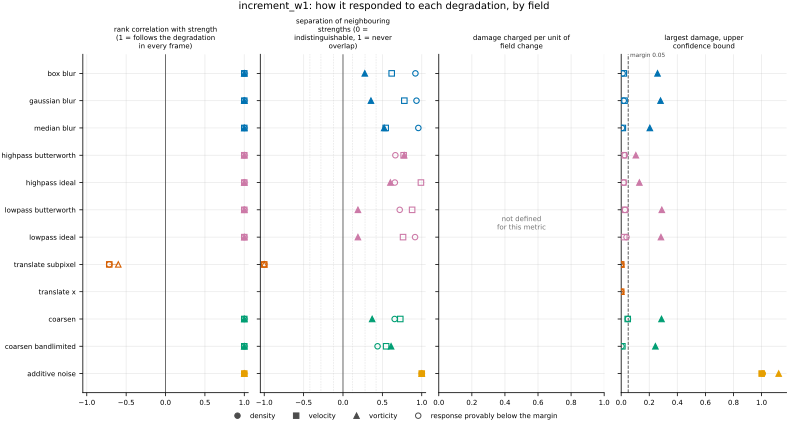
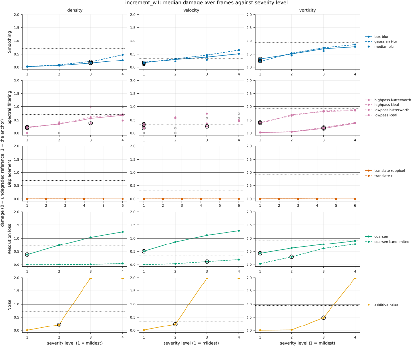
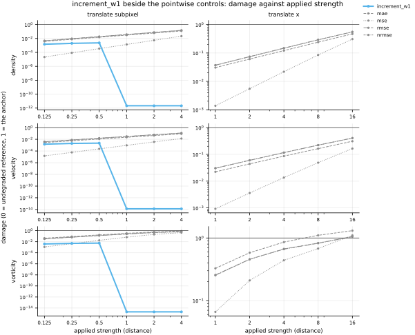

## Definition

Let $f$ be one channel of a field on a periodic grid, $\mathbf{e}_j$ the unit step along
spatial axis $j$, and take the increment at a separation of one cell,

$$
(\delta_j f)_{\mathbf{n}} = f_{\mathbf{n} + \mathbf{e}_j} - f_{\mathbf{n}} \tag{1}
$$

the same definition ``increment_flatness`` uses, imported rather than restated so the two
cannot drift apart. Collecting Equation (1) over all $N$ cells gives an empirical
distribution with $N$ equally weighted atoms. Writing $a_{(1)} \le \dots \le a_{(N)}$ for
the sorted increments of the reference and $b_{(1)} \le \dots \le b_{(N)}$ for those of the
candidate, the 1-Wasserstein distance between the two along axis $j$ is

$$
W_1^{(c, j)} = \frac{1}{N} \sum_{i=1}^{N} \bigl| a_{(i)} - b_{(i)} \bigr| \tag{2}
$$

and the reported value averages Equation (2) over every channel and spatial axis:

$$
W_1 = \frac{1}{C \, D} \sum_{c=1}^{C} \sum_{j=1}^{D} W_1^{(c, j)} \tag{3}
$$

Equation (2) is exact rather than an approximation, and the reason is worth stating because
it is what makes the metric cost a sort instead of a linear program. The transport cost
$|x - y|$ is convex, so by the rearrangement inequality the cheapest way to match two equally
weighted point sets on the line is the monotone one: pair the smallest with the smallest and
so on upward. For equal weights that pairing is exactly "sort both and subtract". The general
treatment is [@peyrecuturi2019], Chapter 2; no equation number is cited from it because the
copy that could be read did not show the numbering, and a plausible-looking one would be
worse than none.

Averaging in Equation (3) runs over per-axis distances rather than over one pooled sample of
increments. Pooling would compare a mixture against a mixture, where an error along one axis
can be cancelled by an opposite error along another; keeping the axes separate cannot hide
that. Unlike the flatness of the same increments, every pair is included even when its
increments vanish in both fields, because the transport distance between two identical
degenerate distributions is a well-defined zero rather than undefined.

Two exact invariances follow from Equation (1) and are properties of the metric rather than
accidents of the discretisation. Translating the field permutes its increments without
changing the multiset, so Equation (2) is unchanged and a translated prediction is at
distance zero. Adding a constant cancels in the difference, so a uniform bias is likewise
invisible.

### Boundary handling

Periodic wrap on every axis: the increment of the last cell along an axis is taken against
the first, so every cell contributes exactly one increment per axis and the two samples in
Equation (2) are guaranteed the same size, which is what the closed form requires.

It therefore declares `requires_periodic`, and the harness does not run it on a dataset with a
non-periodic axis, such as the Sod shock tube; it reports why in the run log.

## Performance

<!-- GENERATED performance: written by `python -m fmeval.cards evidence increment_w1 --results results/comparison_1793302178`, do not edit -->



Four measured statistics for increment_w1, one row per degradation grouped by family and one marker per field. From left: the rank correlation between the metric and the applied strength within a frame, with the line showing the resampling interval; the separation of neighbouring strengths as Cliff's delta, where 0 means the metric cannot tell one strength from the next and the faint ticks at 0.12, 0.28 and 0.42 are Vargha and Delaney's small, medium and large anchors, for scale and not as grades; the damage charged per unit of field change at the harshest strength; and the upper confidence bound on the largest damage, beside the fixed margin of 0.05. A hollow marker is a field and degradation on which that bound lies below the margin, so the response is provably small. A missing marker is a statistic the analysis withheld, as the rank correlation is on an axis the metric is invariant to.



Median damage over frames against severity level for increment_w1, one row per family of degradation and one column per field, on one shared scale. The solid grey line is damage 1, the anchor (by default the field's own mean); the dotted black line is the damage assigned to the fake prediction with the right spectrum, where the run included it. The hollow black ring marks the first level at which the metric has moved a tenth of the way to the anchor. Hollow grey markers are strengths excluded for repeating a milder one or for doing nothing. Degradations with three or fewer usable levels are drawn as markers only; points beyond 2 either side are drawn as triangles at the edge. Damage is negative where a degradation moves the metric away from the anchor, as noise raises a single-field quantity the field's mean sets to zero.

**Trend: does the response follow the degradation?**

| test family | field | degradations | rank correlation | fraction of frames in order | weakest gap between neighbouring strengths |
|---|---|---|---|---|---|
| Displacement | density | 2 | -0.714 | 0 | 0 |
| Displacement | velocity | 2 | -0.714 | 0 | 0 |
| Displacement | vorticity | 2 | -0.6 | 0 | 0 |
| Resolution loss | density | 2 | 1 | 1 | 0.719 to 0.828 |
| Resolution loss | velocity | 2 | 1 | 1 | 0.774 to 0.864 |
| Resolution loss | vorticity | 2 | 1 | 0.919 to 0.988 | 0.685 to 0.805 |
| Smoothing | density | 3 | 1 | 1 | 0.96 to 0.978 |
| Smoothing | velocity | 3 | 1 | 1 | 0.771 to 0.889 |
| Smoothing | vorticity | 3 | 1 | 1 | 0.638 to 0.762 |
| Spectral filtering | density | 4 | 1 | 1 | 0.829 to 0.958 |
| Spectral filtering | velocity | 4 | 1 | 0.919 to 1 | 0.881 to 0.995 |
| Spectral filtering | vorticity | 4 | 1 | 0.925 to 1 | 0.595 to 0.888 |
| Noise | density | 1 | 1 | 1 | 1 |
| Noise | velocity | 1 | 1 | 1 | 1 |
| Noise | vorticity | 1 | 1 | 1 | 1 |

**Reactivity: how far does it move?**

| test family | field | change from clean at the harshest strength | elasticity | first strength detected |
|---|---|---|---|---|
| Displacement | density | — | 0.327 | level — |
| Displacement | velocity | — | 0.3 | level — |
| Displacement | vorticity | — | 0.253 | level — |
| Resolution loss | density | — | 0.72 to 0.791 | level 1 |
| Resolution loss | velocity | — | 0.576 to 2.41 | level 1 |
| Resolution loss | vorticity | — | 0.423 to 1.94 | level 1 |
| Smoothing | density | — | 1.37 to 1.67 | level 3 |
| Smoothing | velocity | — | 0.604 to 0.663 | level 1 |
| Smoothing | vorticity | — | 0.546 to 0.746 | level 1 |
| Spectral filtering | density | — | 0.639 to 9.16 | level 1 |
| Spectral filtering | velocity | — | 0.465 to 1.17 | level 1 |
| Spectral filtering | vorticity | — | 0.405 to 3.13 | level 1 |
| Noise | density | — | 1.52 | level 2 |
| Noise | velocity | — | 1.45 | level 2 |
| Noise | vorticity | — | 1.35 | level 3 |
| trap test: fake prediction, right spectrum | density | — | — | damage 0.702 |
| trap test: fake prediction, right spectrum | velocity | — | — | damage 0.328 |
| trap test: fake prediction, right spectrum | vorticity | — | — | damage 0.937 |

**Consistency: how much does it vary from snapshot to snapshot?**

| test family | field | consistency, in the strength's units | snapshots per independent block |
|---|---|---|---|
| Displacement | density | 0.0911 | 1 to 14 |
| Displacement | velocity | 0.138 | 1 to 20 |
| Displacement | vorticity | 0.28 | 1 to 21 |
| Resolution loss | density | 0.262 to 1.67 | 16 to 20 |
| Resolution loss | velocity | 0.56 to 1.51 | 21 to 22 |
| Resolution loss | vorticity | 1.34 to 1.92 | 21 to 22 |
| Smoothing | density | 0.00487 to 0.0125 | 20 to 21 |
| Smoothing | velocity | 0.0093 to 0.0195 | 21 to 22 |
| Smoothing | vorticity | 0.0115 to 0.0289 | 22 |
| Spectral filtering | density | 0.00899 to 0.0477 | 19 to 21 |
| Spectral filtering | velocity | 0.0242 to 0.0488 | 21 to 22 |
| Spectral filtering | vorticity | 0.0296 to 0.0732 | 21 to 22 |
| Noise | density | 0.000607 | 16 |
| Noise | velocity | 0.0013 | 20 |
| Noise | vorticity | 0.0105 | 22 |

One row per family of degradation and physical field; a cell gives the range over the degradations in that family. **Trend.** The rank correlation is the Spearman correlation between the strength and how far the metric has moved from its value on the undegraded field of the same frame, in the one direction it moves under that degradation, computed inside a single frame. A value of 1 means every strength moved it further than the last in every frame, whichever way it moves; a response that scatters to both sides scores near 0. The fraction of frames in order counts the frames with no exception. The weakest gap is the smallest Mann-Whitney overlap between two neighbouring strengths across frames: 1 means they never overlap, 0.5 that they cannot be told apart. **Reactivity.** The change from clean is the median, at the harshest strength, of the departure from the undegraded value of the same frame over the size of that value: 0.3 means 30%. It does not exist for this metric, whose undegraded value is exactly zero; the damage below is its relative reading. The elasticity is the percentage change of that departure per percentage change in strength over the mildest strengths. First strength detected is the mildest at which the metric has moved a tenth of the way to the anchor; **damage** reads that 0-to-1 scale as a number. A dash means the measurement is not defined there. A metric's reactivity scales with the power it is expressed in: mean squared error's elasticity is twice root-mean-square error's, though the two carry the same information, so compare magnitudes across metrics with that in mind. **Consistency** is how much the response varies from snapshot to snapshot relative to its size, in the strength's units; the snapshots of one trajectory are correlated, and the last column is how many consecutive snapshots one independent block spans.

These tables report what was measured and grade none of the measurements. What the numbers mean for this metric is written in the subsections below, beside the test that produced each number.

**Profile.**

| field | selectivity | charges most for | charges least for | response provably below 0.05 at 90% on | elasticity to a sub-pixel shift, against severity (distance) | compute cost (x cheapest in this run) |
|---|---|---|---|---|---|---|
| density | 0.816 | `additive_noise` | `translate_x` | `translate_subpixel` `translate_x` | 0.327 | 35.4 |
| velocity | 0.72 | `additive_noise` | `translate_x` | `translate_subpixel` `translate_x` | 0.3 | 70.6 |
| vorticity | 0.616 | `additive_noise` | `translate_x` | `translate_subpixel` `translate_x` | 0.253 | 34.7 |

One row per physical field. **Selectivity** is how concentrated the metric's response is on a few degradations, measured per unit of field change: 0 means it charges every degradation the same, as mean squared error does by construction, and values toward 1 that one degradation carries most of it. **Charges most and least for** name the two ends of that profile. **Response provably below** lists degradations on which the upper confidence bound of the largest damage lies below the margin -- an equivalence test, so an entry says the response is provably small, not merely not significant; a dash means no degradation met the bound. **Elasticity** is the slope of log damage against log shift over the smallest shifts: 1 means damage grows in proportion to the shift, 2 with its square. **Compute cost** is wall-clock per evaluation over the cheapest metric and field in the same run.

<!-- END GENERATED performance -->

## Intuition

This metric compares two fields by the statistics of how much they change from one cell to
the next, and by nothing else. It collects every neighbour-to-neighbour difference in the
reference into one pile and does the same for the prediction, then asks how much work it
would take to reshape one pile into the other, where work means total distance moved. If the
prediction has the same mixture of gentle and steep changes as the reference, the two piles
coincide and the answer is zero, however differently those changes are arranged in space.

The reshaping cost has a shortcut that makes the whole thing cheap. Line both piles up in
increasing order, match the smallest with the smallest, the second smallest with the second
smallest, and so on, then average the gaps. That matching is provably the cheapest one when
the cost of moving is proportional to distance, so no search is needed and the metric is
really just two sorts.

What makes it useful is what it refuses to look at. A pointwise error norm is at its harshest
when a sharp feature is correct in every respect except its position, because it compares each
cell against the cell at the same index. This metric never asks where anything is, so that
error costs nothing. What it charges for instead is the prediction having the wrong *mix* of
steep and gentle transitions — too few steep ones, which is what over-smoothing does, or too
many, which is what a noisy prediction does.

A worked example, four cells by four cells. On the left the reference: the top row is zero and
the rest is one, so reading down any column there is a single step. On the right the
prediction: the value alternates every row, so reading down a column there is a step at every
position.

```
reference        candidate        increment_w1
0 0 0 0          0 0 0 0
1 1 1 1          1 1 1 1              0.25
1 1 1 1          0 0 0 0
1 1 1 1          1 1 1 1
```

Reading down the columns, the reference's changes are one step up, two flat, and one step
down where the grid wraps; the prediction's are up, down, up, down. Half the pairs match and
half differ by one, so that direction costs one half. Reading across the rows, both fields are
flat, both piles are all zeros, and that direction costs nothing. The reported number averages
the two directions.

What it ignores: position, entirely. Two fields whose changes have the same statistics but are
arranged into completely different structures are indistinguishable here, and so are two fields
differing only by a constant added everywhere.

## Reading the output

Zero and unbounded above, in the field's own units, so a value is meaningless until the field
is named. Lower is better, and zero means the increment statistics match rather than that the
fields match.

Because the value carries the field's units it cannot be compared across fields without
normalising — which is the opposite of the situation for ``increment_flatness``, a ratio that
is scale-free and comparable everywhere. The two are meant to be read together: flatness
summarises the increment distribution by one moment and has an absolute reference value at 3
but can be matched for the wrong reason, while this compares the entire distribution and cannot
be fooled that way but has no absolute reference value of its own.

Comparison across analysis-grid resolutions is invalid for the same reason it is for flatness:
the separation in Equation (1) is one cell, so a finer grid measures increments at a physically
smaller separation, and in turbulence the increment distribution depends on that separation.

## Limitations

The blind spot is total and is the point of the metric, which means it must never be read
alone. A prediction that has every structure in the wrong place, or that is a spatially
scrambled rearrangement of the truth, is at distance zero. So is one offset by a constant. A
panel containing this metric and no pointwise control would score a badly wrong field perfectly.

A subtler case is cancellation within one axis. Equation (2) compares sorted samples, so a
prediction that is too smooth in one region and too noisy in another can produce an increment
distribution close to the reference's while matching it nowhere locally. The single number
cannot distinguish that from a uniformly faithful prediction.

Finally the units make it easy to misread across fields. On this data density fluctuates by
parts in ten thousand while vorticity is of order one, so the raw values differ by orders of
magnitude for reasons that have nothing to do with prediction quality. Only the normalised
damage columns in the evaluation are comparable between fields.

## Results

<!-- GENERATED run: written by `python -m fmeval.cards evidence increment_w1 --results results/comparison_1793302178`, do not edit -->

Measured on `kinet_re5e4`, frames 2000 to 10000 (161 frames of developed flow), on the 256 analysis grid, seed 20260807, at commit `b59bbde617d1` (working tree dirty). Run `comparison_1793302178`.

Every number in this section comes from that one run. Regenerate with `python -m fmeval.cards evidence <name> --results results/comparison_1793302178`.

<!-- END GENERATED run -->

### Smoothing

[gaussian_blur](../../degradations/gaussian_blur/card.md) ·
[box_blur](../../degradations/box_blur/card.md)

<!-- GENERATED results_smoothing: written by `python -m fmeval.cards evidence increment_w1 --results results/comparison_1793302178`, do not edit -->

| degradation | field | strengths | rank correlation | fraction of frames in the right order | weakest gap between neighbouring strengths |
|---|---|---|---|---|---|
| `box_blur` | density | 4 | 1 | 1 | 0.96 |
| `box_blur` | velocity | 4 | 1 | 1 | 0.809 |
| `box_blur` | vorticity | 4 | 1 | 1 | 0.638 |
| `gaussian_blur` | density | 4 | 1 | 1 | 0.967 |
| `gaussian_blur` | velocity | 4 | 1 | 1 | 0.889 |
| `gaussian_blur` | vorticity | 4 | 1 | 1 | 0.678 |
| `median_blur` | density | 3 | 1 | 1 | 0.978 |
| `median_blur` | velocity | 3 | 1 | 1 | 0.771 |
| `median_blur` | vorticity | 3 | 1 | 1 | 0.762 |

<!-- END GENERATED results_smoothing -->

All three kernels are ordered perfectly on all three fields, with the weakest separation on
vorticity. Smoothing narrows the increment distribution, which is a change of shape rather
than of position, so it is the kind of damage this metric is built to see.

### Spectral filtering

[lowpass_ideal](../../degradations/lowpass_ideal/card.md) ·
[highpass_ideal](../../degradations/highpass_ideal/card.md)

<!-- GENERATED results_spectral: written by `python -m fmeval.cards evidence increment_w1 --results results/comparison_1793302178`, do not edit -->

| degradation | field | strengths | rank correlation | fraction of frames in the right order | weakest gap between neighbouring strengths |
|---|---|---|---|---|---|
| `highpass_butterworth` | density | 4 | 1 | 1 | 0.832 |
| `highpass_butterworth` | velocity | 3 | 1 | 1 | 0.885 |
| `highpass_butterworth` | vorticity | 4 | 1 | 1 | 0.888 |
| `highpass_ideal` | density | 3 | 1 | 1 | 0.829 |
| `highpass_ideal` | velocity | 2 | 1 | 1 | 0.995 |
| `highpass_ideal` | vorticity | 4 | 1 | 1 | 0.801 |
| `lowpass_butterworth` | density | 4 | 1 | 1 | 0.86 |
| `lowpass_butterworth` | velocity | 3 | 1 | 0.919 | 0.939 |
| `lowpass_butterworth` | vorticity | 4 | 1 | 1 | 0.595 |
| `lowpass_ideal` | density | 3 | 1 | 1 | 0.958 |
| `lowpass_ideal` | velocity | 2 | 1 | 1 | 0.881 |
| `lowpass_ideal` | vorticity | 4 | 1 | 0.925 | 0.595 |

<!-- END GENERATED results_spectral -->

Ordered perfectly on all four filters and all three fields. Separability is weakest on
vorticity and strongest on velocity, but nowhere near the chance floor — unlike
`h_minus_one`, this metric does not lose resolution on the high-pass axis, because removing
low modes changes the increment distribution as readily as removing high ones does.

### Displacement

[translate_x](../../degradations/translate/card.md) ·
[translate_subpixel](../../degradations/translate_subpixel/card.md)

<!-- GENERATED results_geometric: written by `python -m fmeval.cards evidence increment_w1 --results results/comparison_1793302178`, do not edit -->

| degradation | field | strengths | rank correlation | fraction of frames in the right order | weakest gap between neighbouring strengths |
|---|---|---|---|---|---|
| `translate_subpixel` | density | 6 | -0.714 | 0 | 0 |
| `translate_subpixel` | velocity | 6 | -0.714 | 0 | 0 |
| `translate_subpixel` | vorticity | 6 | -0.6 | 0 | 0 |
| `translate_x` | density | 5 | — | — | — |
| `translate_x` | velocity | 5 | — | — | — |
| `translate_x` | vorticity | 5 | — | — | — |

<!-- END GENERATED results_geometric -->

This is the axis the metric is invariant to, and the table records that rather than a
response. `translate_x` is an integer shift, which permutes the increments without changing
the multiset, so the value is identically zero at every strength and the rank correlation is
withheld as round-off. `translate_subpixel` interpolates and therefore does change the field
slightly; the small residual it produces is not ordered, giving a negative correlation and a
separability of 0.

The invariance is exact and intended, and it does not reach the damage scale. The anchor is
the field's own spatial mean, which has no increments at all, so this metric scores it at
1.4e-4, 7.6e-4 and 3.1e-4 on density, velocity and vorticity, well away from the reference's
zero. On that scale the sub-pixel residual is at most 0.006 in median damage. Every other
family detects a strength by level 3 on every field; the one degradation outside this family
that detects none is `coarsen_bandlimited` on density, which reaches a damage of 0.05.

### Resolution loss

[coarsen](../../degradations/coarsen/card.md) ·
[coarsen_bandlimited](../../degradations/coarsen_bandlimited/card.md)

<!-- GENERATED results_resolution: written by `python -m fmeval.cards evidence increment_w1 --results results/comparison_1793302178`, do not edit -->

| degradation | field | strengths | rank correlation | fraction of frames in the right order | weakest gap between neighbouring strengths |
|---|---|---|---|---|---|
| `coarsen` | density | 4 | 1 | 1 | 0.828 |
| `coarsen` | velocity | 4 | 1 | 1 | 0.864 |
| `coarsen` | vorticity | 4 | 1 | 0.919 | 0.685 |
| `coarsen_bandlimited` | density | 4 | 1 | 1 | 0.719 |
| `coarsen_bandlimited` | velocity | 4 | 1 | 1 | 0.774 |
| `coarsen_bandlimited` | vorticity | 4 | 1 | 0.988 | 0.805 |

<!-- END GENERATED results_resolution -->

Ordered perfectly on all three fields under both coarsenings, but the values differ by one to
two orders of magnitude at small factors: at a factor of 2, 5.2e-5, 3.8e-4 and 1.3e-4 under
`coarsen` against 7.2e-7, 3.3e-6 and 1.3e-5 under `coarsen_bandlimited`, on density, velocity
and vorticity. The staircase turns most one-cell increments into exact zeros and the rest into
jumps, which moves the increment distribution far more than the lost resolution does. By a
factor of 16 the gap has closed on vorticity, 2.8e-4 against 2.4e-4, because the coarse grid
genuinely cannot hold vorticity's structure at that size.

### Noise

[additive_noise](../../degradations/additive_noise/card.md)

<!-- GENERATED results_stochastic: written by `python -m fmeval.cards evidence increment_w1 --results results/comparison_1793302178`, do not edit -->

| degradation | field | strengths | rank correlation | fraction of frames in the right order | weakest gap between neighbouring strengths |
|---|---|---|---|---|---|
| `additive_noise` | density | 4 | 1 | 1 | 1 |
| `additive_noise` | velocity | 4 | 1 | 1 | 1 |
| `additive_noise` | vorticity | 4 | 1 | 1 | 1 |

<!-- END GENERATED results_stochastic -->

Ordered perfectly with no overlap at all between neighbouring strengths on any field — the
cleanest axis for this metric. Additive noise widens the increment distribution directly and
by a controlled amount, which is the most direct thing that can be done to the quantity this
metric measures.

### Trap tests

[gaussian_impostor](../../degradations/gaussian_impostor/card.md) ·
[uncorrelated](../../degradations/random_large_translation/card.md)

<!-- GENERATED results_canaries: written by `python -m fmeval.cards evidence increment_w1 --results results/comparison_1793302178`, do not edit -->

| field | damage assigned to the fake prediction | closest real degradation | damage of the reference moved far away | value on the anchor |
|---|---|---|---|---|
| density | 0.702 | `lowpass_butterworth=1.31656` | 0 | 0.000137 |
| velocity | 0.328 | `gaussian_blur=9.43858` | 0 | 0.000759 |
| vorticity | 0.937 | `coarsen=16` | 0 | 0.000314 |

The fake prediction here has exactly the reference field's amplitude spectrum and completely scrambled structure. Damage 1 is what the anchor scores, by default the reference's own spatial mean, a prediction that knows the mean and nothing else. The damage column therefore says how close to useless this metric considers that fake prediction: a low number means the metric was fooled. The third column translates the same number into an ordinary degradation whose damage the fake prediction matches, which is easier to picture. The fourth is the reference moved by a large random offset, the right statistics in the wrong place; where a field's energy sits in its largest scales that copy stays partly correlated with the reference, so it is not the score of an unrelated field.

<!-- END GENERATED results_canaries -->

The fake prediction scores damage 0.70 on density, 0.33 on velocity and 0.94 on vorticity, so
the metric sees that the phase-scrambled field has different increment statistics from the
reference. The velocity score is the weakest: it lies below the advisory impostor threshold of
0.5, and the fake prediction costs no more there than `gaussian_blur` at strength 9.4. The
reference moved far away scores exactly 0 on every field, for the reason given under
Displacement.

### Compared with the other metrics

<!-- GENERATED results_summary: written by `python -m fmeval.cards evidence increment_w1 --results results/comparison_1793302178`, do not edit -->

| compared with | rank correlation over every degradation |
|---|---|
| `increment_w1_by_separation` | 0.918 |
| `spectrum_l2` | 0.749 |
| `h1_seminorm` | 0.225 |
| `nrmse` | 0.0858 |
| `rmse` | 0.0846 |
| `mse` | 0.0844 |
| `mae` | 0.0547 |
| `h_minus_one` | -0.0552 |
| `increment_flatness` | -0.489 |
| `enstrophy` | -0.495 |
| `kinetic_energy` | -0.552 |
| `palinstrophy` | -0.57 |

Computed on the median value at each combination of degradation and strength, over every degradation and physical field in the run, with the undegraded reference excluded. Two metrics correlating near 1 put the degradations in the same order, but the two may still weight those degradations very differently. A correlation near 1 therefore means the two metrics are redundant for ranking models, not that the two are interchangeable as training losses.

<!-- END GENERATED results_summary -->

Every axis except displacement is ranked perfectly on every field. Displacement is ranked
not at all, by construction.

The number worth the most here is the cross-metric correlation: 0.09, 0.08, 0.08 and 0.05
against `nrmse`, `rmse`, `mse` and `mae`. This metric is close to uncorrelated with the
entire pointwise family across the whole ladder, which is the strongest such result in the
repository — `h_minus_one`, by contrast, correlates with them above 0.91. That is the
property this metric was proposed for, and it is now measured rather than argued: a panel containing
this metric and a pointwise control is measuring two nearly independent things. It correlates
-0.49 with `increment_flatness`, which reads the same increment distribution through a single
moment, so the two are related but far from redundant.

### Damage beside the other metrics

<!-- GENERATED results_damage_by_level: written by `python -m fmeval.cards evidence increment_w1 --results results/comparison_1793302178`, do not edit -->



Median damage over frames against the applied strength, log-log, for increment_w1 (bold, in colour) and the pointwise controls mae, mse, rmse, nrmse (thin, grey), one column per displacement degradation and one row per field. The grey line is damage 1, the anchor (by default the field's own mean). Parallel lines charge in the same proportion at every strength; a steeper line charges relatively more for the larger shifts, which is what decides whether two metrics are interchangeable as training losses. These are the same numbers as the table beneath.

**Displacement, density, `translate_subpixel`** (strength: distance).

| metric | 0.125 | 0.25 | 0.5 | 1 | 2 | 4 |
|---|---|---|---|---|---|---|
| `increment_w1` | 0.00149 | 0.002 | 0.00235 | 2.16e-12 | 2.16e-12 | 2.16e-12 |
| `mae` | 0.00383 | 0.00767 | 0.0153 | 0.0306 | 0.061 | 0.121 |
| `mse` | 2.17e-05 | 8.68e-05 | 0.000347 | 0.00138 | 0.00551 | 0.0219 |
| `rmse` | 0.00466 | 0.00931 | 0.0186 | 0.0372 | 0.0743 | 0.148 |
| `nrmse` | 0.00463 | 0.00926 | 0.0185 | 0.037 | 0.0738 | 0.147 |

**Displacement, density, `translate_x`** (strength: distance).

| metric | 1 | 2 | 4 | 8 | 16 |
|---|---|---|---|---|---|
| `increment_w1` | 0 | 0 | 0 | 0 | 0 |
| `mae` | 0.0306 | 0.061 | 0.121 | 0.24 | 0.469 |
| `mse` | 0.00138 | 0.00551 | 0.0219 | 0.0849 | 0.307 |
| `rmse` | 0.0372 | 0.0743 | 0.148 | 0.291 | 0.555 |
| `nrmse` | 0.037 | 0.0738 | 0.147 | 0.29 | 0.55 |

**Displacement, velocity, `translate_subpixel`** (strength: distance).

| metric | 0.125 | 0.25 | 0.5 | 1 | 2 | 4 |
|---|---|---|---|---|---|---|
| `increment_w1` | 0.00146 | 0.00198 | 0.00221 | 1.31e-14 | 1.31e-14 | 1.31e-14 |
| `mae` | 0.00279 | 0.00559 | 0.0112 | 0.0223 | 0.0441 | 0.0859 |
| `mse` | 1.45e-05 | 5.81e-05 | 0.000232 | 0.000924 | 0.0036 | 0.0136 |
| `rmse` | 0.00381 | 0.00762 | 0.0152 | 0.0304 | 0.06 | 0.117 |
| `nrmse` | 0.00382 | 0.00763 | 0.0153 | 0.0304 | 0.06 | 0.117 |

**Displacement, velocity, `translate_x`** (strength: distance).

| metric | 1 | 2 | 4 | 8 | 16 |
|---|---|---|---|---|---|
| `increment_w1` | 0 | 0 | 0 | 0 | 0 |
| `mae` | 0.0223 | 0.0441 | 0.0859 | 0.163 | 0.31 |
| `mse` | 0.000924 | 0.0036 | 0.0136 | 0.0489 | 0.165 |
| `rmse` | 0.0304 | 0.06 | 0.117 | 0.221 | 0.406 |
| `nrmse` | 0.0304 | 0.06 | 0.117 | 0.221 | 0.406 |

**Displacement, vorticity, `translate_subpixel`** (strength: distance).

| metric | 0.125 | 0.25 | 0.5 | 1 | 2 | 4 |
|---|---|---|---|---|---|---|
| `increment_w1` | 0.00392 | 0.00502 | 0.00557 | 2.04e-15 | 2.03e-15 | 2.06e-15 |
| `mae` | 0.0428 | 0.0854 | 0.169 | 0.328 | 0.582 | 0.86 |
| `mse` | 0.00112 | 0.00448 | 0.0176 | 0.066 | 0.21 | 0.44 |
| `rmse` | 0.0335 | 0.0669 | 0.133 | 0.257 | 0.458 | 0.663 |
| `nrmse` | 0.0328 | 0.0654 | 0.13 | 0.253 | 0.456 | 0.67 |

**Displacement, vorticity, `translate_x`** (strength: distance).

| metric | 1 | 2 | 4 | 8 | 16 |
|---|---|---|---|---|---|
| `increment_w1` | 0 | 0 | 0 | 0 | 0 |
| `mae` | 0.328 | 0.582 | 0.86 | 1.1 | 1.31 |
| `mse` | 0.066 | 0.21 | 0.44 | 0.679 | 1.1 |
| `rmse` | 0.257 | 0.458 | 0.663 | 0.824 | 1.05 |
| `nrmse` | 0.253 | 0.456 | 0.67 | 0.832 | 1.05 |

Median damage over frames at every strength, this metric in the first row and the pointwise controls beneath it, all on the same 0-to-1 scale where 0 is the undegraded reference and 1 the anchor (by default the field's own mean); a dash means no damage scale on that field. The rank correlations under *Compared with the other metrics* say whether two metrics put the strengths in the same order; this table says how much each one charges for the same strength, which decides whether two metrics are interchangeable as training losses.

<!-- END GENERATED results_damage_by_level -->

## References

\bibliography
