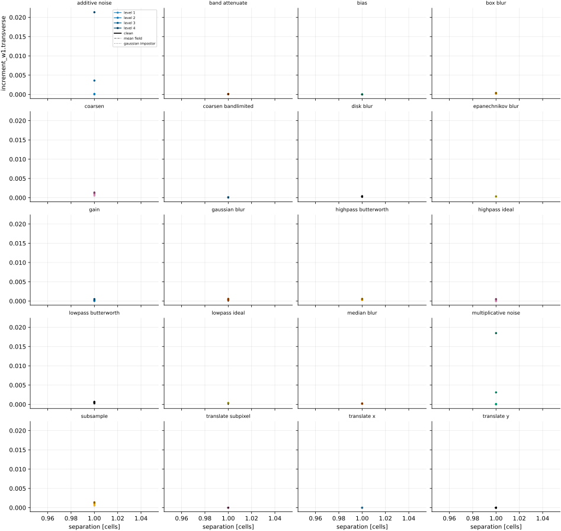
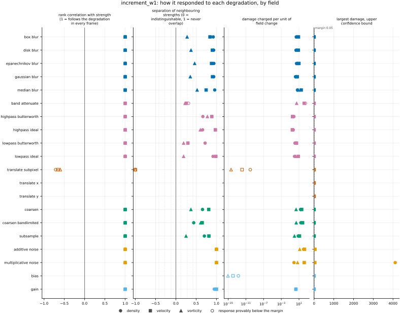
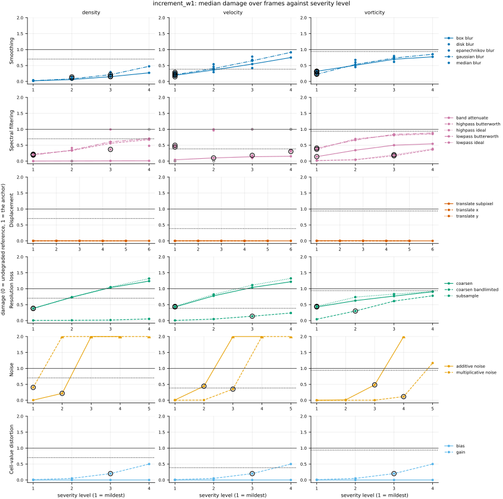
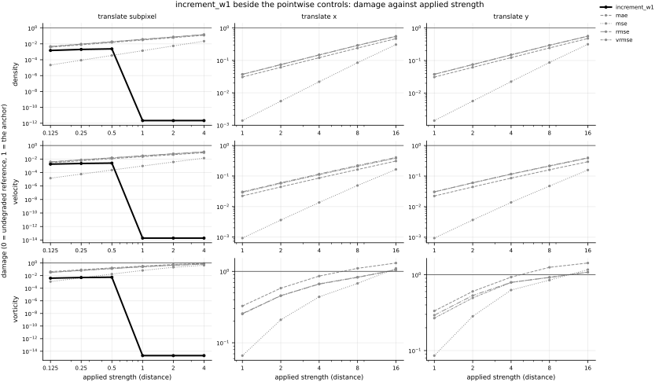
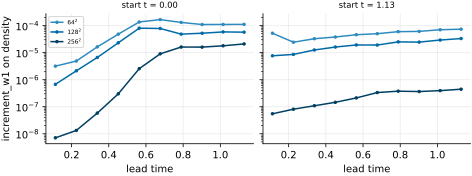
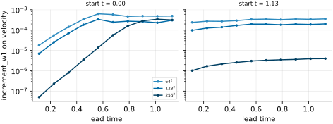
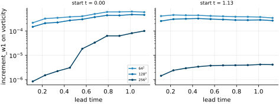

## Definition

Let $f$ be one channel of a field on a periodic grid, $\mathbf{e}_j$ the unit step along
spatial axis $j$, and take the increment at a separation of one cell,

$$
(\delta_j f)_{\mathbf{n}} = f_{\mathbf{n} + \mathbf{e}_j} - f_{\mathbf{n}} \tag{1}
$$

the same definition ``increment_flatness`` uses, imported rather than restated so the two
cannot drift apart. Collecting Equation (1) over all $N$ cells gives an empirical
distribution with $N$ equally weighted atoms. Writing $a_{(1)} \le \dots \le a_{(N)}$ for
the sorted increments of the reference and $b_{(1)} \le \dots \le b_{(N)}$ for those of the
candidate, the 1-Wasserstein distance between the two along axis $j$ of channel $c$ is

$$
W_1^{(c, j)} = \frac{1}{N} \sum_{i=1}^{N} \bigl| a_{(i)} - b_{(i)} \bigr| \tag{2}
$$

which is [@peyrecuturi2019], Remark 2.28, Eq. (2.33) with $p = 1$, numbered as in
arXiv:1803.00567. The reported value averages Equation (2) over the set $P$ of
channel-and-axis pairs read:

$$
W_1 = \frac{1}{|P|} \sum_{(c, j) \in P} W_1^{(c, j)} \tag{3}
$$

For velocity, a vector whose channel $c$ is its component along axis $c$, $P$ holds the
**longitudinal** pairs $j = c$ only, the component parallel to the separation, as
structure-function theory reads velocity increments ([@boffetta2012], Eq. (4);
[@granero2024], Eq. (1)). For a scalar field such as density or two-dimensional vorticity,
which has no orientation, $P$ is every channel along every axis. For velocity the same
average over the **transverse** pairs $j \ne c$ is the companion `increment_w1.transverse`,
a curve with the one point $\ell = 1$; it is empty for a scalar field.

Equation (2) is exact rather than an approximation, and the reason is worth stating because
it is what makes the metric cost a sort instead of a linear program. On the line the
1-Wasserstein distance is the $L^1$ distance between the two quantile functions
([@peyrecuturi2019], Remark 2.30, Eq. (2.36)), or equally between the two cumulative
distribution functions (Eq. (2.37)), and for two empirical measures with the same number of
equally weighted atoms the quantile functions are the sorted samples. Equivalently: the cost
$|x - y|$ is convex, so the cheapest matching of two equally weighted point sets on the line
is the monotone one, smallest with smallest and so on upward.

Averaging in Equation (3) runs over per-axis distances rather than over one pooled sample of
increments. Pooling would compare a mixture against a mixture, where an error along one axis
can be cancelled by an opposite error along another; keeping the axes separate cannot hide
that. Unlike the flatness of the same increments, every pair is included even when its
increments vanish in both fields, because the transport distance between two identical
degenerate distributions is a well-defined zero rather than undefined.

Two exact invariances follow from Equation (1) and are properties of the metric rather than
accidents of the discretisation. Translating the field permutes its increments without
changing the multiset, so Equation (2) is unchanged and a translated prediction is at
distance zero. Adding a constant cancels in the difference, so a uniform bias is likewise
invisible.

### Boundary handling

Periodic wrap on every axis: the increment of the last cell along an axis is taken against
the first, so every cell contributes exactly one increment per axis and the two samples in
Equation (2) are guaranteed the same size, which is what the closed form requires.

It therefore declares `requires_periodic`, and the harness does not run it on a dataset with a
non-periodic axis, such as the Sod shock tube; it reports why in the run log.

### How its field reports it

Two fields meet in this metric: the distance comes from optimal transport, and the samples
it compares come from the statistical theory of turbulence.

- **Optimal transport** ([@peyrecuturi2019], Chapter 2) gives the distance and its exact
  one-dimensional form (Remarks 2.28 and 2.30, Eqs. (2.33), (2.36), (2.37)) and nothing more:
  it reports a distance between two measures, with no normalisation, figure or companion
  statistic of its own.
- **Turbulence** reads the increments of the longitudinal velocity at many separations
  ([@granero2024], Sect. 2.1, Eq. (1); [@boffetta2012], Eq. (4), p. 430, which splits the
  structure function into longitudinal and transverse parts). The one source here that
  scores a model on its increment distributions, [@granero2024], draws the probability
  densities of the centred, standardised increments at separations from the dissipative to
  the integral scale on a logarithmic density axis (Fig. 8), and quantifies the difference
  between a model's and the reference's by the Jeffreys distance between those densities at
  each of the octave separations $\ell = 2, 4, \dots, 4096$ sampling lengths, drawn against
  $\log \ell$ (Sect. 4 and App. A, Fig. A4), with error bars from 256 realisations elsewhere
  in the paper (Fig. 6). Their experiment is a long record of the longitudinal velocity of
  grid turbulence in the ONERA Modane wind tunnel at a Taylor-scale Reynolds number of 2500
  (Sect. 2.2).

**What this bundle reports, and how it differs.** The distance here is the 1-Wasserstein
distance, not the Jeffreys distance, and the increments are not standardised, so a
prediction with the right shape of increment distribution at the wrong amplitude is charged
here and would not be there. A Jeffreys distance between standardised increment densities
needs a choice of bins that the source does not state, and is not built. The number is read
at one separation; the curve over octave separations, the analogue of their Fig. A4, is
[increment_w1_by_separation](../../metrics/increment_w1_by_separation/card.md), whose
transverse companion also holds the transverse distance at every separation. No source fixes
one separation for a single number, and the one cell used here is the repository's
convention, `issues/128`.

**The experiments here.** The field's experiment, stationary turbulence with an inertial
range, does not exist here:
[EXP-increment_flatness-isotropic-3d-turbulence-cutouts](https://github.com/khegazy/pde_metrics/blob/main/proposals/EXP-increment_flatness-isotropic-3d-turbulence-cutouts.md)
writes it up, and
[EXP-energy_distance-tail-only-degradation](https://github.com/khegazy/pde_metrics/blob/main/proposals/EXP-energy_distance-tail-only-degradation.md)
a degradation that changes only the tails of the increment distribution. The metric runs on
the degradation ladder on `kinet_re5e4`, on the forecasts of `forecast_re5e4` against their
targets and on the Reynolds ladder. It is not run on the member mean of `synthetic_ensemble`
(reason under Results) or on `sod_shock_tube`, whose walls rule out a periodic increment.

## Performance

<!-- GENERATED performance: written by `python -m fmeval.cards evidence increment_w1 --results results/comparison_1793846511 --results results/comparison_1793811840 --results results/comparison_1793846600`, do not edit -->



*As this metric's own field draws it.* The curve behind increment_w1.transverse on velocity: the median over frames at every strength of every degradation, the clean curve in black, the anchor dashed and the impostor dotted. Values are the literature's own, untransformed.



Four measured statistics for increment_w1, one row per degradation grouped by family and one marker per field. From left: the rank correlation between the metric and the applied strength within a frame, with the line showing the resampling interval; the separation of neighbouring strengths as Cliff's delta, where 0 means the metric cannot tell one strength from the next and the faint ticks at 0.12, 0.28 and 0.42 are Vargha and Delaney's small, medium and large anchors, for scale and not as grades; the damage charged per unit of field change at the harshest strength; and the upper confidence bound on the largest damage, beside the fixed margin of 0.05. A hollow marker is a field and degradation on which that bound lies below the margin, so the response is provably small. A missing marker is a statistic the analysis withheld, as the rank correlation is on an axis the metric is invariant to.



Median damage over frames against severity level for increment_w1, one row per family of degradation and one column per field, on one shared scale. The solid grey line is damage 1, the anchor (by default the field's own mean); the dotted black line is the damage assigned to the fake prediction with the right spectrum, where the run included it. The hollow black ring marks the first level at which the metric has moved a tenth of the way to the anchor. Hollow grey markers are strengths excluded for repeating a milder one or for doing nothing. Degradations with three or fewer usable levels are drawn as markers only; points beyond 2 either side are drawn as triangles at the edge. Damage is negative where a degradation moves the metric away from the anchor, as noise raises a single-field quantity the field's mean sets to zero.

**Trend: does the response follow the degradation?**

| test family | field | degradations | rank correlation | fraction of frames in order | weakest gap between neighbouring strengths |
|---|---|---|---|---|---|
| Displacement | density | 3 | -0.714 | 0 | 0 |
| Displacement | velocity | 3 | -0.657 | 0 | 0 |
| Displacement | vorticity | 3 | -0.6 | 0 | 0 |
| Cell-value distortion | density | 2 | 1 | 1 | 0.972 |
| Cell-value distortion | velocity | 2 | 1 | 1 | 1 |
| Cell-value distortion | vorticity | 2 | 1 | 1 | 0.996 |
| Resolution loss | density | 3 | 1 | 1 | 0.719 to 0.851 |
| Resolution loss | velocity | 3 | 1 | 1 | 0.824 to 0.907 |
| Resolution loss | vorticity | 3 | 1 | 0.919 to 0.988 | 0.625 to 0.805 |
| Smoothing | density | 5 | 1 | 1 | 0.96 to 0.978 |
| Smoothing | velocity | 5 | 1 | 1 | 0.873 to 0.951 |
| Smoothing | vorticity | 5 | 1 | 1 | 0.638 to 0.762 |
| Spectral filtering | density | 5 | 1 | 1 | 0.655 to 0.958 |
| Spectral filtering | velocity | 5 | 1 | 1 | 0.628 to 0.993 |
| Spectral filtering | vorticity | 5 | 1 | 0.925 to 1 | 0.595 to 0.888 |
| Noise | density | 2 | 1 | 1 | 1 |
| Noise | velocity | 2 | 1 | 1 | 1 |
| Noise | vorticity | 2 | 1 | 1 | 1 |

**Reactivity: how far does it move?**

| test family | field | change from clean at the harshest strength | elasticity | first strength detected |
|---|---|---|---|---|
| Displacement | density | — | 0.327 | level — |
| Displacement | velocity | — | 0.256 | level — |
| Displacement | vorticity | — | 0.253 | level — |
| Cell-value distortion | density | — | 1 | level 3 |
| Cell-value distortion | velocity | — | 1 | level 3 |
| Cell-value distortion | vorticity | — | 1 | level 3 |
| Resolution loss | density | — | 0.72 to 0.791 | level 1 |
| Resolution loss | velocity | — | 0.64 to 2.4 | level 1 |
| Resolution loss | vorticity | — | 0.423 to 1.94 | level 1 |
| Smoothing | density | — | 1.37 to 1.67 | level 2 |
| Smoothing | velocity | — | 0.696 to 0.812 | level 1 |
| Smoothing | vorticity | — | 0.546 to 0.746 | level 1 |
| Spectral filtering | density | — | 0.639 to 9.16 | level 1 |
| Spectral filtering | velocity | — | 0.407 to 5.12 | level 1 |
| Spectral filtering | vorticity | — | 0.405 to 3.13 | level 1 |
| Noise | density | — | 1.15 to 1.52 | level 1 |
| Noise | velocity | — | 1.32 to 1.45 | level 2 |
| Noise | vorticity | — | 0.594 to 1.35 | level 3 |
| trap test: fake prediction, right spectrum | density | — | — | damage 0.702 |
| trap test: fake prediction, right spectrum | velocity | — | — | damage 0.385 |
| trap test: fake prediction, right spectrum | vorticity | — | — | damage 0.937 |

**Consistency: how much does it vary from snapshot to snapshot?**

| test family | field | consistency, in the strength's units | snapshots per independent block |
|---|---|---|---|
| Displacement | density | 0.104 | 1 to 19 |
| Displacement | velocity | 0.266 | 1 to 20 |
| Displacement | vorticity | 0.28 | 1 to 21 |
| Cell-value distortion | density | 0.0262 | 15 to 20 |
| Cell-value distortion | velocity | 0.0178 | 1 to 20 |
| Cell-value distortion | vorticity | 0.0427 | 19 to 22 |
| Resolution loss | density | 0.816 to 1.57 | 21 |
| Resolution loss | velocity | 0.533 to 1.4 | 20 to 22 |
| Resolution loss | vorticity | 1.05 to 1.92 | 21 to 22 |
| Smoothing | density | 0.00728 to 0.0156 | 14 to 19 |
| Smoothing | velocity | 0.00692 to 0.0169 | 21 |
| Smoothing | vorticity | 0.0115 to 0.0289 | 22 |
| Spectral filtering | density | 0.0287 to 0.102 | 15 to 21 |
| Spectral filtering | velocity | 0.0275 to 0.117 | 20 to 22 |
| Spectral filtering | vorticity | 0.0296 to 0.0732 | 21 to 22 |
| Noise | density | 0.00025 to 0.0158 | 1 to 20 |
| Noise | velocity | 0.000968 to 0.00158 | 20 to 21 |
| Noise | vorticity | 0.0104 to 0.0105 | 18 to 22 |

One row per family of degradation and physical field; a cell gives the range over the degradations in that family. **Trend.** The rank correlation is the Spearman correlation between the strength and how far the metric has moved from its value on the undegraded field of the same frame, in the one direction it moves under that degradation, computed inside a single frame. A value of 1 means every strength moved it further than the last in every frame, whichever way it moves; a response that scatters to both sides scores near 0. The fraction of frames in order counts the frames with no exception. The weakest gap is the smallest Mann-Whitney overlap between two neighbouring strengths across frames: 1 means they never overlap, 0.5 that they cannot be told apart. **Reactivity.** The change from clean is the median, at the harshest strength, of the departure from the undegraded value of the same frame over the size of that value: 0.3 means 30%. It does not exist for this metric, whose undegraded value is exactly zero; the damage below is its relative reading. The elasticity is the percentage change of that departure per percentage change in strength over the mildest strengths. First strength detected is the mildest at which the metric has moved a tenth of the way to the anchor; **damage** reads that 0-to-1 scale as a number. A dash means the measurement is not defined there. A metric's reactivity scales with the power it is expressed in: mean squared error's elasticity is twice root-mean-square error's, though the two carry the same information, so compare magnitudes across metrics with that in mind. **Consistency** is how much the response varies from snapshot to snapshot relative to its size, in the strength's units; the snapshots of one trajectory are correlated, and the last column is how many consecutive snapshots one independent block spans.

These tables report what was measured and grade none of the measurements. What the numbers mean for this metric is written in the subsections below, beside the test that produced each number.

**Profile.**

| field | selectivity | charges most for | charges least for | response provably below 0.05 at 90% on | elasticity to a sub-pixel shift, against severity (distance) | compute cost (x cheapest in this run) |
|---|---|---|---|---|---|---|
| density | 0.883 | `band_attenuate` | `translate_x` | `band_attenuate` `bias` `translate_subpixel` `translate_x` `translate_y` | 0.327 | 29.8 |
| velocity | 0.733 | `additive_noise` | `translate_x` | `bias` `translate_subpixel` `translate_x` `translate_y` | 0.256 | 30.6 |
| vorticity | 0.581 | `additive_noise` | `translate_x` | `bias` `translate_subpixel` `translate_x` `translate_y` | 0.253 | 29.4 |

One row per physical field. **Selectivity** is how concentrated the metric's response is on a few degradations, measured per unit of field change: 0 means it charges every degradation the same, as mean squared error does by construction, and values toward 1 that one degradation carries most of it. **Charges most and least for** name the two ends of that profile. **Response provably below** lists degradations on which the upper confidence bound of the largest damage lies below the margin -- an equivalence test, so an entry says the response is provably small, not merely not significant; a dash means no degradation met the bound. **Elasticity** is the slope of log damage against log shift over the smallest shifts: 1 means damage grows in proportion to the shift, 2 with its square. **Compute cost** is wall-clock per evaluation over the cheapest metric and field in the same run.

<!-- END GENERATED performance -->

## Intuition

This metric compares two fields by the statistics of how much they change from one cell to
the next, and by nothing else. It collects every neighbour-to-neighbour difference in the
reference into one pile and does the same for the prediction, then asks how much work it
would take to reshape one pile into the other, where work means total distance moved. If the
prediction has the same mixture of gentle and steep changes as the reference, the two piles
coincide and the answer is zero, however differently those changes are arranged in space.

The reshaping cost has a shortcut that makes the whole thing cheap. Line both piles up in
increasing order, match the smallest with the smallest, the second smallest with the second
smallest, and so on, then average the gaps. That matching is provably the cheapest one when
the cost of moving is proportional to distance, so no search is needed and the metric is
really just two sorts.

What makes it useful is what it refuses to look at. A pointwise error norm is at its harshest
when a sharp feature is correct in every respect except its position, because it compares each
cell against the cell at the same index. This metric never asks where anything is, so that
error costs nothing. What it charges for instead is the prediction having the wrong *mix* of
steep and gentle transitions — too few steep ones, which is what over-smoothing does, or too
many, which is what a noisy prediction does.

A worked example, four cells by four cells. On the left the reference: the top row is zero and
the rest is one, so reading down any column there is a single step. On the right the
prediction: the value alternates every row, so reading down a column there is a step at every
position.

```
reference        candidate        increment_w1
0 0 0 0          0 0 0 0
1 1 1 1          1 1 1 1              0.25
1 1 1 1          0 0 0 0
1 1 1 1          1 1 1 1
```

Reading down the columns, the reference's changes are one step up, two flat, and one step
down where the grid wraps; the prediction's are up, down, up, down. Half the pairs match and
half differ by one, so that direction costs one half. Reading across the rows, both fields are
flat, both piles are all zeros, and that direction costs nothing. The reported number averages
the two directions.

What it ignores: position, entirely. Two fields whose changes have the same statistics but are
arranged into completely different structures are indistinguishable here, and so are two fields
differing only by a constant added everywhere.

## Reading the output

Zero and unbounded above, in the field's own units, so a value is meaningless until the field
is named. Lower is better, and zero means the increment statistics match rather than that the
fields match.

Because the value carries the field's units it cannot be compared across fields without
normalising — which is the opposite of the situation for ``increment_flatness``, a ratio that
is scale-free and comparable everywhere. The two are meant to be read together: flatness
summarises the increment distribution by one moment and has an absolute reference value at 3
but can be matched for the wrong reason, while this compares the entire distribution and cannot
be fooled that way but has no absolute reference value of its own.

Comparison across analysis-grid resolutions is invalid for the same reason it is for flatness:
the separation in Equation (1) is one cell, so a finer grid measures increments at a physically
smaller separation, and in turbulence the increment distribution depends on that separation.

For velocity the number compares the longitudinal increments only. A velocity value from a run
recorded before the bundle read the orientation averaged the longitudinal and transverse pairs
together and is a different quantity; density and vorticity read every axis, and their values
did not change. The transverse distance is in the run's `companions.csv`, in rows labelled
`increment_w1.transverse` with `coordinate` 1, in the field's units like the number; read it
beside the number, against the same comparison on the reference.

## Limitations

The blind spot is total and is the point of the metric, which means it must never be read
alone. A prediction that has every structure in the wrong place, or that is a spatially
scrambled rearrangement of the truth, is at distance zero. So is one offset by a constant. A
panel containing this metric and no pointwise control would score a badly wrong field perfectly.

A subtler case is cancellation within one axis. Equation (2) compares sorted samples, so a
prediction that is too smooth in one region and too noisy in another can produce an increment
distribution close to the reference's while matching it nowhere locally. The single number
cannot distinguish that from a uniformly faithful prediction.

Finally the units make it easy to misread across fields. On this data density fluctuates by
parts in ten thousand while vorticity is of order one, so the raw values differ by orders of
magnitude for reasons that have nothing to do with prediction quality. Only the normalised
damage columns in the evaluation are comparable between fields.

## Results

<!-- GENERATED run: written by `python -m fmeval.cards evidence increment_w1 --results results/comparison_1793846511 --results results/comparison_1793811840 --results results/comparison_1793846600`, do not edit -->

Measured on `kinet_re5e4`, frames 2000 to 10000 (161 frames of developed flow), on the 256 analysis grid, seed 20260807, at commit `adbdc88e4950`. Run `comparison_1793846511`.

Every number in this section comes from that run, except in the subsections headed with another experiment and in a figure whose caption names another run, each of which names its own run. Regenerate with `python -m fmeval.cards evidence <name> --results results/comparison_1793846511 --results results/comparison_1793811840 --results results/comparison_1793846600`.

<!-- END GENERATED run -->

<!-- GENERATED experiments: written by `python -m fmeval.cards catalog`, do not edit -->

**Across the experiments.**

| experiment | what a run on it is evidence of | on this card |
|---|---|---|
| `kinet_re5e4` | developed flow | measured, run `comparison_1793846511`: the main results |
| `kinet_re1e6` | developed flow at Re = 1e6, twenty times the Reynolds number of kinet_re5e4, from the same initial condition | measured, run `comparison_1793846600`: under *On `kinet_re1e6`* |
| `synthetic_ensemble` | a calibrated null: evidence that the estimator computes what it claims to compute, and nothing about turbulence | not applicable: every axis there leaves the member mean's increments unchanged (dispersion scales members about their mean; a bias cancels in an increment) |
| `sod_shock_tube` | an analytic check: evidence that the metric locates and scores a known shock correctly, and nothing about turbulence | not applicable: needs a periodic domain, and this dataset is not periodic |
| `forecast_re5e4` | real predictions scored against their targets at each prediction step; who produced the predictions, a trained model or a coarser solver, is not recorded | measured, run `comparison_1793811840`: under *On `forecast_re5e4`* |

One row per dataset a card may cite (`configs/cards/default.yaml`). *Measured* names the run the card cites: the main results are `## Performance` and the subsections below, and every other run has its own subsection headed with its dataset. *Not applicable* gives the reason: one that follows from what the metric declares and what the dataset offers, or one a person wrote on the card (`not_run` in `card.yaml`) because the result would carry no information. *Not yet run* means the metric can run there and the card cites no run on it yet.

<!-- END GENERATED experiments -->

### Smoothing

[gaussian_blur](../../degradations/gaussian_blur/card.md) ·
[box_blur](../../degradations/box_blur/card.md)

<!-- GENERATED results_smoothing: written by `python -m fmeval.cards evidence increment_w1 --results results/comparison_1793846511 --results results/comparison_1793811840 --results results/comparison_1793846600`, do not edit -->

| degradation | field | strengths | rank correlation | fraction of frames in the right order | weakest gap between neighbouring strengths |
|---|---|---|---|---|---|
| `box_blur` | density | 4 | 1 | 1 | 0.96 |
| `box_blur` | velocity | 4 | 1 | 1 | 0.92 |
| `box_blur` | vorticity | 4 | 1 | 1 | 0.638 |
| `disk_blur` | density | 3 | 1 | 1 | 0.966 |
| `disk_blur` | velocity | 3 | 1 | 1 | 0.95 |
| `disk_blur` | vorticity | 3 | 1 | 1 | 0.686 |
| `epanechnikov_blur` | density | 3 | 1 | 1 | 0.968 |
| `epanechnikov_blur` | velocity | 3 | 1 | 1 | 0.939 |
| `epanechnikov_blur` | vorticity | 3 | 1 | 1 | 0.731 |
| `gaussian_blur` | density | 4 | 1 | 1 | 0.967 |
| `gaussian_blur` | velocity | 4 | 1 | 1 | 0.951 |
| `gaussian_blur` | vorticity | 4 | 1 | 1 | 0.678 |
| `median_blur` | density | 3 | 1 | 1 | 0.978 |
| `median_blur` | velocity | 3 | 1 | 1 | 0.873 |
| `median_blur` | vorticity | 3 | 1 | 1 | 0.762 |

<!-- END GENERATED results_smoothing -->

Every blur is followed in every frame on all three fields, with a rank correlation of 1.
Neighbouring strengths separate least on vorticity (weakest gaps 0.638 to 0.762, against 0.873
to 0.978 on the other two fields). Smoothing narrows the one-cell increment distribution, a
change of its shape rather than of where anything is, which is what this distance compares;
how the change spreads over larger separations, the comparison the field draws, is on the card
of [increment_w1_by_separation](../../metrics/increment_w1_by_separation/card.md).

### Spectral filtering

[lowpass_ideal](../../degradations/lowpass_ideal/card.md) ·
[highpass_ideal](../../degradations/highpass_ideal/card.md)

<!-- GENERATED results_spectral: written by `python -m fmeval.cards evidence increment_w1 --results results/comparison_1793846511 --results results/comparison_1793811840 --results results/comparison_1793846600`, do not edit -->

| degradation | field | strengths | rank correlation | fraction of frames in the right order | weakest gap between neighbouring strengths |
|---|---|---|---|---|---|
| `band_attenuate` | density | 4 | 1 | 1 | 0.655 |
| `band_attenuate` | velocity | 4 | 1 | 1 | 0.628 |
| `band_attenuate` | vorticity | 4 | 1 | 1 | 0.613 |
| `highpass_butterworth` | density | 4 | 1 | 1 | 0.832 |
| `highpass_butterworth` | velocity | 3 | 1 | 1 | 0.943 |
| `highpass_butterworth` | vorticity | 4 | 1 | 1 | 0.888 |
| `highpass_ideal` | density | 3 | 1 | 1 | 0.829 |
| `highpass_ideal` | velocity | 2 | 1 | 1 | 0.987 |
| `highpass_ideal` | vorticity | 4 | 1 | 1 | 0.801 |
| `lowpass_butterworth` | density | 4 | 1 | 1 | 0.86 |
| `lowpass_butterworth` | velocity | 3 | 1 | 1 | 0.648 |
| `lowpass_butterworth` | vorticity | 4 | 1 | 1 | 0.595 |
| `lowpass_ideal` | density | 3 | 1 | 1 | 0.958 |
| `lowpass_ideal` | velocity | 2 | 1 | 1 | 0.993 |
| `lowpass_ideal` | vorticity | 4 | 1 | 0.925 | 0.595 |

<!-- END GENERATED results_spectral -->

Every filter, low-pass, high-pass and band attenuation alike, is followed with a rank
correlation of 1 on every field, in every frame except under `lowpass_ideal` on vorticity
(0.925 of frames). The weakest gaps between neighbouring strengths range from 0.595 on
vorticity to 0.993 on velocity, above the chance value of 0.5 everywhere. On density
`band_attenuate` is listed among the degradations with a provably small
response (its largest damage over every frame and strength is 0.0214), although its ordering
is perfect.

### Displacement

[translate_x](../../degradations/translate/card.md) ·
[translate_subpixel](../../degradations/translate_subpixel/card.md)

<!-- GENERATED results_geometric: written by `python -m fmeval.cards evidence increment_w1 --results results/comparison_1793846511 --results results/comparison_1793811840 --results results/comparison_1793846600`, do not edit -->

| degradation | field | strengths | rank correlation | fraction of frames in the right order | weakest gap between neighbouring strengths |
|---|---|---|---|---|---|
| `translate_subpixel` | density | 6 | -0.714 | 0 | 0 |
| `translate_subpixel` | velocity | 6 | -0.657 | 0 | 0 |
| `translate_subpixel` | vorticity | 6 | -0.6 | 0 | 0 |
| `translate_x` | density | 5 | — | — | — |
| `translate_x` | velocity | 5 | — | — | — |
| `translate_x` | vorticity | 5 | — | — | — |
| `translate_y` | density | 5 | — | — | — |
| `translate_y` | velocity | 5 | — | — | — |
| `translate_y` | vorticity | 5 | — | — | — |

<!-- END GENERATED results_geometric -->

This is the axis the metric is invariant to, and the table records that rather than a
response. `translate_x` is an integer shift, which permutes the increments without changing
the multiset, so the value is identically zero at every strength and the rank correlation is
withheld as round-off. `translate_subpixel` interpolates and therefore does change the field
slightly at the fractional distances and not at all at the whole-cell ones, so the small
residual it produces rises and returns to zero: rank correlations of -0.714, -0.657 and -0.6,
no frame in order and a weakest gap of 0.

The invariance is exact and intended, and it does not reach the damage scale. The anchor is
the field's own spatial mean, which has no increments at all, so this metric scores it at
0.000137, 0.000495 and 0.000314 on density, velocity and vorticity, well away from the
reference's zero. On that scale the sub-pixel residual reaches a largest damage, over every
frame and strength, of 0.00307, 0.00421 and 0.01, and every displacement is listed among the
degradations with a provably small response on every field. Every other family is detected,
in the Reactivity table's sense, by level 3 at the latest on every field.

### Resolution loss

[coarsen](../../degradations/coarsen/card.md) ·
[coarsen_bandlimited](../../degradations/coarsen_bandlimited/card.md)

<!-- GENERATED results_resolution: written by `python -m fmeval.cards evidence increment_w1 --results results/comparison_1793846511 --results results/comparison_1793811840 --results results/comparison_1793846600`, do not edit -->

| degradation | field | strengths | rank correlation | fraction of frames in the right order | weakest gap between neighbouring strengths |
|---|---|---|---|---|---|
| `coarsen` | density | 4 | 1 | 1 | 0.828 |
| `coarsen` | velocity | 4 | 1 | 1 | 0.905 |
| `coarsen` | vorticity | 4 | 1 | 0.919 | 0.685 |
| `coarsen_bandlimited` | density | 4 | 1 | 1 | 0.719 |
| `coarsen_bandlimited` | velocity | 4 | 1 | 1 | 0.824 |
| `coarsen_bandlimited` | vorticity | 4 | 1 | 0.988 | 0.805 |
| `subsample` | density | 4 | 1 | 1 | 0.851 |
| `subsample` | velocity | 4 | 1 | 1 | 0.907 |
| `subsample` | vorticity | 4 | 1 | 0.975 | 0.625 |

<!-- END GENERATED results_resolution -->

All three operators are followed with a rank correlation of 1 on every field, in at least
0.919 of frames. They differ in size. The staircase operators, `coarsen` and `subsample`,
reach a largest damage over every frame and strength of 1.38 and 1.46 on density, 1.3 and 1.42
on velocity and 1.11 and 1.12 on vorticity, past the anchor; `coarsen_bandlimited` reaches
0.0681, 0.357 and 0.973. The staircase turns most one-cell increments into exact zeros and the
rest into jumps, which moves the increment distribution far more than the lost resolution does
(`issues/039`). The gap between the two reconstructions is widest on density, whose
fluctuation sits in the largest scales, and nearly closed on vorticity; my reading is that the
coarse grid cannot hold vorticity's structure under either reconstruction.

### Noise

[additive_noise](../../degradations/additive_noise/card.md)

<!-- GENERATED results_stochastic: written by `python -m fmeval.cards evidence increment_w1 --results results/comparison_1793846511 --results results/comparison_1793811840 --results results/comparison_1793846600`, do not edit -->

| degradation | field | strengths | rank correlation | fraction of frames in the right order | weakest gap between neighbouring strengths |
|---|---|---|---|---|---|
| `additive_noise` | density | 4 | 1 | 1 | 1 |
| `additive_noise` | velocity | 4 | 1 | 1 | 1 |
| `additive_noise` | vorticity | 4 | 1 | 1 | 1 |
| `multiplicative_noise` | density | 5 | 1 | 1 | 1 |
| `multiplicative_noise` | velocity | 5 | 1 | 1 | 1 |
| `multiplicative_noise` | vorticity | 5 | 1 | 1 | 1 |

<!-- END GENERATED results_stochastic -->

Both noises are followed in every frame on every field with no overlap between neighbouring
strengths (weakest gap 1). Additive noise widens the increment distribution directly, and at
the harshest amplitude it goes far past the anchor: a largest damage of 28.4, 44.7 and 5.35 on
density, velocity and vorticity, and `additive_noise` is what the metric charges most for on
velocity and vorticity (the profile table). `multiplicative_noise` reaches 4.15e3 on density.
My reading: multiplicative noise scales with the local value, and density's mean is far larger
than its fluctuation, which sets the anchor.

### Cell-value distortion

[gain](../../degradations/gain/card.md) ·
[bias](../../degradations/bias/card.md)

<!-- GENERATED results_pointwise: written by `python -m fmeval.cards evidence increment_w1 --results results/comparison_1793846511 --results results/comparison_1793811840 --results results/comparison_1793846600`, do not edit -->

| degradation | field | strengths | rank correlation | fraction of frames in the right order | weakest gap between neighbouring strengths |
|---|---|---|---|---|---|
| `bias` | density | 4 | — | — | — |
| `bias` | velocity | 4 | — | — | — |
| `bias` | vorticity | 4 | — | — | — |
| `gain` | density | 4 | 1 | 1 | 0.972 |
| `gain` | velocity | 4 | 1 | 1 | 1 |
| `gain` | vorticity | 4 | 1 | 1 | 0.996 |

<!-- END GENERATED results_pointwise -->

### Trap tests

[gaussian_impostor](../../degradations/gaussian_impostor/card.md) ·
[uncorrelated](../../degradations/random_large_translation/card.md)

<!-- GENERATED results_canaries: written by `python -m fmeval.cards evidence increment_w1 --results results/comparison_1793846511 --results results/comparison_1793811840 --results results/comparison_1793846600`, do not edit -->

| field | damage assigned to the fake prediction | closest real degradation | damage of the reference moved far away | value on the anchor |
|---|---|---|---|---|
| density | 0.702 | `lowpass_butterworth=1.31656` | 0 | 0.000137 |
| velocity | 0.385 | `gaussian_blur=9.43858` | 0 | 0.000495 |
| vorticity | 0.937 | `subsample=16` | 0 | 0.000314 |

The fake prediction here has exactly the reference field's amplitude spectrum and completely scrambled structure. Damage 1 is what the anchor scores, by default the reference's own spatial mean, a prediction that knows the mean and nothing else. The damage column therefore says how close to useless this metric considers that fake prediction: a low number means the metric was fooled. The third column translates the same number into an ordinary degradation whose damage the fake prediction matches, which is easier to picture. The fourth is the reference moved by a large random offset, the right statistics in the wrong place; where a field's energy sits in its largest scales that copy stays partly correlated with the reference, so it is not the score of an unrelated field.

<!-- END GENERATED results_canaries -->

The fake prediction scores damage 0.702 on density, 0.385 on velocity and 0.937 on vorticity, so
the metric sees that the phase-scrambled field has different increment statistics from the
reference. The velocity score is the lowest: the fake prediction costs there what
`gaussian_blur` costs at strength 9.44. The reference moved far away scores exactly 0 on every
field, for the reason given under Displacement.

### Compared with the other metrics

<!-- GENERATED results_summary: written by `python -m fmeval.cards evidence increment_w1 --results results/comparison_1793846511 --results results/comparison_1793811840 --results results/comparison_1793846600`, do not edit -->

| compared with | density | velocity | vorticity |
|---|---|---|---|
| `energy_distance` | 0.997 | 0.995 | 0.987 |
| `increment_w1_by_separation` | 0.971 | 0.957 | 0.923 |
| `tail_exceedance` | 0.795 | 0.875 | 0.88 |
| `spectral_energy_flux` | — | 0.859 | — |
| `persistence_distance` | 0.813 | — | 0.8 |
| `spectrum_l2` | 0.805 | 0.732 | 0.732 |
| `h1_seminorm` | 0.55 | 0.457 | 0.177 |
| `h1_relative` | 0.479 | 0.407 | 0.137 |
| `max_error_channel_mean` | 0.327 | 0.283 | 0.0502 |
| `max_error` | 0.327 | 0.238 | 0.0502 |
| `nrmse` | 0.262 | 0.16 | 0.00953 |
| `vrmse` | 0.26 | 0.159 | 0.00999 |
| `rmse_channel_mean` | 0.262 | 0.155 | 0.00882 |
| `mse` | 0.261 | 0.146 | 0.00856 |
| `rmse` | 0.262 | 0.146 | 0.00882 |
| `mae` | 0.247 | 0.136 | 0.0102 |
| `wasserstein` | 0.121 | — | — |
| `h_minus_one` | 0.133 | 0.036 | -0.0388 |
| `tail_index` | 0.159 | 0.013 | -0.303 |
| `increment_flatness` | -0.247 | -0.413 | 0.505 |
| `kinetic_energy` | — | -0.397 | — |
| `palinstrophy` | — | — | -0.414 |
| `enstrophy` | — | — | -0.5 |

Rank correlation over every degradation, computed separately for each physical field on the median value at each combination of degradation and strength, with the undegraded reference excluded. A dash marks a metric that does not run on that field. A metric with a target value enters by its distance from the target. Two metrics correlating near 1 put the degradations in the same order, but the two may still weight those degradations very differently. A correlation near 1 therefore means the two metrics are redundant for ranking models, not that the two are interchangeable as training losses.

<!-- END GENERATED results_summary -->

Across the ladder this metric orders the degradations almost exactly as `energy_distance`
does, which reads the same one-cell increments, and nearly as
`increment_w1_by_separation` does, which contains it at one cell. It also agrees strongly with
`tail_exceedance`, `persistence_distance`, `spectrum_l2` and, on velocity,
`spectral_energy_flux`. With the pointwise controls (`mae`, `mse`, `rmse`, `vrmse`) its
correlation is weak on density and velocity and close to zero on vorticity, so on this ladder
a panel holding this metric and a pointwise control measures two nearly independent things.
With `increment_flatness`, which reads the same increments through one moment, the correlation
is moderate and changes sign between fields, negative on density and velocity and positive on
vorticity, the sign change that metric shows under smoothing. The table gives the values.

### Damage beside the other metrics

<!-- GENERATED results_damage_by_level: written by `python -m fmeval.cards evidence increment_w1 --results results/comparison_1793846511 --results results/comparison_1793811840 --results results/comparison_1793846600`, do not edit -->



Median damage over frames against the applied strength, log-log, for increment_w1 (bold, in colour) and the pointwise controls mae, mse, rmse, vrmse (thin, grey), one column per displacement degradation and one row per field. The grey line is damage 1, the anchor (by default the field's own mean). Parallel lines charge in the same proportion at every strength; a steeper line charges relatively more for the larger shifts, which is what decides whether two metrics are interchangeable as training losses. These are the same numbers as the table beneath.

**Displacement, density, `translate_subpixel`** (strength: distance).

| metric | 0.125 | 0.25 | 0.5 | 1 | 2 | 4 |
|---|---|---|---|---|---|---|
| `increment_w1` | 0.00149 | 0.002 | 0.00235 | 2.16e-12 | 2.16e-12 | 2.16e-12 |
| `mae` | 0.00383 | 0.00767 | 0.0153 | 0.0306 | 0.061 | 0.121 |
| `mse` | 2.17e-05 | 8.68e-05 | 0.000347 | 0.00138 | 0.00551 | 0.0219 |
| `rmse` | 0.00466 | 0.00931 | 0.0186 | 0.0372 | 0.0743 | 0.148 |
| `vrmse` | 0.00463 | 0.00926 | 0.0185 | 0.037 | 0.0738 | 0.147 |

**Displacement, density, `translate_x`** (strength: distance).

| metric | 1 | 2 | 4 | 8 | 16 |
|---|---|---|---|---|---|
| `increment_w1` | 0 | 0 | 0 | 0 | 0 |
| `mae` | 0.0306 | 0.061 | 0.121 | 0.24 | 0.469 |
| `mse` | 0.00138 | 0.00551 | 0.0219 | 0.0849 | 0.307 |
| `rmse` | 0.0372 | 0.0743 | 0.148 | 0.291 | 0.555 |
| `vrmse` | 0.037 | 0.0738 | 0.147 | 0.29 | 0.55 |

**Displacement, density, `translate_y`** (strength: distance).

| metric | 1 | 2 | 4 | 8 | 16 |
|---|---|---|---|---|---|
| `increment_w1` | 0 | 0 | 0 | 0 | 0 |
| `mae` | 0.031 | 0.0616 | 0.122 | 0.244 | 0.476 |
| `mse` | 0.00142 | 0.00565 | 0.0224 | 0.0869 | 0.316 |
| `rmse` | 0.0377 | 0.0752 | 0.15 | 0.295 | 0.562 |
| `vrmse` | 0.0376 | 0.075 | 0.149 | 0.294 | 0.56 |

**Displacement, velocity, `translate_subpixel`** (strength: distance).

| metric | 0.125 | 0.25 | 0.5 | 1 | 2 | 4 |
|---|---|---|---|---|---|---|
| `increment_w1` | 0.00174 | 0.00218 | 0.00248 | 1.91e-14 | 1.92e-14 | 1.91e-14 |
| `mae` | 0.00279 | 0.00559 | 0.0112 | 0.0223 | 0.0441 | 0.0859 |
| `mse` | 1.45e-05 | 5.81e-05 | 0.000232 | 0.000924 | 0.0036 | 0.0136 |
| `rmse` | 0.00381 | 0.00762 | 0.0152 | 0.0304 | 0.06 | 0.117 |
| `vrmse` | 0.00365 | 0.00729 | 0.0146 | 0.029 | 0.0574 | 0.111 |

**Displacement, velocity, `translate_x`** (strength: distance).

| metric | 1 | 2 | 4 | 8 | 16 |
|---|---|---|---|---|---|
| `increment_w1` | 0 | 0 | 0 | 0 | 0 |
| `mae` | 0.0223 | 0.0441 | 0.0859 | 0.163 | 0.31 |
| `mse` | 0.000924 | 0.0036 | 0.0136 | 0.0489 | 0.165 |
| `rmse` | 0.0304 | 0.06 | 0.117 | 0.221 | 0.406 |
| `vrmse` | 0.029 | 0.0574 | 0.111 | 0.209 | 0.383 |

**Displacement, velocity, `translate_y`** (strength: distance).

| metric | 1 | 2 | 4 | 8 | 16 |
|---|---|---|---|---|---|
| `increment_w1` | 0 | 0 | 0 | 0 | 0 |
| `mae` | 0.0223 | 0.0442 | 0.0856 | 0.16 | 0.295 |
| `mse` | 0.000935 | 0.00366 | 0.0138 | 0.0473 | 0.158 |
| `rmse` | 0.0306 | 0.0605 | 0.117 | 0.218 | 0.397 |
| `vrmse` | 0.0303 | 0.0599 | 0.115 | 0.212 | 0.384 |

**Displacement, vorticity, `translate_subpixel`** (strength: distance).

| metric | 0.125 | 0.25 | 0.5 | 1 | 2 | 4 |
|---|---|---|---|---|---|---|
| `increment_w1` | 0.00392 | 0.00502 | 0.00557 | 2.04e-15 | 2.03e-15 | 2.06e-15 |
| `mae` | 0.0428 | 0.0854 | 0.169 | 0.328 | 0.582 | 0.86 |
| `mse` | 0.00112 | 0.00448 | 0.0176 | 0.066 | 0.21 | 0.44 |
| `rmse` | 0.0335 | 0.0669 | 0.133 | 0.257 | 0.458 | 0.663 |
| `vrmse` | 0.0329 | 0.0656 | 0.13 | 0.253 | 0.455 | 0.671 |

**Displacement, vorticity, `translate_x`** (strength: distance).

| metric | 1 | 2 | 4 | 8 | 16 |
|---|---|---|---|---|---|
| `increment_w1` | 0 | 0 | 0 | 0 | 0 |
| `mae` | 0.328 | 0.582 | 0.86 | 1.1 | 1.31 |
| `mse` | 0.066 | 0.21 | 0.44 | 0.679 | 1.1 |
| `rmse` | 0.257 | 0.458 | 0.663 | 0.824 | 1.05 |
| `vrmse` | 0.253 | 0.455 | 0.671 | 0.832 | 1.05 |

**Displacement, vorticity, `translate_y`** (strength: distance).

| metric | 1 | 2 | 4 | 8 | 16 |
|---|---|---|---|---|---|
| `increment_w1` | 0 | 0 | 0 | 0 | 0 |
| `mae` | 0.333 | 0.603 | 0.93 | 1.25 | 1.43 |
| `mse` | 0.0858 | 0.283 | 0.628 | 0.849 | 1.17 |
| `rmse` | 0.293 | 0.532 | 0.793 | 0.922 | 1.08 |
| `vrmse` | 0.268 | 0.495 | 0.793 | 0.927 | 1.08 |

Median damage over frames at every strength, this metric in the first row and the pointwise controls beneath it, all on the same 0-to-1 scale where 0 is the undegraded reference and 1 the anchor (by default the field's own mean); a dash means no damage scale on that field. The rank correlations under *Compared with the other metrics* say whether two metrics put the strengths in the same order; this table says how much each one charges for the same strength, which decides whether two metrics are interchangeable as training losses.

<!-- END GENERATED results_damage_by_level -->

Beside the pointwise controls, this metric charges nothing for the whole-cell shifts, whose
damage is exactly zero at every distance, while every control's damage grows steadily with the
distance. Under the sub-pixel shift its damage is small at the fractional distances and falls
to round-off at the whole-cell ones, so its line does not rise with the shift at all, where
the controls' lines rise with it.

### On `forecast_re5e4`

<!-- GENERATED results_on_forecast_re5e4: written by `python -m fmeval.cards evidence increment_w1 --results results/comparison_1793846511 --results results/comparison_1793811840 --results results/comparison_1793846600`, do not edit -->

**Real predictions scored against their targets at each prediction step; who produced the predictions, a trained model or a coarser solver, is not recorded.**

Measured on `forecast_re5e4`, frames 0 to 59 (60 frames of real predictions scored against their targets at each prediction step; who produced the predictions, a trained model or a coarser solver, is not recorded), on the 64 analysis grid, seed 20260807, at commit `adbdc88e4950`. Run `comparison_1793811840`.

[mean_field](../../degradations/mean_field/card.md)



increment_w1 on density against lead time, the physical time since the forecast started, one panel per start and one line per run, darker the finer the run's grid. Each point is one prediction step of one forecast.



increment_w1 on velocity against lead time, the physical time since the forecast started, one panel per start and one line per run, darker the finer the run's grid. Each point is one prediction step of one forecast.



increment_w1 on vorticity against lead time, the physical time since the forecast started, one panel per start and one line per run, darker the finer the run's grid. Each point is one prediction step of one forecast.

**density, increment_w1 on the prediction, at each lead time.**

| lead time | 64², start 0 | 128², start 0 | 256², start 0 | 64², start 1.13 | 128², start 1.13 | 256², start 1.13 |
|---|---|---|---|---|---|---|
| 0.1128 | 3.18e-06 | 6.73e-07 | 7.09e-09 | 5.26e-05 | 7.67e-06 | 5.49e-08 |
| 0.2255 | 4.91e-06 | 2.14e-06 | 1.33e-08 | 2.44e-05 | 8.62e-06 | 8.12e-08 |
| 0.3383 | 1.64e-05 | 6.65e-06 | 5.82e-08 | 3.28e-05 | 1.26e-05 | 1.09e-07 |
| 0.4511 | 4.84e-05 | 2.32e-05 | 3e-07 | 3.8e-05 | 1.62e-05 | 1.46e-07 |
| 0.5638 | 0.000136 | 8.06e-05 | 2.56e-06 | 4.61e-05 | 1.93e-05 | 2.12e-07 |
| 0.6766 | 0.000167 | 7.84e-05 | 9.06e-06 | 5.04e-05 | 1.91e-05 | 3.35e-07 |
| 0.7893 | 0.000131 | 4.85e-05 | 1.62e-05 | 5.98e-05 | 2.51e-05 | 3.76e-07 |
| 0.9021 | 0.00011 | 5.24e-05 | 1.6e-05 | 6.13e-05 | 2.46e-05 | 3.65e-07 |
| 1.015 | 0.000111 | 5.86e-05 | 1.8e-05 | 7.05e-05 | 2.93e-05 | 3.94e-07 |
| 1.128 | 0.000111 | 5.73e-05 | 2.1e-05 | 7.4e-05 | 3.33e-05 | 4.45e-07 |

**density, increment_w1 damage, at each lead time.**

| lead time | 64², start 0 | 128², start 0 | 256², start 0 | 64², start 1.13 | 128², start 1.13 | 256², start 1.13 |
|---|---|---|---|---|---|---|
| 0.1128 | 0.0565 | 0.0121 | 0.000127 | 0.0907 | 0.0132 | 9.47e-05 |
| 0.2255 | 0.115 | 0.0493 | 0.000305 | 0.045 | 0.0159 | 0.00015 |
| 0.3383 | 0.193 | 0.0786 | 0.00069 | 0.0595 | 0.0228 | 0.000198 |
| 0.4511 | 0.262 | 0.125 | 0.00161 | 0.0671 | 0.0286 | 0.000258 |
| 0.5638 | 0.465 | 0.275 | 0.00871 | 0.0872 | 0.0365 | 0.000401 |
| 0.6766 | 0.369 | 0.173 | 0.02 | 0.0891 | 0.0339 | 0.000593 |
| 0.7893 | 0.274 | 0.101 | 0.0336 | 0.111 | 0.0465 | 0.000697 |
| 0.9021 | 0.209 | 0.0995 | 0.0305 | 0.112 | 0.045 | 0.000668 |
| 1.015 | 0.195 | 0.103 | 0.0317 | 0.124 | 0.0514 | 0.000691 |
| 1.128 | 0.209 | 0.107 | 0.0394 | 0.139 | 0.0627 | 0.000837 |

**velocity, increment_w1 on the prediction, at each lead time.**

| lead time | 64², start 0 | 128², start 0 | 256², start 0 | 64², start 1.13 | 128², start 1.13 | 256², start 1.13 |
|---|---|---|---|---|---|---|
| 0.1128 | 1.79e-05 | 6.91e-06 | 5.1e-08 | 0.000239 | 9.75e-05 | 1.02e-06 |
| 0.2255 | 5.52e-05 | 2.52e-05 | 2.28e-07 | 0.000274 | 0.000126 | 1.69e-06 |
| 0.3383 | 0.000144 | 7.12e-05 | 8.18e-07 | 0.000269 | 0.000139 | 2.17e-06 |
| 0.4511 | 0.000343 | 0.000184 | 3.45e-06 | 0.000293 | 0.000169 | 2.58e-06 |
| 0.5638 | 0.000631 | 0.000339 | 1.36e-05 | 0.000336 | 0.000197 | 3.02e-06 |
| 0.6766 | 0.00058 | 0.000245 | 5.63e-05 | 0.000347 | 0.000196 | 3.27e-06 |
| 0.7893 | 0.00047 | 0.000274 | 0.00016 | 0.000327 | 0.000183 | 3.47e-06 |
| 0.9021 | 0.000491 | 0.000262 | 0.000284 | 0.000351 | 0.000197 | 3.62e-06 |
| 1.015 | 0.000482 | 0.00023 | 0.000343 | 0.00034 | 0.000189 | 3.91e-06 |
| 1.128 | 0.000491 | 0.000305 | 0.000315 | 0.000356 | 0.000201 | 3.96e-06 |

**velocity, increment_w1 damage, at each lead time.**

| lead time | 64², start 0 | 128², start 0 | 256², start 0 | 64², start 1.13 | 128², start 1.13 | 256², start 1.13 |
|---|---|---|---|---|---|---|
| 0.1128 | 0.133 | 0.0514 | 0.000379 | 0.127 | 0.0517 | 0.00054 |
| 0.2255 | 0.179 | 0.0819 | 0.000741 | 0.148 | 0.0681 | 0.000911 |
| 0.3383 | 0.249 | 0.123 | 0.00141 | 0.148 | 0.0766 | 0.00119 |
| 0.4511 | 0.341 | 0.183 | 0.00343 | 0.163 | 0.0943 | 0.00144 |
| 0.5638 | 0.408 | 0.219 | 0.0088 | 0.189 | 0.111 | 0.0017 |
| 0.6766 | 0.323 | 0.136 | 0.0313 | 0.205 | 0.116 | 0.00194 |
| 0.7893 | 0.241 | 0.14 | 0.0819 | 0.203 | 0.113 | 0.00215 |
| 0.9021 | 0.251 | 0.134 | 0.146 | 0.22 | 0.123 | 0.00226 |
| 1.015 | 0.254 | 0.121 | 0.18 | 0.212 | 0.118 | 0.00244 |
| 1.128 | 0.259 | 0.161 | 0.166 | 0.222 | 0.125 | 0.00247 |

**vorticity, increment_w1 on the prediction, at each lead time.**

| lead time | 64², start 0 | 128², start 0 | 256², start 0 | 64², start 1.13 | 128², start 1.13 | 256², start 1.13 |
|---|---|---|---|---|---|---|
| 0.1128 | 0.000216 | 0.000148 | 8.46e-07 | 0.000408 | 0.000254 | 1.44e-06 |
| 0.2255 | 0.000321 | 0.000208 | 1.52e-06 | 0.000452 | 0.000304 | 2.42e-06 |
| 0.3383 | 0.000345 | 0.000223 | 2.24e-06 | 0.00044 | 0.000315 | 2.95e-06 |
| 0.4511 | 0.000376 | 0.00027 | 3.1e-06 | 0.000438 | 0.000323 | 3.41e-06 |
| 0.5638 | 0.0004 | 0.0003 | 1.86e-05 | 0.000413 | 0.000306 | 3.77e-06 |
| 0.6766 | 0.000496 | 0.000369 | 3.32e-05 | 0.000398 | 0.000294 | 3.87e-06 |
| 0.7893 | 0.000601 | 0.000437 | 6.28e-05 | 0.000383 | 0.00028 | 3.9e-06 |
| 0.9021 | 0.000603 | 0.000432 | 6.27e-05 | 0.00038 | 0.000278 | 3.96e-06 |
| 1.015 | 0.000622 | 0.000471 | 8.09e-05 | 0.000371 | 0.000283 | 4.19e-06 |
| 1.128 | 0.000591 | 0.000456 | 9.97e-05 | 0.000341 | 0.000266 | 4.14e-06 |

**vorticity, increment_w1 damage, at each lead time.**

| lead time | 64², start 0 | 128², start 0 | 256², start 0 | 64², start 1.13 | 128², start 1.13 | 256², start 1.13 |
|---|---|---|---|---|---|---|
| 0.1128 | 0.379 | 0.259 | 0.00148 | 0.473 | 0.295 | 0.00167 |
| 0.2255 | 0.558 | 0.362 | 0.00265 | 0.557 | 0.375 | 0.00298 |
| 0.3383 | 0.599 | 0.387 | 0.00388 | 0.586 | 0.419 | 0.00393 |
| 0.4511 | 0.607 | 0.436 | 0.00501 | 0.615 | 0.455 | 0.0048 |
| 0.5638 | 0.604 | 0.452 | 0.0281 | 0.626 | 0.465 | 0.00571 |
| 0.6766 | 0.638 | 0.475 | 0.0427 | 0.636 | 0.47 | 0.00618 |
| 0.7893 | 0.683 | 0.497 | 0.0713 | 0.649 | 0.474 | 0.00662 |
| 0.9021 | 0.678 | 0.486 | 0.0704 | 0.677 | 0.495 | 0.00706 |
| 1.015 | 0.674 | 0.51 | 0.0877 | 0.696 | 0.531 | 0.00786 |
| 1.128 | 0.663 | 0.511 | 0.112 | 0.691 | 0.539 | 0.00839 |

Every prediction of every forecast, nothing pooled: a cell is one prediction step of one forecast, a row the lead time (the physical time since the forecast started) and a column the forecast, named by its run's native grid and its starting time (`64², start 0` is `F-906861_64_Re_50k_from_256_to_64/forecast_t0-0`; `128², start 0` is `F-906861_64_Re_50k_from_256_to128/forecast_t0-0`; `256², start 0` is `F-906861_64/forecast_t0-0`; `64², start 1.13` is `F-906861_64_Re_50k_from_256_to_64/forecast_t0-1250`; `128², start 1.13` is `F-906861_64_Re_50k_from_256_to128/forecast_t0-2500`; `256², start 1.13` is `F-906861_64/forecast_t0-5000`). **Damage** is the prediction's departure from the target as a fraction of the anchor's in the same frame, by default the target's own spatial mean, so each step is scaled by its own target. A dash means no value there.

<!-- END GENERATED results_on_forecast_re5e4 -->

Each prediction's one-cell increment distribution is compared with its target's, the
comparison the field makes between a model and the reference at each separation (here at one
cell only).

- **The coarser the forecast's grid, the larger the distance**, at almost every step and on
  every field: at the first step from start 0 the damage is 0.0565, 0.0121 and 0.000127 on
  density, 0.133, 0.0514 and 0.000379 on velocity, and 0.379, 0.259 and 0.00148 on vorticity,
  for the 64², 128² and 256² forecasts.
- **The 64² forecast from start 0 peaks at lead time 0.5638 on density and velocity** (damage
  0.465 and 0.408) and then eases (0.209 and 0.259 at the last step). On vorticity it rises,
  with one small dip, to 0.683 at lead time 0.7893 and stays near it.
- **From start 1.13 the 256² forecast stays close to its target**: damage at most 0.000837,
  0.00247 and 0.00839 on density, velocity and vorticity over the ten steps. From start 0 it
  grows over the forecast, to 0.0394, 0.166 and 0.112 at the last step.
- **Vorticity is charged most.** The largest damage of each 64² and 128² forecast on
  vorticity lies between 0.511 and 0.696, against at most 0.465 on density and 0.408 on
  velocity.

### On `kinet_re1e6`

<!-- GENERATED results_on_kinet_re1e6: written by `python -m fmeval.cards evidence increment_w1 --results results/comparison_1793846511 --results results/comparison_1793811840 --results results/comparison_1793846600`, do not edit -->

**Developed flow at Re = 1e6, twenty times the Reynolds number of kinet_re5e4, from the same initial condition.**

Measured on `kinet_re1e6`, frames 2000 to 10000 (161 frames of developed flow at Re = 1e6, twenty times the Reynolds number of kinet_re5e4, from the same initial condition), on the 128 analysis grid, seed 20260807, at commit `adbdc88e4950`. Run `comparison_1793846600`.

[additive_noise](../../degradations/additive_noise/card.md) ·
[band_attenuate](../../degradations/band_attenuate/card.md) ·
[bias](../../degradations/bias/card.md) ·
[box_blur](../../degradations/box_blur/card.md) ·
[coarsen](../../degradations/coarsen/card.md) ·
[coarsen_bandlimited](../../degradations/coarsen_bandlimited/card.md) ·
[disk_blur](../../degradations/disk_blur/card.md) ·
[epanechnikov_blur](../../degradations/epanechnikov_blur/card.md) ·
[gain](../../degradations/gain/card.md) ·
[gaussian_blur](../../degradations/gaussian_blur/card.md) ·
[gaussian_impostor](../../degradations/gaussian_impostor/card.md) ·
[highpass_butterworth](../../degradations/highpass_butterworth/card.md) ·
[highpass_ideal](../../degradations/highpass_ideal/card.md) ·
[lowpass_butterworth](../../degradations/lowpass_butterworth/card.md) ·
[lowpass_ideal](../../degradations/lowpass_ideal/card.md) ·
[mean_field](../../degradations/mean_field/card.md) ·
[median_blur](../../degradations/median_blur/card.md) ·
[multiplicative_noise](../../degradations/multiplicative_noise/card.md) ·
[subsample](../../degradations/subsample/card.md) ·
[translate_subpixel](../../degradations/translate_subpixel/card.md) ·
[translate_x](../../degradations/translate/card.md) ·
[translate_y](../../degradations/translate/card.md) ·
[uncorrelated](../../degradations/random_large_translation/card.md)

**Smoothing.**

| degradation | field | strengths | rank correlation | fraction of frames in the right order | weakest gap between neighbouring strengths |
|---|---|---|---|---|---|
| `box_blur` | density | 4 | 1 | 1 | 0.964 |
| `box_blur` | velocity | 4 | 1 | 1 | 0.938 |
| `box_blur` | vorticity | 2 | 1 | 1 | 0.791 |
| `disk_blur` | density | 3 | 1 | 1 | 0.965 |
| `disk_blur` | velocity | 3 | 1 | 1 | 0.95 |
| `disk_blur` | vorticity | 2 | 1 | 1 | 0.78 |
| `epanechnikov_blur` | density | 3 | 1 | 1 | 0.971 |
| `epanechnikov_blur` | velocity | 3 | 1 | 1 | 0.953 |
| `epanechnikov_blur` | vorticity | 2 | 1 | 1 | 0.785 |
| `gaussian_blur` | density | 4 | 1 | 1 | 0.968 |
| `gaussian_blur` | velocity | 4 | 1 | 1 | 0.943 |
| `gaussian_blur` | vorticity | 4 | 1 | 1 | 0.777 |
| `median_blur` | density | 3 | 1 | 1 | 0.99 |
| `median_blur` | velocity | 3 | 1 | 1 | 0.892 |
| `median_blur` | vorticity | 1 | — | — | — |

**Spectral filtering.**

| degradation | field | strengths | rank correlation | fraction of frames in the right order | weakest gap between neighbouring strengths |
|---|---|---|---|---|---|
| `band_attenuate` | density | 4 | 1 | 1 | 0.659 |
| `band_attenuate` | velocity | 4 | 1 | 1 | 0.647 |
| `band_attenuate` | vorticity | 4 | 1 | 1 | 0.771 |
| `highpass_butterworth` | density | 4 | 1 | 1 | 0.834 |
| `highpass_butterworth` | velocity | 3 | 1 | 1 | 0.94 |
| `highpass_butterworth` | vorticity | 4 | 1 | 1 | 0.909 |
| `highpass_ideal` | density | 3 | 1 | 1 | 0.821 |
| `highpass_ideal` | velocity | 2 | 1 | 1 | 0.988 |
| `highpass_ideal` | vorticity | 4 | 1 | 1 | 0.877 |
| `lowpass_butterworth` | density | 4 | 1 | 1 | 0.867 |
| `lowpass_butterworth` | velocity | 3 | 1 | 1 | 0.931 |
| `lowpass_butterworth` | vorticity | 4 | 1 | 1 | 0.659 |
| `lowpass_ideal` | density | 3 | 1 | 1 | 0.954 |
| `lowpass_ideal` | velocity | 3 | 1 | 0.894 | 0.817 |
| `lowpass_ideal` | vorticity | 4 | 1 | 1 | 0.654 |

**Displacement.**

| degradation | field | strengths | rank correlation | fraction of frames in the right order | weakest gap between neighbouring strengths |
|---|---|---|---|---|---|
| `translate_subpixel` | density | 6 | -0.657 | 0 | 0 |
| `translate_subpixel` | velocity | 6 | -0.6 | 0 | 0 |
| `translate_subpixel` | vorticity | 6 | -0.543 | 0 | 0 |
| `translate_x` | density | 5 | — | — | — |
| `translate_x` | velocity | 5 | — | — | — |
| `translate_x` | vorticity | 5 | — | — | — |
| `translate_y` | density | 5 | — | — | — |
| `translate_y` | velocity | 5 | — | — | — |
| `translate_y` | vorticity | 5 | — | — | — |

**Resolution loss.**

| degradation | field | strengths | rank correlation | fraction of frames in the right order | weakest gap between neighbouring strengths |
|---|---|---|---|---|---|
| `coarsen` | density | 4 | 1 | 1 | 0.754 |
| `coarsen` | velocity | 4 | 1 | 1 | 0.876 |
| `coarsen` | vorticity | 4 | 1 | 1 | 0.61 |
| `coarsen_bandlimited` | density | 4 | 1 | 1 | 0.97 |
| `coarsen_bandlimited` | velocity | 4 | 1 | 1 | 0.935 |
| `coarsen_bandlimited` | vorticity | 4 | 1 | 0.95 | 0.702 |
| `subsample` | density | 4 | 1 | 1 | 0.878 |
| `subsample` | velocity | 4 | 1 | 0.975 | 0.796 |
| `subsample` | vorticity | 4 | 1 | 1 | 0.726 |

**Noise.**

| degradation | field | strengths | rank correlation | fraction of frames in the right order | weakest gap between neighbouring strengths |
|---|---|---|---|---|---|
| `additive_noise` | density | 4 | 1 | 1 | 1 |
| `additive_noise` | velocity | 4 | 1 | 1 | 1 |
| `additive_noise` | vorticity | 4 | 1 | 1 | 1 |
| `multiplicative_noise` | density | 5 | 1 | 1 | 1 |
| `multiplicative_noise` | velocity | 5 | 1 | 1 | 1 |
| `multiplicative_noise` | vorticity | 5 | 1 | 1 | 1 |

**Cell-value distortion.**

| degradation | field | strengths | rank correlation | fraction of frames in the right order | weakest gap between neighbouring strengths |
|---|---|---|---|---|---|
| `bias` | density | 4 | — | — | — |
| `bias` | velocity | 4 | — | — | — |
| `bias` | vorticity | 4 | — | — | — |
| `gain` | density | 4 | 1 | 1 | 0.973 |
| `gain` | velocity | 4 | 1 | 1 | 1 |
| `gain` | vorticity | 4 | 1 | 1 | 0.974 |

**Trap tests.**

| field | damage assigned to the fake prediction | closest real degradation | damage of the reference moved far away | value on the anchor |
|---|---|---|---|---|
| density | 0.781 | `subsample=4` | 0 | 0.000279 |
| velocity | 0.458 | `lowpass_ideal=2.99748` | 0 | 0.00105 |
| vorticity | 0.823 | `coarsen_bandlimited=8` | 0 | 0.000218 |

The fake prediction here has exactly the reference field's amplitude spectrum and completely scrambled structure. Damage 1 is what the anchor scores, by default the reference's own spatial mean, a prediction that knows the mean and nothing else. The damage column therefore says how close to useless this metric considers that fake prediction: a low number means the metric was fooled. The third column translates the same number into an ordinary degradation whose damage the fake prediction matches, which is easier to picture. The fourth is the reference moved by a large random offset, the right statistics in the wrong place; where a field's energy sits in its largest scales that copy stays partly correlated with the reference, so it is not the score of an unrelated field.

<!-- END GENERATED results_on_kinet_re1e6 -->

At twenty times the Reynolds number, on a 128² grid instead of 256², the metric again follows
every blur, filter, coarsening, noise and gain that has more than one usable strength with a
rank correlation of 1 on every field, and is again exactly blind to the whole-cell shifts and to `bias`. The grid differs between the
two runs as well as the Reynolds number, and one cell is twice the physical separation here.
What differs:

- **The fake prediction is charged more on density and velocity and less on vorticity**:
  damage 0.781, 0.458 and 0.823, against 0.702, 0.385 and 0.937 on `kinet_re5e4`. Velocity is
  again the lowest.
- **`coarsen_bandlimited` costs more on density**: a largest damage of 0.271, against 0.0681.
- **The sub-pixel shift costs more on vorticity**, a largest damage of 0.128 against 0.01, and
  vorticity no longer lists it among the degradations with a provably small response; it is
  still unordered (rank correlation -0.543).
- **Fewer usable blur strengths on vorticity**: `median_blur` has one, so no ordering.

## References

\bibliography
