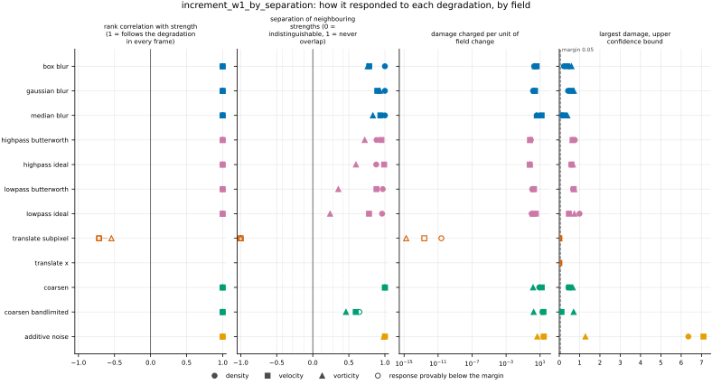
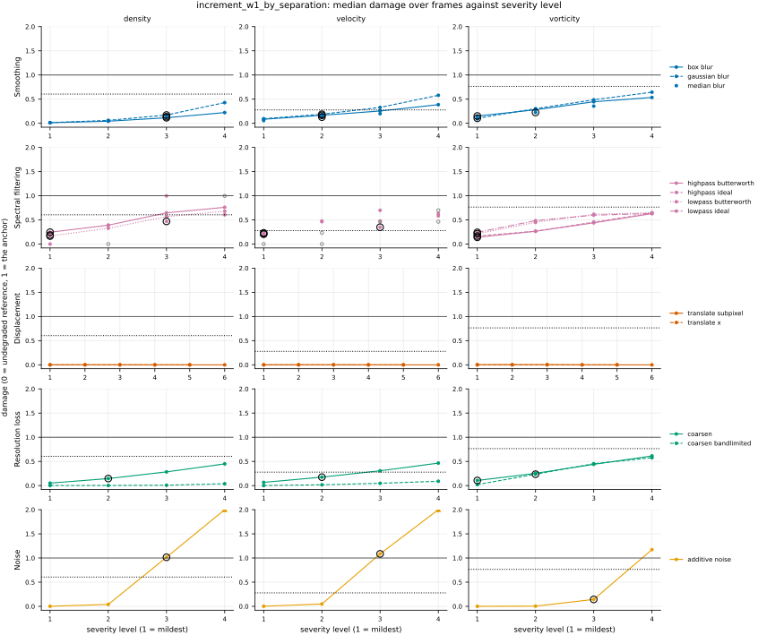
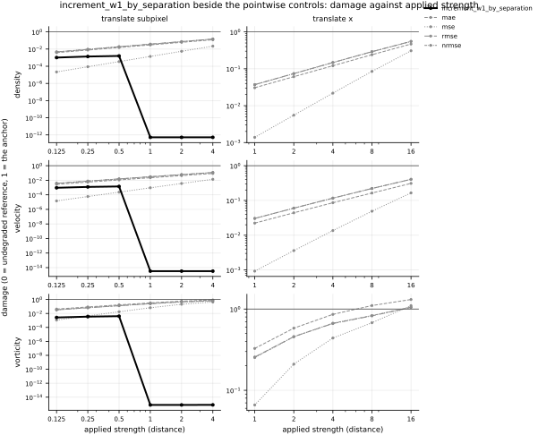

## Definition

Let $f$ be one channel of a field on a periodic grid with $D$ spatial axes, $\mathbf{e}_j$ the
unit step along axis $j$, and take the increment at a separation of $\ell$ cells,

$$
(\delta_{\ell, j} f)_{\mathbf{n}} = f_{\mathbf{n} + \ell \mathbf{e}_j} - f_{\mathbf{n}} \tag{1}
$$

the definition `increment_flatness` uses at one cell, with the separation as an argument. With
$a_{(1)} \le \dots \le a_{(N)}$ the sorted increments of the reference over all $N$ cells and
$b_{(i)}$ those of the candidate, the 1-Wasserstein distance between the two increment
distributions along axis $j$, averaged over channels $c$ and axes, is

$$
W_1(\ell) = \frac{1}{C D} \sum_{c=1}^{C} \sum_{j=1}^{D}
\frac{1}{N} \sum_{i=1}^{N} \bigl| a^{(c,j)}_{(i)} - b^{(c,j)}_{(i)} \bigr| \tag{2}
$$

which is the sorting form of the one-dimensional distance [@peyrecuturi2019], Chapter 2; the
card of `increment_w1` derives it. Equation (2) is computed by `increment_w1` itself, so at
$\ell = 1$ it is that metric's value exactly. The separations are the octaves
$\ell = 1, 2, 4, \dots$ up to half the smallest side of the grid: 1 to 128 on a $256^2$ grid,
eight of them. The curve $W_1(\ell)$ is the metric's companion, stored on every row in the
field's units.

Comparing increment statistics scale by scale is the practice of [@granero2024]. No source
reduces the comparison to one number, so the number registered here is a repository
convention, recorded in `issues/098`:

$$
M = \frac{1}{L} \sum_{\ell} \frac{W_1(\ell)}{s(\ell)}, \qquad
s(\ell) = \frac{1}{C D} \sum_{c, j} \frac{1}{N} \sum_{\mathbf{n}}
\bigl| (\delta_{\ell, j} f^{(c)}_{\text{ref}})_{\mathbf{n}} \bigr| \tag{3}
$$

with $L$ the number of separations and $s(\ell)$ the reference's mean absolute increment.
Increments grow with separation, so $W_1(\ell)$ does too; dividing each by the reference's size
at that separation weighs every separation alike, where a plain mean of Equation (2) would be
carried by the largest. A separation at which the reference has no increments at all
contributes 0 when the candidate has none either, and an infinite term otherwise.

### Boundary handling

Periodic wrap on every axis: the increment of a cell within $\ell$ of the end is taken against
the cells at the start, so every cell contributes one increment per axis and separation, and
the two samples in Equation (2) have the same size, which the sorting form requires. The metric
therefore declares `requires_periodic`, and the harness does not run it on a dataset with a
non-periodic axis.

## Performance

<!-- GENERATED performance: written by `python -m fmeval.cards evidence increment_w1_by_separation --results results/comparison_1793302178`, do not edit -->



Four measured statistics for increment_w1_by_separation, one row per degradation grouped by family and one marker per field. From left: the rank correlation between the metric and the applied strength within a frame, with the line showing the resampling interval; the separation of neighbouring strengths as Cliff's delta, where 0 means the metric cannot tell one strength from the next and the faint ticks at 0.12, 0.28 and 0.42 are Vargha and Delaney's small, medium and large anchors, for scale and not as grades; the damage charged per unit of field change at the harshest strength; and the upper confidence bound on the largest damage, beside the fixed margin of 0.05. A hollow marker is a field and degradation on which that bound lies below the margin, so the response is provably small. A missing marker is a statistic the analysis withheld, as the rank correlation is on an axis the metric is invariant to.



Median damage over frames against severity level for increment_w1_by_separation, one row per family of degradation and one column per field, on one shared scale. The solid grey line is damage 1, the anchor (by default the field's own mean); the dotted black line is the damage assigned to the fake prediction with the right spectrum, where the run included it. The hollow black ring marks the first level at which the metric has moved a tenth of the way to the anchor. Hollow grey markers are strengths excluded for repeating a milder one or for doing nothing. Degradations with three or fewer usable levels are drawn as markers only; points above 2 are drawn as triangles at the top.

**Trend: does the response follow the degradation?**

| test family | field | degradations | rank correlation | fraction of frames in order | weakest gap between neighbouring strengths |
|---|---|---|---|---|---|
| Displacement | density | 2 | -0.714 | 0 | 0 |
| Displacement | velocity | 2 | -0.714 | 0 | 0 |
| Displacement | vorticity | 2 | -0.543 | 0 | 0 |
| Resolution loss | density | 2 | 1 | 1 | 0.823 to 1 |
| Resolution loss | velocity | 2 | 1 | 1 | 0.798 to 1 |
| Resolution loss | vorticity | 2 | 1 | 1 | 0.73 to 1 |
| Smoothing | density | 3 | 1 | 1 | 1 |
| Smoothing | velocity | 3 | 1 | 1 | 0.891 to 0.969 |
| Smoothing | vorticity | 3 | 1 | 1 | 0.881 to 0.966 |
| Spectral filtering | density | 4 | 1 | 1 | 0.94 to 0.985 |
| Spectral filtering | velocity | 4 | 1 | 1 | 0.89 to 0.995 |
| Spectral filtering | vorticity | 4 | 1 | 1 | 0.62 to 0.86 |
| Noise | density | 1 | 1 | 1 | 1 |
| Noise | velocity | 1 | 1 | 1 | 1 |
| Noise | vorticity | 1 | 1 | 1 | 0.992 |

**Reactivity: how far does it move?**

| test family | field | change from clean at the harshest strength | elasticity | first strength detected |
|---|---|---|---|---|
| Displacement | density | — | 0.314 | level — |
| Displacement | velocity | — | 0.303 | level — |
| Displacement | vorticity | — | 0.307 | level — |
| Resolution loss | density | — | 1.13 to 1.24 | level 2 |
| Resolution loss | velocity | — | 1.1 to 2.54 | level 2 |
| Resolution loss | vorticity | — | 1.03 to 2.23 | level 1 |
| Smoothing | density | — | 1.51 to 1.85 | level 3 |
| Smoothing | velocity | — | 0.768 to 0.962 | level 2 |
| Smoothing | vorticity | — | 0.754 to 1.05 | level 1 |
| Spectral filtering | density | — | 0.681 to 9.52 | level 1 |
| Spectral filtering | velocity | — | 0.678 to 1.2 | level 1 |
| Spectral filtering | vorticity | — | 0.515 to 1.63 | level 1 |
| Noise | density | — | 1.46 | level 3 |
| Noise | velocity | — | 1.42 | level 3 |
| Noise | vorticity | — | 1.24 | level 3 |
| trap test: fake prediction, right spectrum | density | — | — | damage 0.605 |
| trap test: fake prediction, right spectrum | velocity | — | — | damage 0.278 |
| trap test: fake prediction, right spectrum | vorticity | — | — | damage 0.765 |

**Consistency: how much does it vary from snapshot to snapshot?**

| test family | field | consistency, in the strength's units | snapshots per independent block |
|---|---|---|---|
| Displacement | density | 0.0963 | 1 to 16 |
| Displacement | velocity | 0.0899 | 1 to 20 |
| Displacement | vorticity | 0.177 | 1 to 21 |
| Resolution loss | density | 0.26 to 1.52 | 15 to 20 |
| Resolution loss | velocity | 0.518 to 1.82 | 21 to 22 |
| Resolution loss | vorticity | 0.863 to 1.11 | 22 |
| Smoothing | density | 0.00575 to 0.0152 | 20 to 21 |
| Smoothing | velocity | 0.0078 to 0.0178 | 21 to 22 |
| Smoothing | vorticity | 0.0101 to 0.0291 | 21 to 22 |
| Spectral filtering | density | 0.00923 to 0.0396 | 20 to 21 |
| Spectral filtering | velocity | 0.0195 to 0.0368 | 21 to 22 |
| Spectral filtering | vorticity | 0.0197 to 0.0529 | 21 to 22 |
| Noise | density | 0.00102 | 17 |
| Noise | velocity | 0.00255 | 21 |
| Noise | vorticity | 0.0121 | 22 |

One row per family of degradation and physical field; a cell gives the range over the degradations in that family. **Trend.** The rank correlation is the Spearman correlation between the strength and how far the metric has moved from its value on the undegraded field of the same frame, in the one direction it moves under that degradation, computed inside a single frame. A value of 1 means every strength moved it further than the last in every frame, whichever way it moves; a response that scatters to both sides scores near 0. The fraction of frames in order counts the frames with no exception. The weakest gap is the smallest Mann-Whitney overlap between two neighbouring strengths across frames: 1 means they never overlap, 0.5 that they cannot be told apart. **Reactivity.** The change from clean is the median, at the harshest strength, of the departure from the undegraded value of the same frame over the size of that value: 0.3 means 30%. It does not exist for this metric, whose undegraded value is exactly zero; the damage below is its relative reading. The elasticity is the percentage change of that departure per percentage change in strength over the mildest strengths. First strength detected is the mildest at which the metric has moved a tenth of the way to the anchor; **damage** reads that 0-to-1 scale as a number. A dash means the measurement is not defined there. A metric's reactivity scales with the power it is expressed in: mean squared error's elasticity is twice root-mean-square error's, though the two carry the same information, so compare magnitudes across metrics with that in mind. **Consistency** is how much the response varies from snapshot to snapshot relative to its size, in the strength's units; the snapshots of one trajectory are correlated, and the last column is how many consecutive snapshots one independent block spans.

These tables report what was measured and grade none of the measurements. What the numbers mean for this metric is written in the subsections below, beside the test that produced each number.

**Profile.**

| field | selectivity | charges most for | charges least for | response provably below 0.05 at 90% on | elasticity to a sub-pixel shift, against severity (distance) | compute cost (x cheapest in this run) |
|---|---|---|---|---|---|---|
| density | 0.694 | `additive_noise` | `translate_x` | `coarsen_bandlimited` `translate_subpixel` `translate_x` | 0.314 | 285 |
| velocity | 0.593 | `additive_noise` | `translate_x` | `translate_subpixel` `translate_x` | 0.303 | 568 |
| vorticity | 0.394 | `additive_noise` | `translate_x` | `translate_subpixel` `translate_x` | 0.307 | 282 |

One row per physical field. **Selectivity** is how concentrated the metric's response is on a few degradations, measured per unit of field change: 0 means it charges every degradation the same, as mean squared error does by construction, and values toward 1 that one degradation carries most of it. **Charges most and least for** name the two ends of that profile. **Response provably below** lists degradations on which the upper confidence bound of the largest damage lies below the margin -- an equivalence test, so an entry says the response is provably small, not merely not significant; a dash means no degradation met the bound. **Elasticity** is the slope of log damage against log shift over the smallest shifts: 1 means damage grows in proportion to the shift, 2 with its square. **Compute cost** is wall-clock per evaluation over the cheapest metric and field in the same run.

<!-- END GENERATED performance -->

## Intuition

This metric asks, separately at each distance apart, whether two fields change by the same
mixture of amounts between points that far apart. At each distance it collects every
difference in the reference into one pile and every difference in the prediction into
another, sorts both, and averages the gaps between matching entries. That average is the
cheapest way to reshape one pile into the other. Doing this at one cell, two cells, four cells
and so on gives a curve, and the curve shows at which sizes of structure the prediction's
statistics depart from the reference's: an over-smoothed field loses its steep changes at small
distances while its large-scale changes stay right.

The one number reported beside the curve divides the gap at each distance by how large the
reference's changes are at that distance, then averages. Without the division the largest
distances would dominate simply because changes over long distances are larger.

A worked example, four cells by four cells: the reference is zero on the top row and one below,
the prediction alternates zero and one row by row.

```
reference        candidate        curve at 1 and 2 cells    number
0 0 0 0          0 0 0 0
1 1 1 1          1 1 1 1              0.25, 0.25              1
1 1 1 1          0 0 0 0
1 1 1 1          1 1 1 1
```

Reading down a column at one cell apart, the reference changes by up, flat, flat, down; the
prediction by up, down, up, down; half the sorted pairs differ by one. At two cells apart the
reference changes by up, flat, down, flat and the prediction not at all; again half the pairs
differ by one. Across the rows both fields are flat. So the gap is one half along the columns and
zero across the rows, and averaging the two directions gives 0.25 at each distance. The
reference's changes average 0.25 in size at both distances too, so each ratio is one, and so is
their mean.

What it ignores: where the changes are. A prediction with every structure in the wrong place,
or offset by a constant, has the same piles as the reference at every distance.

## Reading the output

The number is zero and unbounded above, and dimensionless. Lower means closer increment
statistics, and zero means they match at every separation, not that the fields match. A
prediction that is the reference multiplied by $c$ scores exactly $|c - 1|$. Because it is
divided by the reference's own scale, it can be compared across fields, which the raw
distances of `increment_w1` cannot. That is also why it is a bundle beside `increment_w1` rather
than a replacement of that metric's number: it registers a different, dimensionless quantity,
and `increment_w1` keeps its one-cell distance in the field's units.

The companion is the curve of Equation (2): a `coordinate` column holding the separation in
cells and a `value` column holding $W_1(\ell)$ in the field's units, one row per separation for
every result row, in the run's `companions.csv`. Read it against the reference's curve on the
same field. A curve that departs at small separations and agrees at large ones describes a
prediction that is wrong at small scales only.

Comparison across analysis-grid resolutions is invalid: the separations are in cells, so a
finer grid measures each at a physically smaller distance.

## Limitations

It is blind to position, like `increment_w1`. A spatially scrambled or translated prediction
scores zero, so it must not be read without a pointwise control.

The number is a convention. Dividing by the reference's scale weighs a small departure at a
separation where the reference barely changes as heavily as a large one where it changes a lot,
which can make the number large for a field with almost no structure at some separation. The
curve is the reading in that case.

The largest separations are few in independent samples on one frame: at half the domain every
increment pairs a cell with the one opposite it, and the two halves of the domain repeat each
other's pairs with the sign reversed.

## Results

<!-- GENERATED run: written by `python -m fmeval.cards evidence increment_w1_by_separation --results results/comparison_1793302178`, do not edit -->

Measured on `kinet_re5e4`, frames 2000 to 10000 (161 frames of developed flow), on the 256 analysis grid, seed 20260807, at commit `b59bbde617d1` (working tree dirty). Run `comparison_1793302178`.

Every number in this section comes from that one run. Regenerate with `python -m fmeval.cards evidence <name> --results results/comparison_1793302178`.

<!-- END GENERATED run -->

### Smoothing

[gaussian_blur](../../degradations/gaussian_blur/card.md) ·
[box_blur](../../degradations/box_blur/card.md)

<!-- GENERATED results_smoothing: written by `python -m fmeval.cards evidence increment_w1_by_separation --results results/comparison_1793302178`, do not edit -->

| degradation | field | strengths | rank correlation | fraction of frames in the right order | weakest gap between neighbouring strengths |
|---|---|---|---|---|---|
| `box_blur` | density | 4 | 1 | 1 | 1 |
| `box_blur` | velocity | 4 | 1 | 1 | 0.891 |
| `box_blur` | vorticity | 4 | 1 | 1 | 0.881 |
| `gaussian_blur` | density | 4 | 1 | 1 | 1 |
| `gaussian_blur` | velocity | 4 | 1 | 1 | 0.947 |
| `gaussian_blur` | vorticity | 4 | 1 | 1 | 0.966 |
| `median_blur` | density | 3 | 1 | 1 | 1 |
| `median_blur` | velocity | 3 | 1 | 1 | 0.969 |
| `median_blur` | vorticity | 3 | 1 | 1 | 0.917 |

<!-- END GENERATED results_smoothing -->

Every blur is followed in every frame on all three fields. The weakest gap between neighbouring
strengths is 1 on density and down to 0.88 on velocity and vorticity.

### Spectral filtering

[lowpass_ideal](../../degradations/lowpass_ideal/card.md) ·
[highpass_ideal](../../degradations/highpass_ideal/card.md)

<!-- GENERATED results_spectral: written by `python -m fmeval.cards evidence increment_w1_by_separation --results results/comparison_1793302178`, do not edit -->

| degradation | field | strengths | rank correlation | fraction of frames in the right order | weakest gap between neighbouring strengths |
|---|---|---|---|---|---|
| `highpass_butterworth` | density | 4 | 1 | 1 | 0.942 |
| `highpass_butterworth` | velocity | 3 | 1 | 1 | 0.976 |
| `highpass_butterworth` | vorticity | 4 | 1 | 1 | 0.86 |
| `highpass_ideal` | density | 3 | 1 | 1 | 0.94 |
| `highpass_ideal` | velocity | 2 | 1 | 1 | 0.995 |
| `highpass_ideal` | vorticity | 4 | 1 | 1 | 0.799 |
| `lowpass_butterworth` | density | 4 | 1 | 1 | 0.985 |
| `lowpass_butterworth` | velocity | 3 | 1 | 1 | 0.942 |
| `lowpass_butterworth` | vorticity | 4 | 1 | 1 | 0.677 |
| `lowpass_ideal` | density | 3 | 1 | 1 | 0.98 |
| `lowpass_ideal` | velocity | 2 | 1 | 1 | 0.89 |
| `lowpass_ideal` | vorticity | 4 | 1 | 1 | 0.62 |

<!-- END GENERATED results_spectral -->

Every filter is followed in every frame, low-pass and high-pass alike, because both reshape the
increment distribution away from the reference's at some separation. Vorticity's neighbouring
strengths overlap most (weakest gaps 0.62 to 0.86), and its curve is where the choice of summary
matters most: see the dominance column under "The curve behind the number".

### Displacement

[translate_x](../../degradations/translate/card.md) ·
[translate_subpixel](../../degradations/translate_subpixel/card.md)

<!-- GENERATED results_geometric: written by `python -m fmeval.cards evidence increment_w1_by_separation --results results/comparison_1793302178`, do not edit -->

| degradation | field | strengths | rank correlation | fraction of frames in the right order | weakest gap between neighbouring strengths |
|---|---|---|---|---|---|
| `translate_subpixel` | density | 6 | -0.714 | 0 | 0 |
| `translate_subpixel` | velocity | 6 | -0.714 | 0 | 0 |
| `translate_subpixel` | vorticity | 6 | -0.543 | 0 | 0 |
| `translate_x` | density | 5 | — | — | — |
| `translate_x` | velocity | 5 | — | — | — |
| `translate_x` | vorticity | 5 | — | — | — |

<!-- END GENERATED results_geometric -->

An integer translation leaves every increment distribution unchanged, so `translate_x` is
withheld as round-off. `translate_subpixel` is not a monotone axis for this metric: shifts of
an eighth, a quarter and half a cell interpolate the field and so smooth its increments, while
shifts of one, two and four cells are exact rolls and score round-off, 1e-15 to 5e-13. The value
rises and then drops to zero, which is what the negative rank correlations record. The harshest
levels are round-off, so the direction, upward, is measured at half a cell.

### Resolution loss

[coarsen](../../degradations/coarsen/card.md) ·
[coarsen_bandlimited](../../degradations/coarsen_bandlimited/card.md)

<!-- GENERATED results_resolution: written by `python -m fmeval.cards evidence increment_w1_by_separation --results results/comparison_1793302178`, do not edit -->

| degradation | field | strengths | rank correlation | fraction of frames in the right order | weakest gap between neighbouring strengths |
|---|---|---|---|---|---|
| `coarsen` | density | 4 | 1 | 1 | 1 |
| `coarsen` | velocity | 4 | 1 | 1 | 1 |
| `coarsen` | vorticity | 4 | 1 | 1 | 1 |
| `coarsen_bandlimited` | density | 4 | 1 | 1 | 0.823 |
| `coarsen_bandlimited` | velocity | 4 | 1 | 1 | 0.798 |
| `coarsen_bandlimited` | vorticity | 4 | 1 | 1 | 0.73 |

<!-- END GENERATED results_resolution -->

Both coarsenings are followed in every frame on every field. The staircase of `coarsen`
separates its strengths completely; `coarsen_bandlimited` overlaps more (weakest gaps 0.73 to
0.82).

### Noise

[additive_noise](../../degradations/additive_noise/card.md)

<!-- GENERATED results_stochastic: written by `python -m fmeval.cards evidence increment_w1_by_separation --results results/comparison_1793302178`, do not edit -->

| degradation | field | strengths | rank correlation | fraction of frames in the right order | weakest gap between neighbouring strengths |
|---|---|---|---|---|---|
| `additive_noise` | density | 4 | 1 | 1 | 1 |
| `additive_noise` | velocity | 4 | 1 | 1 | 1 |
| `additive_noise` | vorticity | 4 | 1 | 1 | 0.992 |

<!-- END GENERATED results_stochastic -->

Noise is followed in every frame on every field, with neighbouring strengths separated on
density and velocity and almost separated on vorticity (0.992).

### Trap tests

[gaussian_impostor](../../degradations/gaussian_impostor/card.md) ·
[uncorrelated](../../degradations/random_large_translation/card.md)

<!-- GENERATED results_canaries: written by `python -m fmeval.cards evidence increment_w1_by_separation --results results/comparison_1793302178`, do not edit -->

| field | damage assigned to the fake prediction | closest real degradation | damage of the reference moved far away | value on the anchor |
|---|---|---|---|---|
| density | 0.605 | `highpass_ideal=4.32121` | 0 | 1 |
| velocity | 0.278 | `box_blur=47.1929` | 0 | 1 |
| vorticity | 0.765 | `lowpass_butterworth=4.71416` | 0 | 1 |

The fake prediction here has exactly the reference field's amplitude spectrum and completely scrambled structure. Damage 1 is what the anchor scores, by default the reference's own spatial mean, a prediction that knows the mean and nothing else. The damage column therefore says how close to useless this metric considers that fake prediction: a low number means the metric was fooled. The third column translates the same number into an ordinary degradation whose damage the fake prediction matches, which is easier to picture. The fourth is the reference moved by a large random offset, the right statistics in the wrong place; where a field's energy sits in its largest scales that copy stays partly correlated with the reference, so it is not the score of an unrelated field.

<!-- END GENERATED results_canaries -->

The reference moved far away scores zero on every field: a translation leaves every increment
distribution unchanged, so this metric cannot see the right statistics in the wrong place. The
fake prediction scores a damage of 0.605, 0.278 and 0.765 on density, velocity and
vorticity: less than the field's mean on every field, and on velocity less than a third of it.

### Compared with the other metrics

<!-- GENERATED results_summary: written by `python -m fmeval.cards evidence increment_w1_by_separation --results results/comparison_1793302178`, do not edit -->

| compared with | rank correlation over every degradation |
|---|---|
| `increment_w1` | 0.918 |
| `spectrum_l2` | 0.869 |
| `nrmse` | 0.246 |
| `rmse` | 0.223 |
| `mse` | 0.222 |
| `mae` | 0.217 |
| `h1_seminorm` | 0.126 |
| `h_minus_one` | 0.117 |
| `increment_flatness` | -0.408 |
| `palinstrophy` | -0.551 |
| `enstrophy` | -0.608 |
| `kinetic_energy` | -0.669 |

Computed on the median value at each combination of degradation and strength, over every degradation and physical field in the run, with the undegraded reference excluded. Two metrics correlating near 1 put the degradations in the same order, but the two may still weight those degradations very differently. A correlation near 1 therefore means the two metrics are redundant for ranking models, not that the two are interchangeable as training losses.

<!-- END GENERATED results_summary -->

Across the ladder it ranks almost as `increment_w1` does (0.918), which it contains at one
cell, and only weakly as the pointwise controls do (0.22 to 0.25).

### Damage beside the other metrics

<!-- GENERATED results_damage_by_level: written by `python -m fmeval.cards evidence increment_w1_by_separation --results results/comparison_1793302178`, do not edit -->



Median damage over frames against the applied strength, log-log, for increment_w1_by_separation (bold, in colour) and the pointwise controls mae, mse, rmse, nrmse (thin, grey), one column per displacement degradation and one row per field. The grey line is damage 1, the anchor (by default the field's own mean). Parallel lines charge in the same proportion at every strength; a steeper line charges relatively more for the larger shifts, which is what decides whether two metrics are interchangeable as training losses. These are the same numbers as the table beneath.

**Displacement, density, `translate_subpixel`** (strength: distance).

| metric | 0.125 | 0.25 | 0.5 | 1 | 2 | 4 |
|---|---|---|---|---|---|---|
| `increment_w1_by_separation` | 0.00102 | 0.00136 | 0.00158 | 5.24e-13 | 5.24e-13 | 5.24e-13 |
| `mae` | 0.00383 | 0.00767 | 0.0153 | 0.0306 | 0.061 | 0.121 |
| `mse` | 2.17e-05 | 8.68e-05 | 0.000347 | 0.00138 | 0.00551 | 0.0219 |
| `rmse` | 0.00466 | 0.00931 | 0.0186 | 0.0372 | 0.0743 | 0.148 |
| `nrmse` | 0.00463 | 0.00926 | 0.0185 | 0.037 | 0.0738 | 0.147 |

**Displacement, density, `translate_x`** (strength: distance).

| metric | 1 | 2 | 4 | 8 | 16 |
|---|---|---|---|---|---|
| `increment_w1_by_separation` | 0 | 0 | 0 | 0 | 0 |
| `mae` | 0.0306 | 0.061 | 0.121 | 0.24 | 0.469 |
| `mse` | 0.00138 | 0.00551 | 0.0219 | 0.0849 | 0.307 |
| `rmse` | 0.0372 | 0.0743 | 0.148 | 0.291 | 0.555 |
| `nrmse` | 0.037 | 0.0738 | 0.147 | 0.29 | 0.55 |

**Displacement, velocity, `translate_subpixel`** (strength: distance).

| metric | 0.125 | 0.25 | 0.5 | 1 | 2 | 4 |
|---|---|---|---|---|---|---|
| `increment_w1_by_separation` | 0.000928 | 0.00122 | 0.00141 | 3.28e-15 | 3.28e-15 | 3.26e-15 |
| `mae` | 0.00279 | 0.00559 | 0.0112 | 0.0223 | 0.0441 | 0.0859 |
| `mse` | 1.45e-05 | 5.81e-05 | 0.000232 | 0.000924 | 0.0036 | 0.0136 |
| `rmse` | 0.00381 | 0.00762 | 0.0152 | 0.0304 | 0.06 | 0.117 |
| `nrmse` | 0.00382 | 0.00763 | 0.0153 | 0.0304 | 0.06 | 0.117 |

**Displacement, velocity, `translate_x`** (strength: distance).

| metric | 1 | 2 | 4 | 8 | 16 |
|---|---|---|---|---|---|
| `increment_w1_by_separation` | 0 | 0 | 0 | 0 | 0 |
| `mae` | 0.0223 | 0.0441 | 0.0859 | 0.163 | 0.31 |
| `mse` | 0.000924 | 0.0036 | 0.0136 | 0.0489 | 0.165 |
| `rmse` | 0.0304 | 0.06 | 0.117 | 0.221 | 0.406 |
| `nrmse` | 0.0304 | 0.06 | 0.117 | 0.221 | 0.406 |

**Displacement, vorticity, `translate_subpixel`** (strength: distance).

| metric | 0.125 | 0.25 | 0.5 | 1 | 2 | 4 |
|---|---|---|---|---|---|---|
| `increment_w1_by_separation` | 0.00266 | 0.0035 | 0.00408 | 7.69e-16 | 7.76e-16 | 7.9e-16 |
| `mae` | 0.0428 | 0.0854 | 0.169 | 0.328 | 0.582 | 0.86 |
| `mse` | 0.00112 | 0.00448 | 0.0176 | 0.066 | 0.21 | 0.44 |
| `rmse` | 0.0335 | 0.0669 | 0.133 | 0.257 | 0.458 | 0.663 |
| `nrmse` | 0.0328 | 0.0654 | 0.13 | 0.253 | 0.456 | 0.67 |

**Displacement, vorticity, `translate_x`** (strength: distance).

| metric | 1 | 2 | 4 | 8 | 16 |
|---|---|---|---|---|---|
| `increment_w1_by_separation` | 0 | 0 | 0 | 0 | 0 |
| `mae` | 0.328 | 0.582 | 0.86 | 1.1 | 1.31 |
| `mse` | 0.066 | 0.21 | 0.44 | 0.679 | 1.1 |
| `rmse` | 0.257 | 0.458 | 0.663 | 0.824 | 1.05 |
| `nrmse` | 0.253 | 0.456 | 0.67 | 0.832 | 1.05 |

Median damage over frames at every strength, this metric in the first row and the pointwise controls beneath it, all on the same 0-to-1 scale where 0 is the undegraded reference and 1 the anchor (by default the field's own mean); a dash means no damage scale on that field. The rank correlations under *Compared with the other metrics* say whether two metrics put the strengths in the same order; this table says how much each one charges for the same strength, which decides whether two metrics are interchangeable as training losses.

<!-- END GENERATED results_damage_by_level -->

The anchor scores exactly 1 on every field: a constant field has no increments, so at every
separation the distance in Equation (2) is the reference's own mean absolute increment and each
ratio in Equation (3) is 1. On that scale displacement costs almost nothing. `translate_x`
scores 0 at every strength and `translate_subpixel` at most 0.0041, where the pointwise controls
charge up to 1.31.

### The curve behind the number

<!-- GENERATED results_companion: written by `python -m fmeval.cards evidence increment_w1_by_separation --results results/comparison_1793302178`, do not edit -->

**density, rank correlation, at each coordinate.**

| degradation | 1 | 2 | 4 | 8 | 16 | 32 | 64 | 128 | dominance |
|---|---|---|---|---|---|---|---|---|---|
| `additive_noise` | 1 | 1 | 1 | 1 | 1 | 1 | 1 | 1 | 1 |
| `box_blur` | 1 | 1 | 1 | 1 | 1 | 1 | 1 | 1 | 1 |
| `coarsen` | 1 | 1 | 1 | 1 | 1 | 1 | 1 | 1 | 1 |
| `coarsen_bandlimited` | 1 | 1 | 1 | 1 | 1 | 1 | 1 | 1 | 0.994 |
| `gaussian_blur` | 1 | 1 | 1 | 1 | 1 | 1 | 1 | 1 | 1 |
| `highpass_butterworth` | 1 | 1 | 1 | 1 | 1 | 1 | 1 | 1 | 1 |
| `highpass_ideal` | 1 | 1 | 1 | 1 | 1 | 1 | 1 | 1 | 1 |
| `lowpass_butterworth` | 1 | 1 | 1 | 1 | 1 | 1 | 1 | 1 | 0.932 |
| `lowpass_ideal` | 1 | 1 | 1 | 1 | 1 | 1 | 1 | 1 | 1 |
| `median_blur` | 1 | 1 | 1 | 1 | 1 | 1 | 1 | 1 | 1 |
| `translate_subpixel` | -0.714 | -0.714 | -0.6 | -0.6 | -0.714 | -0.657 | -0.714 | -0.714 | 0 |
| `translate_x` | — | — | — | — | — | — | — | — | — |

**density, change from clean at the harshest strength:** not defined at any coordinate. The curve's value on the undegraded field is zero, as a comparison curve's is, so there is no clean value to divide by.

**velocity, rank correlation, at each coordinate.**

| degradation | 1 | 2 | 4 | 8 | 16 | 32 | 64 | 128 | dominance |
|---|---|---|---|---|---|---|---|---|---|
| `additive_noise` | 1 | 1 | 1 | 1 | 1 | 1 | 1 | 1 | 1 |
| `box_blur` | 1 | 1 | 1 | 1 | 1 | 1 | 1 | 1 | 1 |
| `coarsen` | 1 | 1 | 1 | 1 | 1 | 1 | 1 | 1 | 1 |
| `coarsen_bandlimited` | 1 | 1 | 1 | 1 | 1 | 1 | 1 | 1 | 1 |
| `gaussian_blur` | 1 | 1 | 1 | 1 | 1 | 1 | 1 | 1 | 1 |
| `highpass_butterworth` | 1 | 1 | 1 | 1 | 1 | 1 | 1 | 1 | 1 |
| `highpass_ideal` | 1 | 1 | 1 | 1 | 1 | 1 | 1 | 1 | 1 |
| `lowpass_butterworth` | 1 | 1 | 1 | 1 | 1 | 1 | 1 | 1 | 0.919 |
| `lowpass_ideal` | 1 | 1 | 1 | 1 | 1 | 1 | 1 | 1 | 1 |
| `median_blur` | 1 | 1 | 1 | 1 | 1 | 1 | 1 | 1 | 1 |
| `translate_subpixel` | -0.714 | -0.714 | -0.6 | -0.714 | -0.6 | -0.714 | -0.714 | -0.714 | 0 |
| `translate_x` | — | — | — | — | — | — | — | — | — |

**velocity, change from clean at the harshest strength:** not defined at any coordinate. The curve's value on the undegraded field is zero, as a comparison curve's is, so there is no clean value to divide by.

**vorticity, rank correlation, at each coordinate.**

| degradation | 1 | 2 | 4 | 8 | 16 | 32 | 64 | 128 | dominance |
|---|---|---|---|---|---|---|---|---|---|
| `additive_noise` | 1 | 1 | 1 | 1 | 1 | 1 | 1 | 1 | 1 |
| `box_blur` | 1 | 1 | 1 | 1 | 1 | 1 | 1 | 1 | 1 |
| `coarsen` | 1 | 1 | 1 | 1 | 1 | 1 | 1 | 1 | 0.919 |
| `coarsen_bandlimited` | 1 | 1 | 1 | 1 | 1 | 1 | 1 | 1 | 0.975 |
| `gaussian_blur` | 1 | 1 | 1 | 1 | 1 | 1 | 1 | 1 | 1 |
| `highpass_butterworth` | 1 | 1 | 1 | 1 | 1 | 1 | 1 | 1 | 0.807 |
| `highpass_ideal` | 1 | 1 | 1 | 1 | 1 | 1 | 1 | 1 | 0.839 |
| `lowpass_butterworth` | 1 | 1 | 1 | 1 | 1 | 1 | 1 | 1 | 0.578 |
| `lowpass_ideal` | 1 | 1 | 1 | 1 | 1 | 1 | 1 | 1 | 0.472 |
| `median_blur` | 1 | 1 | 1 | 1 | 1 | 1 | 1 | 1 | 1 |
| `translate_subpixel` | -0.6 | -0.543 | -0.543 | -0.543 | -0.543 | -0.6 | -0.6 | -0.6 | 0 |
| `translate_x` | — | — | — | — | — | — | — | — | — |

**vorticity, change from clean at the harshest strength:** not defined at any coordinate. The curve's value on the undegraded field is zero, as a comparison curve's is, so there is no clean value to divide by.

Each coordinate of the curve read as a metric of its own, with the same statistics as the tables above and no resampling interval. Neighbouring coordinates are strongly correlated, so a row localises the evidence and does not multiply it. **Dominance** is the fraction of frames in which, for the weakest pair of neighbouring strengths, the harsher strength's curve has moved at least as far as the milder one's at every coordinate, each in its own direction: near 1, any summary that grows with every coordinate's departure orders those strengths the same way, so the choice of summary cannot change the trend. None of these numbers enters the tables above.

<!-- END GENERATED results_companion -->

Coordinate by coordinate, every degradation but the sub-pixel shift is followed at every
separation. The dominance column is what the curve adds. Where it is 1, every summary that grows
with the departure at each separation orders the strengths alike, so the convention of Equation
(3) does not decide the trend. Among the degradations it follows, it is lowest for the low-pass
filters on vorticity (0.47 and 0.58), where a summary weighting other separations could order the
weakest pair of strengths differently in about half the frames (`issues/098`). Under the sub-pixel
shift it is 0, as it must be for a curve that returns to zero at whole-cell strengths.

## References

\bibliography
