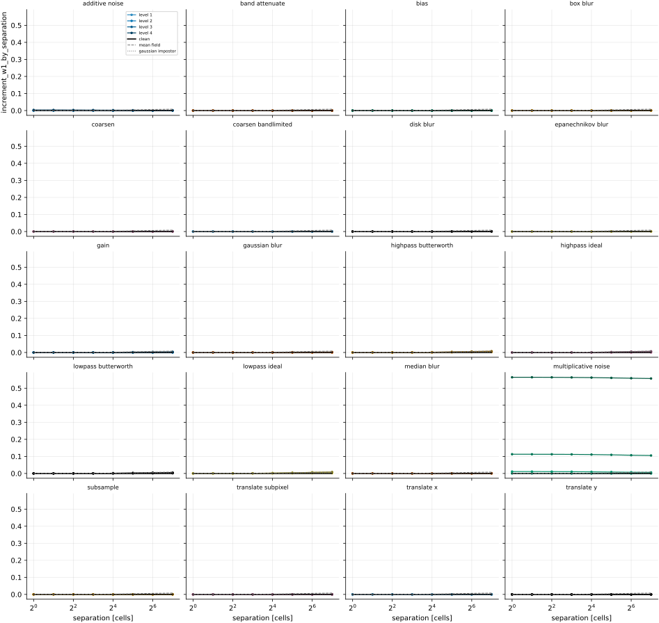
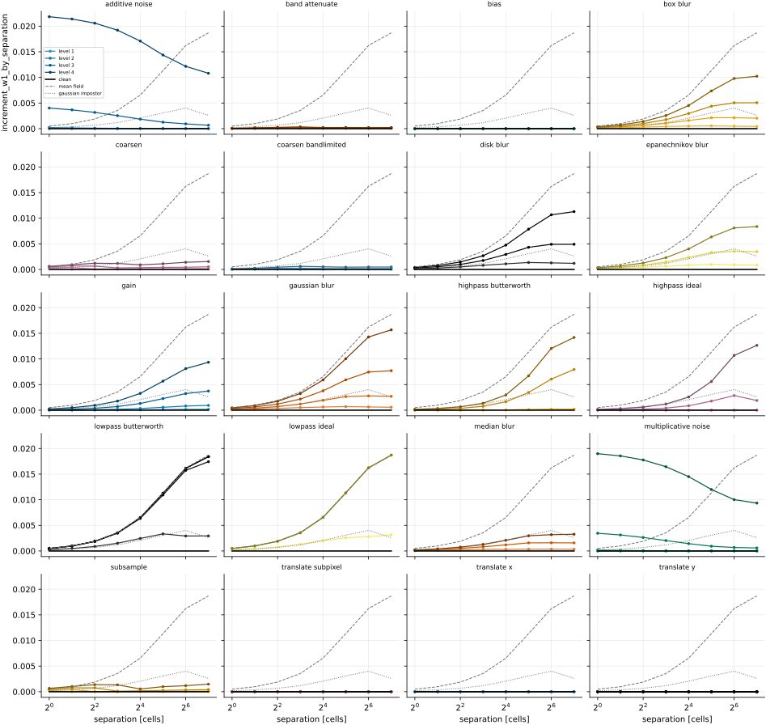
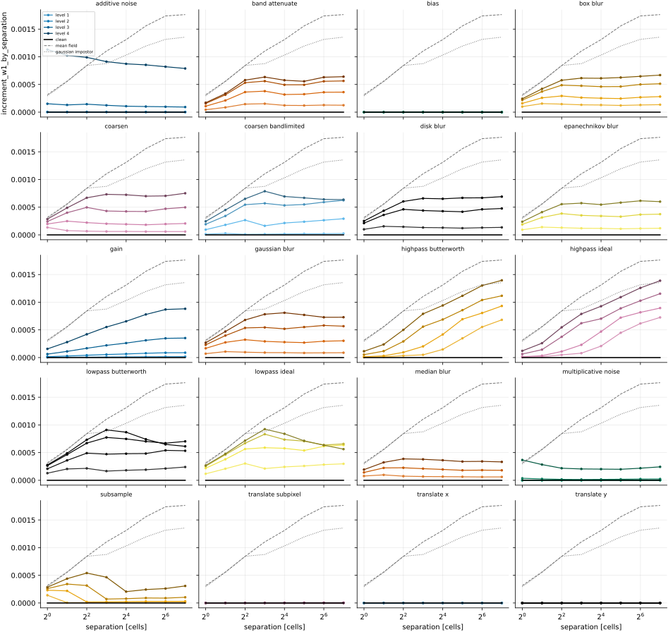
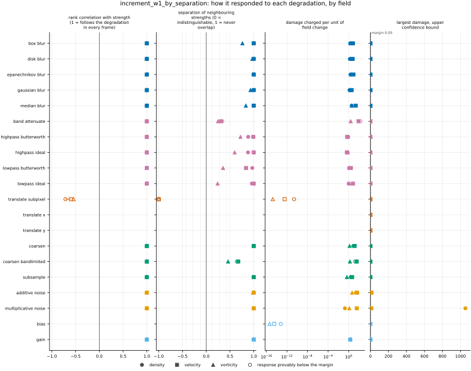
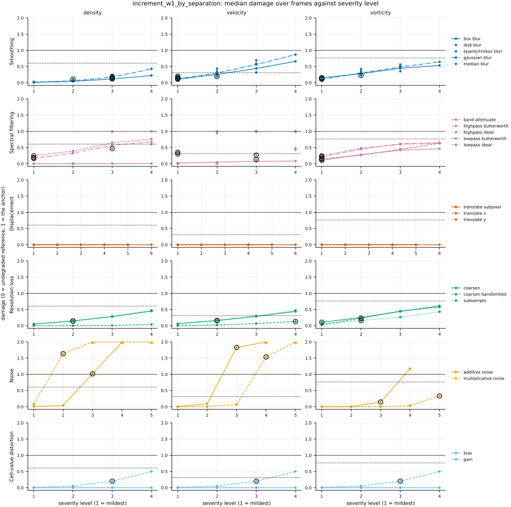
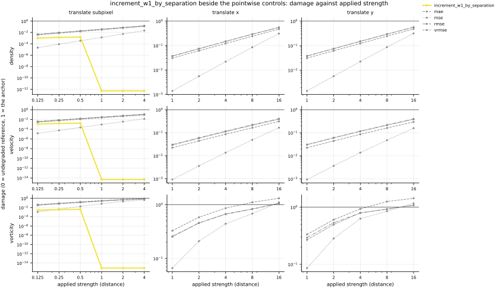
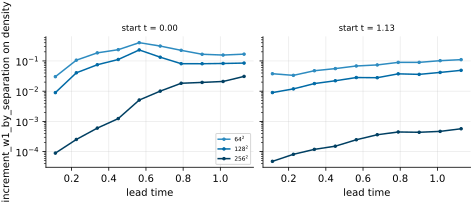
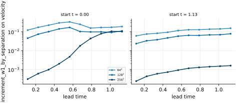
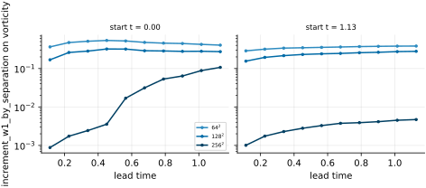

## Definition

Let $f$ be one channel of a field on a periodic grid with $D$ spatial axes, $\mathbf{e}_j$ the
unit step along axis $j$, and take the increment at a separation of $\ell$ cells,

$$
(\delta_{\ell, j} f)_{\mathbf{n}} = f_{\mathbf{n} + \ell \mathbf{e}_j} - f_{\mathbf{n}} \tag{1}
$$

the definition `increment_flatness` uses. With $a_{(1)} \le \dots \le a_{(N)}$ the sorted
increments of the reference over all $N$ cells and $b_{(i)}$ those of the candidate, the
1-Wasserstein distance between the two increment distributions along axis $j$ of channel
$c$, averaged over the set $P$ of channel-and-axis pairs read, is

$$
W_1(\ell) = \frac{1}{|P|} \sum_{(c, j) \in P}
\frac{1}{N} \sum_{i=1}^{N} \bigl| a^{(c,j)}_{(i)} - b^{(c,j)}_{(i)} \bigr| \tag{2}
$$

which is the sorting form of the one-dimensional distance ([@peyrecuturi2019], Remark 2.28,
Eq. (2.33), numbered as in arXiv:1803.00567); the card of `increment_w1` derives it. For
velocity, whose channel $c$ is its component along axis $c$, $P$ holds the **longitudinal**
pairs $j = c$ only, as structure-function theory reads velocity ([@boffetta2012], Eq. (4)); for
a scalar field, which has no orientation, $P$ is every channel along every axis. Equation (2)
is computed by `increment_w1` itself, so at $\ell = 1$ it is that metric's value exactly. The
separations are the octaves $\ell = 1, 2, 4, \dots$ up to half the smallest side of the grid: 1
to 128 on a $256^2$ grid, eight of them. The curve $W_1(\ell)$ is the metric's companion,
stored on every row in the field's units; for velocity the same curve over the
**transverse** pairs $j \ne c$ is the companion `increment_w1_by_separation.transverse`, empty
for a scalar field.

Comparing increment statistics scale by scale is the practice of [@granero2024]. No source
reduces the comparison to one number, so the number registered here is a repository
convention, recorded in `issues/098`:

$$
M = \frac{1}{L} \sum_{\ell} \frac{W_1(\ell)}{s(\ell)}, \qquad
s(\ell) = \frac{1}{|P|} \sum_{(c, j) \in P} \frac{1}{N} \sum_{\mathbf{n}}
\bigl| (\delta_{\ell, j} f^{(c)}_{\text{ref}})_{\mathbf{n}} \bigr| \tag{3}
$$

with $L$ the number of separations and $s(\ell)$ the reference's mean absolute increment over
the same pairs. Increments grow with separation, so $W_1(\ell)$ does too; dividing each by the
reference's size at that separation weighs every separation alike, where a plain mean of
Equation (2) would be carried by the largest. A separation at which the reference has no
increments at all contributes 0 when the candidate has none either, and an infinite term
otherwise.

### Boundary handling

Periodic wrap on every axis: the increment of a cell within $\ell$ of the end is taken against
the cells at the start, so every cell contributes one increment per axis and separation, and
the two samples in Equation (2) have the same size, which the sorting form requires. The metric
therefore declares `requires_periodic`, and the harness does not run it on a dataset with a
non-periodic axis.

### How its field reports it

The curve is the object here, and its field is the statistical theory of turbulence; the
distance is optimal transport's (see [increment_w1](../../metrics/increment_w1/card.md), whose
card sets out both fields).

- **Turbulence** reads increments of the longitudinal velocity at separations spanning the
  dissipative, inertial and integral ranges ([@granero2024], Sect. 2.1, Eq. (1);
  [@boffetta2012], Eq. (4), p. 430, which splits the structure function into longitudinal and
  transverse parts). The nearest published form of this curve is [@granero2024], App. A,
  Fig. A4: the Jeffreys distance between a model's and the reference's probability densities
  of the *centred and standardised* increments, at the octave separations
  $\ell = 2, 4, \dots, 4096$ sampling lengths, drawn against $\log \ell$ with a line at zero,
  for three models, with the integral scale stated; the same densities are drawn on a
  logarithmic density axis in Fig. 8 (Sect. 4). Their data are a long record of the
  longitudinal velocity of grid turbulence in the ONERA Modane wind tunnel, at a Taylor-scale
  Reynolds number of 2500 (Sect. 2.2).

**What this bundle reports, and how it differs.** The curve is drawn the same way, against the
separation on a logarithmic axis, at octave separations. Its distance is the 1-Wasserstein
distance in the field's units rather than the Jeffreys distance between standardised
densities, which would need a choice of bins the source does not state and is not built.
Standardising removes the amplitude of the increments and compares only the shape of their
distribution; the curve here keeps both, and the registered number divides each separation's
distance by the reference's increment size, a different normalisation that likewise makes the
separations comparable (`issues/098`). The separations are in cells, not in units of the
Kolmogorov or the integral scale, which `kinet_re5e4` has not established.

**The experiments here.** The field's experiment, stationary turbulence with an inertial
range, does not exist here:
[EXP-increment_flatness-isotropic-3d-turbulence-cutouts](https://github.com/khegazy/pde_metrics/blob/main/proposals/EXP-increment_flatness-isotropic-3d-turbulence-cutouts.md)
writes it up, and
[EXP-energy_distance-tail-only-degradation](https://github.com/khegazy/pde_metrics/blob/main/proposals/EXP-energy_distance-tail-only-degradation.md)
a degradation that changes only the tails of the increment distribution. The metric runs on
the degradation ladder on `kinet_re5e4`, on the forecasts of `forecast_re5e4` against their
targets and on the Reynolds ladder. It is not run on the member mean of `synthetic_ensemble`
(reason under Results) or on `sod_shock_tube`, whose walls rule out a periodic increment.

## Performance

<!-- GENERATED performance: written by `python -m fmeval.cards evidence increment_w1_by_separation --results results/comparison_1793829127 --results results/comparison_1793811840 --results results/comparison_1793829231`, do not edit -->



*As this metric's own field draws it.* The curve behind increment_w1_by_separation on density: the median over frames at every strength of every degradation, the clean curve in black, the anchor dashed and the impostor dotted. Values are the literature's own, untransformed.



*As this metric's own field draws it.* The curve behind increment_w1_by_separation on velocity: the median over frames at every strength of every degradation, the clean curve in black, the anchor dashed and the impostor dotted. Values are the literature's own, untransformed.



*As this metric's own field draws it.* The curve behind increment_w1_by_separation on vorticity: the median over frames at every strength of every degradation, the clean curve in black, the anchor dashed and the impostor dotted. Values are the literature's own, untransformed.



Four measured statistics for increment_w1_by_separation, one row per degradation grouped by family and one marker per field. From left: the rank correlation between the metric and the applied strength within a frame, with the line showing the resampling interval; the separation of neighbouring strengths as Cliff's delta, where 0 means the metric cannot tell one strength from the next and the faint ticks at 0.12, 0.28 and 0.42 are Vargha and Delaney's small, medium and large anchors, for scale and not as grades; the damage charged per unit of field change at the harshest strength; and the upper confidence bound on the largest damage, beside the fixed margin of 0.05. A hollow marker is a field and degradation on which that bound lies below the margin, so the response is provably small. A missing marker is a statistic the analysis withheld, as the rank correlation is on an axis the metric is invariant to.



Median damage over frames against severity level for increment_w1_by_separation, one row per family of degradation and one column per field, on one shared scale. The solid grey line is damage 1, the anchor (by default the field's own mean); the dotted black line is the damage assigned to the fake prediction with the right spectrum, where the run included it. The hollow black ring marks the first level at which the metric has moved a tenth of the way to the anchor. Hollow grey markers are strengths excluded for repeating a milder one or for doing nothing. Degradations with three or fewer usable levels are drawn as markers only; points beyond 2 either side are drawn as triangles at the edge. Damage is negative where a degradation moves the metric away from the anchor, as noise raises a single-field quantity the field's mean sets to zero.

**Trend: does the response follow the degradation?**

| test family | field | degradations | rank correlation | fraction of frames in order | weakest gap between neighbouring strengths |
|---|---|---|---|---|---|
| Displacement | density | 3 | -0.714 | 0 | 0 |
| Displacement | velocity | 3 | -0.6 | 0 | 0 |
| Displacement | vorticity | 3 | -0.543 | 0 | 0 |
| Cell-value distortion | density | 2 | 1 | 1 | 1 |
| Cell-value distortion | velocity | 2 | 1 | 1 | 1 |
| Cell-value distortion | vorticity | 2 | 1 | 1 | 1 |
| Resolution loss | density | 3 | 1 | 1 | 0.823 to 1 |
| Resolution loss | velocity | 3 | 1 | 1 | 0.837 to 1 |
| Resolution loss | vorticity | 3 | 1 | 1 | 0.73 to 1 |
| Smoothing | density | 5 | 1 | 1 | 1 |
| Smoothing | velocity | 5 | 1 | 1 | 1 |
| Smoothing | vorticity | 5 | 1 | 1 | 0.881 to 1 |
| Spectral filtering | density | 5 | 1 | 1 | 0.668 to 0.985 |
| Spectral filtering | velocity | 5 | 1 | 1 | 0.656 to 1 |
| Spectral filtering | vorticity | 5 | 1 | 1 | 0.62 to 0.86 |
| Noise | density | 2 | 1 | 1 | 1 |
| Noise | velocity | 2 | 1 | 1 | 1 |
| Noise | vorticity | 2 | 1 | 1 | 0.992 to 1 |

**Reactivity: how far does it move?**

| test family | field | change from clean at the harshest strength | elasticity | first strength detected |
|---|---|---|---|---|
| Displacement | density | — | 0.314 | level — |
| Displacement | velocity | — | 0.278 | level — |
| Displacement | vorticity | — | 0.307 | level — |
| Cell-value distortion | density | — | 1 | level 3 |
| Cell-value distortion | velocity | — | 1 | level 3 |
| Cell-value distortion | vorticity | — | 1 | level 3 |
| Resolution loss | density | — | 1.13 to 1.25 | level 2 |
| Resolution loss | velocity | — | 1.12 to 2.6 | level 2 |
| Resolution loss | vorticity | — | 1.03 to 2.23 | level 1 |
| Smoothing | density | — | 1.51 to 1.85 | level 2 |
| Smoothing | velocity | — | 0.875 to 1.08 | level 1 |
| Smoothing | vorticity | — | 0.754 to 1.05 | level 1 |
| Spectral filtering | density | — | 0.681 to 9.52 | level 1 |
| Spectral filtering | velocity | — | 0.602 to 5.13 | level 1 |
| Spectral filtering | vorticity | — | 0.515 to 1.63 | level 1 |
| Noise | density | — | 1.21 to 1.46 | level 2 |
| Noise | velocity | — | 1.16 to 1.43 | level 3 |
| Noise | vorticity | — | 0.602 to 1.24 | level 3 |
| trap test: fake prediction, right spectrum | density | — | — | damage 0.605 |
| trap test: fake prediction, right spectrum | velocity | — | — | damage 0.309 |
| trap test: fake prediction, right spectrum | vorticity | — | — | damage 0.765 |

**Consistency: how much does it vary from snapshot to snapshot?**

| test family | field | consistency, in the strength's units | snapshots per independent block |
|---|---|---|---|
| Displacement | density | 0.0938 | 1 to 16 |
| Displacement | velocity | 0.161 | 1 to 20 |
| Displacement | vorticity | 0.177 | 1 to 21 |
| Cell-value distortion | density | 0.0262 | 1 to 20 |
| Cell-value distortion | velocity | 0.0176 | 1 to 20 |
| Cell-value distortion | vorticity | 0.039 | 21 to 22 |
| Resolution loss | density | 0.781 to 1.38 | 20 to 21 |
| Resolution loss | velocity | 0.432 to 1.79 | 19 to 22 |
| Resolution loss | vorticity | 0.863 to 1.11 | 22 |
| Smoothing | density | 0.00723 to 0.0156 | 12 to 14 |
| Smoothing | velocity | 0.00661 to 0.0153 | 21 |
| Smoothing | vorticity | 0.0101 to 0.0291 | 21 to 22 |
| Spectral filtering | density | 0.027 to 0.0941 | 14 to 21 |
| Spectral filtering | velocity | 0.0234 to 0.124 | 20 to 22 |
| Spectral filtering | vorticity | 0.0197 to 0.0728 | 21 to 22 |
| Noise | density | 0.000236 to 0.0157 | 20 |
| Noise | velocity | 0.00134 to 0.00153 | 21 to 22 |
| Noise | vorticity | 0.00934 to 0.0121 | 22 |

One row per family of degradation and physical field; a cell gives the range over the degradations in that family. **Trend.** The rank correlation is the Spearman correlation between the strength and how far the metric has moved from its value on the undegraded field of the same frame, in the one direction it moves under that degradation, computed inside a single frame. A value of 1 means every strength moved it further than the last in every frame, whichever way it moves; a response that scatters to both sides scores near 0. The fraction of frames in order counts the frames with no exception. The weakest gap is the smallest Mann-Whitney overlap between two neighbouring strengths across frames: 1 means they never overlap, 0.5 that they cannot be told apart. **Reactivity.** The change from clean is the median, at the harshest strength, of the departure from the undegraded value of the same frame over the size of that value: 0.3 means 30%. It does not exist for this metric, whose undegraded value is exactly zero; the damage below is its relative reading. The elasticity is the percentage change of that departure per percentage change in strength over the mildest strengths. First strength detected is the mildest at which the metric has moved a tenth of the way to the anchor; **damage** reads that 0-to-1 scale as a number. A dash means the measurement is not defined there. A metric's reactivity scales with the power it is expressed in: mean squared error's elasticity is twice root-mean-square error's, though the two carry the same information, so compare magnitudes across metrics with that in mind. **Consistency** is how much the response varies from snapshot to snapshot relative to its size, in the strength's units; the snapshots of one trajectory are correlated, and the last column is how many consecutive snapshots one independent block spans.

These tables report what was measured and grade none of the measurements. What the numbers mean for this metric is written in the subsections below, beside the test that produced each number.

**Profile.**

| field | selectivity | charges most for | charges least for | response provably below 0.05 at 90% on | elasticity to a sub-pixel shift, against severity (distance) | compute cost (x cheapest in this run) |
|---|---|---|---|---|---|---|
| density | 0.905 | `band_attenuate` | `translate_x` | `band_attenuate` `bias` `coarsen_bandlimited` `translate_subpixel` `translate_x` `translate_y` | 0.314 | 284 |
| velocity | 0.681 | `band_attenuate` | `translate_x` | `bias` `translate_subpixel` `translate_x` `translate_y` | 0.278 | 289 |
| vorticity | 0.39 | `additive_noise` | `translate_x` | `bias` `translate_subpixel` `translate_x` `translate_y` | 0.307 | 289 |

One row per physical field. **Selectivity** is how concentrated the metric's response is on a few degradations, measured per unit of field change: 0 means it charges every degradation the same, as mean squared error does by construction, and values toward 1 that one degradation carries most of it. **Charges most and least for** name the two ends of that profile. **Response provably below** lists degradations on which the upper confidence bound of the largest damage lies below the margin -- an equivalence test, so an entry says the response is provably small, not merely not significant; a dash means no degradation met the bound. **Elasticity** is the slope of log damage against log shift over the smallest shifts: 1 means damage grows in proportion to the shift, 2 with its square. **Compute cost** is wall-clock per evaluation over the cheapest metric and field in the same run.

<!-- END GENERATED performance -->

## Intuition

This metric asks, separately at each distance apart, whether two fields change by the same
mixture of amounts between points that far apart. At each distance it collects every
difference in the reference into one pile and every difference in the prediction into
another, sorts both, and averages the gaps between matching entries. That average is the
cheapest way to reshape one pile into the other. Doing this at one cell, two cells, four cells
and so on gives a curve, and the curve shows at which sizes of structure the prediction's
statistics depart from the reference's: an over-smoothed field loses its steep changes at small
distances while its large-scale changes stay right.

The one number reported beside the curve divides the gap at each distance by how large the
reference's changes are at that distance, then averages. Without the division the largest
distances would dominate simply because changes over long distances are larger.

A worked example, four cells by four cells: the reference is zero on the top row and one below,
the prediction alternates zero and one row by row.

```
reference        candidate        curve at 1 and 2 cells    number
0 0 0 0          0 0 0 0
1 1 1 1          1 1 1 1              0.25, 0.25              1
1 1 1 1          0 0 0 0
1 1 1 1          1 1 1 1
```

Reading down a column at one cell apart, the reference changes by up, flat, flat, down; the
prediction by up, down, up, down; half the sorted pairs differ by one. At two cells apart the
reference changes by up, flat, down, flat and the prediction not at all; again half the pairs
differ by one. Across the rows both fields are flat. So the gap is one half along the columns and
zero across the rows, and averaging the two directions gives 0.25 at each distance. The
reference's changes average 0.25 in size at both distances too, so each ratio is one, and so is
their mean.

What it ignores: where the changes are. A prediction with every structure in the wrong place,
or offset by a constant, has the same piles as the reference at every distance.

## Reading the output

The number is zero and unbounded above, and dimensionless. Lower means closer increment
statistics, and zero means they match at every separation, not that the fields match. A
prediction that is the reference multiplied by $c$ scores exactly $|c - 1|$. Because it is
divided by the reference's own scale, it can be compared across fields, which the raw
distances of `increment_w1` cannot. That is also why it is a bundle beside `increment_w1` rather
than a replacement of that metric's number: it registers a different, dimensionless quantity,
and `increment_w1` keeps its one-cell distance in the field's units.

The companion is the curve of Equation (2): a `coordinate` column holding the separation in
cells and a `value` column holding $W_1(\ell)$ in the field's units, one row per separation for
every result row, in the run's `companions.csv`. It is zero at every separation for a
prediction whose increment statistics match, so its shape is the reading: a curve that departs
at small separations and stays near zero at large ones describes a prediction that is wrong at
small scales only.

For velocity the number and the curve compare the longitudinal increments only. A velocity
value from a run recorded before the bundle read the orientation averaged the longitudinal and
transverse pairs together and is a different quantity; density and vorticity read every axis,
and their values did not change. The transverse curve is in the same file, in rows labelled
`increment_w1_by_separation.transverse`, in the field's units and undivided.

Comparison across analysis-grid resolutions is invalid: the separations are in cells, so a
finer grid measures each at a physically smaller distance.

## Limitations

It is blind to position, like `increment_w1`. A translated prediction scores exactly zero, and
the fake prediction with the right spectrum but scrambled phases is charged only part of the
anchor's damage (the trap tests under Results give the values), so it must not be read without
a pointwise control.

The number is a convention. Dividing by the reference's scale weighs a small departure at a
separation where the reference barely changes as heavily as a large one where it changes a lot,
which can make the number large for a field with almost no structure at some separation. The
curve is the reading in that case.

The largest separations are few in independent samples on one frame: at half the domain every
increment pairs a cell with the one opposite it, and the two halves of the domain repeat each
other's pairs with the sign reversed.

## Results

<!-- GENERATED run: written by `python -m fmeval.cards evidence increment_w1_by_separation --results results/comparison_1793829127 --results results/comparison_1793811840 --results results/comparison_1793829231`, do not edit -->

Measured on `kinet_re5e4`, frames 2000 to 10000 (161 frames of developed flow), on the 256 analysis grid, seed 20260807, at commit `adbdc88e4950`. Run `comparison_1793829127`.

Every number in this section comes from that run, except in the subsections headed with another experiment and in a figure whose caption names another run, each of which names its own run. Regenerate with `python -m fmeval.cards evidence <name> --results results/comparison_1793829127 --results results/comparison_1793811840 --results results/comparison_1793829231`.

<!-- END GENERATED run -->

<!-- GENERATED experiments: written by `python -m fmeval.cards catalog`, do not edit -->

**Across the experiments.**

| experiment | what a run on it is evidence of | on this card |
|---|---|---|
| `kinet_re5e4` | developed flow | measured, run `comparison_1793829127`: the main results |
| `kinet_re1e6` | developed flow at Re = 1e6, twenty times the Reynolds number of kinet_re5e4, from the same initial condition | measured, run `comparison_1793829231`: under *On `kinet_re1e6`* |
| `synthetic_ensemble` | a calibrated null: evidence that the estimator computes what it claims to compute, and nothing about turbulence | not applicable: every axis there leaves the member mean's increments unchanged (dispersion scales members about their mean; a bias cancels in an increment) |
| `sod_shock_tube` | an analytic check: evidence that the metric locates and scores a known shock correctly, and nothing about turbulence | not applicable: needs a periodic domain, and this dataset is not periodic |
| `forecast_re5e4` | real predictions scored against their targets at each prediction step; who produced the predictions, a trained model or a coarser solver, is not recorded | measured, run `comparison_1793811840`: under *On `forecast_re5e4`* |

One row per dataset a card may cite (`configs/cards/default.yaml`). *Measured* names the run the card cites: the main results are `## Performance` and the subsections below, and every other run has its own subsection headed with its dataset. *Not applicable* gives the reason: one that follows from what the metric declares and what the dataset offers, or one a person wrote on the card (`not_run` in `card.yaml`) because the result would carry no information. *Not yet run* means the metric can run there and the card cites no run on it yet.

<!-- END GENERATED experiments -->

### Smoothing

[gaussian_blur](../../degradations/gaussian_blur/card.md) ·
[box_blur](../../degradations/box_blur/card.md)

<!-- GENERATED results_smoothing: written by `python -m fmeval.cards evidence increment_w1_by_separation --results results/comparison_1793829127 --results results/comparison_1793811840 --results results/comparison_1793829231`, do not edit -->

| degradation | field | strengths | rank correlation | fraction of frames in the right order | weakest gap between neighbouring strengths |
|---|---|---|---|---|---|
| `box_blur` | density | 4 | 1 | 1 | 1 |
| `box_blur` | velocity | 4 | 1 | 1 | 1 |
| `box_blur` | vorticity | 4 | 1 | 1 | 0.881 |
| `disk_blur` | density | 3 | 1 | 1 | 1 |
| `disk_blur` | velocity | 3 | 1 | 1 | 1 |
| `disk_blur` | vorticity | 3 | 1 | 1 | 0.986 |
| `epanechnikov_blur` | density | 3 | 1 | 1 | 1 |
| `epanechnikov_blur` | velocity | 3 | 1 | 1 | 1 |
| `epanechnikov_blur` | vorticity | 3 | 1 | 1 | 1 |
| `gaussian_blur` | density | 4 | 1 | 1 | 1 |
| `gaussian_blur` | velocity | 4 | 1 | 1 | 1 |
| `gaussian_blur` | vorticity | 4 | 1 | 1 | 0.966 |
| `median_blur` | density | 3 | 1 | 1 | 1 |
| `median_blur` | velocity | 3 | 1 | 1 | 1 |
| `median_blur` | vorticity | 3 | 1 | 1 | 0.917 |

<!-- END GENERATED results_smoothing -->

Every blur is followed in every frame on all three fields. The weakest gap between neighbouring
strengths is 1 on density and down to 0.88 on velocity and vorticity.

### Spectral filtering

[lowpass_ideal](../../degradations/lowpass_ideal/card.md) ·
[highpass_ideal](../../degradations/highpass_ideal/card.md)

<!-- GENERATED results_spectral: written by `python -m fmeval.cards evidence increment_w1_by_separation --results results/comparison_1793829127 --results results/comparison_1793811840 --results results/comparison_1793829231`, do not edit -->

| degradation | field | strengths | rank correlation | fraction of frames in the right order | weakest gap between neighbouring strengths |
|---|---|---|---|---|---|
| `band_attenuate` | density | 4 | 1 | 1 | 0.668 |
| `band_attenuate` | velocity | 4 | 1 | 1 | 0.656 |
| `band_attenuate` | vorticity | 4 | 1 | 1 | 0.624 |
| `highpass_butterworth` | density | 4 | 1 | 1 | 0.942 |
| `highpass_butterworth` | velocity | 3 | 1 | 1 | 0.995 |
| `highpass_butterworth` | vorticity | 4 | 1 | 1 | 0.86 |
| `highpass_ideal` | density | 3 | 1 | 1 | 0.94 |
| `highpass_ideal` | velocity | 2 | 1 | 1 | 1 |
| `highpass_ideal` | vorticity | 4 | 1 | 1 | 0.799 |
| `lowpass_butterworth` | density | 4 | 1 | 1 | 0.985 |
| `lowpass_butterworth` | velocity | 3 | 1 | 1 | 0.919 |
| `lowpass_butterworth` | vorticity | 4 | 1 | 1 | 0.677 |
| `lowpass_ideal` | density | 3 | 1 | 1 | 0.98 |
| `lowpass_ideal` | velocity | 2 | 1 | 1 | 1 |
| `lowpass_ideal` | vorticity | 4 | 1 | 1 | 0.62 |

<!-- END GENERATED results_spectral -->

Every filter is followed in every frame, low-pass and high-pass alike, because both reshape the
increment distribution away from the reference's at some separation. Vorticity's neighbouring
strengths overlap most (weakest gaps 0.62 to 0.86), and its curve is where the choice of summary
matters most: see the dominance column under "The curve behind the number".

### Displacement

[translate_x](../../degradations/translate/card.md) ·
[translate_subpixel](../../degradations/translate_subpixel/card.md)

<!-- GENERATED results_geometric: written by `python -m fmeval.cards evidence increment_w1_by_separation --results results/comparison_1793829127 --results results/comparison_1793811840 --results results/comparison_1793829231`, do not edit -->

| degradation | field | strengths | rank correlation | fraction of frames in the right order | weakest gap between neighbouring strengths |
|---|---|---|---|---|---|
| `translate_subpixel` | density | 6 | -0.714 | 0 | 0 |
| `translate_subpixel` | velocity | 6 | -0.6 | 0 | 0 |
| `translate_subpixel` | vorticity | 6 | -0.543 | 0 | 0 |
| `translate_x` | density | 5 | — | — | — |
| `translate_x` | velocity | 5 | — | — | — |
| `translate_x` | vorticity | 5 | — | — | — |
| `translate_y` | density | 5 | — | — | — |
| `translate_y` | velocity | 5 | — | — | — |
| `translate_y` | vorticity | 5 | — | — | — |

<!-- END GENERATED results_geometric -->

An integer translation leaves every increment distribution unchanged, so `translate_x` is
withheld as round-off. `translate_subpixel` is not a monotone axis for this metric: shifts of
an eighth, a quarter and half a cell interpolate the field and so smooth its increments, while
shifts of one, two and four cells are exact rolls and score round-off, 1e-15 to 5e-13. The value
rises and then drops to zero, which is what the negative rank correlations record. The harshest
levels are round-off, so the direction, upward, is measured at half a cell.

### Resolution loss

[coarsen](../../degradations/coarsen/card.md) ·
[coarsen_bandlimited](../../degradations/coarsen_bandlimited/card.md)

<!-- GENERATED results_resolution: written by `python -m fmeval.cards evidence increment_w1_by_separation --results results/comparison_1793829127 --results results/comparison_1793811840 --results results/comparison_1793829231`, do not edit -->

| degradation | field | strengths | rank correlation | fraction of frames in the right order | weakest gap between neighbouring strengths |
|---|---|---|---|---|---|
| `coarsen` | density | 4 | 1 | 1 | 1 |
| `coarsen` | velocity | 4 | 1 | 1 | 1 |
| `coarsen` | vorticity | 4 | 1 | 1 | 1 |
| `coarsen_bandlimited` | density | 4 | 1 | 1 | 0.823 |
| `coarsen_bandlimited` | velocity | 4 | 1 | 1 | 0.837 |
| `coarsen_bandlimited` | vorticity | 4 | 1 | 1 | 0.73 |
| `subsample` | density | 4 | 1 | 1 | 1 |
| `subsample` | velocity | 4 | 1 | 1 | 1 |
| `subsample` | vorticity | 4 | 1 | 1 | 1 |

<!-- END GENERATED results_resolution -->

Both coarsenings are followed in every frame on every field. The staircase of `coarsen`
separates its strengths completely; `coarsen_bandlimited` overlaps more (weakest gaps 0.73 to
0.82).

### Noise

[additive_noise](../../degradations/additive_noise/card.md)

<!-- GENERATED results_stochastic: written by `python -m fmeval.cards evidence increment_w1_by_separation --results results/comparison_1793829127 --results results/comparison_1793811840 --results results/comparison_1793829231`, do not edit -->

| degradation | field | strengths | rank correlation | fraction of frames in the right order | weakest gap between neighbouring strengths |
|---|---|---|---|---|---|
| `additive_noise` | density | 4 | 1 | 1 | 1 |
| `additive_noise` | velocity | 4 | 1 | 1 | 1 |
| `additive_noise` | vorticity | 4 | 1 | 1 | 0.992 |
| `multiplicative_noise` | density | 5 | 1 | 1 | 1 |
| `multiplicative_noise` | velocity | 5 | 1 | 1 | 1 |
| `multiplicative_noise` | vorticity | 5 | 1 | 1 | 1 |

<!-- END GENERATED results_stochastic -->

Noise is followed in every frame on every field, with neighbouring strengths separated on
density and velocity and almost separated on vorticity (0.992).

### Trap tests

[gaussian_impostor](../../degradations/gaussian_impostor/card.md) ·
[uncorrelated](../../degradations/random_large_translation/card.md)

<!-- GENERATED results_canaries: written by `python -m fmeval.cards evidence increment_w1_by_separation --results results/comparison_1793829127 --results results/comparison_1793811840 --results results/comparison_1793829231`, do not edit -->

| field | damage assigned to the fake prediction | closest real degradation | damage of the reference moved far away | value on the anchor |
|---|---|---|---|---|
| density | 0.605 | `highpass_ideal=4.32121` | 0 | 1 |
| velocity | 0.309 | `lowpass_ideal=2.97527` | 0 | 1 |
| vorticity | 0.765 | `lowpass_butterworth=4.71416` | 0 | 1 |

The fake prediction here has exactly the reference field's amplitude spectrum and completely scrambled structure. Damage 1 is what the anchor scores, by default the reference's own spatial mean, a prediction that knows the mean and nothing else. The damage column therefore says how close to useless this metric considers that fake prediction: a low number means the metric was fooled. The third column translates the same number into an ordinary degradation whose damage the fake prediction matches, which is easier to picture. The fourth is the reference moved by a large random offset, the right statistics in the wrong place; where a field's energy sits in its largest scales that copy stays partly correlated with the reference, so it is not the score of an unrelated field.

<!-- END GENERATED results_canaries -->

The reference moved far away scores zero on every field: a translation leaves every increment
distribution unchanged, so this metric cannot see the right statistics in the wrong place. The
fake prediction scores a damage of 0.605, 0.278 and 0.765 on density, velocity and
vorticity: less than the field's mean on every field, and on velocity less than a third of it.

### Compared with the other metrics

<!-- GENERATED results_summary: written by `python -m fmeval.cards evidence increment_w1_by_separation --results results/comparison_1793829127 --results results/comparison_1793811840 --results results/comparison_1793829231`, do not edit -->

| compared with | density | velocity | vorticity |
|---|---|---|---|
| `energy_distance` | 0.966 | 0.961 | 0.901 |
| `increment_w1` | 0.971 | 0.957 | 0.923 |
| `spectral_energy_flux` | — | 0.925 | — |
| `tail_exceedance` | 0.845 | 0.905 | 0.895 |
| `persistence_distance` | 0.897 | — | 0.889 |
| `spectrum_l2` | 0.881 | 0.823 | 0.856 |
| `h1_relative` | 0.467 | 0.386 | 0.0664 |
| `h1_seminorm` | 0.485 | 0.373 | 0.0457 |
| `max_error_channel_mean` | 0.389 | 0.347 | 0.112 |
| `max_error` | 0.389 | 0.305 | 0.112 |
| `nrmse` | 0.338 | 0.263 | 0.111 |
| `vrmse` | 0.337 | 0.263 | 0.112 |
| `rmse_channel_mean` | 0.338 | 0.258 | 0.11 |
| `mse` | 0.338 | 0.248 | 0.11 |
| `rmse` | 0.338 | 0.248 | 0.11 |
| `mae` | 0.32 | 0.237 | 0.124 |
| `wasserstein` | 0.216 | — | — |
| `h_minus_one` | 0.226 | 0.141 | 0.0989 |
| `tail_index` | 0.0416 | -0.126 | -0.465 |
| `increment_flatness` | -0.331 | -0.524 | 0.392 |
| `kinetic_energy` | — | -0.485 | — |
| `palinstrophy` | — | — | -0.55 |
| `enstrophy` | — | — | -0.654 |

Rank correlation over every degradation, computed separately for each physical field on the median value at each combination of degradation and strength, with the undegraded reference excluded. A dash marks a metric that does not run on that field. A metric with a target value enters by its distance from the target. Two metrics correlating near 1 put the degradations in the same order, but the two may still weight those degradations very differently. A correlation near 1 therefore means the two metrics are redundant for ranking models, not that the two are interchangeable as training losses.

<!-- END GENERATED results_summary -->

Across the ladder it ranks almost as `increment_w1` does (0.926 to 0.969 across the fields),
which it contains at one cell, and only weakly as the pointwise controls do (0.251 to 0.264 on
density and velocity, 0.034 to 0.091 on vorticity).

### Damage beside the other metrics

<!-- GENERATED results_damage_by_level: written by `python -m fmeval.cards evidence increment_w1_by_separation --results results/comparison_1793829127 --results results/comparison_1793811840 --results results/comparison_1793829231`, do not edit -->



Median damage over frames against the applied strength, log-log, for increment_w1_by_separation (bold, in colour) and the pointwise controls mae, mse, rmse, vrmse (thin, grey), one column per displacement degradation and one row per field. The grey line is damage 1, the anchor (by default the field's own mean). Parallel lines charge in the same proportion at every strength; a steeper line charges relatively more for the larger shifts, which is what decides whether two metrics are interchangeable as training losses. These are the same numbers as the table beneath.

**Displacement, density, `translate_subpixel`** (strength: distance).

| metric | 0.125 | 0.25 | 0.5 | 1 | 2 | 4 |
|---|---|---|---|---|---|---|
| `increment_w1_by_separation` | 0.00102 | 0.00136 | 0.00158 | 5.24e-13 | 5.24e-13 | 5.24e-13 |
| `mae` | 0.00383 | 0.00767 | 0.0153 | 0.0306 | 0.061 | 0.121 |
| `mse` | 2.17e-05 | 8.68e-05 | 0.000347 | 0.00138 | 0.00551 | 0.0219 |
| `rmse` | 0.00466 | 0.00931 | 0.0186 | 0.0372 | 0.0743 | 0.148 |
| `vrmse` | 0.00463 | 0.00926 | 0.0185 | 0.037 | 0.0738 | 0.147 |

**Displacement, density, `translate_x`** (strength: distance).

| metric | 1 | 2 | 4 | 8 | 16 |
|---|---|---|---|---|---|
| `increment_w1_by_separation` | 0 | 0 | 0 | 0 | 0 |
| `mae` | 0.0306 | 0.061 | 0.121 | 0.24 | 0.469 |
| `mse` | 0.00138 | 0.00551 | 0.0219 | 0.0849 | 0.307 |
| `rmse` | 0.0372 | 0.0743 | 0.148 | 0.291 | 0.555 |
| `vrmse` | 0.037 | 0.0738 | 0.147 | 0.29 | 0.55 |

**Displacement, density, `translate_y`** (strength: distance).

| metric | 1 | 2 | 4 | 8 | 16 |
|---|---|---|---|---|---|
| `increment_w1_by_separation` | 0 | 0 | 0 | 0 | 0 |
| `mae` | 0.031 | 0.0616 | 0.122 | 0.244 | 0.476 |
| `mse` | 0.00142 | 0.00565 | 0.0224 | 0.0869 | 0.316 |
| `rmse` | 0.0377 | 0.0752 | 0.15 | 0.295 | 0.562 |
| `vrmse` | 0.0376 | 0.075 | 0.149 | 0.294 | 0.56 |

**Displacement, velocity, `translate_subpixel`** (strength: distance).

| metric | 0.125 | 0.25 | 0.5 | 1 | 2 | 4 |
|---|---|---|---|---|---|---|
| `increment_w1_by_separation` | 0.00116 | 0.00151 | 0.00171 | 4.83e-15 | 4.82e-15 | 4.8e-15 |
| `mae` | 0.00279 | 0.00559 | 0.0112 | 0.0223 | 0.0441 | 0.0859 |
| `mse` | 1.45e-05 | 5.81e-05 | 0.000232 | 0.000924 | 0.0036 | 0.0136 |
| `rmse` | 0.00381 | 0.00762 | 0.0152 | 0.0304 | 0.06 | 0.117 |
| `vrmse` | 0.00365 | 0.00729 | 0.0146 | 0.029 | 0.0574 | 0.111 |

**Displacement, velocity, `translate_x`** (strength: distance).

| metric | 1 | 2 | 4 | 8 | 16 |
|---|---|---|---|---|---|
| `increment_w1_by_separation` | 0 | 0 | 0 | 0 | 0 |
| `mae` | 0.0223 | 0.0441 | 0.0859 | 0.163 | 0.31 |
| `mse` | 0.000924 | 0.0036 | 0.0136 | 0.0489 | 0.165 |
| `rmse` | 0.0304 | 0.06 | 0.117 | 0.221 | 0.406 |
| `vrmse` | 0.029 | 0.0574 | 0.111 | 0.209 | 0.383 |

**Displacement, velocity, `translate_y`** (strength: distance).

| metric | 1 | 2 | 4 | 8 | 16 |
|---|---|---|---|---|---|
| `increment_w1_by_separation` | 0 | 0 | 0 | 0 | 0 |
| `mae` | 0.0223 | 0.0442 | 0.0856 | 0.16 | 0.295 |
| `mse` | 0.000935 | 0.00366 | 0.0138 | 0.0473 | 0.158 |
| `rmse` | 0.0306 | 0.0605 | 0.117 | 0.218 | 0.397 |
| `vrmse` | 0.0303 | 0.0599 | 0.115 | 0.212 | 0.384 |

**Displacement, vorticity, `translate_subpixel`** (strength: distance).

| metric | 0.125 | 0.25 | 0.5 | 1 | 2 | 4 |
|---|---|---|---|---|---|---|
| `increment_w1_by_separation` | 0.00266 | 0.0035 | 0.00408 | 7.69e-16 | 7.76e-16 | 7.9e-16 |
| `mae` | 0.0428 | 0.0854 | 0.169 | 0.328 | 0.582 | 0.86 |
| `mse` | 0.00112 | 0.00448 | 0.0176 | 0.066 | 0.21 | 0.44 |
| `rmse` | 0.0335 | 0.0669 | 0.133 | 0.257 | 0.458 | 0.663 |
| `vrmse` | 0.0329 | 0.0656 | 0.13 | 0.253 | 0.455 | 0.671 |

**Displacement, vorticity, `translate_x`** (strength: distance).

| metric | 1 | 2 | 4 | 8 | 16 |
|---|---|---|---|---|---|
| `increment_w1_by_separation` | 0 | 0 | 0 | 0 | 0 |
| `mae` | 0.328 | 0.582 | 0.86 | 1.1 | 1.31 |
| `mse` | 0.066 | 0.21 | 0.44 | 0.679 | 1.1 |
| `rmse` | 0.257 | 0.458 | 0.663 | 0.824 | 1.05 |
| `vrmse` | 0.253 | 0.455 | 0.671 | 0.832 | 1.05 |

**Displacement, vorticity, `translate_y`** (strength: distance).

| metric | 1 | 2 | 4 | 8 | 16 |
|---|---|---|---|---|---|
| `increment_w1_by_separation` | 0 | 0 | 0 | 0 | 0 |
| `mae` | 0.333 | 0.603 | 0.93 | 1.25 | 1.43 |
| `mse` | 0.0858 | 0.283 | 0.628 | 0.849 | 1.17 |
| `rmse` | 0.293 | 0.532 | 0.793 | 0.922 | 1.08 |
| `vrmse` | 0.268 | 0.495 | 0.793 | 0.927 | 1.08 |

Median damage over frames at every strength, this metric in the first row and the pointwise controls beneath it, all on the same 0-to-1 scale where 0 is the undegraded reference and 1 the anchor (by default the field's own mean); a dash means no damage scale on that field. The rank correlations under *Compared with the other metrics* say whether two metrics put the strengths in the same order; this table says how much each one charges for the same strength, which decides whether two metrics are interchangeable as training losses.

<!-- END GENERATED results_damage_by_level -->

The anchor scores exactly 1 on every field: a constant field has no increments, so at every
separation the distance in Equation (2) is the reference's own mean absolute increment and each
ratio in Equation (3) is 1. On that scale displacement costs almost nothing. `translate_x`
scores 0 at every strength and `translate_subpixel` at most 0.0041, where the pointwise controls
charge up to 1.31.

### The curve behind the number

<!-- GENERATED results_companion: written by `python -m fmeval.cards evidence increment_w1_by_separation --results results/comparison_1793829127 --results results/comparison_1793811840 --results results/comparison_1793829231`, do not edit -->

**density, rank correlation, at each coordinate.**

| degradation | 1 | 2 | 4 | 8 | 16 | 32 | 64 | 128 | dominance |
|---|---|---|---|---|---|---|---|---|---|
| `additive_noise` | 1 | 1 | 1 | 1 | 1 | 1 | 1 | 1 | 1 |
| `band_attenuate` | 1 | 1 | 1 | 1 | 1 | 1 | 1 | 1 | 1 |
| `bias` | — | — | — | — | — | — | — | — | — |
| `box_blur` | 1 | 1 | 1 | 1 | 1 | 1 | 1 | 1 | 1 |
| `coarsen` | 1 | 1 | 1 | 1 | 1 | 1 | 1 | 1 | 1 |
| `coarsen_bandlimited` | 1 | 1 | 1 | 1 | 1 | 1 | 1 | 1 | 0.994 |
| `disk_blur` | 1 | 1 | 1 | 1 | 1 | 1 | 1 | 1 | 1 |
| `epanechnikov_blur` | 1 | 1 | 1 | 1 | 1 | 1 | 1 | 1 | 1 |
| `gain` | 1 | 1 | 1 | 1 | 1 | 1 | 1 | 1 | 1 |
| `gaussian_blur` | 1 | 1 | 1 | 1 | 1 | 1 | 1 | 1 | 1 |
| `highpass_butterworth` | 1 | 1 | 1 | 1 | 1 | 1 | 1 | 1 | 1 |
| `highpass_ideal` | 1 | 1 | 1 | 1 | 1 | 1 | 1 | 1 | 1 |
| `lowpass_butterworth` | 1 | 1 | 1 | 1 | 1 | 1 | 1 | 1 | 0.932 |
| `lowpass_ideal` | 1 | 1 | 1 | 1 | 1 | 1 | 1 | 1 | 1 |
| `median_blur` | 1 | 1 | 1 | 1 | 1 | 1 | 1 | 1 | 1 |
| `multiplicative_noise` | 1 | 1 | 1 | 1 | 1 | 1 | 1 | 1 | 1 |
| `subsample` | 1 | 1 | 1 | 1 | 1 | 1 | 1 | 1 | 1 |
| `translate_subpixel` | -0.714 | -0.714 | -0.6 | -0.6 | -0.714 | -0.657 | -0.714 | -0.714 | 0 |
| `translate_x` | — | — | — | — | — | — | — | — | — |
| `translate_y` | — | — | — | — | — | — | — | — | — |

**density, change from clean at the harshest strength:** not defined at any coordinate. The curve's value on the undegraded field is zero, as a comparison curve's is, so there is no clean value to divide by.

**velocity, rank correlation, at each coordinate.**

| degradation | 1 | 2 | 4 | 8 | 16 | 32 | 64 | 128 | dominance |
|---|---|---|---|---|---|---|---|---|---|
| `additive_noise` | 1 | 1 | 1 | 1 | 1 | 1 | 1 | 1 | 1 |
| `band_attenuate` | 1 | 1 | 1 | 1 | 1 | 1 | 1 | 1 | 1 |
| `bias` | — | — | — | — | — | — | — | — | — |
| `box_blur` | 1 | 1 | 1 | 1 | 1 | 1 | 1 | 1 | 1 |
| `coarsen` | 1 | 1 | 1 | 1 | 1 | 1 | 1 | 1 | 1 |
| `coarsen_bandlimited` | 1 | 1 | 1 | 1 | 1 | 1 | 1 | 1 | 1 |
| `disk_blur` | 1 | 1 | 1 | 1 | 1 | 1 | 1 | 1 | 1 |
| `epanechnikov_blur` | 1 | 1 | 1 | 1 | 1 | 1 | 1 | 1 | 1 |
| `gain` | 1 | 1 | 1 | 1 | 1 | 1 | 1 | 1 | 1 |
| `gaussian_blur` | 1 | 1 | 1 | 1 | 1 | 1 | 1 | 1 | 1 |
| `highpass_butterworth` | 1 | 1 | 1 | 1 | 1 | 1 | 1 | 1 | 1 |
| `highpass_ideal` | 1 | 1 | 1 | 1 | 1 | 1 | 1 | 1 | 1 |
| `lowpass_butterworth` | 1 | 1 | 1 | 1 | 1 | 1 | 1 | 1 | 1 |
| `lowpass_ideal` | 1 | 1 | 1 | 1 | 1 | 1 | 1 | 1 | 1 |
| `median_blur` | 1 | 1 | 1 | 1 | 1 | 1 | 1 | 1 | 1 |
| `multiplicative_noise` | 1 | 1 | 1 | 1 | 1 | 1 | 1 | 1 | 1 |
| `subsample` | 1 | 1 | 1 | 1 | 1 | 1 | 1 | 1 | 1 |
| `translate_subpixel` | -0.657 | -0.657 | -0.657 | -0.714 | -0.714 | -0.714 | -0.714 | -0.714 | 0 |
| `translate_x` | — | — | — | — | — | — | — | — | — |
| `translate_y` | — | — | — | — | — | — | — | — | — |

**velocity, change from clean at the harshest strength:** not defined at any coordinate. The curve's value on the undegraded field is zero, as a comparison curve's is, so there is no clean value to divide by.

**vorticity, rank correlation, at each coordinate.**

| degradation | 1 | 2 | 4 | 8 | 16 | 32 | 64 | 128 | dominance |
|---|---|---|---|---|---|---|---|---|---|
| `additive_noise` | 1 | 1 | 1 | 1 | 1 | 1 | 1 | 1 | 1 |
| `band_attenuate` | 1 | 1 | 1 | 1 | 1 | 1 | 1 | 1 | 1 |
| `bias` | — | — | — | — | — | — | — | — | — |
| `box_blur` | 1 | 1 | 1 | 1 | 1 | 1 | 1 | 1 | 1 |
| `coarsen` | 1 | 1 | 1 | 1 | 1 | 1 | 1 | 1 | 0.919 |
| `coarsen_bandlimited` | 1 | 1 | 1 | 1 | 1 | 1 | 1 | 1 | 0.975 |
| `disk_blur` | 1 | 1 | 1 | 1 | 1 | 1 | 1 | 1 | 1 |
| `epanechnikov_blur` | 1 | 1 | 1 | 1 | 1 | 1 | 1 | 1 | 1 |
| `gain` | 1 | 1 | 1 | 1 | 1 | 1 | 1 | 1 | 1 |
| `gaussian_blur` | 1 | 1 | 1 | 1 | 1 | 1 | 1 | 1 | 1 |
| `highpass_butterworth` | 1 | 1 | 1 | 1 | 1 | 1 | 1 | 1 | 0.807 |
| `highpass_ideal` | 1 | 1 | 1 | 1 | 1 | 1 | 1 | 1 | 0.839 |
| `lowpass_butterworth` | 1 | 1 | 1 | 1 | 1 | 1 | 1 | 1 | 0.578 |
| `lowpass_ideal` | 1 | 1 | 1 | 1 | 1 | 1 | 1 | 1 | 0.472 |
| `median_blur` | 1 | 1 | 1 | 1 | 1 | 1 | 1 | 1 | 1 |
| `multiplicative_noise` | 1 | 1 | 1 | 1 | 1 | 1 | 1 | 1 | 1 |
| `subsample` | 1 | 1 | 1 | 1 | 1 | 1 | 1 | 1 | 0.963 |
| `translate_subpixel` | -0.6 | -0.543 | -0.543 | -0.543 | -0.543 | -0.6 | -0.6 | -0.6 | 0 |
| `translate_x` | — | — | — | — | — | — | — | — | — |
| `translate_y` | — | — | — | — | — | — | — | — | — |

**vorticity, change from clean at the harshest strength:** not defined at any coordinate. The curve's value on the undegraded field is zero, as a comparison curve's is, so there is no clean value to divide by.

Each coordinate of the curve read as a metric of its own, with the same statistics as the tables above and no resampling interval. Neighbouring coordinates are strongly correlated, so a row localises the evidence and does not multiply it. **Dominance** is the fraction of frames in which, for the weakest pair of neighbouring strengths, the harsher strength's curve has moved at least as far as the milder one's at every coordinate, each in its own direction: near 1, any summary that grows with every coordinate's departure orders those strengths the same way, so the choice of summary cannot change the trend. None of these numbers enters the tables above.

<!-- END GENERATED results_companion -->

Coordinate by coordinate, every degradation but the sub-pixel shift is followed at every
separation. The dominance column is what the curve adds. Where it is 1, every summary that grows
with the departure at each separation orders the strengths alike, so the convention of Equation
(3) does not decide the trend. Among the degradations it follows, it is lowest for the low-pass
filters on vorticity (0.47 and 0.58), where a summary weighting other separations could order the
weakest pair of strengths differently in about half the frames (`issues/098`). Under the sub-pixel
shift it is 0, as it must be for a curve that returns to zero at whole-cell strengths.

### On `forecast_re5e4`

<!-- GENERATED results_on_forecast_re5e4: written by `python -m fmeval.cards evidence increment_w1_by_separation --results results/comparison_1793829127 --results results/comparison_1793811840 --results results/comparison_1793829231`, do not edit -->

**Real predictions scored against their targets at each prediction step; who produced the predictions, a trained model or a coarser solver, is not recorded.**

Measured on `forecast_re5e4`, frames 0 to 59 (60 frames of real predictions scored against their targets at each prediction step; who produced the predictions, a trained model or a coarser solver, is not recorded), on the 64 analysis grid, seed 20260807, at commit `adbdc88e4950`. Run `comparison_1793811840`.

[mean_field](../../degradations/mean_field/card.md)



increment_w1_by_separation on density against lead time, the physical time since the forecast started, one panel per start and one line per run, darker the finer the run's grid. Each point is one prediction step of one forecast.



increment_w1_by_separation on velocity against lead time, the physical time since the forecast started, one panel per start and one line per run, darker the finer the run's grid. Each point is one prediction step of one forecast.



increment_w1_by_separation on vorticity against lead time, the physical time since the forecast started, one panel per start and one line per run, darker the finer the run's grid. Each point is one prediction step of one forecast.

**density, increment_w1_by_separation on the prediction, at each lead time.**

| lead time | 64², start 0 | 128², start 0 | 256², start 0 | 64², start 1.13 | 128², start 1.13 | 256², start 1.13 |
|---|---|---|---|---|---|---|
| 0.1128 | 0.0302 | 0.00896 | 8.95e-05 | 0.0377 | 0.00899 | 4.77e-05 |
| 0.2255 | 0.106 | 0.0406 | 0.000253 | 0.0334 | 0.0119 | 8.15e-05 |
| 0.3383 | 0.185 | 0.0748 | 0.000601 | 0.0475 | 0.0178 | 0.000119 |
| 0.4511 | 0.236 | 0.112 | 0.00124 | 0.0558 | 0.0221 | 0.000152 |
| 0.5638 | 0.403 | 0.231 | 0.00509 | 0.0682 | 0.0282 | 0.000247 |
| 0.6766 | 0.311 | 0.133 | 0.01 | 0.0738 | 0.0279 | 0.000362 |
| 0.7893 | 0.225 | 0.0812 | 0.0183 | 0.0897 | 0.0375 | 0.000447 |
| 0.9021 | 0.166 | 0.081 | 0.0195 | 0.0898 | 0.036 | 0.000437 |
| 1.015 | 0.157 | 0.0825 | 0.021 | 0.102 | 0.0418 | 0.000468 |
| 1.128 | 0.168 | 0.085 | 0.0308 | 0.11 | 0.049 | 0.000571 |

**density, increment_w1_by_separation damage, at each lead time.**

| lead time | 64², start 0 | 128², start 0 | 256², start 0 | 64², start 1.13 | 128², start 1.13 | 256², start 1.13 |
|---|---|---|---|---|---|---|
| 0.1128 | 0.0302 | 0.00896 | 8.95e-05 | 0.0377 | 0.00899 | 4.77e-05 |
| 0.2255 | 0.106 | 0.0406 | 0.000253 | 0.0334 | 0.0119 | 8.15e-05 |
| 0.3383 | 0.185 | 0.0748 | 0.000601 | 0.0475 | 0.0178 | 0.000119 |
| 0.4511 | 0.236 | 0.112 | 0.00124 | 0.0558 | 0.0221 | 0.000152 |
| 0.5638 | 0.403 | 0.231 | 0.00509 | 0.0682 | 0.0282 | 0.000247 |
| 0.6766 | 0.311 | 0.133 | 0.01 | 0.0738 | 0.0279 | 0.000362 |
| 0.7893 | 0.225 | 0.0812 | 0.0183 | 0.0897 | 0.0375 | 0.000447 |
| 0.9021 | 0.166 | 0.081 | 0.0195 | 0.0898 | 0.036 | 0.000437 |
| 1.015 | 0.157 | 0.0825 | 0.021 | 0.102 | 0.0418 | 0.000468 |
| 1.128 | 0.168 | 0.085 | 0.0308 | 0.11 | 0.049 | 0.000571 |

**velocity, increment_w1_by_separation on the prediction, at each lead time.**

| lead time | 64², start 0 | 128², start 0 | 256², start 0 | 64², start 1.13 | 128², start 1.13 | 256², start 1.13 |
|---|---|---|---|---|---|---|
| 0.1128 | 0.123 | 0.0459 | 0.000311 | 0.0611 | 0.0237 | 0.000243 |
| 0.2255 | 0.172 | 0.075 | 0.000608 | 0.0766 | 0.0336 | 0.000435 |
| 0.3383 | 0.225 | 0.102 | 0.000989 | 0.0838 | 0.0382 | 0.000597 |
| 0.4511 | 0.296 | 0.143 | 0.00202 | 0.0948 | 0.0475 | 0.000732 |
| 0.5638 | 0.336 | 0.171 | 0.00475 | 0.117 | 0.0588 | 0.000932 |
| 0.6766 | 0.249 | 0.103 | 0.0181 | 0.129 | 0.0653 | 0.00116 |
| 0.7893 | 0.158 | 0.0989 | 0.0441 | 0.129 | 0.0646 | 0.0013 |
| 0.9021 | 0.169 | 0.0995 | 0.0794 | 0.138 | 0.0688 | 0.00141 |
| 1.015 | 0.174 | 0.0925 | 0.107 | 0.143 | 0.0702 | 0.00151 |
| 1.128 | 0.19 | 0.111 | 0.103 | 0.155 | 0.079 | 0.00161 |

**velocity, increment_w1_by_separation damage, at each lead time.**

| lead time | 64², start 0 | 128², start 0 | 256², start 0 | 64², start 1.13 | 128², start 1.13 | 256², start 1.13 |
|---|---|---|---|---|---|---|
| 0.1128 | 0.123 | 0.0459 | 0.000311 | 0.0611 | 0.0237 | 0.000243 |
| 0.2255 | 0.172 | 0.075 | 0.000608 | 0.0766 | 0.0336 | 0.000435 |
| 0.3383 | 0.225 | 0.102 | 0.000989 | 0.0838 | 0.0382 | 0.000597 |
| 0.4511 | 0.296 | 0.143 | 0.00202 | 0.0948 | 0.0475 | 0.000732 |
| 0.5638 | 0.336 | 0.171 | 0.00475 | 0.117 | 0.0588 | 0.000932 |
| 0.6766 | 0.249 | 0.103 | 0.0181 | 0.129 | 0.0653 | 0.00116 |
| 0.7893 | 0.158 | 0.0989 | 0.0441 | 0.129 | 0.0646 | 0.0013 |
| 0.9021 | 0.169 | 0.0995 | 0.0794 | 0.138 | 0.0688 | 0.00141 |
| 1.015 | 0.174 | 0.0925 | 0.107 | 0.143 | 0.0702 | 0.00151 |
| 1.128 | 0.19 | 0.111 | 0.103 | 0.155 | 0.079 | 0.00161 |

**vorticity, increment_w1_by_separation on the prediction, at each lead time.**

| lead time | 64², start 0 | 128², start 0 | 256², start 0 | 64², start 1.13 | 128², start 1.13 | 256², start 1.13 |
|---|---|---|---|---|---|---|
| 0.1128 | 0.365 | 0.168 | 0.000878 | 0.288 | 0.155 | 0.00101 |
| 0.2255 | 0.474 | 0.261 | 0.00173 | 0.319 | 0.195 | 0.00174 |
| 0.3383 | 0.512 | 0.283 | 0.00243 | 0.339 | 0.216 | 0.00229 |
| 0.4511 | 0.537 | 0.322 | 0.00356 | 0.347 | 0.232 | 0.00279 |
| 0.5638 | 0.521 | 0.32 | 0.0169 | 0.355 | 0.241 | 0.00328 |
| 0.6766 | 0.478 | 0.29 | 0.0314 | 0.363 | 0.247 | 0.00375 |
| 0.7893 | 0.456 | 0.286 | 0.0532 | 0.372 | 0.257 | 0.0039 |
| 0.9021 | 0.447 | 0.279 | 0.0639 | 0.377 | 0.264 | 0.00414 |
| 1.015 | 0.424 | 0.281 | 0.0884 | 0.382 | 0.275 | 0.00451 |
| 1.128 | 0.405 | 0.274 | 0.107 | 0.384 | 0.28 | 0.0047 |

**vorticity, increment_w1_by_separation damage, at each lead time.**

| lead time | 64², start 0 | 128², start 0 | 256², start 0 | 64², start 1.13 | 128², start 1.13 | 256², start 1.13 |
|---|---|---|---|---|---|---|
| 0.1128 | 0.365 | 0.168 | 0.000878 | 0.288 | 0.155 | 0.00101 |
| 0.2255 | 0.474 | 0.261 | 0.00173 | 0.319 | 0.195 | 0.00174 |
| 0.3383 | 0.512 | 0.283 | 0.00243 | 0.339 | 0.216 | 0.00229 |
| 0.4511 | 0.537 | 0.322 | 0.00356 | 0.347 | 0.232 | 0.00279 |
| 0.5638 | 0.521 | 0.32 | 0.0169 | 0.355 | 0.241 | 0.00328 |
| 0.6766 | 0.478 | 0.29 | 0.0314 | 0.363 | 0.247 | 0.00375 |
| 0.7893 | 0.456 | 0.286 | 0.0532 | 0.372 | 0.257 | 0.0039 |
| 0.9021 | 0.447 | 0.279 | 0.0639 | 0.377 | 0.264 | 0.00414 |
| 1.015 | 0.424 | 0.281 | 0.0884 | 0.382 | 0.275 | 0.00451 |
| 1.128 | 0.405 | 0.274 | 0.107 | 0.384 | 0.28 | 0.0047 |

Every prediction of every forecast, nothing pooled: a cell is one prediction step of one forecast, a row the lead time (the physical time since the forecast started) and a column the forecast, named by its run's native grid and its starting time (`64², start 0` is `F-906861_64_Re_50k_from_256_to_64/forecast_t0-0`; `128², start 0` is `F-906861_64_Re_50k_from_256_to128/forecast_t0-0`; `256², start 0` is `F-906861_64/forecast_t0-0`; `64², start 1.13` is `F-906861_64_Re_50k_from_256_to_64/forecast_t0-1250`; `128², start 1.13` is `F-906861_64_Re_50k_from_256_to128/forecast_t0-2500`; `256², start 1.13` is `F-906861_64/forecast_t0-5000`). **Damage** is the prediction's departure from the target as a fraction of the anchor's in the same frame, by default the target's own spatial mean, so each step is scaled by its own target. A dash means no value there.

<!-- END GENERATED results_on_forecast_re5e4 -->

### On `kinet_re1e6`

<!-- GENERATED results_on_kinet_re1e6: written by `python -m fmeval.cards evidence increment_w1_by_separation --results results/comparison_1793829127 --results results/comparison_1793811840 --results results/comparison_1793829231`, do not edit -->

**Developed flow at Re = 1e6, twenty times the Reynolds number of kinet_re5e4, from the same initial condition.**

Measured on `kinet_re1e6`, frames 2000 to 10000 (161 frames of developed flow at Re = 1e6, twenty times the Reynolds number of kinet_re5e4, from the same initial condition), on the 128 analysis grid, seed 20260807, at commit `adbdc88e4950`. Run `comparison_1793829231`.

[additive_noise](../../degradations/additive_noise/card.md) ·
[band_attenuate](../../degradations/band_attenuate/card.md) ·
[bias](../../degradations/bias/card.md) ·
[box_blur](../../degradations/box_blur/card.md) ·
[coarsen](../../degradations/coarsen/card.md) ·
[coarsen_bandlimited](../../degradations/coarsen_bandlimited/card.md) ·
[disk_blur](../../degradations/disk_blur/card.md) ·
[epanechnikov_blur](../../degradations/epanechnikov_blur/card.md) ·
[gain](../../degradations/gain/card.md) ·
[gaussian_blur](../../degradations/gaussian_blur/card.md) ·
[gaussian_impostor](../../degradations/gaussian_impostor/card.md) ·
[highpass_butterworth](../../degradations/highpass_butterworth/card.md) ·
[highpass_ideal](../../degradations/highpass_ideal/card.md) ·
[lowpass_butterworth](../../degradations/lowpass_butterworth/card.md) ·
[lowpass_ideal](../../degradations/lowpass_ideal/card.md) ·
[mean_field](../../degradations/mean_field/card.md) ·
[median_blur](../../degradations/median_blur/card.md) ·
[multiplicative_noise](../../degradations/multiplicative_noise/card.md) ·
[subsample](../../degradations/subsample/card.md) ·
[translate_subpixel](../../degradations/translate_subpixel/card.md) ·
[translate_x](../../degradations/translate/card.md) ·
[translate_y](../../degradations/translate/card.md) ·
[uncorrelated](../../degradations/random_large_translation/card.md)

**Smoothing.**

| degradation | field | strengths | rank correlation | fraction of frames in the right order | weakest gap between neighbouring strengths |
|---|---|---|---|---|---|
| `box_blur` | density | 4 | 1 | 1 | 1 |
| `box_blur` | velocity | 4 | 1 | 1 | 1 |
| `box_blur` | vorticity | 2 | 1 | 1 | 0.999 |
| `disk_blur` | density | 3 | 1 | 1 | 1 |
| `disk_blur` | velocity | 3 | 1 | 1 | 1 |
| `disk_blur` | vorticity | 2 | 1 | 1 | 0.967 |
| `epanechnikov_blur` | density | 3 | 1 | 1 | 1 |
| `epanechnikov_blur` | velocity | 3 | 1 | 1 | 1 |
| `epanechnikov_blur` | vorticity | 2 | 1 | 1 | 0.964 |
| `gaussian_blur` | density | 4 | 1 | 1 | 1 |
| `gaussian_blur` | velocity | 4 | 1 | 1 | 1 |
| `gaussian_blur` | vorticity | 4 | 1 | 1 | 1 |
| `median_blur` | density | 3 | 1 | 1 | 1 |
| `median_blur` | velocity | 3 | 1 | 1 | 1 |
| `median_blur` | vorticity | 1 | — | — | — |

**Spectral filtering.**

| degradation | field | strengths | rank correlation | fraction of frames in the right order | weakest gap between neighbouring strengths |
|---|---|---|---|---|---|
| `band_attenuate` | density | 4 | 1 | 1 | 0.66 |
| `band_attenuate` | velocity | 4 | 1 | 1 | 0.672 |
| `band_attenuate` | vorticity | 4 | 1 | 1 | 0.65 |
| `highpass_butterworth` | density | 4 | 1 | 1 | 0.948 |
| `highpass_butterworth` | velocity | 3 | 1 | 1 | 0.997 |
| `highpass_butterworth` | vorticity | 4 | 1 | 1 | 0.847 |
| `highpass_ideal` | density | 3 | 1 | 1 | 0.946 |
| `highpass_ideal` | velocity | 2 | 1 | 1 | 1 |
| `highpass_ideal` | vorticity | 4 | 1 | 1 | 0.818 |
| `lowpass_butterworth` | density | 4 | 1 | 1 | 0.993 |
| `lowpass_butterworth` | velocity | 3 | 1 | 1 | 1 |
| `lowpass_butterworth` | vorticity | 4 | 1 | 1 | 0.828 |
| `lowpass_ideal` | density | 3 | 1 | 1 | 0.97 |
| `lowpass_ideal` | velocity | 3 | 1 | 0.925 | 0.989 |
| `lowpass_ideal` | vorticity | 4 | 1 | 0.988 | 0.613 |

**Displacement.**

| degradation | field | strengths | rank correlation | fraction of frames in the right order | weakest gap between neighbouring strengths |
|---|---|---|---|---|---|
| `translate_subpixel` | density | 6 | -0.657 | 0 | 0 |
| `translate_subpixel` | velocity | 6 | -0.6 | 0 | 0 |
| `translate_subpixel` | vorticity | 6 | -0.543 | 0 | 0 |
| `translate_x` | density | 5 | — | — | — |
| `translate_x` | velocity | 5 | — | — | — |
| `translate_x` | vorticity | 5 | — | — | — |
| `translate_y` | density | 5 | — | — | — |
| `translate_y` | velocity | 5 | — | — | — |
| `translate_y` | vorticity | 5 | — | — | — |

**Resolution loss.**

| degradation | field | strengths | rank correlation | fraction of frames in the right order | weakest gap between neighbouring strengths |
|---|---|---|---|---|---|
| `coarsen` | density | 4 | 1 | 1 | 1 |
| `coarsen` | velocity | 4 | 1 | 1 | 1 |
| `coarsen` | vorticity | 4 | 1 | 1 | 0.997 |
| `coarsen_bandlimited` | density | 4 | 1 | 1 | 1 |
| `coarsen_bandlimited` | velocity | 4 | 1 | 1 | 0.91 |
| `coarsen_bandlimited` | vorticity | 4 | 1 | 1 | 0.733 |
| `subsample` | density | 4 | 1 | 1 | 1 |
| `subsample` | velocity | 4 | 1 | 1 | 1 |
| `subsample` | vorticity | 4 | 1 | 1 | 1 |

**Noise.**

| degradation | field | strengths | rank correlation | fraction of frames in the right order | weakest gap between neighbouring strengths |
|---|---|---|---|---|---|
| `additive_noise` | density | 4 | 1 | 1 | 1 |
| `additive_noise` | velocity | 4 | 1 | 1 | 1 |
| `additive_noise` | vorticity | 4 | 1 | 1 | 1 |
| `multiplicative_noise` | density | 5 | 1 | 1 | 1 |
| `multiplicative_noise` | velocity | 5 | 1 | 1 | 1 |
| `multiplicative_noise` | vorticity | 5 | 1 | 1 | 1 |

**Cell-value distortion.**

| degradation | field | strengths | rank correlation | fraction of frames in the right order | weakest gap between neighbouring strengths |
|---|---|---|---|---|---|
| `bias` | density | 4 | — | — | — |
| `bias` | velocity | 4 | — | — | — |
| `bias` | vorticity | 4 | — | — | — |
| `gain` | density | 4 | 1 | 1 | 1 |
| `gain` | velocity | 4 | 1 | 1 | 1 |
| `gain` | vorticity | 4 | 1 | 1 | 1 |

**Trap tests.**

| field | damage assigned to the fake prediction | closest real degradation | damage of the reference moved far away | value on the anchor |
|---|---|---|---|---|
| density | 0.635 | `highpass_butterworth=3.05782` | 0 | 1 |
| velocity | 0.327 | `coarsen=8` | 0 | 1 |
| vorticity | 0.775 | `coarsen=16` | 0 | 1 |

The fake prediction here has exactly the reference field's amplitude spectrum and completely scrambled structure. Damage 1 is what the anchor scores, by default the reference's own spatial mean, a prediction that knows the mean and nothing else. The damage column therefore says how close to useless this metric considers that fake prediction: a low number means the metric was fooled. The third column translates the same number into an ordinary degradation whose damage the fake prediction matches, which is easier to picture. The fourth is the reference moved by a large random offset, the right statistics in the wrong place; where a field's energy sits in its largest scales that copy stays partly correlated with the reference, so it is not the score of an unrelated field.

<!-- END GENERATED results_on_kinet_re1e6 -->

## References

\bibliography
