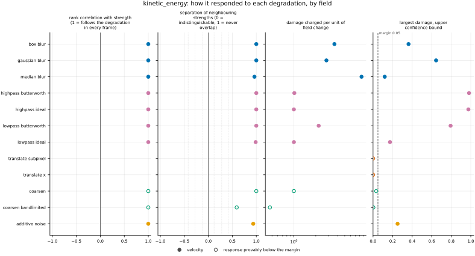
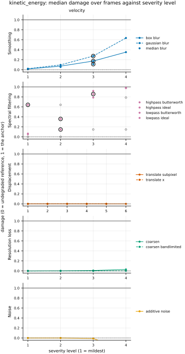
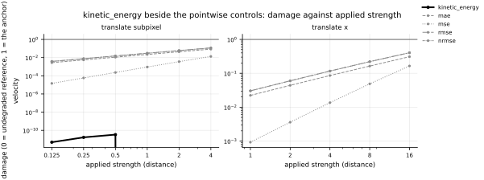

## Definition

For a velocity field $u$ on the analysis grid with $C$ components and $N$ cells,

$$
E(u) = \frac{1}{2N} \sum_{i=1}^{N} \sum_{c=1}^{C} u_{c,i}^{2} \tag{1}
$$

Components are summed before the average over cells. This is the *specific* kinetic
energy, per unit mass: the density-weighted form is the conserved quantity, but at Mach
0.1 with density varying under 4% the two differ negligibly, and Equation (1) needs only
one field.

Like enstrophy, it takes one field and returns one number, and is evaluated on the
reference and on every degraded variant so the drift can be read downstream.

### Boundary handling

None. The operation is local to each cell, so no neighbourhood is ever consulted and no
boundary condition can enter.

## Performance

<!-- GENERATED performance: written by `python -m fmeval.cards evidence kinetic_energy --results results/comparison_1793302178`, do not edit -->



Four measured statistics for kinetic_energy, one row per degradation grouped by family and one marker per field. From left: the rank correlation between the metric and the applied strength within a frame, with the line showing the resampling interval; the separation of neighbouring strengths as Cliff's delta, where 0 means the metric cannot tell one strength from the next and the faint ticks at 0.12, 0.28 and 0.42 are Vargha and Delaney's small, medium and large anchors, for scale and not as grades; the damage charged per unit of field change at the harshest strength; and the upper confidence bound on the largest damage, beside the fixed margin of 0.05. A hollow marker is a field and degradation on which that bound lies below the margin, so the response is provably small. A missing marker is a statistic the analysis withheld, as the rank correlation is on an axis the metric is invariant to.



Median damage over frames against severity level for kinetic_energy, one row per family of degradation and one column per field, on one shared scale. The solid grey line is damage 1, the anchor (by default the field's own mean); the dotted black line is the damage assigned to the fake prediction with the right spectrum, where the run included it. The hollow black ring marks the first level at which the metric has moved a tenth of the way to the anchor. Hollow grey markers are strengths excluded for repeating a milder one or for doing nothing. Degradations with three or fewer usable levels are drawn as markers only; points above 2 are drawn as triangles at the top.

**Trend: does the response follow the degradation?**

| test family | field | degradations | rank correlation | fraction of frames in order | weakest gap between neighbouring strengths |
|---|---|---|---|---|---|
| Displacement | velocity | 2 | — | — | — |
| Resolution loss | velocity | 2 | 1 | 0.907 to 1 | 0.796 to 1 |
| Smoothing | velocity | 3 | 1 | 1 | 0.981 to 1 |
| Spectral filtering | velocity | 4 | 1 | 1 | 0.993 to 1 |
| Noise | velocity | 1 | 1 | 0.969 | 0.968 |

**Reactivity: how far does it move?**

| test family | field | change from clean at the harshest strength | elasticity | first strength detected |
|---|---|---|---|---|
| Displacement | velocity | 0 | — | level — |
| Resolution loss | velocity | -0.0298 to -0.00169 | 2.08 to 5.2 | level — |
| Smoothing | velocity | -0.636 to -0.112 | 1.61 to 1.8 | level 3 |
| Spectral filtering | velocity | -0.981 to -0.147 | 0.541 to 1.41 | level 1 |
| Noise | velocity | 0.25 | 1.86 | level 4 |
| trap test: fake prediction, right spectrum | velocity | — | — | damage 0 |

**Consistency: how much does it vary from snapshot to snapshot?**

| test family | field | consistency, in the strength's units | snapshots per independent block |
|---|---|---|---|
| Displacement | velocity | — | 1 to 21 |
| Resolution loss | velocity | 0.981 to 3.58 | 21 to 22 |
| Smoothing | velocity | 0.00195 to 0.00999 | 18 to 22 |
| Spectral filtering | velocity | 0.00388 to 0.0191 | 22 |
| Noise | velocity | 0.00524 | 1 |

One row per family of degradation and physical field; a cell gives the range over the degradations in that family. **Trend.** The rank correlation is the Spearman correlation between the strength and how far the metric has moved from its value on the undegraded field of the same frame, in the one direction it moves under that degradation, computed inside a single frame. A value of 1 means every strength moved it further than the last in every frame, whichever way it moves; a response that scatters to both sides scores near 0. The fraction of frames in order counts the frames with no exception. The weakest gap is the smallest Mann-Whitney overlap between two neighbouring strengths across frames: 1 means they never overlap, 0.5 that they cannot be told apart. **Reactivity.** The change from clean is the median, at the harshest strength, of the departure from the undegraded value of the same frame over the size of that value: 0.3 means 30%. The elasticity is the percentage change of that departure per percentage change in strength over the mildest strengths. First strength detected is the mildest at which the metric has moved a tenth of the way to the anchor; **damage** reads that 0-to-1 scale as a number. A dash means the measurement is not defined there. A metric's reactivity scales with the power it is expressed in: mean squared error's elasticity is twice root-mean-square error's, though the two carry the same information, so compare magnitudes across metrics with that in mind. **Consistency** is how much the response varies from snapshot to snapshot relative to its size, in the strength's units; the snapshots of one trajectory are correlated, and the last column is how many consecutive snapshots one independent block spans.

These tables report what was measured and grade none of the measurements. What the numbers mean for this metric is written in the subsections below, beside the test that produced each number.

**Profile.**

| field | selectivity | charges most for | charges least for | response provably below 0.05 at 90% on | elasticity to a sub-pixel shift, against severity (distance) | compute cost (x cheapest in this run) |
|---|---|---|---|---|---|---|
| velocity | 0.62 | `median_blur` | `additive_noise` | `coarsen` `coarsen_bandlimited` `translate_subpixel` `translate_x` | — | 1.68 |

One row per physical field. **Selectivity** is how concentrated the metric's response is on a few degradations, measured per unit of field change: 0 means it charges every degradation the same, as mean squared error does by construction, and values toward 1 that one degradation carries most of it. **Charges most and least for** name the two ends of that profile. **Response provably below** lists degradations on which the upper confidence bound of the largest damage lies below the margin -- an equivalence test, so an entry says the response is provably small, not merely not significant; a dash means no degradation met the bound. **Elasticity** is the slope of log damage against log shift over the smallest shifts: 1 means damage grows in proportion to the shift, 2 with its square. **Compute cost** is wall-clock per evaluation over the cheapest metric and field in the same run.

<!-- END GENERATED performance -->

## Intuition

Kinetic energy measures how fast the flow is moving, by squaring the local speed
everywhere and averaging. Squaring means direction is discarded — a flow and its exact
reverse carry the same energy — and that the fastest regions dominate the total. Unlike
enstrophy, most of this quantity sits in the largest structures of the flow rather than
the smallest.

That difference is what makes the pair useful together. A surrogate that has smoothed away
the fine structure loses enstrophy while its kinetic energy barely moves, because the
energy was never in the fine structure to begin with. A surrogate whose overall amplitude
has drifted shows up here.

On a four-by-four grid with a uniform unit flow in one component:

```
velocity (u)     velocity (v)     kinetic energy
1 1 1 1          0 0 0 0
1 1 1 1          0 0 0 0          0.5
1 1 1 1          0 0 0 0
1 1 1 1          0 0 0 0
```

Half of unit speed squared gives 0.5. Concentrating the same energy into half the domain,
at a speed of the square root of two, gives 0.5 as well.

That is what it ignores: how the energy is distributed. Any two flows with the same mean
squared speed are identical to this quantity, however differently they are arranged.

## Reading the output

The value runs from zero upwards with no upper limit, in the square of the velocity units.
There is no direction in which it is better: like enstrophy, it is a property of a flow
rather than an error, read by comparing the prediction against the reference on the same
frame.

Because energy sits at the large scales, this quantity is far more robust to grid
coarsening than enstrophy is, and a departure from the reference is more likely to mean a
genuine amplitude error than a resolution artefact. In freely decaying turbulence the
reference value falls along the trajectory, so a comparison must be made frame by frame
against the reference at that time and never against a single number for the run.

Comparing absolute values across datasets is not meaningful; comparing each prediction's
drift from its own reference is.

## Limitations

The degeneracy is total: energy says nothing about where the motion is or what shape it
takes, so a prediction can match it exactly while getting the flow entirely wrong. Matching
here is not evidence of a good prediction, only the absence of one particular kind of bad
one.

It sees the loss of small scales only through the energy that goes with them. At the
strongest smoothing levels the median loss is 11% (median blur) to 64% (Gaussian blur), but
coarsening by a factor of 16, which destroys the same small scales, removes 3%. A kinetic
energy that matches should therefore be read as the absence of one kind of failure, not as
the prediction being sound.

Finally, this is specific energy, not the conserved density-weighted quantity. At higher
Mach number, or in a flow with real density contrast, the two separate and the conserved
form is the one to reach for.

## Results

<!-- GENERATED run: written by `python -m fmeval.cards evidence kinetic_energy --results results/comparison_1793302178`, do not edit -->

Measured on `kinet_re5e4`, frames 2000 to 10000 (161 frames of developed flow), on the 256 analysis grid, seed 20260807, at commit `b59bbde617d1` (working tree dirty). Run `comparison_1793302178`.

Every number in this section comes from that one run. Regenerate with `python -m fmeval.cards evidence <name> --results results/comparison_1793302178`.

<!-- END GENERATED run -->

Each subsection links to the degradations that subsection reports. What those degradations
do, and what their strength numbers mean, is documented on their own pages. A single-field
diagnostic is evaluated on the reference and on every degraded variant alike, so what is
read here is the drift away from the reference value rather than an error. On the damage scale
the anchor is the field's own spatial mean, whose kinetic energy is 2.5e-8 against the
reference's 1.6e-3, so damage is the fraction of the reference's energy lost: positive when the
value falls and negative when it rises.

### Smoothing

[gaussian_blur](../../degradations/gaussian_blur/card.md) ·
[box_blur](../../degradations/box_blur/card.md) ·
[median_blur](../../degradations/median_blur/card.md)

<!-- GENERATED results_smoothing: written by `python -m fmeval.cards evidence kinetic_energy --results results/comparison_1793302178`, do not edit -->

| degradation | field | strengths | rank correlation | fraction of frames in the right order | weakest gap between neighbouring strengths |
|---|---|---|---|---|---|
| `box_blur` | velocity | 4 | 1 | 1 | 1 |
| `gaussian_blur` | velocity | 4 | 1 | 1 | 1 |
| `median_blur` | velocity | 3 | 1 | 1 | 0.981 |

<!-- END GENERATED results_smoothing -->

### Spectral filtering

[lowpass_ideal](../../degradations/lowpass_ideal/card.md) ·
[lowpass_butterworth](../../degradations/lowpass_butterworth/card.md) ·
[highpass_ideal](../../degradations/highpass_ideal/card.md) ·
[highpass_butterworth](../../degradations/highpass_butterworth/card.md)

<!-- GENERATED results_spectral: written by `python -m fmeval.cards evidence kinetic_energy --results results/comparison_1793302178`, do not edit -->

| degradation | field | strengths | rank correlation | fraction of frames in the right order | weakest gap between neighbouring strengths |
|---|---|---|---|---|---|
| `highpass_butterworth` | velocity | 3 | 1 | 1 | 1 |
| `highpass_ideal` | velocity | 2 | 1 | 1 | 1 |
| `lowpass_butterworth` | velocity | 3 | 1 | 1 | 1 |
| `lowpass_ideal` | velocity | 2 | 1 | 1 | 0.993 |

<!-- END GENERATED results_spectral -->

### Displacement

[translate_x](../../degradations/translate/card.md) ·
[translate_subpixel](../../degradations/translate_subpixel/card.md)

<!-- GENERATED results_geometric: written by `python -m fmeval.cards evidence kinetic_energy --results results/comparison_1793302178`, do not edit -->

| degradation | field | strengths | rank correlation | fraction of frames in the right order | weakest gap between neighbouring strengths |
|---|---|---|---|---|---|
| `translate_subpixel` | velocity | 6 | — | — | — |
| `translate_x` | velocity | 5 | — | — | — |

<!-- END GENERATED results_geometric -->

A translation moves the field without changing any of its values, so a quantity built from
those values alone cannot see it at all. Measured, it is flat: on every frame and at every
shift the value matches the reference's to within 2e-10 of it, which is why the table has
no rank correlation. A measurement showing otherwise would indicate the translation is not
conserving what it should — which is one of the things a reference-free diagnostic is
useful for.

### Resolution loss

[coarsen](../../degradations/coarsen/card.md) ·
[coarsen_bandlimited](../../degradations/coarsen_bandlimited/card.md)

<!-- GENERATED results_resolution: written by `python -m fmeval.cards evidence kinetic_energy --results results/comparison_1793302178`, do not edit -->

| degradation | field | strengths | rank correlation | fraction of frames in the right order | weakest gap between neighbouring strengths |
|---|---|---|---|---|---|
| `coarsen` | velocity | 4 | 1 | 1 | 1 |
| `coarsen_bandlimited` | velocity | 4 | 1 | 0.907 | 0.796 |

<!-- END GENERATED results_resolution -->

Both coarsenings take the value steadily below its clean value, so each follows its
degradation with a rank correlation of 1; it falls because detail is removed. The losses are small because velocity keeps its energy at large
scales: 0.05%, 0.2%, 0.9% and 3.0% at factors 2 to 16 under `coarsen`, and 0.00%, 0.01%, 0.07%
and 0.25% under `coarsen_bandlimited`. Most of what `coarsen` removes is the variance inside
each block, which its staircase flattens.

### Noise

[additive_noise](../../degradations/additive_noise/card.md)

<!-- GENERATED results_stochastic: written by `python -m fmeval.cards evidence kinetic_energy --results results/comparison_1793302178`, do not edit -->

| degradation | field | strengths | rank correlation | fraction of frames in the right order | weakest gap between neighbouring strengths |
|---|---|---|---|---|---|
| `additive_noise` | velocity | 4 | 1 | 0.969 | 0.968 |

<!-- END GENERATED results_stochastic -->

### Trap tests

[gaussian_impostor](../../degradations/gaussian_impostor/card.md) ·
[uncorrelated](../../degradations/random_large_translation/card.md)

<!-- GENERATED results_canaries: written by `python -m fmeval.cards evidence kinetic_energy --results results/comparison_1793302178`, do not edit -->

| field | damage assigned to the fake prediction | closest real degradation | damage of the reference moved far away | value on the anchor |
|---|---|---|---|---|
| velocity | 0 | `translate_subpixel=1` | 0 | 2.54e-08 |

The fake prediction here has exactly the reference field's amplitude spectrum and completely scrambled structure. Damage 1 is what the anchor scores, by default the reference's own spatial mean, a prediction that knows the mean and nothing else. The damage column therefore says how close to useless this metric considers that fake prediction: a low number means the metric was fooled. The third column translates the same number into an ordinary degradation whose damage the fake prediction matches, which is easier to picture. The fourth is the reference moved by a large random offset, the right statistics in the wrong place; where a field's energy sits in its largest scales that copy stays partly correlated with the reference, so it is not the score of an unrelated field.

<!-- END GENERATED results_canaries -->

Both score exactly the reference's kinetic energy, damage 0. The fake prediction has the
reference's amplitude spectrum, and by Parseval's theorem Equation (1) is proportional to the
sum of that spectrum's squares, so the two cannot differ; the moved copy is a translation of
the reference. The trap therefore records this metric as fooled, which for a single-field
quantity follows from the definition rather than from the data.

### Compared with the other metrics

<!-- GENERATED results_summary: written by `python -m fmeval.cards evidence kinetic_energy --results results/comparison_1793302178`, do not edit -->

| compared with | rank correlation over every degradation |
|---|---|
| `enstrophy` | 0.86 |
| `palinstrophy` | 0.805 |
| `increment_flatness` | 0.161 |
| `h1_seminorm` | 0.147 |
| `mae` | -0.208 |
| `mse` | -0.23 |
| `rmse` | -0.23 |
| `nrmse` | -0.284 |
| `h_minus_one` | -0.292 |
| `increment_w1` | -0.552 |
| `increment_w1_by_separation` | -0.669 |
| `spectrum_l2` | -0.883 |

Computed on the median value at each combination of degradation and strength, over every degradation and physical field in the run, with the undegraded reference excluded. Two metrics correlating near 1 put the degradations in the same order, but the two may still weight those degradations very differently. A correlation near 1 therefore means the two metrics are redundant for ranking models, not that the two are interchangeable as training losses.

<!-- END GENERATED results_summary -->

### Damage beside the other metrics

<!-- GENERATED results_damage_by_level: written by `python -m fmeval.cards evidence kinetic_energy --results results/comparison_1793302178`, do not edit -->



Median damage over frames against the applied strength, log-log, for kinetic_energy (bold, in colour) and the pointwise controls mae, mse, rmse, nrmse (thin, grey), one column per displacement degradation and one row per field. The grey line is damage 1, the anchor (by default the field's own mean). Parallel lines charge in the same proportion at every strength; a steeper line charges relatively more for the larger shifts, which is what decides whether two metrics are interchangeable as training losses. These are the same numbers as the table beneath.

**Displacement, density, `translate_subpixel`** (strength: distance).

| metric | 0.125 | 0.25 | 0.5 | 1 | 2 | 4 |
|---|---|---|---|---|---|---|
| `kinetic_energy` | — | — | — | — | — | — |
| `mae` | 0.00383 | 0.00767 | 0.0153 | 0.0306 | 0.061 | 0.121 |
| `mse` | 2.17e-05 | 8.68e-05 | 0.000347 | 0.00138 | 0.00551 | 0.0219 |
| `rmse` | 0.00466 | 0.00931 | 0.0186 | 0.0372 | 0.0743 | 0.148 |
| `nrmse` | 0.00463 | 0.00926 | 0.0185 | 0.037 | 0.0738 | 0.147 |

**Displacement, density, `translate_x`** (strength: distance).

| metric | 1 | 2 | 4 | 8 | 16 |
|---|---|---|---|---|---|
| `kinetic_energy` | — | — | — | — | — |
| `mae` | 0.0306 | 0.061 | 0.121 | 0.24 | 0.469 |
| `mse` | 0.00138 | 0.00551 | 0.0219 | 0.0849 | 0.307 |
| `rmse` | 0.0372 | 0.0743 | 0.148 | 0.291 | 0.555 |
| `nrmse` | 0.037 | 0.0738 | 0.147 | 0.29 | 0.55 |

**Displacement, velocity, `translate_subpixel`** (strength: distance).

| metric | 0.125 | 0.25 | 0.5 | 1 | 2 | 4 |
|---|---|---|---|---|---|---|
| `kinetic_energy` | 4.92e-12 | 1.69e-11 | 3.37e-11 | -0 | -0 | -0 |
| `mae` | 0.00279 | 0.00559 | 0.0112 | 0.0223 | 0.0441 | 0.0859 |
| `mse` | 1.45e-05 | 5.81e-05 | 0.000232 | 0.000924 | 0.0036 | 0.0136 |
| `rmse` | 0.00381 | 0.00762 | 0.0152 | 0.0304 | 0.06 | 0.117 |
| `nrmse` | 0.00382 | 0.00763 | 0.0153 | 0.0304 | 0.06 | 0.117 |

**Displacement, velocity, `translate_x`** (strength: distance).

| metric | 1 | 2 | 4 | 8 | 16 |
|---|---|---|---|---|---|
| `kinetic_energy` | -0 | -0 | -0 | -0 | -0 |
| `mae` | 0.0223 | 0.0441 | 0.0859 | 0.163 | 0.31 |
| `mse` | 0.000924 | 0.0036 | 0.0136 | 0.0489 | 0.165 |
| `rmse` | 0.0304 | 0.06 | 0.117 | 0.221 | 0.406 |
| `nrmse` | 0.0304 | 0.06 | 0.117 | 0.221 | 0.406 |

**Displacement, vorticity, `translate_subpixel`** (strength: distance).

| metric | 0.125 | 0.25 | 0.5 | 1 | 2 | 4 |
|---|---|---|---|---|---|---|
| `kinetic_energy` | — | — | — | — | — | — |
| `mae` | 0.0428 | 0.0854 | 0.169 | 0.328 | 0.582 | 0.86 |
| `mse` | 0.00112 | 0.00448 | 0.0176 | 0.066 | 0.21 | 0.44 |
| `rmse` | 0.0335 | 0.0669 | 0.133 | 0.257 | 0.458 | 0.663 |
| `nrmse` | 0.0328 | 0.0654 | 0.13 | 0.253 | 0.456 | 0.67 |

**Displacement, vorticity, `translate_x`** (strength: distance).

| metric | 1 | 2 | 4 | 8 | 16 |
|---|---|---|---|---|---|
| `kinetic_energy` | — | — | — | — | — |
| `mae` | 0.328 | 0.582 | 0.86 | 1.1 | 1.31 |
| `mse` | 0.066 | 0.21 | 0.44 | 0.679 | 1.1 |
| `rmse` | 0.257 | 0.458 | 0.663 | 0.824 | 1.05 |
| `nrmse` | 0.253 | 0.456 | 0.67 | 0.832 | 1.05 |

Median damage over frames at every strength, this metric in the first row and the pointwise controls beneath it, all on the same 0-to-1 scale where 0 is the undegraded reference and 1 the anchor (by default the field's own mean); a dash means no damage scale on that field. The rank correlations under *Compared with the other metrics* say whether two metrics put the strengths in the same order; this table says how much each one charges for the same strength, which decides whether two metrics are interchangeable as training losses.

<!-- END GENERATED results_damage_by_level -->

## References

\bibliography
