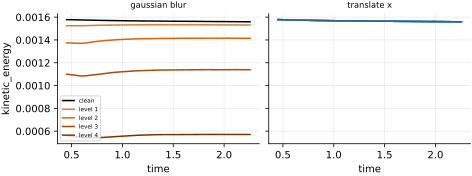
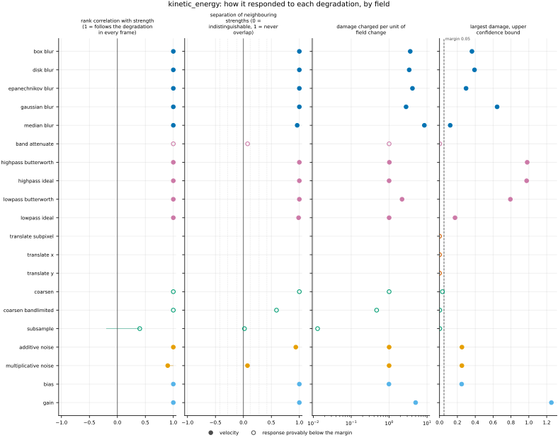
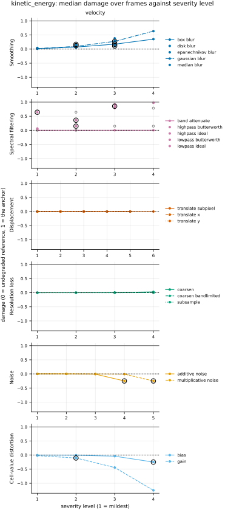
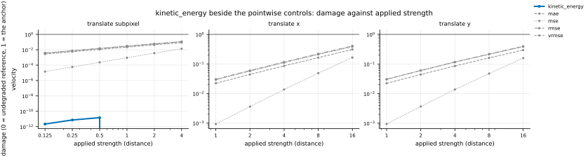
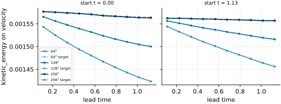

## Definition

For a velocity field $u$ on the analysis grid with $C$ components and $N$ cells,

$$
E(u) = \frac{1}{2N} \sum_{i=1}^{N} \sum_{c=1}^{C} u_{c,i}^{2} \tag{1}
$$

Components are summed before the average over cells. Equation (1) is the energy of
two-dimensional turbulence theory, $E = \tfrac12 \langle u^2 \rangle$ with the average over the
domain ([@boffetta2012], p. 430), including its factor of one half. It is the *specific*
kinetic energy, per unit mass: the density-weighted form is the conserved quantity, but at Mach
0.1 with density varying under 4% the two differ negligibly, and Equation (1) needs only
one field.

Like enstrophy, it takes one field and returns one number, and is evaluated on the
reference and on every degraded variant so the drift can be read downstream.

### Boundary handling

None. The operation is local to each cell, so no neighbourhood is ever consulted and no
boundary condition can enter.

### How its field reports it

**Turbulence theory** defines the energy as a quadratic invariant of the inviscid, unforced
two-dimensional equations, $E = \tfrac12 \langle u^2 \rangle = \int E(k)\,dk$ with the isotropic
spectrum $E(k)$ of their Eq. (3), and its decay without forcing or friction by their Eq. (5),
$dE/dt = -2\nu\Omega$, with $\Omega$ the [enstrophy](../../metrics/enstrophy/card.md)
([@boffetta2012], p. 430). The quantity is read as a time series and as the balance of that
budget.

**Learned turbulence models** report it as a time series: the energy of each model's rollout
against time, with the direct numerical simulation's curve overlaid, in decaying
two-dimensional turbulence ([@list2022], Fig. 4(a); [@frezat2022], Fig. 4, and Fig. 6 for the
forced case). Neither paper reduces the two curves to a number; the relative error of the
integral, $(E_{\mathrm{prediction}} - E_{\mathrm{reference}}) / E_{\mathrm{reference}}$ at each
time, is this repository's reading of them (Reading the output). The two papers also normalise
differently: [@frezat2022] average $\tfrac12 u^2$ over the domain, as Equation (1) does, and
[@list2022] integrate $u'_i u'_i$ of the turbulent fluctuation without the one half.

**The figure** is the energy against time with the reference's curve overlaid, the card's first
figure. On a run of real forecasts it is the field's figure exactly, the prediction's energy
beside its target's at each prediction step. On the degradation ladder it is the reference's
decay beside each degradation applied at each time, which is not a rollout.

**The experiments.** Rollouts of a model scored against the truth: `forecast_re5e4` holds one
model's rollouts from two starting times, ten prediction steps each; many initial conditions are
written up in
[EXP-nrmse-rollouts-over-many-initial-conditions](https://github.com/khegazy/pde_metrics/blob/main/proposals/EXP-nrmse-rollouts-over-many-initial-conditions.md).
The budget, Eq. (5), needs consecutive states of the same trajectory to difference in time;
`kinet_re5e4` read at reduction 1 holds consecutive solver steps of the reference, but no
candidate trajectory has them, so the experiment is written up in
[EXP-enstrophy-budget-closure-from-consecutive-states](https://github.com/khegazy/pde_metrics/blob/main/proposals/EXP-enstrophy-budget-closure-from-consecutive-states.md)
and not built. The metric also runs on the degradation ladder on `kinet_re5e4`, on the Reynolds
ladder and on `sod_shock_tube`, whose one-dimensional velocity it reads as an analytic check.
`synthetic_ensemble` holds no velocity.

## Performance

<!-- GENERATED performance: written by `python -m fmeval.cards evidence kinetic_energy --results results/comparison_1793829127 --results results/comparison_1793812304 --results results/comparison_1793811840 --results results/comparison_1793829231`, do not edit -->



*As this metric's own field draws it.* kinetic_energy on velocity against the frame's physical time, one line per strength of each degradation the run chose for its detailed views, or whose applied strength grows with time; the clean field in black is the quantity's own history. A degraded line is the operator applied to each frame on its own, not a rollout: it says what the operator does at each time, not how an error would grow. Median over frames at each time.



Four measured statistics for kinetic_energy, one row per degradation grouped by family and one marker per field. From left: the rank correlation between the metric and the applied strength within a frame, with the line showing the resampling interval; the separation of neighbouring strengths as Cliff's delta, where 0 means the metric cannot tell one strength from the next and the faint ticks at 0.12, 0.28 and 0.42 are Vargha and Delaney's small, medium and large anchors, for scale and not as grades; the damage charged per unit of field change at the harshest strength; and the upper confidence bound on the largest damage, beside the fixed margin of 0.05. A hollow marker is a field and degradation on which that bound lies below the margin, so the response is provably small. A missing marker is a statistic the analysis withheld, as the rank correlation is on an axis the metric is invariant to.



Median damage over frames against severity level for kinetic_energy, one row per family of degradation and one column per field, on one shared scale. The solid grey line is damage 1, the anchor (by default the field's own mean); the dotted black line is the damage assigned to the fake prediction with the right spectrum, where the run included it. The hollow black ring marks the first level at which the metric has moved a tenth of the way to the anchor. Hollow grey markers are strengths excluded for repeating a milder one or for doing nothing. Degradations with three or fewer usable levels are drawn as markers only; points beyond 2 either side are drawn as triangles at the edge. Damage is negative where a degradation moves the metric away from the anchor, as noise raises a single-field quantity the field's mean sets to zero.

**Trend: does the response follow the degradation?**

| test family | field | degradations | rank correlation | fraction of frames in order | weakest gap between neighbouring strengths |
|---|---|---|---|---|---|
| Displacement | velocity | 3 | — | — | — |
| Cell-value distortion | velocity | 2 | 1 | 1 | 1 |
| Resolution loss | velocity | 3 | 0.4 to 1 | 0.193 to 1 | 0.509 to 1 |
| Smoothing | velocity | 5 | 1 | 1 | 0.981 to 1 |
| Spectral filtering | velocity | 5 | 1 | 1 | 0.537 to 1 |
| Noise | velocity | 2 | 0.9 to 1 | 0.466 to 0.969 | 0.536 to 0.968 |

**Reactivity: how far does it move?**

| test family | field | change from clean at the harshest strength | elasticity | first strength detected |
|---|---|---|---|---|
| Displacement | velocity | 0 | — | level — |
| Cell-value distortion | velocity | 0.247 to 1.25 | 1.03 to 2.25 | level 2 |
| Resolution loss | velocity | -0.0298 to -0.00132 | 2.08 to 6.44 | level — |
| Smoothing | velocity | -0.636 to -0.112 | 1.54 to 1.8 | level 2 |
| Spectral filtering | velocity | -0.981 to -0.00103 | 0.541 to 1.41 | level 1 |
| Noise | velocity | 0.25 | 1.4 to 1.86 | level 4 |
| trap test: fake prediction, right spectrum | velocity | — | — | damage 0 |

**Consistency: how much does it vary from snapshot to snapshot?**

| test family | field | consistency, in the strength's units | snapshots per independent block |
|---|---|---|---|
| Displacement | velocity | — | 1 to 21 |
| Cell-value distortion | velocity | 4e-09 to 1.29e-05 | 21 to 22 |
| Resolution loss | velocity | 0.981 to 82.3 | 1 to 22 |
| Smoothing | velocity | 0.00193 to 0.01 | 18 to 22 |
| Spectral filtering | velocity | 0.0039 to 0.164 | 21 to 22 |
| Noise | velocity | 0.00528 to 0.00722 | 1 |

One row per family of degradation and physical field; a cell gives the range over the degradations in that family. **Trend.** The rank correlation is the Spearman correlation between the strength and how far the metric has moved from its value on the undegraded field of the same frame, in the one direction it moves under that degradation, computed inside a single frame. A value of 1 means every strength moved it further than the last in every frame, whichever way it moves; a response that scatters to both sides scores near 0. The fraction of frames in order counts the frames with no exception. The weakest gap is the smallest Mann-Whitney overlap between two neighbouring strengths across frames: 1 means they never overlap, 0.5 that they cannot be told apart. **Reactivity.** The change from clean is the median, at the harshest strength, of the departure from the undegraded value of the same frame over the size of that value: 0.3 means 30%. The elasticity is the percentage change of that departure per percentage change in strength over the mildest strengths. First strength detected is the mildest at which the metric has moved a tenth of the way to the anchor; **damage** reads that 0-to-1 scale as a number. A dash means the measurement is not defined there. A metric's reactivity scales with the power it is expressed in: mean squared error's elasticity is twice root-mean-square error's, though the two carry the same information, so compare magnitudes across metrics with that in mind. **Consistency** is how much the response varies from snapshot to snapshot relative to its size, in the strength's units; the snapshots of one trajectory are correlated, and the last column is how many consecutive snapshots one independent block spans.

These tables report what was measured and grade none of the measurements. What the numbers mean for this metric is written in the subsections below, beside the test that produced each number.

**Profile.**

| field | selectivity | charges most for | charges least for | response provably below 0.05 at 90% on | elasticity to a sub-pixel shift, against severity (distance) | compute cost (x cheapest in this run) |
|---|---|---|---|---|---|---|
| velocity | 0.545 | `median_blur` | `translate_subpixel` | `band_attenuate` `coarsen` `coarsen_bandlimited` `subsample` `translate_subpixel` `translate_x` `translate_y` | — | 2.39 |

One row per physical field. **Selectivity** is how concentrated the metric's response is on a few degradations, measured per unit of field change: 0 means it charges every degradation the same, as mean squared error does by construction, and values toward 1 that one degradation carries most of it. **Charges most and least for** name the two ends of that profile. **Response provably below** lists degradations on which the upper confidence bound of the largest damage lies below the margin -- an equivalence test, so an entry says the response is provably small, not merely not significant; a dash means no degradation met the bound. **Elasticity** is the slope of log damage against log shift over the smallest shifts: 1 means damage grows in proportion to the shift, 2 with its square. **Compute cost** is wall-clock per evaluation over the cheapest metric and field in the same run.

<!-- END GENERATED performance -->

## Intuition

Kinetic energy measures how fast the flow is moving, by squaring the local speed
everywhere and averaging. Squaring means direction is discarded — a flow and its exact
reverse carry the same energy — and that the fastest regions dominate the total. Unlike
enstrophy, most of this quantity sits in the largest structures of the flow rather than
the smallest.

That difference is what makes the pair useful together. A surrogate that has smoothed away
the fine structure loses enstrophy while its kinetic energy barely moves, because the
energy was never in the fine structure to begin with. A surrogate whose overall amplitude
has drifted shows up here.

On a four-by-four grid with a uniform unit flow in one component:

```
velocity (u)     velocity (v)     kinetic energy
1 1 1 1          0 0 0 0
1 1 1 1          0 0 0 0          0.5
1 1 1 1          0 0 0 0
1 1 1 1          0 0 0 0
```

Half of unit speed squared gives 0.5. Concentrating the same energy into half the domain,
at a speed of the square root of two, gives 0.5 as well.

That is what it ignores: how the energy is distributed. Any two flows with the same mean
squared speed are identical to this quantity, however differently they are arranged.

## Reading the output

The value runs from zero upwards with no upper limit, in the square of the velocity units.
There is no direction in which it is better: like enstrophy, it is a property of a flow
rather than an error, read by comparing the prediction against the reference on the same
frame.

**The reading is the relative error of the integral**,
$(E_{\mathrm{prediction}} - E_{\mathrm{reference}}) / E_{\mathrm{reference}}$ on the same
frame, which the tables give as the *change from clean*: 0 is a prediction with the
reference's energy, $-0.1$ one that has lost a tenth of it, $+0.1$ one with a tenth too much.
On a run of real forecasts it is the relative error at each prediction step, and the figure
shows the two energies against time. The sign says which way the prediction went wrong, and
the size, unlike the raw value, is comparable across frames of a decaying flow.

Because energy sits at the large scales, this quantity is far more robust to grid
coarsening than enstrophy is, and a departure from the reference is more likely to mean a
genuine amplitude error than a resolution artefact. In freely decaying turbulence the
reference value falls along the trajectory, so a comparison must be made frame by frame
against the reference at that time and never against a single number for the run.

Comparing absolute values across datasets is not meaningful; comparing each prediction's
drift from its own reference is.

## Limitations

The degeneracy is total: energy says nothing about where the motion is or what shape it
takes, so a prediction can match it exactly while getting the flow entirely wrong. Matching
here is not evidence of a good prediction, only the absence of one particular kind of bad
one.

It sees the loss of small scales only through the energy that goes with them, so two
degradations that destroy the same small scales can remove very different shares of it, as
the smoothing and resolution-loss tables under Results show. A kinetic energy that matches should therefore be read as the absence of one kind of failure, not as
the prediction being sound.

Finally, this is specific energy, not the conserved density-weighted quantity. At higher
Mach number, or in a flow with real density contrast, the two separate and the conserved
form is the one to reach for.

## Results

<!-- GENERATED run: written by `python -m fmeval.cards evidence kinetic_energy --results results/comparison_1793829127 --results results/comparison_1793812304 --results results/comparison_1793811840 --results results/comparison_1793829231`, do not edit -->

Measured on `kinet_re5e4`, frames 2000 to 10000 (161 frames of developed flow), on the 256 analysis grid, seed 20260807, at commit `adbdc88e4950`. Run `comparison_1793829127`.

Every number in this section comes from that run, except in the subsections headed with another experiment and in a figure whose caption names another run, each of which names its own run. Regenerate with `python -m fmeval.cards evidence <name> --results results/comparison_1793829127 --results results/comparison_1793812304 --results results/comparison_1793811840 --results results/comparison_1793829231`.

<!-- END GENERATED run -->

Each subsection links to the degradations that subsection reports. What those degradations
do, and what their strength numbers mean, is documented on their own pages. A single-field
diagnostic is evaluated on the reference and on every degraded variant alike, so what is
read here is the drift away from the reference value rather than an error. On the damage scale
the anchor is the field's own spatial mean, whose kinetic energy is 2.54e-8 against the
reference's median of 1.57e-3, so damage is the fraction of the reference's energy lost:
positive when the value falls and negative when it rises. The *change from clean* in the tables
is the relative error of the integral of `### How its field reports it`, with its sign.

<!-- GENERATED experiments: written by `python -m fmeval.cards catalog`, do not edit -->

**Across the experiments.**

| experiment | what a run on it is evidence of | on this card |
|---|---|---|
| `kinet_re5e4` | developed flow | measured, run `comparison_1793829127`: the main results |
| `kinet_re1e6` | developed flow at Re = 1e6, twenty times the Reynolds number of kinet_re5e4, from the same initial condition | measured, run `comparison_1793829231`: under *On `kinet_re1e6`* |
| `synthetic_ensemble` | a calibrated null: evidence that the estimator computes what it claims to compute, and nothing about turbulence | not applicable: needs velocity, which this dataset does not provide |
| `sod_shock_tube` | an analytic check: evidence that the metric locates and scores a known shock correctly, and nothing about turbulence | measured, run `comparison_1793812304`: under *On `sod_shock_tube`* |
| `forecast_re5e4` | real predictions scored against their targets at each prediction step; who produced the predictions, a trained model or a coarser solver, is not recorded | measured, run `comparison_1793811840`: under *On `forecast_re5e4`* |

One row per dataset a card may cite (`configs/cards/default.yaml`). *Measured* names the run the card cites: the main results are `## Performance` and the subsections below, and every other run has its own subsection headed with its dataset. *Not applicable* gives the reason: one that follows from what the metric declares and what the dataset offers, or one a person wrote on the card (`not_run` in `card.yaml`) because the result would carry no information. *Not yet run* means the metric can run there and the card cites no run on it yet.

<!-- END GENERATED experiments -->

### Smoothing

[gaussian_blur](../../degradations/gaussian_blur/card.md) ·
[box_blur](../../degradations/box_blur/card.md) ·
[median_blur](../../degradations/median_blur/card.md)

<!-- GENERATED results_smoothing: written by `python -m fmeval.cards evidence kinetic_energy --results results/comparison_1793829127 --results results/comparison_1793812304 --results results/comparison_1793811840 --results results/comparison_1793829231`, do not edit -->

| degradation | field | strengths | rank correlation | fraction of frames in the right order | weakest gap between neighbouring strengths |
|---|---|---|---|---|---|
| `box_blur` | velocity | 4 | 1 | 1 | 1 |
| `disk_blur` | velocity | 3 | 1 | 1 | 1 |
| `epanechnikov_blur` | velocity | 3 | 1 | 1 | 1 |
| `gaussian_blur` | velocity | 4 | 1 | 1 | 1 |
| `median_blur` | velocity | 3 | 1 | 1 | 0.981 |

<!-- END GENERATED results_smoothing -->

Every blur lowers the energy, and every stronger blur lowers it further on every frame: rank
correlation 1 with every frame in order on all five. Read as the field reads it, the relative
error of the integral at the harshest strength runs from $-0.112$ under `median_blur` to
$-0.636$ under `gaussian_blur` (the *change from clean* in the Performance tables), so the
harshest Gaussian blur takes away about two thirds of the reference's energy. `median_blur` is
the one blur whose neighbouring strengths overlap at all across frames (weakest gap 0.981).

### Spectral filtering

[lowpass_ideal](../../degradations/lowpass_ideal/card.md) ·
[lowpass_butterworth](../../degradations/lowpass_butterworth/card.md) ·
[highpass_ideal](../../degradations/highpass_ideal/card.md) ·
[highpass_butterworth](../../degradations/highpass_butterworth/card.md)

<!-- GENERATED results_spectral: written by `python -m fmeval.cards evidence kinetic_energy --results results/comparison_1793829127 --results results/comparison_1793812304 --results results/comparison_1793811840 --results results/comparison_1793829231`, do not edit -->

| degradation | field | strengths | rank correlation | fraction of frames in the right order | weakest gap between neighbouring strengths |
|---|---|---|---|---|---|
| `band_attenuate` | velocity | 4 | 1 | 1 | 0.537 |
| `highpass_butterworth` | velocity | 3 | 1 | 1 | 1 |
| `highpass_ideal` | velocity | 2 | 1 | 1 | 1 |
| `lowpass_butterworth` | velocity | 3 | 1 | 1 | 1 |
| `lowpass_ideal` | velocity | 2 | 1 | 1 | 0.993 |

<!-- END GENERATED results_spectral -->

Every filter lowers the energy in order of strength (rank correlation 1 on all five). How much
depends on where the filter cuts, because velocity's energy sits at the largest scales: the two
high-pass filters remove almost all of it at their harshest strength (relative error $-0.981$
under `highpass_butterworth` and $-0.975$ under `highpass_ideal`, from the run's
fingerprint), while `band_attenuate` changes it by $-0.00103$, small enough that it is listed
among the degradations whose response is provably below 0.05, and its neighbouring strengths
overlap across frames (weakest gap 0.537). The low-pass filters lie between: $-0.147$ for
`lowpass_ideal` and $-0.787$ for `lowpass_butterworth`.

### Displacement

[translate_x](../../degradations/translate/card.md) ·
[translate_subpixel](../../degradations/translate_subpixel/card.md)

<!-- GENERATED results_geometric: written by `python -m fmeval.cards evidence kinetic_energy --results results/comparison_1793829127 --results results/comparison_1793812304 --results results/comparison_1793811840 --results results/comparison_1793829231`, do not edit -->

| degradation | field | strengths | rank correlation | fraction of frames in the right order | weakest gap between neighbouring strengths |
|---|---|---|---|---|---|
| `translate_subpixel` | velocity | 6 | — | — | — |
| `translate_x` | velocity | 5 | — | — | — |
| `translate_y` | velocity | 5 | — | — | — |

<!-- END GENERATED results_geometric -->

A translation moves the field without changing any of its values, so a quantity built from
those values alone cannot see it at all. Measured, it is flat: the largest damage over every
frame and shift is 1.65e-10 under `translate_subpixel` and 0 under the whole-cell shifts
(fingerprint), which is why the table has no rank correlation. A measurement showing otherwise
would indicate the translation is not conserving what it should — which is one of the things a
reference-free diagnostic is useful for.

### Resolution loss

[coarsen](../../degradations/coarsen/card.md) ·
[coarsen_bandlimited](../../degradations/coarsen_bandlimited/card.md)

<!-- GENERATED results_resolution: written by `python -m fmeval.cards evidence kinetic_energy --results results/comparison_1793829127 --results results/comparison_1793812304 --results results/comparison_1793811840 --results results/comparison_1793829231`, do not edit -->

| degradation | field | strengths | rank correlation | fraction of frames in the right order | weakest gap between neighbouring strengths |
|---|---|---|---|---|---|
| `coarsen` | velocity | 4 | 1 | 1 | 1 |
| `coarsen_bandlimited` | velocity | 4 | 1 | 0.907 | 0.796 |
| `subsample` | velocity | 4 | 0.4 | 0.193 | 0.509 |

<!-- END GENERATED results_resolution -->

All three lower the energy, and all three by little: the relative error at the harshest
strength is $-0.0298$ under `coarsen`, $-0.00169$ under `coarsen_bandlimited` and $-0.00132$
under `subsample` (fingerprint), and all three are listed among the degradations whose response
is provably below 0.05. `coarsen` lowers it in order on every frame. The other two do not:
`coarsen_bandlimited` keeps the order in 0.907 of frames, and `subsample` in 0.193 of frames
with a rank correlation of 0.4, so on this field and grid its strengths are not told apart by
the energy. My reading, not a measurement: `coarsen` replaces each block by its average, which
removes the variance inside each block, while the other two keep the large scales that hold
the energy.

### Noise

[additive_noise](../../degradations/additive_noise/card.md)

<!-- GENERATED results_stochastic: written by `python -m fmeval.cards evidence kinetic_energy --results results/comparison_1793829127 --results results/comparison_1793812304 --results results/comparison_1793811840 --results results/comparison_1793829231`, do not edit -->

| degradation | field | strengths | rank correlation | fraction of frames in the right order | weakest gap between neighbouring strengths |
|---|---|---|---|---|---|
| `additive_noise` | velocity | 4 | 1 | 0.969 | 0.968 |
| `multiplicative_noise` | velocity | 5 | 0.9 | 0.466 | 0.536 |

<!-- END GENERATED results_stochastic -->

Noise raises the energy, by the variance it adds: the relative error at the harshest strength is
$+0.250$ under both (fingerprint). It first moves by a tenth of the distance between the
reference and the anchor at level 4 of `additive_noise` and level 5 of `multiplicative_noise`,
the harshest of each. Additive noise raises it in order of strength (rank
correlation 1, 0.969 of frames in order). Multiplicative noise does so less cleanly: rank
correlation 0.9, with 0.466 of frames in order and neighbouring strengths overlapping (weakest
gap 0.536), so at its milder strengths the added energy is not separated from one strength to
the next.

### Cell-value distortion

[gain](../../degradations/gain/card.md) ·
[bias](../../degradations/bias/card.md)

<!-- GENERATED results_pointwise: written by `python -m fmeval.cards evidence kinetic_energy`, do not edit -->

Not generated yet. Run `python -m fmeval.cards evidence kinetic_energy`.

<!-- END GENERATED results_pointwise -->

### Trap tests

[gaussian_impostor](../../degradations/gaussian_impostor/card.md) ·
[uncorrelated](../../degradations/random_large_translation/card.md)

<!-- GENERATED results_canaries: written by `python -m fmeval.cards evidence kinetic_energy --results results/comparison_1793829127 --results results/comparison_1793812304 --results results/comparison_1793811840 --results results/comparison_1793829231`, do not edit -->

| field | damage assigned to the fake prediction | closest real degradation | damage of the reference moved far away | value on the anchor |
|---|---|---|---|---|
| velocity | 0 | `translate_subpixel=1` | 0 | 2.54e-08 |

The fake prediction here has exactly the reference field's amplitude spectrum and completely scrambled structure. Damage 1 is what the anchor scores, by default the reference's own spatial mean, a prediction that knows the mean and nothing else. The damage column therefore says how close to useless this metric considers that fake prediction: a low number means the metric was fooled. The third column translates the same number into an ordinary degradation whose damage the fake prediction matches, which is easier to picture. The fourth is the reference moved by a large random offset, the right statistics in the wrong place; where a field's energy sits in its largest scales that copy stays partly correlated with the reference, so it is not the score of an unrelated field.

<!-- END GENERATED results_canaries -->

Both score exactly the reference's kinetic energy, damage 0. The fake prediction has the
reference's amplitude spectrum, and by Parseval's theorem Equation (1) is proportional to the
sum of that spectrum's squares, so the two cannot differ; the moved copy is a translation of
the reference. The trap therefore records this metric as fooled, which for a single-field
quantity follows from the definition rather than from the data.

### Compared with the other metrics

<!-- GENERATED results_summary: written by `python -m fmeval.cards evidence kinetic_energy --results results/comparison_1793829127 --results results/comparison_1793812304 --results results/comparison_1793811840 --results results/comparison_1793829231`, do not edit -->

| compared with | velocity |
|---|---|
| `tail_index` | 0.306 |
| `increment_flatness` | 0.279 |
| `h1_seminorm` | -0.133 |
| `h1_relative` | -0.181 |
| `mae` | -0.221 |
| `rmse` | -0.249 |
| `mse` | -0.249 |
| `rmse_channel_mean` | -0.259 |
| `nrmse` | -0.261 |
| `vrmse` | -0.261 |
| `max_error` | -0.288 |
| `max_error_channel_mean` | -0.307 |
| `h_minus_one` | -0.355 |
| `increment_w1` | -0.397 |
| `energy_distance` | -0.423 |
| `increment_w1_by_separation` | -0.485 |
| `spectral_energy_flux` | -0.572 |
| `tail_exceedance` | -0.593 |
| `spectrum_l2` | -0.673 |

Rank correlation over every degradation, computed separately for each physical field on the median value at each combination of degradation and strength, with the undegraded reference excluded. A dash marks a metric that does not run on that field. A metric with a target value enters by its distance from the target. Two metrics correlating near 1 put the degradations in the same order, but the two may still weight those degradations very differently. A correlation near 1 therefore means the two metrics are redundant for ranking models, not that the two are interchangeable as training losses.

<!-- END GENERATED results_summary -->

The energy orders the degradations unlike the pairwise errors: its correlations with them are
negative and well short of 1 in size. It enters by its raw value, which falls under smoothing
and filtering while every error rises, so it correlates negatively with every pairwise metric, most
strongly with the spectral ones (`spectrum_l2`, `spectral_energy_flux`) and `tail_exceedance`,
and positively, and weakly, only with the two other single-field statistics, `tail_index` and
`increment_flatness`. The sign is my reading of the definitions, not a separate measurement.

### Damage beside the other metrics

<!-- GENERATED results_damage_by_level: written by `python -m fmeval.cards evidence kinetic_energy --results results/comparison_1793829127 --results results/comparison_1793812304 --results results/comparison_1793811840 --results results/comparison_1793829231`, do not edit -->



Median damage over frames against the applied strength, log-log, for kinetic_energy (bold, in colour) and the pointwise controls mae, mse, rmse, vrmse (thin, grey), one column per displacement degradation and one row per field. The grey line is damage 1, the anchor (by default the field's own mean). Parallel lines charge in the same proportion at every strength; a steeper line charges relatively more for the larger shifts, which is what decides whether two metrics are interchangeable as training losses. These are the same numbers as the table beneath.

**Displacement, density, `translate_subpixel`** (strength: distance).

| metric | 0.125 | 0.25 | 0.5 | 1 | 2 | 4 |
|---|---|---|---|---|---|---|
| `kinetic_energy` | — | — | — | — | — | — |
| `mae` | 0.00383 | 0.00767 | 0.0153 | 0.0306 | 0.061 | 0.121 |
| `mse` | 2.17e-05 | 8.68e-05 | 0.000347 | 0.00138 | 0.00551 | 0.0219 |
| `rmse` | 0.00466 | 0.00931 | 0.0186 | 0.0372 | 0.0743 | 0.148 |
| `vrmse` | 0.00463 | 0.00926 | 0.0185 | 0.037 | 0.0738 | 0.147 |

**Displacement, density, `translate_x`** (strength: distance).

| metric | 1 | 2 | 4 | 8 | 16 |
|---|---|---|---|---|---|
| `kinetic_energy` | — | — | — | — | — |
| `mae` | 0.0306 | 0.061 | 0.121 | 0.24 | 0.469 |
| `mse` | 0.00138 | 0.00551 | 0.0219 | 0.0849 | 0.307 |
| `rmse` | 0.0372 | 0.0743 | 0.148 | 0.291 | 0.555 |
| `vrmse` | 0.037 | 0.0738 | 0.147 | 0.29 | 0.55 |

**Displacement, density, `translate_y`** (strength: distance).

| metric | 1 | 2 | 4 | 8 | 16 |
|---|---|---|---|---|---|
| `kinetic_energy` | — | — | — | — | — |
| `mae` | 0.031 | 0.0616 | 0.122 | 0.244 | 0.476 |
| `mse` | 0.00142 | 0.00565 | 0.0224 | 0.0869 | 0.316 |
| `rmse` | 0.0377 | 0.0752 | 0.15 | 0.295 | 0.562 |
| `vrmse` | 0.0376 | 0.075 | 0.149 | 0.294 | 0.56 |

**Displacement, velocity, `translate_subpixel`** (strength: distance).

| metric | 0.125 | 0.25 | 0.5 | 1 | 2 | 4 |
|---|---|---|---|---|---|---|
| `kinetic_energy` | 2.17e-12 | 7.35e-12 | 1.47e-11 | -0 | -0 | -0 |
| `mae` | 0.00279 | 0.00559 | 0.0112 | 0.0223 | 0.0441 | 0.0859 |
| `mse` | 1.45e-05 | 5.81e-05 | 0.000232 | 0.000924 | 0.0036 | 0.0136 |
| `rmse` | 0.00381 | 0.00762 | 0.0152 | 0.0304 | 0.06 | 0.117 |
| `vrmse` | 0.00365 | 0.00729 | 0.0146 | 0.029 | 0.0574 | 0.111 |

**Displacement, velocity, `translate_x`** (strength: distance).

| metric | 1 | 2 | 4 | 8 | 16 |
|---|---|---|---|---|---|
| `kinetic_energy` | -0 | -0 | -0 | -0 | -0 |
| `mae` | 0.0223 | 0.0441 | 0.0859 | 0.163 | 0.31 |
| `mse` | 0.000924 | 0.0036 | 0.0136 | 0.0489 | 0.165 |
| `rmse` | 0.0304 | 0.06 | 0.117 | 0.221 | 0.406 |
| `vrmse` | 0.029 | 0.0574 | 0.111 | 0.209 | 0.383 |

**Displacement, velocity, `translate_y`** (strength: distance).

| metric | 1 | 2 | 4 | 8 | 16 |
|---|---|---|---|---|---|
| `kinetic_energy` | -0 | -0 | -0 | -0 | -0 |
| `mae` | 0.0223 | 0.0442 | 0.0856 | 0.16 | 0.295 |
| `mse` | 0.000935 | 0.00366 | 0.0138 | 0.0473 | 0.158 |
| `rmse` | 0.0306 | 0.0605 | 0.117 | 0.218 | 0.397 |
| `vrmse` | 0.0303 | 0.0599 | 0.115 | 0.212 | 0.384 |

**Displacement, vorticity, `translate_subpixel`** (strength: distance).

| metric | 0.125 | 0.25 | 0.5 | 1 | 2 | 4 |
|---|---|---|---|---|---|---|
| `kinetic_energy` | — | — | — | — | — | — |
| `mae` | 0.0428 | 0.0854 | 0.169 | 0.328 | 0.582 | 0.86 |
| `mse` | 0.00112 | 0.00448 | 0.0176 | 0.066 | 0.21 | 0.44 |
| `rmse` | 0.0335 | 0.0669 | 0.133 | 0.257 | 0.458 | 0.663 |
| `vrmse` | 0.0329 | 0.0656 | 0.13 | 0.253 | 0.455 | 0.671 |

**Displacement, vorticity, `translate_x`** (strength: distance).

| metric | 1 | 2 | 4 | 8 | 16 |
|---|---|---|---|---|---|
| `kinetic_energy` | — | — | — | — | — |
| `mae` | 0.328 | 0.582 | 0.86 | 1.1 | 1.31 |
| `mse` | 0.066 | 0.21 | 0.44 | 0.679 | 1.1 |
| `rmse` | 0.257 | 0.458 | 0.663 | 0.824 | 1.05 |
| `vrmse` | 0.253 | 0.455 | 0.671 | 0.832 | 1.05 |

**Displacement, vorticity, `translate_y`** (strength: distance).

| metric | 1 | 2 | 4 | 8 | 16 |
|---|---|---|---|---|---|
| `kinetic_energy` | — | — | — | — | — |
| `mae` | 0.333 | 0.603 | 0.93 | 1.25 | 1.43 |
| `mse` | 0.0858 | 0.283 | 0.628 | 0.849 | 1.17 |
| `rmse` | 0.293 | 0.532 | 0.793 | 0.922 | 1.08 |
| `vrmse` | 0.268 | 0.495 | 0.793 | 0.927 | 1.08 |

Median damage over frames at every strength, this metric in the first row and the pointwise controls beneath it, all on the same 0-to-1 scale where 0 is the undegraded reference and 1 the anchor (by default the field's own mean); a dash means no damage scale on that field. The rank correlations under *Compared with the other metrics* say whether two metrics put the strengths in the same order; this table says how much each one charges for the same strength, which decides whether two metrics are interchangeable as training losses.

<!-- END GENERATED results_damage_by_level -->

The energy has a damage scale on velocity only. On every shift its row is zero or a round-off
residue far below the pointwise controls, which grow with the shift: a translation moves the
field and leaves its energy where it was, so this metric charges nothing for a displacement of
any size.

### On `sod_shock_tube`

<!-- GENERATED results_on_sod_shock_tube: written by `python -m fmeval.cards evidence kinetic_energy --results results/comparison_1793829127 --results results/comparison_1793812304 --results results/comparison_1793811840 --results results/comparison_1793829231`, do not edit -->

**An analytic check: evidence that the metric locates and scores a known shock correctly, and nothing about turbulence.**

Measured on `sod_shock_tube`, frames 0 to 9 (10 frames of an analytic check: evidence that the metric locates and scores a known shock correctly, and nothing about turbulence), on the 2048 analysis grid, seed 20260807, at commit `adbdc88e4950`. Run `comparison_1793812304`.

[additive_noise](../../degradations/additive_noise/card.md) ·
[band_attenuate](../../degradations/band_attenuate/card.md) ·
[bias](../../degradations/bias/card.md) ·
[box_blur](../../degradations/box_blur/card.md) ·
[coarsen](../../degradations/coarsen/card.md) ·
[coarsen_bandlimited](../../degradations/coarsen_bandlimited/card.md) ·
[disk_blur](../../degradations/disk_blur/card.md) ·
[epanechnikov_blur](../../degradations/epanechnikov_blur/card.md) ·
[gain](../../degradations/gain/card.md) ·
[gaussian_blur](../../degradations/gaussian_blur/card.md) ·
[gaussian_impostor](../../degradations/gaussian_impostor/card.md) ·
[highpass_butterworth](../../degradations/highpass_butterworth/card.md) ·
[highpass_ideal](../../degradations/highpass_ideal/card.md) ·
[lowpass_butterworth](../../degradations/lowpass_butterworth/card.md) ·
[lowpass_ideal](../../degradations/lowpass_ideal/card.md) ·
[mean_field](../../degradations/mean_field/card.md) ·
[median_blur](../../degradations/median_blur/card.md) ·
[multiplicative_noise](../../degradations/multiplicative_noise/card.md) ·
[subsample](../../degradations/subsample/card.md) ·
[translate_subpixel](../../degradations/translate_subpixel/card.md) ·
[translate_x](../../degradations/translate/card.md) ·
[uncorrelated](../../degradations/random_large_translation/card.md)

**Smoothing.**

| degradation | field | strengths | rank correlation | fraction of frames in the right order | weakest gap between neighbouring strengths |
|---|---|---|---|---|---|
| `box_blur` | velocity | 4 | 1 | 1 | 1 |
| `disk_blur` | velocity | 3 | 1 | 1 | 1 |
| `epanechnikov_blur` | velocity | 3 | 1 | 1 | 1 |
| `gaussian_blur` | velocity | 4 | 1 | 1 | 1 |

**Spectral filtering.**

| degradation | field | strengths | rank correlation | fraction of frames in the right order | weakest gap between neighbouring strengths |
|---|---|---|---|---|---|
| `band_attenuate` | velocity | 4 | 1 | 1 | 0.71 |
| `highpass_butterworth` | velocity | 4 | 1 | 1 | 0.73 |
| `highpass_ideal` | velocity | 4 | 1 | 1 | 0.78 |
| `lowpass_butterworth` | velocity | 4 | 1 | 1 | 1 |
| `lowpass_ideal` | velocity | 4 | 1 | 1 | 1 |

**Displacement.**

| degradation | field | strengths | rank correlation | fraction of frames in the right order | weakest gap between neighbouring strengths |
|---|---|---|---|---|---|
| `translate_subpixel` | velocity | 6 | -0.88 | 0 | 0 |
| `translate_x` | velocity | 5 | — | — | — |

**Resolution loss.**

| degradation | field | strengths | rank correlation | fraction of frames in the right order | weakest gap between neighbouring strengths |
|---|---|---|---|---|---|
| `coarsen` | velocity | 4 | 1 | 1 | 0.79 |
| `coarsen_bandlimited` | velocity | 4 | 0.4 | 0.3 | 0.62 |
| `subsample` | velocity | 4 | 0.3 | 0.1 | 0.345 |

**Noise.**

| degradation | field | strengths | rank correlation | fraction of frames in the right order | weakest gap between neighbouring strengths |
|---|---|---|---|---|---|
| `additive_noise` | velocity | 4 | 0.8 | 0.3 | 0.37 |
| `multiplicative_noise` | velocity | 5 | 0.8 | 0.3 | 0.67 |

**Cell-value distortion.**

| degradation | field | strengths | rank correlation | fraction of frames in the right order | weakest gap between neighbouring strengths |
|---|---|---|---|---|---|
| `bias` | velocity | 4 | 1 | 1 | 1 |
| `gain` | velocity | 4 | 1 | 1 | 1 |

**Trap tests.**

| field | damage assigned to the fake prediction | closest real degradation | damage of the reference moved far away | value on the anchor |
|---|---|---|---|---|
| velocity | -0.22 | `additive_noise=0.5` | 0 | 0.0548 |

The fake prediction here has exactly the reference field's amplitude spectrum and completely scrambled structure. Damage 1 is what the anchor scores, by default the reference's own spatial mean, a prediction that knows the mean and nothing else. The damage column therefore says how close to useless this metric considers that fake prediction: a low number means the metric was fooled. The third column translates the same number into an ordinary degradation whose damage the fake prediction matches, which is easier to picture. The fourth is the reference moved by a large random offset, the right statistics in the wrong place; where a field's energy sits in its largest scales that copy stays partly correlated with the reference, so it is not the score of an unrelated field.

<!-- END GENERATED results_on_sod_shock_tube -->

On the one-dimensional velocity of the shock tube, every blur, every spectral filter and
`coarsen` lower the energy in order of strength, and `bias` and `gain` raise it in order (rank
correlation 1 on each). The reference's median energy is 0.141 and the anchor's 0.0548: the
velocity here has a mean that is not small beside its variation, so the anchor sits well above
zero, unlike on `kinet_re5e4`.

Three results differ from the turbulence:

- **Sub-cell shift.** `translate_subpixel` is not flat: its damage reaches 2.92e-07 at most, and
  the departure does not grow with the shift (rank correlation $-0.88$, no frame in order).
- **Resolution loss and noise.** `coarsen_bandlimited` (0.4) and `subsample` (0.3) barely order
  their strengths, and both noises reach rank correlation 0.8 with 0.3 of the ten frames in
  order.
- **The trap.** The fake prediction does not score the reference's energy: its damage is $-0.22$,
  as far from the reference as `additive_noise` at 0.5, on the side away from the anchor.

My reading of the first and third, not a measurement: on a grid with walls the degradations act
on the profile extended by its boundary rule to twice its length and are cropped back
(`GridSpec.extend` in `fmeval/data/base.py`), so the cropped half of a shifted or phase-scrambled
field need not carry the reference's energy, and Parseval's theorem no longer ties the fake
prediction's energy to the reference's.

### On `forecast_re5e4`

<!-- GENERATED results_on_forecast_re5e4: written by `python -m fmeval.cards evidence kinetic_energy --results results/comparison_1793829127 --results results/comparison_1793812304 --results results/comparison_1793811840 --results results/comparison_1793829231`, do not edit -->

**Real predictions scored against their targets at each prediction step; who produced the predictions, a trained model or a coarser solver, is not recorded.**

Measured on `forecast_re5e4`, frames 0 to 59 (60 frames of real predictions scored against their targets at each prediction step; who produced the predictions, a trained model or a coarser solver, is not recorded), on the 64 analysis grid, seed 20260807, at commit `adbdc88e4950`. Run `comparison_1793811840`.

[mean_field](../../degradations/mean_field/card.md)



kinetic_energy on velocity against lead time, the physical time since the forecast started, one panel per start and one line per run, darker the finer the run's grid. Dashed lighter lines are the target's own value. Each point is one prediction step of one forecast.

**velocity, kinetic_energy on the prediction, at each lead time.**

| lead time | 64², start 0 | 128², start 0 | 256², start 0 | 64², start 1.13 | 128², start 1.13 | 256², start 1.13 |
|---|---|---|---|---|---|---|
| 0.1128 | 0.00154 | 0.00157 | 0.00158 | 0.00154 | 0.00156 | 0.00156 |
| 0.2255 | 0.00152 | 0.00156 | 0.00158 | 0.00153 | 0.00155 | 0.00156 |
| 0.3383 | 0.00151 | 0.00155 | 0.00157 | 0.00152 | 0.00155 | 0.00156 |
| 0.4511 | 0.00149 | 0.00154 | 0.00157 | 0.00151 | 0.00154 | 0.00156 |
| 0.5638 | 0.00148 | 0.00153 | 0.00157 | 0.0015 | 0.00154 | 0.00156 |
| 0.6766 | 0.00147 | 0.00152 | 0.00157 | 0.00149 | 0.00153 | 0.00156 |
| 0.7893 | 0.00145 | 0.00152 | 0.00157 | 0.00148 | 0.00153 | 0.00156 |
| 0.9021 | 0.00144 | 0.00151 | 0.00156 | 0.00147 | 0.00152 | 0.00156 |
| 1.015 | 0.00143 | 0.0015 | 0.00156 | 0.00146 | 0.00152 | 0.00156 |
| 1.128 | 0.00142 | 0.0015 | 0.00156 | 0.00146 | 0.00152 | 0.00156 |

**velocity, kinetic_energy on the target, at each lead time.**

| lead time | 64², start 0 | 128², start 0 | 256², start 0 | 64², start 1.13 | 128², start 1.13 | 256², start 1.13 |
|---|---|---|---|---|---|---|
| 0.1128 | 0.00158 | 0.00158 | 0.00158 | 0.00156 | 0.00156 | 0.00156 |
| 0.2255 | 0.00158 | 0.00158 | 0.00158 | 0.00156 | 0.00156 | 0.00156 |
| 0.3383 | 0.00157 | 0.00157 | 0.00157 | 0.00156 | 0.00156 | 0.00156 |
| 0.4511 | 0.00157 | 0.00157 | 0.00157 | 0.00156 | 0.00156 | 0.00156 |
| 0.5638 | 0.00157 | 0.00157 | 0.00157 | 0.00156 | 0.00156 | 0.00156 |
| 0.6766 | 0.00157 | 0.00157 | 0.00157 | 0.00156 | 0.00156 | 0.00156 |
| 0.7893 | 0.00157 | 0.00157 | 0.00157 | 0.00156 | 0.00156 | 0.00156 |
| 0.9021 | 0.00157 | 0.00157 | 0.00157 | 0.00156 | 0.00156 | 0.00156 |
| 1.015 | 0.00156 | 0.00156 | 0.00156 | 0.00156 | 0.00156 | 0.00156 |
| 1.128 | 0.00156 | 0.00156 | 0.00156 | 0.00156 | 0.00156 | 0.00156 |

**velocity, kinetic_energy damage, at each lead time.**

| lead time | 64², start 0 | 128², start 0 | 256², start 0 | 64², start 1.13 | 128², start 1.13 | 256², start 1.13 |
|---|---|---|---|---|---|---|
| 0.1128 | 0.0213 | 0.00725 | 1.86e-05 | 0.0117 | 0.00399 | 1.64e-05 |
| 0.2255 | 0.0321 | 0.0123 | 4.55e-05 | 0.0191 | 0.00699 | 3.18e-05 |
| 0.3383 | 0.0415 | 0.0168 | 7.16e-05 | 0.0256 | 0.00973 | 4.64e-05 |
| 0.4511 | 0.0501 | 0.0211 | 9.15e-05 | 0.032 | 0.0124 | 6.06e-05 |
| 0.5638 | 0.0576 | 0.0248 | 6.3e-05 | 0.038 | 0.0149 | 7.4e-05 |
| 0.6766 | 0.0645 | 0.0284 | 0.000311 | 0.0437 | 0.0173 | 8.75e-05 |
| 0.7893 | 0.0716 | 0.0322 | 0.000449 | 0.0492 | 0.0197 | 9.99e-05 |
| 0.9021 | 0.0782 | 0.0352 | 0.000438 | 0.0546 | 0.022 | 0.000113 |
| 1.015 | 0.0842 | 0.0381 | 0.000447 | 0.0598 | 0.0242 | 0.000125 |
| 1.128 | 0.0897 | 0.0407 | 0.000531 | 0.0649 | 0.0264 | 0.000137 |

Every prediction of every forecast, nothing pooled: a cell is one prediction step of one forecast, a row the lead time (the physical time since the forecast started) and a column the forecast, named by its run's native grid and its starting time (`64², start 0` is `F-906861_64_Re_50k_from_256_to_64/forecast_t0-0`; `128², start 0` is `F-906861_64_Re_50k_from_256_to128/forecast_t0-0`; `256², start 0` is `F-906861_64/forecast_t0-0`; `64², start 1.13` is `F-906861_64_Re_50k_from_256_to_64/forecast_t0-1250`; `128², start 1.13` is `F-906861_64_Re_50k_from_256_to128/forecast_t0-2500`; `256², start 1.13` is `F-906861_64/forecast_t0-5000`). **Damage** is the prediction's departure from the target as a fraction of the anchor's in the same frame, by default the target's own spatial mean, so each step is scaled by its own target. A dash means no value there.

<!-- END GENERATED results_on_forecast_re5e4 -->

This is the field's own experiment and figure: each forecast's energy against lead time, with
its target's dashed. Every forecast is below its target at every step (every damage is
positive), and the shortfall grows with lead time. Because the anchor's energy is near zero, the damage reads as the field's relative error
of the integral with the sign removed: the fraction of the target's energy the prediction has
lost.

- **The coarser the forecast's grid, the more energy it loses.** At the last lead time, 1.128,
  the 64² forecasts have lost 0.0897 (start 0) and 0.0649 (start 1.13) of their targets'
  energy, the 128² forecasts 0.0407 and 0.0264, and the 256² forecasts 0.000531 and 0.000137.
- **The loss grows at every step** for the 64² and 128² forecasts from both starts and for the
  256² forecast from start 1.13. The 256² forecast from start 0 is the exception: its damage falls
  from 9.15e-05 to 6.3e-05 at lead time 0.5638, then rises to 0.000311 at the next step.
- **The target itself decays slowly** over the same window, from 0.00158 to 0.00156 from start 0
  and staying at 0.00156 from start 1.13, so most of the coarser predictions' decline is not
  in their targets.

### On `kinet_re1e6`

<!-- GENERATED results_on_kinet_re1e6: written by `python -m fmeval.cards evidence kinetic_energy --results results/comparison_1793829127 --results results/comparison_1793812304 --results results/comparison_1793811840 --results results/comparison_1793829231`, do not edit -->

**Developed flow at Re = 1e6, twenty times the Reynolds number of kinet_re5e4, from the same initial condition.**

Measured on `kinet_re1e6`, frames 2000 to 10000 (161 frames of developed flow at Re = 1e6, twenty times the Reynolds number of kinet_re5e4, from the same initial condition), on the 128 analysis grid, seed 20260807, at commit `adbdc88e4950`. Run `comparison_1793829231`.

[additive_noise](../../degradations/additive_noise/card.md) ·
[band_attenuate](../../degradations/band_attenuate/card.md) ·
[bias](../../degradations/bias/card.md) ·
[box_blur](../../degradations/box_blur/card.md) ·
[coarsen](../../degradations/coarsen/card.md) ·
[coarsen_bandlimited](../../degradations/coarsen_bandlimited/card.md) ·
[disk_blur](../../degradations/disk_blur/card.md) ·
[epanechnikov_blur](../../degradations/epanechnikov_blur/card.md) ·
[gain](../../degradations/gain/card.md) ·
[gaussian_blur](../../degradations/gaussian_blur/card.md) ·
[gaussian_impostor](../../degradations/gaussian_impostor/card.md) ·
[highpass_butterworth](../../degradations/highpass_butterworth/card.md) ·
[highpass_ideal](../../degradations/highpass_ideal/card.md) ·
[lowpass_butterworth](../../degradations/lowpass_butterworth/card.md) ·
[lowpass_ideal](../../degradations/lowpass_ideal/card.md) ·
[mean_field](../../degradations/mean_field/card.md) ·
[median_blur](../../degradations/median_blur/card.md) ·
[multiplicative_noise](../../degradations/multiplicative_noise/card.md) ·
[subsample](../../degradations/subsample/card.md) ·
[translate_subpixel](../../degradations/translate_subpixel/card.md) ·
[translate_x](../../degradations/translate/card.md) ·
[translate_y](../../degradations/translate/card.md) ·
[uncorrelated](../../degradations/random_large_translation/card.md)

**Smoothing.**

| degradation | field | strengths | rank correlation | fraction of frames in the right order | weakest gap between neighbouring strengths |
|---|---|---|---|---|---|
| `box_blur` | velocity | 4 | 1 | 1 | 1 |
| `disk_blur` | velocity | 3 | 1 | 1 | 1 |
| `epanechnikov_blur` | velocity | 3 | 1 | 1 | 1 |
| `gaussian_blur` | velocity | 4 | 1 | 1 | 1 |
| `median_blur` | velocity | 3 | 1 | 1 | 0.982 |

**Spectral filtering.**

| degradation | field | strengths | rank correlation | fraction of frames in the right order | weakest gap between neighbouring strengths |
|---|---|---|---|---|---|
| `band_attenuate` | velocity | 4 | 1 | 1 | 0.546 |
| `highpass_butterworth` | velocity | 3 | 1 | 1 | 1 |
| `highpass_ideal` | velocity | 2 | 1 | 1 | 1 |
| `lowpass_butterworth` | velocity | 3 | 1 | 1 | 1 |
| `lowpass_ideal` | velocity | 3 | 1 | 1 | 0.695 |

**Displacement.**

| degradation | field | strengths | rank correlation | fraction of frames in the right order | weakest gap between neighbouring strengths |
|---|---|---|---|---|---|
| `translate_subpixel` | velocity | 6 | -0.698 | 0 | 0.00932 |
| `translate_x` | velocity | 5 | — | — | — |
| `translate_y` | velocity | 5 | — | — | — |

**Resolution loss.**

| degradation | field | strengths | rank correlation | fraction of frames in the right order | weakest gap between neighbouring strengths |
|---|---|---|---|---|---|
| `coarsen` | velocity | 4 | 1 | 1 | 1 |
| `coarsen_bandlimited` | velocity | 4 | 0.2 | 0 | 0.0338 |
| `subsample` | velocity | 4 | 0.8 | 0.329 | 0.512 |

**Noise.**

| degradation | field | strengths | rank correlation | fraction of frames in the right order | weakest gap between neighbouring strengths |
|---|---|---|---|---|---|
| `additive_noise` | velocity | 4 | 1 | 0.839 | 0.821 |
| `multiplicative_noise` | velocity | 5 | 0.9 | 0.404 | 0.571 |

**Cell-value distortion.**

| degradation | field | strengths | rank correlation | fraction of frames in the right order | weakest gap between neighbouring strengths |
|---|---|---|---|---|---|
| `bias` | velocity | 4 | 1 | 1 | 1 |
| `gain` | velocity | 4 | 1 | 1 | 1 |

**Trap tests.**

| field | damage assigned to the fake prediction | closest real degradation | damage of the reference moved far away | value on the anchor |
|---|---|---|---|---|
| velocity | 0 | `translate_subpixel=1` | 0 | 1.59e-09 |

The fake prediction here has exactly the reference field's amplitude spectrum and completely scrambled structure. Damage 1 is what the anchor scores, by default the reference's own spatial mean, a prediction that knows the mean and nothing else. The damage column therefore says how close to useless this metric considers that fake prediction: a low number means the metric was fooled. The third column translates the same number into an ordinary degradation whose damage the fake prediction matches, which is easier to picture. The fourth is the reference moved by a large random offset, the right statistics in the wrong place; where a field's energy sits in its largest scales that copy stays partly correlated with the reference, so it is not the score of an unrelated field.

<!-- END GENERATED results_on_kinet_re1e6 -->

At twenty times the Reynolds number, on a 128² grid instead of 256², the energy responds as on
`kinet_re5e4` to the blurs, the spectral filters, the cell-value distortions and the trap
(rank correlation 1 on every blur and filter, damage 0 for both trap tests). The reference's
median energy is 0.00158. Four results differ:

- **`coarsen`** lowers it by more: relative error $-0.0804$ at the harshest strength, against
  $-0.0298$ on `kinet_re5e4`. The grid also differs between the two runs, so this does not
  separate the Reynolds number from the resolution.
- **`coarsen_bandlimited`** moves it both ways: the energy rises at the harshest strength
  ($+0.00367$), and no frame is in order (rank correlation 0.2, weakest gap 0.0338).
- **`subsample`** orders its strengths better than on `kinet_re5e4` (rank correlation 0.8 against
  0.4) and lowers the energy by more ($-0.0691$).
- **`translate_subpixel`** is no longer flat to round-off: its damage reaches 1.19e-06 at most,
  and the departure does not grow with the shift (rank correlation $-0.698$, no frame in order).

## References

\bibliography
