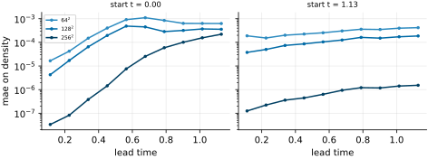
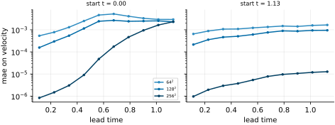
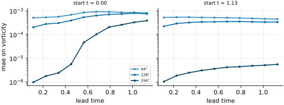
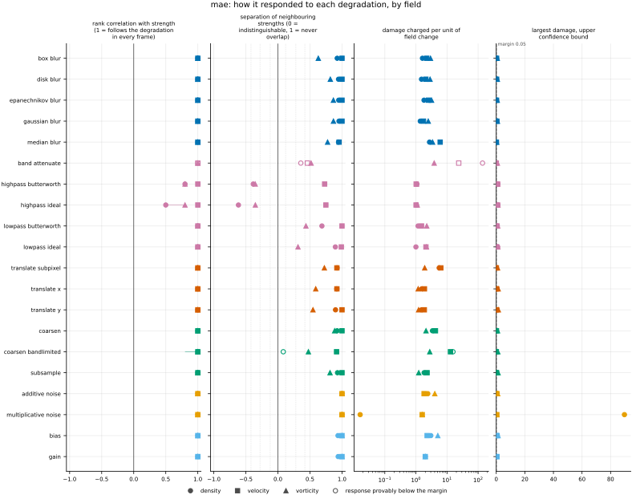
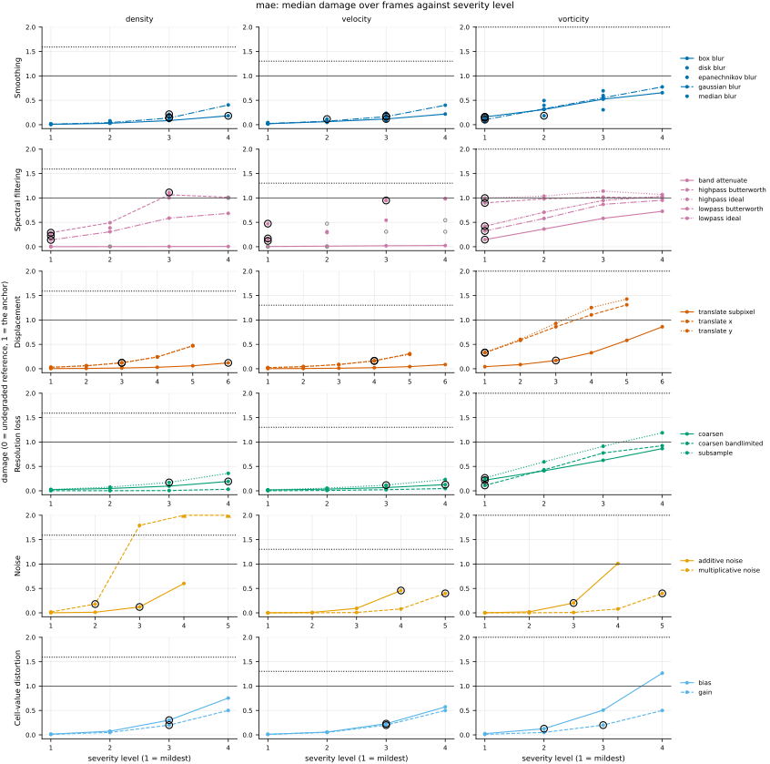
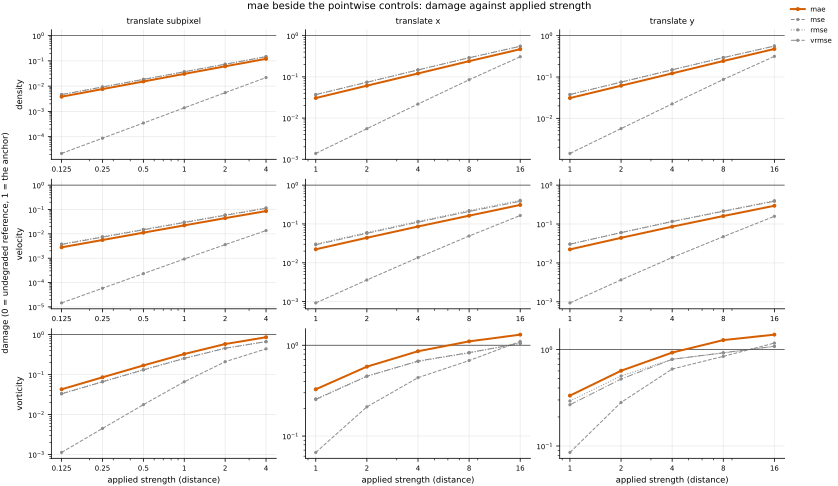

## Definition

For fields $f$ (reference) and $g$ (candidate) sampled on the same analysis grid, with $C$
channels and $N$ cells per channel,

$$
\mathrm{MAE}(f, g) = \frac{1}{CN} \sum_{c=1}^{C} \sum_{i=1}^{N}
\bigl| f_{c,i} - g_{c,i} \bigr| \tag{1}
$$

For a vector field the channels are pooled rather than reduced separately. The analysis
grid is uniform, so cells carry equal weight; on a non-uniform grid Equation (1) would
need cell volumes and would no longer be a plain mean.

Unlike the squared error, Equation (1) is a metric in the mathematical sense: it is the
L1 distance, and it satisfies the triangle inequality.

For a displacement $\delta$ small compared with the scale of variation, expanding
$f(x + \delta) - f(x) \simeq \delta\, \partial_x f$ in Equation (1) gives

$$
\mathrm{MAE} \simeq \delta \bigl\langle |\partial_x f| \bigr\rangle \tag{2}
$$

which is linear in the displacement where the squared error is quadratic. That single
difference in exponent is what separates the two in practice.

### Boundary handling

None. The operation is local to each cell, so no neighbourhood is ever consulted and no
boundary condition can enter.

### How its field reports it

None of the primary sources read for the pointwise family makes the mean absolute error its
reported number. Numerical analysis defines the $L^\infty$ and $L^2$ norms of the discretisation
error and not the $L^1$ [@roy2005] (Sect. 2.5, Eq. 7); PDEBench reports RMSE, nRMSE and the
maximum error [@takamoto2022] (Sect. 3.3); WeatherBench 2's deterministic scores are the RMSE, the
anomaly correlation, the bias and SEEPS [@rasp2024] (Sect. 4.3); The Well's paper lists squared
and maximum errors only [@ohana2024] (App. E.3).

- **Machine-learning benchmarks for PDEs.** The Well's library defines the MAE, the spatial mean
  of the absolute error, one value per field, and a normalised form divided by the mean absolute
  value of the truth (`the_well/benchmark/metrics/spatial.py`, `MAE` and `NMAE`), but leaves both
  out of the suite its trainer reports (`the_well/benchmark/metrics/__init__.py`,
  `validation_metric_suite`: RMSE, NRMSE, $L^\infty$, VRMSE, a binned spectral error and the
  Pearson correlation). Every channel has the same cells, so a mean of per-field MAEs over channels
  is exactly Equation (1): pooling and averaging per channel agree for this metric, and no sibling
  is needed.
- **The figure and the experiment** are those of its squared counterpart, the error against
  prediction step on a test set of rollouts, described on [rmse](../../metrics/rmse/card.md).

**The experiments here.** `forecast_re5e4` gives one model's error against lead time from two
starting times (`docs/datasets/reynolds_ladder_2d.md`, "Forecast pairs"); the missing
experiments are
[EXP-nrmse-rollouts-over-many-initial-conditions](https://github.com/khegazy/pde_metrics/blob/main/proposals/EXP-nrmse-rollouts-over-many-initial-conditions.md)
and
[EXP-max_error-grid-convergence-with-a-known-solution](https://github.com/khegazy/pde_metrics/blob/main/proposals/EXP-max_error-grid-convergence-with-a-known-solution.md).
The metric also runs on the degradation ladder on `kinet_re5e4`, on `sod_shock_tube`, on the
member mean of `synthetic_ensemble` and on the Reynolds ladder: it needs nothing but two fields
on one grid.

## Performance

<!-- GENERATED performance: written by `python -m fmeval.cards evidence mae --results results/comparison_1793846511 --results results/comparison_1793812304 --results results/comparison_1793812401 --results results/comparison_1793811840 --results results/comparison_1793846600`, do not edit -->



*As this metric's own field draws it, from run `comparison_1793811840`.* mae on density against lead time, the physical time since the forecast started, one panel per start and one line per run, darker the finer the run's grid. Each point is one prediction step of one forecast.



*As this metric's own field draws it, from run `comparison_1793811840`.* mae on velocity against lead time, the physical time since the forecast started, one panel per start and one line per run, darker the finer the run's grid. Each point is one prediction step of one forecast.



*As this metric's own field draws it, from run `comparison_1793811840`.* mae on vorticity against lead time, the physical time since the forecast started, one panel per start and one line per run, darker the finer the run's grid. Each point is one prediction step of one forecast.



Four measured statistics for mae, one row per degradation grouped by family and one marker per field. From left: the rank correlation between the metric and the applied strength within a frame, with the line showing the resampling interval; the separation of neighbouring strengths as Cliff's delta, where 0 means the metric cannot tell one strength from the next and the faint ticks at 0.12, 0.28 and 0.42 are Vargha and Delaney's small, medium and large anchors, for scale and not as grades; the damage charged per unit of field change at the harshest strength; and the upper confidence bound on the largest damage, beside the fixed margin of 0.05. A hollow marker is a field and degradation on which that bound lies below the margin, so the response is provably small. A missing marker is a statistic the analysis withheld, as the rank correlation is on an axis the metric is invariant to.



Median damage over frames against severity level for mae, one row per family of degradation and one column per field, on one shared scale. The solid grey line is damage 1, the anchor (by default the field's own mean); the dotted black line is the damage assigned to the fake prediction with the right spectrum, where the run included it. The hollow black ring marks the first level at which the metric has moved a tenth of the way to the anchor. Hollow grey markers are strengths excluded for repeating a milder one or for doing nothing. Degradations with three or fewer usable levels are drawn as markers only; points beyond 2 either side are drawn as triangles at the edge. Damage is negative where a degradation moves the metric away from the anchor, as noise raises a single-field quantity the field's mean sets to zero.

**Trend: does the response follow the degradation?**

| test family | field | degradations | rank correlation | fraction of frames in order | weakest gap between neighbouring strengths |
|---|---|---|---|---|---|
| Displacement | density | 3 | 1 | 1 | 0.949 to 0.961 |
| Displacement | velocity | 3 | 1 | 1 | 0.96 to 1 |
| Displacement | vorticity | 3 | 1 | 1 | 0.774 to 0.862 |
| Cell-value distortion | density | 2 | 1 | 1 | 0.969 to 0.97 |
| Cell-value distortion | velocity | 2 | 1 | 1 | 1 |
| Cell-value distortion | vorticity | 2 | 1 | 1 | 1 |
| Resolution loss | density | 3 | 1 | 0.59 to 1 | 0.542 to 0.965 |
| Resolution loss | velocity | 3 | 1 | 1 | 0.958 to 1 |
| Resolution loss | vorticity | 3 | 1 | 1 | 0.738 to 0.942 |
| Smoothing | density | 5 | 1 | 1 | 0.963 to 0.976 |
| Smoothing | velocity | 5 | 1 | 1 | 0.977 to 1 |
| Smoothing | vorticity | 5 | 1 | 1 | 0.815 to 0.933 |
| Spectral filtering | density | 5 | 0.5 to 1 | 0 to 1 | 0.192 to 0.948 |
| Spectral filtering | velocity | 5 | 1 | 1 | 0.73 to 1 |
| Spectral filtering | vorticity | 5 | 0.8 to 1 | 0 to 1 | 0.323 to 0.759 |
| Noise | density | 2 | 1 | 1 | 1 |
| Noise | velocity | 2 | 1 | 1 | 1 |
| Noise | vorticity | 2 | 1 | 1 | 1 |

**Reactivity: how far does it move?**

| test family | field | change from clean at the harshest strength | elasticity | first strength detected |
|---|---|---|---|---|
| Displacement | density | — | 0.991 to 0.999 | level 3 |
| Displacement | velocity | — | 0.971 to 0.999 | level 4 |
| Displacement | vorticity | — | 0.696 to 0.992 | level 1 |
| Cell-value distortion | density | — | 1 | level 3 |
| Cell-value distortion | velocity | — | 1 | level 3 |
| Cell-value distortion | vorticity | — | 1 | level 2 |
| Resolution loss | density | — | 0.709 to 1.34 | level 3 |
| Resolution loss | velocity | — | 1 to 2.21 | level 3 |
| Resolution loss | vorticity | — | 0.759 to 1.41 | level 1 |
| Smoothing | density | — | 1.62 to 1.94 | level 3 |
| Smoothing | velocity | — | 1.17 to 1.27 | level 2 |
| Smoothing | vorticity | — | 0.832 to 1.15 | level 1 |
| Spectral filtering | density | — | 0.796 to 7.05 | level 1 |
| Spectral filtering | velocity | — | 0.844 to 1 | level 1 |
| Spectral filtering | vorticity | — | 0.181 to 1 | level 1 |
| Noise | density | — | 1 | level 2 |
| Noise | velocity | — | 1 | level 4 |
| Noise | vorticity | — | 0.999 to 1 | level 3 |
| trap test: fake prediction, right spectrum | density | — | — | damage 1.59 |
| trap test: fake prediction, right spectrum | velocity | — | — | damage 1.3 |
| trap test: fake prediction, right spectrum | vorticity | — | — | damage 2.67 |

**Consistency: how much does it vary from snapshot to snapshot?**

| test family | field | consistency, in the strength's units | snapshots per independent block |
|---|---|---|---|
| Displacement | density | 0.0855 to 0.537 | 20 |
| Displacement | velocity | 0.0739 to 0.403 | 19 to 22 |
| Displacement | vorticity | 0.179 to 0.587 | 21 to 22 |
| Cell-value distortion | density | 0.0265 to 0.0294 | 20 to 21 |
| Cell-value distortion | velocity | 0.00627 to 0.00923 | 21 |
| Cell-value distortion | vorticity | 0.00934 to 0.0219 | 1 to 22 |
| Resolution loss | density | 0.697 to 1.32 | 20 to 21 |
| Resolution loss | velocity | 0.331 to 1.34 | 20 to 22 |
| Resolution loss | vorticity | 0.41 to 0.695 | 21 |
| Smoothing | density | 0.00801 to 0.0166 | 16 to 18 |
| Smoothing | velocity | 0.00738 to 0.0201 | 21 to 22 |
| Smoothing | vorticity | 0.00688 to 0.0244 | 21 |
| Spectral filtering | density | 0.0278 to 0.0934 | 17 to 21 |
| Spectral filtering | velocity | 0.00774 to 0.0825 | 1 to 22 |
| Spectral filtering | vorticity | 0.0422 to 0.413 | 21 to 22 |
| Noise | density | 0.000236 to 0.0159 | 1 to 20 |
| Noise | velocity | 0.00207 to 0.00552 | 21 |
| Noise | vorticity | 0.00557 to 0.00726 | 1 to 22 |

One row per family of degradation and physical field; a cell gives the range over the degradations in that family. **Trend.** The rank correlation is the Spearman correlation between the strength and how far the metric has moved from its value on the undegraded field of the same frame, in the one direction it moves under that degradation, computed inside a single frame. A value of 1 means every strength moved it further than the last in every frame, whichever way it moves; a response that scatters to both sides scores near 0. The fraction of frames in order counts the frames with no exception. The weakest gap is the smallest Mann-Whitney overlap between two neighbouring strengths across frames: 1 means they never overlap, 0.5 that they cannot be told apart. **Reactivity.** The change from clean is the median, at the harshest strength, of the departure from the undegraded value of the same frame over the size of that value: 0.3 means 30%. It does not exist for this metric, whose undegraded value is exactly zero; the damage below is its relative reading. The elasticity is the percentage change of that departure per percentage change in strength over the mildest strengths. First strength detected is the mildest at which the metric has moved a tenth of the way to the anchor; **damage** reads that 0-to-1 scale as a number. A dash means the measurement is not defined there. A metric's reactivity scales with the power it is expressed in: mean squared error's elasticity is twice root-mean-square error's, though the two carry the same information, so compare magnitudes across metrics with that in mind. **Consistency** is how much the response varies from snapshot to snapshot relative to its size, in the strength's units; the snapshots of one trajectory are correlated, and the last column is how many consecutive snapshots one independent block spans.

These tables report what was measured and grade none of the measurements. What the numbers mean for this metric is written in the subsections below, beside the test that produced each number.

**Profile.**

| field | selectivity | charges most for | charges least for | response provably below 0.05 at 90% on | elasticity to a sub-pixel shift, against severity (distance) | compute cost (x cheapest in this run) |
|---|---|---|---|---|---|---|
| density | 0.909 | `band_attenuate` | `multiplicative_noise` | `band_attenuate` `coarsen_bandlimited` | 0.999 | 1.67 |
| velocity | 0.626 | `band_attenuate` | `highpass_ideal` | `band_attenuate` | 0.999 | 2.42 |
| vorticity | 0.165 | `bias` | `highpass_butterworth` | — | 0.992 | 1 |

One row per physical field. **Selectivity** is how concentrated the metric's response is on a few degradations, measured per unit of field change: 0 means it charges every degradation the same, as mean squared error does by construction, and values toward 1 that one degradation carries most of it. **Charges most and least for** name the two ends of that profile. **Response provably below** lists degradations on which the upper confidence bound of the largest damage lies below the margin -- an equivalence test, so an entry says the response is provably small, not merely not significant; a dash means no degradation met the bound. **Elasticity** is the slope of log damage against log shift over the smallest shifts: 1 means damage grows in proportion to the shift, 2 with its square. **Compute cost** is wall-clock per evaluation over the cheapest metric and field in the same run.

<!-- END GENERATED performance -->

## Intuition

Mean absolute error compares two fields one cell at a time: subtract, take the size of
the difference regardless of sign, average. Taking the size rather than the square means
every unit of error counts the same wherever it appears, so one badly wrong cell and many
slightly wrong cells contribute in proportion to their total error rather than being
dominated by the worst. Nothing in the calculation looks beyond a single cell, so the
metric carries no notion of shape or position.

It shares that blindness with mean squared error and differs in how steeply it responds.
On a four-by-four grid, with one candidate that moved the bright square a cell and another
that halved its brightness where it stands:

```
reference        moved one cell    half brightness
0 0 0 0          0 0 0 0           0    0    0    0
0 1 1 0          0 0 1 1           0   0.5  0.5   0
0 1 1 0          0 0 1 1           0   0.5  0.5   0
0 0 0 0          0 0 0 0           0    0    0    0

                 mae = 0.25        mae = 0.125
```

The displaced candidate scores twice as badly as the damped one. Mean squared error, on
these same fields, makes it four times. Both prefer the damped candidate; they disagree
about by how much, and below one cell that disagreement grows into a factor of tens.

What this metric ignores is the arrangement of the errors: the same total error
concentrated at a sharp front and scattered as noise across the domain are the same
number.

## Reading the output

The value runs from zero upwards with no upper limit, in the field's own units, so a
density field and a vorticity field produce numbers that cannot be compared with each
other. Lower is better, and zero means the two fields are identical cell for cell. Because
it is linear rather than squared, the number is directly readable as a typical error size:
an MAE of 0.01 means the average cell is off by about 0.01 of whatever the field measures.

What counts as good depends entirely on the variance of the field being predicted, which
is why the suite reports damage — the value rescaled so that zero is the reference and one
is what the reference's own spatial mean scores, which for this metric is the mean absolute
fluctuation of the reference.

Comparisons across models on the same field, dataset and analysis grid are meaningful and
are the intended use. Comparisons across fields need normalising because of the units.
Comparisons across resolutions are invalid as they stand: the value is a mean over cells,
so refining the grid reweights the small scales even when nothing about the prediction has
changed. Compare on a common analysis grid, which is what this suite remaps onto before
measuring.

## Limitations

The linear response is a double-edged property. It makes MAE far more sensitive than MSE
to sub-cell displacement, which is useful when position matters, but it also means a
single catastrophically wrong region is not flagged any more urgently than the same total
error spread thinly everywhere. A model that is excellent across the domain and badly
wrong in one small area can score better than one that is mediocre throughout, and MAE
will not tell you which situation you are in.

It is also blind to position in the same way as every metric that compares fields cell by
cell, so a shock with exactly the right shape and strength sitting one cell over is
penalised twice: once where it should be and is not, once where it is and should not be.
And the absolute value is not differentiable at zero error, which matters if it is used as
a training loss rather than a diagnostic.

## Results

<!-- GENERATED run: written by `python -m fmeval.cards evidence mae --results results/comparison_1793846511 --results results/comparison_1793812304 --results results/comparison_1793812401 --results results/comparison_1793811840 --results results/comparison_1793846600`, do not edit -->

Measured on `kinet_re5e4`, frames 2000 to 10000 (161 frames of developed flow), on the 256 analysis grid, seed 20260807, at commit `adbdc88e4950`. Run `comparison_1793846511`.

Every number in this section comes from that run, except in the subsections headed with another experiment and in a figure whose caption names another run, each of which names its own run. Regenerate with `python -m fmeval.cards evidence <name> --results results/comparison_1793846511 --results results/comparison_1793812304 --results results/comparison_1793812401 --results results/comparison_1793811840 --results results/comparison_1793846600`.

<!-- END GENERATED run -->

Each subsection links to the degradations that subsection reports. What those degradations
do, and what their strength numbers mean, is documented on their own pages.

<!-- GENERATED experiments: written by `python -m fmeval.cards catalog`, do not edit -->

**Across the experiments.**

| experiment | what a run on it is evidence of | on this card |
|---|---|---|
| `kinet_re5e4` | developed flow | measured, run `comparison_1793846511`: the main results |
| `kinet_re1e6` | developed flow at Re = 1e6, twenty times the Reynolds number of kinet_re5e4, from the same initial condition | measured, run `comparison_1793846600`: under *On `kinet_re1e6`* |
| `synthetic_ensemble` | a calibrated null: evidence that the estimator computes what it claims to compute, and nothing about turbulence | measured, run `comparison_1793812401`: under *On `synthetic_ensemble`*; on this dataset the metric scores the member mean of the ensemble |
| `sod_shock_tube` | an analytic check: evidence that the metric locates and scores a known shock correctly, and nothing about turbulence | measured, run `comparison_1793812304`: under *On `sod_shock_tube`* |
| `forecast_re5e4` | real predictions scored against their targets at each prediction step; who produced the predictions, a trained model or a coarser solver, is not recorded | measured, run `comparison_1793811840`: under *On `forecast_re5e4`* |

One row per dataset a card may cite (`configs/cards/default.yaml`). *Measured* names the run the card cites: the main results are `## Performance` and the subsections below, and every other run has its own subsection headed with its dataset. *Not applicable* gives the reason: one that follows from what the metric declares and what the dataset offers, or one a person wrote on the card (`not_run` in `card.yaml`) because the result would carry no information. *Not yet run* means the metric can run there and the card cites no run on it yet.

<!-- END GENERATED experiments -->

### Smoothing

[gaussian_blur](../../degradations/gaussian_blur/card.md) ·
[box_blur](../../degradations/box_blur/card.md) ·
[median_blur](../../degradations/median_blur/card.md)

<!-- GENERATED results_smoothing: written by `python -m fmeval.cards evidence mae --results results/comparison_1793846511 --results results/comparison_1793812304 --results results/comparison_1793812401 --results results/comparison_1793811840 --results results/comparison_1793846600`, do not edit -->

| degradation | field | strengths | rank correlation | fraction of frames in the right order | weakest gap between neighbouring strengths |
|---|---|---|---|---|---|
| `box_blur` | density | 4 | 1 | 1 | 0.963 |
| `box_blur` | velocity | 4 | 1 | 1 | 1 |
| `box_blur` | vorticity | 4 | 1 | 1 | 0.815 |
| `disk_blur` | density | 3 | 1 | 1 | 0.973 |
| `disk_blur` | velocity | 3 | 1 | 1 | 1 |
| `disk_blur` | vorticity | 3 | 1 | 1 | 0.909 |
| `epanechnikov_blur` | density | 3 | 1 | 1 | 0.974 |
| `epanechnikov_blur` | velocity | 3 | 1 | 1 | 1 |
| `epanechnikov_blur` | vorticity | 3 | 1 | 1 | 0.933 |
| `gaussian_blur` | density | 4 | 1 | 1 | 0.976 |
| `gaussian_blur` | velocity | 4 | 1 | 1 | 1 |
| `gaussian_blur` | vorticity | 4 | 1 | 1 | 0.933 |
| `median_blur` | density | 3 | 1 | 1 | 0.973 |
| `median_blur` | velocity | 3 | 1 | 1 | 0.977 |
| `median_blur` | vorticity | 3 | 1 | 1 | 0.887 |

<!-- END GENERATED results_smoothing -->

Every blur is ordered in every frame on every field, with a rank correlation of 1. On density
and velocity neighbouring strengths are almost never confused (weakest gap 0.963 or more); on
vorticity they overlap more, from 0.815 under `box_blur` to 0.933 under `gaussian_blur` and
`epanechnikov_blur`. No blur reaches the damage of the field's mean: the largest damage over
every frame and strength is 0.426 on density and 0.897 on vorticity under `gaussian_blur`, and
0.102 on density under `median_blur`. The elasticity is 1.62 to 1.94 on density and 0.832 to
1.15 on vorticity (Reactivity table).

### Spectral filtering

[lowpass_ideal](../../degradations/lowpass_ideal/card.md) ·
[lowpass_butterworth](../../degradations/lowpass_butterworth/card.md) ·
[highpass_ideal](../../degradations/highpass_ideal/card.md) ·
[highpass_butterworth](../../degradations/highpass_butterworth/card.md)

<!-- GENERATED results_spectral: written by `python -m fmeval.cards evidence mae --results results/comparison_1793846511 --results results/comparison_1793812304 --results results/comparison_1793812401 --results results/comparison_1793811840 --results results/comparison_1793846600`, do not edit -->

| degradation | field | strengths | rank correlation | fraction of frames in the right order | weakest gap between neighbouring strengths |
|---|---|---|---|---|---|
| `band_attenuate` | density | 4 | 1 | 1 | 0.679 |
| `band_attenuate` | velocity | 4 | 1 | 1 | 0.73 |
| `band_attenuate` | vorticity | 4 | 1 | 1 | 0.759 |
| `highpass_butterworth` | density | 4 | 0.8 | 0 | 0.308 |
| `highpass_butterworth` | velocity | 3 | 1 | 1 | 0.864 |
| `highpass_butterworth` | vorticity | 4 | 0.8 | 0.298 | 0.323 |
| `highpass_ideal` | density | 3 | 0.5 | 0 | 0.192 |
| `highpass_ideal` | velocity | 2 | 1 | 1 | 0.874 |
| `highpass_ideal` | vorticity | 4 | 0.8 | 0 | 0.324 |
| `lowpass_butterworth` | density | 4 | 1 | 1 | 0.843 |
| `lowpass_butterworth` | velocity | 3 | 1 | 1 | 1 |
| `lowpass_butterworth` | vorticity | 4 | 1 | 1 | 0.719 |
| `lowpass_ideal` | density | 3 | 1 | 1 | 0.948 |
| `lowpass_ideal` | velocity | 2 | 1 | 1 | 0.995 |
| `lowpass_ideal` | vorticity | 4 | 1 | 1 | 0.657 |

<!-- END GENERATED results_spectral -->

The low-pass filters and `band_attenuate` are ordered in every frame on every field. The
high-pass filters are not, on density and vorticity: the rank correlation is 0.8 under
`highpass_butterworth` and 0.5 (density) or 0.8 (vorticity) under `highpass_ideal`, and no
frame of density, and at most 0.298 of the frames of vorticity, keeps every strength in order,
with weakest gaps of 0.192 to 0.324. On velocity both are ordered in every frame. The largest
damage under the high-pass filters is 1.15 to 1.52, above the field's mean. Our reasoning, not
a measurement: a high-pass filter's error is the large-scale part it removes, and removing more
modes always raises that part's squared norm (Parseval) but need not raise its absolute norm,
so a cutoff can cost less under MAE than a milder one. `band_attenuate` barely registers on
density, with a largest damage of 0.00824, and the Profile table lists it among the degradations
on which the response is provably below 0.05; on vorticity it reaches 0.909.

### Displacement

[translate_x](../../degradations/translate/card.md) ·
[translate_subpixel](../../degradations/translate_subpixel/card.md)

<!-- GENERATED results_geometric: written by `python -m fmeval.cards evidence mae --results results/comparison_1793846511 --results results/comparison_1793812304 --results results/comparison_1793812401 --results results/comparison_1793811840 --results results/comparison_1793846600`, do not edit -->

| degradation | field | strengths | rank correlation | fraction of frames in the right order | weakest gap between neighbouring strengths |
|---|---|---|---|---|---|
| `translate_subpixel` | density | 6 | 1 | 1 | 0.961 |
| `translate_subpixel` | velocity | 6 | 1 | 1 | 0.96 |
| `translate_subpixel` | vorticity | 6 | 1 | 1 | 0.862 |
| `translate_x` | density | 5 | 1 | 1 | 0.959 |
| `translate_x` | velocity | 5 | 1 | 1 | 0.96 |
| `translate_x` | vorticity | 5 | 1 | 1 | 0.795 |
| `translate_y` | density | 5 | 1 | 1 | 0.949 |
| `translate_y` | velocity | 5 | 1 | 1 | 1 |
| `translate_y` | vorticity | 5 | 1 | 1 | 0.774 |

<!-- END GENERATED results_geometric -->

Every shift is ordered in every frame, with a rank correlation of 1. The response is linear in
the displacement, as Equation (2) gives: the elasticity to a sub-pixel shift in the Profile
table is 0.999, 0.999 and 0.992 on density, velocity and vorticity. Over whole-cell shifts it
stays 0.991 on density and falls to 0.696 on vorticity, the field whose structure is smallest.
On vorticity the sub-cell shift is first detected, a tenth of the way to the anchor, at level 3,
and its largest damage is 1.03; under `translate_x` the largest damage is 0.508 on density and
1.49 on vorticity. How this linear response compares with the squared errors' quadratic one is
under *Damage beside the other metrics*.

### Resolution loss

[coarsen](../../degradations/coarsen/card.md) ·
[coarsen_bandlimited](../../degradations/coarsen_bandlimited/card.md)

<!-- GENERATED results_resolution: written by `python -m fmeval.cards evidence mae --results results/comparison_1793846511 --results results/comparison_1793812304 --results results/comparison_1793812401 --results results/comparison_1793811840 --results results/comparison_1793846600`, do not edit -->

| degradation | field | strengths | rank correlation | fraction of frames in the right order | weakest gap between neighbouring strengths |
|---|---|---|---|---|---|
| `coarsen` | density | 4 | 1 | 1 | 0.962 |
| `coarsen` | velocity | 4 | 1 | 1 | 1 |
| `coarsen` | vorticity | 4 | 1 | 1 | 0.942 |
| `coarsen_bandlimited` | density | 4 | 1 | 0.59 | 0.542 |
| `coarsen_bandlimited` | velocity | 4 | 1 | 1 | 0.958 |
| `coarsen_bandlimited` | vorticity | 4 | 1 | 1 | 0.738 |
| `subsample` | density | 4 | 1 | 1 | 0.965 |
| `subsample` | velocity | 4 | 1 | 1 | 1 |
| `subsample` | vorticity | 4 | 1 | 1 | 0.907 |

<!-- END GENERATED results_resolution -->

Every coarsening is ordered with a rank correlation of 1. They differ in size. The largest
damage under `coarsen` is 0.208, 0.142 and 0.965 on density, velocity and vorticity, and under
`coarsen_bandlimited` 0.0389, 0.0851 and 1.53. The two operators keep the same block means, so on
the smooth fields most of what `coarsen` charges is its staircase; on vorticity, whose structure
the coarse grid cannot hold, both reach the field's mean. Under the band-limited operator density
is in the right order in only 0.59 of frames, with a weakest gap of 0.542: its mildest strengths
are nearly free, and which of two neighbours is larger changes from frame to frame. The other
pointwise metrics, `spectrum_l2` and `h1_seminorm` show this on density too, and its cause is not
established; `issues/039` records what was ruled out.

### Noise

[additive_noise](../../degradations/additive_noise/card.md)

<!-- GENERATED results_stochastic: written by `python -m fmeval.cards evidence mae --results results/comparison_1793846511 --results results/comparison_1793812304 --results results/comparison_1793812401 --results results/comparison_1793811840 --results results/comparison_1793846600`, do not edit -->

| degradation | field | strengths | rank correlation | fraction of frames in the right order | weakest gap between neighbouring strengths |
|---|---|---|---|---|---|
| `additive_noise` | density | 4 | 1 | 1 | 1 |
| `additive_noise` | velocity | 4 | 1 | 1 | 1 |
| `additive_noise` | vorticity | 4 | 1 | 1 | 1 |
| `multiplicative_noise` | density | 5 | 1 | 1 | 1 |
| `multiplicative_noise` | velocity | 5 | 1 | 1 | 1 |
| `multiplicative_noise` | vorticity | 5 | 1 | 1 | 1 |

<!-- END GENERATED results_stochastic -->

Both noises are ordered in every frame on every field, and neighbouring strengths never overlap
(weakest gap 1). The elasticity is 1 on density and velocity and 0.999 to 1 on vorticity: either
noise adds an error proportional to its amplitude, and the mean absolute error follows it
linearly. Multiplicative noise on density reaches a largest damage of 90.4. Our reading, not a
measured decomposition: that noise scales the whole density, whose mean is near 1, while the
anchor measures only the fluctuation about that mean, two to three orders of magnitude smaller
(`AGENTS.md` §4).

### Cell-value distortion

[gain](../../degradations/gain/card.md) ·
[bias](../../degradations/bias/card.md)

<!-- GENERATED results_pointwise: written by `python -m fmeval.cards evidence mae --results results/comparison_1793846511 --results results/comparison_1793812304 --results results/comparison_1793812401 --results results/comparison_1793811840 --results results/comparison_1793846600`, do not edit -->

| degradation | field | strengths | rank correlation | fraction of frames in the right order | weakest gap between neighbouring strengths |
|---|---|---|---|---|---|
| `bias` | density | 4 | 1 | 1 | 0.969 |
| `bias` | velocity | 4 | 1 | 1 | 1 |
| `bias` | vorticity | 4 | 1 | 1 | 1 |
| `gain` | density | 4 | 1 | 1 | 0.97 |
| `gain` | velocity | 4 | 1 | 1 | 1 |
| `gain` | vorticity | 4 | 1 | 1 | 1 |

<!-- END GENERATED results_pointwise -->

### Trap tests

[gaussian_impostor](../../degradations/gaussian_impostor/card.md) ·
[uncorrelated](../../degradations/random_large_translation/card.md)

<!-- GENERATED results_canaries: written by `python -m fmeval.cards evidence mae --results results/comparison_1793846511 --results results/comparison_1793812304 --results results/comparison_1793812401 --results results/comparison_1793811840 --results results/comparison_1793846600`, do not edit -->

| field | damage assigned to the fake prediction | closest real degradation | damage of the reference moved far away | value on the anchor |
|---|---|---|---|---|
| density | 1.59 | `multiplicative_noise=0.01` | 1.17 | 0.00445 |
| velocity | 1.3 | `highpass_ideal=4.02293` | 1.72 | 0.0345 |
| vorticity | 2.67 | `translate_y=16` | 1.9 | 0.00098 |

The fake prediction here has exactly the reference field's amplitude spectrum and completely scrambled structure. Damage 1 is what the anchor scores, by default the reference's own spatial mean, a prediction that knows the mean and nothing else. The damage column therefore says how close to useless this metric considers that fake prediction: a low number means the metric was fooled. The third column translates the same number into an ordinary degradation whose damage the fake prediction matches, which is easier to picture. The fourth is the reference moved by a large random offset, the right statistics in the wrong place; where a field's energy sits in its largest scales that copy stays partly correlated with the reference, so it is not the score of an unrelated field.

<!-- END GENERATED results_canaries -->

MAE scores the phase-scrambled fake prediction worse than the field's own mean on every field,
with damage 1.59, 1.3 and 2.67 on density, velocity and vorticity. The reference moved far away
scores 1.17, 1.72 and 1.9. The trap test is aimed at metrics that depend only on the amplitude
spectrum, so it does not catch this family, and a panel in which every metric rejects it is not
evidence of a well-guarded panel.

### Compared with the other metrics

<!-- GENERATED results_summary: written by `python -m fmeval.cards evidence mae --results results/comparison_1793846511 --results results/comparison_1793812304 --results results/comparison_1793812401 --results results/comparison_1793811840 --results results/comparison_1793846600`, do not edit -->

| compared with | density | velocity | vorticity |
|---|---|---|---|
| `rmse` | 0.988 | 0.995 | 0.973 |
| `rmse_channel_mean` | 0.988 | 0.995 | 0.973 |
| `nrmse` | 0.988 | 0.995 | 0.973 |
| `mse` | 0.988 | 0.995 | 0.973 |
| `vrmse` | 0.988 | 0.995 | 0.974 |
| `max_error_channel_mean` | 0.911 | 0.915 | 0.872 |
| `max_error` | 0.911 | 0.909 | 0.872 |
| `wasserstein` | 0.852 | — | — |
| `h_minus_one` | 0.823 | 0.836 | 0.831 |
| `h1_relative` | 0.789 | 0.704 | 0.71 |
| `h1_seminorm` | 0.682 | 0.582 | 0.646 |
| `spectral_energy_flux` | — | 0.384 | — |
| `persistence_distance` | 0.34 | — | 0.163 |
| `increment_w1_by_separation` | 0.32 | 0.237 | 0.124 |
| `spectrum_l2` | 0.218 | 0.349 | 0.134 |
| `energy_distance` | 0.241 | 0.149 | -0.00794 |
| `increment_w1` | 0.247 | 0.136 | 0.0102 |
| `tail_exceedance` | 0.146 | 0.0951 | -0.0496 |
| `increment_flatness` | -0.145 | -0.0717 | 0.0516 |
| `palinstrophy` | — | — | -0.137 |
| `tail_index` | 0.0928 | -0.154 | -0.171 |
| `kinetic_energy` | — | -0.221 | — |
| `enstrophy` | — | — | -0.245 |

Rank correlation over every degradation, computed separately for each physical field on the median value at each combination of degradation and strength, with the undegraded reference excluded. A dash marks a metric that does not run on that field. A metric with a target value enters by its distance from the target. Two metrics correlating near 1 put the degradations in the same order, but the two may still weight those degradations very differently. A correlation near 1 therefore means the two metrics are redundant for ranking models, not that the two are interchangeable as training losses.

<!-- END GENERATED results_summary -->

MAE correlates just below 1 with the squared errors (`mse`, `rmse`, `rmse_channel_mean`,
`vrmse`, `nrmse`) on every field, and a little lower with the two maximum errors, while the
metrics that compare spectra, increments or distributions order the degradations differently.
It orders the degradations almost as the squared errors do without charging them alike: its
damage grows linearly with a small shift where theirs grows with the square
(*Damage beside the other metrics*), so for ranking they are near duplicates and as training
losses they are not.

### Damage beside the other metrics

<!-- GENERATED results_damage_by_level: written by `python -m fmeval.cards evidence mae --results results/comparison_1793846511 --results results/comparison_1793812304 --results results/comparison_1793812401 --results results/comparison_1793811840 --results results/comparison_1793846600`, do not edit -->



Median damage over frames against the applied strength, log-log, for mae (bold, in colour) and the pointwise controls mse, rmse, vrmse (thin, grey), one column per displacement degradation and one row per field. The grey line is damage 1, the anchor (by default the field's own mean). Parallel lines charge in the same proportion at every strength; a steeper line charges relatively more for the larger shifts, which is what decides whether two metrics are interchangeable as training losses. These are the same numbers as the table beneath.

**Displacement, density, `translate_subpixel`** (strength: distance).

| metric | 0.125 | 0.25 | 0.5 | 1 | 2 | 4 |
|---|---|---|---|---|---|---|
| `mae` | 0.00383 | 0.00767 | 0.0153 | 0.0306 | 0.061 | 0.121 |
| `mse` | 2.17e-05 | 8.68e-05 | 0.000347 | 0.00138 | 0.00551 | 0.0219 |
| `rmse` | 0.00466 | 0.00931 | 0.0186 | 0.0372 | 0.0743 | 0.148 |
| `vrmse` | 0.00463 | 0.00926 | 0.0185 | 0.037 | 0.0738 | 0.147 |

**Displacement, density, `translate_x`** (strength: distance).

| metric | 1 | 2 | 4 | 8 | 16 |
|---|---|---|---|---|---|
| `mae` | 0.0306 | 0.061 | 0.121 | 0.24 | 0.469 |
| `mse` | 0.00138 | 0.00551 | 0.0219 | 0.0849 | 0.307 |
| `rmse` | 0.0372 | 0.0743 | 0.148 | 0.291 | 0.555 |
| `vrmse` | 0.037 | 0.0738 | 0.147 | 0.29 | 0.55 |

**Displacement, density, `translate_y`** (strength: distance).

| metric | 1 | 2 | 4 | 8 | 16 |
|---|---|---|---|---|---|
| `mae` | 0.031 | 0.0616 | 0.122 | 0.244 | 0.476 |
| `mse` | 0.00142 | 0.00565 | 0.0224 | 0.0869 | 0.316 |
| `rmse` | 0.0377 | 0.0752 | 0.15 | 0.295 | 0.562 |
| `vrmse` | 0.0376 | 0.075 | 0.149 | 0.294 | 0.56 |

**Displacement, velocity, `translate_subpixel`** (strength: distance).

| metric | 0.125 | 0.25 | 0.5 | 1 | 2 | 4 |
|---|---|---|---|---|---|---|
| `mae` | 0.00279 | 0.00559 | 0.0112 | 0.0223 | 0.0441 | 0.0859 |
| `mse` | 1.45e-05 | 5.81e-05 | 0.000232 | 0.000924 | 0.0036 | 0.0136 |
| `rmse` | 0.00381 | 0.00762 | 0.0152 | 0.0304 | 0.06 | 0.117 |
| `vrmse` | 0.00365 | 0.00729 | 0.0146 | 0.029 | 0.0574 | 0.111 |

**Displacement, velocity, `translate_x`** (strength: distance).

| metric | 1 | 2 | 4 | 8 | 16 |
|---|---|---|---|---|---|
| `mae` | 0.0223 | 0.0441 | 0.0859 | 0.163 | 0.31 |
| `mse` | 0.000924 | 0.0036 | 0.0136 | 0.0489 | 0.165 |
| `rmse` | 0.0304 | 0.06 | 0.117 | 0.221 | 0.406 |
| `vrmse` | 0.029 | 0.0574 | 0.111 | 0.209 | 0.383 |

**Displacement, velocity, `translate_y`** (strength: distance).

| metric | 1 | 2 | 4 | 8 | 16 |
|---|---|---|---|---|---|
| `mae` | 0.0223 | 0.0442 | 0.0856 | 0.16 | 0.295 |
| `mse` | 0.000935 | 0.00366 | 0.0138 | 0.0473 | 0.158 |
| `rmse` | 0.0306 | 0.0605 | 0.117 | 0.218 | 0.397 |
| `vrmse` | 0.0303 | 0.0599 | 0.115 | 0.212 | 0.384 |

**Displacement, vorticity, `translate_subpixel`** (strength: distance).

| metric | 0.125 | 0.25 | 0.5 | 1 | 2 | 4 |
|---|---|---|---|---|---|---|
| `mae` | 0.0428 | 0.0854 | 0.169 | 0.328 | 0.582 | 0.86 |
| `mse` | 0.00112 | 0.00448 | 0.0176 | 0.066 | 0.21 | 0.44 |
| `rmse` | 0.0335 | 0.0669 | 0.133 | 0.257 | 0.458 | 0.663 |
| `vrmse` | 0.0329 | 0.0656 | 0.13 | 0.253 | 0.455 | 0.671 |

**Displacement, vorticity, `translate_x`** (strength: distance).

| metric | 1 | 2 | 4 | 8 | 16 |
|---|---|---|---|---|---|
| `mae` | 0.328 | 0.582 | 0.86 | 1.1 | 1.31 |
| `mse` | 0.066 | 0.21 | 0.44 | 0.679 | 1.1 |
| `rmse` | 0.257 | 0.458 | 0.663 | 0.824 | 1.05 |
| `vrmse` | 0.253 | 0.455 | 0.671 | 0.832 | 1.05 |

**Displacement, vorticity, `translate_y`** (strength: distance).

| metric | 1 | 2 | 4 | 8 | 16 |
|---|---|---|---|---|---|
| `mae` | 0.333 | 0.603 | 0.93 | 1.25 | 1.43 |
| `mse` | 0.0858 | 0.283 | 0.628 | 0.849 | 1.17 |
| `rmse` | 0.293 | 0.532 | 0.793 | 0.922 | 1.08 |
| `vrmse` | 0.268 | 0.495 | 0.793 | 0.927 | 1.08 |

Median damage over frames at every strength, this metric in the first row and the pointwise controls beneath it, all on the same 0-to-1 scale where 0 is the undegraded reference and 1 the anchor (by default the field's own mean); a dash means no damage scale on that field. The rank correlations under *Compared with the other metrics* say whether two metrics put the strengths in the same order; this table says how much each one charges for the same strength, which decides whether two metrics are interchangeable as training losses.

<!-- END GENERATED results_damage_by_level -->

On every displacement and field MAE charges far more than `mse` at the smallest shifts, and on
the log-log figure its line has about half the slope of `mse`'s, as the linear response of
Equation (2) against the quadratic one of Equation (3) on `mse`'s card gives. Against `rmse` and
`vrmse`, whose small-shift response is also linear, its line runs nearly parallel, a little
below them on density and velocity and above them on vorticity. On vorticity the lines converge
near the anchor at the largest whole-cell shifts, where MAE ends above the others.

### On `sod_shock_tube`

<!-- GENERATED results_on_sod_shock_tube: written by `python -m fmeval.cards evidence mae --results results/comparison_1793846511 --results results/comparison_1793812304 --results results/comparison_1793812401 --results results/comparison_1793811840 --results results/comparison_1793846600`, do not edit -->

**An analytic check: evidence that the metric locates and scores a known shock correctly, and nothing about turbulence.**

Measured on `sod_shock_tube`, frames 0 to 9 (10 frames of an analytic check: evidence that the metric locates and scores a known shock correctly, and nothing about turbulence), on the 2048 analysis grid, seed 20260807, at commit `adbdc88e4950`. Run `comparison_1793812304`.

[additive_noise](../../degradations/additive_noise/card.md) ·
[band_attenuate](../../degradations/band_attenuate/card.md) ·
[bias](../../degradations/bias/card.md) ·
[box_blur](../../degradations/box_blur/card.md) ·
[coarsen](../../degradations/coarsen/card.md) ·
[coarsen_bandlimited](../../degradations/coarsen_bandlimited/card.md) ·
[disk_blur](../../degradations/disk_blur/card.md) ·
[epanechnikov_blur](../../degradations/epanechnikov_blur/card.md) ·
[gain](../../degradations/gain/card.md) ·
[gaussian_blur](../../degradations/gaussian_blur/card.md) ·
[gaussian_impostor](../../degradations/gaussian_impostor/card.md) ·
[highpass_butterworth](../../degradations/highpass_butterworth/card.md) ·
[highpass_ideal](../../degradations/highpass_ideal/card.md) ·
[lowpass_butterworth](../../degradations/lowpass_butterworth/card.md) ·
[lowpass_ideal](../../degradations/lowpass_ideal/card.md) ·
[mean_field](../../degradations/mean_field/card.md) ·
[median_blur](../../degradations/median_blur/card.md) ·
[multiplicative_noise](../../degradations/multiplicative_noise/card.md) ·
[subsample](../../degradations/subsample/card.md) ·
[translate_subpixel](../../degradations/translate_subpixel/card.md) ·
[translate_x](../../degradations/translate/card.md) ·
[uncorrelated](../../degradations/random_large_translation/card.md)

**Smoothing.**

| degradation | field | strengths | rank correlation | fraction of frames in the right order | weakest gap between neighbouring strengths |
|---|---|---|---|---|---|
| `box_blur` | density | 4 | 1 | 1 | 1 |
| `box_blur` | pressure | 4 | 1 | 1 | 1 |
| `box_blur` | velocity | 4 | 1 | 1 | 1 |
| `disk_blur` | density | 3 | 1 | 1 | 1 |
| `disk_blur` | pressure | 3 | 1 | 1 | 1 |
| `disk_blur` | velocity | 3 | 1 | 1 | 1 |
| `epanechnikov_blur` | density | 3 | 1 | 1 | 1 |
| `epanechnikov_blur` | pressure | 3 | 1 | 1 | 1 |
| `epanechnikov_blur` | velocity | 3 | 1 | 1 | 1 |
| `gaussian_blur` | density | 4 | 1 | 1 | 1 |
| `gaussian_blur` | pressure | 4 | 1 | 1 | 1 |
| `gaussian_blur` | velocity | 4 | 1 | 1 | 1 |

**Spectral filtering.**

| degradation | field | strengths | rank correlation | fraction of frames in the right order | weakest gap between neighbouring strengths |
|---|---|---|---|---|---|
| `band_attenuate` | density | 4 | 1 | 1 | 0.96 |
| `band_attenuate` | pressure | 4 | 1 | 1 | 0.98 |
| `band_attenuate` | velocity | 4 | 1 | 1 | 0.97 |
| `highpass_butterworth` | density | 2 | 1 | 1 | 1 |
| `highpass_butterworth` | pressure | 2 | 1 | 1 | 1 |
| `highpass_butterworth` | velocity | 4 | 1 | 1 | 0.77 |
| `highpass_ideal` | density | 1 | — | — | — |
| `highpass_ideal` | pressure | 1 | — | — | — |
| `highpass_ideal` | velocity | 4 | 1 | 1 | 0.77 |
| `lowpass_butterworth` | density | 1 | — | — | — |
| `lowpass_butterworth` | pressure | 2 | 1 | 1 | 1 |
| `lowpass_butterworth` | velocity | 4 | 1 | 1 | 1 |
| `lowpass_ideal` | density | 1 | — | — | — |
| `lowpass_ideal` | pressure | 2 | 1 | 1 | 1 |
| `lowpass_ideal` | velocity | 4 | 1 | 1 | 1 |

**Displacement.**

| degradation | field | strengths | rank correlation | fraction of frames in the right order | weakest gap between neighbouring strengths |
|---|---|---|---|---|---|
| `translate_subpixel` | density | 6 | 0.943 | 0 | 0 |
| `translate_subpixel` | pressure | 6 | 0.943 | 0.4 | 0.4 |
| `translate_subpixel` | velocity | 6 | 0.829 | 0 | 0 |
| `translate_x` | density | 5 | 1 | 1 | 1 |
| `translate_x` | pressure | 5 | 1 | 1 | 1 |
| `translate_x` | velocity | 5 | 1 | 1 | 1 |

**Resolution loss.**

| degradation | field | strengths | rank correlation | fraction of frames in the right order | weakest gap between neighbouring strengths |
|---|---|---|---|---|---|
| `coarsen` | density | 4 | 1 | 1 | 1 |
| `coarsen` | pressure | 4 | 1 | 1 | 1 |
| `coarsen` | velocity | 4 | 1 | 1 | 1 |
| `coarsen_bandlimited` | density | 4 | 1 | 0.7 | 0.64 |
| `coarsen_bandlimited` | pressure | 4 | 0.8 | 0.1 | 0.51 |
| `coarsen_bandlimited` | velocity | 4 | 0.8 | 0.1 | 0.51 |
| `subsample` | density | 4 | 1 | 1 | 1 |
| `subsample` | pressure | 4 | 1 | 1 | 1 |
| `subsample` | velocity | 4 | 1 | 1 | 1 |

**Noise.**

| degradation | field | strengths | rank correlation | fraction of frames in the right order | weakest gap between neighbouring strengths |
|---|---|---|---|---|---|
| `additive_noise` | density | 4 | 1 | 1 | 1 |
| `additive_noise` | pressure | 4 | 1 | 1 | 1 |
| `additive_noise` | velocity | 4 | 1 | 1 | 1 |
| `multiplicative_noise` | density | 5 | 1 | 1 | 1 |
| `multiplicative_noise` | pressure | 5 | 1 | 1 | 1 |
| `multiplicative_noise` | velocity | 5 | 1 | 1 | 1 |

**Cell-value distortion.**

| degradation | field | strengths | rank correlation | fraction of frames in the right order | weakest gap between neighbouring strengths |
|---|---|---|---|---|---|
| `bias` | density | 4 | 1 | 1 | 1 |
| `bias` | pressure | 4 | 1 | 1 | 1 |
| `bias` | velocity | 4 | 1 | 1 | 1 |
| `gain` | density | 4 | 1 | 1 | 1 |
| `gain` | pressure | 4 | 1 | 1 | 1 |
| `gain` | velocity | 4 | 1 | 1 | 1 |

**Trap tests.**

| field | damage assigned to the fake prediction | closest real degradation | damage of the reference moved far away | value on the anchor |
|---|---|---|---|---|
| density | 1.32 | `highpass_butterworth=2.77538` | 1.79 | 0.329 |
| pressure | 1.2 | `highpass_butterworth=3.73482` | 1.71 | 0.344 |
| velocity | 1.27 | `highpass_ideal=17.1163` | 1.12 | 0.39 |

The fake prediction here has exactly the reference field's amplitude spectrum and completely scrambled structure. Damage 1 is what the anchor scores, by default the reference's own spatial mean, a prediction that knows the mean and nothing else. The damage column therefore says how close to useless this metric considers that fake prediction: a low number means the metric was fooled. The third column translates the same number into an ordinary degradation whose damage the fake prediction matches, which is easier to picture. The fourth is the reference moved by a large random offset, the right statistics in the wrong place; where a field's energy sits in its largest scales that copy stays partly correlated with the reference, so it is not the score of an unrelated field.

<!-- END GENERATED results_on_sod_shock_tube -->

On the exact Sod solution MAE orders the blurs, the noises, the cell-value distortions, `coarsen`,
`subsample`, `translate_x` and every spectral filter that keeps two or more distinct strengths,
with a rank correlation of 1 in every frame. Several spectral rows hold one strength and no
correlation: most of density's and pressure's fluctuation energy lies at the lowest wavenumbers,
so calibrated strengths resolve to the same cutoff and are excluded as repeats.

Two operators are not ordered. Under `translate_subpixel` the rank correlation is 0.943 on
density and pressure and 0.829 on velocity, and no frame of density or velocity keeps every
strength in order (weakest gap 0). Under `coarsen_bandlimited` it is 0.8 on pressure and
velocity, in order in 0.1 of frames. Both responses are tiny: the largest damage is 0.00519,
0.00511 and 0.00929 under `translate_subpixel` and at most 0.0274 under `coarsen_bandlimited`.
Our conjecture, not measured: both operators act through the Fourier transform, which rings
around a jump, and the absolute error counts the many small ripples more heavily, relative to
the few cells at the jump, than the squared error does.

Whole-cell shifts are linear in the shift, with an elasticity of 1 on all three fields, as for a
jump of height $J$ moved by $\delta$ cells, which changes $\delta$ cells by $J$ each. The damage
stays small, at most 0.0208, 0.0204 and 0.0372 under `translate_x` on density, pressure and
velocity, because only the cells near the shock, the contact and the rarefaction change while
the anchor, the field's spatial mean, is wrong along the whole tube. The phase-scrambled fake
prediction scores worse than the mean on every field, with damage 1.32, 1.2 and 1.27.

### On `synthetic_ensemble`

<!-- GENERATED results_on_synthetic_ensemble: written by `python -m fmeval.cards evidence mae --results results/comparison_1793846511 --results results/comparison_1793812304 --results results/comparison_1793812401 --results results/comparison_1793811840 --results results/comparison_1793846600`, do not edit -->

**A calibrated null: evidence that the estimator computes what it claims to compute, and nothing about turbulence.**

Measured on `synthetic_ensemble`, frames 0 to 11 (12 frames of a calibrated null: evidence that the estimator computes what it claims to compute, and nothing about turbulence), on the 64 analysis grid, seed 20260807, at commit `adbdc88e4950`. Run `comparison_1793812401`.

[bias](../../degradations/bias/card.md) ·
[mean_field](../../degradations/mean_field/card.md) ·
[spread_deflate](../../degradations/spread_deflate/card.md) ·
[spread_inflate](../../degradations/spread_inflate/card.md)

**Cell-value distortion.**

| degradation | field | strengths | rank correlation | fraction of frames in the right order | weakest gap between neighbouring strengths |
|---|---|---|---|---|---|
| `bias` | density | 4 | 1 | 1 | 1 |

**Ensemble dispersion.**

| degradation | field | strengths | rank correlation | fraction of frames in the right order | weakest gap between neighbouring strengths |
|---|---|---|---|---|---|
| `spread_deflate` | density | 4 | — | — | — |
| `spread_inflate` | density | 4 | — | — | — |

**Trap tests.**

| field | damage assigned to the fake prediction | closest real degradation | damage of the reference moved far away | value on the anchor |
|---|---|---|---|---|
| density | — | — | — | 0.509 |

The fake prediction here has exactly the reference field's amplitude spectrum and completely scrambled structure. Damage 1 is what the anchor scores, by default the reference's own spatial mean, a prediction that knows the mean and nothing else. The damage column therefore says how close to useless this metric considers that fake prediction: a low number means the metric was fooled. The third column translates the same number into an ordinary degradation whose damage the fake prediction matches, which is easier to picture. The fourth is the reference moved by a large random offset, the right statistics in the wrong place; where a field's energy sits in its largest scales that copy stays partly correlated with the reference, so it is not the score of an unrelated field.

<!-- END GENERATED results_on_synthetic_ensemble -->

On the synthetic ensemble this metric scores the member mean against the reference, so it is
already 0.124 before any degradation: the mean of a finite ensemble is not the reference. A bias
raises it in order in every frame, with a rank correlation of 1 and no overlap between
neighbouring strengths, to a largest damage of 0.671. Narrowing or widening the members
(`spread_deflate`, `spread_inflate`) leaves the value unchanged in every frame, a largest
relative change of 0, which is why those rows carry no correlation: the dispersion of an
ensemble does not reach a metric of its mean. The ensemble metrics, such as `crps` and
`spread_skill`, are the ones that read it. The trap tests are not run on this dataset.

### On `forecast_re5e4`

<!-- GENERATED results_on_forecast_re5e4: written by `python -m fmeval.cards evidence mae --results results/comparison_1793846511 --results results/comparison_1793812304 --results results/comparison_1793812401 --results results/comparison_1793811840 --results results/comparison_1793846600`, do not edit -->

**Real predictions scored against their targets at each prediction step; who produced the predictions, a trained model or a coarser solver, is not recorded.**

Measured on `forecast_re5e4`, frames 0 to 59 (60 frames of real predictions scored against their targets at each prediction step; who produced the predictions, a trained model or a coarser solver, is not recorded), on the 64 analysis grid, seed 20260807, at commit `adbdc88e4950`. Run `comparison_1793811840`.

[mean_field](../../degradations/mean_field/card.md)


mae on density against lead time, the physical time since the forecast started, one panel per start and one line per run, darker the finer the run's grid. Each point is one prediction step of one forecast.


mae on velocity against lead time, the physical time since the forecast started, one panel per start and one line per run, darker the finer the run's grid. Each point is one prediction step of one forecast.


mae on vorticity against lead time, the physical time since the forecast started, one panel per start and one line per run, darker the finer the run's grid. Each point is one prediction step of one forecast.

**density, mae on the prediction, at each lead time.**

| lead time | 64², start 0 | 128², start 0 | 256², start 0 | 64², start 1.13 | 128², start 1.13 | 256², start 1.13 |
|---|---|---|---|---|---|---|
| 0.1128 | 1.66e-05 | 4.25e-06 | 3.33e-08 | 0.000189 | 3.76e-05 | 1.25e-07 |
| 0.2255 | 4.22e-05 | 1.71e-05 | 8.22e-08 | 0.000153 | 5.01e-05 | 2.23e-07 |
| 0.3383 | 0.00015 | 6.47e-05 | 3.81e-07 | 0.000201 | 7.42e-05 | 3.58e-07 |
| 0.4511 | 0.000404 | 0.000196 | 1.45e-06 | 0.000225 | 8.63e-05 | 4.44e-07 |
| 0.5638 | 0.000917 | 0.000488 | 7.58e-06 | 0.000255 | 0.000105 | 6.31e-07 |
| 0.6766 | 0.00111 | 0.000451 | 2.55e-05 | 0.000305 | 0.000126 | 9.37e-07 |
| 0.7893 | 0.000848 | 0.000286 | 5.93e-05 | 0.00036 | 0.000162 | 1.21e-06 |
| 0.9021 | 0.000637 | 0.000321 | 0.000101 | 0.000351 | 0.000151 | 1.18e-06 |
| 1.015 | 0.000633 | 0.00037 | 0.000156 | 0.000398 | 0.000173 | 1.42e-06 |
| 1.128 | 0.000628 | 0.000358 | 0.000221 | 0.000419 | 0.000186 | 1.52e-06 |

**density, mae damage, at each lead time.**

| lead time | 64², start 0 | 128², start 0 | 256², start 0 | 64², start 1.13 | 128², start 1.13 | 256², start 1.13 |
|---|---|---|---|---|---|---|
| 0.1128 | 0.0343 | 0.00885 | 6.95e-05 | 0.0395 | 0.00786 | 2.6e-05 |
| 0.2255 | 0.117 | 0.047 | 0.000224 | 0.0342 | 0.0112 | 4.96e-05 |
| 0.3383 | 0.219 | 0.095 | 0.000561 | 0.044 | 0.0163 | 7.86e-05 |
| 0.4511 | 0.267 | 0.129 | 0.000953 | 0.0476 | 0.0182 | 9.38e-05 |
| 0.5638 | 0.443 | 0.235 | 0.00365 | 0.0587 | 0.0241 | 0.000145 |
| 0.6766 | 0.327 | 0.133 | 0.00753 | 0.0639 | 0.0264 | 0.000197 |
| 0.7893 | 0.224 | 0.0755 | 0.0156 | 0.081 | 0.0365 | 0.000271 |
| 0.9021 | 0.15 | 0.0756 | 0.0239 | 0.0769 | 0.0332 | 0.000258 |
| 1.015 | 0.136 | 0.0793 | 0.0334 | 0.0843 | 0.0365 | 0.0003 |
| 1.128 | 0.145 | 0.0826 | 0.051 | 0.0962 | 0.0428 | 0.00035 |

**velocity, mae on the prediction, at each lead time.**

| lead time | 64², start 0 | 128², start 0 | 256², start 0 | 64², start 1.13 | 128², start 1.13 | 256², start 1.13 |
|---|---|---|---|---|---|---|
| 0.1128 | 0.000535 | 0.000157 | 8.32e-07 | 0.000646 | 0.000214 | 9.63e-07 |
| 0.2255 | 0.000779 | 0.000297 | 1.48e-06 | 0.000877 | 0.000356 | 1.93e-06 |
| 0.3383 | 0.0013 | 0.000542 | 3.05e-06 | 0.00107 | 0.000463 | 2.93e-06 |
| 0.4511 | 0.00249 | 0.00114 | 9.04e-06 | 0.00109 | 0.000509 | 3.73e-06 |
| 0.5638 | 0.00462 | 0.00242 | 4.75e-05 | 0.00122 | 0.000609 | 5.36e-06 |
| 0.6766 | 0.0052 | 0.00266 | 0.000173 | 0.00134 | 0.000757 | 7.75e-06 |
| 0.7893 | 0.00408 | 0.00241 | 0.000465 | 0.00148 | 0.000891 | 9.57e-06 |
| 0.9021 | 0.0033 | 0.00247 | 0.00094 | 0.00141 | 0.000865 | 1.06e-05 |
| 1.015 | 0.00293 | 0.00253 | 0.00164 | 0.00157 | 0.000936 | 1.19e-05 |
| 1.128 | 0.00292 | 0.00228 | 0.00231 | 0.00165 | 0.000945 | 1.27e-05 |

**velocity, mae damage, at each lead time.**

| lead time | 64², start 0 | 128², start 0 | 256², start 0 | 64², start 1.13 | 128², start 1.13 | 256², start 1.13 |
|---|---|---|---|---|---|---|
| 0.1128 | 0.0186 | 0.00545 | 2.89e-05 | 0.0185 | 0.00615 | 2.76e-05 |
| 0.2255 | 0.0269 | 0.0103 | 5.13e-05 | 0.0252 | 0.0102 | 5.56e-05 |
| 0.3383 | 0.044 | 0.0183 | 0.000103 | 0.0309 | 0.0134 | 8.48e-05 |
| 0.4511 | 0.0802 | 0.0369 | 0.000291 | 0.0317 | 0.0148 | 0.000109 |
| 0.5638 | 0.142 | 0.0744 | 0.00146 | 0.0358 | 0.0179 | 0.000157 |
| 0.6766 | 0.156 | 0.08 | 0.0052 | 0.0391 | 0.0221 | 0.000226 |
| 0.7893 | 0.12 | 0.0712 | 0.0137 | 0.0428 | 0.0258 | 0.000277 |
| 0.9021 | 0.0962 | 0.0721 | 0.0274 | 0.0408 | 0.0249 | 0.000306 |
| 1.015 | 0.085 | 0.0732 | 0.0474 | 0.0451 | 0.0268 | 0.00034 |
| 1.128 | 0.0841 | 0.0657 | 0.0665 | 0.0471 | 0.027 | 0.000364 |

**vorticity, mae on the prediction, at each lead time.**

| lead time | 64², start 0 | 128², start 0 | 256², start 0 | 64², start 1.13 | 128², start 1.13 | 256², start 1.13 |
|---|---|---|---|---|---|---|
| 0.1128 | 0.000508 | 0.000203 | 9.75e-07 | 0.000522 | 0.000223 | 1.03e-06 |
| 0.2255 | 0.00053 | 0.000279 | 1.76e-06 | 0.000538 | 0.000291 | 1.85e-06 |
| 0.3383 | 0.000562 | 0.000306 | 2.43e-06 | 0.000541 | 0.000322 | 2.46e-06 |
| 0.4511 | 0.00068 | 0.000394 | 5.65e-06 | 0.000525 | 0.00034 | 3.08e-06 |
| 0.5638 | 0.000849 | 0.000537 | 4.63e-05 | 0.000519 | 0.000344 | 3.58e-06 |
| 0.6766 | 0.000918 | 0.000635 | 0.000102 | 0.00051 | 0.000352 | 4.18e-06 |
| 0.7893 | 0.000901 | 0.000706 | 0.000205 | 0.000499 | 0.000354 | 4.4e-06 |
| 0.9021 | 0.000861 | 0.000738 | 0.000258 | 0.000479 | 0.000344 | 4.79e-06 |
| 1.015 | 0.000845 | 0.0008 | 0.000328 | 0.00046 | 0.000336 | 5.09e-06 |
| 1.128 | 0.000805 | 0.000748 | 0.000385 | 0.000449 | 0.000338 | 5.53e-06 |

**vorticity, mae damage, at each lead time.**

| lead time | 64², start 0 | 128², start 0 | 256², start 0 | 64², start 1.13 | 128², start 1.13 | 256², start 1.13 |
|---|---|---|---|---|---|---|
| 0.1128 | 0.495 | 0.198 | 0.000949 | 0.493 | 0.211 | 0.000977 |
| 0.2255 | 0.522 | 0.275 | 0.00174 | 0.516 | 0.279 | 0.00177 |
| 0.3383 | 0.567 | 0.308 | 0.00245 | 0.533 | 0.317 | 0.00242 |
| 0.4511 | 0.668 | 0.387 | 0.00555 | 0.523 | 0.339 | 0.00306 |
| 0.5638 | 0.816 | 0.516 | 0.0445 | 0.524 | 0.348 | 0.00361 |
| 0.6766 | 0.851 | 0.588 | 0.0946 | 0.521 | 0.36 | 0.00427 |
| 0.7893 | 0.813 | 0.637 | 0.185 | 0.516 | 0.366 | 0.00455 |
| 0.9021 | 0.792 | 0.679 | 0.238 | 0.501 | 0.36 | 0.00501 |
| 1.015 | 0.762 | 0.722 | 0.296 | 0.487 | 0.355 | 0.00539 |
| 1.128 | 0.747 | 0.694 | 0.357 | 0.484 | 0.364 | 0.00595 |

Every prediction of every forecast, nothing pooled: a cell is one prediction step of one forecast, a row the lead time (the physical time since the forecast started) and a column the forecast, named by its run's native grid and its starting time (`64², start 0` is `F-906861_64_Re_50k_from_256_to_64/forecast_t0-0`; `128², start 0` is `F-906861_64_Re_50k_from_256_to128/forecast_t0-0`; `256², start 0` is `F-906861_64/forecast_t0-0`; `64², start 1.13` is `F-906861_64_Re_50k_from_256_to_64/forecast_t0-1250`; `128², start 1.13` is `F-906861_64_Re_50k_from_256_to128/forecast_t0-2500`; `256², start 1.13` is `F-906861_64/forecast_t0-5000`). **Damage** is the prediction's departure from the target as a fraction of the anchor's in the same frame, by default the target's own spatial mean, so each step is scaled by its own target. A dash means no value there.

<!-- END GENERATED results_on_forecast_re5e4 -->

No primary source read reports MAE against the prediction step, so this subsection is read as its
squared counterpart's figure is, the error against prediction step of PDEBench's Fig. 5a
[@takamoto2022] and weather verification's RMSE against lead time [@rasp2024] (described on
`rmse`'s card). Such a figure is read, in our summary, for three things: how fast the error grows
along the rollout, whether the predictors keep their order at every lead time or their curves
cross, and how far the error stays from that of a prediction with no skill. Damage 1 is the
target's own spatial mean; a field with the target's mean and spread and no relation to it would
score $\sqrt{2}$ if both are Gaussian (our derivation: the difference of two independent
Gaussians has $\sqrt{2}$ times the spread of either).

- **Order.** On density and vorticity, at every lead time and from both starts, the error falls
  as the run's grid is refined, 64² above 128² above 256², in value and in damage. On velocity
  from t = 0 the curves of the two finer runs cross at the last step: at lead time 1.128 the 256²
  run's error, 0.00231, is above the 128² run's, 0.00228 (damage 0.0665 against 0.0657). The
  squared errors do not show this crossing. The 256² run predicts on the reference grid itself,
  and its first-step error from t = 0 is far below the others, 3.33e-08 on density against
  4.25e-06 at 128² and 1.66e-05 at 64², so it is not a coarser solve, and the three runs are not
  a refinement sequence (issue 126).
- **Growth.** From t = 0 the error grows by orders of magnitude over the ten steps, and the
  coarse runs' errors peak and then fall back: on density at 64² from 1.66e-05 to 0.00111 at lead
  time 0.6766 and 0.000628 at the last step. From t = 1.13 they grow slowly: on vorticity at 64²
  the damage stays between 0.484 and 0.533.
- **Distance from no skill.** No prediction reaches damage 1. The largest damage in the tables is
  0.851, on vorticity at 64² from t = 0, against 0.443 on density and 0.156 on velocity in the
  same forecast. MAE puts the vorticity forecasts closer to the mean's score than the squared
  errors do: at the first step the 64² runs already score 0.495 and 0.493 from the two starts.

The benchmarks average each step over many test trajectories or initialisations before drawing
it; here each cell is one forecast of one model from one of two starts
([EXP-nrmse-rollouts-over-many-initial-conditions](https://github.com/khegazy/pde_metrics/blob/main/proposals/EXP-nrmse-rollouts-over-many-initial-conditions.md)).

### On `kinet_re1e6`

<!-- GENERATED results_on_kinet_re1e6: written by `python -m fmeval.cards evidence mae --results results/comparison_1793846511 --results results/comparison_1793812304 --results results/comparison_1793812401 --results results/comparison_1793811840 --results results/comparison_1793846600`, do not edit -->

**Developed flow at Re = 1e6, twenty times the Reynolds number of kinet_re5e4, from the same initial condition.**

Measured on `kinet_re1e6`, frames 2000 to 10000 (161 frames of developed flow at Re = 1e6, twenty times the Reynolds number of kinet_re5e4, from the same initial condition), on the 128 analysis grid, seed 20260807, at commit `adbdc88e4950`. Run `comparison_1793846600`.

[additive_noise](../../degradations/additive_noise/card.md) ·
[band_attenuate](../../degradations/band_attenuate/card.md) ·
[bias](../../degradations/bias/card.md) ·
[box_blur](../../degradations/box_blur/card.md) ·
[coarsen](../../degradations/coarsen/card.md) ·
[coarsen_bandlimited](../../degradations/coarsen_bandlimited/card.md) ·
[disk_blur](../../degradations/disk_blur/card.md) ·
[epanechnikov_blur](../../degradations/epanechnikov_blur/card.md) ·
[gain](../../degradations/gain/card.md) ·
[gaussian_blur](../../degradations/gaussian_blur/card.md) ·
[gaussian_impostor](../../degradations/gaussian_impostor/card.md) ·
[highpass_butterworth](../../degradations/highpass_butterworth/card.md) ·
[highpass_ideal](../../degradations/highpass_ideal/card.md) ·
[lowpass_butterworth](../../degradations/lowpass_butterworth/card.md) ·
[lowpass_ideal](../../degradations/lowpass_ideal/card.md) ·
[mean_field](../../degradations/mean_field/card.md) ·
[median_blur](../../degradations/median_blur/card.md) ·
[multiplicative_noise](../../degradations/multiplicative_noise/card.md) ·
[subsample](../../degradations/subsample/card.md) ·
[translate_subpixel](../../degradations/translate_subpixel/card.md) ·
[translate_x](../../degradations/translate/card.md) ·
[translate_y](../../degradations/translate/card.md) ·
[uncorrelated](../../degradations/random_large_translation/card.md)

**Smoothing.**

| degradation | field | strengths | rank correlation | fraction of frames in the right order | weakest gap between neighbouring strengths |
|---|---|---|---|---|---|
| `box_blur` | density | 4 | 1 | 1 | 0.965 |
| `box_blur` | velocity | 4 | 1 | 1 | 1 |
| `box_blur` | vorticity | 2 | 1 | 1 | 0.873 |
| `disk_blur` | density | 3 | 1 | 1 | 0.971 |
| `disk_blur` | velocity | 3 | 1 | 1 | 1 |
| `disk_blur` | vorticity | 2 | 1 | 1 | 0.843 |
| `epanechnikov_blur` | density | 3 | 1 | 1 | 0.975 |
| `epanechnikov_blur` | velocity | 3 | 1 | 1 | 1 |
| `epanechnikov_blur` | vorticity | 2 | 1 | 1 | 0.871 |
| `gaussian_blur` | density | 4 | 1 | 1 | 0.979 |
| `gaussian_blur` | velocity | 4 | 1 | 1 | 1 |
| `gaussian_blur` | vorticity | 4 | 1 | 1 | 0.929 |
| `median_blur` | density | 3 | 1 | 1 | 0.979 |
| `median_blur` | velocity | 3 | 1 | 1 | 0.966 |
| `median_blur` | vorticity | 1 | — | — | — |

**Spectral filtering.**

| degradation | field | strengths | rank correlation | fraction of frames in the right order | weakest gap between neighbouring strengths |
|---|---|---|---|---|---|
| `band_attenuate` | density | 4 | 1 | 1 | 0.704 |
| `band_attenuate` | velocity | 4 | 1 | 1 | 0.796 |
| `band_attenuate` | vorticity | 4 | 1 | 1 | 0.9 |
| `highpass_butterworth` | density | 4 | 0.8 | 0 | 0.301 |
| `highpass_butterworth` | velocity | 3 | 1 | 1 | 0.864 |
| `highpass_butterworth` | vorticity | 4 | 0.8 | 0.323 | 0.356 |
| `highpass_ideal` | density | 3 | 0.5 | 0 | 0.194 |
| `highpass_ideal` | velocity | 2 | 1 | 1 | 0.873 |
| `highpass_ideal` | vorticity | 4 | 0.8 | 0.28 | 0.305 |
| `lowpass_butterworth` | density | 4 | 1 | 1 | 0.845 |
| `lowpass_butterworth` | velocity | 3 | 1 | 1 | 1 |
| `lowpass_butterworth` | vorticity | 4 | 1 | 1 | 0.888 |
| `lowpass_ideal` | density | 3 | 1 | 1 | 0.963 |
| `lowpass_ideal` | velocity | 3 | 1 | 0.994 | 0.779 |
| `lowpass_ideal` | vorticity | 4 | 1 | 1 | 0.826 |

**Displacement.**

| degradation | field | strengths | rank correlation | fraction of frames in the right order | weakest gap between neighbouring strengths |
|---|---|---|---|---|---|
| `translate_subpixel` | density | 6 | 1 | 1 | 0.962 |
| `translate_subpixel` | velocity | 6 | 1 | 1 | 0.958 |
| `translate_subpixel` | vorticity | 6 | 1 | 1 | 0.814 |
| `translate_x` | density | 5 | 1 | 1 | 0.944 |
| `translate_x` | velocity | 5 | 1 | 1 | 0.96 |
| `translate_x` | vorticity | 5 | 1 | 1 | 0.811 |
| `translate_y` | density | 5 | 1 | 1 | 0.939 |
| `translate_y` | velocity | 5 | 1 | 1 | 1 |
| `translate_y` | vorticity | 5 | 1 | 1 | 0.889 |

**Resolution loss.**

| degradation | field | strengths | rank correlation | fraction of frames in the right order | weakest gap between neighbouring strengths |
|---|---|---|---|---|---|
| `coarsen` | density | 4 | 1 | 1 | 0.963 |
| `coarsen` | velocity | 4 | 1 | 1 | 1 |
| `coarsen` | vorticity | 4 | 1 | 1 | 0.932 |
| `coarsen_bandlimited` | density | 4 | 1 | 1 | 0.997 |
| `coarsen_bandlimited` | velocity | 4 | 1 | 1 | 1 |
| `coarsen_bandlimited` | vorticity | 4 | 1 | 1 | 0.702 |
| `subsample` | density | 4 | 1 | 1 | 0.968 |
| `subsample` | velocity | 4 | 1 | 1 | 1 |
| `subsample` | vorticity | 4 | 1 | 1 | 0.95 |

**Noise.**

| degradation | field | strengths | rank correlation | fraction of frames in the right order | weakest gap between neighbouring strengths |
|---|---|---|---|---|---|
| `additive_noise` | density | 4 | 1 | 1 | 1 |
| `additive_noise` | velocity | 4 | 1 | 1 | 1 |
| `additive_noise` | vorticity | 4 | 1 | 1 | 1 |
| `multiplicative_noise` | density | 5 | 1 | 1 | 1 |
| `multiplicative_noise` | velocity | 5 | 1 | 1 | 1 |
| `multiplicative_noise` | vorticity | 5 | 1 | 1 | 1 |

**Cell-value distortion.**

| degradation | field | strengths | rank correlation | fraction of frames in the right order | weakest gap between neighbouring strengths |
|---|---|---|---|---|---|
| `bias` | density | 4 | 1 | 1 | 0.97 |
| `bias` | velocity | 4 | 1 | 1 | 1 |
| `bias` | vorticity | 4 | 1 | 1 | 1 |
| `gain` | density | 4 | 1 | 1 | 0.97 |
| `gain` | velocity | 4 | 1 | 1 | 1 |
| `gain` | vorticity | 4 | 1 | 1 | 1 |

**Trap tests.**

| field | damage assigned to the fake prediction | closest real degradation | damage of the reference moved far away | value on the anchor |
|---|---|---|---|---|
| density | 1.61 | `multiplicative_noise=0.01` | 1.17 | 0.00451 |
| velocity | 1.26 | `highpass_ideal=4.08281` | 1.72 | 0.0346 |
| vorticity | 2.55 | `subsample=16` | 1.83 | 0.000274 |

The fake prediction here has exactly the reference field's amplitude spectrum and completely scrambled structure. Damage 1 is what the anchor scores, by default the reference's own spatial mean, a prediction that knows the mean and nothing else. The damage column therefore says how close to useless this metric considers that fake prediction: a low number means the metric was fooled. The third column translates the same number into an ordinary degradation whose damage the fake prediction matches, which is easier to picture. The fourth is the reference moved by a large random offset, the right statistics in the wrong place; where a field's energy sits in its largest scales that copy stays partly correlated with the reference, so it is not the score of an unrelated field.

<!-- END GENERATED results_on_kinet_re1e6 -->

At twenty times the Reynolds number, on a 128 analysis grid rather than 256, the pattern of
`kinet_re5e4` repeats. The high-pass filters are again out of order on density and vorticity
(rank correlation 0.5 to 0.8, with no frame of density in order), and every other degradation
with two or more usable strengths has a rank correlation of 1. `coarsen_bandlimited` on density,
in order in 0.59 of frames on `kinet_re5e4`, is in order in every frame here, with a weakest gap
of 0.997; `lowpass_ideal` on velocity is in order in 0.994 of frames. On vorticity several blur
strengths are excluded as repeats or no-ops, leaving two strengths of `box_blur`, `disk_blur` and
`epanechnikov_blur` and one of `median_blur`. The fake prediction with the right spectrum is again
scored worse than the field's mean, at damage 1.61, 1.26 and 2.55 on density, velocity and
vorticity.

## References

\bibliography
