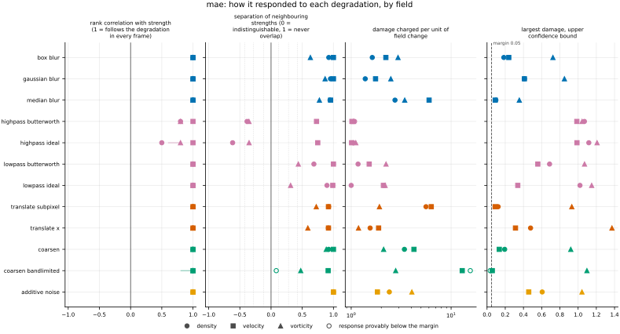
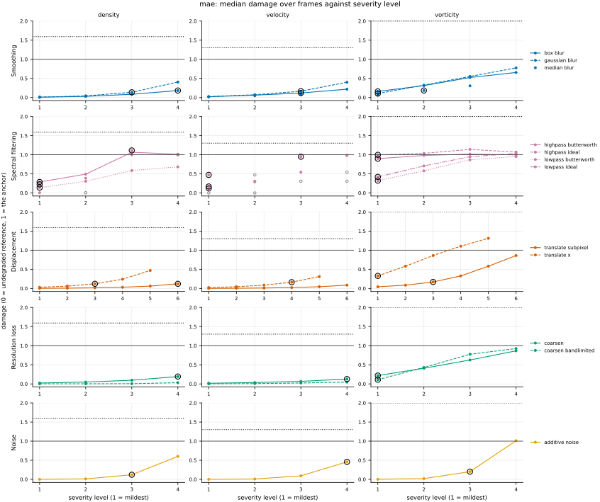
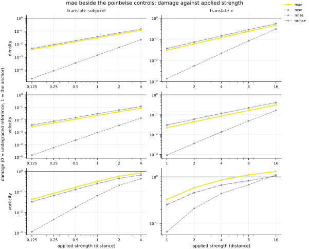

## Definition

For fields $f$ (reference) and $g$ (candidate) sampled on the same analysis grid, with $C$
channels and $N$ cells per channel,

$$
\mathrm{MAE}(f, g) = \frac{1}{CN} \sum_{c=1}^{C} \sum_{i=1}^{N}
\bigl| f_{c,i} - g_{c,i} \bigr| \tag{1}
$$

For a vector field the channels are pooled rather than reduced separately. The analysis
grid is uniform, so cells carry equal weight; on a non-uniform grid Equation (1) would
need cell volumes and would no longer be a plain mean.

Unlike the squared error, Equation (1) is a metric in the mathematical sense: it is the
L1 distance, and it satisfies the triangle inequality.

For a displacement $\delta$ small compared with the scale of variation, expanding
$f(x + \delta) - f(x) \simeq \delta\, \partial_x f$ in Equation (1) gives

$$
\mathrm{MAE} \simeq \delta \bigl\langle |\partial_x f| \bigr\rangle \tag{2}
$$

which is linear in the displacement where the squared error is quadratic. That single
difference in exponent is what separates the two in practice.

### Boundary handling

None. The operation is local to each cell, so no neighbourhood is ever consulted and no
boundary condition can enter.

## Performance

<!-- GENERATED performance: written by `python -m fmeval.cards evidence mae --results results/comparison_1793434653`, do not edit -->



Four measured statistics for mae, one row per degradation grouped by family and one marker per field. From left: the rank correlation between the metric and the applied strength within a frame, with the line showing the resampling interval; the separation of neighbouring strengths as Cliff's delta, where 0 means the metric cannot tell one strength from the next and the faint ticks at 0.12, 0.28 and 0.42 are Vargha and Delaney's small, medium and large anchors, for scale and not as grades; the damage charged per unit of field change at the harshest strength; and the upper confidence bound on the largest damage, beside the fixed margin of 0.05. A hollow marker is a field and degradation on which that bound lies below the margin, so the response is provably small. A missing marker is a statistic the analysis withheld, as the rank correlation is on an axis the metric is invariant to.



Median damage over frames against severity level for mae, one row per family of degradation and one column per field, on one shared scale. The solid grey line is damage 1, the anchor (by default the field's own mean); the dotted black line is the damage assigned to the fake prediction with the right spectrum, where the run included it. The hollow black ring marks the first level at which the metric has moved a tenth of the way to the anchor. Hollow grey markers are strengths excluded for repeating a milder one or for doing nothing. Degradations with three or fewer usable levels are drawn as markers only; points beyond 2 either side are drawn as triangles at the edge. Damage is negative where a degradation moves the metric away from the anchor, as noise raises a single-field quantity the field's mean sets to zero.

**Trend: does the response follow the degradation?**

| test family | field | degradations | rank correlation | fraction of frames in order | weakest gap between neighbouring strengths |
|---|---|---|---|---|---|
| Displacement | density | 2 | 1 | 1 | 0.959 to 0.961 |
| Displacement | velocity | 2 | 1 | 1 | 0.96 |
| Displacement | vorticity | 2 | 1 | 1 | 0.795 to 0.862 |
| Resolution loss | density | 2 | 1 | 0.59 to 1 | 0.542 to 0.962 |
| Resolution loss | velocity | 2 | 1 | 1 | 0.958 to 1 |
| Resolution loss | vorticity | 2 | 1 | 1 | 0.738 to 0.942 |
| Smoothing | density | 3 | 1 | 1 | 0.963 to 0.976 |
| Smoothing | velocity | 3 | 1 | 1 | 0.977 to 1 |
| Smoothing | vorticity | 3 | 1 | 1 | 0.815 to 0.933 |
| Spectral filtering | density | 4 | 0.5 to 1 | 0 to 1 | 0.192 to 0.948 |
| Spectral filtering | velocity | 4 | 1 | 1 | 0.864 to 1 |
| Spectral filtering | vorticity | 4 | 0.8 to 1 | 0 to 1 | 0.323 to 0.719 |
| Noise | density | 1 | 1 | 1 | 1 |
| Noise | velocity | 1 | 1 | 1 | 1 |
| Noise | vorticity | 1 | 1 | 1 | 1 |

**Reactivity: how far does it move?**

| test family | field | change from clean at the harshest strength | elasticity | first strength detected |
|---|---|---|---|---|
| Displacement | density | — | 0.991 to 0.999 | level 3 |
| Displacement | velocity | — | 0.974 to 0.999 | level 4 |
| Displacement | vorticity | — | 0.696 to 0.992 | level 1 |
| Resolution loss | density | — | 0.709 to 1.04 | level 4 |
| Resolution loss | velocity | — | 1 to 2.21 | level 4 |
| Resolution loss | vorticity | — | 0.759 to 1.41 | level 1 |
| Smoothing | density | — | 1.62 to 1.94 | level 3 |
| Smoothing | velocity | — | 1.21 to 1.27 | level 3 |
| Smoothing | vorticity | — | 0.832 to 1.15 | level 1 |
| Spectral filtering | density | — | 0.796 to 7.05 | level 1 |
| Spectral filtering | velocity | — | 0.844 to 0.973 | level 1 |
| Spectral filtering | vorticity | — | 0.181 to 0.551 | level 1 |
| Noise | density | — | 1 | level 3 |
| Noise | velocity | — | 1 | level 4 |
| Noise | vorticity | — | 0.999 | level 3 |
| trap test: fake prediction, right spectrum | density | — | — | damage 1.59 |
| trap test: fake prediction, right spectrum | velocity | — | — | damage 1.3 |
| trap test: fake prediction, right spectrum | vorticity | — | — | damage 2.67 |

**Consistency: how much does it vary from snapshot to snapshot?**

| test family | field | consistency, in the strength's units | snapshots per independent block |
|---|---|---|---|
| Displacement | density | 0.0608 to 0.367 | 1 to 17 |
| Displacement | velocity | 0.0739 to 0.38 | 19 to 20 |
| Displacement | vorticity | 0.179 to 0.587 | 21 to 22 |
| Resolution loss | density | 0.462 to 2 | 1 to 21 |
| Resolution loss | velocity | 0.35 to 1.34 | 21 to 22 |
| Resolution loss | vorticity | 0.421 to 0.695 | 21 |
| Smoothing | density | 0.00715 to 0.0187 | 20 |
| Smoothing | velocity | 0.00738 to 0.0201 | 21 to 22 |
| Smoothing | vorticity | 0.00688 to 0.0244 | 21 |
| Spectral filtering | density | 0.0183 to 0.0295 | 1 to 20 |
| Spectral filtering | velocity | 0.00774 to 0.0245 | 1 to 22 |
| Spectral filtering | vorticity | 0.0422 to 0.413 | 21 to 22 |
| Noise | density | 0.0105 | 1 |
| Noise | velocity | 0.00552 | 21 |
| Noise | vorticity | 0.00557 | 1 |

One row per family of degradation and physical field; a cell gives the range over the degradations in that family. **Trend.** The rank correlation is the Spearman correlation between the strength and how far the metric has moved from its value on the undegraded field of the same frame, in the one direction it moves under that degradation, computed inside a single frame. A value of 1 means every strength moved it further than the last in every frame, whichever way it moves; a response that scatters to both sides scores near 0. The fraction of frames in order counts the frames with no exception. The weakest gap is the smallest Mann-Whitney overlap between two neighbouring strengths across frames: 1 means they never overlap, 0.5 that they cannot be told apart. **Reactivity.** The change from clean is the median, at the harshest strength, of the departure from the undegraded value of the same frame over the size of that value: 0.3 means 30%. It does not exist for this metric, whose undegraded value is exactly zero; the damage below is its relative reading. The elasticity is the percentage change of that departure per percentage change in strength over the mildest strengths. First strength detected is the mildest at which the metric has moved a tenth of the way to the anchor; **damage** reads that 0-to-1 scale as a number. A dash means the measurement is not defined there. A metric's reactivity scales with the power it is expressed in: mean squared error's elasticity is twice root-mean-square error's, though the two carry the same information, so compare magnitudes across metrics with that in mind. **Consistency** is how much the response varies from snapshot to snapshot relative to its size, in the strength's units; the snapshots of one trajectory are correlated, and the last column is how many consecutive snapshots one independent block spans.

These tables report what was measured and grade none of the measurements. What the numbers mean for this metric is written in the subsections below, beside the test that produced each number.

**Profile.**

| field | selectivity | charges most for | charges least for | response provably below 0.05 at 90% on | elasticity to a sub-pixel shift, against severity (distance) | compute cost (x cheapest in this run) |
|---|---|---|---|---|---|---|
| density | 0.6 | `coarsen_bandlimited` | `lowpass_ideal` | `coarsen_bandlimited` | 0.999 | 1.21 |
| velocity | 0.463 | `coarsen_bandlimited` | `highpass_ideal` | — | 0.999 | 2.21 |
| vorticity | 0.13 | `additive_noise` | `highpass_butterworth` | — | 0.992 | 1.16 |

One row per physical field. **Selectivity** is how concentrated the metric's response is on a few degradations, measured per unit of field change: 0 means it charges every degradation the same, as mean squared error does by construction, and values toward 1 that one degradation carries most of it. **Charges most and least for** name the two ends of that profile. **Response provably below** lists degradations on which the upper confidence bound of the largest damage lies below the margin -- an equivalence test, so an entry says the response is provably small, not merely not significant; a dash means no degradation met the bound. **Elasticity** is the slope of log damage against log shift over the smallest shifts: 1 means damage grows in proportion to the shift, 2 with its square. **Compute cost** is wall-clock per evaluation over the cheapest metric and field in the same run.

<!-- END GENERATED performance -->

## Intuition

Mean absolute error compares two fields one cell at a time: subtract, take the size of
the difference regardless of sign, average. Taking the size rather than the square means
every unit of error counts the same wherever it appears, so one badly wrong cell and many
slightly wrong cells contribute in proportion to their total error rather than being
dominated by the worst. Nothing in the calculation looks beyond a single cell, so the
metric carries no notion of shape or position.

It shares that blindness with mean squared error and differs in how steeply it responds.
On a four-by-four grid, with one candidate that moved the bright square a cell and another
that halved its brightness where it stands:

```
reference        moved one cell    half brightness
0 0 0 0          0 0 0 0           0    0    0    0
0 1 1 0          0 0 1 1           0   0.5  0.5   0
0 1 1 0          0 0 1 1           0   0.5  0.5   0
0 0 0 0          0 0 0 0           0    0    0    0

                 mae = 0.25        mae = 0.125
```

The displaced candidate scores twice as badly as the damped one. Mean squared error, on
these same fields, makes it four times. Both prefer the damped candidate; they disagree
about by how much, and below one cell that disagreement grows into a factor of tens.

What this metric ignores is the arrangement of the errors: the same total error
concentrated at a sharp front and scattered as noise across the domain are the same
number.

## Reading the output

The value runs from zero upwards with no upper limit, in the field's own units, so a
density field and a vorticity field produce numbers that cannot be compared with each
other. Lower is better, and zero means the two fields are identical cell for cell. Because
it is linear rather than squared, the number is directly readable as a typical error size:
an MAE of 0.01 means the average cell is off by about 0.01 of whatever the field measures.

What counts as good depends entirely on the variance of the field being predicted, which
is why the suite reports damage — the value rescaled so that zero is the reference and one
is what the reference's own spatial mean scores, which for this metric is the mean absolute
fluctuation of the reference.

Comparisons across models on the same field, dataset and analysis grid are meaningful and
are the intended use. Comparisons across fields need normalising because of the units.
Comparisons across resolutions are invalid as they stand: the value is a mean over cells,
so refining the grid reweights the small scales even when nothing about the prediction has
changed. Compare on a common analysis grid, which is what this suite remaps onto before
measuring.

## Limitations

The linear response is a double-edged property. It makes MAE far more sensitive than MSE
to sub-cell displacement, which is useful when position matters, but it also means a
single catastrophically wrong region is not flagged any more urgently than the same total
error spread thinly everywhere. A model that is excellent across the domain and badly
wrong in one small area can score better than one that is mediocre throughout, and MAE
will not tell you which situation you are in.

It is also blind to position in the same way as every metric that compares fields cell by
cell, so a shock with exactly the right shape and strength sitting one cell over is
penalised twice: once where it should be and is not, once where it is and should not be.
And the absolute value is not differentiable at zero error, which matters if it is used as
a training loss rather than a diagnostic.

## Results

<!-- GENERATED run: written by `python -m fmeval.cards evidence mae --results results/comparison_1793434653`, do not edit -->

Measured on `kinet_re5e4`, frames 2000 to 10000 (161 frames of developed flow), on the 256 analysis grid, seed 20260807, at commit `a9a8b7f86aca`. Run `comparison_1793434653`.

Every number in this section comes from that one run. Regenerate with `python -m fmeval.cards evidence <name> --results results/comparison_1793434653`.

<!-- END GENERATED run -->

Each subsection links to the degradations that subsection reports. What those degradations
do, and what their strength numbers mean, is documented on their own pages.

### Smoothing

[gaussian_blur](../../degradations/gaussian_blur/card.md) ·
[box_blur](../../degradations/box_blur/card.md) ·
[median_blur](../../degradations/median_blur/card.md)

<!-- GENERATED results_smoothing: written by `python -m fmeval.cards evidence mae --results results/comparison_1793434653`, do not edit -->

| degradation | field | strengths | rank correlation | fraction of frames in the right order | weakest gap between neighbouring strengths |
|---|---|---|---|---|---|
| `box_blur` | density | 4 | 1 | 1 | 0.963 |
| `box_blur` | velocity | 4 | 1 | 1 | 1 |
| `box_blur` | vorticity | 4 | 1 | 1 | 0.815 |
| `gaussian_blur` | density | 4 | 1 | 1 | 0.976 |
| `gaussian_blur` | velocity | 4 | 1 | 1 | 1 |
| `gaussian_blur` | vorticity | 4 | 1 | 1 | 0.933 |
| `median_blur` | density | 3 | 1 | 1 | 0.973 |
| `median_blur` | velocity | 3 | 1 | 1 | 0.977 |
| `median_blur` | vorticity | 3 | 1 | 1 | 0.887 |

<!-- END GENERATED results_smoothing -->

### Spectral filtering

[lowpass_ideal](../../degradations/lowpass_ideal/card.md) ·
[lowpass_butterworth](../../degradations/lowpass_butterworth/card.md) ·
[highpass_ideal](../../degradations/highpass_ideal/card.md) ·
[highpass_butterworth](../../degradations/highpass_butterworth/card.md)

<!-- GENERATED results_spectral: written by `python -m fmeval.cards evidence mae --results results/comparison_1793434653`, do not edit -->

| degradation | field | strengths | rank correlation | fraction of frames in the right order | weakest gap between neighbouring strengths |
|---|---|---|---|---|---|
| `highpass_butterworth` | density | 4 | 0.8 | 0 | 0.308 |
| `highpass_butterworth` | velocity | 3 | 1 | 1 | 0.864 |
| `highpass_butterworth` | vorticity | 4 | 0.8 | 0.298 | 0.323 |
| `highpass_ideal` | density | 3 | 0.5 | 0 | 0.192 |
| `highpass_ideal` | velocity | 2 | 1 | 1 | 0.874 |
| `highpass_ideal` | vorticity | 4 | 0.8 | 0 | 0.324 |
| `lowpass_butterworth` | density | 4 | 1 | 1 | 0.843 |
| `lowpass_butterworth` | velocity | 3 | 1 | 1 | 1 |
| `lowpass_butterworth` | vorticity | 4 | 1 | 1 | 0.719 |
| `lowpass_ideal` | density | 3 | 1 | 1 | 0.948 |
| `lowpass_ideal` | velocity | 2 | 1 | 1 | 0.995 |
| `lowpass_ideal` | vorticity | 4 | 1 | 1 | 0.657 |

<!-- END GENERATED results_spectral -->

### Displacement

[translate_x](../../degradations/translate/card.md) ·
[translate_subpixel](../../degradations/translate_subpixel/card.md)

<!-- GENERATED results_geometric: written by `python -m fmeval.cards evidence mae --results results/comparison_1793434653`, do not edit -->

| degradation | field | strengths | rank correlation | fraction of frames in the right order | weakest gap between neighbouring strengths |
|---|---|---|---|---|---|
| `translate_subpixel` | density | 6 | 1 | 1 | 0.961 |
| `translate_subpixel` | velocity | 6 | 1 | 1 | 0.96 |
| `translate_subpixel` | vorticity | 6 | 1 | 1 | 0.862 |
| `translate_x` | density | 5 | 1 | 1 | 0.959 |
| `translate_x` | velocity | 5 | 1 | 1 | 0.96 |
| `translate_x` | vorticity | 5 | 1 | 1 | 0.795 |

<!-- END GENERATED results_geometric -->

The response is linear in the displacement, as Equation (2) gives: on vorticity the damage
ratios per doubling below one cell are 2.00, 1.98 and 1.93 against the 2 implied by that
scaling. Against MSE over the same shifts, MAE assigns 38 times the damage at an eighth of
a cell and 5.0 times at one cell, and its damage at an eighth of a cell is 0.043 against
MSE's 0.0011. Of the cell-by-cell baselines, MAE is the one that notices sub-cell
displacement.

### Resolution loss

[coarsen](../../degradations/coarsen/card.md) ·
[coarsen_bandlimited](../../degradations/coarsen_bandlimited/card.md)

<!-- GENERATED results_resolution: written by `python -m fmeval.cards evidence mae --results results/comparison_1793434653`, do not edit -->

| degradation | field | strengths | rank correlation | fraction of frames in the right order | weakest gap between neighbouring strengths |
|---|---|---|---|---|---|
| `coarsen` | density | 4 | 1 | 1 | 0.962 |
| `coarsen` | velocity | 4 | 1 | 1 | 1 |
| `coarsen` | vorticity | 4 | 1 | 1 | 0.942 |
| `coarsen_bandlimited` | density | 4 | 1 | 0.59 | 0.542 |
| `coarsen_bandlimited` | velocity | 4 | 1 | 1 | 0.958 |
| `coarsen_bandlimited` | vorticity | 4 | 1 | 1 | 0.738 |

<!-- END GENERATED results_resolution -->

Both coarsenings are ordered correctly on every field, with a rank correlation of 1. They differ in size. At a factor of 16, `coarsen` scores a damage of 0.19, 0.13 and 0.87 on density, velocity and vorticity, and `coarsen_bandlimited` 0.03, 0.05 and 0.92. The two operators keep the same block means, so on the smooth fields most of what `coarsen` charges is its staircase; on vorticity, whose structure the coarse grid genuinely cannot hold, they nearly agree. Under the band-limited operator density is in the right order in only 59% of frames: its damage at factors 2 and 4 is 0.002 at both, and which of the two is larger changes from frame to frame. The other pointwise metrics, `spectrum_l2` and `h1_seminorm` show this on density too, and its
cause is not established; `issues/039` records what was ruled out.

### Noise

[additive_noise](../../degradations/additive_noise/card.md)

<!-- GENERATED results_stochastic: written by `python -m fmeval.cards evidence mae --results results/comparison_1793434653`, do not edit -->

| degradation | field | strengths | rank correlation | fraction of frames in the right order | weakest gap between neighbouring strengths |
|---|---|---|---|---|---|
| `additive_noise` | density | 4 | 1 | 1 | 1 |
| `additive_noise` | velocity | 4 | 1 | 1 | 1 |
| `additive_noise` | vorticity | 4 | 1 | 1 | 1 |

<!-- END GENERATED results_stochastic -->

### Trap tests

[gaussian_impostor](../../degradations/gaussian_impostor/card.md) ·
[uncorrelated](../../degradations/random_large_translation/card.md)

<!-- GENERATED results_canaries: written by `python -m fmeval.cards evidence mae --results results/comparison_1793434653`, do not edit -->

| field | damage assigned to the fake prediction | closest real degradation | damage of the reference moved far away | value on the anchor |
|---|---|---|---|---|
| density | 1.59 | `highpass_ideal=3.03099` | 1.17 | 0.00445 |
| velocity | 1.3 | `highpass_ideal=4.02293` | 1.72 | 0.0345 |
| vorticity | 2.67 | `translate_x=16` | 1.9 | 0.00098 |

The fake prediction here has exactly the reference field's amplitude spectrum and completely scrambled structure. Damage 1 is what the anchor scores, by default the reference's own spatial mean, a prediction that knows the mean and nothing else. The damage column therefore says how close to useless this metric considers that fake prediction: a low number means the metric was fooled. The third column translates the same number into an ordinary degradation whose damage the fake prediction matches, which is easier to picture. The fourth is the reference moved by a large random offset, the right statistics in the wrong place; where a field's energy sits in its largest scales that copy stays partly correlated with the reference, so it is not the score of an unrelated field.

<!-- END GENERATED results_canaries -->

### Compared with the other metrics

<!-- GENERATED results_summary: written by `python -m fmeval.cards evidence mae --results results/comparison_1793434653`, do not edit -->

| compared with | rank correlation over every degradation |
|---|---|
| `rmse` | 0.986 |
| `mse` | 0.986 |
| `nrmse` | 0.963 |
| `max_error` | 0.937 |
| `h_minus_one` | 0.913 |
| `h1_seminorm` | 0.677 |
| `spectral_energy_flux` | 0.301 |
| `increment_w1_by_separation` | 0.217 |
| `spectrum_l2` | 0.136 |
| `energy_distance` | 0.0792 |
| `increment_w1` | 0.0547 |
| `tail_index` | -0.0681 |
| `palinstrophy` | -0.0971 |
| `increment_flatness` | -0.101 |
| `enstrophy` | -0.103 |
| `kinetic_energy` | -0.208 |

Computed on the median value at each combination of degradation and strength, over every degradation and physical field in the run, with the undegraded reference excluded. Two metrics correlating near 1 put the degradations in the same order, but the two may still weight those degradations very differently. A correlation near 1 therefore means the two metrics are redundant for ranking models, not that the two are interchangeable as training losses.

<!-- END GENERATED results_summary -->

MAE and MSE correlate at 0.986 across every degradation, above the 0.95 redundancy
threshold, and MAE against NRMSE at 0.963 — they order the degradations almost identically
while differing by 38 times in sub-cell displacement damage. For ranking models the
cell-by-cell baselines are duplicates of one another; as training losses they are not.

MAE also rejects the phase-scrambled fake prediction, with damage 1.59, 1.30 and 2.67 on
density, velocity and vorticity, all above the 1 that the field's own mean scores; on
vorticity it charges more than MSE's 2.13. Reach
for MAE over MSE when small displacements are what you need to see, and when you do not
want the score dominated by the worst cell.

### Damage beside the other metrics

<!-- GENERATED results_damage_by_level: written by `python -m fmeval.cards evidence mae --results results/comparison_1793434653`, do not edit -->



Median damage over frames against the applied strength, log-log, for mae (bold, in colour) and the pointwise controls mse, rmse, nrmse (thin, grey), one column per displacement degradation and one row per field. The grey line is damage 1, the anchor (by default the field's own mean). Parallel lines charge in the same proportion at every strength; a steeper line charges relatively more for the larger shifts, which is what decides whether two metrics are interchangeable as training losses. These are the same numbers as the table beneath.

**Displacement, density, `translate_subpixel`** (strength: distance).

| metric | 0.125 | 0.25 | 0.5 | 1 | 2 | 4 |
|---|---|---|---|---|---|---|
| `mae` | 0.00383 | 0.00767 | 0.0153 | 0.0306 | 0.061 | 0.121 |
| `mse` | 2.17e-05 | 8.68e-05 | 0.000347 | 0.00138 | 0.00551 | 0.0219 |
| `rmse` | 0.00466 | 0.00931 | 0.0186 | 0.0372 | 0.0743 | 0.148 |
| `nrmse` | 0.00463 | 0.00926 | 0.0185 | 0.037 | 0.0738 | 0.147 |

**Displacement, density, `translate_x`** (strength: distance).

| metric | 1 | 2 | 4 | 8 | 16 |
|---|---|---|---|---|---|
| `mae` | 0.0306 | 0.061 | 0.121 | 0.24 | 0.469 |
| `mse` | 0.00138 | 0.00551 | 0.0219 | 0.0849 | 0.307 |
| `rmse` | 0.0372 | 0.0743 | 0.148 | 0.291 | 0.555 |
| `nrmse` | 0.037 | 0.0738 | 0.147 | 0.29 | 0.55 |

**Displacement, velocity, `translate_subpixel`** (strength: distance).

| metric | 0.125 | 0.25 | 0.5 | 1 | 2 | 4 |
|---|---|---|---|---|---|---|
| `mae` | 0.00279 | 0.00559 | 0.0112 | 0.0223 | 0.0441 | 0.0859 |
| `mse` | 1.45e-05 | 5.81e-05 | 0.000232 | 0.000924 | 0.0036 | 0.0136 |
| `rmse` | 0.00381 | 0.00762 | 0.0152 | 0.0304 | 0.06 | 0.117 |
| `nrmse` | 0.00382 | 0.00763 | 0.0153 | 0.0304 | 0.06 | 0.117 |

**Displacement, velocity, `translate_x`** (strength: distance).

| metric | 1 | 2 | 4 | 8 | 16 |
|---|---|---|---|---|---|
| `mae` | 0.0223 | 0.0441 | 0.0859 | 0.163 | 0.31 |
| `mse` | 0.000924 | 0.0036 | 0.0136 | 0.0489 | 0.165 |
| `rmse` | 0.0304 | 0.06 | 0.117 | 0.221 | 0.406 |
| `nrmse` | 0.0304 | 0.06 | 0.117 | 0.221 | 0.406 |

**Displacement, vorticity, `translate_subpixel`** (strength: distance).

| metric | 0.125 | 0.25 | 0.5 | 1 | 2 | 4 |
|---|---|---|---|---|---|---|
| `mae` | 0.0428 | 0.0854 | 0.169 | 0.328 | 0.582 | 0.86 |
| `mse` | 0.00112 | 0.00448 | 0.0176 | 0.066 | 0.21 | 0.44 |
| `rmse` | 0.0335 | 0.0669 | 0.133 | 0.257 | 0.458 | 0.663 |
| `nrmse` | 0.0328 | 0.0654 | 0.13 | 0.253 | 0.456 | 0.67 |

**Displacement, vorticity, `translate_x`** (strength: distance).

| metric | 1 | 2 | 4 | 8 | 16 |
|---|---|---|---|---|---|
| `mae` | 0.328 | 0.582 | 0.86 | 1.1 | 1.31 |
| `mse` | 0.066 | 0.21 | 0.44 | 0.679 | 1.1 |
| `rmse` | 0.257 | 0.458 | 0.663 | 0.824 | 1.05 |
| `nrmse` | 0.253 | 0.456 | 0.67 | 0.832 | 1.05 |

Median damage over frames at every strength, this metric in the first row and the pointwise controls beneath it, all on the same 0-to-1 scale where 0 is the undegraded reference and 1 the anchor (by default the field's own mean); a dash means no damage scale on that field. The rank correlations under *Compared with the other metrics* say whether two metrics put the strengths in the same order; this table says how much each one charges for the same strength, which decides whether two metrics are interchangeable as training losses.

<!-- END GENERATED results_damage_by_level -->

## References

\bibliography
