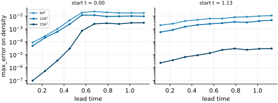
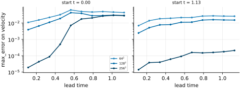
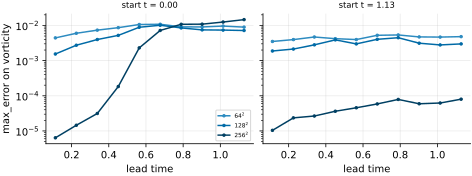
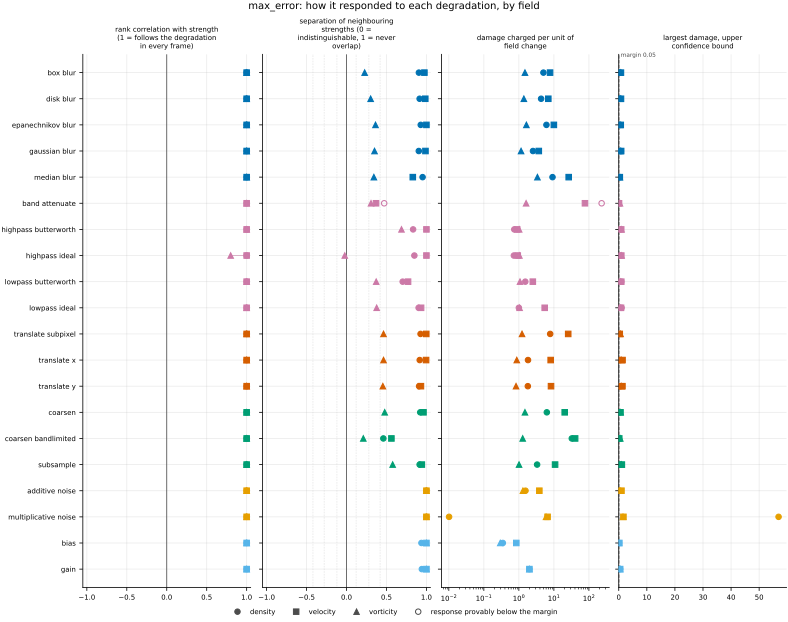
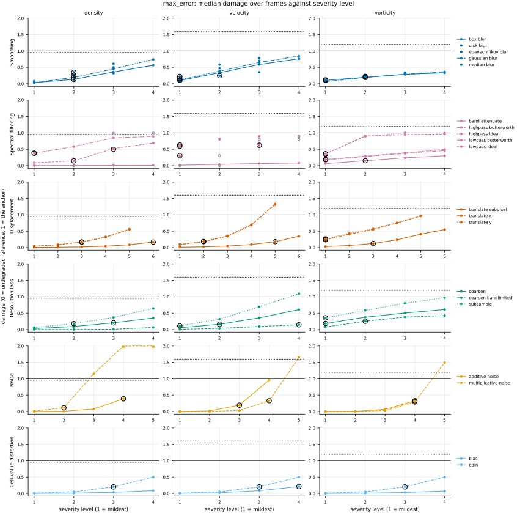
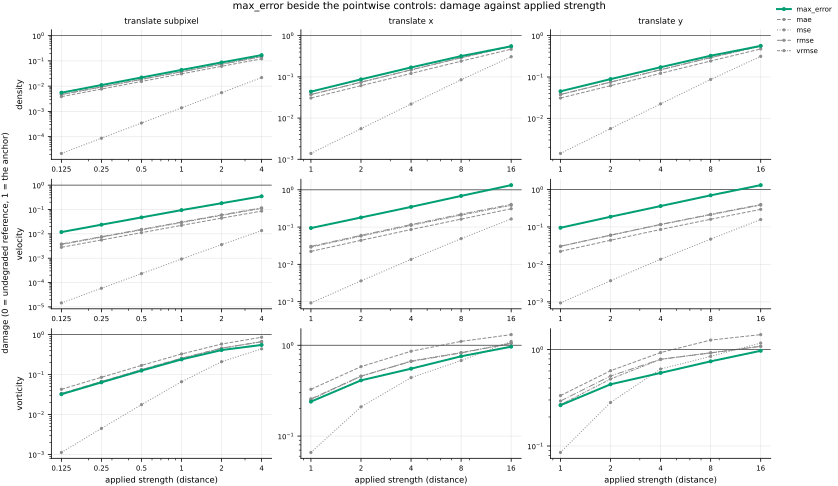

## Definition

For fields $f$ (reference) and $g$ (candidate) sampled on the same analysis grid, with $C$
channels and $N$ cells per channel, the maximum error is the discrete $L^\infty$ norm of their
difference, Equation 7 of [@roy2005]:

$$
\mathrm{MaxE}(f, g) = \max_{1 \le c \le C} \; \max_{1 \le i \le N} \bigl| f_{c,i} - g_{c,i} \bigr| \tag{1}
$$

PDEBench reports this "max error" for machine-learned surrogates beside RMSE and nRMSE, as the
local worst case and a proxy for the stability of time-stepping, in the table of metrics of
Section 3.3 of [@takamoto2022].

For a vector field the channels are pooled, so the maximum runs over every component of every
cell, as `mae` and `mse` pool channels into their means. That choice is this bundle's, not a
source's. PDEBench's code takes the maximum per channel and then averages over channels, which
is the sibling bundle [max_error_channel_mean](../../metrics/max_error_channel_mean/card.md); the two agree
on every one-channel field and differ only on velocity. A maximum carries no cell
weights, so the formula of Equation (1) is unchanged on a non-uniform grid, but its value is
not grid-neutral there: a peak inside a coarse cell is averaged down more than one inside a
fine cell, so the number depends on where the grid is refined.

The per-cell map stored beside the scalar is the absolute error, reduced over channels by its
largest value,

$$
m_i = \max_{1 \le c \le C} \bigl| f_{c,i} - g_{c,i} \bigr| \tag{2}
$$

and the declared reduction is `max`: the largest value of the map is Equation (1).

Two consequences follow directly from Equation (1). For a displacement $\delta$ small compared
with the scale of variation, expanding $g(x) = f(x + \delta) \simeq f(x) + \delta\, \partial_x f$
gives

$$
\mathrm{MaxE} \simeq \delta \max_{c,i} \bigl| \partial_x f_{c,i} \bigr| \tag{3}
$$

which is linear in the displacement, like the mean absolute error, but set by the steepest
gradient in the domain rather than the mean gradient.

For a jump of height $h$ between two constant states, with its face on a cell boundary, a
shift by any whole number of cells (short of wrapping a periodic domain onto itself) leaves a
cell on which one field sits on the high side and the other on the low side, so
$\mathrm{MaxE} = h$ whatever the size of the displacement. Two departures from that idealised
case change the number. If the face falls inside a cell, as it generally does once a field is
averaged onto the analysis grid, that cell holds a fraction $a$ of the high state and a
one-cell shift gives

$$
\mathrm{MaxE} = \max(a,\, 1 - a)\, h \tag{4}
$$

which is as low as $h/2$; a shift of two cells reaches $h$. If the jump sits on a varying
background, the background's own change over the shift adds to $h$, so the value exceeds $h$
and keeps growing with the shift. `test_metric.py` tests the cell-face case at shifts of one
to three cells and Equation (4) at $a = 1/2$; the varying background is not tested.

On the damage scale the anchor is the reference's own spatial mean, taken channel by channel
(`judgements/001`), so damage 1 is the reference's largest departure from its mean,
$\max_{c,i} |f_{c,i} - \bar f_c|$.

### Boundary handling

None. The operation is local to each cell, so no neighbourhood is ever consulted and no
boundary condition can enter.

### How its field reports it

Two fields report a maximum error. They agree on a one-channel field and reduce a vector field
differently; this bundle is the pooled form, and the per-channel form of the machine-learning
benchmarks is [max_error_channel_mean](../../metrics/max_error_channel_mean/card.md).

- **Numerical analysis and code verification** [@roy2005]. The object is the discrete
  $L^\infty$ norm of the discretisation error, $\max_n |f_{k,n} - f_{\mathrm{exact},n}|$ over the
  mesh nodes of grid $k$, defined beside the $L^2$ norm (Sect. 2.5, Eq. 7) and applied to one
  variable at a time. The figure is the norm against the grid spacing $h$ on logarithmic axes,
  with first- and second-order slopes drawn for reference (Fig. 3, for mass density), and the
  statistic reported beside it is the observed order of accuracy, $p = \ln(L_{k+1}/L_k) / \ln r$
  from two grids refined by the ratio $r$ against an exact solution (Eq. 8, plotted against $h$ in
  Fig. 4), or from three grids without one (Sect. 3.3.3, Eq. 18). For a flow with shocks Roy notes
  that shock-capturing schemes fall to first order whatever their formal order (Sect. 3.5.6). The
  experiment is a manufactured or exact solution on systematically refined grids (Sect. 2.5;
  Table 1, five grids at $r = 2$).
- **Machine-learning benchmarks for PDEs** [@takamoto2022; @ohana2024]. PDEBench's maximum error
  is the per-channel maximum averaged over channels, reported in its tables per PDE and model
  (App. E) and drawn against a PDE parameter beside the RMSE (Sect. 4.2, Fig. 3a): that is
  [max_error_channel_mean](../../metrics/max_error_channel_mean/card.md). The Well's $L^\infty$ error is
  one value per field (App. E.3).

**The experiments here.** A refinement study against a known solution does not exist: the three
runs of `forecast_re5e4` are not a refinement sequence as they stand
(`docs/datasets/reynolds_ladder_2d.md`, "Can the three runs be read as a grid-refinement
sequence?"), and `sod_shock_tube` has the exact solution but no solver run at several
resolutions to set against it. The study is written up in
[EXP-max_error-grid-convergence-with-a-known-solution](https://github.com/khegazy/pde_metrics/blob/main/proposals/EXP-max_error-grid-convergence-with-a-known-solution.md).
`forecast_re5e4` gives one model's error against lead time from two starting times; a test set of
many initial conditions is
[EXP-nrmse-rollouts-over-many-initial-conditions](https://github.com/khegazy/pde_metrics/blob/main/proposals/EXP-nrmse-rollouts-over-many-initial-conditions.md).
The metric also runs on the degradation ladder on `kinet_re5e4`, on `sod_shock_tube`, on the
member mean of `synthetic_ensemble` and on the Reynolds ladder: it needs nothing but two fields
on one grid.

## Performance

<!-- GENERATED performance: written by `python -m fmeval.cards evidence max_error --results results/comparison_1793829127 --results results/comparison_1793812304 --results results/comparison_1793812401 --results results/comparison_1793811840 --results results/comparison_1793829231`, do not edit -->



*As this metric's own field draws it, from run `comparison_1793811840`.* max_error on density against lead time, the physical time since the forecast started, one panel per start and one line per run, darker the finer the run's grid. Each point is one prediction step of one forecast.



*As this metric's own field draws it, from run `comparison_1793811840`.* max_error on velocity against lead time, the physical time since the forecast started, one panel per start and one line per run, darker the finer the run's grid. Each point is one prediction step of one forecast.



*As this metric's own field draws it, from run `comparison_1793811840`.* max_error on vorticity against lead time, the physical time since the forecast started, one panel per start and one line per run, darker the finer the run's grid. Each point is one prediction step of one forecast.



Four measured statistics for max_error, one row per degradation grouped by family and one marker per field. From left: the rank correlation between the metric and the applied strength within a frame, with the line showing the resampling interval; the separation of neighbouring strengths as Cliff's delta, where 0 means the metric cannot tell one strength from the next and the faint ticks at 0.12, 0.28 and 0.42 are Vargha and Delaney's small, medium and large anchors, for scale and not as grades; the damage charged per unit of field change at the harshest strength; and the upper confidence bound on the largest damage, beside the fixed margin of 0.05. A hollow marker is a field and degradation on which that bound lies below the margin, so the response is provably small. A missing marker is a statistic the analysis withheld, as the rank correlation is on an axis the metric is invariant to.



Median damage over frames against severity level for max_error, one row per family of degradation and one column per field, on one shared scale. The solid grey line is damage 1, the anchor (by default the field's own mean); the dotted black line is the damage assigned to the fake prediction with the right spectrum, where the run included it. The hollow black ring marks the first level at which the metric has moved a tenth of the way to the anchor. Hollow grey markers are strengths excluded for repeating a milder one or for doing nothing. Degradations with three or fewer usable levels are drawn as markers only; points beyond 2 either side are drawn as triangles at the edge. Damage is negative where a degradation moves the metric away from the anchor, as noise raises a single-field quantity the field's mean sets to zero.

**Trend: does the response follow the degradation?**

| test family | field | degradations | rank correlation | fraction of frames in order | weakest gap between neighbouring strengths |
|---|---|---|---|---|---|
| Displacement | density | 3 | 1 | 1 | 0.954 to 0.963 |
| Displacement | velocity | 3 | 1 | 1 | 0.966 to 0.999 |
| Displacement | vorticity | 3 | 1 | 0.925 to 0.969 | 0.727 to 0.732 |
| Cell-value distortion | density | 2 | 1 | 1 | 0.969 to 0.971 |
| Cell-value distortion | velocity | 2 | 1 | 1 | 1 |
| Cell-value distortion | vorticity | 2 | 1 | 1 | 1 |
| Resolution loss | density | 3 | 1 | 0.988 to 1 | 0.73 to 0.961 |
| Resolution loss | velocity | 3 | 1 | 0.994 to 1 | 0.781 to 0.982 |
| Resolution loss | vorticity | 3 | 1 | 0.913 to 0.969 | 0.605 to 0.789 |
| Smoothing | density | 5 | 1 | 1 | 0.952 to 0.976 |
| Smoothing | velocity | 5 | 1 | 1 | 0.915 to 1 |
| Smoothing | vorticity | 5 | 1 | 0.981 to 1 | 0.614 to 0.681 |
| Spectral filtering | density | 5 | 1 | 1 | 0.736 to 0.951 |
| Spectral filtering | velocity | 5 | 1 | 1 | 0.685 to 1 |
| Spectral filtering | vorticity | 5 | 0.8 to 1 | 0.478 to 1 | 0.489 to 0.844 |
| Noise | density | 2 | 1 | 1 | 1 |
| Noise | velocity | 2 | 1 | 1 | 1 |
| Noise | vorticity | 2 | 1 | 1 | 1 |

**Reactivity: how far does it move?**

| test family | field | change from clean at the harshest strength | elasticity | first strength detected |
|---|---|---|---|---|
| Displacement | density | — | 0.966 to 0.998 | level 3 |
| Displacement | velocity | — | 0.943 to 0.999 | level 2 |
| Displacement | vorticity | — | 0.556 to 0.983 | level 1 |
| Cell-value distortion | density | — | 1 | level 3 |
| Cell-value distortion | velocity | — | 1 | level 3 |
| Cell-value distortion | vorticity | — | 1 | level 3 |
| Resolution loss | density | — | 1.14 to 1.34 | level 2 |
| Resolution loss | velocity | — | 1.31 to 1.88 | level 1 |
| Resolution loss | vorticity | — | 0.581 to 1.13 | level 1 |
| Smoothing | density | — | 1.44 to 1.79 | level 2 |
| Smoothing | velocity | — | 0.894 to 1.25 | level 1 |
| Smoothing | vorticity | — | 0.706 to 0.92 | level 1 |
| Spectral filtering | density | — | 0.443 to 8.2 | level 1 |
| Spectral filtering | velocity | — | 0.235 to 1.27 | level 1 |
| Spectral filtering | vorticity | — | 0.4 to 1.55 | level 1 |
| Noise | density | — | 1 | level 2 |
| Noise | velocity | — | 0.999 to 1 | level 3 |
| Noise | vorticity | — | 0.998 to 1 | level 4 |
| trap test: fake prediction, right spectrum | density | — | — | damage 0.955 |
| trap test: fake prediction, right spectrum | velocity | — | — | damage 1.6 |
| trap test: fake prediction, right spectrum | vorticity | — | — | damage 1.2 |

**Consistency: how much does it vary from snapshot to snapshot?**

| test family | field | consistency, in the strength's units | snapshots per independent block |
|---|---|---|---|
| Displacement | density | 0.0899 to 0.5 | 11 to 13 |
| Displacement | velocity | 0.0677 to 0.53 | 1 to 20 |
| Displacement | vorticity | 0.175 to 1.51 | 20 to 21 |
| Cell-value distortion | density | 0.0247 to 0.0276 | 17 to 20 |
| Cell-value distortion | velocity | 0.00856 to 0.00965 | 1 to 16 |
| Cell-value distortion | vorticity | 0.017 to 0.0174 | 11 to 20 |
| Resolution loss | density | 0.69 to 1.59 | 13 to 18 |
| Resolution loss | velocity | 0.77 to 1.69 | 16 to 22 |
| Resolution loss | vorticity | 1.67 to 2.24 | 21 to 22 |
| Smoothing | density | 0.00832 to 0.0186 | 13 |
| Smoothing | velocity | 0.00437 to 0.0152 | 6 to 15 |
| Smoothing | vorticity | 0.0236 to 0.0548 | 21 to 22 |
| Spectral filtering | density | 0.0231 to 0.104 | 13 to 20 |
| Spectral filtering | velocity | 0.0153 to 0.0966 | 6 to 22 |
| Spectral filtering | vorticity | 0.0773 to 0.106 | 14 to 22 |
| Noise | density | 0.00394 to 0.0179 | 1 to 19 |
| Noise | velocity | 0.0051 to 0.00905 | 1 to 6 |
| Noise | vorticity | 0.00771 to 0.0125 | 1 to 20 |

One row per family of degradation and physical field; a cell gives the range over the degradations in that family. **Trend.** The rank correlation is the Spearman correlation between the strength and how far the metric has moved from its value on the undegraded field of the same frame, in the one direction it moves under that degradation, computed inside a single frame. A value of 1 means every strength moved it further than the last in every frame, whichever way it moves; a response that scatters to both sides scores near 0. The fraction of frames in order counts the frames with no exception. The weakest gap is the smallest Mann-Whitney overlap between two neighbouring strengths across frames: 1 means they never overlap, 0.5 that they cannot be told apart. **Reactivity.** The change from clean is the median, at the harshest strength, of the departure from the undegraded value of the same frame over the size of that value: 0.3 means 30%. It does not exist for this metric, whose undegraded value is exactly zero; the damage below is its relative reading. The elasticity is the percentage change of that departure per percentage change in strength over the mildest strengths. First strength detected is the mildest at which the metric has moved a tenth of the way to the anchor; **damage** reads that 0-to-1 scale as a number. A dash means the measurement is not defined there. A metric's reactivity scales with the power it is expressed in: mean squared error's elasticity is twice root-mean-square error's, though the two carry the same information, so compare magnitudes across metrics with that in mind. **Consistency** is how much the response varies from snapshot to snapshot relative to its size, in the strength's units; the snapshots of one trajectory are correlated, and the last column is how many consecutive snapshots one independent block spans.

These tables report what was measured and grade none of the measurements. What the numbers mean for this metric is written in the subsections below, beside the test that produced each number.

**Profile.**

| field | selectivity | charges most for | charges least for | response provably below 0.05 at 90% on | elasticity to a sub-pixel shift, against severity (distance) | compute cost (x cheapest in this run) |
|---|---|---|---|---|---|---|
| density | 0.907 | `band_attenuate` | `multiplicative_noise` | `band_attenuate` | 0.998 | 1.18 |
| velocity | 0.637 | `band_attenuate` | `bias` | — | 0.999 | 2.48 |
| vorticity | 0.361 | `multiplicative_noise` | `bias` | — | 0.983 | 1.22 |

One row per physical field. **Selectivity** is how concentrated the metric's response is on a few degradations, measured per unit of field change: 0 means it charges every degradation the same, as mean squared error does by construction, and values toward 1 that one degradation carries most of it. **Charges most and least for** name the two ends of that profile. **Response provably below** lists degradations on which the upper confidence bound of the largest damage lies below the margin -- an equivalence test, so an entry says the response is provably small, not merely not significant; a dash means no degradation met the bound. **Elasticity** is the slope of log damage against log shift over the smallest shifts: 1 means damage grows in proportion to the shift, 2 with its square. **Compute cost** is wall-clock per evaluation over the cheapest metric and field in the same run.

<!-- END GENERATED performance -->

## Intuition

The maximum error compares two fields one cell at a time, takes the size of each difference
regardless of sign, and reports the largest. It answers the question of where the prediction
is worst, and how bad it is there. It reveals a local failure that an average hides: one
spurious spike, an overshoot next to a sharp front, or the first cell of an instability that
is starting to grow.

An average spreads each cell's error over the whole domain, so a single wrong cell among
many counts for very little. The maximum gives that cell all of the weight and every other
cell none. On a four-by-four grid, with a bright square, a copy moved by one cell, a copy at
half the brightness, and a copy with one extra bright cell in a corner:

```
reference      moved one cell   half brightness      one spike
0 0 0 0        0 0 0 0          0    0    0    0     1 0 0 0
0 1 1 0        0 0 1 1          0   0.5  0.5   0     0 1 1 0
0 1 1 0        0 0 1 1          0   0.5  0.5   0     0 1 1 0
0 0 0 0        0 0 0 0          0    0    0    0     0 0 0 0

               max error = 1    max error = 0.5      max error = 1
                                                     (mean absolute error = 0.0625)
```

The moved square and the single spike both score the full height of the square, because each
has at least one cell that is completely wrong. The mean absolute error charges the spike only
one sixteenth of that. A sharp edge that sits exactly between two cells, moved by two or three
cells instead of one, also scores its full height: once such a feature has left its own cells,
the maximum cannot tell a small miss from a large one. An edge that falls inside a cell, which
is then half bright, scores only half its height when moved by one cell, and the full height
from two cells on.

What this metric ignores is everything except the single worst cell: how many cells are
wrong, and by how much, below that one.

## Reading the output

The value runs from zero upwards with no upper limit, in the field's own units, so a density
field and a vorticity field produce numbers that cannot be compared with each other. Lower is
better, and zero means the two fields agree in every cell. The number is directly readable as
a bound: no cell is off by more than it.

What counts as good depends on how far the field itself strays from its mean, which is why
the suite reports damage, the value rescaled so that zero is the reference and one is what the
reference's own spatial mean scores. For this metric that anchor is the reference's largest
departure from its mean, so a damage of 0.1 says the worst cell is off by a tenth of the
field's largest excursion.

Comparisons across models on the same field, dataset and analysis grid are meaningful and are
the intended use. Comparisons across fields need normalising because of the units. Comparisons
across resolutions are invalid as they stand: a finer grid offers more cells to take the
maximum over, and a remap onto cell averages lowers peaks, so the same prediction scores
differently on different grids. Compare on a common analysis grid, which is what this suite
remaps onto before measuring.

The companion is a per-cell map, Equation (2): the absolute error at each cell, the largest
over channels. Its brightest cell is the metric. A single isolated bright cell is a local
excursion; a ridge along a front is a displaced sharp feature. Every other cell contributes
nothing to the number, so the map shows where the error lies, not shares of the metric. The
report's `field_gallery` figure clips its colour scale at the 99.5th percentile of the values
of all its panels, so on a panel whose worst cell lies above that limit the worst cell is drawn
in the same saturated colour as the other cells above it; read the value from the stored map,
not from the figure.

## Limitations

It suffers the double penalty in its most extreme form. A sharp front, a shock or a
shocklet, with the right shape and strength but sitting one cell from where it should be,
scores the full height of its jump when its face lies on a cell boundary, as much as a
prediction that keeps the low state where the front should be. On a field with sharp features
the maximum error therefore reaches the height of the largest jump as soon as anything is
misplaced by a cell or two, and stops distinguishing a near miss from a gross one. A front
whose face falls inside a cell scores between half and all of its height at a one-cell shift,
Equation (4), so the same miss scores differently depending on where the front sits within its
cell.

On a field whose largest excursion is one isolated extremum, both the metric and its anchor
are set by that extremum. On `kinet_re5e4` density the reference's largest departure from its
mean is a single deep minimum that sits on the strongest vortex core (measured on frames 2500,
5000, 8000 and 10000; `issues/106`). There the maximum error largely asks whether that one
minimum was reproduced in depth and position, and any prediction unrelated to the reference
that lacks it scores close to the anchor.

It rests on one cell, so it is noisy and depends on the grid. Two predictions that differ
only in where their noise happens to peak score differently. The largest of many independent
noise values tends to exceed the largest of a few, so on a finer grid the same noise level
scores higher with nothing else about the prediction changed.

Like every pointwise error, it is meaningful only while the prediction is still aligned with
the reference. Once a rollout has decorrelated from the truth, the maximum error measures the
size of the field's own excursions and carries no information about the model. Its use as a
stability diagnostic, its growth along a rollout, is not tested by this suite, which scores
single snapshots against a degraded copy and has no rollout input (`issues/094`).

On velocity, pooling the channels means the number is the largest single-component error,
which depends on the orientation of the axes: the same error vector pointing along an axis or
along a diagonal scores differently, by up to the square root of two. And as a training loss
its gradient reaches only the one cell that attains the maximum.

## Results

<!-- GENERATED run: written by `python -m fmeval.cards evidence max_error --results results/comparison_1793829127 --results results/comparison_1793812304 --results results/comparison_1793812401 --results results/comparison_1793811840 --results results/comparison_1793829231`, do not edit -->

Measured on `kinet_re5e4`, frames 2000 to 10000 (161 frames of developed flow), on the 256 analysis grid, seed 20260807, at commit `adbdc88e4950`. Run `comparison_1793829127`.

Every number in this section comes from that run, except in the subsections headed with another experiment and in a figure whose caption names another run, each of which names its own run. Regenerate with `python -m fmeval.cards evidence <name> --results results/comparison_1793829127 --results results/comparison_1793812304 --results results/comparison_1793812401 --results results/comparison_1793811840 --results results/comparison_1793829231`.

<!-- END GENERATED run -->

Each subsection links to the degradations that subsection reports. What those degradations
do, and what their strength numbers mean, is documented on their own pages.

<!-- GENERATED experiments: written by `python -m fmeval.cards catalog`, do not edit -->

**Across the experiments.**

| experiment | what a run on it is evidence of | on this card |
|---|---|---|
| `kinet_re5e4` | developed flow | measured, run `comparison_1793829127`: the main results |
| `kinet_re1e6` | developed flow at Re = 1e6, twenty times the Reynolds number of kinet_re5e4, from the same initial condition | measured, run `comparison_1793829231`: under *On `kinet_re1e6`* |
| `synthetic_ensemble` | a calibrated null: evidence that the estimator computes what it claims to compute, and nothing about turbulence | measured, run `comparison_1793812401`: under *On `synthetic_ensemble`*; on this dataset the metric scores the member mean of the ensemble |
| `sod_shock_tube` | an analytic check: evidence that the metric locates and scores a known shock correctly, and nothing about turbulence | measured, run `comparison_1793812304`: under *On `sod_shock_tube`* |
| `forecast_re5e4` | real predictions scored against their targets at each prediction step; who produced the predictions, a trained model or a coarser solver, is not recorded | measured, run `comparison_1793811840`: under *On `forecast_re5e4`* |

One row per dataset a card may cite (`configs/cards/default.yaml`). *Measured* names the run the card cites: the main results are `## Performance` and the subsections below, and every other run has its own subsection headed with its dataset. *Not applicable* gives the reason: one that follows from what the metric declares and what the dataset offers, or one a person wrote on the card (`not_run` in `card.yaml`) because the result would carry no information. *Not yet run* means the metric can run there and the card cites no run on it yet.

<!-- END GENERATED experiments -->

### Smoothing

[gaussian_blur](../../degradations/gaussian_blur/card.md) ·
[box_blur](../../degradations/box_blur/card.md) ·
[median_blur](../../degradations/median_blur/card.md)

<!-- GENERATED results_smoothing: written by `python -m fmeval.cards evidence max_error --results results/comparison_1793829127 --results results/comparison_1793812304 --results results/comparison_1793812401 --results results/comparison_1793811840 --results results/comparison_1793829231`, do not edit -->

| degradation | field | strengths | rank correlation | fraction of frames in the right order | weakest gap between neighbouring strengths |
|---|---|---|---|---|---|
| `box_blur` | density | 4 | 1 | 1 | 0.953 |
| `box_blur` | velocity | 4 | 1 | 1 | 0.987 |
| `box_blur` | vorticity | 4 | 1 | 1 | 0.614 |
| `disk_blur` | density | 3 | 1 | 1 | 0.958 |
| `disk_blur` | velocity | 3 | 1 | 1 | 0.993 |
| `disk_blur` | vorticity | 3 | 1 | 1 | 0.651 |
| `epanechnikov_blur` | density | 3 | 1 | 1 | 0.964 |
| `epanechnikov_blur` | velocity | 3 | 1 | 1 | 1 |
| `epanechnikov_blur` | vorticity | 3 | 1 | 1 | 0.681 |
| `gaussian_blur` | density | 4 | 1 | 1 | 0.952 |
| `gaussian_blur` | velocity | 4 | 1 | 1 | 0.994 |
| `gaussian_blur` | vorticity | 4 | 1 | 1 | 0.675 |
| `median_blur` | density | 3 | 1 | 1 | 0.976 |
| `median_blur` | velocity | 3 | 1 | 1 | 0.915 |
| `median_blur` | vorticity | 3 | 1 | 0.981 | 0.671 |

<!-- END GENERATED results_smoothing -->

Every blur is ordered with a rank correlation of 1 on every field. On density and velocity
neighbouring strengths are almost never confused (weakest gap 0.915 or more). On vorticity they
overlap more, with weakest gaps of 0.614 to 0.681, and `median_blur` is in order in 0.981 of
frames. On velocity the blurs come close to the field's mean: the largest damage is 0.991 under
`gaussian_blur` and 0.966 under `disk_blur`, against 0.774 on density under `gaussian_blur`.

### Spectral filtering

[lowpass_ideal](../../degradations/lowpass_ideal/card.md) ·
[lowpass_butterworth](../../degradations/lowpass_butterworth/card.md) ·
[highpass_ideal](../../degradations/highpass_ideal/card.md) ·
[highpass_butterworth](../../degradations/highpass_butterworth/card.md)

<!-- GENERATED results_spectral: written by `python -m fmeval.cards evidence max_error --results results/comparison_1793829127 --results results/comparison_1793812304 --results results/comparison_1793812401 --results results/comparison_1793811840 --results results/comparison_1793829231`, do not edit -->

| degradation | field | strengths | rank correlation | fraction of frames in the right order | weakest gap between neighbouring strengths |
|---|---|---|---|---|---|
| `band_attenuate` | density | 4 | 1 | 1 | 0.736 |
| `band_attenuate` | velocity | 4 | 1 | 1 | 0.685 |
| `band_attenuate` | vorticity | 4 | 1 | 1 | 0.653 |
| `highpass_butterworth` | density | 4 | 1 | 1 | 0.917 |
| `highpass_butterworth` | velocity | 3 | 1 | 1 | 1 |
| `highpass_butterworth` | vorticity | 4 | 1 | 0.894 | 0.844 |
| `highpass_ideal` | density | 3 | 1 | 1 | 0.925 |
| `highpass_ideal` | velocity | 2 | 1 | 1 | 1 |
| `highpass_ideal` | vorticity | 4 | 0.8 | 0.478 | 0.489 |
| `lowpass_butterworth` | density | 4 | 1 | 1 | 0.851 |
| `lowpass_butterworth` | velocity | 3 | 1 | 1 | 0.885 |
| `lowpass_butterworth` | vorticity | 4 | 1 | 1 | 0.686 |
| `lowpass_ideal` | density | 3 | 1 | 1 | 0.951 |
| `lowpass_ideal` | velocity | 2 | 1 | 1 | 0.967 |
| `lowpass_ideal` | vorticity | 4 | 1 | 1 | 0.689 |

<!-- END GENERATED results_spectral -->

Every filter is ordered with a rank correlation of 1 except `highpass_ideal` on vorticity, at
0.8, in order in only 0.478 of frames, with a weakest gap of 0.489: two of its neighbouring
strengths cannot be told apart by the worst cell. `highpass_butterworth` on vorticity has a rank
correlation of 1 but is in order in 0.894 of frames. The low-pass filters, which remove the small
scales that set a field's sharpest extrema, are ordered in every frame on every field.
`band_attenuate` registers least on density, with a largest damage of 0.0205, and the Profile
table lists it as the one degradation there on which the response is provably below 0.05.

### Displacement

[translate_x](../../degradations/translate/card.md) ·
[translate_subpixel](../../degradations/translate_subpixel/card.md)

<!-- GENERATED results_geometric: written by `python -m fmeval.cards evidence max_error --results results/comparison_1793829127 --results results/comparison_1793812304 --results results/comparison_1793812401 --results results/comparison_1793811840 --results results/comparison_1793829231`, do not edit -->

| degradation | field | strengths | rank correlation | fraction of frames in the right order | weakest gap between neighbouring strengths |
|---|---|---|---|---|---|
| `translate_subpixel` | density | 6 | 1 | 1 | 0.963 |
| `translate_subpixel` | velocity | 6 | 1 | 1 | 0.999 |
| `translate_subpixel` | vorticity | 6 | 1 | 0.969 | 0.732 |
| `translate_x` | density | 5 | 1 | 1 | 0.958 |
| `translate_x` | velocity | 5 | 1 | 1 | 0.998 |
| `translate_x` | vorticity | 5 | 1 | 0.925 | 0.732 |
| `translate_y` | density | 5 | 1 | 1 | 0.954 |
| `translate_y` | velocity | 5 | 1 | 1 | 0.966 |
| `translate_y` | vorticity | 5 | 1 | 0.95 | 0.727 |

<!-- END GENERATED results_geometric -->

Every shift is ordered with a rank correlation of 1 on every field; on vorticity `translate_x`
is in order in 0.925 of frames, `translate_y` in 0.95 and the sub-cell shift in 0.969. The response
is linear in the displacement, as Equation (3) gives: the elasticity to a sub-pixel shift in
the Profile table is 0.998, 0.999 and 0.983 on density, velocity and vorticity. On these
smooth fields no jump is displaced, so the saturation at the jump height described under
Limitations does not appear here.

### Resolution loss

[coarsen](../../degradations/coarsen/card.md) ·
[coarsen_bandlimited](../../degradations/coarsen_bandlimited/card.md)

<!-- GENERATED results_resolution: written by `python -m fmeval.cards evidence max_error --results results/comparison_1793829127 --results results/comparison_1793812304 --results results/comparison_1793812401 --results results/comparison_1793811840 --results results/comparison_1793829231`, do not edit -->

| degradation | field | strengths | rank correlation | fraction of frames in the right order | weakest gap between neighbouring strengths |
|---|---|---|---|---|---|
| `coarsen` | density | 4 | 1 | 1 | 0.961 |
| `coarsen` | velocity | 4 | 1 | 1 | 0.982 |
| `coarsen` | vorticity | 4 | 1 | 0.938 | 0.739 |
| `coarsen_bandlimited` | density | 4 | 1 | 0.988 | 0.73 |
| `coarsen_bandlimited` | velocity | 4 | 1 | 0.994 | 0.781 |
| `coarsen_bandlimited` | vorticity | 4 | 1 | 0.913 | 0.605 |
| `subsample` | density | 4 | 1 | 1 | 0.957 |
| `subsample` | velocity | 4 | 1 | 1 | 0.971 |
| `subsample` | vorticity | 4 | 1 | 0.969 | 0.789 |

<!-- END GENERATED results_resolution -->

Every coarsening is ordered with a rank correlation of 1 on every field, but not in every frame:
under `coarsen_bandlimited` density is in order in 0.988 of frames, velocity in 0.994 and
vorticity in 0.913, and on vorticity `coarsen` is in order in 0.938 and `subsample` in 0.969. The
largest damage under `coarsen` is 0.383, 0.987 and 0.919 on density, velocity and vorticity, and
under `coarsen_bandlimited` 0.0851, 0.334 and 0.843.

### Noise

[additive_noise](../../degradations/additive_noise/card.md)

<!-- GENERATED results_stochastic: written by `python -m fmeval.cards evidence max_error --results results/comparison_1793829127 --results results/comparison_1793812304 --results results/comparison_1793812401 --results results/comparison_1793811840 --results results/comparison_1793829231`, do not edit -->

| degradation | field | strengths | rank correlation | fraction of frames in the right order | weakest gap between neighbouring strengths |
|---|---|---|---|---|---|
| `additive_noise` | density | 4 | 1 | 1 | 1 |
| `additive_noise` | velocity | 4 | 1 | 1 | 1 |
| `additive_noise` | vorticity | 4 | 1 | 1 | 1 |
| `multiplicative_noise` | density | 5 | 1 | 1 | 1 |
| `multiplicative_noise` | velocity | 5 | 1 | 1 | 1 |
| `multiplicative_noise` | vorticity | 5 | 1 | 1 | 1 |

<!-- END GENERATED results_stochastic -->

Noise is ordered perfectly on every field, with no overlap between neighbouring strengths. It
is first detected, a tenth of the way to the anchor, at level 2 on density, 3 on velocity and 4
on vorticity (Reactivity table); `additive_noise` alone is first detected at level 4 on density.
The anchor is the field's largest excursion from its mean, so the worst noisy cell must reach a
tenth of that before it registers. Multiplicative noise on density reaches a largest damage of
65.7, because it scales the whole density, mean included, while the anchor measures the largest
excursion about that mean (our reading).

### Trap tests

[gaussian_impostor](../../degradations/gaussian_impostor/card.md) ·
[uncorrelated](../../degradations/random_large_translation/card.md)

<!-- GENERATED results_canaries: written by `python -m fmeval.cards evidence max_error --results results/comparison_1793829127 --results results/comparison_1793812304 --results results/comparison_1793812401 --results results/comparison_1793811840 --results results/comparison_1793829231`, do not edit -->

| field | damage assigned to the fake prediction | closest real degradation | damage of the reference moved far away | value on the anchor |
|---|---|---|---|---|
| density | 0.955 | `lowpass_ideal=1.4029` | 0.959 | 0.0386 |
| velocity | 1.6 | `multiplicative_noise=0.5` | 1.61 | 0.0937 |
| vorticity | 1.2 | `highpass_ideal=23.5784` | 1.28 | 0.0169 |

The fake prediction here has exactly the reference field's amplitude spectrum and completely scrambled structure. Damage 1 is what the anchor scores, by default the reference's own spatial mean, a prediction that knows the mean and nothing else. The damage column therefore says how close to useless this metric considers that fake prediction: a low number means the metric was fooled. The third column translates the same number into an ordinary degradation whose damage the fake prediction matches, which is easier to picture. The fourth is the reference moved by a large random offset, the right statistics in the wrong place; where a field's energy sits in its largest scales that copy stays partly correlated with the reference, so it is not the score of an unrelated field.

<!-- END GENERATED results_canaries -->

On velocity and vorticity the fake prediction scores worse than the field's mean, with damage
1.6 and 1.2. On density it scores 0.955 and the reference moved far away 0.959, both close to
the mean's 1: by its worst cell, a phase-scrambled density field is rated about as far from the
truth as the mean is. The table holds one draw of the fake per frame, so a value this close to
1 does not show that the fake scores better than the mean; `issues/106` records a separate
measurement of the draw-to-draw spread, which straddles 1 on density. The reason the value
sits near 1 on density, the single deep minimum that sets both this number and the anchor, is
under Limitations. The maximum error must therefore not be the only check against a fake with
the right spectrum on a field like this density.

### Compared with the other metrics

<!-- GENERATED results_summary: written by `python -m fmeval.cards evidence max_error --results results/comparison_1793829127 --results results/comparison_1793812304 --results results/comparison_1793812401 --results results/comparison_1793811840 --results results/comparison_1793829231`, do not edit -->

| compared with | density | velocity | vorticity |
|---|---|---|---|
| `max_error_channel_mean` | 1 | 0.996 | 1 |
| `nrmse` | 0.956 | 0.93 | 0.948 |
| `rmse` | 0.956 | 0.933 | 0.947 |
| `rmse_channel_mean` | 0.956 | 0.93 | 0.947 |
| `mse` | 0.956 | 0.933 | 0.947 |
| `vrmse` | 0.956 | 0.93 | 0.947 |
| `mae` | 0.911 | 0.909 | 0.872 |
| `wasserstein` | 0.899 | — | — |
| `h_minus_one` | 0.89 | 0.856 | 0.897 |
| `h1_relative` | 0.869 | 0.876 | 0.794 |
| `h1_seminorm` | 0.771 | 0.784 | 0.765 |
| `spectral_energy_flux` | — | 0.406 | — |
| `spectrum_l2` | 0.324 | 0.336 | 0.187 |
| `persistence_distance` | 0.417 | — | 0.21 |
| `increment_w1_by_separation` | 0.389 | 0.305 | 0.112 |
| `energy_distance` | 0.311 | 0.247 | 0.0163 |
| `increment_w1` | 0.327 | 0.238 | 0.0502 |
| `tail_exceedance` | 0.358 | 0.22 | -0.0491 |
| `palinstrophy` | — | — | 0.0189 |
| `tail_index` | -0.0767 | -0.142 | 0.00949 |
| `increment_flatness` | -0.295 | -0.154 | 0.178 |
| `enstrophy` | — | — | -0.202 |
| `kinetic_energy` | — | -0.288 | — |

Rank correlation over every degradation, computed separately for each physical field on the median value at each combination of degradation and strength, with the undegraded reference excluded. A dash marks a metric that does not run on that field. A metric with a target value enters by its distance from the target. Two metrics correlating near 1 put the degradations in the same order, but the two may still weight those degradations very differently. A correlation near 1 therefore means the two metrics are redundant for ranking models, not that the two are interchangeable as training losses.

<!-- END GENERATED results_summary -->

The maximum error correlates at 1 or very near it with its per-channel sibling
`max_error_channel_mean`, a little below 1 with the squared errors, and lower again with `mae`,
while the metrics that compare spectra, increments or distributions order the degradations
differently. It orders the degradations much as the averaged errors do; what it adds is the size
of the worst cell, which the tables above show it charges in a different proportion from the
averages.

### Damage beside the other metrics

<!-- GENERATED results_damage_by_level: written by `python -m fmeval.cards evidence max_error --results results/comparison_1793829127 --results results/comparison_1793812304 --results results/comparison_1793812401 --results results/comparison_1793811840 --results results/comparison_1793829231`, do not edit -->



Median damage over frames against the applied strength, log-log, for max_error (bold, in colour) and the pointwise controls mae, mse, rmse, vrmse (thin, grey), one column per displacement degradation and one row per field. The grey line is damage 1, the anchor (by default the field's own mean). Parallel lines charge in the same proportion at every strength; a steeper line charges relatively more for the larger shifts, which is what decides whether two metrics are interchangeable as training losses. These are the same numbers as the table beneath.

**Displacement, density, `translate_subpixel`** (strength: distance).

| metric | 0.125 | 0.25 | 0.5 | 1 | 2 | 4 |
|---|---|---|---|---|---|---|
| `max_error` | 0.00552 | 0.011 | 0.022 | 0.0439 | 0.0869 | 0.169 |
| `mae` | 0.00383 | 0.00767 | 0.0153 | 0.0306 | 0.061 | 0.121 |
| `mse` | 2.17e-05 | 8.68e-05 | 0.000347 | 0.00138 | 0.00551 | 0.0219 |
| `rmse` | 0.00466 | 0.00931 | 0.0186 | 0.0372 | 0.0743 | 0.148 |
| `vrmse` | 0.00463 | 0.00926 | 0.0185 | 0.037 | 0.0738 | 0.147 |

**Displacement, density, `translate_x`** (strength: distance).

| metric | 1 | 2 | 4 | 8 | 16 |
|---|---|---|---|---|---|
| `max_error` | 0.0439 | 0.0869 | 0.169 | 0.319 | 0.553 |
| `mae` | 0.0306 | 0.061 | 0.121 | 0.24 | 0.469 |
| `mse` | 0.00138 | 0.00551 | 0.0219 | 0.0849 | 0.307 |
| `rmse` | 0.0372 | 0.0743 | 0.148 | 0.291 | 0.555 |
| `vrmse` | 0.037 | 0.0738 | 0.147 | 0.29 | 0.55 |

**Displacement, density, `translate_y`** (strength: distance).

| metric | 1 | 2 | 4 | 8 | 16 |
|---|---|---|---|---|---|
| `max_error` | 0.0451 | 0.0889 | 0.172 | 0.327 | 0.565 |
| `mae` | 0.031 | 0.0616 | 0.122 | 0.244 | 0.476 |
| `mse` | 0.00142 | 0.00565 | 0.0224 | 0.0869 | 0.316 |
| `rmse` | 0.0377 | 0.0752 | 0.15 | 0.295 | 0.562 |
| `vrmse` | 0.0376 | 0.075 | 0.149 | 0.294 | 0.56 |

**Displacement, velocity, `translate_subpixel`** (strength: distance).

| metric | 0.125 | 0.25 | 0.5 | 1 | 2 | 4 |
|---|---|---|---|---|---|---|
| `max_error` | 0.0118 | 0.0237 | 0.0473 | 0.0942 | 0.181 | 0.348 |
| `mae` | 0.00279 | 0.00559 | 0.0112 | 0.0223 | 0.0441 | 0.0859 |
| `mse` | 1.45e-05 | 5.81e-05 | 0.000232 | 0.000924 | 0.0036 | 0.0136 |
| `rmse` | 0.00381 | 0.00762 | 0.0152 | 0.0304 | 0.06 | 0.117 |
| `vrmse` | 0.00365 | 0.00729 | 0.0146 | 0.029 | 0.0574 | 0.111 |

**Displacement, velocity, `translate_x`** (strength: distance).

| metric | 1 | 2 | 4 | 8 | 16 |
|---|---|---|---|---|---|
| `max_error` | 0.0942 | 0.181 | 0.348 | 0.685 | 1.33 |
| `mae` | 0.0223 | 0.0441 | 0.0859 | 0.163 | 0.31 |
| `mse` | 0.000924 | 0.0036 | 0.0136 | 0.0489 | 0.165 |
| `rmse` | 0.0304 | 0.06 | 0.117 | 0.221 | 0.406 |
| `vrmse` | 0.029 | 0.0574 | 0.111 | 0.209 | 0.383 |

**Displacement, velocity, `translate_y`** (strength: distance).

| metric | 1 | 2 | 4 | 8 | 16 |
|---|---|---|---|---|---|
| `max_error` | 0.0952 | 0.187 | 0.362 | 0.7 | 1.31 |
| `mae` | 0.0223 | 0.0442 | 0.0856 | 0.16 | 0.295 |
| `mse` | 0.000935 | 0.00366 | 0.0138 | 0.0473 | 0.158 |
| `rmse` | 0.0306 | 0.0605 | 0.117 | 0.218 | 0.397 |
| `vrmse` | 0.0303 | 0.0599 | 0.115 | 0.212 | 0.384 |

**Displacement, vorticity, `translate_subpixel`** (strength: distance).

| metric | 0.125 | 0.25 | 0.5 | 1 | 2 | 4 |
|---|---|---|---|---|---|---|
| `max_error` | 0.0322 | 0.0638 | 0.126 | 0.24 | 0.411 | 0.552 |
| `mae` | 0.0428 | 0.0854 | 0.169 | 0.328 | 0.582 | 0.86 |
| `mse` | 0.00112 | 0.00448 | 0.0176 | 0.066 | 0.21 | 0.44 |
| `rmse` | 0.0335 | 0.0669 | 0.133 | 0.257 | 0.458 | 0.663 |
| `vrmse` | 0.0329 | 0.0656 | 0.13 | 0.253 | 0.455 | 0.671 |

**Displacement, vorticity, `translate_x`** (strength: distance).

| metric | 1 | 2 | 4 | 8 | 16 |
|---|---|---|---|---|---|
| `max_error` | 0.24 | 0.411 | 0.552 | 0.757 | 0.966 |
| `mae` | 0.328 | 0.582 | 0.86 | 1.1 | 1.31 |
| `mse` | 0.066 | 0.21 | 0.44 | 0.679 | 1.1 |
| `rmse` | 0.257 | 0.458 | 0.663 | 0.824 | 1.05 |
| `vrmse` | 0.253 | 0.455 | 0.671 | 0.832 | 1.05 |

**Displacement, vorticity, `translate_y`** (strength: distance).

| metric | 1 | 2 | 4 | 8 | 16 |
|---|---|---|---|---|---|
| `max_error` | 0.265 | 0.436 | 0.573 | 0.755 | 0.971 |
| `mae` | 0.333 | 0.603 | 0.93 | 1.25 | 1.43 |
| `mse` | 0.0858 | 0.283 | 0.628 | 0.849 | 1.17 |
| `rmse` | 0.293 | 0.532 | 0.793 | 0.922 | 1.08 |
| `vrmse` | 0.268 | 0.495 | 0.793 | 0.927 | 1.08 |

Median damage over frames at every strength, this metric in the first row and the pointwise controls beneath it, all on the same 0-to-1 scale where 0 is the undegraded reference and 1 the anchor (by default the field's own mean); a dash means no damage scale on that field. The rank correlations under *Compared with the other metrics* say whether two metrics put the strengths in the same order; this table says how much each one charges for the same strength, which decides whether two metrics are interchangeable as training losses.

<!-- END GENERATED results_damage_by_level -->

The maximum error's line runs parallel to `mae`'s, `rmse`'s and `vrmse`'s at small shifts, all
linear in the shift, and has half the slope of `mse`'s. It sits above the averaged errors on
density until it meets `rmse` at the largest shift, and well above them on velocity, where at the largest whole-cell shift it passes the
anchor while they stay well below it, and below `mae` and `rmse` on vorticity, where every line
flattens as it nears the anchor.

### On `sod_shock_tube`

<!-- GENERATED results_on_sod_shock_tube: written by `python -m fmeval.cards evidence max_error --results results/comparison_1793829127 --results results/comparison_1793812304 --results results/comparison_1793812401 --results results/comparison_1793811840 --results results/comparison_1793829231`, do not edit -->

**An analytic check: evidence that the metric locates and scores a known shock correctly, and nothing about turbulence.**

Measured on `sod_shock_tube`, frames 0 to 9 (10 frames of an analytic check: evidence that the metric locates and scores a known shock correctly, and nothing about turbulence), on the 2048 analysis grid, seed 20260807, at commit `adbdc88e4950`. Run `comparison_1793812304`.

[additive_noise](../../degradations/additive_noise/card.md) ·
[band_attenuate](../../degradations/band_attenuate/card.md) ·
[bias](../../degradations/bias/card.md) ·
[box_blur](../../degradations/box_blur/card.md) ·
[coarsen](../../degradations/coarsen/card.md) ·
[coarsen_bandlimited](../../degradations/coarsen_bandlimited/card.md) ·
[disk_blur](../../degradations/disk_blur/card.md) ·
[epanechnikov_blur](../../degradations/epanechnikov_blur/card.md) ·
[gain](../../degradations/gain/card.md) ·
[gaussian_blur](../../degradations/gaussian_blur/card.md) ·
[gaussian_impostor](../../degradations/gaussian_impostor/card.md) ·
[highpass_butterworth](../../degradations/highpass_butterworth/card.md) ·
[highpass_ideal](../../degradations/highpass_ideal/card.md) ·
[lowpass_butterworth](../../degradations/lowpass_butterworth/card.md) ·
[lowpass_ideal](../../degradations/lowpass_ideal/card.md) ·
[mean_field](../../degradations/mean_field/card.md) ·
[median_blur](../../degradations/median_blur/card.md) ·
[multiplicative_noise](../../degradations/multiplicative_noise/card.md) ·
[subsample](../../degradations/subsample/card.md) ·
[translate_subpixel](../../degradations/translate_subpixel/card.md) ·
[translate_x](../../degradations/translate/card.md) ·
[uncorrelated](../../degradations/random_large_translation/card.md)

**Smoothing.**

| degradation | field | strengths | rank correlation | fraction of frames in the right order | weakest gap between neighbouring strengths |
|---|---|---|---|---|---|
| `box_blur` | density | 4 | 1 | 1 | 0.92 |
| `box_blur` | pressure | 4 | 1 | 1 | 0.92 |
| `box_blur` | velocity | 4 | 1 | 1 | 1 |
| `disk_blur` | density | 3 | 1 | 1 | 0.97 |
| `disk_blur` | pressure | 3 | 1 | 1 | 0.97 |
| `disk_blur` | velocity | 3 | 1 | 1 | 1 |
| `epanechnikov_blur` | density | 3 | 1 | 1 | 0.97 |
| `epanechnikov_blur` | pressure | 3 | 1 | 1 | 0.97 |
| `epanechnikov_blur` | velocity | 3 | 1 | 1 | 1 |
| `gaussian_blur` | density | 4 | 1 | 1 | 1 |
| `gaussian_blur` | pressure | 4 | 1 | 1 | 1 |
| `gaussian_blur` | velocity | 4 | 1 | 1 | 1 |

**Spectral filtering.**

| degradation | field | strengths | rank correlation | fraction of frames in the right order | weakest gap between neighbouring strengths |
|---|---|---|---|---|---|
| `band_attenuate` | density | 4 | 1 | 1 | 1 |
| `band_attenuate` | pressure | 4 | 1 | 1 | 1 |
| `band_attenuate` | velocity | 4 | 1 | 1 | 1 |
| `highpass_butterworth` | density | 2 | 1 | 1 | 1 |
| `highpass_butterworth` | pressure | 2 | 1 | 1 | 1 |
| `highpass_butterworth` | velocity | 4 | 0.8 | 0.4 | 0.51 |
| `highpass_ideal` | density | 1 | — | — | — |
| `highpass_ideal` | pressure | 1 | — | — | — |
| `highpass_ideal` | velocity | 4 | 0.9 | 0.5 | 0.56 |
| `lowpass_butterworth` | density | 1 | — | — | — |
| `lowpass_butterworth` | pressure | 2 | 1 | 1 | 1 |
| `lowpass_butterworth` | velocity | 4 | 0.8 | 0.1 | 0.19 |
| `lowpass_ideal` | density | 1 | — | — | — |
| `lowpass_ideal` | pressure | 2 | 1 | 1 | 1 |
| `lowpass_ideal` | velocity | 4 | 0.8 | 0.2 | 0.19 |

**Displacement.**

| degradation | field | strengths | rank correlation | fraction of frames in the right order | weakest gap between neighbouring strengths |
|---|---|---|---|---|---|
| `translate_subpixel` | density | 6 | 0.986 | 0.4 | 0.53 |
| `translate_subpixel` | pressure | 6 | 0.986 | 0.4 | 0.52 |
| `translate_subpixel` | velocity | 6 | 0.942 | 0 | 0.54 |
| `translate_x` | density | 5 | — | — | — |
| `translate_x` | pressure | 5 | — | — | — |
| `translate_x` | velocity | 5 | — | — | — |

**Resolution loss.**

| degradation | field | strengths | rank correlation | fraction of frames in the right order | weakest gap between neighbouring strengths |
|---|---|---|---|---|---|
| `coarsen` | density | 4 | 0.9 | 0.5 | 0.64 |
| `coarsen` | pressure | 4 | 0.9 | 0.5 | 0.44 |
| `coarsen` | velocity | 4 | 0.9 | 0.5 | 0.44 |
| `coarsen_bandlimited` | density | 4 | 1 | 1 | 0.84 |
| `coarsen_bandlimited` | pressure | 4 | 1 | 1 | 0.79 |
| `coarsen_bandlimited` | velocity | 4 | 1 | 1 | 0.79 |
| `subsample` | density | 4 | 0.775 | 0 | 0.55 |
| `subsample` | pressure | 4 | 0.775 | 0 | 0.5 |
| `subsample` | velocity | 4 | 0.775 | 0 | 0.5 |

**Noise.**

| degradation | field | strengths | rank correlation | fraction of frames in the right order | weakest gap between neighbouring strengths |
|---|---|---|---|---|---|
| `additive_noise` | density | 4 | 1 | 1 | 1 |
| `additive_noise` | pressure | 4 | 1 | 1 | 1 |
| `additive_noise` | velocity | 4 | 1 | 1 | 1 |
| `multiplicative_noise` | density | 5 | 1 | 1 | 1 |
| `multiplicative_noise` | pressure | 5 | 1 | 1 | 1 |
| `multiplicative_noise` | velocity | 5 | 1 | 1 | 1 |

**Cell-value distortion.**

| degradation | field | strengths | rank correlation | fraction of frames in the right order | weakest gap between neighbouring strengths |
|---|---|---|---|---|---|
| `bias` | density | 4 | 1 | 1 | 1 |
| `bias` | pressure | 4 | 1 | 1 | 1 |
| `bias` | velocity | 4 | 1 | 1 | 1 |
| `gain` | density | 4 | 1 | 1 | 1 |
| `gain` | pressure | 4 | 1 | 1 | 1 |
| `gain` | velocity | 4 | 1 | 1 | 1 |

**Trap tests.**

| field | damage assigned to the fake prediction | closest real degradation | damage of the reference moved far away | value on the anchor |
|---|---|---|---|---|
| density | 1.92 | `additive_noise=0.5` | 2 | 0.438 |
| pressure | 1.96 | `additive_noise=0.5` | 1.91 | 0.472 |
| velocity | 2.07 | `multiplicative_noise=0.5` | 1.55 | 0.597 |

The fake prediction here has exactly the reference field's amplitude spectrum and completely scrambled structure. Damage 1 is what the anchor scores, by default the reference's own spatial mean, a prediction that knows the mean and nothing else. The damage column therefore says how close to useless this metric considers that fake prediction: a low number means the metric was fooled. The third column translates the same number into an ordinary degradation whose damage the fake prediction matches, which is easier to picture. The fourth is the reference moved by a large random offset, the right statistics in the wrong place; where a field's energy sits in its largest scales that copy stays partly correlated with the reference, so it is not the score of an unrelated field.

<!-- END GENERATED results_on_sod_shock_tube -->

On the exact Sod solution the jumps decide almost everything this metric reports, as Equation (4)
and *Limitations* describe. Under `translate_x` the value is the same at every whole-cell shift
on every frame, 0.161, 0.203 and 0.927 on density, pressure and velocity, so the five strengths
cannot be ordered and no correlation is reported: one cell of every shifted jump sits on the
wrong side of it, and the worst cell is the largest jump whatever the shift. The damage there is
0.367, 0.431 and 1.55; on velocity the shift scores worse than the field's mean. The sub-cell
shift and the operators that move or resample a jump by a fraction of a cell behave alike:
`translate_subpixel`, `coarsen` and `subsample` have rank correlations of 0.775 to 0.986, with
at most half the frames in order. The largest damage of `translate_subpixel` and `subsample`
reaches the same 0.367, 0.431 and 1.55 as the whole-cell shift, and that of `coarsen` 0.321,
0.404 and 1.46.

The blurs are ordered in every frame, but on velocity they saturate: the value moves only from
0.451 to 0.464 across the strengths of `gaussian_blur`, with an elasticity of 0.0139. On velocity
the high- and low-pass filters are out of order as well, with rank correlations of 0.8 to 0.9 and
weakest gaps down to 0.19; on density three of them keep a single strength. The noises and the
cell-value distortions, which do not move the jumps, are ordered in every frame, as is
`coarsen_bandlimited`. The phase-scrambled fake prediction scores close to twice the mean's
damage on every field, 1.92, 1.96 and 2.07.

### On `synthetic_ensemble`

<!-- GENERATED results_on_synthetic_ensemble: written by `python -m fmeval.cards evidence max_error --results results/comparison_1793829127 --results results/comparison_1793812304 --results results/comparison_1793812401 --results results/comparison_1793811840 --results results/comparison_1793829231`, do not edit -->

**A calibrated null: evidence that the estimator computes what it claims to compute, and nothing about turbulence.**

Measured on `synthetic_ensemble`, frames 0 to 11 (12 frames of a calibrated null: evidence that the estimator computes what it claims to compute, and nothing about turbulence), on the 64 analysis grid, seed 20260807, at commit `adbdc88e4950`. Run `comparison_1793812401`.

[bias](../../degradations/bias/card.md) ·
[mean_field](../../degradations/mean_field/card.md) ·
[spread_deflate](../../degradations/spread_deflate/card.md) ·
[spread_inflate](../../degradations/spread_inflate/card.md)

**Cell-value distortion.**

| degradation | field | strengths | rank correlation | fraction of frames in the right order | weakest gap between neighbouring strengths |
|---|---|---|---|---|---|
| `bias` | density | 4 | 1 | 0.833 | 0.771 |

**Ensemble dispersion.**

| degradation | field | strengths | rank correlation | fraction of frames in the right order | weakest gap between neighbouring strengths |
|---|---|---|---|---|---|
| `spread_deflate` | density | 4 | — | — | — |
| `spread_inflate` | density | 4 | — | — | — |

**Trap tests.**

| field | damage assigned to the fake prediction | closest real degradation | damage of the reference moved far away | value on the anchor |
|---|---|---|---|---|
| density | — | — | — | 1.89 |

The fake prediction here has exactly the reference field's amplitude spectrum and completely scrambled structure. Damage 1 is what the anchor scores, by default the reference's own spatial mean, a prediction that knows the mean and nothing else. The damage column therefore says how close to useless this metric considers that fake prediction: a low number means the metric was fooled. The third column translates the same number into an ordinary degradation whose damage the fake prediction matches, which is easier to picture. The fourth is the reference moved by a large random offset, the right statistics in the wrong place; where a field's energy sits in its largest scales that copy stays partly correlated with the reference, so it is not the score of an unrelated field.

<!-- END GENERATED results_on_synthetic_ensemble -->

On the synthetic ensemble this metric scores the member mean against the reference, so it is
already 0.634 before any degradation: the mean of a finite ensemble is not the reference, and its
worst cell is far from it. A bias raises it with a rank correlation of 1, but only 0.833 of
frames keep every strength in order (weakest gap 0.771), and its largest damage is 0.301. Our
reading, not measured: a uniform shift adds to the worst cell only where the existing error has
the same sign, so the cell that sets the value can change with the strength. Narrowing or
widening the members (`spread_deflate`, `spread_inflate`) leaves the value unchanged in every
frame, to rounding, which is why those rows carry no correlation: the
dispersion of an ensemble does not reach a metric of its mean. The trap tests are not run on
this dataset.

### On `forecast_re5e4`

<!-- GENERATED results_on_forecast_re5e4: written by `python -m fmeval.cards evidence max_error --results results/comparison_1793829127 --results results/comparison_1793812304 --results results/comparison_1793812401 --results results/comparison_1793811840 --results results/comparison_1793829231`, do not edit -->

**Real predictions scored against their targets at each prediction step; who produced the predictions, a trained model or a coarser solver, is not recorded.**

Measured on `forecast_re5e4`, frames 0 to 59 (60 frames of real predictions scored against their targets at each prediction step; who produced the predictions, a trained model or a coarser solver, is not recorded), on the 64 analysis grid, seed 20260807, at commit `adbdc88e4950`. Run `comparison_1793811840`.

[mean_field](../../degradations/mean_field/card.md)


max_error on density against lead time, the physical time since the forecast started, one panel per start and one line per run, darker the finer the run's grid. Each point is one prediction step of one forecast.


max_error on velocity against lead time, the physical time since the forecast started, one panel per start and one line per run, darker the finer the run's grid. Each point is one prediction step of one forecast.


max_error on vorticity against lead time, the physical time since the forecast started, one panel per start and one line per run, darker the finer the run's grid. Each point is one prediction step of one forecast.

**density, max_error on the prediction, at each lead time.**

| lead time | 64², start 0 | 128², start 0 | 256², start 0 | 64², start 1.13 | 128², start 1.13 | 256², start 1.13 |
|---|---|---|---|---|---|---|
| 0.1128 | 8.74e-05 | 4.82e-05 | 9.66e-08 | 0.00194 | 0.000557 | 2.32e-06 |
| 0.2255 | 0.000278 | 0.000205 | 5.37e-07 | 0.00253 | 0.00083 | 3.74e-06 |
| 0.3383 | 0.000994 | 0.000598 | 3.41e-06 | 0.00409 | 0.00147 | 6.62e-06 |
| 0.4511 | 0.00466 | 0.00232 | 2.93e-05 | 0.00502 | 0.00203 | 9.04e-06 |
| 0.5638 | 0.0184 | 0.0118 | 0.000708 | 0.00629 | 0.00244 | 1.32e-05 |
| 0.6766 | 0.0223 | 0.0115 | 0.00244 | 0.00634 | 0.00279 | 2.34e-05 |
| 0.7893 | 0.0191 | 0.00906 | 0.00275 | 0.00801 | 0.00348 | 2.96e-05 |
| 0.9021 | 0.0172 | 0.00947 | 0.0024 | 0.00857 | 0.00315 | 2.39e-05 |
| 1.015 | 0.0172 | 0.00981 | 0.00294 | 0.00973 | 0.00405 | 2.85e-05 |
| 1.128 | 0.017 | 0.00943 | 0.00299 | 0.0108 | 0.00473 | 2.98e-05 |

**density, max_error damage, at each lead time.**

| lead time | 64², start 0 | 128², start 0 | 256², start 0 | 64², start 1.13 | 128², start 1.13 | 256², start 1.13 |
|---|---|---|---|---|---|---|
| 0.1128 | 0.0536 | 0.0297 | 5.98e-05 | 0.0498 | 0.0143 | 5.96e-05 |
| 0.2255 | 0.201 | 0.146 | 0.000381 | 0.0687 | 0.0225 | 0.000101 |
| 0.3383 | 0.299 | 0.18 | 0.00103 | 0.107 | 0.0385 | 0.000173 |
| 0.4511 | 0.493 | 0.245 | 0.00308 | 0.129 | 0.0523 | 0.000232 |
| 0.5638 | 0.715 | 0.457 | 0.0275 | 0.164 | 0.0636 | 0.000345 |
| 0.6766 | 0.619 | 0.319 | 0.0676 | 0.167 | 0.0734 | 0.000616 |
| 0.7893 | 0.515 | 0.244 | 0.0742 | 0.211 | 0.0918 | 0.000781 |
| 0.9021 | 0.448 | 0.247 | 0.0627 | 0.227 | 0.0836 | 0.000636 |
| 1.015 | 0.437 | 0.249 | 0.0746 | 0.252 | 0.105 | 0.000738 |
| 1.128 | 0.445 | 0.247 | 0.0784 | 0.285 | 0.125 | 0.000785 |

**velocity, max_error on the prediction, at each lead time.**

| lead time | 64², start 0 | 128², start 0 | 256², start 0 | 64², start 1.13 | 128², start 1.13 | 256², start 1.13 |
|---|---|---|---|---|---|---|
| 0.1128 | 0.011 | 0.00394 | 1.91e-05 | 0.00697 | 0.00247 | 1.41e-05 |
| 0.2255 | 0.0155 | 0.00666 | 4.33e-05 | 0.0141 | 0.00521 | 3.83e-05 |
| 0.3383 | 0.0223 | 0.0112 | 8.79e-05 | 0.0186 | 0.00779 | 4.02e-05 |
| 0.4511 | 0.0327 | 0.019 | 0.0005 | 0.0197 | 0.0081 | 6.18e-05 |
| 0.5638 | 0.0639 | 0.0432 | 0.00718 | 0.0218 | 0.0112 | 9.17e-05 |
| 0.6766 | 0.0512 | 0.0392 | 0.0178 | 0.0219 | 0.0114 | 0.00016 |
| 0.7893 | 0.0475 | 0.0283 | 0.0207 | 0.0269 | 0.0153 | 0.00015 |
| 0.9021 | 0.0504 | 0.029 | 0.0269 | 0.0277 | 0.0161 | 0.00016 |
| 1.015 | 0.0471 | 0.0307 | 0.0298 | 0.0268 | 0.0155 | 0.000178 |
| 1.128 | 0.0442 | 0.0294 | 0.0285 | 0.0264 | 0.0153 | 0.000211 |

**velocity, max_error damage, at each lead time.**

| lead time | 64², start 0 | 128², start 0 | 256², start 0 | 64², start 1.13 | 128², start 1.13 | 256², start 1.13 |
|---|---|---|---|---|---|---|
| 0.1128 | 0.182 | 0.0649 | 0.000315 | 0.0771 | 0.0274 | 0.000155 |
| 0.2255 | 0.242 | 0.104 | 0.000677 | 0.151 | 0.0559 | 0.000411 |
| 0.3383 | 0.319 | 0.161 | 0.00126 | 0.191 | 0.0802 | 0.000414 |
| 0.4511 | 0.404 | 0.234 | 0.00616 | 0.21 | 0.0862 | 0.000658 |
| 0.5638 | 0.631 | 0.426 | 0.0709 | 0.23 | 0.119 | 0.000969 |
| 0.6766 | 0.533 | 0.409 | 0.185 | 0.238 | 0.124 | 0.00173 |
| 0.7893 | 0.51 | 0.304 | 0.222 | 0.295 | 0.168 | 0.00164 |
| 0.9021 | 0.542 | 0.312 | 0.289 | 0.305 | 0.178 | 0.00176 |
| 1.015 | 0.515 | 0.336 | 0.325 | 0.295 | 0.17 | 0.00196 |
| 1.128 | 0.482 | 0.321 | 0.311 | 0.294 | 0.171 | 0.00236 |

**vorticity, max_error on the prediction, at each lead time.**

| lead time | 64², start 0 | 128², start 0 | 256², start 0 | 64², start 1.13 | 128², start 1.13 | 256², start 1.13 |
|---|---|---|---|---|---|---|
| 0.1128 | 0.00443 | 0.00154 | 6.39e-06 | 0.0035 | 0.00188 | 1.04e-05 |
| 0.2255 | 0.00599 | 0.00274 | 1.45e-05 | 0.00396 | 0.00213 | 2.36e-05 |
| 0.3383 | 0.00735 | 0.00398 | 3.14e-05 | 0.00469 | 0.00281 | 2.66e-05 |
| 0.4511 | 0.00864 | 0.00521 | 0.000183 | 0.00421 | 0.00389 | 3.64e-05 |
| 0.5638 | 0.0106 | 0.00887 | 0.0023 | 0.00397 | 0.00299 | 4.56e-05 |
| 0.6766 | 0.0108 | 0.0101 | 0.0072 | 0.00524 | 0.00403 | 5.86e-05 |
| 0.7893 | 0.0091 | 0.0085 | 0.0108 | 0.00536 | 0.00448 | 7.87e-05 |
| 0.9021 | 0.00905 | 0.00747 | 0.0109 | 0.00471 | 0.00313 | 5.93e-05 |
| 1.015 | 0.0096 | 0.00737 | 0.0125 | 0.00466 | 0.00279 | 6.23e-05 |
| 1.128 | 0.00895 | 0.00718 | 0.0146 | 0.0048 | 0.00298 | 8.01e-05 |

**vorticity, max_error damage, at each lead time.**

| lead time | 64², start 0 | 128², start 0 | 256², start 0 | 64², start 1.13 | 128², start 1.13 | 256², start 1.13 |
|---|---|---|---|---|---|---|
| 0.1128 | 0.3 | 0.105 | 0.000433 | 0.216 | 0.116 | 0.000643 |
| 0.2255 | 0.398 | 0.182 | 0.000965 | 0.242 | 0.13 | 0.00144 |
| 0.3383 | 0.469 | 0.254 | 0.00201 | 0.289 | 0.173 | 0.00164 |
| 0.4511 | 0.524 | 0.316 | 0.0111 | 0.25 | 0.231 | 0.00216 |
| 0.5638 | 0.643 | 0.537 | 0.139 | 0.243 | 0.183 | 0.0028 |
| 0.6766 | 0.597 | 0.559 | 0.398 | 0.325 | 0.25 | 0.00364 |
| 0.7893 | 0.548 | 0.512 | 0.649 | 0.337 | 0.281 | 0.00495 |
| 0.9021 | 0.56 | 0.462 | 0.672 | 0.288 | 0.191 | 0.00363 |
| 1.015 | 0.579 | 0.445 | 0.753 | 0.29 | 0.174 | 0.00388 |
| 1.128 | 0.553 | 0.443 | 0.903 | 0.295 | 0.183 | 0.00492 |

Every prediction of every forecast, nothing pooled: a cell is one prediction step of one forecast, a row the lead time (the physical time since the forecast started) and a column the forecast, named by its run's native grid and its starting time (`64², start 0` is `F-906861_64_Re_50k_from_256_to_64/forecast_t0-0`; `128², start 0` is `F-906861_64_Re_50k_from_256_to128/forecast_t0-0`; `256², start 0` is `F-906861_64/forecast_t0-0`; `64², start 1.13` is `F-906861_64_Re_50k_from_256_to_64/forecast_t0-1250`; `128², start 1.13` is `F-906861_64_Re_50k_from_256_to128/forecast_t0-2500`; `256², start 1.13` is `F-906861_64/forecast_t0-5000`). **Damage** is the prediction's departure from the target as a fraction of the anchor's in the same frame, by default the target's own spatial mean, so each step is scaled by its own target. A dash means no value there.

<!-- END GENERATED results_on_forecast_re5e4 -->

The numerical-analysis standard for this metric, the norm against grid spacing with the observed
order beside it [@roy2005], cannot be read from these runs: the 256² run predicts on the
reference grid itself, its first-step error from t = 0 is 9.66e-08 on density against 4.82e-05
at 128² and 8.74e-05 at 64², and the three runs are not a refinement sequence (issue 126). What
the run does give is the machine-learning benchmarks' object, the maximum error of each
prediction step, which PDEBench computes at every step and offers as a proxy for the stability
of time-stepping [@takamoto2022] (Sect. 3.3). Such a curve is read, in our summary, for whether
the worst cell grows along the rollout, whether the predictors keep their order at every lead
time, and how close the worst cell comes to the no-skill landmark. Here damage 1 is the target's
spatial mean, which for this metric is the target's own largest excursion from its mean: a damage
of 0.5 says the worst cell is off by half the largest excursion in the field.

- **Order.** On density and velocity, at every lead time and from both starts, the error falls as
  the run's grid is refined, 64² above 128² above 256², in value and in damage. On vorticity from
  t = 0 the curves cross: the 256² run's worst cell grows at every step and passes both coarser
  runs from lead time 0.7893, where it is 0.0108 against 0.0091 at 64² and 0.0085 at 128², to
  0.0146 at the last step against 0.00895 and 0.00718. From t = 1.13 the order holds on every
  field.
- **Growth.** From t = 0 the coarse runs' worst cells peak at lead time 0.5638 or 0.6766 and then
  fall back (density at 64²: 8.74e-05 at the first step, 0.0223 at the peak, 0.017 at the last).
  From t = 1.13 they grow more slowly, on density at 64² at every step, from damage 0.0498 to
  0.285.
- **Distance from no skill.** No prediction reaches damage 1. The closest is the 256² run's last
  vorticity step from t = 0, at 0.903: its worst cell is off by nine tenths of the target's
  largest vorticity excursion. The largest damage of the 64² run from t = 0 is 0.715 on density,
  0.631 on velocity and 0.643 on vorticity.

The averaged errors keep the 256² run below the coarse runs on vorticity at every step (on
`mse`'s and `rmse`'s cards), so the crossing is a property of the worst cell alone; why that
cell grows past the coarse runs' was not measured. Each cell of the tables is one forecast of one model from
one of two starts, not an average over a test set
([EXP-nrmse-rollouts-over-many-initial-conditions](https://github.com/khegazy/pde_metrics/blob/main/proposals/EXP-nrmse-rollouts-over-many-initial-conditions.md)).

### On `kinet_re1e6`

<!-- GENERATED results_on_kinet_re1e6: written by `python -m fmeval.cards evidence max_error --results results/comparison_1793829127 --results results/comparison_1793812304 --results results/comparison_1793812401 --results results/comparison_1793811840 --results results/comparison_1793829231`, do not edit -->

**Developed flow at Re = 1e6, twenty times the Reynolds number of kinet_re5e4, from the same initial condition.**

Measured on `kinet_re1e6`, frames 2000 to 10000 (161 frames of developed flow at Re = 1e6, twenty times the Reynolds number of kinet_re5e4, from the same initial condition), on the 128 analysis grid, seed 20260807, at commit `adbdc88e4950`. Run `comparison_1793829231`.

[additive_noise](../../degradations/additive_noise/card.md) ·
[band_attenuate](../../degradations/band_attenuate/card.md) ·
[bias](../../degradations/bias/card.md) ·
[box_blur](../../degradations/box_blur/card.md) ·
[coarsen](../../degradations/coarsen/card.md) ·
[coarsen_bandlimited](../../degradations/coarsen_bandlimited/card.md) ·
[disk_blur](../../degradations/disk_blur/card.md) ·
[epanechnikov_blur](../../degradations/epanechnikov_blur/card.md) ·
[gain](../../degradations/gain/card.md) ·
[gaussian_blur](../../degradations/gaussian_blur/card.md) ·
[gaussian_impostor](../../degradations/gaussian_impostor/card.md) ·
[highpass_butterworth](../../degradations/highpass_butterworth/card.md) ·
[highpass_ideal](../../degradations/highpass_ideal/card.md) ·
[lowpass_butterworth](../../degradations/lowpass_butterworth/card.md) ·
[lowpass_ideal](../../degradations/lowpass_ideal/card.md) ·
[mean_field](../../degradations/mean_field/card.md) ·
[median_blur](../../degradations/median_blur/card.md) ·
[multiplicative_noise](../../degradations/multiplicative_noise/card.md) ·
[subsample](../../degradations/subsample/card.md) ·
[translate_subpixel](../../degradations/translate_subpixel/card.md) ·
[translate_x](../../degradations/translate/card.md) ·
[translate_y](../../degradations/translate/card.md) ·
[uncorrelated](../../degradations/random_large_translation/card.md)

**Smoothing.**

| degradation | field | strengths | rank correlation | fraction of frames in the right order | weakest gap between neighbouring strengths |
|---|---|---|---|---|---|
| `box_blur` | density | 4 | 1 | 1 | 0.954 |
| `box_blur` | velocity | 4 | 1 | 1 | 0.986 |
| `box_blur` | vorticity | 2 | 1 | 1 | 0.962 |
| `disk_blur` | density | 3 | 1 | 1 | 0.959 |
| `disk_blur` | velocity | 3 | 1 | 1 | 0.994 |
| `disk_blur` | vorticity | 2 | 1 | 1 | 0.937 |
| `epanechnikov_blur` | density | 3 | 1 | 1 | 0.965 |
| `epanechnikov_blur` | velocity | 3 | 1 | 1 | 0.999 |
| `epanechnikov_blur` | vorticity | 2 | 1 | 1 | 0.983 |
| `gaussian_blur` | density | 4 | 1 | 1 | 0.954 |
| `gaussian_blur` | velocity | 4 | 1 | 1 | 0.993 |
| `gaussian_blur` | vorticity | 4 | 1 | 1 | 0.922 |
| `median_blur` | density | 3 | 1 | 1 | 0.977 |
| `median_blur` | velocity | 3 | 1 | 1 | 0.936 |
| `median_blur` | vorticity | 1 | — | — | — |

**Spectral filtering.**

| degradation | field | strengths | rank correlation | fraction of frames in the right order | weakest gap between neighbouring strengths |
|---|---|---|---|---|---|
| `band_attenuate` | density | 4 | 1 | 1 | 0.702 |
| `band_attenuate` | velocity | 4 | 1 | 1 | 0.788 |
| `band_attenuate` | vorticity | 4 | 1 | 1 | 0.854 |
| `highpass_butterworth` | density | 4 | 1 | 1 | 0.924 |
| `highpass_butterworth` | velocity | 3 | 1 | 1 | 1 |
| `highpass_butterworth` | vorticity | 4 | 0.4 | 0.0373 | 0.084 |
| `highpass_ideal` | density | 3 | 1 | 1 | 0.927 |
| `highpass_ideal` | velocity | 2 | 1 | 1 | 1 |
| `highpass_ideal` | vorticity | 4 | 0.4 | 0.0186 | 0.129 |
| `lowpass_butterworth` | density | 4 | 1 | 1 | 0.819 |
| `lowpass_butterworth` | velocity | 3 | 1 | 1 | 0.962 |
| `lowpass_butterworth` | vorticity | 4 | 1 | 0.888 | 0.66 |
| `lowpass_ideal` | density | 3 | 1 | 1 | 0.952 |
| `lowpass_ideal` | velocity | 3 | 0.5 | 0.404 | 0.497 |
| `lowpass_ideal` | vorticity | 4 | 1 | 0.863 | 0.672 |

**Displacement.**

| degradation | field | strengths | rank correlation | fraction of frames in the right order | weakest gap between neighbouring strengths |
|---|---|---|---|---|---|
| `translate_subpixel` | density | 6 | 1 | 1 | 0.965 |
| `translate_subpixel` | velocity | 6 | 1 | 1 | 0.999 |
| `translate_subpixel` | vorticity | 6 | 1 | 0.981 | 0.902 |
| `translate_x` | density | 5 | 1 | 1 | 0.948 |
| `translate_x` | velocity | 5 | 1 | 0.963 | 0.942 |
| `translate_x` | vorticity | 5 | 1 | 0.807 | 0.794 |
| `translate_y` | density | 5 | 1 | 1 | 0.944 |
| `translate_y` | velocity | 5 | 1 | 0.988 | 0.979 |
| `translate_y` | vorticity | 5 | 1 | 0.72 | 0.763 |

**Resolution loss.**

| degradation | field | strengths | rank correlation | fraction of frames in the right order | weakest gap between neighbouring strengths |
|---|---|---|---|---|---|
| `coarsen` | density | 4 | 1 | 1 | 0.962 |
| `coarsen` | velocity | 4 | 1 | 0.702 | 0.588 |
| `coarsen` | vorticity | 4 | 1 | 0.944 | 0.789 |
| `coarsen_bandlimited` | density | 4 | 1 | 1 | 0.992 |
| `coarsen_bandlimited` | velocity | 4 | 1 | 1 | 0.892 |
| `coarsen_bandlimited` | vorticity | 4 | 1 | 0.857 | 0.76 |
| `subsample` | density | 4 | 1 | 1 | 0.944 |
| `subsample` | velocity | 4 | 0.8 | 0.491 | 0.493 |
| `subsample` | vorticity | 4 | 1 | 0.901 | 0.859 |

**Noise.**

| degradation | field | strengths | rank correlation | fraction of frames in the right order | weakest gap between neighbouring strengths |
|---|---|---|---|---|---|
| `additive_noise` | density | 4 | 1 | 1 | 1 |
| `additive_noise` | velocity | 4 | 1 | 1 | 1 |
| `additive_noise` | vorticity | 4 | 1 | 1 | 1 |
| `multiplicative_noise` | density | 5 | 1 | 1 | 1 |
| `multiplicative_noise` | velocity | 5 | 1 | 1 | 1 |
| `multiplicative_noise` | vorticity | 5 | 1 | 1 | 1 |

**Cell-value distortion.**

| degradation | field | strengths | rank correlation | fraction of frames in the right order | weakest gap between neighbouring strengths |
|---|---|---|---|---|---|
| `bias` | density | 4 | 1 | 1 | 0.97 |
| `bias` | velocity | 4 | 1 | 1 | 1 |
| `bias` | vorticity | 4 | 1 | 1 | 1 |
| `gain` | density | 4 | 1 | 1 | 0.972 |
| `gain` | velocity | 4 | 1 | 1 | 1 |
| `gain` | vorticity | 4 | 1 | 1 | 1 |

**Trap tests.**

| field | damage assigned to the fake prediction | closest real degradation | damage of the reference moved far away | value on the anchor |
|---|---|---|---|---|
| density | 0.984 | `multiplicative_noise=0.01` | 0.958 | 0.0412 |
| velocity | 1.54 | `multiplicative_noise=0.5` | 1.59 | 0.0968 |
| vorticity | 1.16 | `highpass_ideal=11.3356` | 1.31 | 0.00461 |

The fake prediction here has exactly the reference field's amplitude spectrum and completely scrambled structure. Damage 1 is what the anchor scores, by default the reference's own spatial mean, a prediction that knows the mean and nothing else. The damage column therefore says how close to useless this metric considers that fake prediction: a low number means the metric was fooled. The third column translates the same number into an ordinary degradation whose damage the fake prediction matches, which is easier to picture. The fourth is the reference moved by a large random offset, the right statistics in the wrong place; where a field's energy sits in its largest scales that copy stays partly correlated with the reference, so it is not the score of an unrelated field.

<!-- END GENERATED results_on_kinet_re1e6 -->

At twenty times the Reynolds number, on a 128 analysis grid rather than 256, more of the
degradations lose their order in some frames. On vorticity both high-pass filters fall to a rank
correlation of 0.4, with almost no frame in order (0.0373 and 0.0186) and weakest gaps of 0.084
and 0.129; on `kinet_re5e4` only `highpass_ideal` was out of order there, at 0.8. On velocity
`lowpass_ideal` has a rank correlation of 0.5 and `subsample` 0.8, and `coarsen` is in order in
0.702 of frames. Whole-cell shifts of velocity reach a largest damage of 2.09 and 2.13, twice the
field's mean. On vorticity several blur strengths are excluded as repeats or no-ops, leaving two
strengths of `box_blur`, `disk_blur` and `epanechnikov_blur` and one of `median_blur`. The trap
test repeats the pattern of `kinet_re5e4`: on density the fake prediction scores 0.984 and the
reference moved far away 0.958, both near the mean's 1, while on velocity and vorticity they
score 1.54 and 1.16.

## References

\bibliography
