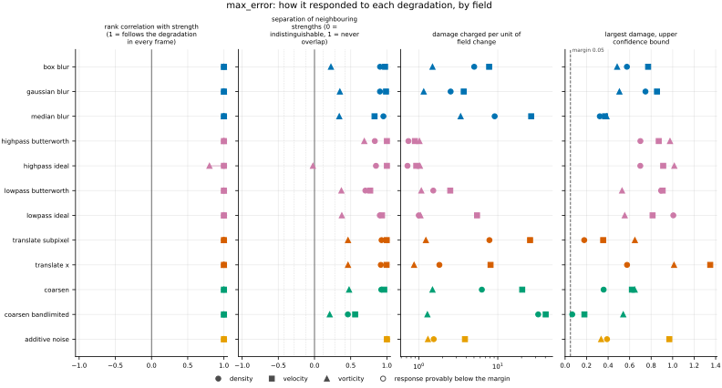
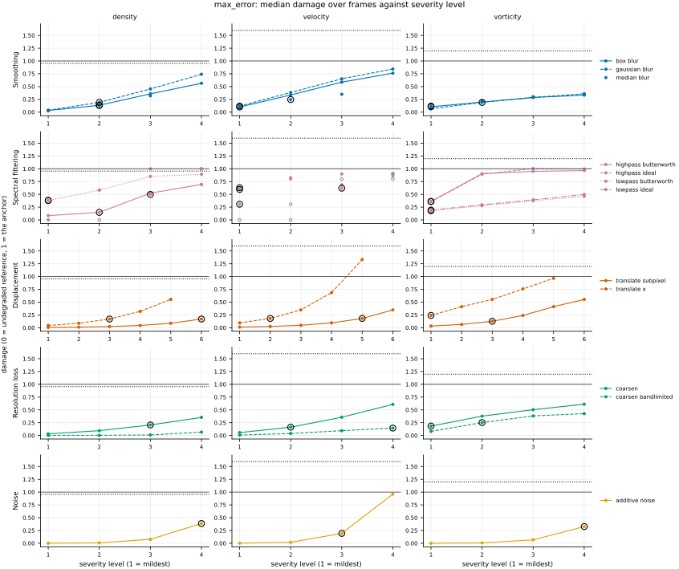

## Definition

For fields $f$ (reference) and $g$ (candidate) sampled on the same analysis grid, with $C$
channels and $N$ cells per channel, the maximum error is the discrete $L^\infty$ norm of their
difference, Equation 7 of [@roy2005]:

$$
\mathrm{MaxE}(f, g) = \max_{1 \le c \le C} \; \max_{1 \le i \le N} \bigl| f_{c,i} - g_{c,i} \bigr| \tag{1}
$$

PDEBench reports this "max error" for machine-learned surrogates beside RMSE and nRMSE, as the
local worst case and a proxy for the stability of time-stepping, in the table of metrics of
Section 3.3 of [@takamoto2022].

For a vector field the channels are pooled, so the maximum runs over every component of every
cell, as `mae` and `mse` pool channels into their means. That choice is this bundle's, not a
source's. PDEBench's code takes the maximum per channel and then averages over channels; the
two agree on every one-channel field and differ only on velocity. A maximum carries no cell
weights, so the formula of Equation (1) is unchanged on a non-uniform grid, but its value is
not grid-neutral there: a peak inside a coarse cell is averaged down more than one inside a
fine cell, so the number depends on where the grid is refined.

The per-cell map stored beside the scalar is the absolute error, reduced over channels by its
largest value,

$$
m_i = \max_{1 \le c \le C} \bigl| f_{c,i} - g_{c,i} \bigr| \tag{2}
$$

and the declared reduction is `max`: the largest value of the map is Equation (1).

Two consequences follow directly from Equation (1). For a displacement $\delta$ small compared
with the scale of variation, expanding $g(x) = f(x + \delta) \simeq f(x) + \delta\, \partial_x f$
gives

$$
\mathrm{MaxE} \simeq \delta \max_{c,i} \bigl| \partial_x f_{c,i} \bigr| \tag{3}
$$

which is linear in the displacement, like the mean absolute error, but set by the steepest
gradient in the domain rather than the mean gradient.

For a jump of height $h$ between two constant states, with its face on a cell boundary, a
shift by any whole number of cells (short of wrapping a periodic domain onto itself) leaves a
cell on which one field sits on the high side and the other on the low side, so
$\mathrm{MaxE} = h$ whatever the size of the displacement. Two departures from that idealised
case change the number. If the face falls inside a cell, as it generally does once a field is
averaged onto the analysis grid, that cell holds a fraction $a$ of the high state and a
one-cell shift gives

$$
\mathrm{MaxE} = \max(a,\, 1 - a)\, h \tag{4}
$$

which is as low as $h/2$; a shift of two cells reaches $h$. If the jump sits on a varying
background, the background's own change over the shift adds to $h$, so the value exceeds $h$
and keeps growing with the shift. `test_metric.py` tests the cell-face case at shifts of one
to three cells and Equation (4) at $a = 1/2$; the varying background is not tested.

On the damage scale the anchor is the reference's own spatial mean, taken channel by channel
(`judgements/001`), so damage 1 is the reference's largest departure from its mean,
$\max_{c,i} |f_{c,i} - \bar f_c|$.

### Boundary handling

None. The operation is local to each cell, so no neighbourhood is ever consulted and no
boundary condition can enter.

## Performance

<!-- GENERATED performance: written by `python -m fmeval.cards evidence max_error --results results/max_error_1793355020`, do not edit -->



Four measured statistics for max_error, one row per degradation grouped by family and one marker per field. From left: the rank correlation between the metric and the applied strength within a frame, with the line showing the resampling interval; the separation of neighbouring strengths as Cliff's delta, where 0 means the metric cannot tell one strength from the next and the faint ticks at 0.12, 0.28 and 0.42 are Vargha and Delaney's small, medium and large anchors, for scale and not as grades; the damage charged per unit of field change at the harshest strength; and the upper confidence bound on the largest damage, beside the fixed margin of 0.05. A hollow marker is a field and degradation on which that bound lies below the margin, so the response is provably small. A missing marker is a statistic the analysis withheld, as the rank correlation is on an axis the metric is invariant to.



Median damage over frames against severity level for max_error, one row per family of degradation and one column per field, on one shared scale. The solid grey line is damage 1, the anchor (by default the field's own mean); the dotted black line is the damage assigned to the fake prediction with the right spectrum, where the run included it. The hollow black ring marks the first level at which the metric has moved a tenth of the way to the anchor. Hollow grey markers are strengths excluded for repeating a milder one or for doing nothing. Degradations with three or fewer usable levels are drawn as markers only; points beyond 2 either side are drawn as triangles at the edge. Damage is negative where a degradation moves the metric away from the anchor, as noise raises a single-field quantity the field's mean sets to zero.

**Trend: does the response follow the degradation?**

| test family | field | degradations | rank correlation | fraction of frames in order | weakest gap between neighbouring strengths |
|---|---|---|---|---|---|
| Displacement | density | 2 | 1 | 1 | 0.958 to 0.963 |
| Displacement | velocity | 2 | 1 | 1 | 0.998 to 0.999 |
| Displacement | vorticity | 2 | 1 | 0.925 to 0.969 | 0.732 |
| Resolution loss | density | 2 | 1 | 0.988 to 1 | 0.73 to 0.961 |
| Resolution loss | velocity | 2 | 1 | 0.994 to 1 | 0.781 to 0.982 |
| Resolution loss | vorticity | 2 | 1 | 0.913 to 0.938 | 0.605 to 0.739 |
| Smoothing | density | 3 | 1 | 1 | 0.952 to 0.976 |
| Smoothing | velocity | 3 | 1 | 1 | 0.915 to 0.994 |
| Smoothing | vorticity | 3 | 1 | 0.981 to 1 | 0.614 to 0.675 |
| Spectral filtering | density | 4 | 1 | 1 | 0.851 to 0.951 |
| Spectral filtering | velocity | 4 | 1 | 1 | 0.885 to 1 |
| Spectral filtering | vorticity | 4 | 0.8 to 1 | 0.478 to 1 | 0.489 to 0.844 |
| Noise | density | 1 | 1 | 1 | 1 |
| Noise | velocity | 1 | 1 | 1 | 1 |
| Noise | vorticity | 1 | 1 | 1 | 1 |

**Reactivity: how far does it move?**

| test family | field | change from clean at the harshest strength | elasticity | first strength detected |
|---|---|---|---|---|
| Displacement | density | — | 0.974 to 0.998 | level 3 |
| Displacement | velocity | — | 0.943 to 0.999 | level 2 |
| Displacement | vorticity | — | 0.603 to 0.983 | level 1 |
| Resolution loss | density | — | 1.14 to 1.34 | level 3 |
| Resolution loss | velocity | — | 1.33 to 1.88 | level 2 |
| Resolution loss | vorticity | — | 0.728 to 1.13 | level 1 |
| Smoothing | density | — | 1.58 to 1.79 | level 2 |
| Smoothing | velocity | — | 1.03 to 1.25 | level 1 |
| Smoothing | vorticity | — | 0.706 to 0.92 | level 1 |
| Spectral filtering | density | — | 0.443 to 8.2 | level 1 |
| Spectral filtering | velocity | — | 0.235 to 1.27 | level 1 |
| Spectral filtering | vorticity | — | 0.4 to 1.55 | level 1 |
| Noise | density | — | 1 | level 4 |
| Noise | velocity | — | 1 | level 3 |
| Noise | vorticity | — | 1 | level 4 |
| trap test: fake prediction, right spectrum | density | — | — | damage 0.955 |
| trap test: fake prediction, right spectrum | velocity | — | — | damage 1.6 |
| trap test: fake prediction, right spectrum | vorticity | — | — | damage 1.2 |

**Consistency: how much does it vary from snapshot to snapshot?**

| test family | field | consistency, in the strength's units | snapshots per independent block |
|---|---|---|---|
| Displacement | density | 0.0759 to 0.373 | 18 to 19 |
| Displacement | velocity | 0.0678 to 0.441 | 1 |
| Displacement | vorticity | 0.163 to 1.45 | 17 to 20 |
| Resolution loss | density | 0.413 to 1.8 | 19 to 20 |
| Resolution loss | velocity | 0.76 to 1.7 | 19 to 22 |
| Resolution loss | vorticity | 1.76 to 2.14 | 20 to 22 |
| Smoothing | density | 0.00453 to 0.0116 | 18 to 19 |
| Smoothing | velocity | 0.00435 to 0.0152 | 6 to 14 |
| Smoothing | vorticity | 0.0219 to 0.0515 | 21 to 22 |
| Spectral filtering | density | 0.0118 to 0.025 | 1 to 20 |
| Spectral filtering | velocity | 0.0154 to 0.0231 | 6 to 11 |
| Spectral filtering | vorticity | 0.0745 to 0.0943 | 20 to 22 |
| Noise | density | 0.0108 | 1 |
| Noise | velocity | 0.00913 | 6 |
| Noise | vorticity | 0.014 | 1 |

One row per family of degradation and physical field; a cell gives the range over the degradations in that family. **Trend.** The rank correlation is the Spearman correlation between the strength and how far the metric has moved from its value on the undegraded field of the same frame, in the one direction it moves under that degradation, computed inside a single frame. A value of 1 means every strength moved it further than the last in every frame, whichever way it moves; a response that scatters to both sides scores near 0. The fraction of frames in order counts the frames with no exception. The weakest gap is the smallest Mann-Whitney overlap between two neighbouring strengths across frames: 1 means they never overlap, 0.5 that they cannot be told apart. **Reactivity.** The change from clean is the median, at the harshest strength, of the departure from the undegraded value of the same frame over the size of that value: 0.3 means 30%. It does not exist for this metric, whose undegraded value is exactly zero; the damage below is its relative reading. The elasticity is the percentage change of that departure per percentage change in strength over the mildest strengths. First strength detected is the mildest at which the metric has moved a tenth of the way to the anchor; **damage** reads that 0-to-1 scale as a number. A dash means the measurement is not defined there. A metric's reactivity scales with the power it is expressed in: mean squared error's elasticity is twice root-mean-square error's, though the two carry the same information, so compare magnitudes across metrics with that in mind. **Consistency** is how much the response varies from snapshot to snapshot relative to its size, in the strength's units; the snapshots of one trajectory are correlated, and the last column is how many consecutive snapshots one independent block spans.

These tables report what was measured and grade none of the measurements. What the numbers mean for this metric is written in the subsections below, beside the test that produced each number.

**Profile.**

| field | selectivity | charges most for | charges least for | response provably below 0.05 at 90% on | elasticity to a sub-pixel shift, against severity (distance) | compute cost (x cheapest in this run) |
|---|---|---|---|---|---|---|
| density | 0.675 | `coarsen_bandlimited` | `highpass_ideal` | — | 0.998 | 1.07 |
| velocity | 0.506 | `coarsen_bandlimited` | `highpass_butterworth` | — | 0.999 | 1.97 |
| vorticity | 0.178 | `median_blur` | `translate_x` | — | 0.983 | 1 |

One row per physical field. **Selectivity** is how concentrated the metric's response is on a few degradations, measured per unit of field change: 0 means it charges every degradation the same, as mean squared error does by construction, and values toward 1 that one degradation carries most of it. **Charges most and least for** name the two ends of that profile. **Response provably below** lists degradations on which the upper confidence bound of the largest damage lies below the margin -- an equivalence test, so an entry says the response is provably small, not merely not significant; a dash means no degradation met the bound. **Elasticity** is the slope of log damage against log shift over the smallest shifts: 1 means damage grows in proportion to the shift, 2 with its square. **Compute cost** is wall-clock per evaluation over the cheapest metric and field in the same run.

<!-- END GENERATED performance -->

## Intuition

The maximum error compares two fields one cell at a time, takes the size of each difference
regardless of sign, and reports the largest. It answers the question of where the prediction
is worst, and how bad it is there. It reveals a local failure that an average hides: one
spurious spike, an overshoot next to a sharp front, or the first cell of an instability that
is starting to grow.

An average spreads each cell's error over the whole domain, so a single wrong cell among
many counts for very little. The maximum gives that cell all of the weight and every other
cell none. On a four-by-four grid, with a bright square, a copy moved by one cell, a copy at
half the brightness, and a copy with one extra bright cell in a corner:

```
reference      moved one cell   half brightness      one spike
0 0 0 0        0 0 0 0          0    0    0    0     1 0 0 0
0 1 1 0        0 0 1 1          0   0.5  0.5   0     0 1 1 0
0 1 1 0        0 0 1 1          0   0.5  0.5   0     0 1 1 0
0 0 0 0        0 0 0 0          0    0    0    0     0 0 0 0

               max error = 1    max error = 0.5      max error = 1
                                                     (mean absolute error = 0.0625)
```

The moved square and the single spike both score the full height of the square, because each
has at least one cell that is completely wrong. The mean absolute error charges the spike only
one sixteenth of that. A sharp edge that sits exactly between two cells, moved by two or three
cells instead of one, also scores its full height: once such a feature has left its own cells,
the maximum cannot tell a small miss from a large one. An edge that falls inside a cell, which
is then half bright, scores only half its height when moved by one cell, and the full height
from two cells on.

What this metric ignores is everything except the single worst cell: how many cells are
wrong, and by how much, below that one.

## Reading the output

The value runs from zero upwards with no upper limit, in the field's own units, so a density
field and a vorticity field produce numbers that cannot be compared with each other. Lower is
better, and zero means the two fields agree in every cell. The number is directly readable as
a bound: no cell is off by more than it.

What counts as good depends on how far the field itself strays from its mean, which is why
the suite reports damage, the value rescaled so that zero is the reference and one is what the
reference's own spatial mean scores. For this metric that anchor is the reference's largest
departure from its mean, so a damage of 0.1 says the worst cell is off by a tenth of the
field's largest excursion.

Comparisons across models on the same field, dataset and analysis grid are meaningful and are
the intended use. Comparisons across fields need normalising because of the units. Comparisons
across resolutions are invalid as they stand: a finer grid offers more cells to take the
maximum over, and a remap onto cell averages lowers peaks, so the same prediction scores
differently on different grids. Compare on a common analysis grid, which is what this suite
remaps onto before measuring.

The companion is a per-cell map, Equation (2): the absolute error at each cell, the largest
over channels. Its brightest cell is the metric. A single isolated bright cell is a local
excursion; a ridge along a front is a displaced sharp feature. Every other cell contributes
nothing to the number, so the map shows where the error lies, not shares of the metric. The
report's `field_gallery` figure clips its colour scale at the 99.5th percentile of the values
of all its panels, so on a panel whose worst cell lies above that limit the worst cell is drawn
in the same saturated colour as the other cells above it; read the value from the stored map,
not from the figure.

## Limitations

It suffers the double penalty in its most extreme form. A sharp front, a shock or a
shocklet, with the right shape and strength but sitting one cell from where it should be,
scores the full height of its jump when its face lies on a cell boundary, as much as a
prediction that keeps the low state where the front should be. On a field with sharp features
the maximum error therefore reaches the height of the largest jump as soon as anything is
misplaced by a cell or two, and stops distinguishing a near miss from a gross one. A front
whose face falls inside a cell scores between half and all of its height at a one-cell shift,
Equation (4), so the same miss scores differently depending on where the front sits within its
cell.

On a field whose largest excursion is one isolated extremum, both the metric and its anchor
are set by that extremum. On `kinet_re5e4` density the reference's largest departure from its
mean is a single deep minimum that sits on the strongest vortex core (measured on frames 2500,
5000, 8000 and 10000; `issues/106`). There the maximum error largely asks whether that one
minimum was reproduced in depth and position, and any prediction unrelated to the reference
that lacks it scores close to the anchor.

It rests on one cell, so it is noisy and depends on the grid. Two predictions that differ
only in where their noise happens to peak score differently. The largest of many independent
noise values tends to exceed the largest of a few, so on a finer grid the same noise level
scores higher with nothing else about the prediction changed.

Like every pointwise error, it is meaningful only while the prediction is still aligned with
the reference. Once a rollout has decorrelated from the truth, the maximum error measures the
size of the field's own excursions and carries no information about the model. Its use as a
stability diagnostic, its growth along a rollout, is not tested by this suite, which scores
single snapshots against a degraded copy and has no rollout input (`issues/094`).

On velocity, pooling the channels means the number is the largest single-component error,
which depends on the orientation of the axes: the same error vector pointing along an axis or
along a diagonal scores differently, by up to the square root of two. And as a training loss
its gradient reaches only the one cell that attains the maximum.

## Results

<!-- GENERATED run: written by `python -m fmeval.cards evidence max_error --results results/max_error_1793355020`, do not edit -->

Measured on `kinet_re5e4`, frames 2000 to 10000 (161 frames of developed flow), on the 256 analysis grid, seed 20260807, at commit `e4da8d329ddf`. Run `max_error_1793355020`.

Every number in this section comes from that one run. Regenerate with `python -m fmeval.cards evidence <name> --results results/max_error_1793355020`.

<!-- END GENERATED run -->

Each subsection links to the degradations that subsection reports. What those degradations
do, and what their strength numbers mean, is documented on their own pages.

### Smoothing

[gaussian_blur](../../degradations/gaussian_blur/card.md) ·
[box_blur](../../degradations/box_blur/card.md) ·
[median_blur](../../degradations/median_blur/card.md)

<!-- GENERATED results_smoothing: written by `python -m fmeval.cards evidence max_error --results results/max_error_1793355020`, do not edit -->

| degradation | field | strengths | rank correlation | fraction of frames in the right order | weakest gap between neighbouring strengths |
|---|---|---|---|---|---|
| `box_blur` | density | 4 | 1 | 1 | 0.953 |
| `box_blur` | velocity | 4 | 1 | 1 | 0.987 |
| `box_blur` | vorticity | 4 | 1 | 1 | 0.614 |
| `gaussian_blur` | density | 4 | 1 | 1 | 0.952 |
| `gaussian_blur` | velocity | 4 | 1 | 1 | 0.994 |
| `gaussian_blur` | vorticity | 4 | 1 | 1 | 0.675 |
| `median_blur` | density | 3 | 1 | 1 | 0.976 |
| `median_blur` | velocity | 3 | 1 | 1 | 0.915 |
| `median_blur` | vorticity | 3 | 1 | 0.981 | 0.671 |

<!-- END GENERATED results_smoothing -->

All three blurs are ordered correctly on every field, with a rank correlation of 1. On density
and velocity neighbouring strengths are almost never confused (weakest gap 0.915 or more). On
vorticity they overlap more, with weakest gaps of 0.614 to 0.675, and `median_blur` is in order
in 0.981 of frames.

### Spectral filtering

[lowpass_ideal](../../degradations/lowpass_ideal/card.md) ·
[lowpass_butterworth](../../degradations/lowpass_butterworth/card.md) ·
[highpass_ideal](../../degradations/highpass_ideal/card.md) ·
[highpass_butterworth](../../degradations/highpass_butterworth/card.md)

<!-- GENERATED results_spectral: written by `python -m fmeval.cards evidence max_error --results results/max_error_1793355020`, do not edit -->

| degradation | field | strengths | rank correlation | fraction of frames in the right order | weakest gap between neighbouring strengths |
|---|---|---|---|---|---|
| `highpass_butterworth` | density | 4 | 1 | 1 | 0.917 |
| `highpass_butterworth` | velocity | 3 | 1 | 1 | 1 |
| `highpass_butterworth` | vorticity | 4 | 1 | 0.894 | 0.844 |
| `highpass_ideal` | density | 3 | 1 | 1 | 0.925 |
| `highpass_ideal` | velocity | 2 | 1 | 1 | 1 |
| `highpass_ideal` | vorticity | 4 | 0.8 | 0.478 | 0.489 |
| `lowpass_butterworth` | density | 4 | 1 | 1 | 0.851 |
| `lowpass_butterworth` | velocity | 3 | 1 | 1 | 0.885 |
| `lowpass_butterworth` | vorticity | 4 | 1 | 1 | 0.686 |
| `lowpass_ideal` | density | 3 | 1 | 1 | 0.951 |
| `lowpass_ideal` | velocity | 2 | 1 | 1 | 0.967 |
| `lowpass_ideal` | vorticity | 4 | 1 | 1 | 0.689 |

<!-- END GENERATED results_spectral -->

Every filter is ordered with a rank correlation of 1 except `highpass_ideal` on vorticity, at
0.8, in order in only 0.478 of frames, with a weakest gap of 0.489: two of its neighbouring
strengths cannot be told apart by the worst cell. The low-pass filters, which remove the small
scales that set a field's sharpest extrema, are ordered in every frame on every field.

### Displacement

[translate_x](../../degradations/translate/card.md) ·
[translate_subpixel](../../degradations/translate_subpixel/card.md)

<!-- GENERATED results_geometric: written by `python -m fmeval.cards evidence max_error --results results/max_error_1793355020`, do not edit -->

| degradation | field | strengths | rank correlation | fraction of frames in the right order | weakest gap between neighbouring strengths |
|---|---|---|---|---|---|
| `translate_subpixel` | density | 6 | 1 | 1 | 0.963 |
| `translate_subpixel` | velocity | 6 | 1 | 1 | 0.999 |
| `translate_subpixel` | vorticity | 6 | 1 | 0.969 | 0.732 |
| `translate_x` | density | 5 | 1 | 1 | 0.958 |
| `translate_x` | velocity | 5 | 1 | 1 | 0.998 |
| `translate_x` | vorticity | 5 | 1 | 0.925 | 0.732 |

<!-- END GENERATED results_geometric -->

Both displacements are ordered with a rank correlation of 1 on every field; on vorticity the
whole-cell shift is in order in 0.925 of frames and the sub-cell shift in 0.969. The response
is linear in the displacement, as Equation (3) gives: the elasticity to a sub-pixel shift in
the Profile table is 0.998, 0.999 and 0.983 on density, velocity and vorticity. On these
smooth fields no jump is displaced, so the saturation at the jump height described under
Limitations does not appear here.

### Resolution loss

[coarsen](../../degradations/coarsen/card.md) ·
[coarsen_bandlimited](../../degradations/coarsen_bandlimited/card.md)

<!-- GENERATED results_resolution: written by `python -m fmeval.cards evidence max_error --results results/max_error_1793355020`, do not edit -->

| degradation | field | strengths | rank correlation | fraction of frames in the right order | weakest gap between neighbouring strengths |
|---|---|---|---|---|---|
| `coarsen` | density | 4 | 1 | 1 | 0.961 |
| `coarsen` | velocity | 4 | 1 | 1 | 0.982 |
| `coarsen` | vorticity | 4 | 1 | 0.938 | 0.739 |
| `coarsen_bandlimited` | density | 4 | 1 | 0.988 | 0.73 |
| `coarsen_bandlimited` | velocity | 4 | 1 | 0.994 | 0.781 |
| `coarsen_bandlimited` | vorticity | 4 | 1 | 0.913 | 0.605 |

<!-- END GENERATED results_resolution -->

Both coarsenings are ordered with a rank correlation of 1 on every field. Under
`coarsen_bandlimited`, density is in order in 0.988 of frames and vorticity in 0.913, and the
Profile table names `coarsen_bandlimited` as what this metric charges most for, per unit of
field change, on density and velocity.

### Noise

[additive_noise](../../degradations/additive_noise/card.md)

<!-- GENERATED results_stochastic: written by `python -m fmeval.cards evidence max_error --results results/max_error_1793355020`, do not edit -->

| degradation | field | strengths | rank correlation | fraction of frames in the right order | weakest gap between neighbouring strengths |
|---|---|---|---|---|---|
| `additive_noise` | density | 4 | 1 | 1 | 1 |
| `additive_noise` | velocity | 4 | 1 | 1 | 1 |
| `additive_noise` | vorticity | 4 | 1 | 1 | 1 |

<!-- END GENERATED results_stochastic -->

Noise is ordered perfectly on every field, with no overlap between neighbouring strengths. It
is first detected, a tenth of the way to the anchor, only at level 4 on density and vorticity
and level 3 on velocity (Reactivity table): the anchor is the field's largest excursion from
its mean, so the worst noisy cell must reach a tenth of that before it registers.

### Trap tests

[gaussian_impostor](../../degradations/gaussian_impostor/card.md) ·
[uncorrelated](../../degradations/random_large_translation/card.md)

<!-- GENERATED results_canaries: written by `python -m fmeval.cards evidence max_error --results results/max_error_1793355020`, do not edit -->

| field | damage assigned to the fake prediction | closest real degradation | damage of the reference moved far away | value on the anchor |
|---|---|---|---|---|
| density | 0.955 | `lowpass_ideal=1.4029` | 0.959 | 0.0386 |
| velocity | 1.6 | `translate_x=16` | 1.61 | 0.0937 |
| vorticity | 1.2 | `highpass_ideal=23.5784` | 1.28 | 0.0169 |

The fake prediction here has exactly the reference field's amplitude spectrum and completely scrambled structure. Damage 1 is what the anchor scores, by default the reference's own spatial mean, a prediction that knows the mean and nothing else. The damage column therefore says how close to useless this metric considers that fake prediction: a low number means the metric was fooled. The third column translates the same number into an ordinary degradation whose damage the fake prediction matches, which is easier to picture. The fourth is the reference moved by a large random offset, the right statistics in the wrong place; where a field's energy sits in its largest scales that copy stays partly correlated with the reference, so it is not the score of an unrelated field.

<!-- END GENERATED results_canaries -->

On velocity and vorticity the fake prediction scores worse than the field's mean, with damage
1.6 and 1.2. On density it scores 0.955 and the reference moved far away 0.959, both close to
the mean's 1: by its worst cell, a phase-scrambled density field is rated about as far from the
truth as the mean is. The table holds one draw of the fake per frame, so a value this close to
1 does not show that the fake scores better than the mean; `issues/106` records a separate
measurement of the draw-to-draw spread, which straddles 1 on density. The reason the value
sits near 1 on density, the single deep minimum that sets both this number and the anchor, is
under Limitations. The maximum error must therefore not be the only check against a fake with
the right spectrum on a field like this density.

### Compared with the other metrics

<!-- GENERATED results_summary: written by `python -m fmeval.cards evidence max_error --results results/max_error_1793355020`, do not edit -->

No measurements for this test in the recorded run.

<!-- END GENERATED results_summary -->

This run scored `max_error` alone, one metric per evaluation, so it has no cross-metric
correlation; a run beside the other metrics would fill this table.

### Damage beside the other metrics

<!-- GENERATED results_damage_by_level: written by `python -m fmeval.cards evidence max_error --results results/max_error_1793355020`, do not edit -->

Only one metric in the recorded run; there is nothing to place this one beside.

<!-- END GENERATED results_damage_by_level -->

For the same reason this run has no damage beside the pointwise controls; a run beside `mae`,
`mse`, `rmse` and `nrmse` would fill this table.

## References

\bibliography
