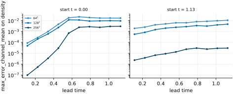
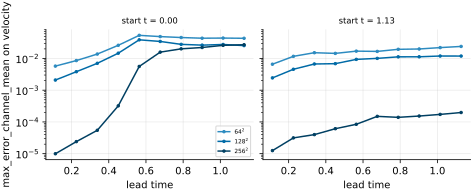
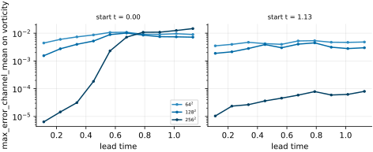
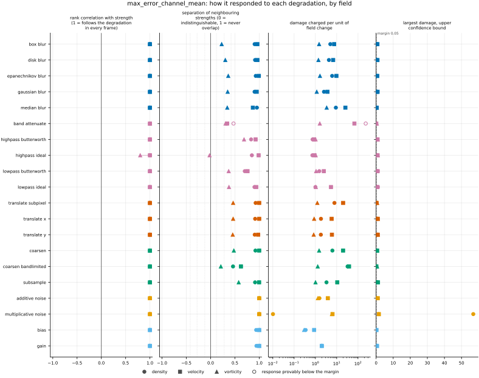
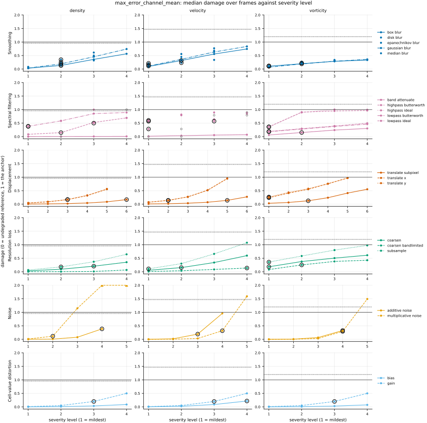
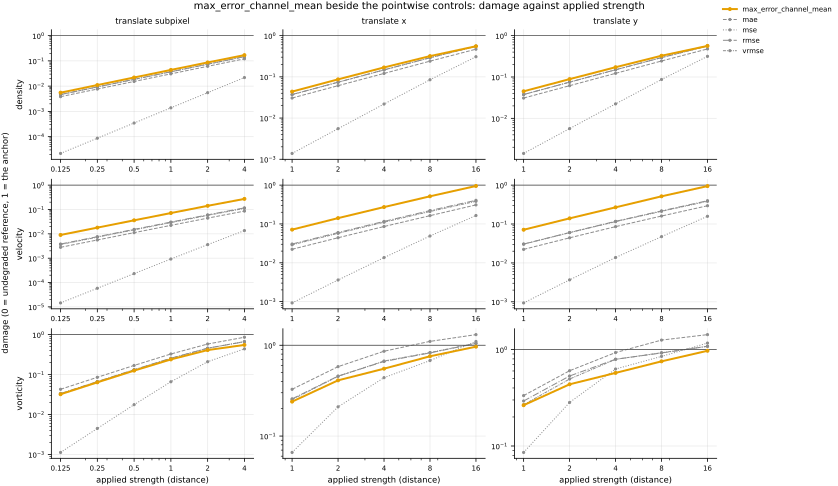

## Definition

For fields $f$ (reference) and $g$ (candidate) on the same analysis grid, with $C$ channels and
$N$ cells per channel, this bundle reports the mean over channels of each channel's largest
absolute error:

$$
\mathrm{MaxE}_{\mathrm{ch}}(f, g) = \frac{1}{C} \sum_{c=1}^{C} \max_{1 \le i \le N}
\bigl| f_{c,i} - g_{c,i} \bigr| \tag{1}
$$

This is how PDEBench's code reduces its maximum error [@takamoto2022]: the maximum of the absolute
error over space for each sample, channel and time step, the maximum over the samples of a batch,
and then the mean over channels and time steps (`pdebench/models/metrics.py`, `metric_func`,
`err_Max`). The paper names the metric and gives no equation for it (Sect. 3.3; App. B says it
"measures the model's worst prediction"). The harness scores one frame of one field at a time,
so the mean over channels is the reduction that remains. The Well's $L^\infty$ error is the same
maximum per field, which its library averages over fields [@ohana2024] (App. E.3;
`the_well/benchmark/metrics/spatial.py`, `LInfinity`).

[max_error](../../metrics/max_error/card.md) takes one maximum over every channel and cell, the discrete
$L^\infty$ norm of numerical analysis [@roy2005] (Sect. 2.5, Eq. 7). On a one-channel field
(density, vorticity) the two are the same number. On several channels a mean of $C$ maxima is
never larger than the largest of them, which is `max_error`, and never smaller than that over $C$:

$$
\frac{\mathrm{MaxE}}{C} \le \mathrm{MaxE}_{\mathrm{ch}} \le \mathrm{MaxE} \tag{2}
$$

with equality on the right when every channel's worst error is the same size and on the left
when only one channel is wrong.

No per-cell map is stored. A mean of per-channel maxima cannot be recovered from a map reduced
over channels; `max_error`'s map shows where the worst cells are.

### Boundary handling

None. The operation is local to each cell, so no neighbourhood is ever consulted and no boundary
condition can enter.

### How its field reports it

This is the reduction of the machine-learning benchmarks for PDEs. Numerical analysis reports
the pooled maximum, [max_error](../../metrics/max_error/card.md), whose card describes the
order-of-accuracy test it is used in.

- **PDEBench** [@takamoto2022]. The object is Equation (1) per time step, taken as the worst case
  over the samples of each batch, then averaged over batches, channels and time steps (code
  above); it is described as the local worst case and a proxy for the stability of time-stepping
  (Sect. 3.3, table of metrics). It is reported in the tables of every metric per PDE and model
  (App. E); no figure of it is drawn. The experiment is autoregressive rollouts on a held-out
  tenth of each dataset's samples (Sect. 4.1).
- **The Well** [@ohana2024]. The $L^\infty$ error is one of its library's spatial metrics, one
  value per field (App. E.3); its tables and figures report VRMSE, not this.

**The experiments here.** Rollouts over many initial conditions do not exist; `forecast_re5e4`
(`docs/datasets/reynolds_ladder_2d.md`, "Forecast pairs") gives one model's predictions at ten
prediction steps from two starting times, on which the error is drawn against lead time, and
[EXP-nrmse-rollouts-over-many-initial-conditions](https://github.com/khegazy/pde_metrics/blob/main/proposals/EXP-nrmse-rollouts-over-many-initial-conditions.md)
writes up the missing test set. The metric also runs on the degradation ladder on `kinet_re5e4`
and on the Reynolds ladder, where velocity has two components. It is not run on
`sod_shock_tube` or `synthetic_ensemble`: every field there has one channel, where Equation (1) is
`max_error` exactly (`card.yaml`, `not_run`).

## Performance

<!-- GENERATED performance: written by `python -m fmeval.cards evidence max_error_channel_mean --results results/comparison_1793829127 --results results/comparison_1793811840 --results results/comparison_1793829231`, do not edit -->



*As this metric's own field draws it, from run `comparison_1793811840`.* max_error_channel_mean on density against lead time, the physical time since the forecast started, one panel per start and one line per run, darker the finer the run's grid. Each point is one prediction step of one forecast.



*As this metric's own field draws it, from run `comparison_1793811840`.* max_error_channel_mean on velocity against lead time, the physical time since the forecast started, one panel per start and one line per run, darker the finer the run's grid. Each point is one prediction step of one forecast.



*As this metric's own field draws it, from run `comparison_1793811840`.* max_error_channel_mean on vorticity against lead time, the physical time since the forecast started, one panel per start and one line per run, darker the finer the run's grid. Each point is one prediction step of one forecast.



Four measured statistics for max_error_channel_mean, one row per degradation grouped by family and one marker per field. From left: the rank correlation between the metric and the applied strength within a frame, with the line showing the resampling interval; the separation of neighbouring strengths as Cliff's delta, where 0 means the metric cannot tell one strength from the next and the faint ticks at 0.12, 0.28 and 0.42 are Vargha and Delaney's small, medium and large anchors, for scale and not as grades; the damage charged per unit of field change at the harshest strength; and the upper confidence bound on the largest damage, beside the fixed margin of 0.05. A hollow marker is a field and degradation on which that bound lies below the margin, so the response is provably small. A missing marker is a statistic the analysis withheld, as the rank correlation is on an axis the metric is invariant to.



Median damage over frames against severity level for max_error_channel_mean, one row per family of degradation and one column per field, on one shared scale. The solid grey line is damage 1, the anchor (by default the field's own mean); the dotted black line is the damage assigned to the fake prediction with the right spectrum, where the run included it. The hollow black ring marks the first level at which the metric has moved a tenth of the way to the anchor. Hollow grey markers are strengths excluded for repeating a milder one or for doing nothing. Degradations with three or fewer usable levels are drawn as markers only; points beyond 2 either side are drawn as triangles at the edge. Damage is negative where a degradation moves the metric away from the anchor, as noise raises a single-field quantity the field's mean sets to zero.

**Trend: does the response follow the degradation?**

| test family | field | degradations | rank correlation | fraction of frames in order | weakest gap between neighbouring strengths |
|---|---|---|---|---|---|
| Displacement | density | 3 | 1 | 1 | 0.954 to 0.963 |
| Displacement | velocity | 3 | 1 | 1 | 0.989 to 1 |
| Displacement | vorticity | 3 | 1 | 0.925 to 0.969 | 0.727 to 0.732 |
| Cell-value distortion | density | 2 | 1 | 1 | 0.969 to 0.971 |
| Cell-value distortion | velocity | 2 | 1 | 1 | 1 |
| Cell-value distortion | vorticity | 2 | 1 | 1 | 1 |
| Resolution loss | density | 3 | 1 | 0.988 to 1 | 0.73 to 0.961 |
| Resolution loss | velocity | 3 | 1 | 1 | 0.812 to 1 |
| Resolution loss | vorticity | 3 | 1 | 0.913 to 0.969 | 0.605 to 0.789 |
| Smoothing | density | 5 | 1 | 1 | 0.952 to 0.976 |
| Smoothing | velocity | 5 | 1 | 1 | 0.935 to 0.996 |
| Smoothing | vorticity | 5 | 1 | 0.981 to 1 | 0.614 to 0.681 |
| Spectral filtering | density | 5 | 1 | 1 | 0.736 to 0.951 |
| Spectral filtering | velocity | 5 | 1 | 1 | 0.67 to 0.994 |
| Spectral filtering | vorticity | 5 | 0.8 to 1 | 0.478 to 1 | 0.489 to 0.844 |
| Noise | density | 2 | 1 | 1 | 1 |
| Noise | velocity | 2 | 1 | 1 | 1 |
| Noise | vorticity | 2 | 1 | 1 | 1 |

**Reactivity: how far does it move?**

| test family | field | change from clean at the harshest strength | elasticity | first strength detected |
|---|---|---|---|---|
| Displacement | density | — | 0.966 to 0.998 | level 3 |
| Displacement | velocity | — | 0.957 to 0.999 | level 2 |
| Displacement | vorticity | — | 0.556 to 0.983 | level 1 |
| Cell-value distortion | density | — | 1 | level 3 |
| Cell-value distortion | velocity | — | 1 | level 3 |
| Cell-value distortion | vorticity | — | 1 | level 3 |
| Resolution loss | density | — | 1.14 to 1.34 | level 2 |
| Resolution loss | velocity | — | 1.32 to 1.85 | level 1 |
| Resolution loss | vorticity | — | 0.581 to 1.13 | level 1 |
| Smoothing | density | — | 1.44 to 1.79 | level 2 |
| Smoothing | velocity | — | 0.919 to 1.25 | level 1 |
| Smoothing | vorticity | — | 0.706 to 0.92 | level 1 |
| Spectral filtering | density | — | 0.443 to 8.2 | level 1 |
| Spectral filtering | velocity | — | 0.26 to 1.33 | level 1 |
| Spectral filtering | vorticity | — | 0.4 to 1.55 | level 1 |
| Noise | density | — | 1 | level 2 |
| Noise | velocity | — | 0.998 to 1 | level 3 |
| Noise | vorticity | — | 0.998 to 1 | level 4 |
| trap test: fake prediction, right spectrum | density | — | — | damage 0.955 |
| trap test: fake prediction, right spectrum | velocity | — | — | damage 1.47 |
| trap test: fake prediction, right spectrum | vorticity | — | — | damage 1.2 |

**Consistency: how much does it vary from snapshot to snapshot?**

| test family | field | consistency, in the strength's units | snapshots per independent block |
|---|---|---|---|
| Displacement | density | 0.0899 to 0.5 | 11 to 13 |
| Displacement | velocity | 0.0598 to 0.667 | 10 to 20 |
| Displacement | vorticity | 0.175 to 1.51 | 20 to 21 |
| Cell-value distortion | density | 0.0247 to 0.0276 | 17 to 20 |
| Cell-value distortion | velocity | 0.00943 to 0.0149 | 1 to 11 |
| Cell-value distortion | vorticity | 0.017 to 0.0174 | 11 to 20 |
| Resolution loss | density | 0.69 to 1.59 | 13 to 18 |
| Resolution loss | velocity | 0.797 to 1.57 | 17 to 22 |
| Resolution loss | vorticity | 1.67 to 2.24 | 21 to 22 |
| Smoothing | density | 0.00832 to 0.0186 | 13 |
| Smoothing | velocity | 0.00388 to 0.0122 | 20 to 21 |
| Smoothing | vorticity | 0.0236 to 0.0548 | 21 to 22 |
| Spectral filtering | density | 0.0231 to 0.104 | 13 to 20 |
| Spectral filtering | velocity | 0.00928 to 0.1 | 10 to 22 |
| Spectral filtering | vorticity | 0.0773 to 0.106 | 14 to 22 |
| Noise | density | 0.00394 to 0.0179 | 1 to 19 |
| Noise | velocity | 0.00475 to 0.0108 | 1 to 11 |
| Noise | vorticity | 0.00771 to 0.0125 | 1 to 20 |

One row per family of degradation and physical field; a cell gives the range over the degradations in that family. **Trend.** The rank correlation is the Spearman correlation between the strength and how far the metric has moved from its value on the undegraded field of the same frame, in the one direction it moves under that degradation, computed inside a single frame. A value of 1 means every strength moved it further than the last in every frame, whichever way it moves; a response that scatters to both sides scores near 0. The fraction of frames in order counts the frames with no exception. The weakest gap is the smallest Mann-Whitney overlap between two neighbouring strengths across frames: 1 means they never overlap, 0.5 that they cannot be told apart. **Reactivity.** The change from clean is the median, at the harshest strength, of the departure from the undegraded value of the same frame over the size of that value: 0.3 means 30%. It does not exist for this metric, whose undegraded value is exactly zero; the damage below is its relative reading. The elasticity is the percentage change of that departure per percentage change in strength over the mildest strengths. First strength detected is the mildest at which the metric has moved a tenth of the way to the anchor; **damage** reads that 0-to-1 scale as a number. A dash means the measurement is not defined there. A metric's reactivity scales with the power it is expressed in: mean squared error's elasticity is twice root-mean-square error's, though the two carry the same information, so compare magnitudes across metrics with that in mind. **Consistency** is how much the response varies from snapshot to snapshot relative to its size, in the strength's units; the snapshots of one trajectory are correlated, and the last column is how many consecutive snapshots one independent block spans.

These tables report what was measured and grade none of the measurements. What the numbers mean for this metric is written in the subsections below, beside the test that produced each number.

**Profile.**

| field | selectivity | charges most for | charges least for | response provably below 0.05 at 90% on | elasticity to a sub-pixel shift, against severity (distance) | compute cost (x cheapest in this run) |
|---|---|---|---|---|---|---|
| density | 0.907 | `band_attenuate` | `multiplicative_noise` | `band_attenuate` | 0.998 | 1.27 |
| velocity | 0.627 | `band_attenuate` | `bias` | — | 0.999 | 2.37 |
| vorticity | 0.361 | `multiplicative_noise` | `bias` | — | 0.983 | 1.17 |

One row per physical field. **Selectivity** is how concentrated the metric's response is on a few degradations, measured per unit of field change: 0 means it charges every degradation the same, as mean squared error does by construction, and values toward 1 that one degradation carries most of it. **Charges most and least for** name the two ends of that profile. **Response provably below** lists degradations on which the upper confidence bound of the largest damage lies below the margin -- an equivalence test, so an entry says the response is provably small, not merely not significant; a dash means no degradation met the bound. **Elasticity** is the slope of log damage against log shift over the smallest shifts: 1 means damage grows in proportion to the shift, 2 with its square. **Compute cost** is wall-clock per evaluation over the cheapest metric and field in the same run.

<!-- END GENERATED performance -->

## Intuition

This is the worst single-cell error taken separately for each component of a field and then
averaged. A velocity field has two components; for each, the cell where it is most wrong is found
and its error read off, and the two worst errors are averaged.

The difference from taking one maximum over every component shows when the components are
predicted unequally. On a four-by-four grid with two components, one in which a bright square
moved by one cell and one predicted exactly:

```
first component                second component
reference      candidate       reference      candidate
0 0 0 0        0 0 0 0         0 0 0 0        0 0 0 0
0 1 1 0        0 0 1 1         0 1 1 0        0 1 1 0
0 1 1 0        0 0 1 1         0 1 1 0        0 1 1 0
0 0 0 0        0 0 0 0         0 0 0 0        0 0 0 0

worst cell: 1                  worst cell: 0

max_error_channel_mean = 0.5   max_error (one maximum) = 1
```

The first component's worst cell is wrong by the full height of the square and the second's by
nothing, so their average is a half, while a single maximum over both reports the one cell that
is completely wrong. On a field with one component the two are identical.

What this metric ignores is everything except each component's worst cell: how many cells are
wrong, and by how much, below those.

## Reading the output

The value runs from zero upwards with no upper limit, in the field's own units, so values on
different fields cannot be compared. Lower is better, and zero means the fields agree in every
cell. Unlike `max_error` it is not a bound on the error of any one cell: on velocity, one
component can be wrong by up to twice this value somewhere.

On density and vorticity it equals `max_error` exactly. On velocity it is the number to set beside
a PDEBench table entry. Comparisons across models on one field, dataset and analysis grid are the
intended use; comparisons across resolutions are invalid as they stand, because a finer grid
offers more cells to take the maximum over and a remap onto cell averages lowers peaks.

## Limitations

Averaging the channel maxima loses the one property that makes a maximum useful, a guarantee. A
reader who takes a value of 0.1 to mean that no cell is off by more than 0.1 is wrong on a
two-component field whenever one component's worst error is larger than the other's. Equation
(2) bounds the gap: the largest single error is at most $C$ times this value.

It inherits every limitation of `max_error`: the value is set by one cell per component, so it is
noisy from frame to frame, and a displaced sharp front scores its full height once the shift
reaches a cell, so it cannot tell a small displacement from a large one.

## Results

<!-- GENERATED run: written by `python -m fmeval.cards evidence max_error_channel_mean --results results/comparison_1793829127 --results results/comparison_1793811840 --results results/comparison_1793829231`, do not edit -->

Measured on `kinet_re5e4`, frames 2000 to 10000 (161 frames of developed flow), on the 256 analysis grid, seed 20260807, at commit `adbdc88e4950`. Run `comparison_1793829127`.

Every number in this section comes from that run, except in the subsections headed with another experiment and in a figure whose caption names another run, each of which names its own run. Regenerate with `python -m fmeval.cards evidence <name> --results results/comparison_1793829127 --results results/comparison_1793811840 --results results/comparison_1793829231`.

<!-- END GENERATED run -->

Each subsection links to the degradations that subsection reports. What those degradations
do, and what their strength numbers mean, is documented on their own pages.

<!-- GENERATED experiments: written by `python -m fmeval.cards catalog`, do not edit -->

**Across the experiments.**

| experiment | what a run on it is evidence of | on this card |
|---|---|---|
| `kinet_re5e4` | developed flow | measured, run `comparison_1793829127`: the main results |
| `kinet_re1e6` | developed flow at Re = 1e6, twenty times the Reynolds number of kinet_re5e4, from the same initial condition | measured, run `comparison_1793829231`: under *On `kinet_re1e6`* |
| `synthetic_ensemble` | a calibrated null: evidence that the estimator computes what it claims to compute, and nothing about turbulence | not applicable: the dataset holds density alone, one channel, where this metric is max_error exactly |
| `sod_shock_tube` | an analytic check: evidence that the metric locates and scores a known shock correctly, and nothing about turbulence | not applicable: every field of the one-dimensional tube has one channel, where this metric is max_error exactly |
| `forecast_re5e4` | real predictions scored against their targets at each prediction step; who produced the predictions, a trained model or a coarser solver, is not recorded | measured, run `comparison_1793811840`: under *On `forecast_re5e4`* |

One row per dataset a card may cite (`configs/cards/default.yaml`). *Measured* names the run the card cites: the main results are `## Performance` and the subsections below, and every other run has its own subsection headed with its dataset. *Not applicable* gives the reason: one that follows from what the metric declares and what the dataset offers, or one a person wrote on the card (`not_run` in `card.yaml`) because the result would carry no information. *Not yet run* means the metric can run there and the card cites no run on it yet.

<!-- END GENERATED experiments -->

### Smoothing

[gaussian_blur](../../degradations/gaussian_blur/card.md) ·
[box_blur](../../degradations/box_blur/card.md) ·
[median_blur](../../degradations/median_blur/card.md)

<!-- GENERATED results_smoothing: written by `python -m fmeval.cards evidence max_error_channel_mean --results results/comparison_1793829127 --results results/comparison_1793811840 --results results/comparison_1793829231`, do not edit -->

| degradation | field | strengths | rank correlation | fraction of frames in the right order | weakest gap between neighbouring strengths |
|---|---|---|---|---|---|
| `box_blur` | density | 4 | 1 | 1 | 0.953 |
| `box_blur` | velocity | 4 | 1 | 1 | 0.981 |
| `box_blur` | vorticity | 4 | 1 | 1 | 0.614 |
| `disk_blur` | density | 3 | 1 | 1 | 0.958 |
| `disk_blur` | velocity | 3 | 1 | 1 | 0.982 |
| `disk_blur` | vorticity | 3 | 1 | 1 | 0.651 |
| `epanechnikov_blur` | density | 3 | 1 | 1 | 0.964 |
| `epanechnikov_blur` | velocity | 3 | 1 | 1 | 0.996 |
| `epanechnikov_blur` | vorticity | 3 | 1 | 1 | 0.681 |
| `gaussian_blur` | density | 4 | 1 | 1 | 0.952 |
| `gaussian_blur` | velocity | 4 | 1 | 1 | 0.974 |
| `gaussian_blur` | vorticity | 4 | 1 | 1 | 0.675 |
| `median_blur` | density | 3 | 1 | 1 | 0.976 |
| `median_blur` | velocity | 3 | 1 | 1 | 0.935 |
| `median_blur` | vorticity | 3 | 1 | 0.981 | 0.671 |

<!-- END GENERATED results_smoothing -->

### Spectral filtering

[lowpass_ideal](../../degradations/lowpass_ideal/card.md) ·
[lowpass_butterworth](../../degradations/lowpass_butterworth/card.md) ·
[highpass_ideal](../../degradations/highpass_ideal/card.md) ·
[highpass_butterworth](../../degradations/highpass_butterworth/card.md)

<!-- GENERATED results_spectral: written by `python -m fmeval.cards evidence max_error_channel_mean --results results/comparison_1793829127 --results results/comparison_1793811840 --results results/comparison_1793829231`, do not edit -->

| degradation | field | strengths | rank correlation | fraction of frames in the right order | weakest gap between neighbouring strengths |
|---|---|---|---|---|---|
| `band_attenuate` | density | 4 | 1 | 1 | 0.736 |
| `band_attenuate` | velocity | 4 | 1 | 1 | 0.67 |
| `band_attenuate` | vorticity | 4 | 1 | 1 | 0.653 |
| `highpass_butterworth` | density | 4 | 1 | 1 | 0.917 |
| `highpass_butterworth` | velocity | 3 | 1 | 1 | 0.963 |
| `highpass_butterworth` | vorticity | 4 | 1 | 0.894 | 0.844 |
| `highpass_ideal` | density | 3 | 1 | 1 | 0.925 |
| `highpass_ideal` | velocity | 2 | 1 | 1 | 0.994 |
| `highpass_ideal` | vorticity | 4 | 0.8 | 0.478 | 0.489 |
| `lowpass_butterworth` | density | 4 | 1 | 1 | 0.851 |
| `lowpass_butterworth` | velocity | 3 | 1 | 1 | 0.88 |
| `lowpass_butterworth` | vorticity | 4 | 1 | 1 | 0.686 |
| `lowpass_ideal` | density | 3 | 1 | 1 | 0.951 |
| `lowpass_ideal` | velocity | 2 | 1 | 1 | 0.97 |
| `lowpass_ideal` | vorticity | 4 | 1 | 1 | 0.689 |

<!-- END GENERATED results_spectral -->

### Displacement

[translate_x](../../degradations/translate/card.md) ·
[translate_subpixel](../../degradations/translate_subpixel/card.md)

<!-- GENERATED results_geometric: written by `python -m fmeval.cards evidence max_error_channel_mean --results results/comparison_1793829127 --results results/comparison_1793811840 --results results/comparison_1793829231`, do not edit -->

| degradation | field | strengths | rank correlation | fraction of frames in the right order | weakest gap between neighbouring strengths |
|---|---|---|---|---|---|
| `translate_subpixel` | density | 6 | 1 | 1 | 0.963 |
| `translate_subpixel` | velocity | 6 | 1 | 1 | 1 |
| `translate_subpixel` | vorticity | 6 | 1 | 0.969 | 0.732 |
| `translate_x` | density | 5 | 1 | 1 | 0.958 |
| `translate_x` | velocity | 5 | 1 | 1 | 1 |
| `translate_x` | vorticity | 5 | 1 | 0.925 | 0.732 |
| `translate_y` | density | 5 | 1 | 1 | 0.954 |
| `translate_y` | velocity | 5 | 1 | 1 | 0.989 |
| `translate_y` | vorticity | 5 | 1 | 0.95 | 0.727 |

<!-- END GENERATED results_geometric -->

### Resolution loss

[coarsen](../../degradations/coarsen/card.md) ·
[coarsen_bandlimited](../../degradations/coarsen_bandlimited/card.md)

<!-- GENERATED results_resolution: written by `python -m fmeval.cards evidence max_error_channel_mean --results results/comparison_1793829127 --results results/comparison_1793811840 --results results/comparison_1793829231`, do not edit -->

| degradation | field | strengths | rank correlation | fraction of frames in the right order | weakest gap between neighbouring strengths |
|---|---|---|---|---|---|
| `coarsen` | density | 4 | 1 | 1 | 0.961 |
| `coarsen` | velocity | 4 | 1 | 1 | 1 |
| `coarsen` | vorticity | 4 | 1 | 0.938 | 0.739 |
| `coarsen_bandlimited` | density | 4 | 1 | 0.988 | 0.73 |
| `coarsen_bandlimited` | velocity | 4 | 1 | 1 | 0.812 |
| `coarsen_bandlimited` | vorticity | 4 | 1 | 0.913 | 0.605 |
| `subsample` | density | 4 | 1 | 1 | 0.957 |
| `subsample` | velocity | 4 | 1 | 1 | 0.999 |
| `subsample` | vorticity | 4 | 1 | 0.969 | 0.789 |

<!-- END GENERATED results_resolution -->

### Noise

[additive_noise](../../degradations/additive_noise/card.md)

<!-- GENERATED results_stochastic: written by `python -m fmeval.cards evidence max_error_channel_mean --results results/comparison_1793829127 --results results/comparison_1793811840 --results results/comparison_1793829231`, do not edit -->

| degradation | field | strengths | rank correlation | fraction of frames in the right order | weakest gap between neighbouring strengths |
|---|---|---|---|---|---|
| `additive_noise` | density | 4 | 1 | 1 | 1 |
| `additive_noise` | velocity | 4 | 1 | 1 | 1 |
| `additive_noise` | vorticity | 4 | 1 | 1 | 1 |
| `multiplicative_noise` | density | 5 | 1 | 1 | 1 |
| `multiplicative_noise` | velocity | 5 | 1 | 1 | 1 |
| `multiplicative_noise` | vorticity | 5 | 1 | 1 | 1 |

<!-- END GENERATED results_stochastic -->

### Trap tests

[gaussian_impostor](../../degradations/gaussian_impostor/card.md) ·
[uncorrelated](../../degradations/random_large_translation/card.md)

<!-- GENERATED results_canaries: written by `python -m fmeval.cards evidence max_error_channel_mean --results results/comparison_1793829127 --results results/comparison_1793811840 --results results/comparison_1793829231`, do not edit -->

| field | damage assigned to the fake prediction | closest real degradation | damage of the reference moved far away | value on the anchor |
|---|---|---|---|---|
| density | 0.955 | `lowpass_ideal=1.4029` | 0.959 | 0.0386 |
| velocity | 1.47 | `multiplicative_noise=0.5` | 1.54 | 0.091 |
| vorticity | 1.2 | `highpass_ideal=23.5784` | 1.28 | 0.0169 |

The fake prediction here has exactly the reference field's amplitude spectrum and completely scrambled structure. Damage 1 is what the anchor scores, by default the reference's own spatial mean, a prediction that knows the mean and nothing else. The damage column therefore says how close to useless this metric considers that fake prediction: a low number means the metric was fooled. The third column translates the same number into an ordinary degradation whose damage the fake prediction matches, which is easier to picture. The fourth is the reference moved by a large random offset, the right statistics in the wrong place; where a field's energy sits in its largest scales that copy stays partly correlated with the reference, so it is not the score of an unrelated field.

<!-- END GENERATED results_canaries -->

### Compared with the other metrics

<!-- GENERATED results_summary: written by `python -m fmeval.cards evidence max_error_channel_mean --results results/comparison_1793829127 --results results/comparison_1793811840 --results results/comparison_1793829231`, do not edit -->

| compared with | density | velocity | vorticity |
|---|---|---|---|
| `max_error` | 1 | 0.996 | 1 |
| `nrmse` | 0.956 | 0.935 | 0.948 |
| `rmse` | 0.956 | 0.937 | 0.947 |
| `rmse_channel_mean` | 0.956 | 0.935 | 0.947 |
| `mse` | 0.956 | 0.937 | 0.947 |
| `vrmse` | 0.956 | 0.935 | 0.947 |
| `mae` | 0.911 | 0.915 | 0.872 |
| `wasserstein` | 0.899 | — | — |
| `h_minus_one` | 0.89 | 0.844 | 0.897 |
| `h1_relative` | 0.869 | 0.878 | 0.794 |
| `h1_seminorm` | 0.771 | 0.786 | 0.765 |
| `spectral_energy_flux` | — | 0.447 | — |
| `increment_w1_by_separation` | 0.389 | 0.347 | 0.112 |
| `spectrum_l2` | 0.324 | 0.374 | 0.187 |
| `persistence_distance` | 0.417 | — | 0.21 |
| `energy_distance` | 0.311 | 0.291 | 0.0163 |
| `increment_w1` | 0.327 | 0.283 | 0.0502 |
| `tail_exceedance` | 0.358 | 0.258 | -0.0491 |
| `palinstrophy` | — | — | 0.0189 |
| `tail_index` | -0.0767 | -0.135 | 0.00949 |
| `increment_flatness` | -0.295 | -0.167 | 0.178 |
| `enstrophy` | — | — | -0.202 |
| `kinetic_energy` | — | -0.307 | — |

Rank correlation over every degradation, computed separately for each physical field on the median value at each combination of degradation and strength, with the undegraded reference excluded. A dash marks a metric that does not run on that field. A metric with a target value enters by its distance from the target. Two metrics correlating near 1 put the degradations in the same order, but the two may still weight those degradations very differently. A correlation near 1 therefore means the two metrics are redundant for ranking models, not that the two are interchangeable as training losses.

<!-- END GENERATED results_summary -->

### Damage beside the other metrics

<!-- GENERATED results_damage_by_level: written by `python -m fmeval.cards evidence max_error_channel_mean --results results/comparison_1793829127 --results results/comparison_1793811840 --results results/comparison_1793829231`, do not edit -->



Median damage over frames against the applied strength, log-log, for max_error_channel_mean (bold, in colour) and the pointwise controls mae, mse, rmse, vrmse (thin, grey), one column per displacement degradation and one row per field. The grey line is damage 1, the anchor (by default the field's own mean). Parallel lines charge in the same proportion at every strength; a steeper line charges relatively more for the larger shifts, which is what decides whether two metrics are interchangeable as training losses. These are the same numbers as the table beneath.

**Displacement, density, `translate_subpixel`** (strength: distance).

| metric | 0.125 | 0.25 | 0.5 | 1 | 2 | 4 |
|---|---|---|---|---|---|---|
| `max_error_channel_mean` | 0.00552 | 0.011 | 0.022 | 0.0439 | 0.0869 | 0.169 |
| `mae` | 0.00383 | 0.00767 | 0.0153 | 0.0306 | 0.061 | 0.121 |
| `mse` | 2.17e-05 | 8.68e-05 | 0.000347 | 0.00138 | 0.00551 | 0.0219 |
| `rmse` | 0.00466 | 0.00931 | 0.0186 | 0.0372 | 0.0743 | 0.148 |
| `vrmse` | 0.00463 | 0.00926 | 0.0185 | 0.037 | 0.0738 | 0.147 |

**Displacement, density, `translate_x`** (strength: distance).

| metric | 1 | 2 | 4 | 8 | 16 |
|---|---|---|---|---|---|
| `max_error_channel_mean` | 0.0439 | 0.0869 | 0.169 | 0.319 | 0.553 |
| `mae` | 0.0306 | 0.061 | 0.121 | 0.24 | 0.469 |
| `mse` | 0.00138 | 0.00551 | 0.0219 | 0.0849 | 0.307 |
| `rmse` | 0.0372 | 0.0743 | 0.148 | 0.291 | 0.555 |
| `vrmse` | 0.037 | 0.0738 | 0.147 | 0.29 | 0.55 |

**Displacement, density, `translate_y`** (strength: distance).

| metric | 1 | 2 | 4 | 8 | 16 |
|---|---|---|---|---|---|
| `max_error_channel_mean` | 0.0451 | 0.0889 | 0.172 | 0.327 | 0.565 |
| `mae` | 0.031 | 0.0616 | 0.122 | 0.244 | 0.476 |
| `mse` | 0.00142 | 0.00565 | 0.0224 | 0.0869 | 0.316 |
| `rmse` | 0.0377 | 0.0752 | 0.15 | 0.295 | 0.562 |
| `vrmse` | 0.0376 | 0.075 | 0.149 | 0.294 | 0.56 |

**Displacement, velocity, `translate_subpixel`** (strength: distance).

| metric | 0.125 | 0.25 | 0.5 | 1 | 2 | 4 |
|---|---|---|---|---|---|---|
| `max_error_channel_mean` | 0.00899 | 0.018 | 0.0359 | 0.0715 | 0.141 | 0.272 |
| `mae` | 0.00279 | 0.00559 | 0.0112 | 0.0223 | 0.0441 | 0.0859 |
| `mse` | 1.45e-05 | 5.81e-05 | 0.000232 | 0.000924 | 0.0036 | 0.0136 |
| `rmse` | 0.00381 | 0.00762 | 0.0152 | 0.0304 | 0.06 | 0.117 |
| `vrmse` | 0.00365 | 0.00729 | 0.0146 | 0.029 | 0.0574 | 0.111 |

**Displacement, velocity, `translate_x`** (strength: distance).

| metric | 1 | 2 | 4 | 8 | 16 |
|---|---|---|---|---|---|
| `max_error_channel_mean` | 0.0715 | 0.141 | 0.272 | 0.515 | 0.951 |
| `mae` | 0.0223 | 0.0441 | 0.0859 | 0.163 | 0.31 |
| `mse` | 0.000924 | 0.0036 | 0.0136 | 0.0489 | 0.165 |
| `rmse` | 0.0304 | 0.06 | 0.117 | 0.221 | 0.406 |
| `vrmse` | 0.029 | 0.0574 | 0.111 | 0.209 | 0.383 |

**Displacement, velocity, `translate_y`** (strength: distance).

| metric | 1 | 2 | 4 | 8 | 16 |
|---|---|---|---|---|---|
| `max_error_channel_mean` | 0.0713 | 0.14 | 0.269 | 0.516 | 0.944 |
| `mae` | 0.0223 | 0.0442 | 0.0856 | 0.16 | 0.295 |
| `mse` | 0.000935 | 0.00366 | 0.0138 | 0.0473 | 0.158 |
| `rmse` | 0.0306 | 0.0605 | 0.117 | 0.218 | 0.397 |
| `vrmse` | 0.0303 | 0.0599 | 0.115 | 0.212 | 0.384 |

**Displacement, vorticity, `translate_subpixel`** (strength: distance).

| metric | 0.125 | 0.25 | 0.5 | 1 | 2 | 4 |
|---|---|---|---|---|---|---|
| `max_error_channel_mean` | 0.0322 | 0.0638 | 0.126 | 0.24 | 0.411 | 0.552 |
| `mae` | 0.0428 | 0.0854 | 0.169 | 0.328 | 0.582 | 0.86 |
| `mse` | 0.00112 | 0.00448 | 0.0176 | 0.066 | 0.21 | 0.44 |
| `rmse` | 0.0335 | 0.0669 | 0.133 | 0.257 | 0.458 | 0.663 |
| `vrmse` | 0.0329 | 0.0656 | 0.13 | 0.253 | 0.455 | 0.671 |

**Displacement, vorticity, `translate_x`** (strength: distance).

| metric | 1 | 2 | 4 | 8 | 16 |
|---|---|---|---|---|---|
| `max_error_channel_mean` | 0.24 | 0.411 | 0.552 | 0.757 | 0.966 |
| `mae` | 0.328 | 0.582 | 0.86 | 1.1 | 1.31 |
| `mse` | 0.066 | 0.21 | 0.44 | 0.679 | 1.1 |
| `rmse` | 0.257 | 0.458 | 0.663 | 0.824 | 1.05 |
| `vrmse` | 0.253 | 0.455 | 0.671 | 0.832 | 1.05 |

**Displacement, vorticity, `translate_y`** (strength: distance).

| metric | 1 | 2 | 4 | 8 | 16 |
|---|---|---|---|---|---|
| `max_error_channel_mean` | 0.265 | 0.436 | 0.573 | 0.755 | 0.971 |
| `mae` | 0.333 | 0.603 | 0.93 | 1.25 | 1.43 |
| `mse` | 0.0858 | 0.283 | 0.628 | 0.849 | 1.17 |
| `rmse` | 0.293 | 0.532 | 0.793 | 0.922 | 1.08 |
| `vrmse` | 0.268 | 0.495 | 0.793 | 0.927 | 1.08 |

Median damage over frames at every strength, this metric in the first row and the pointwise controls beneath it, all on the same 0-to-1 scale where 0 is the undegraded reference and 1 the anchor (by default the field's own mean); a dash means no damage scale on that field. The rank correlations under *Compared with the other metrics* say whether two metrics put the strengths in the same order; this table says how much each one charges for the same strength, which decides whether two metrics are interchangeable as training losses.

<!-- END GENERATED results_damage_by_level -->

### On `forecast_re5e4`

<!-- GENERATED results_on_forecast_re5e4: written by `python -m fmeval.cards evidence max_error_channel_mean --results results/comparison_1793829127 --results results/comparison_1793811840 --results results/comparison_1793829231`, do not edit -->

**Real predictions scored against their targets at each prediction step; who produced the predictions, a trained model or a coarser solver, is not recorded.**

Measured on `forecast_re5e4`, frames 0 to 59 (60 frames of real predictions scored against their targets at each prediction step; who produced the predictions, a trained model or a coarser solver, is not recorded), on the 64 analysis grid, seed 20260807, at commit `adbdc88e4950`. Run `comparison_1793811840`.

[mean_field](../../degradations/mean_field/card.md)


max_error_channel_mean on density against lead time, the physical time since the forecast started, one panel per start and one line per run, darker the finer the run's grid. Each point is one prediction step of one forecast.


max_error_channel_mean on velocity against lead time, the physical time since the forecast started, one panel per start and one line per run, darker the finer the run's grid. Each point is one prediction step of one forecast.


max_error_channel_mean on vorticity against lead time, the physical time since the forecast started, one panel per start and one line per run, darker the finer the run's grid. Each point is one prediction step of one forecast.

**density, max_error_channel_mean on the prediction, at each lead time.**

| lead time | 64², start 0 | 128², start 0 | 256², start 0 | 64², start 1.13 | 128², start 1.13 | 256², start 1.13 |
|---|---|---|---|---|---|---|
| 0.1128 | 8.74e-05 | 4.82e-05 | 9.66e-08 | 0.00194 | 0.000557 | 2.32e-06 |
| 0.2255 | 0.000278 | 0.000205 | 5.37e-07 | 0.00253 | 0.00083 | 3.74e-06 |
| 0.3383 | 0.000994 | 0.000598 | 3.41e-06 | 0.00409 | 0.00147 | 6.62e-06 |
| 0.4511 | 0.00466 | 0.00232 | 2.93e-05 | 0.00502 | 0.00203 | 9.04e-06 |
| 0.5638 | 0.0184 | 0.0118 | 0.000708 | 0.00629 | 0.00244 | 1.32e-05 |
| 0.6766 | 0.0223 | 0.0115 | 0.00244 | 0.00634 | 0.00279 | 2.34e-05 |
| 0.7893 | 0.0191 | 0.00906 | 0.00275 | 0.00801 | 0.00348 | 2.96e-05 |
| 0.9021 | 0.0172 | 0.00947 | 0.0024 | 0.00857 | 0.00315 | 2.39e-05 |
| 1.015 | 0.0172 | 0.00981 | 0.00294 | 0.00973 | 0.00405 | 2.85e-05 |
| 1.128 | 0.017 | 0.00943 | 0.00299 | 0.0108 | 0.00473 | 2.98e-05 |

**density, max_error_channel_mean damage, at each lead time.**

| lead time | 64², start 0 | 128², start 0 | 256², start 0 | 64², start 1.13 | 128², start 1.13 | 256², start 1.13 |
|---|---|---|---|---|---|---|
| 0.1128 | 0.0536 | 0.0297 | 5.98e-05 | 0.0498 | 0.0143 | 5.96e-05 |
| 0.2255 | 0.201 | 0.146 | 0.000381 | 0.0687 | 0.0225 | 0.000101 |
| 0.3383 | 0.299 | 0.18 | 0.00103 | 0.107 | 0.0385 | 0.000173 |
| 0.4511 | 0.493 | 0.245 | 0.00308 | 0.129 | 0.0523 | 0.000232 |
| 0.5638 | 0.715 | 0.457 | 0.0275 | 0.164 | 0.0636 | 0.000345 |
| 0.6766 | 0.619 | 0.319 | 0.0676 | 0.167 | 0.0734 | 0.000616 |
| 0.7893 | 0.515 | 0.244 | 0.0742 | 0.211 | 0.0918 | 0.000781 |
| 0.9021 | 0.448 | 0.247 | 0.0627 | 0.227 | 0.0836 | 0.000636 |
| 1.015 | 0.437 | 0.249 | 0.0746 | 0.252 | 0.105 | 0.000738 |
| 1.128 | 0.445 | 0.247 | 0.0784 | 0.285 | 0.125 | 0.000785 |

**velocity, max_error_channel_mean on the prediction, at each lead time.**

| lead time | 64², start 0 | 128², start 0 | 256², start 0 | 64², start 1.13 | 128², start 1.13 | 256², start 1.13 |
|---|---|---|---|---|---|---|
| 0.1128 | 0.00575 | 0.00209 | 9.96e-06 | 0.00659 | 0.00244 | 1.25e-05 |
| 0.2255 | 0.00858 | 0.00383 | 2.4e-05 | 0.0117 | 0.00457 | 3.15e-05 |
| 0.3383 | 0.0138 | 0.00704 | 5.46e-05 | 0.0152 | 0.00669 | 3.99e-05 |
| 0.4511 | 0.026 | 0.0147 | 0.000321 | 0.0144 | 0.00686 | 6.13e-05 |
| 0.5638 | 0.0535 | 0.0387 | 0.0056 | 0.017 | 0.00935 | 8.44e-05 |
| 0.6766 | 0.0489 | 0.0344 | 0.0158 | 0.0167 | 0.0101 | 0.00015 |
| 0.7893 | 0.0457 | 0.0278 | 0.0201 | 0.0194 | 0.0112 | 0.00014 |
| 0.9021 | 0.0435 | 0.0263 | 0.0222 | 0.0199 | 0.0113 | 0.000154 |
| 1.015 | 0.0439 | 0.0276 | 0.0259 | 0.022 | 0.0119 | 0.000173 |
| 1.128 | 0.0432 | 0.0254 | 0.0271 | 0.0239 | 0.0119 | 0.000198 |

**velocity, max_error_channel_mean damage, at each lead time.**

| lead time | 64², start 0 | 128², start 0 | 256², start 0 | 64², start 1.13 | 128², start 1.13 | 256², start 1.13 |
|---|---|---|---|---|---|---|
| 0.1128 | 0.178 | 0.0649 | 0.000309 | 0.0736 | 0.0273 | 0.00014 |
| 0.2255 | 0.244 | 0.109 | 0.000683 | 0.129 | 0.0505 | 0.000348 |
| 0.3383 | 0.334 | 0.17 | 0.00132 | 0.167 | 0.0737 | 0.000439 |
| 0.4511 | 0.468 | 0.264 | 0.00578 | 0.163 | 0.0773 | 0.00069 |
| 0.5638 | 0.587 | 0.424 | 0.0615 | 0.188 | 0.103 | 0.000933 |
| 0.6766 | 0.524 | 0.368 | 0.17 | 0.19 | 0.115 | 0.00171 |
| 0.7893 | 0.5 | 0.304 | 0.22 | 0.219 | 0.127 | 0.00158 |
| 0.9021 | 0.472 | 0.286 | 0.241 | 0.231 | 0.131 | 0.00178 |
| 1.015 | 0.482 | 0.303 | 0.284 | 0.251 | 0.136 | 0.00197 |
| 1.128 | 0.479 | 0.282 | 0.3 | 0.274 | 0.136 | 0.00227 |

**vorticity, max_error_channel_mean on the prediction, at each lead time.**

| lead time | 64², start 0 | 128², start 0 | 256², start 0 | 64², start 1.13 | 128², start 1.13 | 256², start 1.13 |
|---|---|---|---|---|---|---|
| 0.1128 | 0.00443 | 0.00154 | 6.39e-06 | 0.0035 | 0.00188 | 1.04e-05 |
| 0.2255 | 0.00599 | 0.00274 | 1.45e-05 | 0.00396 | 0.00213 | 2.36e-05 |
| 0.3383 | 0.00735 | 0.00398 | 3.14e-05 | 0.00469 | 0.00281 | 2.66e-05 |
| 0.4511 | 0.00864 | 0.00521 | 0.000183 | 0.00421 | 0.00389 | 3.64e-05 |
| 0.5638 | 0.0106 | 0.00887 | 0.0023 | 0.00397 | 0.00299 | 4.56e-05 |
| 0.6766 | 0.0108 | 0.0101 | 0.0072 | 0.00524 | 0.00403 | 5.86e-05 |
| 0.7893 | 0.0091 | 0.0085 | 0.0108 | 0.00536 | 0.00448 | 7.87e-05 |
| 0.9021 | 0.00905 | 0.00747 | 0.0109 | 0.00471 | 0.00313 | 5.93e-05 |
| 1.015 | 0.0096 | 0.00737 | 0.0125 | 0.00466 | 0.00279 | 6.23e-05 |
| 1.128 | 0.00895 | 0.00718 | 0.0146 | 0.0048 | 0.00298 | 8.01e-05 |

**vorticity, max_error_channel_mean damage, at each lead time.**

| lead time | 64², start 0 | 128², start 0 | 256², start 0 | 64², start 1.13 | 128², start 1.13 | 256², start 1.13 |
|---|---|---|---|---|---|---|
| 0.1128 | 0.3 | 0.105 | 0.000433 | 0.216 | 0.116 | 0.000643 |
| 0.2255 | 0.398 | 0.182 | 0.000965 | 0.242 | 0.13 | 0.00144 |
| 0.3383 | 0.469 | 0.254 | 0.00201 | 0.289 | 0.173 | 0.00164 |
| 0.4511 | 0.524 | 0.316 | 0.0111 | 0.25 | 0.231 | 0.00216 |
| 0.5638 | 0.643 | 0.537 | 0.139 | 0.243 | 0.183 | 0.0028 |
| 0.6766 | 0.597 | 0.559 | 0.398 | 0.325 | 0.25 | 0.00364 |
| 0.7893 | 0.548 | 0.512 | 0.649 | 0.337 | 0.281 | 0.00495 |
| 0.9021 | 0.56 | 0.462 | 0.672 | 0.288 | 0.191 | 0.00363 |
| 1.015 | 0.579 | 0.445 | 0.753 | 0.29 | 0.174 | 0.00388 |
| 1.128 | 0.553 | 0.443 | 0.903 | 0.295 | 0.183 | 0.00492 |

Every prediction of every forecast, nothing pooled: a cell is one prediction step of one forecast, a row the lead time (the physical time since the forecast started) and a column the forecast, named by its run's native grid and its starting time (`64², start 0` is `F-906861_64_Re_50k_from_256_to_64/forecast_t0-0`; `128², start 0` is `F-906861_64_Re_50k_from_256_to128/forecast_t0-0`; `256², start 0` is `F-906861_64/forecast_t0-0`; `64², start 1.13` is `F-906861_64_Re_50k_from_256_to_64/forecast_t0-1250`; `128², start 1.13` is `F-906861_64_Re_50k_from_256_to128/forecast_t0-2500`; `256², start 1.13` is `F-906861_64/forecast_t0-5000`). **Damage** is the prediction's departure from the target as a fraction of the anchor's in the same frame, by default the target's own spatial mean, so each step is scaled by its own target. A dash means no value there.

<!-- END GENERATED results_on_forecast_re5e4 -->

### On `kinet_re1e6`

<!-- GENERATED results_on_kinet_re1e6: written by `python -m fmeval.cards evidence max_error_channel_mean --results results/comparison_1793829127 --results results/comparison_1793811840 --results results/comparison_1793829231`, do not edit -->

**Developed flow at Re = 1e6, twenty times the Reynolds number of kinet_re5e4, from the same initial condition.**

Measured on `kinet_re1e6`, frames 2000 to 10000 (161 frames of developed flow at Re = 1e6, twenty times the Reynolds number of kinet_re5e4, from the same initial condition), on the 128 analysis grid, seed 20260807, at commit `adbdc88e4950`. Run `comparison_1793829231`.

[additive_noise](../../degradations/additive_noise/card.md) ·
[band_attenuate](../../degradations/band_attenuate/card.md) ·
[bias](../../degradations/bias/card.md) ·
[box_blur](../../degradations/box_blur/card.md) ·
[coarsen](../../degradations/coarsen/card.md) ·
[coarsen_bandlimited](../../degradations/coarsen_bandlimited/card.md) ·
[disk_blur](../../degradations/disk_blur/card.md) ·
[epanechnikov_blur](../../degradations/epanechnikov_blur/card.md) ·
[gain](../../degradations/gain/card.md) ·
[gaussian_blur](../../degradations/gaussian_blur/card.md) ·
[gaussian_impostor](../../degradations/gaussian_impostor/card.md) ·
[highpass_butterworth](../../degradations/highpass_butterworth/card.md) ·
[highpass_ideal](../../degradations/highpass_ideal/card.md) ·
[lowpass_butterworth](../../degradations/lowpass_butterworth/card.md) ·
[lowpass_ideal](../../degradations/lowpass_ideal/card.md) ·
[mean_field](../../degradations/mean_field/card.md) ·
[median_blur](../../degradations/median_blur/card.md) ·
[multiplicative_noise](../../degradations/multiplicative_noise/card.md) ·
[subsample](../../degradations/subsample/card.md) ·
[translate_subpixel](../../degradations/translate_subpixel/card.md) ·
[translate_x](../../degradations/translate/card.md) ·
[translate_y](../../degradations/translate/card.md) ·
[uncorrelated](../../degradations/random_large_translation/card.md)

**Smoothing.**

| degradation | field | strengths | rank correlation | fraction of frames in the right order | weakest gap between neighbouring strengths |
|---|---|---|---|---|---|
| `box_blur` | density | 4 | 1 | 1 | 0.954 |
| `box_blur` | velocity | 4 | 1 | 1 | 0.977 |
| `box_blur` | vorticity | 2 | 1 | 1 | 0.962 |
| `disk_blur` | density | 3 | 1 | 1 | 0.959 |
| `disk_blur` | velocity | 3 | 1 | 1 | 0.979 |
| `disk_blur` | vorticity | 2 | 1 | 1 | 0.937 |
| `epanechnikov_blur` | density | 3 | 1 | 1 | 0.965 |
| `epanechnikov_blur` | velocity | 3 | 1 | 1 | 0.991 |
| `epanechnikov_blur` | vorticity | 2 | 1 | 1 | 0.983 |
| `gaussian_blur` | density | 4 | 1 | 1 | 0.954 |
| `gaussian_blur` | velocity | 4 | 1 | 1 | 0.972 |
| `gaussian_blur` | vorticity | 4 | 1 | 1 | 0.922 |
| `median_blur` | density | 3 | 1 | 1 | 0.977 |
| `median_blur` | velocity | 3 | 1 | 1 | 0.954 |
| `median_blur` | vorticity | 1 | — | — | — |

**Spectral filtering.**

| degradation | field | strengths | rank correlation | fraction of frames in the right order | weakest gap between neighbouring strengths |
|---|---|---|---|---|---|
| `band_attenuate` | density | 4 | 1 | 1 | 0.702 |
| `band_attenuate` | velocity | 4 | 1 | 1 | 0.781 |
| `band_attenuate` | vorticity | 4 | 1 | 1 | 0.854 |
| `highpass_butterworth` | density | 4 | 1 | 1 | 0.924 |
| `highpass_butterworth` | velocity | 3 | 1 | 1 | 0.964 |
| `highpass_butterworth` | vorticity | 4 | 0.4 | 0.0373 | 0.084 |
| `highpass_ideal` | density | 3 | 1 | 1 | 0.927 |
| `highpass_ideal` | velocity | 2 | 1 | 1 | 0.995 |
| `highpass_ideal` | vorticity | 4 | 0.4 | 0.0186 | 0.129 |
| `lowpass_butterworth` | density | 4 | 1 | 1 | 0.819 |
| `lowpass_butterworth` | velocity | 3 | 1 | 1 | 0.962 |
| `lowpass_butterworth` | vorticity | 4 | 1 | 0.888 | 0.66 |
| `lowpass_ideal` | density | 3 | 1 | 1 | 0.952 |
| `lowpass_ideal` | velocity | 3 | 0.5 | 0.447 | 0.497 |
| `lowpass_ideal` | vorticity | 4 | 1 | 0.863 | 0.672 |

**Displacement.**

| degradation | field | strengths | rank correlation | fraction of frames in the right order | weakest gap between neighbouring strengths |
|---|---|---|---|---|---|
| `translate_subpixel` | density | 6 | 1 | 1 | 0.965 |
| `translate_subpixel` | velocity | 6 | 1 | 1 | 1 |
| `translate_subpixel` | vorticity | 6 | 1 | 0.981 | 0.902 |
| `translate_x` | density | 5 | 1 | 1 | 0.948 |
| `translate_x` | velocity | 5 | 1 | 1 | 0.979 |
| `translate_x` | vorticity | 5 | 1 | 0.807 | 0.794 |
| `translate_y` | density | 5 | 1 | 1 | 0.944 |
| `translate_y` | velocity | 5 | 1 | 0.963 | 0.992 |
| `translate_y` | vorticity | 5 | 1 | 0.72 | 0.763 |

**Resolution loss.**

| degradation | field | strengths | rank correlation | fraction of frames in the right order | weakest gap between neighbouring strengths |
|---|---|---|---|---|---|
| `coarsen` | density | 4 | 1 | 1 | 0.962 |
| `coarsen` | velocity | 4 | 1 | 0.863 | 0.659 |
| `coarsen` | vorticity | 4 | 1 | 0.944 | 0.789 |
| `coarsen_bandlimited` | density | 4 | 1 | 1 | 0.992 |
| `coarsen_bandlimited` | velocity | 4 | 1 | 1 | 0.919 |
| `coarsen_bandlimited` | vorticity | 4 | 1 | 0.857 | 0.76 |
| `subsample` | density | 4 | 1 | 1 | 0.944 |
| `subsample` | velocity | 4 | 0.8 | 0.497 | 0.497 |
| `subsample` | vorticity | 4 | 1 | 0.901 | 0.859 |

**Noise.**

| degradation | field | strengths | rank correlation | fraction of frames in the right order | weakest gap between neighbouring strengths |
|---|---|---|---|---|---|
| `additive_noise` | density | 4 | 1 | 1 | 1 |
| `additive_noise` | velocity | 4 | 1 | 1 | 1 |
| `additive_noise` | vorticity | 4 | 1 | 1 | 1 |
| `multiplicative_noise` | density | 5 | 1 | 1 | 1 |
| `multiplicative_noise` | velocity | 5 | 1 | 1 | 1 |
| `multiplicative_noise` | vorticity | 5 | 1 | 1 | 1 |

**Cell-value distortion.**

| degradation | field | strengths | rank correlation | fraction of frames in the right order | weakest gap between neighbouring strengths |
|---|---|---|---|---|---|
| `bias` | density | 4 | 1 | 1 | 0.97 |
| `bias` | velocity | 4 | 1 | 1 | 1 |
| `bias` | vorticity | 4 | 1 | 1 | 1 |
| `gain` | density | 4 | 1 | 1 | 0.972 |
| `gain` | velocity | 4 | 1 | 1 | 1 |
| `gain` | vorticity | 4 | 1 | 1 | 1 |

**Trap tests.**

| field | damage assigned to the fake prediction | closest real degradation | damage of the reference moved far away | value on the anchor |
|---|---|---|---|---|
| density | 0.984 | `multiplicative_noise=0.01` | 0.958 | 0.0412 |
| velocity | 1.42 | `multiplicative_noise=0.5` | 1.51 | 0.0942 |
| vorticity | 1.16 | `highpass_ideal=11.3356` | 1.31 | 0.00461 |

The fake prediction here has exactly the reference field's amplitude spectrum and completely scrambled structure. Damage 1 is what the anchor scores, by default the reference's own spatial mean, a prediction that knows the mean and nothing else. The damage column therefore says how close to useless this metric considers that fake prediction: a low number means the metric was fooled. The third column translates the same number into an ordinary degradation whose damage the fake prediction matches, which is easier to picture. The fourth is the reference moved by a large random offset, the right statistics in the wrong place; where a field's energy sits in its largest scales that copy stays partly correlated with the reference, so it is not the score of an unrelated field.

<!-- END GENERATED results_on_kinet_re1e6 -->

## References

\bibliography
