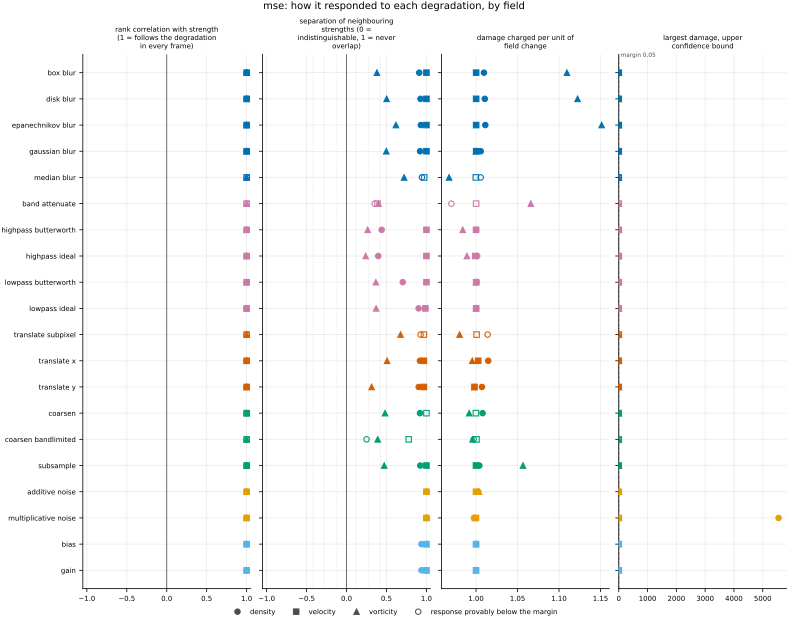
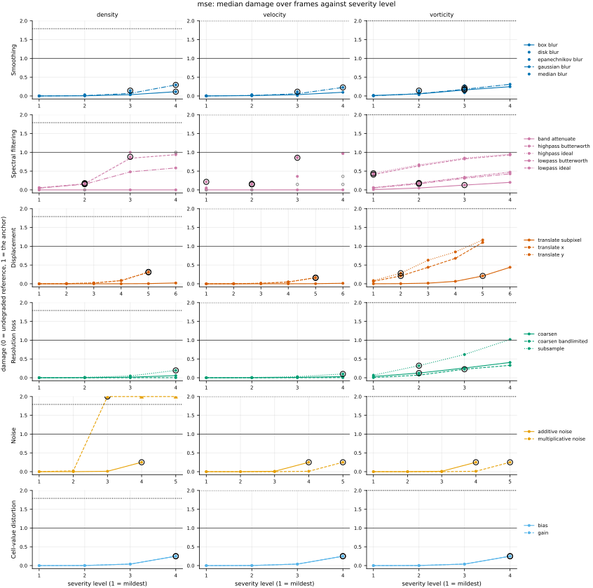
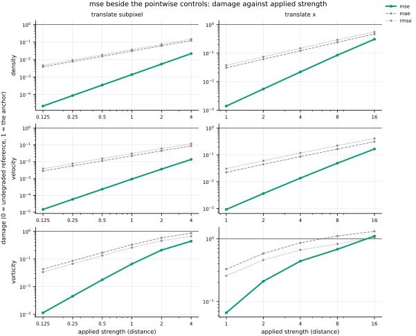

## Definition

For fields $f$ (reference) and $g$ (candidate) sampled on the same analysis grid, with $C$
channels and $N$ cells per channel,

$$
\mathrm{MSE}(f, g) = \frac{1}{CN} \sum_{c=1}^{C} \sum_{i=1}^{N}
\bigl( f_{c,i} - g_{c,i} \bigr)^2 \tag{1}
$$

For a vector field the channels are pooled rather than reduced separately. The analysis
grid is uniform, so cells carry equal weight; on a non-uniform grid Equation (1) would
need cell volumes and would no longer be a plain mean.

The per-cell map that this repository stores alongside the single number is the summand,

$$
m_i = \sum_{c=1}^{C} \bigl( f_{c,i} - g_{c,i} \bigr)^2 ,
\qquad
\mathrm{MSE} = \frac{1}{C} \, \langle m \rangle \tag{2}
$$

The declared reduction is the mean divided by the channel count, and a contract test
checks that reducing the map reproduces the scalar.

For a displacement $\delta$ small compared with the scale of variation, expanding
$f(x + \delta) - f(x) \simeq \delta\, \partial_x f$ in Equation (1) gives the
scaling that governs everything this metric does with shifted features:

$$
\mathrm{MSE} \simeq \delta^{2} \bigl\langle (\partial_x f)^2 \bigr\rangle ,
\qquad
\mathrm{MAE} \simeq \delta \bigl\langle |\partial_x f| \bigr\rangle \tag{3}
$$

### Boundary handling

None. The operation is local to each cell, so no neighbourhood is ever consulted and no
boundary condition can enter.

## Performance

<!-- GENERATED performance: written by `python -m fmeval.cards evidence mse --results results/comparison_1793657627 --results results/mse_1793784126`, do not edit -->



Four measured statistics for mse, one row per degradation grouped by family and one marker per field. From left: the rank correlation between the metric and the applied strength within a frame, with the line showing the resampling interval; the separation of neighbouring strengths as Cliff's delta, where 0 means the metric cannot tell one strength from the next and the faint ticks at 0.12, 0.28 and 0.42 are Vargha and Delaney's small, medium and large anchors, for scale and not as grades; the damage charged per unit of field change at the harshest strength; and the upper confidence bound on the largest damage, beside the fixed margin of 0.05. A hollow marker is a field and degradation on which that bound lies below the margin, so the response is provably small. A missing marker is a statistic the analysis withheld, as the rank correlation is on an axis the metric is invariant to.



Median damage over frames against severity level for mse, one row per family of degradation and one column per field, on one shared scale. The solid grey line is damage 1, the anchor (by default the field's own mean); the dotted black line is the damage assigned to the fake prediction with the right spectrum, where the run included it. The hollow black ring marks the first level at which the metric has moved a tenth of the way to the anchor. Hollow grey markers are strengths excluded for repeating a milder one or for doing nothing. Degradations with three or fewer usable levels are drawn as markers only; points beyond 2 either side are drawn as triangles at the edge. Damage is negative where a degradation moves the metric away from the anchor, as noise raises a single-field quantity the field's mean sets to zero.

**Trend: does the response follow the degradation?**

| test family | field | degradations | rank correlation | fraction of frames in order | weakest gap between neighbouring strengths |
|---|---|---|---|---|---|
| Displacement | density | 2 | 1 | 1 | 0.959 to 0.964 |
| Displacement | velocity | 2 | 1 | 1 | 0.984 |
| Displacement | vorticity | 2 | 1 | 1 | 0.754 to 0.838 |
| Resolution loss | density | 2 | 1 | 0.714 to 1 | 0.625 to 0.96 |
| Resolution loss | velocity | 2 | 1 | 1 | 0.889 to 1 |
| Resolution loss | vorticity | 2 | 1 | 1 | 0.695 to 0.741 |
| Smoothing | density | 3 | 1 | 1 | 0.955 to 0.972 |
| Smoothing | velocity | 3 | 1 | 1 | 0.986 to 1 |
| Smoothing | vorticity | 3 | 1 | 1 | 0.69 to 0.86 |
| Spectral filtering | density | 4 | 1 | 1 | 0.698 to 0.951 |
| Spectral filtering | velocity | 4 | 1 | 1 | 0.993 to 1 |
| Spectral filtering | vorticity | 4 | 1 | 1 | 0.62 to 0.685 |
| Noise | density | 1 | 1 | 1 | 1 |
| Noise | velocity | 1 | 1 | 1 | 1 |
| Noise | vorticity | 1 | 1 | 1 | 1 |

**Reactivity: how far does it move?**

| test family | field | change from clean at the harshest strength | elasticity | first strength detected |
|---|---|---|---|---|
| Displacement | density | — | 1.99 to 2 | level 5 |
| Displacement | velocity | — | 1.94 to 2 | level 5 |
| Displacement | vorticity | — | 1.37 to 1.99 | level 2 |
| Resolution loss | density | — | 1.88 to 2.18 | level — |
| Resolution loss | velocity | — | 2.08 to 4.39 | level — |
| Resolution loss | vorticity | — | 1.47 to 2.86 | level 2 |
| Smoothing | density | — | 3.25 to 3.72 | level 4 |
| Smoothing | velocity | — | 2.15 to 2.29 | level 4 |
| Smoothing | vorticity | — | 1.75 to 2.3 | level 3 |
| Spectral filtering | density | — | 1.27 to 14.6 | level 2 |
| Spectral filtering | velocity | — | 1.29 to 1.99 | level 1 |
| Spectral filtering | vorticity | — | 0.94 to 1.02 | level 1 |
| Noise | density | — | 2 | level 4 |
| Noise | velocity | — | 2 | level 4 |
| Noise | vorticity | — | 2 | level 4 |
| trap test: fake prediction, right spectrum | density | — | — | damage 1.79 |
| trap test: fake prediction, right spectrum | velocity | — | — | damage 2.02 |
| trap test: fake prediction, right spectrum | vorticity | — | — | damage 2.13 |

**Consistency: how much does it vary from snapshot to snapshot?**

| test family | field | consistency, in the strength's units | snapshots per independent block |
|---|---|---|---|
| Displacement | density | 0.143 to 0.831 | 19 |
| Displacement | velocity | 0.109 to 0.566 | 15 to 18 |
| Displacement | vorticity | 0.225 to 1.14 | 21 |
| Resolution loss | density | 0.874 to 3.38 | 19 to 20 |
| Resolution loss | velocity | 1.08 to 2.49 | 22 |
| Resolution loss | vorticity | 1.43 to 1.66 | 22 |
| Smoothing | density | 0.0136 to 0.0357 | 19 to 20 |
| Smoothing | velocity | 0.00999 to 0.0331 | 21 to 22 |
| Smoothing | vorticity | 0.02 to 0.045 | 21 to 22 |
| Spectral filtering | density | 0.0225 to 0.043 | 1 to 20 |
| Spectral filtering | velocity | 0.00675 to 0.0211 | 1 to 22 |
| Spectral filtering | vorticity | 0.0435 to 0.0573 | 20 to 22 |
| Noise | density | 0.0124 | 1 |
| Noise | velocity | 0.00623 | 1 |
| Noise | vorticity | 0.0103 | 21 |

One row per family of degradation and physical field; a cell gives the range over the degradations in that family. **Trend.** The rank correlation is the Spearman correlation between the strength and how far the metric has moved from its value on the undegraded field of the same frame, in the one direction it moves under that degradation, computed inside a single frame. A value of 1 means every strength moved it further than the last in every frame, whichever way it moves; a response that scatters to both sides scores near 0. The fraction of frames in order counts the frames with no exception. The weakest gap is the smallest Mann-Whitney overlap between two neighbouring strengths across frames: 1 means they never overlap, 0.5 that they cannot be told apart. **Reactivity.** The change from clean is the median, at the harshest strength, of the departure from the undegraded value of the same frame over the size of that value: 0.3 means 30%. It does not exist for this metric, whose undegraded value is exactly zero; the damage below is its relative reading. The elasticity is the percentage change of that departure per percentage change in strength over the mildest strengths. First strength detected is the mildest at which the metric has moved a tenth of the way to the anchor; **damage** reads that 0-to-1 scale as a number. A dash means the measurement is not defined there. A metric's reactivity scales with the power it is expressed in: mean squared error's elasticity is twice root-mean-square error's, though the two carry the same information, so compare magnitudes across metrics with that in mind. **Consistency** is how much the response varies from snapshot to snapshot relative to its size, in the strength's units; the snapshots of one trajectory are correlated, and the last column is how many consecutive snapshots one independent block spans.

These tables report what was measured and grade none of the measurements. What the numbers mean for this metric is written in the subsections below, beside the test that produced each number.

**Profile.**

| field | selectivity | charges most for | charges least for | response provably below 0.05 at 90% on | elasticity to a sub-pixel shift, against severity (distance) | compute cost (x cheapest in this run) |
|---|---|---|---|---|---|---|
| density | 2.9e-05 | `translate_x` | `coarsen_bandlimited` | `coarsen_bandlimited` `median_blur` `translate_subpixel` | 2 | 1.03 |
| velocity | 6.36e-07 | `translate_x` | `highpass_ideal` | `coarsen` `coarsen_bandlimited` `median_blur` `translate_subpixel` | 2 | 1.91 |
| vorticity | 0.00116 | `box_blur` | `median_blur` | — | 1.99 | 1.02 |

One row per physical field. **Selectivity** is how concentrated the metric's response is on a few degradations, measured per unit of field change: 0 means it charges every degradation the same, as mean squared error does by construction, and values toward 1 that one degradation carries most of it. **Charges most and least for** name the two ends of that profile. **Response provably below** lists degradations on which the upper confidence bound of the largest damage lies below the margin -- an equivalence test, so an entry says the response is provably small, not merely not significant; a dash means no degradation met the bound. **Elasticity** is the slope of log damage against log shift over the smallest shifts: 1 means damage grows in proportion to the shift, 2 with its square. **Compute cost** is wall-clock per evaluation over the cheapest metric and field in the same run.

<!-- END GENERATED performance -->

## Intuition

Mean squared error compares two fields one cell at a time: subtract, square, average.
Squaring keeps errors of opposite sign from cancelling and makes the largest local errors
dominate the total. Nothing in the calculation ever looks at more than one cell, so the
metric carries no notion of shape or position — it sees a bag of per-cell differences,
not a picture.

That locality produces its characteristic failure. A feature with the right shape and
strength but slightly displaced is wrong twice — once in the cells it left, once in the
cells it entered — while a feature in the right place with reduced amplitude is wrong
only once, and only by the amount reduced. On a four-by-four grid, with a candidate that
moved the square one cell and another that halved its brightness:

```
reference        moved one cell    half brightness
0 0 0 0          0 0 0 0           0    0    0    0
0 1 1 0          0 0 1 1           0   0.5  0.5   0
0 1 1 0          0 0 1 1           0   0.5  0.5   0
0 0 0 0          0 0 0 0           0    0    0    0

                 mse = 0.25        mse = 0.0625
```

The candidate that preserved the feature and only moved it scores four times worse. This
is the double penalty, and it is why a metric comparing fields cell by cell misjudges
sharp features that are nearly in the right place.

What this metric ignores is the arrangement of the errors: one error concentrated at a
sharp front and the same total error scattered as noise across the domain are the same
number.

## Reading the output

The value runs from zero upwards with no upper limit, in the square of the field's units,
so a density field and a vorticity field produce numbers that cannot be compared with each
other. Lower is better, and zero means the two fields are identical cell for cell.

There is no value that counts as good in the abstract. What counts as good depends
entirely on the variance of the field being predicted: an error of 0.01 is excellent for a
field whose fluctuations are of order one and catastrophic for one whose fluctuations are
of order 0.001. That is why the suite reports damage, which rescales the value so that
zero is the reference and one is what the reference's own spatial mean
scores, which for this metric is exactly the variance of the reference, and why NRMSE exists
as a normalised sibling.

Comparisons across models on the same field, the same dataset and the same analysis grid
are meaningful and are the intended use. Comparisons across fields are meaningless without
normalising, because of the units. Comparisons across resolutions are invalid as they
stand: the value is a mean over cells, so refining the grid changes the weight given to
small scales even when nothing about the prediction has changed. Compare on a common
analysis grid, which is what this suite remaps onto before measuring.

## Limitations

The concrete situation to recognise is a model that reproduces the structure of a flow
well but places it slightly wrong. Two candidates, one that predicts a shock of the right
strength one cell from its true position and one that smears the same shock over four
cells while keeping it centred, can receive similar mean squared errors even though a
person looking at the two fields would not hesitate to prefer the first. Ranking such
models by MSE therefore selects for smoothness. This is the mechanism behind the blurry
outputs that regression losses are known to produce, and it is visible in the results
here: the metric saturates slowly on displacement degradations while responding
immediately to blurring.

Two further cautions. The value is not comparable across grid resolutions, because it is
a mean over cells, so a run whose analysis grid differs is not comparable at all. And
because the differences are squared, a single badly wrong cell can dominate the whole
field; this is an advantage when outliers are what matters and a liability when they are
an artefact of the reader or the remap.

## Results

<!-- GENERATED run: written by `python -m fmeval.cards evidence mse --results results/comparison_1793657627 --results results/mse_1793784126`, do not edit -->

Measured on `kinet_re5e4`, frames 2000 to 10000 (161 frames of developed flow), on the 256 analysis grid, seed 20260807, at commit `fdbd5d7872d6` (working tree dirty). Run `comparison_1793657627`.

Every number in this section comes from that run, except in the subsections headed with another experiment, each of which names its own run. Regenerate with `python -m fmeval.cards evidence <name> --results results/comparison_1793657627 --results results/mse_1793784126`.

<!-- END GENERATED run -->

Each subsection links to the degradations that subsection reports. What those degradations
do, and what their strength numbers mean, is documented on their own pages.

<!-- GENERATED experiments: written by `python -m fmeval.cards catalog`, do not edit -->

**Across the experiments.**

| experiment | what a run on it is evidence of | on this card |
|---|---|---|
| `kinet_re5e4` | developed flow | measured, run `comparison_1793657627`: the main results |
| `kinet_re1e6` | developed flow at Re = 1e6, twenty times the Reynolds number of kinet_re5e4, from the same initial condition | not yet run |
| `synthetic_ensemble` | a calibrated null: evidence that the estimator computes what it claims to compute, and nothing about turbulence | not yet run; on this dataset the metric scores the member mean of the ensemble |
| `sod_shock_tube` | an analytic check: evidence that the metric locates and scores a known shock correctly, and nothing about turbulence | measured, run `mse_1793784126`: under *On `sod_shock_tube`* |
| `forecast_re5e4` | real predictions scored against their targets at each prediction step; who produced the predictions, a trained model or a coarser solver, is not recorded | not yet run |

One row per dataset a card may cite (`configs/cards/default.yaml`). *Measured* names the run the card cites: the main results are `## Performance` and the subsections below, and every other run has its own subsection headed with its dataset. *Not applicable* gives the reason: one that follows from what the metric declares and what the dataset offers, or one a person wrote on the card (`not_run` in `card.yaml`) because the result would carry no information. *Not yet run* means the metric can run there and the card cites no run on it yet.

<!-- END GENERATED experiments -->

### Smoothing

[gaussian_blur](../../degradations/gaussian_blur/card.md) ·
[box_blur](../../degradations/box_blur/card.md) ·
[median_blur](../../degradations/median_blur/card.md)

<!-- GENERATED results_smoothing: written by `python -m fmeval.cards evidence mse --results results/comparison_1793657627 --results results/mse_1793784126`, do not edit -->

| degradation | field | strengths | rank correlation | fraction of frames in the right order | weakest gap between neighbouring strengths |
|---|---|---|---|---|---|
| `box_blur` | density | 4 | 1 | 1 | 0.955 |
| `box_blur` | velocity | 4 | 1 | 1 | 1 |
| `box_blur` | vorticity | 4 | 1 | 1 | 0.69 |
| `gaussian_blur` | density | 4 | 1 | 1 | 0.96 |
| `gaussian_blur` | velocity | 4 | 1 | 1 | 1 |
| `gaussian_blur` | vorticity | 4 | 1 | 1 | 0.749 |
| `median_blur` | density | 3 | 1 | 1 | 0.972 |
| `median_blur` | velocity | 3 | 1 | 1 | 0.986 |
| `median_blur` | vorticity | 3 | 1 | 1 | 0.86 |

<!-- END GENERATED results_smoothing -->

### Spectral filtering

[lowpass_ideal](../../degradations/lowpass_ideal/card.md) ·
[lowpass_butterworth](../../degradations/lowpass_butterworth/card.md) ·
[highpass_ideal](../../degradations/highpass_ideal/card.md) ·
[highpass_butterworth](../../degradations/highpass_butterworth/card.md)

<!-- GENERATED results_spectral: written by `python -m fmeval.cards evidence mse --results results/comparison_1793657627 --results results/mse_1793784126`, do not edit -->

| degradation | field | strengths | rank correlation | fraction of frames in the right order | weakest gap between neighbouring strengths |
|---|---|---|---|---|---|
| `highpass_butterworth` | density | 4 | 1 | 1 | 0.72 |
| `highpass_butterworth` | velocity | 3 | 1 | 1 | 1 |
| `highpass_butterworth` | vorticity | 4 | 1 | 1 | 0.633 |
| `highpass_ideal` | density | 3 | 1 | 1 | 0.698 |
| `highpass_ideal` | velocity | 2 | 1 | 1 | 1 |
| `highpass_ideal` | vorticity | 4 | 1 | 1 | 0.62 |
| `lowpass_butterworth` | density | 4 | 1 | 1 | 0.852 |
| `lowpass_butterworth` | velocity | 3 | 1 | 1 | 1 |
| `lowpass_butterworth` | vorticity | 4 | 1 | 1 | 0.684 |
| `lowpass_ideal` | density | 3 | 1 | 1 | 0.951 |
| `lowpass_ideal` | velocity | 2 | 1 | 1 | 0.993 |
| `lowpass_ideal` | vorticity | 4 | 1 | 1 | 0.685 |

<!-- END GENERATED results_spectral -->

### Displacement

[translate_x](../../degradations/translate/card.md) ·
[translate_subpixel](../../degradations/translate_subpixel/card.md)

<!-- GENERATED results_geometric: written by `python -m fmeval.cards evidence mse --results results/comparison_1793657627 --results results/mse_1793784126`, do not edit -->

| degradation | field | strengths | rank correlation | fraction of frames in the right order | weakest gap between neighbouring strengths |
|---|---|---|---|---|---|
| `translate_subpixel` | density | 6 | 1 | 1 | 0.964 |
| `translate_subpixel` | velocity | 6 | 1 | 1 | 0.984 |
| `translate_subpixel` | vorticity | 6 | 1 | 1 | 0.838 |
| `translate_x` | density | 5 | 1 | 1 | 0.959 |
| `translate_x` | velocity | 5 | 1 | 1 | 0.984 |
| `translate_x` | vorticity | 5 | 1 | 1 | 0.754 |

<!-- END GENERATED results_geometric -->

The response is quadratic in the displacement, as Equation (3) gives: on vorticity the
damage ratios per doubling below one cell are 3.98, 3.94 and 3.75 against the 4 implied by
that scaling, falling to 3.18 and 2.10 above a cell as the expansion stops holding. MAE is
linear over the same shifts, so it assigns 38 times the damage at an eighth of a cell and
5.0 times at one cell. MSE therefore reads as tolerant of small displacements and severe
about moderate ones, and the double penalty has no single onset.

### Resolution loss

[coarsen](../../degradations/coarsen/card.md) ·
[coarsen_bandlimited](../../degradations/coarsen_bandlimited/card.md)

<!-- GENERATED results_resolution: written by `python -m fmeval.cards evidence mse --results results/comparison_1793657627 --results results/mse_1793784126`, do not edit -->

| degradation | field | strengths | rank correlation | fraction of frames in the right order | weakest gap between neighbouring strengths |
|---|---|---|---|---|---|
| `coarsen` | density | 4 | 1 | 1 | 0.96 |
| `coarsen` | velocity | 4 | 1 | 1 | 1 |
| `coarsen` | vorticity | 4 | 1 | 1 | 0.741 |
| `coarsen_bandlimited` | density | 4 | 1 | 0.714 | 0.625 |
| `coarsen_bandlimited` | velocity | 4 | 1 | 1 | 0.889 |
| `coarsen_bandlimited` | vorticity | 4 | 1 | 1 | 0.695 |

<!-- END GENERATED results_resolution -->

Both coarsenings are ordered correctly on every field, with a rank correlation of 1. They differ in size. At a factor of 16, `coarsen` scores a damage of 0.06, 0.03 and 0.41 on density, velocity and vorticity, and `coarsen_bandlimited` 0.002, 0.004 and 0.33. The two operators keep the same block means, so on the smooth fields most of what `coarsen` charges is its staircase; on vorticity, whose structure the coarse grid genuinely cannot hold, they nearly agree. Under the band-limited operator density is in the right order in only 71% of frames: its damage at factors 2 and 4 is below 0.001 at both, and which of the two is larger changes from frame to frame. The other pointwise metrics, `spectrum_l2` and `h1_seminorm` show this on density too, and its
cause is not established; `issues/039` records what was ruled out.

### Noise

[additive_noise](../../degradations/additive_noise/card.md)

<!-- GENERATED results_stochastic: written by `python -m fmeval.cards evidence mse --results results/comparison_1793657627 --results results/mse_1793784126`, do not edit -->

| degradation | field | strengths | rank correlation | fraction of frames in the right order | weakest gap between neighbouring strengths |
|---|---|---|---|---|---|
| `additive_noise` | density | 4 | 1 | 1 | 1 |
| `additive_noise` | velocity | 4 | 1 | 1 | 1 |
| `additive_noise` | vorticity | 4 | 1 | 1 | 1 |

<!-- END GENERATED results_stochastic -->

### Trap tests

[gaussian_impostor](../../degradations/gaussian_impostor/card.md) ·
[uncorrelated](../../degradations/random_large_translation/card.md)

<!-- GENERATED results_canaries: written by `python -m fmeval.cards evidence mse --results results/comparison_1793657627 --results results/mse_1793784126`, do not edit -->

| field | damage assigned to the fake prediction | closest real degradation | damage of the reference moved far away | value on the anchor |
|---|---|---|---|---|
| density | 1.79 | `lowpass_ideal=1.4029` | 1.45 | 4.51e-05 |
| velocity | 2.02 | `highpass_ideal=4.02293` | 3.05 | 0.00157 |
| vorticity | 2.13 | `translate_x=16` | 2.36 | 6.16e-06 |

The fake prediction here has exactly the reference field's amplitude spectrum and completely scrambled structure. Damage 1 is what the anchor scores, by default the reference's own spatial mean, a prediction that knows the mean and nothing else. The damage column therefore says how close to useless this metric considers that fake prediction: a low number means the metric was fooled. The third column translates the same number into an ordinary degradation whose damage the fake prediction matches, which is easier to picture. The fourth is the reference moved by a large random offset, the right statistics in the wrong place; where a field's energy sits in its largest scales that copy stays partly correlated with the reference, so it is not the score of an unrelated field.

<!-- END GENERATED results_canaries -->

MSE rejects the phase-scrambled fake prediction firmly: damage 2.13 on vorticity, 2.02 on
velocity and 1.79 on density, so it scores the fake prediction worse than the field's own
mean on every field. Here damage is the mean squared error divided by the variance, so a
field with the reference's mean and variance and no relation to it would score 2 on
average; the fake prediction sits close to that. The trap test is aimed at
metrics depending only on the amplitude spectrum, so it does not catch this family, and a
panel in which every metric rejects it is not evidence of a well-guarded panel.

### Compared with the other metrics

<!-- GENERATED results_summary: written by `python -m fmeval.cards evidence mse --results results/comparison_1793657627 --results results/mse_1793784126`, do not edit -->

| compared with | density | velocity | vorticity |
|---|---|---|---|
| `rmse` | 1 | 1 | 1 |
| `nrmse` | 0.999 | 1 | 0.999 |
| `mae` | 0.99 | 0.997 | 0.98 |
| `max_error` | 0.969 | 0.957 | 0.972 |
| `h_minus_one` | 0.949 | 0.951 | 0.961 |
| `wasserstein` | 0.949 | — | — |
| `h1_seminorm` | 0.759 | 0.657 | 0.592 |
| `spectral_energy_flux` | — | 0.357 | — |
| `increment_w1_by_separation` | 0.263 | 0.251 | 0.0346 |
| `persistence_distance` | 0.275 | — | 0.146 |
| `spectrum_l2` | 0.186 | 0.346 | 0.102 |
| `energy_distance` | 0.186 | 0.14 | -0.195 |
| `increment_w1` | 0.188 | 0.123 | -0.159 |
| `tail_exceedance` | 0.171 | 0.122 | -0.203 |
| `palinstrophy` | — | — | 0.0172 |
| `tail_index` | -0.0634 | -0.0452 | -0.0629 |
| `increment_flatness` | -0.225 | -0.137 | -0.0348 |
| `enstrophy` | — | — | -0.16 |
| `kinetic_energy` | — | -0.285 | — |

Rank correlation over every degradation, computed separately for each physical field on the median value at each combination of degradation and strength, with the undegraded reference excluded. A dash marks a metric that does not run on that field. A metric with a target value enters by its distance from the target. Two metrics correlating near 1 put the degradations in the same order, but the two may still weight those degradations very differently. A correlation near 1 therefore means the two metrics are redundant for ranking models, not that the two are interchangeable as training losses.

<!-- END GENERATED results_summary -->

MSE and RMSE correlate at exactly 1: the square root is monotone, so no ranking can ever
separate them. Against the other baselines MSE sits at 0.98 to 0.997 with MAE and 0.999 to 1
with NRMSE across the fields, above the 0.95 redundancy threshold, yet MAE assigns 38 times the damage at an
eighth of a cell. They order damage alike without weighting it alike, so for ranking
models they are duplicates and as training losses they are not. Reach for MSE when the
errors that matter are errors of amplitude, not of position.

### Damage beside the other metrics

<!-- GENERATED results_damage_by_level: written by `python -m fmeval.cards evidence mse --results results/comparison_1793657627 --results results/mse_1793784126`, do not edit -->



Median damage over frames against the applied strength, log-log, for mse (bold, in colour) and the pointwise controls mae, rmse, nrmse (thin, grey), one column per displacement degradation and one row per field. The grey line is damage 1, the anchor (by default the field's own mean). Parallel lines charge in the same proportion at every strength; a steeper line charges relatively more for the larger shifts, which is what decides whether two metrics are interchangeable as training losses. These are the same numbers as the table beneath.

**Displacement, density, `translate_subpixel`** (strength: distance).

| metric | 0.125 | 0.25 | 0.5 | 1 | 2 | 4 |
|---|---|---|---|---|---|---|
| `mse` | 2.17e-05 | 8.68e-05 | 0.000347 | 0.00138 | 0.00551 | 0.0219 |
| `mae` | 0.00383 | 0.00767 | 0.0153 | 0.0306 | 0.061 | 0.121 |
| `rmse` | 0.00466 | 0.00931 | 0.0186 | 0.0372 | 0.0743 | 0.148 |
| `nrmse` | 0.00463 | 0.00926 | 0.0185 | 0.037 | 0.0738 | 0.147 |

**Displacement, density, `translate_x`** (strength: distance).

| metric | 1 | 2 | 4 | 8 | 16 |
|---|---|---|---|---|---|
| `mse` | 0.00138 | 0.00551 | 0.0219 | 0.0849 | 0.307 |
| `mae` | 0.0306 | 0.061 | 0.121 | 0.24 | 0.469 |
| `rmse` | 0.0372 | 0.0743 | 0.148 | 0.291 | 0.555 |
| `nrmse` | 0.037 | 0.0738 | 0.147 | 0.29 | 0.55 |

**Displacement, velocity, `translate_subpixel`** (strength: distance).

| metric | 0.125 | 0.25 | 0.5 | 1 | 2 | 4 |
|---|---|---|---|---|---|---|
| `mse` | 1.45e-05 | 5.81e-05 | 0.000232 | 0.000924 | 0.0036 | 0.0136 |
| `mae` | 0.00279 | 0.00559 | 0.0112 | 0.0223 | 0.0441 | 0.0859 |
| `rmse` | 0.00381 | 0.00762 | 0.0152 | 0.0304 | 0.06 | 0.117 |
| `nrmse` | 0.00382 | 0.00763 | 0.0153 | 0.0304 | 0.06 | 0.117 |

**Displacement, velocity, `translate_x`** (strength: distance).

| metric | 1 | 2 | 4 | 8 | 16 |
|---|---|---|---|---|---|
| `mse` | 0.000924 | 0.0036 | 0.0136 | 0.0489 | 0.165 |
| `mae` | 0.0223 | 0.0441 | 0.0859 | 0.163 | 0.31 |
| `rmse` | 0.0304 | 0.06 | 0.117 | 0.221 | 0.406 |
| `nrmse` | 0.0304 | 0.06 | 0.117 | 0.221 | 0.406 |

**Displacement, vorticity, `translate_subpixel`** (strength: distance).

| metric | 0.125 | 0.25 | 0.5 | 1 | 2 | 4 |
|---|---|---|---|---|---|---|
| `mse` | 0.00112 | 0.00448 | 0.0176 | 0.066 | 0.21 | 0.44 |
| `mae` | 0.0428 | 0.0854 | 0.169 | 0.328 | 0.582 | 0.86 |
| `rmse` | 0.0335 | 0.0669 | 0.133 | 0.257 | 0.458 | 0.663 |
| `nrmse` | 0.0328 | 0.0654 | 0.13 | 0.253 | 0.456 | 0.67 |

**Displacement, vorticity, `translate_x`** (strength: distance).

| metric | 1 | 2 | 4 | 8 | 16 |
|---|---|---|---|---|---|
| `mse` | 0.066 | 0.21 | 0.44 | 0.679 | 1.1 |
| `mae` | 0.328 | 0.582 | 0.86 | 1.1 | 1.31 |
| `rmse` | 0.257 | 0.458 | 0.663 | 0.824 | 1.05 |
| `nrmse` | 0.253 | 0.456 | 0.67 | 0.832 | 1.05 |

Median damage over frames at every strength, this metric in the first row and the pointwise controls beneath it, all on the same 0-to-1 scale where 0 is the undegraded reference and 1 the anchor (by default the field's own mean); a dash means no damage scale on that field. The rank correlations under *Compared with the other metrics* say whether two metrics put the strengths in the same order; this table says how much each one charges for the same strength, which decides whether two metrics are interchangeable as training losses.

<!-- END GENERATED results_damage_by_level -->

### On `sod_shock_tube`

<!-- GENERATED results_on_sod_shock_tube: written by `python -m fmeval.cards evidence mse --results results/comparison_1793657627 --results results/mse_1793784126`, do not edit -->

**An analytic check: evidence that the metric locates and scores a known shock correctly, and nothing about turbulence.**

Measured on `sod_shock_tube`, frames 0 to 9 (10 frames of an analytic check: evidence that the metric locates and scores a known shock correctly, and nothing about turbulence), on the 2048 analysis grid, seed 20260807, at commit `440e07112085`. Run `mse_1793784126`.

[additive_noise](../../degradations/additive_noise/card.md) ·
[box_blur](../../degradations/box_blur/card.md) ·
[coarsen](../../degradations/coarsen/card.md) ·
[coarsen_bandlimited](../../degradations/coarsen_bandlimited/card.md) ·
[gaussian_blur](../../degradations/gaussian_blur/card.md) ·
[gaussian_impostor](../../degradations/gaussian_impostor/card.md) ·
[highpass_butterworth](../../degradations/highpass_butterworth/card.md) ·
[highpass_ideal](../../degradations/highpass_ideal/card.md) ·
[lowpass_butterworth](../../degradations/lowpass_butterworth/card.md) ·
[lowpass_ideal](../../degradations/lowpass_ideal/card.md) ·
[mean_field](../../degradations/mean_field/card.md) ·
[median_blur](../../degradations/median_blur/card.md) ·
[translate_subpixel](../../degradations/translate_subpixel/card.md) ·
[translate_x](../../degradations/translate/card.md) ·
[uncorrelated](../../degradations/random_large_translation/card.md)

**Smoothing.**

| degradation | field | strengths | rank correlation | fraction of frames in the right order | weakest gap between neighbouring strengths |
|---|---|---|---|---|---|
| `box_blur` | density | 4 | 1 | 1 | 1 |
| `box_blur` | pressure | 4 | 1 | 1 | 1 |
| `box_blur` | velocity | 4 | 1 | 1 | 1 |
| `gaussian_blur` | density | 4 | 1 | 1 | 1 |
| `gaussian_blur` | pressure | 4 | 1 | 1 | 1 |
| `gaussian_blur` | velocity | 4 | 1 | 1 | 1 |

**Spectral filtering.**

| degradation | field | strengths | rank correlation | fraction of frames in the right order | weakest gap between neighbouring strengths |
|---|---|---|---|---|---|
| `highpass_butterworth` | density | 2 | 1 | 1 | 1 |
| `highpass_butterworth` | pressure | 2 | 1 | 1 | 1 |
| `highpass_butterworth` | velocity | 4 | 1 | 1 | 0.78 |
| `highpass_ideal` | density | 1 | — | — | — |
| `highpass_ideal` | pressure | 1 | — | — | — |
| `highpass_ideal` | velocity | 4 | 1 | 1 | 0.78 |
| `lowpass_butterworth` | density | 1 | — | — | — |
| `lowpass_butterworth` | pressure | 2 | 1 | 1 | 1 |
| `lowpass_butterworth` | velocity | 4 | 1 | 1 | 1 |
| `lowpass_ideal` | density | 1 | — | — | — |
| `lowpass_ideal` | pressure | 2 | 1 | 1 | 1 |
| `lowpass_ideal` | velocity | 4 | 1 | 1 | 1 |

**Displacement.**

| degradation | field | strengths | rank correlation | fraction of frames in the right order | weakest gap between neighbouring strengths |
|---|---|---|---|---|---|
| `translate_subpixel` | density | 6 | 1 | 1 | 1 |
| `translate_subpixel` | pressure | 6 | 1 | 1 | 1 |
| `translate_subpixel` | velocity | 6 | 1 | 1 | 1 |
| `translate_x` | density | 5 | 1 | 1 | 1 |
| `translate_x` | pressure | 5 | 1 | 1 | 1 |
| `translate_x` | velocity | 5 | 1 | 1 | 1 |

**Resolution loss.**

| degradation | field | strengths | rank correlation | fraction of frames in the right order | weakest gap between neighbouring strengths |
|---|---|---|---|---|---|
| `coarsen` | density | 4 | 1 | 1 | 0.92 |
| `coarsen` | pressure | 4 | 1 | 1 | 1 |
| `coarsen` | velocity | 4 | 1 | 1 | 0.79 |
| `coarsen_bandlimited` | density | 4 | 1 | 1 | 1 |
| `coarsen_bandlimited` | pressure | 4 | 1 | 1 | 1 |
| `coarsen_bandlimited` | velocity | 4 | 1 | 1 | 1 |

**Noise.**

| degradation | field | strengths | rank correlation | fraction of frames in the right order | weakest gap between neighbouring strengths |
|---|---|---|---|---|---|
| `additive_noise` | density | 4 | 1 | 1 | 1 |
| `additive_noise` | pressure | 4 | 1 | 1 | 1 |
| `additive_noise` | velocity | 4 | 1 | 1 | 1 |

**Trap tests.**

| field | damage assigned to the fake prediction | closest real degradation | damage of the reference moved far away | value on the anchor |
|---|---|---|---|---|
| density | 1.98 | `highpass_butterworth=2.77538` | 3.29 | 0.128 |
| pressure | 1.86 | `highpass_butterworth=3.73482` | 3.29 | 0.137 |
| velocity | 2.1 | `highpass_ideal=17.1163` | 2.17 | 0.173 |

The fake prediction here has exactly the reference field's amplitude spectrum and completely scrambled structure. Damage 1 is what the anchor scores, by default the reference's own spatial mean, a prediction that knows the mean and nothing else. The damage column therefore says how close to useless this metric considers that fake prediction: a low number means the metric was fooled. The third column translates the same number into an ordinary degradation whose damage the fake prediction matches, which is easier to picture. The fourth is the reference moved by a large random offset, the right statistics in the wrong place; where a field's energy sits in its largest scales that copy stays partly correlated with the reference, so it is not the score of an unrelated field.

<!-- END GENERATED results_on_sod_shock_tube -->

On the exact Sod solution MSE orders every degradation that keeps two or more distinct
strengths, with a rank correlation of 1 on density, pressure and velocity. The narrowest gaps
between neighbouring strengths are on velocity: 0.78 under both high-pass filters and 0.79
under `coarsen`. On density and pressure 99% of the fluctuation energy lies below wavenumber 6
(the run's `data/calibration.csv`), so several calibrated spectral strengths resolve to the same
cutoff and are excluded as repeats of a milder one, or leave the profile unchanged; that is why
several rows hold one strength and no correlation.

The displacement result differs from the developed flow in a way Equation (3) does not cover.
Over the three mildest whole-cell shifts of `translate_x` the damage grows in proportion to the
shift, with an elasticity of 1.04, 1.07 and 1.01 on density, pressure and velocity, where on
`kinet_re5e4` it grows with the square (1.99 on density). Over the sub-cell shifts of
`translate_subpixel` it is quadratic again, 1.94 on all three fields. Our own derivation, not
taken from a source, accounts for both: Equation (3) assumes the field is smooth on the scale
of the shift, which a jump is not. A jump of height $J$ moved by a whole number $\delta$ of
cells changes $\delta$ cells by $J$ each, adding $J^2 \delta / N$ to the mean squared error on
$N$ cells, which is linear in the shift; a sub-cell shift changes the cell at the jump
continuously with $\delta$, so its error starts quadratic. The damage stays small, at most
0.0042, 0.0044 and 0.041 under `translate_x` against 0.35 on density in the developed flow,
because only the cells near the shock, the contact and the rarefaction change while the anchor,
the field's spatial mean, is wrong along the whole tube. Coarsening is nearly free for the same
reason: at most 0.0008 on density and pressure and 0.0098 on velocity under `coarsen`.

The phase-scrambled fake prediction is rejected as it is on the developed flow, with damage
1.98, 1.86 and 2.10 on density, pressure and velocity.

## References

\bibliography
