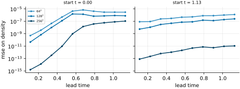
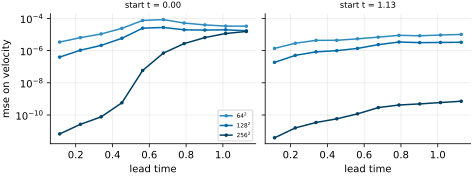
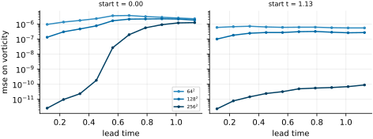

## Definition

For fields $f$ (reference) and $g$ (candidate) sampled on the same analysis grid, with $C$
channels and $N$ cells per channel,

$$
\mathrm{MSE}(f, g) = \frac{1}{CN} \sum_{c=1}^{C} \sum_{i=1}^{N}
\bigl( f_{c,i} - g_{c,i} \bigr)^2 \tag{1}
$$

For a vector field the channels are pooled rather than reduced separately. The analysis
grid is uniform, so cells carry equal weight; on a non-uniform grid Equation (1) would
need cell volumes and would no longer be a plain mean.

The per-cell map that this repository stores alongside the single number is the summand,

$$
m_i = \sum_{c=1}^{C} \bigl( f_{c,i} - g_{c,i} \bigr)^2 ,
\qquad
\mathrm{MSE} = \frac{1}{C} \, \langle m \rangle \tag{2}
$$

The declared reduction is the mean divided by the channel count, and a contract test
checks that reducing the map reproduces the scalar.

For a displacement $\delta$ small compared with the scale of variation, expanding
$f(x + \delta) - f(x) \simeq \delta\, \partial_x f$ in Equation (1) gives the
scaling that governs everything this metric does with shifted features:

$$
\mathrm{MSE} \simeq \delta^{2} \bigl\langle (\partial_x f)^2 \bigr\rangle ,
\qquad
\mathrm{MAE} \simeq \delta \bigl\langle |\partial_x f| \bigr\rangle \tag{3}
$$

### Boundary handling

None. The operation is local to each cell, so no neighbourhood is ever consulted and no
boundary condition can enter.

### How its field reports it

The fields that report a squared error mostly report its square root; the mean squared error
itself is a per-field number of The Well's library and the loss its baselines were trained on.

- **Machine-learning benchmarks for PDEs** [@ohana2024]. The Well's MSE is the spatial mean of the
  squared error, one value per field (App. E.3; `the_well/benchmark/metrics/spatial.py`, `MSE`).
  Its baselines were trained on the MSE "averaged over fields and space" (App. E.1), and its
  trainer reports the training loss per field and as the mean over fields beside its validation
  metrics (`the_well/benchmark/trainer/training.py`, `validation_suite`, `split_up_losses`).
  Every channel has the same cells, so that mean over channels is exactly Equation (1): pooling
  and averaging per channel agree for this metric, and no sibling is needed. The Well's
  tables and figures report the normalised form, [vrmse](../../metrics/vrmse/card.md), and PDEBench reports
  RMSE, not MSE [@takamoto2022] (Sect. 3.3).
- **Numerical analysis and weather verification** report the square root, the discrete $L^2$
  norm and the RMSE; the figures, statistics and experiments of both are on the card of
  [rmse](../../metrics/rmse/card.md), whose ordering this metric shares exactly.

**The experiments here.** The rollouts and refinement studies these fields evaluate on are as
described on `rmse`'s card: `forecast_re5e4` gives one model's error against lead time from two
starting times, and the missing experiments are
[EXP-nrmse-rollouts-over-many-initial-conditions](https://github.com/khegazy/pde_metrics/blob/main/proposals/EXP-nrmse-rollouts-over-many-initial-conditions.md)
and
[EXP-max_error-grid-convergence-with-a-known-solution](https://github.com/khegazy/pde_metrics/blob/main/proposals/EXP-max_error-grid-convergence-with-a-known-solution.md).
The metric also runs on the degradation ladder on `kinet_re5e4`, on `sod_shock_tube`, on the
member mean of `synthetic_ensemble` and on the Reynolds ladder: it needs nothing but two fields
on one grid.

## Performance

<!-- GENERATED performance: written by `python -m fmeval.cards evidence mse --results results/comparison_1793829127 --results results/comparison_1793812304 --results results/comparison_1793811840 --results results/comparison_1793812401 --results results/comparison_1793829231`, do not edit -->



*As this metric's own field draws it, from run `comparison_1793811840`.* mse on density against lead time, the physical time since the forecast started, one panel per start and one line per run, darker the finer the run's grid. Each point is one prediction step of one forecast.



*As this metric's own field draws it, from run `comparison_1793811840`.* mse on velocity against lead time, the physical time since the forecast started, one panel per start and one line per run, darker the finer the run's grid. Each point is one prediction step of one forecast.



*As this metric's own field draws it, from run `comparison_1793811840`.* mse on vorticity against lead time, the physical time since the forecast started, one panel per start and one line per run, darker the finer the run's grid. Each point is one prediction step of one forecast.


Four measured statistics for mse, one row per degradation grouped by family and one marker per field. From left: the rank correlation between the metric and the applied strength within a frame, with the line showing the resampling interval; the separation of neighbouring strengths as Cliff's delta, where 0 means the metric cannot tell one strength from the next and the faint ticks at 0.12, 0.28 and 0.42 are Vargha and Delaney's small, medium and large anchors, for scale and not as grades; the damage charged per unit of field change at the harshest strength; and the upper confidence bound on the largest damage, beside the fixed margin of 0.05. A hollow marker is a field and degradation on which that bound lies below the margin, so the response is provably small. A missing marker is a statistic the analysis withheld, as the rank correlation is on an axis the metric is invariant to.


Median damage over frames against severity level for mse, one row per family of degradation and one column per field, on one shared scale. The solid grey line is damage 1, the anchor (by default the field's own mean); the dotted black line is the damage assigned to the fake prediction with the right spectrum, where the run included it. The hollow black ring marks the first level at which the metric has moved a tenth of the way to the anchor. Hollow grey markers are strengths excluded for repeating a milder one or for doing nothing. Degradations with three or fewer usable levels are drawn as markers only; points beyond 2 either side are drawn as triangles at the edge. Damage is negative where a degradation moves the metric away from the anchor, as noise raises a single-field quantity the field's mean sets to zero.

**Trend: does the response follow the degradation?**

| test family | field | degradations | rank correlation | fraction of frames in order | weakest gap between neighbouring strengths |
|---|---|---|---|---|---|
| Displacement | density | 3 | 1 | 1 | 0.952 to 0.964 |
| Displacement | velocity | 3 | 1 | 1 | 0.984 |
| Displacement | vorticity | 3 | 1 | 1 | 0.657 to 0.838 |
| Cell-value distortion | density | 2 | 1 | 1 | 0.969 |
| Cell-value distortion | velocity | 2 | 1 | 1 | 1 |
| Cell-value distortion | vorticity | 2 | 1 | 1 | 1 |
| Resolution loss | density | 3 | 1 | 0.714 to 1 | 0.625 to 0.961 |
| Resolution loss | velocity | 3 | 1 | 1 | 0.889 to 1 |
| Resolution loss | vorticity | 3 | 1 | 1 | 0.695 to 0.741 |
| Smoothing | density | 5 | 1 | 1 | 0.955 to 0.972 |
| Smoothing | velocity | 5 | 1 | 1 | 0.986 to 1 |
| Smoothing | vorticity | 5 | 1 | 1 | 0.69 to 0.86 |
| Spectral filtering | density | 5 | 1 | 1 | 0.676 to 0.951 |
| Spectral filtering | velocity | 5 | 1 | 1 | 0.694 to 1 |
| Spectral filtering | vorticity | 5 | 1 | 1 | 0.62 to 0.7 |
| Noise | density | 2 | 1 | 1 | 1 |
| Noise | velocity | 2 | 1 | 1 | 1 |
| Noise | vorticity | 2 | 1 | 1 | 1 |

**Reactivity: how far does it move?**

| test family | field | change from clean at the harshest strength | elasticity | first strength detected |
|---|---|---|---|---|
| Displacement | density | — | 1.99 to 2 | level 5 |
| Displacement | velocity | — | 1.94 to 2 | level 5 |
| Displacement | vorticity | — | 1.37 to 1.99 | level 2 |
| Cell-value distortion | density | — | 2 | level 4 |
| Cell-value distortion | velocity | — | 2 | level 4 |
| Cell-value distortion | vorticity | — | 2 | level 4 |
| Resolution loss | density | — | 1.88 to 2.54 | level 4 |
| Resolution loss | velocity | — | 2.08 to 4.39 | level 4 |
| Resolution loss | vorticity | — | 1.47 to 2.86 | level 2 |
| Smoothing | density | — | 3.09 to 3.72 | level 3 |
| Smoothing | velocity | — | 2.15 to 2.29 | level 3 |
| Smoothing | vorticity | — | 1.75 to 2.3 | level 2 |
| Spectral filtering | density | — | 1.27 to 14.6 | level 2 |
| Spectral filtering | velocity | — | 1.29 to 2 | level 1 |
| Spectral filtering | vorticity | — | 0.94 to 2 | level 1 |
| Noise | density | — | 2 | level 3 |
| Noise | velocity | — | 2 | level 4 |
| Noise | vorticity | — | 2 | level 4 |
| trap test: fake prediction, right spectrum | density | — | — | damage 1.79 |
| trap test: fake prediction, right spectrum | velocity | — | — | damage 2.02 |
| trap test: fake prediction, right spectrum | vorticity | — | — | damage 2.13 |

**Consistency: how much does it vary from snapshot to snapshot?**

| test family | field | consistency, in the strength's units | snapshots per independent block |
|---|---|---|---|
| Displacement | density | 0.107 to 0.733 | 15 to 19 |
| Displacement | velocity | 0.109 to 1.47 | 15 to 22 |
| Displacement | vorticity | 0.225 to 1.51 | 21 to 22 |
| Cell-value distortion | density | 0.0408 | 20 |
| Cell-value distortion | velocity | 0.0104 | 1 |
| Cell-value distortion | vorticity | 0.0172 | 21 |
| Resolution loss | density | 0.888 to 2.42 | 18 to 20 |
| Resolution loss | velocity | 1.05 to 2.49 | 22 |
| Resolution loss | vorticity | 1.43 to 1.66 | 22 |
| Smoothing | density | 0.0108 to 0.0238 | 14 to 15 |
| Smoothing | velocity | 0.00999 to 0.0331 | 21 to 22 |
| Smoothing | vorticity | 0.02 to 0.045 | 21 to 22 |
| Spectral filtering | density | 0.0337 to 0.187 | 16 to 21 |
| Spectral filtering | velocity | 0.00675 to 0.171 | 1 to 22 |
| Spectral filtering | vorticity | 0.0435 to 0.127 | 20 to 22 |
| Noise | density | 0.000104 to 0.0245 | 1 to 20 |
| Noise | velocity | 0.00341 to 0.00623 | 1 |
| Noise | vorticity | 0.00586 to 0.0103 | 21 |

One row per family of degradation and physical field; a cell gives the range over the degradations in that family. **Trend.** The rank correlation is the Spearman correlation between the strength and how far the metric has moved from its value on the undegraded field of the same frame, in the one direction it moves under that degradation, computed inside a single frame. A value of 1 means every strength moved it further than the last in every frame, whichever way it moves; a response that scatters to both sides scores near 0. The fraction of frames in order counts the frames with no exception. The weakest gap is the smallest Mann-Whitney overlap between two neighbouring strengths across frames: 1 means they never overlap, 0.5 that they cannot be told apart. **Reactivity.** The change from clean is the median, at the harshest strength, of the departure from the undegraded value of the same frame over the size of that value: 0.3 means 30%. It does not exist for this metric, whose undegraded value is exactly zero; the damage below is its relative reading. The elasticity is the percentage change of that departure per percentage change in strength over the mildest strengths. First strength detected is the mildest at which the metric has moved a tenth of the way to the anchor; **damage** reads that 0-to-1 scale as a number. A dash means the measurement is not defined there. A metric's reactivity scales with the power it is expressed in: mean squared error's elasticity is twice root-mean-square error's, though the two carry the same information, so compare magnitudes across metrics with that in mind. **Consistency** is how much the response varies from snapshot to snapshot relative to its size, in the strength's units; the snapshots of one trajectory are correlated, and the last column is how many consecutive snapshots one independent block spans.

These tables report what was measured and grade none of the measurements. What the numbers mean for this metric is written in the subsections below, beside the test that produced each number.

**Profile.**

| field | selectivity | charges most for | charges least for | response provably below 0.05 at 90% on | elasticity to a sub-pixel shift, against severity (distance) | compute cost (x cheapest in this run) |
|---|---|---|---|---|---|---|
| density | 8.25e-05 | `translate_x` | `band_attenuate` | `band_attenuate` `coarsen_bandlimited` `median_blur` `translate_subpixel` | 2 | 2.2 |
| velocity | 6.04e-07 | `translate_x` | `translate_y` | `band_attenuate` `coarsen` `coarsen_bandlimited` `median_blur` `translate_subpixel` | 2 | 3.83 |
| vorticity | 0.00244 | `epanechnikov_blur` | `median_blur` | — | 1.99 | 1.82 |

One row per physical field. **Selectivity** is how concentrated the metric's response is on a few degradations, measured per unit of field change: 0 means it charges every degradation the same, as mean squared error does by construction, and values toward 1 that one degradation carries most of it. **Charges most and least for** name the two ends of that profile. **Response provably below** lists degradations on which the upper confidence bound of the largest damage lies below the margin -- an equivalence test, so an entry says the response is provably small, not merely not significant; a dash means no degradation met the bound. **Elasticity** is the slope of log damage against log shift over the smallest shifts: 1 means damage grows in proportion to the shift, 2 with its square. **Compute cost** is wall-clock per evaluation over the cheapest metric and field in the same run.

<!-- END GENERATED performance -->

## Intuition

Mean squared error compares two fields one cell at a time: subtract, square, average.
Squaring keeps errors of opposite sign from cancelling and makes the largest local errors
dominate the total. Nothing in the calculation ever looks at more than one cell, so the
metric carries no notion of shape or position — it sees a bag of per-cell differences,
not a picture.

That locality produces its characteristic failure. A feature with the right shape and
strength but slightly displaced is wrong twice — once in the cells it left, once in the
cells it entered — while a feature in the right place with reduced amplitude is wrong
only once, and only by the amount reduced. On a four-by-four grid, with a candidate that
moved the square one cell and another that halved its brightness:

```
reference        moved one cell    half brightness
0 0 0 0          0 0 0 0           0    0    0    0
0 1 1 0          0 0 1 1           0   0.5  0.5   0
0 1 1 0          0 0 1 1           0   0.5  0.5   0
0 0 0 0          0 0 0 0           0    0    0    0

                 mse = 0.25        mse = 0.0625
```

The candidate that preserved the feature and only moved it scores four times worse. This
is the double penalty, and it is why a metric comparing fields cell by cell misjudges
sharp features that are nearly in the right place.

What this metric ignores is the arrangement of the errors: one error concentrated at a
sharp front and the same total error scattered as noise across the domain are the same
number.

## Reading the output

The value runs from zero upwards with no upper limit, in the square of the field's units,
so a density field and a vorticity field produce numbers that cannot be compared with each
other. Lower is better, and zero means the two fields are identical cell for cell.

There is no value that counts as good in the abstract. What counts as good depends
entirely on the variance of the field being predicted: an error of 0.01 is excellent for a
field whose fluctuations are of order one and catastrophic for one whose fluctuations are
of order 0.001. That is why the suite reports damage, which rescales the value so that
zero is the reference and one is what the reference's own spatial mean
scores, which for this metric is exactly the variance of the reference, and why `vrmse` and
`nrmse` exist as normalised siblings.

Comparisons across models on the same field, the same dataset and the same analysis grid
are meaningful and are the intended use. Comparisons across fields are meaningless without
normalising, because of the units. Comparisons across resolutions are invalid as they
stand: the value is a mean over cells, so refining the grid changes the weight given to
small scales even when nothing about the prediction has changed. Compare on a common
analysis grid, which is what this suite remaps onto before measuring.

## Limitations

The concrete situation to recognise is a model that reproduces the structure of a flow
well but places it slightly wrong. Two candidates, one that predicts a shock of the right
strength one cell from its true position and one that smears the same shock over four
cells while keeping it centred, can receive similar mean squared errors even though a
person looking at the two fields would not hesitate to prefer the first. Ranking such
models by MSE therefore selects for smoothness. This is the mechanism behind the blurry
outputs that regression losses are known to produce, and it is visible in the results
here: the metric saturates slowly on displacement degradations while responding
immediately to blurring.

Two further cautions. The value is not comparable across grid resolutions, because it is
a mean over cells, so a run whose analysis grid differs is not comparable at all. And
because the differences are squared, a single badly wrong cell can dominate the whole
field; this is an advantage when outliers are what matters and a liability when they are
an artefact of the reader or the remap.

## Results

<!-- GENERATED run: written by `python -m fmeval.cards evidence mse --results results/comparison_1793829127 --results results/comparison_1793812304 --results results/comparison_1793811840 --results results/comparison_1793812401 --results results/comparison_1793829231`, do not edit -->

Measured on `kinet_re5e4`, frames 2000 to 10000 (161 frames of developed flow), on the 256 analysis grid, seed 20260807, at commit `adbdc88e4950`. Run `comparison_1793829127`.

Every number in this section comes from that run, except in the subsections headed with another experiment and in a figure whose caption names another run, each of which names its own run. Regenerate with `python -m fmeval.cards evidence <name> --results results/comparison_1793829127 --results results/comparison_1793812304 --results results/comparison_1793811840 --results results/comparison_1793812401 --results results/comparison_1793829231`.

<!-- END GENERATED run -->

Each subsection links to the degradations that subsection reports. What those degradations
do, and what their strength numbers mean, is documented on their own pages.

<!-- GENERATED experiments: written by `python -m fmeval.cards catalog`, do not edit -->

**Across the experiments.**

| experiment | what a run on it is evidence of | on this card |
|---|---|---|
| `kinet_re5e4` | developed flow | measured, run `comparison_1793829127`: the main results |
| `kinet_re1e6` | developed flow at Re = 1e6, twenty times the Reynolds number of kinet_re5e4, from the same initial condition | measured, run `comparison_1793829231`: under *On `kinet_re1e6`* |
| `synthetic_ensemble` | a calibrated null: evidence that the estimator computes what it claims to compute, and nothing about turbulence | measured, run `comparison_1793812401`: under *On `synthetic_ensemble`*; on this dataset the metric scores the member mean of the ensemble |
| `sod_shock_tube` | an analytic check: evidence that the metric locates and scores a known shock correctly, and nothing about turbulence | measured, run `comparison_1793812304`: under *On `sod_shock_tube`* |
| `forecast_re5e4` | real predictions scored against their targets at each prediction step; who produced the predictions, a trained model or a coarser solver, is not recorded | measured, run `comparison_1793811840`: under *On `forecast_re5e4`* |

One row per dataset a card may cite (`configs/cards/default.yaml`). *Measured* names the run the card cites: the main results are `## Performance` and the subsections below, and every other run has its own subsection headed with its dataset. *Not applicable* gives the reason: one that follows from what the metric declares and what the dataset offers, or one a person wrote on the card (`not_run` in `card.yaml`) because the result would carry no information. *Not yet run* means the metric can run there and the card cites no run on it yet.

<!-- END GENERATED experiments -->

### Smoothing

[gaussian_blur](../../degradations/gaussian_blur/card.md) ·
[box_blur](../../degradations/box_blur/card.md) ·
[median_blur](../../degradations/median_blur/card.md)

<!-- GENERATED results_smoothing: written by `python -m fmeval.cards evidence mse --results results/comparison_1793829127 --results results/comparison_1793812304 --results results/comparison_1793811840 --results results/comparison_1793812401 --results results/comparison_1793829231`, do not edit -->

| degradation | field | strengths | rank correlation | fraction of frames in the right order | weakest gap between neighbouring strengths |
|---|---|---|---|---|---|
| `box_blur` | density | 4 | 1 | 1 | 0.955 |
| `box_blur` | velocity | 4 | 1 | 1 | 1 |
| `box_blur` | vorticity | 4 | 1 | 1 | 0.69 |
| `disk_blur` | density | 3 | 1 | 1 | 0.963 |
| `disk_blur` | velocity | 3 | 1 | 1 | 1 |
| `disk_blur` | vorticity | 3 | 1 | 1 | 0.751 |
| `epanechnikov_blur` | density | 3 | 1 | 1 | 0.965 |
| `epanechnikov_blur` | velocity | 3 | 1 | 1 | 1 |
| `epanechnikov_blur` | vorticity | 3 | 1 | 1 | 0.809 |
| `gaussian_blur` | density | 4 | 1 | 1 | 0.96 |
| `gaussian_blur` | velocity | 4 | 1 | 1 | 1 |
| `gaussian_blur` | vorticity | 4 | 1 | 1 | 0.749 |
| `median_blur` | density | 3 | 1 | 1 | 0.972 |
| `median_blur` | velocity | 3 | 1 | 1 | 0.986 |
| `median_blur` | vorticity | 3 | 1 | 1 | 0.86 |

<!-- END GENERATED results_smoothing -->

Every blur is ordered in every frame on every field, with a rank correlation of 1. On density
and velocity neighbouring strengths are almost never confused (weakest gap 0.955 or more); on
vorticity they overlap more, from 0.69 under `box_blur` to 0.86 under `median_blur`. No blur
reaches the damage of the field's mean: the largest damage over every frame and strength is
0.321 on density and 0.575 on vorticity under `gaussian_blur`, and 0.0394 on density under
`median_blur`. The elasticity on density, 3.09 to 3.72 in the Reactivity table, is the steepest
of the ladder outside the spectral filters: a blur's error grows faster than its width.

### Spectral filtering

[lowpass_ideal](../../degradations/lowpass_ideal/card.md) ·
[lowpass_butterworth](../../degradations/lowpass_butterworth/card.md) ·
[highpass_ideal](../../degradations/highpass_ideal/card.md) ·
[highpass_butterworth](../../degradations/highpass_butterworth/card.md)

<!-- GENERATED results_spectral: written by `python -m fmeval.cards evidence mse --results results/comparison_1793829127 --results results/comparison_1793812304 --results results/comparison_1793811840 --results results/comparison_1793812401 --results results/comparison_1793829231`, do not edit -->

| degradation | field | strengths | rank correlation | fraction of frames in the right order | weakest gap between neighbouring strengths |
|---|---|---|---|---|---|
| `band_attenuate` | density | 4 | 1 | 1 | 0.676 |
| `band_attenuate` | velocity | 4 | 1 | 1 | 0.694 |
| `band_attenuate` | vorticity | 4 | 1 | 1 | 0.7 |
| `highpass_butterworth` | density | 4 | 1 | 1 | 0.72 |
| `highpass_butterworth` | velocity | 3 | 1 | 1 | 1 |
| `highpass_butterworth` | vorticity | 4 | 1 | 1 | 0.633 |
| `highpass_ideal` | density | 3 | 1 | 1 | 0.698 |
| `highpass_ideal` | velocity | 2 | 1 | 1 | 1 |
| `highpass_ideal` | vorticity | 4 | 1 | 1 | 0.62 |
| `lowpass_butterworth` | density | 4 | 1 | 1 | 0.852 |
| `lowpass_butterworth` | velocity | 3 | 1 | 1 | 1 |
| `lowpass_butterworth` | vorticity | 4 | 1 | 1 | 0.684 |
| `lowpass_ideal` | density | 3 | 1 | 1 | 0.951 |
| `lowpass_ideal` | velocity | 2 | 1 | 1 | 0.993 |
| `lowpass_ideal` | vorticity | 4 | 1 | 1 | 0.685 |

<!-- END GENERATED results_spectral -->

Every filter is ordered in every frame, with a rank correlation of 1, but neighbouring strengths
overlap more than under the blurs: the weakest gaps are 0.62 to 0.7 on vorticity and down to
0.676 on density under `band_attenuate`. At their harshest the ideal and Butterworth filters cost
about what the field's mean does: the largest damage is 1.13 on density under `lowpass_ideal`
and 1.6 on vorticity under both high-pass filters. `band_attenuate` barely registers on density
and velocity, with a largest damage of 0.0001 and 0.00198, and the Profile table lists it among
the degradations on which the response is provably below 0.05; on vorticity it reaches 0.366.

### Displacement

[translate_x](../../degradations/translate/card.md) ·
[translate_subpixel](../../degradations/translate_subpixel/card.md)

<!-- GENERATED results_geometric: written by `python -m fmeval.cards evidence mse --results results/comparison_1793829127 --results results/comparison_1793812304 --results results/comparison_1793811840 --results results/comparison_1793812401 --results results/comparison_1793829231`, do not edit -->

| degradation | field | strengths | rank correlation | fraction of frames in the right order | weakest gap between neighbouring strengths |
|---|---|---|---|---|---|
| `translate_subpixel` | density | 6 | 1 | 1 | 0.964 |
| `translate_subpixel` | velocity | 6 | 1 | 1 | 0.984 |
| `translate_subpixel` | vorticity | 6 | 1 | 1 | 0.838 |
| `translate_x` | density | 5 | 1 | 1 | 0.959 |
| `translate_x` | velocity | 5 | 1 | 1 | 0.984 |
| `translate_x` | vorticity | 5 | 1 | 1 | 0.754 |
| `translate_y` | density | 5 | 1 | 1 | 0.952 |
| `translate_y` | velocity | 5 | 1 | 1 | 0.984 |
| `translate_y` | vorticity | 5 | 1 | 1 | 0.657 |

<!-- END GENERATED results_geometric -->

Every shift is ordered in every frame, with a rank correlation of 1. The response is quadratic
in the displacement, as Equation (3) gives: the elasticity to a sub-pixel shift in the Profile
table is 2, 2 and 1.99 on density, velocity and vorticity. Over whole-cell shifts it stays 1.99
on density but falls to 1.37 on vorticity, the field whose structure is smallest, as the
expansion behind Equation (3) stops holding. MSE therefore reads as tolerant of small
displacements and severe about moderate ones, and the double penalty has no single onset. The
largest damage under `translate_x` is 0.35 on density and 1.9 on vorticity, beyond the field's
mean.

### Resolution loss

[coarsen](../../degradations/coarsen/card.md) ·
[coarsen_bandlimited](../../degradations/coarsen_bandlimited/card.md)

<!-- GENERATED results_resolution: written by `python -m fmeval.cards evidence mse --results results/comparison_1793829127 --results results/comparison_1793812304 --results results/comparison_1793811840 --results results/comparison_1793812401 --results results/comparison_1793829231`, do not edit -->

| degradation | field | strengths | rank correlation | fraction of frames in the right order | weakest gap between neighbouring strengths |
|---|---|---|---|---|---|
| `coarsen` | density | 4 | 1 | 1 | 0.96 |
| `coarsen` | velocity | 4 | 1 | 1 | 1 |
| `coarsen` | vorticity | 4 | 1 | 1 | 0.741 |
| `coarsen_bandlimited` | density | 4 | 1 | 0.714 | 0.625 |
| `coarsen_bandlimited` | velocity | 4 | 1 | 1 | 0.889 |
| `coarsen_bandlimited` | vorticity | 4 | 1 | 1 | 0.695 |
| `subsample` | density | 4 | 1 | 1 | 0.961 |
| `subsample` | velocity | 4 | 1 | 1 | 1 |
| `subsample` | vorticity | 4 | 1 | 1 | 0.736 |

<!-- END GENERATED results_resolution -->

Every coarsening is ordered with a rank correlation of 1. They differ in size. The largest
damage under `coarsen` is 0.0622, 0.057 and 0.795 on density, velocity and vorticity, and under
`coarsen_bandlimited` 0.00331, 0.0174 and 0.764. The two operators keep the same block means, so
on the smooth fields most of what `coarsen` charges is its staircase; on vorticity, whose
structure the coarse grid cannot hold, they nearly agree. Under the band-limited operator
density is in the right order in only 0.714 of frames, with a weakest gap of 0.625: its
mildest strengths are nearly free, and which of two neighbours is larger changes from frame to
frame. The other pointwise metrics, `spectrum_l2` and `h1_seminorm` show this on density too,
and its cause is not established; `issues/039` records what was ruled out.

### Noise

[additive_noise](../../degradations/additive_noise/card.md)

<!-- GENERATED results_stochastic: written by `python -m fmeval.cards evidence mse --results results/comparison_1793829127 --results results/comparison_1793812304 --results results/comparison_1793811840 --results results/comparison_1793812401 --results results/comparison_1793829231`, do not edit -->

| degradation | field | strengths | rank correlation | fraction of frames in the right order | weakest gap between neighbouring strengths |
|---|---|---|---|---|---|
| `additive_noise` | density | 4 | 1 | 1 | 1 |
| `additive_noise` | velocity | 4 | 1 | 1 | 1 |
| `additive_noise` | vorticity | 4 | 1 | 1 | 1 |
| `multiplicative_noise` | density | 5 | 1 | 1 | 1 |
| `multiplicative_noise` | velocity | 5 | 1 | 1 | 1 |
| `multiplicative_noise` | vorticity | 5 | 1 | 1 | 1 |

<!-- END GENERATED results_stochastic -->

Both noises are ordered in every frame on every field, and neighbouring strengths never overlap
(weakest gap 1). The elasticity is 2 throughout: either noise adds an error proportional to its
amplitude, and the mean squared error goes with its square. Multiplicative noise on density
reaches a largest damage of 5.64e3. Our reading, not a measured decomposition: that noise scales
the whole density, whose mean is near 1, while the anchor measures only the fluctuation about
that mean, two to three orders of magnitude smaller (`AGENTS.md` §4).

### Trap tests

[gaussian_impostor](../../degradations/gaussian_impostor/card.md) ·
[uncorrelated](../../degradations/random_large_translation/card.md)

<!-- GENERATED results_canaries: written by `python -m fmeval.cards evidence mse --results results/comparison_1793829127 --results results/comparison_1793812304 --results results/comparison_1793811840 --results results/comparison_1793812401 --results results/comparison_1793829231`, do not edit -->

| field | damage assigned to the fake prediction | closest real degradation | damage of the reference moved far away | value on the anchor |
|---|---|---|---|---|
| density | 1.79 | `multiplicative_noise=0.01` | 1.45 | 4.51e-05 |
| velocity | 2.02 | `highpass_ideal=4.02293` | 3.05 | 0.00157 |
| vorticity | 2.13 | `translate_y=16` | 2.36 | 6.16e-06 |

The fake prediction here has exactly the reference field's amplitude spectrum and completely scrambled structure. Damage 1 is what the anchor scores, by default the reference's own spatial mean, a prediction that knows the mean and nothing else. The damage column therefore says how close to useless this metric considers that fake prediction: a low number means the metric was fooled. The third column translates the same number into an ordinary degradation whose damage the fake prediction matches, which is easier to picture. The fourth is the reference moved by a large random offset, the right statistics in the wrong place; where a field's energy sits in its largest scales that copy stays partly correlated with the reference, so it is not the score of an unrelated field.

<!-- END GENERATED results_canaries -->

MSE rejects the phase-scrambled fake prediction firmly: damage 2.13 on vorticity, 2.02 on
velocity and 1.79 on density, so it scores the fake prediction worse than the field's own
mean on every field. Here damage is the mean squared error divided by the variance, so a
field with the reference's mean and variance and no relation to it would score 2 on
average; the fake prediction sits close to that. The trap test is aimed at
metrics depending only on the amplitude spectrum, so it does not catch this family, and a
panel in which every metric rejects it is not evidence of a well-guarded panel.

### Compared with the other metrics

<!-- GENERATED results_summary: written by `python -m fmeval.cards evidence mse --results results/comparison_1793829127 --results results/comparison_1793812304 --results results/comparison_1793811840 --results results/comparison_1793812401 --results results/comparison_1793829231`, do not edit -->

| compared with | density | velocity | vorticity |
|---|---|---|---|
| `rmse` | 1 | 1 | 1 |
| `rmse_channel_mean` | 1 | 0.999 | 1 |
| `vrmse` | 1 | 0.999 | 0.999 |
| `nrmse` | 1 | 0.999 | 0.998 |
| `mae` | 0.988 | 0.995 | 0.973 |
| `max_error` | 0.956 | 0.933 | 0.947 |
| `max_error_channel_mean` | 0.956 | 0.937 | 0.947 |
| `wasserstein` | 0.886 | — | — |
| `h_minus_one` | 0.862 | 0.852 | 0.903 |
| `h1_relative` | 0.815 | 0.726 | 0.755 |
| `h1_seminorm` | 0.705 | 0.608 | 0.7 |
| `spectral_energy_flux` | — | 0.399 | — |
| `persistence_distance` | 0.376 | — | 0.179 |
| `spectrum_l2` | 0.26 | 0.361 | 0.171 |
| `increment_w1_by_separation` | 0.338 | 0.248 | 0.11 |
| `energy_distance` | 0.253 | 0.16 | -0.0151 |
| `increment_w1` | 0.261 | 0.146 | 0.00856 |
| `tail_exceedance` | 0.221 | 0.121 | -0.0608 |
| `palinstrophy` | — | — | -0.0876 |
| `increment_flatness` | -0.209 | -0.0934 | 0.114 |
| `tail_index` | 0.0216 | -0.16 | -0.112 |
| `kinetic_energy` | — | -0.249 | — |
| `enstrophy` | — | — | -0.252 |

Rank correlation over every degradation, computed separately for each physical field on the median value at each combination of degradation and strength, with the undegraded reference excluded. A dash marks a metric that does not run on that field. A metric with a target value enters by its distance from the target. Two metrics correlating near 1 put the degradations in the same order, but the two may still weight those degradations very differently. A correlation near 1 therefore means the two metrics are redundant for ranking models, not that the two are interchangeable as training losses.

<!-- END GENERATED results_summary -->

MSE and RMSE correlate at exactly 1: the square root is monotone, so no ranking can ever
separate them. The other cell-by-cell errors (`rmse_channel_mean`, `vrmse`, `nrmse`, `mae`) sit
just below 1 on every field and the two maximum errors a little lower, while the metrics that
compare spectra, increments or distributions order the degradations differently. MAE orders the
degradations almost as MSE does without charging them alike: its damage grows linearly with a
small shift where this metric's grows with the square (*Damage beside the other metrics*), so
for ranking they are near duplicates and as training losses they are not.

### Damage beside the other metrics

<!-- GENERATED results_damage_by_level: written by `python -m fmeval.cards evidence mse --results results/comparison_1793829127 --results results/comparison_1793812304 --results results/comparison_1793811840 --results results/comparison_1793812401 --results results/comparison_1793829231`, do not edit -->


Median damage over frames against the applied strength, log-log, for mse (bold, in colour) and the pointwise controls mae, rmse, vrmse (thin, grey), one column per displacement degradation and one row per field. The grey line is damage 1, the anchor (by default the field's own mean). Parallel lines charge in the same proportion at every strength; a steeper line charges relatively more for the larger shifts, which is what decides whether two metrics are interchangeable as training losses. These are the same numbers as the table beneath.

**Displacement, density, `translate_subpixel`** (strength: distance).

| metric | 0.125 | 0.25 | 0.5 | 1 | 2 | 4 |
|---|---|---|---|---|---|---|
| `mse` | 2.17e-05 | 8.68e-05 | 0.000347 | 0.00138 | 0.00551 | 0.0219 |
| `mae` | 0.00383 | 0.00767 | 0.0153 | 0.0306 | 0.061 | 0.121 |
| `rmse` | 0.00466 | 0.00931 | 0.0186 | 0.0372 | 0.0743 | 0.148 |
| `vrmse` | 0.00463 | 0.00926 | 0.0185 | 0.037 | 0.0738 | 0.147 |

**Displacement, density, `translate_x`** (strength: distance).

| metric | 1 | 2 | 4 | 8 | 16 |
|---|---|---|---|---|---|
| `mse` | 0.00138 | 0.00551 | 0.0219 | 0.0849 | 0.307 |
| `mae` | 0.0306 | 0.061 | 0.121 | 0.24 | 0.469 |
| `rmse` | 0.0372 | 0.0743 | 0.148 | 0.291 | 0.555 |
| `vrmse` | 0.037 | 0.0738 | 0.147 | 0.29 | 0.55 |

**Displacement, density, `translate_y`** (strength: distance).

| metric | 1 | 2 | 4 | 8 | 16 |
|---|---|---|---|---|---|
| `mse` | 0.00142 | 0.00565 | 0.0224 | 0.0869 | 0.316 |
| `mae` | 0.031 | 0.0616 | 0.122 | 0.244 | 0.476 |
| `rmse` | 0.0377 | 0.0752 | 0.15 | 0.295 | 0.562 |
| `vrmse` | 0.0376 | 0.075 | 0.149 | 0.294 | 0.56 |

**Displacement, velocity, `translate_subpixel`** (strength: distance).

| metric | 0.125 | 0.25 | 0.5 | 1 | 2 | 4 |
|---|---|---|---|---|---|---|
| `mse` | 1.45e-05 | 5.81e-05 | 0.000232 | 0.000924 | 0.0036 | 0.0136 |
| `mae` | 0.00279 | 0.00559 | 0.0112 | 0.0223 | 0.0441 | 0.0859 |
| `rmse` | 0.00381 | 0.00762 | 0.0152 | 0.0304 | 0.06 | 0.117 |
| `vrmse` | 0.00365 | 0.00729 | 0.0146 | 0.029 | 0.0574 | 0.111 |

**Displacement, velocity, `translate_x`** (strength: distance).

| metric | 1 | 2 | 4 | 8 | 16 |
|---|---|---|---|---|---|
| `mse` | 0.000924 | 0.0036 | 0.0136 | 0.0489 | 0.165 |
| `mae` | 0.0223 | 0.0441 | 0.0859 | 0.163 | 0.31 |
| `rmse` | 0.0304 | 0.06 | 0.117 | 0.221 | 0.406 |
| `vrmse` | 0.029 | 0.0574 | 0.111 | 0.209 | 0.383 |

**Displacement, velocity, `translate_y`** (strength: distance).

| metric | 1 | 2 | 4 | 8 | 16 |
|---|---|---|---|---|---|
| `mse` | 0.000935 | 0.00366 | 0.0138 | 0.0473 | 0.158 |
| `mae` | 0.0223 | 0.0442 | 0.0856 | 0.16 | 0.295 |
| `rmse` | 0.0306 | 0.0605 | 0.117 | 0.218 | 0.397 |
| `vrmse` | 0.0303 | 0.0599 | 0.115 | 0.212 | 0.384 |

**Displacement, vorticity, `translate_subpixel`** (strength: distance).

| metric | 0.125 | 0.25 | 0.5 | 1 | 2 | 4 |
|---|---|---|---|---|---|---|
| `mse` | 0.00112 | 0.00448 | 0.0176 | 0.066 | 0.21 | 0.44 |
| `mae` | 0.0428 | 0.0854 | 0.169 | 0.328 | 0.582 | 0.86 |
| `rmse` | 0.0335 | 0.0669 | 0.133 | 0.257 | 0.458 | 0.663 |
| `vrmse` | 0.0329 | 0.0656 | 0.13 | 0.253 | 0.455 | 0.671 |

**Displacement, vorticity, `translate_x`** (strength: distance).

| metric | 1 | 2 | 4 | 8 | 16 |
|---|---|---|---|---|---|
| `mse` | 0.066 | 0.21 | 0.44 | 0.679 | 1.1 |
| `mae` | 0.328 | 0.582 | 0.86 | 1.1 | 1.31 |
| `rmse` | 0.257 | 0.458 | 0.663 | 0.824 | 1.05 |
| `vrmse` | 0.253 | 0.455 | 0.671 | 0.832 | 1.05 |

**Displacement, vorticity, `translate_y`** (strength: distance).

| metric | 1 | 2 | 4 | 8 | 16 |
|---|---|---|---|---|---|
| `mse` | 0.0858 | 0.283 | 0.628 | 0.849 | 1.17 |
| `mae` | 0.333 | 0.603 | 0.93 | 1.25 | 1.43 |
| `rmse` | 0.293 | 0.532 | 0.793 | 0.922 | 1.08 |
| `vrmse` | 0.268 | 0.495 | 0.793 | 0.927 | 1.08 |

Median damage over frames at every strength, this metric in the first row and the pointwise controls beneath it, all on the same 0-to-1 scale where 0 is the undegraded reference and 1 the anchor (by default the field's own mean); a dash means no damage scale on that field. The rank correlations under *Compared with the other metrics* say whether two metrics put the strengths in the same order; this table says how much each one charges for the same strength, which decides whether two metrics are interchangeable as training losses.

<!-- END GENERATED results_damage_by_level -->

On every displacement and field MSE charges least of the four at the smallest shifts and climbs
most steeply: on the log-log figure its line has twice the slope of `rmse`'s, which it squares,
and of `mae`'s, which grows linearly with a small shift. On vorticity the four lines converge
near the anchor at the largest whole-cell shifts. `rmse` and `vrmse` lie close together but not on top
of each other: `vrmse` scales each frame, and on velocity each component, by its own spread.

### On `sod_shock_tube`

<!-- GENERATED results_on_sod_shock_tube: written by `python -m fmeval.cards evidence mse --results results/comparison_1793829127 --results results/comparison_1793812304 --results results/comparison_1793811840 --results results/comparison_1793812401 --results results/comparison_1793829231`, do not edit -->

**An analytic check: evidence that the metric locates and scores a known shock correctly, and nothing about turbulence.**

Measured on `sod_shock_tube`, frames 0 to 9 (10 frames of an analytic check: evidence that the metric locates and scores a known shock correctly, and nothing about turbulence), on the 2048 analysis grid, seed 20260807, at commit `adbdc88e4950`. Run `comparison_1793812304`.

[additive_noise](../../degradations/additive_noise/card.md) ·
[band_attenuate](../../degradations/band_attenuate/card.md) ·
[bias](../../degradations/bias/card.md) ·
[box_blur](../../degradations/box_blur/card.md) ·
[coarsen](../../degradations/coarsen/card.md) ·
[coarsen_bandlimited](../../degradations/coarsen_bandlimited/card.md) ·
[disk_blur](../../degradations/disk_blur/card.md) ·
[epanechnikov_blur](../../degradations/epanechnikov_blur/card.md) ·
[gain](../../degradations/gain/card.md) ·
[gaussian_blur](../../degradations/gaussian_blur/card.md) ·
[gaussian_impostor](../../degradations/gaussian_impostor/card.md) ·
[highpass_butterworth](../../degradations/highpass_butterworth/card.md) ·
[highpass_ideal](../../degradations/highpass_ideal/card.md) ·
[lowpass_butterworth](../../degradations/lowpass_butterworth/card.md) ·
[lowpass_ideal](../../degradations/lowpass_ideal/card.md) ·
[mean_field](../../degradations/mean_field/card.md) ·
[median_blur](../../degradations/median_blur/card.md) ·
[multiplicative_noise](../../degradations/multiplicative_noise/card.md) ·
[subsample](../../degradations/subsample/card.md) ·
[translate_subpixel](../../degradations/translate_subpixel/card.md) ·
[translate_x](../../degradations/translate/card.md) ·
[uncorrelated](../../degradations/random_large_translation/card.md)

**Smoothing.**

| degradation | field | strengths | rank correlation | fraction of frames in the right order | weakest gap between neighbouring strengths |
|---|---|---|---|---|---|
| `box_blur` | density | 4 | 1 | 1 | 1 |
| `box_blur` | pressure | 4 | 1 | 1 | 1 |
| `box_blur` | velocity | 4 | 1 | 1 | 1 |
| `disk_blur` | density | 3 | 1 | 1 | 1 |
| `disk_blur` | pressure | 3 | 1 | 1 | 1 |
| `disk_blur` | velocity | 3 | 1 | 1 | 1 |
| `epanechnikov_blur` | density | 3 | 1 | 1 | 1 |
| `epanechnikov_blur` | pressure | 3 | 1 | 1 | 1 |
| `epanechnikov_blur` | velocity | 3 | 1 | 1 | 1 |
| `gaussian_blur` | density | 4 | 1 | 1 | 1 |
| `gaussian_blur` | pressure | 4 | 1 | 1 | 1 |
| `gaussian_blur` | velocity | 4 | 1 | 1 | 1 |

**Spectral filtering.**

| degradation | field | strengths | rank correlation | fraction of frames in the right order | weakest gap between neighbouring strengths |
|---|---|---|---|---|---|
| `band_attenuate` | density | 4 | 1 | 1 | 0.97 |
| `band_attenuate` | pressure | 4 | 1 | 1 | 1 |
| `band_attenuate` | velocity | 4 | 1 | 1 | 1 |
| `highpass_butterworth` | density | 2 | 1 | 1 | 1 |
| `highpass_butterworth` | pressure | 2 | 1 | 1 | 1 |
| `highpass_butterworth` | velocity | 4 | 1 | 1 | 0.78 |
| `highpass_ideal` | density | 1 | — | — | — |
| `highpass_ideal` | pressure | 1 | — | — | — |
| `highpass_ideal` | velocity | 4 | 1 | 1 | 0.78 |
| `lowpass_butterworth` | density | 1 | — | — | — |
| `lowpass_butterworth` | pressure | 2 | 1 | 1 | 1 |
| `lowpass_butterworth` | velocity | 4 | 1 | 1 | 1 |
| `lowpass_ideal` | density | 1 | — | — | — |
| `lowpass_ideal` | pressure | 2 | 1 | 1 | 1 |
| `lowpass_ideal` | velocity | 4 | 1 | 1 | 1 |

**Displacement.**

| degradation | field | strengths | rank correlation | fraction of frames in the right order | weakest gap between neighbouring strengths |
|---|---|---|---|---|---|
| `translate_subpixel` | density | 6 | 1 | 1 | 1 |
| `translate_subpixel` | pressure | 6 | 1 | 1 | 1 |
| `translate_subpixel` | velocity | 6 | 1 | 1 | 1 |
| `translate_x` | density | 5 | 1 | 1 | 1 |
| `translate_x` | pressure | 5 | 1 | 1 | 1 |
| `translate_x` | velocity | 5 | 1 | 1 | 1 |

**Resolution loss.**

| degradation | field | strengths | rank correlation | fraction of frames in the right order | weakest gap between neighbouring strengths |
|---|---|---|---|---|---|
| `coarsen` | density | 4 | 1 | 1 | 0.92 |
| `coarsen` | pressure | 4 | 1 | 1 | 1 |
| `coarsen` | velocity | 4 | 1 | 1 | 0.79 |
| `coarsen_bandlimited` | density | 4 | 1 | 1 | 1 |
| `coarsen_bandlimited` | pressure | 4 | 1 | 1 | 1 |
| `coarsen_bandlimited` | velocity | 4 | 1 | 1 | 1 |
| `subsample` | density | 4 | 1 | 1 | 0.81 |
| `subsample` | pressure | 4 | 1 | 1 | 0.79 |
| `subsample` | velocity | 4 | 1 | 1 | 0.79 |

**Noise.**

| degradation | field | strengths | rank correlation | fraction of frames in the right order | weakest gap between neighbouring strengths |
|---|---|---|---|---|---|
| `additive_noise` | density | 4 | 1 | 1 | 1 |
| `additive_noise` | pressure | 4 | 1 | 1 | 1 |
| `additive_noise` | velocity | 4 | 1 | 1 | 1 |
| `multiplicative_noise` | density | 5 | 1 | 1 | 1 |
| `multiplicative_noise` | pressure | 5 | 1 | 1 | 1 |
| `multiplicative_noise` | velocity | 5 | 1 | 1 | 1 |

**Cell-value distortion.**

| degradation | field | strengths | rank correlation | fraction of frames in the right order | weakest gap between neighbouring strengths |
|---|---|---|---|---|---|
| `bias` | density | 4 | 1 | 1 | 1 |
| `bias` | pressure | 4 | 1 | 1 | 1 |
| `bias` | velocity | 4 | 1 | 1 | 1 |
| `gain` | density | 4 | 1 | 1 | 1 |
| `gain` | pressure | 4 | 1 | 1 | 1 |
| `gain` | velocity | 4 | 1 | 1 | 1 |

**Trap tests.**

| field | damage assigned to the fake prediction | closest real degradation | damage of the reference moved far away | value on the anchor |
|---|---|---|---|---|
| density | 1.98 | `highpass_butterworth=2.77538` | 3.29 | 0.128 |
| pressure | 1.86 | `highpass_butterworth=3.73482` | 3.29 | 0.137 |
| velocity | 2.1 | `highpass_ideal=17.1163` | 2.17 | 0.173 |

The fake prediction here has exactly the reference field's amplitude spectrum and completely scrambled structure. Damage 1 is what the anchor scores, by default the reference's own spatial mean, a prediction that knows the mean and nothing else. The damage column therefore says how close to useless this metric considers that fake prediction: a low number means the metric was fooled. The third column translates the same number into an ordinary degradation whose damage the fake prediction matches, which is easier to picture. The fourth is the reference moved by a large random offset, the right statistics in the wrong place; where a field's energy sits in its largest scales that copy stays partly correlated with the reference, so it is not the score of an unrelated field.

<!-- END GENERATED results_on_sod_shock_tube -->

On the exact Sod solution MSE orders every degradation that keeps two or more distinct
strengths, with a rank correlation of 1 on density, pressure and velocity. The narrowest gaps
between neighbouring strengths are on velocity: 0.78 under both high-pass filters and 0.79
under `coarsen`. On density and pressure 99% of the fluctuation energy lies below wavenumber 6
(the run's `data/calibration.csv`), so several calibrated spectral strengths resolve to the same
cutoff and are excluded as repeats of a milder one, or leave the profile unchanged; that is why
several rows hold one strength and no correlation.

The displacement result differs from the developed flow in a way Equation (3) does not cover.
Over the three mildest whole-cell shifts of `translate_x` the damage grows in proportion to the
shift, with an elasticity of 1.04, 1.07 and 1.01 on density, pressure and velocity, where on
`kinet_re5e4` it grows with the square (1.99 on density). Over the sub-cell shifts of
`translate_subpixel` it is quadratic again, 1.94 on all three fields. Our own derivation, not
taken from a source, accounts for both: Equation (3) assumes the field is smooth on the scale
of the shift, which a jump is not. A jump of height $J$ moved by a whole number $\delta$ of
cells changes $\delta$ cells by $J$ each, adding $J^2 \delta / N$ to the mean squared error on
$N$ cells, which is linear in the shift; a sub-cell shift changes the cell at the jump
continuously with $\delta$, so its error starts quadratic. The damage stays small, at most
0.0042, 0.0044 and 0.041 under `translate_x` against 0.35 on density in the developed flow,
because only the cells near the shock, the contact and the rarefaction change while the anchor,
the field's spatial mean, is wrong along the whole tube. Coarsening is nearly free for the same
reason: at most 0.0008 on density and pressure and 0.0098 on velocity under `coarsen`.

The phase-scrambled fake prediction is rejected as it is on the developed flow, with damage
1.98, 1.86 and 2.10 on density, pressure and velocity.

### On `forecast_re5e4`

<!-- GENERATED results_on_forecast_re5e4: written by `python -m fmeval.cards evidence mse --results results/comparison_1793829127 --results results/comparison_1793812304 --results results/comparison_1793811840 --results results/comparison_1793812401 --results results/comparison_1793829231`, do not edit -->

**Real predictions scored against their targets at each prediction step; who produced the predictions, a trained model or a coarser solver, is not recorded.**

Measured on `forecast_re5e4`, frames 0 to 59 (60 frames of real predictions scored against their targets at each prediction step; who produced the predictions, a trained model or a coarser solver, is not recorded), on the 64 analysis grid, seed 20260807, at commit `adbdc88e4950`. Run `comparison_1793811840`.

[mean_field](../../degradations/mean_field/card.md)


mse on density against lead time, the physical time since the forecast started, one panel per start and one line per run, darker the finer the run's grid. Each point is one prediction step of one forecast.


mse on velocity against lead time, the physical time since the forecast started, one panel per start and one line per run, darker the finer the run's grid. Each point is one prediction step of one forecast.


mse on vorticity against lead time, the physical time since the forecast started, one panel per start and one line per run, darker the finer the run's grid. Each point is one prediction step of one forecast.

**density, mse on the prediction, at each lead time.**

| lead time | 64², start 0 | 128², start 0 | 256², start 0 | 64², start 1.13 | 128², start 1.13 | 256², start 1.13 |
|---|---|---|---|---|---|---|
| 0.1128 | 5e-10 | 4.57e-11 | 1.59e-15 | 8.43e-08 | 5.49e-09 | 8.03e-14 |
| 0.2255 | 3.66e-09 | 6.74e-10 | 1.31e-14 | 9.09e-08 | 1.1e-08 | 2.2e-13 |
| 0.3383 | 4.6e-08 | 9.8e-09 | 3.27e-13 | 2.4e-07 | 3.1e-08 | 6.35e-13 |
| 0.4511 | 4.8e-07 | 1.24e-07 | 9.35e-12 | 2.94e-07 | 4.79e-08 | 1.05e-12 |
| 0.5638 | 4.41e-06 | 1.53e-06 | 9.55e-10 | 4.58e-07 | 7.19e-08 | 2.07e-12 |
| 0.6766 | 6.83e-06 | 1.38e-06 | 1.41e-08 | 5.16e-07 | 8.2e-08 | 4.88e-12 |
| 0.7893 | 4.24e-06 | 6.68e-07 | 3.73e-08 | 7.93e-07 | 1.51e-07 | 7.4e-12 |
| 0.9021 | 2.98e-06 | 7.42e-07 | 5.79e-08 | 8.08e-07 | 1.3e-07 | 5.54e-12 |
| 1.015 | 2.97e-06 | 8.55e-07 | 8.17e-08 | 1.02e-06 | 1.89e-07 | 9.29e-12 |
| 1.128 | 2.95e-06 | 7.68e-07 | 1.09e-07 | 1.24e-06 | 2.48e-07 | 1.08e-11 |

**density, mse damage, at each lead time.**

| lead time | 64², start 0 | 128², start 0 | 256², start 0 | 64², start 1.13 | 128², start 1.13 | 256², start 1.13 |
|---|---|---|---|---|---|---|
| 0.1128 | 0.00119 | 0.00011 | 3.85e-09 | 0.00167 | 0.000108 | 1.59e-09 |
| 0.2255 | 0.017 | 0.00304 | 5.83e-08 | 0.00203 | 0.000245 | 4.91e-09 |
| 0.3383 | 0.0516 | 0.0111 | 3.73e-07 | 0.00515 | 0.000666 | 1.37e-08 |
| 0.4511 | 0.107 | 0.0273 | 2.06e-06 | 0.00605 | 0.000984 | 2.16e-08 |
| 0.5638 | 0.341 | 0.118 | 7.36e-05 | 0.0106 | 0.00166 | 4.77e-08 |
| 0.6766 | 0.217 | 0.0438 | 0.000448 | 0.0105 | 0.00167 | 9.97e-08 |
| 0.7893 | 0.117 | 0.0184 | 0.00103 | 0.0176 | 0.00336 | 1.64e-07 |
| 0.9021 | 0.0696 | 0.0174 | 0.00135 | 0.0176 | 0.00284 | 1.21e-07 |
| 1.015 | 0.0609 | 0.0175 | 0.00167 | 0.0208 | 0.00384 | 1.89e-07 |
| 1.128 | 0.0673 | 0.0175 | 0.00249 | 0.0285 | 0.00571 | 2.49e-07 |

**velocity, mse on the prediction, at each lead time.**

| lead time | 64², start 0 | 128², start 0 | 256², start 0 | 64², start 1.13 | 128², start 1.13 | 256², start 1.13 |
|---|---|---|---|---|---|---|
| 0.1128 | 3.4e-06 | 3.95e-07 | 6.67e-12 | 1.37e-06 | 1.86e-07 | 3.81e-12 |
| 0.2255 | 6.36e-06 | 1.06e-06 | 2.63e-11 | 2.86e-06 | 5.04e-07 | 1.57e-11 |
| 0.3383 | 1.08e-05 | 2.11e-06 | 7.64e-11 | 4.33e-06 | 8.36e-07 | 3.41e-11 |
| 0.4511 | 2.41e-05 | 5.82e-06 | 5.72e-10 | 4.36e-06 | 9.88e-07 | 5.77e-11 |
| 0.5638 | 7.44e-05 | 2.47e-05 | 5.82e-08 | 5.37e-06 | 1.36e-06 | 1.18e-10 |
| 0.6766 | 8.4e-05 | 2.74e-05 | 7e-07 | 6.83e-06 | 2.34e-06 | 2.87e-10 |
| 0.7893 | 5.15e-05 | 1.95e-05 | 2.72e-06 | 8.88e-06 | 3.41e-06 | 4.16e-10 |
| 0.9021 | 3.93e-05 | 1.88e-05 | 6.44e-06 | 8.31e-06 | 3.12e-06 | 4.87e-10 |
| 1.015 | 3.33e-05 | 1.96e-05 | 1.15e-05 | 9.24e-06 | 3.2e-06 | 5.91e-10 |
| 1.128 | 3.28e-05 | 1.7e-05 | 1.54e-05 | 1.01e-05 | 3.28e-06 | 7.15e-10 |

**velocity, mse damage, at each lead time.**

| lead time | 64², start 0 | 128², start 0 | 256², start 0 | 64², start 1.13 | 128², start 1.13 | 256², start 1.13 |
|---|---|---|---|---|---|---|
| 0.1128 | 0.00216 | 0.00025 | 4.23e-09 | 0.000878 | 0.000119 | 2.44e-09 |
| 0.2255 | 0.00404 | 0.000671 | 1.67e-08 | 0.00183 | 0.000323 | 1.01e-08 |
| 0.3383 | 0.00686 | 0.00134 | 4.86e-08 | 0.00277 | 0.000535 | 2.19e-08 |
| 0.4511 | 0.0154 | 0.0037 | 3.64e-07 | 0.00279 | 0.000633 | 3.7e-08 |
| 0.5638 | 0.0474 | 0.0157 | 3.7e-05 | 0.00344 | 0.000873 | 7.54e-08 |
| 0.6766 | 0.0536 | 0.0174 | 0.000447 | 0.00438 | 0.0015 | 1.84e-07 |
| 0.7893 | 0.0329 | 0.0125 | 0.00174 | 0.00569 | 0.00219 | 2.67e-07 |
| 0.9021 | 0.0251 | 0.012 | 0.00411 | 0.00533 | 0.002 | 3.13e-07 |
| 1.015 | 0.0213 | 0.0125 | 0.00737 | 0.00593 | 0.00205 | 3.8e-07 |
| 1.128 | 0.021 | 0.0109 | 0.00986 | 0.00649 | 0.00211 | 4.59e-07 |

**vorticity, mse on the prediction, at each lead time.**

| lead time | 64², start 0 | 128², start 0 | 256², start 0 | 64², start 1.13 | 128², start 1.13 | 256², start 1.13 |
|---|---|---|---|---|---|---|
| 0.1128 | 9.49e-07 | 1.33e-07 | 2.57e-12 | 5.95e-07 | 1.01e-07 | 2.31e-12 |
| 0.2255 | 1.36e-06 | 3.06e-07 | 9.69e-12 | 6.7e-07 | 1.82e-07 | 7.79e-12 |
| 0.3383 | 1.74e-06 | 4.71e-07 | 2.34e-11 | 7.15e-07 | 2.46e-07 | 1.45e-11 |
| 0.4511 | 2.29e-06 | 7.62e-07 | 1.82e-10 | 6.41e-07 | 2.74e-07 | 2.42e-11 |
| 0.5638 | 3.57e-06 | 1.66e-06 | 2.7e-08 | 6.04e-07 | 2.74e-07 | 3.21e-11 |
| 0.6766 | 3.71e-06 | 2.11e-06 | 1.96e-07 | 6.17e-07 | 3.11e-07 | 4.96e-11 |
| 0.7893 | 3.14e-06 | 2.18e-06 | 5.65e-07 | 6.2e-07 | 3.23e-07 | 5.56e-11 |
| 0.9021 | 2.82e-06 | 2.22e-06 | 9.11e-07 | 5.71e-07 | 2.87e-07 | 6.04e-11 |
| 1.015 | 2.51e-06 | 2.14e-06 | 1.19e-06 | 5.53e-07 | 2.63e-07 | 6.93e-11 |
| 1.128 | 2.24e-06 | 1.84e-06 | 1.25e-06 | 5.52e-07 | 2.72e-07 | 8.95e-11 |

**vorticity, mse damage, at each lead time.**

| lead time | 64², start 0 | 128², start 0 | 256², start 0 | 64², start 1.13 | 128², start 1.13 | 256², start 1.13 |
|---|---|---|---|---|---|---|
| 0.1128 | 0.0982 | 0.0138 | 2.65e-07 | 0.107 | 0.0182 | 4.18e-07 |
| 0.2255 | 0.143 | 0.0322 | 1.02e-06 | 0.127 | 0.0343 | 1.47e-06 |
| 0.3383 | 0.186 | 0.0506 | 2.51e-06 | 0.141 | 0.0485 | 2.87e-06 |
| 0.4511 | 0.25 | 0.0832 | 1.98e-05 | 0.131 | 0.0562 | 4.97e-06 |
| 0.5638 | 0.404 | 0.188 | 0.00305 | 0.128 | 0.0579 | 6.78e-06 |
| 0.6766 | 0.457 | 0.261 | 0.0242 | 0.134 | 0.0674 | 1.08e-05 |
| 0.7893 | 0.424 | 0.294 | 0.0763 | 0.138 | 0.0716 | 1.23e-05 |
| 0.9021 | 0.417 | 0.329 | 0.135 | 0.129 | 0.0649 | 1.37e-05 |
| 1.015 | 0.401 | 0.342 | 0.19 | 0.127 | 0.0603 | 1.59e-05 |
| 1.128 | 0.386 | 0.316 | 0.214 | 0.128 | 0.0629 | 2.07e-05 |

Every prediction of every forecast, nothing pooled: a cell is one prediction step of one forecast, a row the lead time (the physical time since the forecast started) and a column the forecast, named by its run's native grid and its starting time (`64², start 0` is `F-906861_64_Re_50k_from_256_to_64/forecast_t0-0`; `128², start 0` is `F-906861_64_Re_50k_from_256_to128/forecast_t0-0`; `256², start 0` is `F-906861_64/forecast_t0-0`; `64², start 1.13` is `F-906861_64_Re_50k_from_256_to_64/forecast_t0-1250`; `128², start 1.13` is `F-906861_64_Re_50k_from_256_to128/forecast_t0-2500`; `256², start 1.13` is `F-906861_64/forecast_t0-5000`). **Damage** is the prediction's departure from the target as a fraction of the anchor's in the same frame, by default the target's own spatial mean, so each step is scaled by its own target. A dash means no value there.

<!-- END GENERATED results_on_forecast_re5e4 -->

This is the experiment the fields that report a squared error draw: one predictor's error
against the prediction step, one line per predictor (PDEBench's Fig. 5a [@takamoto2022], The
Well's per-step logs [@ohana2024], and weather verification's RMSE against lead time, all cited
under *How its field reports it* and on `rmse`'s card). Such a figure is read, in our summary,
for three things: how fast the error grows along the rollout, whether the predictors keep their
order at every lead time or their curves cross, and how far the error stays from that of a
prediction with no skill. The damage tables give the last directly. Damage 1 is the target's own
spatial mean, The Well's landmark; for this metric the damage is the error over the target's
variance, the square of The Well's VRMSE up to its constant and its $N-1$, and a field with the
target's mean and variance and no relation to it would score 2 on average (our derivation, as
under *Trap tests*).

- **Order.** On every field, at every lead time and from both starts, the error falls as the
  run's grid is refined, 64² above 128² above 256², in value and in damage (every row of the six
  tables); no two curves cross. The 256² run predicts on the reference grid itself, and its
  first-step error from t = 0 is far below the others, 1.59e-15 on density against 4.57e-11 at
  128² and 5e-10 at 64², so it is not a coarser solve, and the three runs are not a refinement
  sequence (issue 126).
- **Growth.** From t = 0, while the flow develops out of its initial state, the error grows by
  orders of magnitude over the ten steps: on density from 5e-10 to a peak of 6.83e-06 at 64², and
  from 1.59e-15 to 1.09e-07 at 256². The coarse runs' errors peak and then fall back (density at
  64², 6.83e-06 at lead time 0.6766 and 2.95e-06 at 1.128). From t = 1.13, in the developed flow,
  they grow slowly: on vorticity at 64² the damage stays between 0.107 and 0.141.
- **Distance from no skill.** No prediction reaches damage 1. The largest damage in the tables is
  0.457, on vorticity at 64² from t = 0, against 0.341 on density and 0.0536 on velocity in the
  same forecast: the coarse runs lose most on the field that carries the small scales. Damage
  reads each step against its own target, so its peak can sit elsewhere than the raw error's: on
  density at 64² from t = 0 the raw error peaks at lead time 0.6766 and the damage at 0.5638,
  because the target's own variance grows over the same steps.

The benchmarks average each step over many test trajectories or initialisations before drawing
it; here each cell is one forecast of one model from one of two starts
([EXP-nrmse-rollouts-over-many-initial-conditions](https://github.com/khegazy/pde_metrics/blob/main/proposals/EXP-nrmse-rollouts-over-many-initial-conditions.md)).

### On `synthetic_ensemble`

<!-- GENERATED results_on_synthetic_ensemble: written by `python -m fmeval.cards evidence mse --results results/comparison_1793829127 --results results/comparison_1793812304 --results results/comparison_1793811840 --results results/comparison_1793812401 --results results/comparison_1793829231`, do not edit -->

**A calibrated null: evidence that the estimator computes what it claims to compute, and nothing about turbulence.**

Measured on `synthetic_ensemble`, frames 0 to 11 (12 frames of a calibrated null: evidence that the estimator computes what it claims to compute, and nothing about turbulence), on the 64 analysis grid, seed 20260807, at commit `adbdc88e4950`. Run `comparison_1793812401`.

[bias](../../degradations/bias/card.md) ·
[mean_field](../../degradations/mean_field/card.md) ·
[spread_deflate](../../degradations/spread_deflate/card.md) ·
[spread_inflate](../../degradations/spread_inflate/card.md)

**Cell-value distortion.**

| degradation | field | strengths | rank correlation | fraction of frames in the right order | weakest gap between neighbouring strengths |
|---|---|---|---|---|---|
| `bias` | density | 4 | 1 | 1 | 1 |

**Ensemble dispersion.**

| degradation | field | strengths | rank correlation | fraction of frames in the right order | weakest gap between neighbouring strengths |
|---|---|---|---|---|---|
| `spread_deflate` | density | 4 | — | — | — |
| `spread_inflate` | density | 4 | — | — | — |

**Trap tests.**

| field | damage assigned to the fake prediction | closest real degradation | damage of the reference moved far away | value on the anchor |
|---|---|---|---|---|
| density | — | — | — | 0.395 |

The fake prediction here has exactly the reference field's amplitude spectrum and completely scrambled structure. Damage 1 is what the anchor scores, by default the reference's own spatial mean, a prediction that knows the mean and nothing else. The damage column therefore says how close to useless this metric considers that fake prediction: a low number means the metric was fooled. The third column translates the same number into an ordinary degradation whose damage the fake prediction matches, which is easier to picture. The fourth is the reference moved by a large random offset, the right statistics in the wrong place; where a field's energy sits in its largest scales that copy stays partly correlated with the reference, so it is not the score of an unrelated field.

<!-- END GENERATED results_on_synthetic_ensemble -->

On the synthetic ensemble this metric scores the member mean against the reference, so it is
already 0.0243 before any degradation: the mean of a finite ensemble is not the reference. A
bias raises it in order in every frame, with a rank correlation of 1 and no overlap between
neighbouring strengths, to a largest damage of 0.393. Narrowing or widening the members
(`spread_deflate`, `spread_inflate`) leaves the value unchanged in every frame, a largest
relative change of 0, which is why those rows carry no correlation: the dispersion of an
ensemble does not reach a metric of its mean. The ensemble metrics, such as `crps` and
`spread_skill`, are the ones that read it. The trap tests are not run on this dataset.

### On `kinet_re1e6`

<!-- GENERATED results_on_kinet_re1e6: written by `python -m fmeval.cards evidence mse --results results/comparison_1793829127 --results results/comparison_1793812304 --results results/comparison_1793811840 --results results/comparison_1793812401 --results results/comparison_1793829231`, do not edit -->

**Developed flow at Re = 1e6, twenty times the Reynolds number of kinet_re5e4, from the same initial condition.**

Measured on `kinet_re1e6`, frames 2000 to 10000 (161 frames of developed flow at Re = 1e6, twenty times the Reynolds number of kinet_re5e4, from the same initial condition), on the 128 analysis grid, seed 20260807, at commit `adbdc88e4950`. Run `comparison_1793829231`.

[additive_noise](../../degradations/additive_noise/card.md) ·
[band_attenuate](../../degradations/band_attenuate/card.md) ·
[bias](../../degradations/bias/card.md) ·
[box_blur](../../degradations/box_blur/card.md) ·
[coarsen](../../degradations/coarsen/card.md) ·
[coarsen_bandlimited](../../degradations/coarsen_bandlimited/card.md) ·
[disk_blur](../../degradations/disk_blur/card.md) ·
[epanechnikov_blur](../../degradations/epanechnikov_blur/card.md) ·
[gain](../../degradations/gain/card.md) ·
[gaussian_blur](../../degradations/gaussian_blur/card.md) ·
[gaussian_impostor](../../degradations/gaussian_impostor/card.md) ·
[highpass_butterworth](../../degradations/highpass_butterworth/card.md) ·
[highpass_ideal](../../degradations/highpass_ideal/card.md) ·
[lowpass_butterworth](../../degradations/lowpass_butterworth/card.md) ·
[lowpass_ideal](../../degradations/lowpass_ideal/card.md) ·
[mean_field](../../degradations/mean_field/card.md) ·
[median_blur](../../degradations/median_blur/card.md) ·
[multiplicative_noise](../../degradations/multiplicative_noise/card.md) ·
[subsample](../../degradations/subsample/card.md) ·
[translate_subpixel](../../degradations/translate_subpixel/card.md) ·
[translate_x](../../degradations/translate/card.md) ·
[translate_y](../../degradations/translate/card.md) ·
[uncorrelated](../../degradations/random_large_translation/card.md)

**Smoothing.**

| degradation | field | strengths | rank correlation | fraction of frames in the right order | weakest gap between neighbouring strengths |
|---|---|---|---|---|---|
| `box_blur` | density | 4 | 1 | 1 | 0.957 |
| `box_blur` | velocity | 4 | 1 | 1 | 1 |
| `box_blur` | vorticity | 2 | 1 | 1 | 0.92 |
| `disk_blur` | density | 3 | 1 | 1 | 0.963 |
| `disk_blur` | velocity | 3 | 1 | 1 | 1 |
| `disk_blur` | vorticity | 2 | 1 | 1 | 0.881 |
| `epanechnikov_blur` | density | 3 | 1 | 1 | 0.966 |
| `epanechnikov_blur` | velocity | 3 | 1 | 1 | 1 |
| `epanechnikov_blur` | vorticity | 2 | 1 | 1 | 0.964 |
| `gaussian_blur` | density | 4 | 1 | 1 | 0.961 |
| `gaussian_blur` | velocity | 4 | 1 | 1 | 1 |
| `gaussian_blur` | vorticity | 4 | 1 | 1 | 0.907 |
| `median_blur` | density | 3 | 1 | 1 | 0.976 |
| `median_blur` | velocity | 3 | 1 | 1 | 0.98 |
| `median_blur` | vorticity | 1 | — | — | — |

**Spectral filtering.**

| degradation | field | strengths | rank correlation | fraction of frames in the right order | weakest gap between neighbouring strengths |
|---|---|---|---|---|---|
| `band_attenuate` | density | 4 | 1 | 1 | 0.692 |
| `band_attenuate` | velocity | 4 | 1 | 1 | 0.75 |
| `band_attenuate` | vorticity | 4 | 1 | 1 | 0.816 |
| `highpass_butterworth` | density | 4 | 1 | 1 | 0.728 |
| `highpass_butterworth` | velocity | 3 | 1 | 1 | 1 |
| `highpass_butterworth` | vorticity | 4 | 1 | 1 | 0.643 |
| `highpass_ideal` | density | 3 | 1 | 1 | 0.705 |
| `highpass_ideal` | velocity | 2 | 1 | 1 | 1 |
| `highpass_ideal` | vorticity | 4 | 1 | 1 | 0.628 |
| `lowpass_butterworth` | density | 4 | 1 | 1 | 0.852 |
| `lowpass_butterworth` | velocity | 3 | 1 | 1 | 1 |
| `lowpass_butterworth` | vorticity | 4 | 1 | 1 | 0.742 |
| `lowpass_ideal` | density | 3 | 1 | 1 | 0.957 |
| `lowpass_ideal` | velocity | 3 | 1 | 1 | 0.695 |
| `lowpass_ideal` | vorticity | 4 | 1 | 1 | 0.74 |

**Displacement.**

| degradation | field | strengths | rank correlation | fraction of frames in the right order | weakest gap between neighbouring strengths |
|---|---|---|---|---|---|
| `translate_subpixel` | density | 6 | 1 | 1 | 0.965 |
| `translate_subpixel` | velocity | 6 | 1 | 1 | 0.983 |
| `translate_subpixel` | vorticity | 6 | 1 | 1 | 0.774 |
| `translate_x` | density | 5 | 1 | 1 | 0.952 |
| `translate_x` | velocity | 5 | 1 | 1 | 0.976 |
| `translate_x` | vorticity | 5 | 1 | 1 | 0.774 |
| `translate_y` | density | 5 | 1 | 1 | 0.942 |
| `translate_y` | velocity | 5 | 1 | 1 | 0.989 |
| `translate_y` | vorticity | 5 | 1 | 1 | 0.671 |

**Resolution loss.**

| degradation | field | strengths | rank correlation | fraction of frames in the right order | weakest gap between neighbouring strengths |
|---|---|---|---|---|---|
| `coarsen` | density | 4 | 1 | 1 | 0.961 |
| `coarsen` | velocity | 4 | 1 | 1 | 1 |
| `coarsen` | vorticity | 4 | 1 | 1 | 0.798 |
| `coarsen_bandlimited` | density | 4 | 1 | 1 | 0.992 |
| `coarsen_bandlimited` | velocity | 4 | 1 | 1 | 0.948 |
| `coarsen_bandlimited` | vorticity | 4 | 1 | 1 | 0.745 |
| `subsample` | density | 4 | 1 | 1 | 0.965 |
| `subsample` | velocity | 4 | 1 | 1 | 1 |
| `subsample` | vorticity | 4 | 1 | 1 | 0.808 |

**Noise.**

| degradation | field | strengths | rank correlation | fraction of frames in the right order | weakest gap between neighbouring strengths |
|---|---|---|---|---|---|
| `additive_noise` | density | 4 | 1 | 1 | 1 |
| `additive_noise` | velocity | 4 | 1 | 1 | 1 |
| `additive_noise` | vorticity | 4 | 1 | 1 | 1 |
| `multiplicative_noise` | density | 5 | 1 | 1 | 1 |
| `multiplicative_noise` | velocity | 5 | 1 | 1 | 1 |
| `multiplicative_noise` | vorticity | 5 | 1 | 1 | 1 |

**Cell-value distortion.**

| degradation | field | strengths | rank correlation | fraction of frames in the right order | weakest gap between neighbouring strengths |
|---|---|---|---|---|---|
| `bias` | density | 4 | 1 | 1 | 0.97 |
| `bias` | velocity | 4 | 1 | 1 | 1 |
| `bias` | vorticity | 4 | 1 | 1 | 1 |
| `gain` | density | 4 | 1 | 1 | 0.97 |
| `gain` | velocity | 4 | 1 | 1 | 1 |
| `gain` | vorticity | 4 | 1 | 1 | 1 |

**Trap tests.**

| field | damage assigned to the fake prediction | closest real degradation | damage of the reference moved far away | value on the anchor |
|---|---|---|---|---|
| density | 1.84 | `multiplicative_noise=0.01` | 1.48 | 4.71e-05 |
| velocity | 1.8 | `highpass_ideal=4.08281` | 3.04 | 0.00158 |
| vorticity | 2.06 | `subsample=16` | 2.28 | 4.58e-07 |

The fake prediction here has exactly the reference field's amplitude spectrum and completely scrambled structure. Damage 1 is what the anchor scores, by default the reference's own spatial mean, a prediction that knows the mean and nothing else. The damage column therefore says how close to useless this metric considers that fake prediction: a low number means the metric was fooled. The third column translates the same number into an ordinary degradation whose damage the fake prediction matches, which is easier to picture. The fourth is the reference moved by a large random offset, the right statistics in the wrong place; where a field's energy sits in its largest scales that copy stays partly correlated with the reference, so it is not the score of an unrelated field.

<!-- END GENERATED results_on_kinet_re1e6 -->

At twenty times the Reynolds number, on a 128 analysis grid rather than 256, every degradation
with two or more usable strengths is again ordered in every frame with a rank correlation of 1.
`coarsen_bandlimited` on density, in order in 0.714 of frames on `kinet_re5e4`, is in order in
every frame here, with a weakest gap of 0.992. On vorticity several strengths of the blurs are
excluded as repeats or no-ops, leaving two strengths of `box_blur`, `disk_blur` and
`epanechnikov_blur` and one of `median_blur`. The fake prediction with the right spectrum is
again scored worse than the field's mean, at damage 1.84, 1.8 and 2.06 on density, velocity and
vorticity, against 1.79, 2.02 and 2.13 on `kinet_re5e4`.

## References

\bibliography
