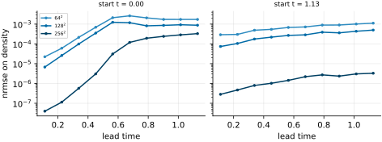
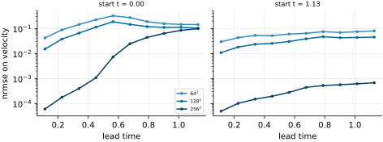
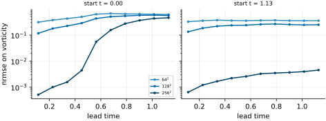
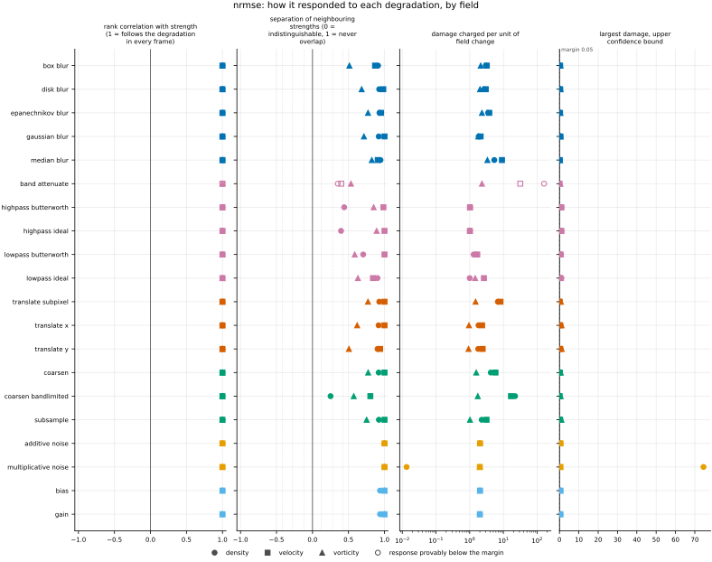
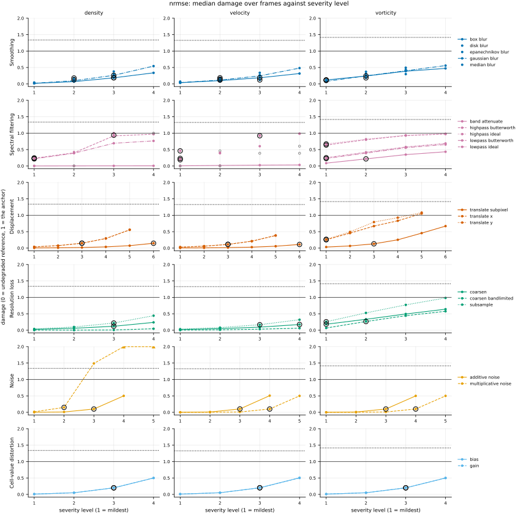
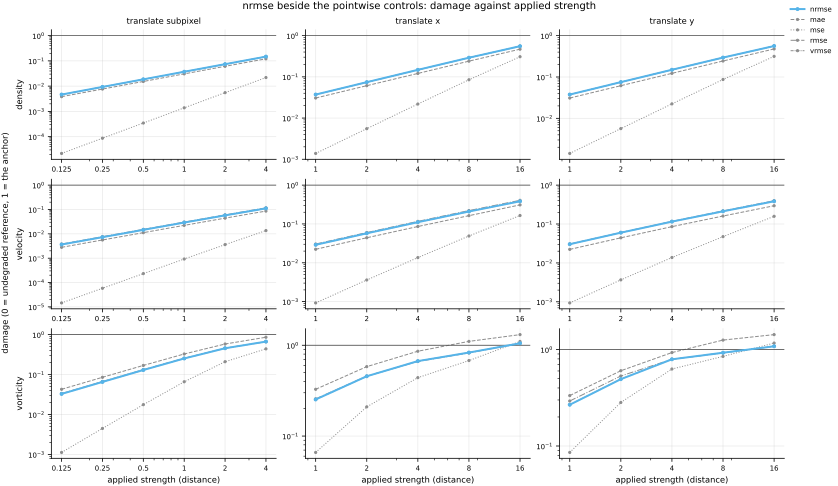

## Definition

For fields $f$ (reference) and $g$ (candidate) on the same analysis grid, with $C$ channels and
$N$ cells per channel, the normalised root mean squared error of PDEBench [@takamoto2022] divides
each channel's root mean squared error by the root mean square of that channel of the reference,
and averages over channels:

$$
\mathrm{nRMSE}(f, g) = \frac{1}{C} \sum_{c=1}^{C}
\frac{\sqrt{\frac{1}{N} \sum_{i} \bigl( f_{c,i} - g_{c,i} \bigr)^2}}
{\sqrt{\frac{1}{N} \sum_{i} f_{c,i}^2}} \tag{1}
$$

The paper writes it as $\lVert u_{\mathrm{pred}} - u_{\mathrm{true}} \rVert_2 / \lVert
u_{\mathrm{true}} \rVert_2$ (App. B, unnumbered); Equation (1) is how its code evaluates that
ratio: for each sample, channel and time step, the RMSE over space divided by
$\sqrt{\mathrm{mean}(u_{\mathrm{true}}^2)}$ over space, with no small constant added, then the
mean over samples and over channels and time steps (`pdebench/models/metrics.py`, `metric_func`,
`err_nRMSE`). The harness scores one frame of one field at a time, so the mean over channels is
the reduction that remains.

The denominator is the raw root mean square of the reference: its spatial mean is **not**
removed. Writing $\bar f_c$ for the spatial mean of channel $c$ and $\sigma_c$ for the root mean
square of its fluctuation, the denominator is $\sqrt{\bar f_c^{\,2} + \sigma_c^2}$, so on a channel
whose mean is much larger than its fluctuation

$$
\mathrm{nRMSE}_c \approx \frac{\sigma_c}{|\bar f_c|} \, \frac{\mathrm{RMSE}_c}{\sigma_c} \tag{2}
$$

that is, the fluctuation-normalised error of [vrmse](../../metrics/vrmse/card.md) multiplied by the ratio of
fluctuation to mean. On `kinet_re5e4` density has mean 1 and a fluctuation root mean square of
$2.1 \times 10^{-3}$ to $6.7 \times 10^{-3}$ over frames 2000 to 10000 (`AGENTS.md` §4), so on
density this metric is that factor, two to three orders of magnitude, below `vrmse`, and near
zero for every degradation: the reference's own spatial mean, the damage anchor, scores about
$\sigma / \bar f$ there. That is the standard's behaviour, not a defect of this implementation;
The Well reports VRMSE rather than NRMSE for exactly this reason, saying that a 2-norm denominator
"down-weights errors" on fields such as density and pressure "whose mean is often bounded away
from zero" [@ohana2024] (Sect. 4, Results). On a one-channel field the factor cancels from
damage, the value over the anchor's value. On vorticity, whose spatial mean on a periodic domain is zero, the
denominator is the fluctuation itself and this metric equals `vrmse` up to The Well's two
numerical conventions.

The reference alone sets the denominator, so Equation (1) is not symmetric, and since each term
of a triangle is divided by a different reference's scale, it does not satisfy the triangle
inequality (`test_metric.py` gives a three-field example). Where a channel of the reference is
zero in every cell PDEBench's division has no value, and the metric returns NaN.

### Boundary handling

None. The operation is local to each cell, and the root mean square is taken over the whole
field, so no neighbourhood and no boundary condition enter.

### How its field reports it

The name and the definition are PDEBench's. Two other fields normalise the error differently, and
each of those forms is its own bundle.

- **PDEBench** [@takamoto2022]. The object is Equation (1) per sample and time step, averaged over
  the held-out tenth of the samples (Sect. 4.1) and then over channels and time steps, described as
  ensuring scale independence (Sect. 3.3, table of metrics). It is reported in the tables of every
  metric per PDE and model (App. E), and drawn against a parameter of the PDE: Fig. 3b plots nRMSE
  against the Darcy-flow force term on logarithmic axes, one line per model, and the text reads its
  rise as the solution's scale falls (Sect. 4.2). The experiment is autoregressive rollouts, or a
  parameter-to-solution map, over many samples of each PDE.
- **The Well** [@ohana2024]. It defines NRMSE as the same ratio with $10^{-7}$ added to the mean
  square (App. E.3), which differs from Equation (1) only by that constant and is not built
  separately, and reports instead the variance-scaled form, [vrmse](../../metrics/vrmse/card.md).
- **Numerical analysis and weather verification** report unnormalised norms:
  [rmse](../../metrics/rmse/card.md) and [max_error](../../metrics/max_error/card.md).

**The experiments here.** Rollouts over many initial conditions do not exist; `forecast_re5e4`
(`docs/datasets/reynolds_ladder_2d.md`, "Forecast pairs") gives one model's predictions at ten
prediction steps from two starting times, on which the error is drawn against lead time, and
[EXP-nrmse-rollouts-over-many-initial-conditions](https://github.com/khegazy/pde_metrics/blob/main/proposals/EXP-nrmse-rollouts-over-many-initial-conditions.md)
writes up the missing test set. PDEBench's error against a PDE parameter has its nearest analogue
in the Reynolds ladder (`dataset_family=reynolds_ladder_2d`), two members at
$\mathrm{Re} = 5 \times 10^4$ and $10^6$, whose report section compares rank statistics rather
than raw values. The metric also runs on the degradation ladder on `kinet_re5e4`, on
`sod_shock_tube` and on the member mean of `synthetic_ensemble`.

## Performance

<!-- GENERATED performance: written by `python -m fmeval.cards evidence nrmse --results results/comparison_1793846511 --results results/comparison_1793812304 --results results/comparison_1793812401 --results results/comparison_1793811840 --results results/comparison_1793846600`, do not edit -->



*As this metric's own field draws it, from run `comparison_1793811840`.* nrmse on density against lead time, the physical time since the forecast started, one panel per start and one line per run, darker the finer the run's grid. Each point is one prediction step of one forecast.



*As this metric's own field draws it, from run `comparison_1793811840`.* nrmse on velocity against lead time, the physical time since the forecast started, one panel per start and one line per run, darker the finer the run's grid. Each point is one prediction step of one forecast.



*As this metric's own field draws it, from run `comparison_1793811840`.* nrmse on vorticity against lead time, the physical time since the forecast started, one panel per start and one line per run, darker the finer the run's grid. Each point is one prediction step of one forecast.



Four measured statistics for nrmse, one row per degradation grouped by family and one marker per field. From left: the rank correlation between the metric and the applied strength within a frame, with the line showing the resampling interval; the separation of neighbouring strengths as Cliff's delta, where 0 means the metric cannot tell one strength from the next and the faint ticks at 0.12, 0.28 and 0.42 are Vargha and Delaney's small, medium and large anchors, for scale and not as grades; the damage charged per unit of field change at the harshest strength; and the upper confidence bound on the largest damage, beside the fixed margin of 0.05. A hollow marker is a field and degradation on which that bound lies below the margin, so the response is provably small. A missing marker is a statistic the analysis withheld, as the rank correlation is on an axis the metric is invariant to.



Median damage over frames against severity level for nrmse, one row per family of degradation and one column per field, on one shared scale. The solid grey line is damage 1, the anchor (by default the field's own mean); the dotted black line is the damage assigned to the fake prediction with the right spectrum, where the run included it. The hollow black ring marks the first level at which the metric has moved a tenth of the way to the anchor. Hollow grey markers are strengths excluded for repeating a milder one or for doing nothing. Degradations with three or fewer usable levels are drawn as markers only; points beyond 2 either side are drawn as triangles at the edge. Damage is negative where a degradation moves the metric away from the anchor, as noise raises a single-field quantity the field's mean sets to zero.

**Trend: does the response follow the degradation?**

| test family | field | degradations | rank correlation | fraction of frames in order | weakest gap between neighbouring strengths |
|---|---|---|---|---|---|
| Displacement | density | 3 | 1 | 1 | 0.952 to 0.964 |
| Displacement | velocity | 3 | 1 | 1 | 0.97 to 1 |
| Displacement | vorticity | 3 | 1 | 1 | 0.753 to 0.885 |
| Cell-value distortion | density | 2 | 1 | 1 | 0.969 |
| Cell-value distortion | velocity | 2 | 1 | 1 | 1 |
| Cell-value distortion | vorticity | 2 | 1 | 1 | 1 |
| Resolution loss | density | 3 | 1 | 0.714 to 1 | 0.625 to 0.961 |
| Resolution loss | velocity | 3 | 1 | 1 | 0.902 to 1 |
| Resolution loss | vorticity | 3 | 1 | 1 | 0.786 to 0.886 |
| Smoothing | density | 5 | 1 | 1 | 0.955 to 0.972 |
| Smoothing | velocity | 5 | 1 | 1 | 0.934 to 1 |
| Smoothing | vorticity | 5 | 1 | 1 | 0.756 to 0.912 |
| Spectral filtering | density | 5 | 1 | 1 | 0.676 to 0.951 |
| Spectral filtering | velocity | 5 | 1 | 1 | 0.7 to 1 |
| Spectral filtering | vorticity | 5 | 1 | 1 | 0.767 to 0.945 |
| Noise | density | 2 | 1 | 1 | 1 |
| Noise | velocity | 2 | 1 | 1 | 1 |
| Noise | vorticity | 2 | 1 | 1 | 1 |

**Reactivity: how far does it move?**

| test family | field | change from clean at the harshest strength | elasticity | first strength detected |
|---|---|---|---|---|
| Displacement | density | — | 0.995 to 1 | level 3 |
| Displacement | velocity | — | 0.963 to 0.999 | level 3 |
| Displacement | vorticity | — | 0.702 to 0.994 | level 1 |
| Cell-value distortion | density | — | 1 | level 3 |
| Cell-value distortion | velocity | — | 1 | level 3 |
| Cell-value distortion | vorticity | — | 1 | level 3 |
| Resolution loss | density | — | 0.942 to 1.27 | level 3 |
| Resolution loss | velocity | — | 1.04 to 2.19 | level 3 |
| Resolution loss | vorticity | — | 0.72 to 1.36 | level 1 |
| Smoothing | density | — | 1.55 to 1.86 | level 2 |
| Smoothing | velocity | — | 1.08 to 1.14 | level 2 |
| Smoothing | vorticity | — | 0.821 to 1.15 | level 1 |
| Spectral filtering | density | — | 0.636 to 7.3 | level 1 |
| Spectral filtering | velocity | — | 0.647 to 1 | level 1 |
| Spectral filtering | vorticity | — | 0.466 to 1 | level 1 |
| Noise | density | — | 1 | level 2 |
| Noise | velocity | — | 1 | level 3 |
| Noise | vorticity | — | 1 | level 3 |
| trap test: fake prediction, right spectrum | density | — | — | damage 1.34 |
| trap test: fake prediction, right spectrum | velocity | — | — | damage 1.33 |
| trap test: fake prediction, right spectrum | vorticity | — | — | damage 1.42 |

**Consistency: how much does it vary from snapshot to snapshot?**

| test family | field | consistency, in the strength's units | snapshots per independent block |
|---|---|---|---|
| Displacement | density | 0.074 to 0.498 | 15 to 18 |
| Displacement | velocity | 0.0727 to 0.773 | 21 |
| Displacement | vorticity | 0.134 to 0.927 | 21 to 22 |
| Cell-value distortion | density | 0.0265 | 20 |
| Cell-value distortion | velocity | 0.00667 to 0.0372 | 19 to 21 |
| Cell-value distortion | vorticity | 0.00868 | 21 |
| Resolution loss | density | 0.616 to 1.41 | 17 to 20 |
| Resolution loss | velocity | 0.785 to 1.49 | 21 to 22 |
| Resolution loss | vorticity | 0.838 to 1.06 | 22 |
| Smoothing | density | 0.00777 to 0.017 | 14 |
| Smoothing | velocity | 0.0073 to 0.0264 | 21 to 22 |
| Smoothing | vorticity | 0.0115 to 0.0264 | 21 to 22 |
| Spectral filtering | density | 0.025 to 0.0976 | 15 to 20 |
| Spectral filtering | velocity | 0.00751 to 0.0942 | 1 to 22 |
| Spectral filtering | vorticity | 0.0321 to 0.0671 | 20 to 22 |
| Noise | density | 0.00022 to 0.0159 | 1 to 20 |
| Noise | velocity | 0.00219 to 0.0222 | 19 to 21 |
| Noise | vorticity | 0.00297 to 0.00519 | 21 |

One row per family of degradation and physical field; a cell gives the range over the degradations in that family. **Trend.** The rank correlation is the Spearman correlation between the strength and how far the metric has moved from its value on the undegraded field of the same frame, in the one direction it moves under that degradation, computed inside a single frame. A value of 1 means every strength moved it further than the last in every frame, whichever way it moves; a response that scatters to both sides scores near 0. The fraction of frames in order counts the frames with no exception. The weakest gap is the smallest Mann-Whitney overlap between two neighbouring strengths across frames: 1 means they never overlap, 0.5 that they cannot be told apart. **Reactivity.** The change from clean is the median, at the harshest strength, of the departure from the undegraded value of the same frame over the size of that value: 0.3 means 30%. It does not exist for this metric, whose undegraded value is exactly zero; the damage below is its relative reading. The elasticity is the percentage change of that departure per percentage change in strength over the mildest strengths. First strength detected is the mildest at which the metric has moved a tenth of the way to the anchor; **damage** reads that 0-to-1 scale as a number. A dash means the measurement is not defined there. A metric's reactivity scales with the power it is expressed in: mean squared error's elasticity is twice root-mean-square error's, though the two carry the same information, so compare magnitudes across metrics with that in mind. **Consistency** is how much the response varies from snapshot to snapshot relative to its size, in the strength's units; the snapshots of one trajectory are correlated, and the last column is how many consecutive snapshots one independent block spans.

These tables report what was measured and grade none of the measurements. What the numbers mean for this metric is written in the subsections below, beside the test that produced each number.

**Profile.**

| field | selectivity | charges most for | charges least for | response provably below 0.05 at 90% on | elasticity to a sub-pixel shift, against severity (distance) | compute cost (x cheapest in this run) |
|---|---|---|---|---|---|---|
| density | 0.903 | `band_attenuate` | `multiplicative_noise` | `band_attenuate` | 1 | 2.17 |
| velocity | 0.639 | `band_attenuate` | `highpass_ideal` | `band_attenuate` | 0.999 | 3.83 |
| vorticity | 0.102 | `median_blur` | `translate_y` | — | 0.994 | 2.52 |

One row per physical field. **Selectivity** is how concentrated the metric's response is on a few degradations, measured per unit of field change: 0 means it charges every degradation the same, as mean squared error does by construction, and values toward 1 that one degradation carries most of it. **Charges most and least for** name the two ends of that profile. **Response provably below** lists degradations on which the upper confidence bound of the largest damage lies below the margin -- an equivalence test, so an entry says the response is provably small, not merely not significant; a dash means no degradation met the bound. **Elasticity** is the slope of log damage against log shift over the smallest shifts: 1 means damage grows in proportion to the shift, 2 with its square. **Compute cost** is wall-clock per evaluation over the cheapest metric and field in the same run.

<!-- END GENERATED performance -->

## Intuition

Normalised root mean squared error, in PDEBench's form, is the root mean squared error as a
fraction of the typical size of the reference, measured from zero. An error of one unit means
something different in a field whose values are near a thousand and in one whose values are near
two, and dividing by the reference's size is meant to remove that.

Measuring the size from zero rather than from the field's mean decides what the number says on a
field that sits on a large constant background. On a four-by-four grid, the same displaced square
scored as it stands and on a background of a thousand:

```
                            rmse      nrmse        vrmse
as it stands                0.5       1.0          1.118
on a background of 1000     0.5       0.0005       1.118
```

The error is the same in both rows. As it stands, the reference's size is a half, so the error is
as large as the field. On the background the reference's size is about a thousand, so the same
error is a two-thousandth of it and the metric reads it as nearly perfect. The variance-scaled form
in the last column measures the size about the mean instead and does not move. Each component of
a field is normalised by its own size before the components are averaged.

What this metric ignores is where the errors sit, as every cell-by-cell error does, and, on a
field with a large mean, the size of the error relative to how much the field actually varies.

## Reading the output

The value runs from zero upwards with no upper limit and is dimensionless. Lower is better, and
zero means the fields are identical. A value of one means the error is as large as the reference's
root mean square; predicting zero everywhere scores exactly one.

Its comparisons across fields are only as meaningful as the fields' means are alike. On a field
whose mean is near zero (vorticity, and here velocity) it behaves like `vrmse`; on density, which
sits on a mean two to three orders of magnitude above its fluctuation, every value is small, and
a small value there does not mean a good prediction. Compare models on one field, dataset and
analysis grid; set it beside a PDEBench table entry; read `vrmse` beside it on density. The
reference must be the trusted field: the metric is asymmetric.

## Limitations

On any field with a large mean the metric is compressed towards zero by the ratio of fluctuation
to mean, Equation (2). On density here a prediction no better than the field's own mean scores
less than one percent, and a reader who reads the value against the landmark of one, as on a
field without a mean, will take a useless prediction for an excellent one. The damage column,
which divides by what the mean scores, is the reading that survives this.

The denominator is measured from the reference on each frame. As a decaying flow loses its
fluctuation the denominator of a zero-mean field falls, and the same absolute error scores
higher; on density, whose mean does not decay, it does not. A trend along a trajectory therefore
means different things on different fields.

On a one-channel field, with the reference fixed, it orders candidates exactly as `rmse` does,
and on every field it shares that metric's blindness to position and its quadratic response to
sub-cell displacement.

## Results

<!-- GENERATED run: written by `python -m fmeval.cards evidence nrmse --results results/comparison_1793846511 --results results/comparison_1793812304 --results results/comparison_1793812401 --results results/comparison_1793811840 --results results/comparison_1793846600`, do not edit -->

Measured on `kinet_re5e4`, frames 2000 to 10000 (161 frames of developed flow), on the 256 analysis grid, seed 20260807, at commit `adbdc88e4950`. Run `comparison_1793846511`.

Every number in this section comes from that run, except in the subsections headed with another experiment and in a figure whose caption names another run, each of which names its own run. Regenerate with `python -m fmeval.cards evidence <name> --results results/comparison_1793846511 --results results/comparison_1793812304 --results results/comparison_1793812401 --results results/comparison_1793811840 --results results/comparison_1793846600`.

<!-- END GENERATED run -->

Each subsection links to the degradations that subsection reports. What those degradations
do, and what their strength numbers mean, is documented on their own pages.

<!-- GENERATED experiments: written by `python -m fmeval.cards catalog`, do not edit -->

**Across the experiments.**

| experiment | what a run on it is evidence of | on this card |
|---|---|---|
| `kinet_re5e4` | developed flow | measured, run `comparison_1793846511`: the main results |
| `kinet_re1e6` | developed flow at Re = 1e6, twenty times the Reynolds number of kinet_re5e4, from the same initial condition | measured, run `comparison_1793846600`: under *On `kinet_re1e6`* |
| `synthetic_ensemble` | a calibrated null: evidence that the estimator computes what it claims to compute, and nothing about turbulence | measured, run `comparison_1793812401`: under *On `synthetic_ensemble`*; on this dataset the metric scores the member mean of the ensemble |
| `sod_shock_tube` | an analytic check: evidence that the metric locates and scores a known shock correctly, and nothing about turbulence | measured, run `comparison_1793812304`: under *On `sod_shock_tube`* |
| `forecast_re5e4` | real predictions scored against their targets at each prediction step; who produced the predictions, a trained model or a coarser solver, is not recorded | measured, run `comparison_1793811840`: under *On `forecast_re5e4`* |

One row per dataset a card may cite (`configs/cards/default.yaml`). *Measured* names the run the card cites: the main results are `## Performance` and the subsections below, and every other run has its own subsection headed with its dataset. *Not applicable* gives the reason: one that follows from what the metric declares and what the dataset offers, or one a person wrote on the card (`not_run` in `card.yaml`) because the result would carry no information. *Not yet run* means the metric can run there and the card cites no run on it yet.

<!-- END GENERATED experiments -->

### Smoothing

[gaussian_blur](../../degradations/gaussian_blur/card.md) ·
[box_blur](../../degradations/box_blur/card.md) ·
[median_blur](../../degradations/median_blur/card.md)

<!-- GENERATED results_smoothing: written by `python -m fmeval.cards evidence nrmse --results results/comparison_1793846511 --results results/comparison_1793812304 --results results/comparison_1793812401 --results results/comparison_1793811840 --results results/comparison_1793846600`, do not edit -->

| degradation | field | strengths | rank correlation | fraction of frames in the right order | weakest gap between neighbouring strengths |
|---|---|---|---|---|---|
| `box_blur` | density | 4 | 1 | 1 | 0.955 |
| `box_blur` | velocity | 4 | 1 | 1 | 0.934 |
| `box_blur` | vorticity | 4 | 1 | 1 | 0.756 |
| `disk_blur` | density | 3 | 1 | 1 | 0.963 |
| `disk_blur` | velocity | 3 | 1 | 1 | 0.991 |
| `disk_blur` | vorticity | 3 | 1 | 1 | 0.841 |
| `epanechnikov_blur` | density | 3 | 1 | 1 | 0.965 |
| `epanechnikov_blur` | velocity | 3 | 1 | 1 | 0.976 |
| `epanechnikov_blur` | vorticity | 3 | 1 | 1 | 0.886 |
| `gaussian_blur` | density | 4 | 1 | 1 | 0.96 |
| `gaussian_blur` | velocity | 4 | 1 | 1 | 1 |
| `gaussian_blur` | vorticity | 4 | 1 | 1 | 0.857 |
| `median_blur` | density | 3 | 1 | 1 | 0.972 |
| `median_blur` | velocity | 3 | 1 | 1 | 0.953 |
| `median_blur` | vorticity | 3 | 1 | 1 | 0.912 |

<!-- END GENERATED results_smoothing -->

Every blur is ordered in every frame on every field, with a rank correlation of 1. The weakest
gaps are 0.955 to 0.972 on density, 0.934 to 1 on velocity and 0.756 to 0.912 on vorticity. On
density the value is compressed as Equation (2) gives: the largest is 0.0038, under
`gaussian_blur`, where the damage reaches 0.566. On velocity and vorticity, whose spatial means
are near zero, the value reads directly against one, and the same blur reaches 0.599 and 0.636.

### Spectral filtering

[lowpass_ideal](../../degradations/lowpass_ideal/card.md) ·
[lowpass_butterworth](../../degradations/lowpass_butterworth/card.md) ·
[highpass_ideal](../../degradations/highpass_ideal/card.md) ·
[highpass_butterworth](../../degradations/highpass_butterworth/card.md)

<!-- GENERATED results_spectral: written by `python -m fmeval.cards evidence nrmse --results results/comparison_1793846511 --results results/comparison_1793812304 --results results/comparison_1793812401 --results results/comparison_1793811840 --results results/comparison_1793846600`, do not edit -->

| degradation | field | strengths | rank correlation | fraction of frames in the right order | weakest gap between neighbouring strengths |
|---|---|---|---|---|---|
| `band_attenuate` | density | 4 | 1 | 1 | 0.676 |
| `band_attenuate` | velocity | 4 | 1 | 1 | 0.7 |
| `band_attenuate` | vorticity | 4 | 1 | 1 | 0.767 |
| `highpass_butterworth` | density | 4 | 1 | 1 | 0.72 |
| `highpass_butterworth` | velocity | 3 | 1 | 1 | 0.992 |
| `highpass_butterworth` | vorticity | 4 | 1 | 1 | 0.925 |
| `highpass_ideal` | density | 3 | 1 | 1 | 0.698 |
| `highpass_ideal` | velocity | 2 | 1 | 1 | 1 |
| `highpass_ideal` | vorticity | 4 | 1 | 1 | 0.945 |
| `lowpass_butterworth` | density | 4 | 1 | 1 | 0.852 |
| `lowpass_butterworth` | velocity | 3 | 1 | 1 | 1 |
| `lowpass_butterworth` | vorticity | 4 | 1 | 1 | 0.793 |
| `lowpass_ideal` | density | 3 | 1 | 1 | 0.951 |
| `lowpass_ideal` | velocity | 2 | 1 | 1 | 0.92 |
| `lowpass_ideal` | vorticity | 4 | 1 | 1 | 0.815 |

<!-- END GENERATED results_spectral -->

Every filter is ordered in every frame, with a rank correlation of 1. The weakest gaps run from
0.676 on density and 0.7 on velocity under `band_attenuate` to 1 on velocity under
`highpass_ideal`. At their harshest the ideal filters cost about what the field's mean
does. On density the largest value under `lowpass_ideal` is 0.00714, the same as the largest the
field's mean scores, at a damage of 1.06; on vorticity `highpass_ideal` reaches 0.999.
`band_attenuate` barely registers on density and velocity, with a largest damage of 0.01 and
0.0452, and the Profile table lists it among the degradations on which the response is provably
below 0.05; on vorticity it reaches 0.535.

### Displacement

[translate_x](../../degradations/translate/card.md) ·
[translate_subpixel](../../degradations/translate_subpixel/card.md)

<!-- GENERATED results_geometric: written by `python -m fmeval.cards evidence nrmse --results results/comparison_1793846511 --results results/comparison_1793812304 --results results/comparison_1793812401 --results results/comparison_1793811840 --results results/comparison_1793846600`, do not edit -->

| degradation | field | strengths | rank correlation | fraction of frames in the right order | weakest gap between neighbouring strengths |
|---|---|---|---|---|---|
| `translate_subpixel` | density | 6 | 1 | 1 | 0.964 |
| `translate_subpixel` | velocity | 6 | 1 | 1 | 1 |
| `translate_subpixel` | vorticity | 6 | 1 | 1 | 0.885 |
| `translate_x` | density | 5 | 1 | 1 | 0.959 |
| `translate_x` | velocity | 5 | 1 | 1 | 1 |
| `translate_x` | vorticity | 5 | 1 | 1 | 0.81 |
| `translate_y` | density | 5 | 1 | 1 | 0.952 |
| `translate_y` | velocity | 5 | 1 | 1 | 0.97 |
| `translate_y` | vorticity | 5 | 1 | 1 | 0.753 |

<!-- END GENERATED results_geometric -->

Every shift is ordered in every frame, with a rank correlation of 1. The weakest gaps are 0.952
to 0.964 on density, 0.97 to 1 on velocity and 0.753 to 0.885 on vorticity. The value grows
linearly with a small displacement: the elasticity to a sub-pixel shift in the Profile table is
1, 0.999 and 0.994 on density, velocity and vorticity. On density the largest value under
`translate_x` is 0.00397, a damage of 0.592. On vorticity the largest shifts pass one, at 1.17
under `translate_x` and 1.41 under `translate_y`: a vorticity field moved that far scores worse
than predicting zero, which there is also its mean.

### Resolution loss

[coarsen](../../degradations/coarsen/card.md) ·
[coarsen_bandlimited](../../degradations/coarsen_bandlimited/card.md)

<!-- GENERATED results_resolution: written by `python -m fmeval.cards evidence nrmse --results results/comparison_1793846511 --results results/comparison_1793812304 --results results/comparison_1793812401 --results results/comparison_1793811840 --results results/comparison_1793846600`, do not edit -->

| degradation | field | strengths | rank correlation | fraction of frames in the right order | weakest gap between neighbouring strengths |
|---|---|---|---|---|---|
| `coarsen` | density | 4 | 1 | 1 | 0.96 |
| `coarsen` | velocity | 4 | 1 | 1 | 1 |
| `coarsen` | vorticity | 4 | 1 | 1 | 0.886 |
| `coarsen_bandlimited` | density | 4 | 1 | 0.714 | 0.625 |
| `coarsen_bandlimited` | velocity | 4 | 1 | 1 | 0.902 |
| `coarsen_bandlimited` | vorticity | 4 | 1 | 1 | 0.786 |
| `subsample` | density | 4 | 1 | 1 | 0.961 |
| `subsample` | velocity | 4 | 1 | 1 | 1 |
| `subsample` | vorticity | 4 | 1 | 1 | 0.876 |

<!-- END GENERATED results_resolution -->

Every coarsening is ordered with a rank correlation of 1. The largest damage under `coarsen` is
0.249 on density, and the largest value 0.265 on velocity and 0.714 on vorticity; under
`coarsen_bandlimited` the damage on density reaches 0.0575 and the value 0.147 and 0.69. On
vorticity the two operators nearly agree and `subsample` reaches 1.3. Under the band-limited
operator density is in the right order in only 0.714 of frames, with a weakest gap of 0.625, as
for the other cell-by-cell errors; its cause is not established, and `issues/039` records what
was ruled out.

### Noise

[additive_noise](../../degradations/additive_noise/card.md)

<!-- GENERATED results_stochastic: written by `python -m fmeval.cards evidence nrmse --results results/comparison_1793846511 --results results/comparison_1793812304 --results results/comparison_1793812401 --results results/comparison_1793811840 --results results/comparison_1793846600`, do not edit -->

| degradation | field | strengths | rank correlation | fraction of frames in the right order | weakest gap between neighbouring strengths |
|---|---|---|---|---|---|
| `additive_noise` | density | 4 | 1 | 1 | 1 |
| `additive_noise` | velocity | 4 | 1 | 1 | 1 |
| `additive_noise` | vorticity | 4 | 1 | 1 | 1 |
| `multiplicative_noise` | density | 5 | 1 | 1 | 1 |
| `multiplicative_noise` | velocity | 5 | 1 | 1 | 1 |
| `multiplicative_noise` | vorticity | 5 | 1 | 1 | 1 |

<!-- END GENERATED results_stochastic -->

Both noises are ordered in every frame on every field, and neighbouring strengths never overlap
(weakest gap 1). The elasticity is 1 throughout: either noise adds an error proportional to its
amplitude. Multiplicative noise is the one degradation whose value is not compressed on density:
its largest value is 0.505 on density, 0.504 on velocity and 0.516 on vorticity. Our derivation:
a noise that multiplies the field has an error proportional to the field itself, so its error
over the field's root mean square is the noise's relative amplitude, whatever the field's mean.
The damage on density, which divides by what the mean scores, is correspondingly large, 75.1.
Additive noise reaches a largest value of 1.19 on velocity, against 0.504 on vorticity; our
reading is that it is sized to the velocity field as a whole, and the mean over components
weights a component whose own size is small as heavily as the other.

### Cell-value distortion

[gain](../../degradations/gain/card.md) ·
[bias](../../degradations/bias/card.md)

<!-- GENERATED results_pointwise: written by `python -m fmeval.cards evidence nrmse --results results/comparison_1793846511 --results results/comparison_1793812304 --results results/comparison_1793812401 --results results/comparison_1793811840 --results results/comparison_1793846600`, do not edit -->

| degradation | field | strengths | rank correlation | fraction of frames in the right order | weakest gap between neighbouring strengths |
|---|---|---|---|---|---|
| `bias` | density | 4 | 1 | 1 | 0.969 |
| `bias` | velocity | 4 | 1 | 1 | 1 |
| `bias` | vorticity | 4 | 1 | 1 | 1 |
| `gain` | density | 4 | 1 | 1 | 0.969 |
| `gain` | velocity | 4 | 1 | 1 | 1 |
| `gain` | vorticity | 4 | 1 | 1 | 1 |

<!-- END GENERATED results_pointwise -->

Both distortions are ordered in every frame on every field, with an elasticity of 1. On density
and vorticity the two are charged identically, with a largest damage of 0.532 and 0.5
(fingerprint). The value on density is compressed, as under every degradation, to at most
0.00357 against 0.5 on vorticity, because Equation (1) divides by a root mean square that
includes density's mean; damage divides by the anchor's value and undoes that factor. On density
neighbouring strengths overlap across frames (weakest gap 0.969), where `vrmse`'s do not. Our
reading: this denominator is set by the mean, so the value still follows the size of each
frame's fluctuation, which changes along the trajectory. On velocity `bias` reaches a largest
damage of 1.19 against 0.5 under `gain`. The run's per-frame values put that maximum at the first
frame of the window, frame 2000, falling toward 0.5 over about the first fifth of it. Our reading,
not a measured decomposition: `bias` adds the strength times the pooled velocity fluctuation RMS
to both components, and the mean over components in Equation (1) weighs a component whose own
spread is small as heavily as the other.

### Trap tests

[gaussian_impostor](../../degradations/gaussian_impostor/card.md) ·
[uncorrelated](../../degradations/random_large_translation/card.md)

<!-- GENERATED results_canaries: written by `python -m fmeval.cards evidence nrmse --results results/comparison_1793846511 --results results/comparison_1793812304 --results results/comparison_1793812401 --results results/comparison_1793811840 --results results/comparison_1793846600`, do not edit -->

| field | damage assigned to the fake prediction | closest real degradation | damage of the reference moved far away | value on the anchor |
|---|---|---|---|---|
| density | 1.34 | `multiplicative_noise=0.01` | 1.21 | 0.00672 |
| velocity | 1.33 | `highpass_ideal=4.02293` | 1.71 | 1 |
| vorticity | 1.42 | `translate_y=16` | 1.5 | 1 |

The fake prediction here has exactly the reference field's amplitude spectrum and completely scrambled structure. Damage 1 is what the anchor scores, by default the reference's own spatial mean, a prediction that knows the mean and nothing else. The damage column therefore says how close to useless this metric considers that fake prediction: a low number means the metric was fooled. The third column translates the same number into an ordinary degradation whose damage the fake prediction matches, which is easier to picture. The fourth is the reference moved by a large random offset, the right statistics in the wrong place; where a field's energy sits in its largest scales that copy stays partly correlated with the reference, so it is not the score of an unrelated field.

<!-- END GENERATED results_canaries -->

The fake prediction with the right spectrum is scored worse than the field's mean on every field,
with damage 1.34, 1.33 and 1.42 on density, velocity and vorticity. On velocity and vorticity the
mean scores 1 and the value equals the damage. On density the mean scores 0.00672 and the fake
prediction 0.00899: read against PDEBench's landmark of one, both look like nearly perfect
predictions, and only the damage shows the fake prediction is further from the truth than the
mean is. This is the compression of Equation (2), not a property of the trap.

### Compared with the other metrics

<!-- GENERATED results_summary: written by `python -m fmeval.cards evidence nrmse --results results/comparison_1793846511 --results results/comparison_1793812304 --results results/comparison_1793812401 --results results/comparison_1793811840 --results results/comparison_1793846600`, do not edit -->

| compared with | density | velocity | vorticity |
|---|---|---|---|
| `vrmse` | 1 | 1 | 1 |
| `rmse_channel_mean` | 1 | 1 | 0.998 |
| `mse` | 1 | 0.999 | 0.998 |
| `rmse` | 1 | 0.999 | 0.998 |
| `mae` | 0.988 | 0.995 | 0.973 |
| `max_error` | 0.956 | 0.93 | 0.948 |
| `max_error_channel_mean` | 0.956 | 0.935 | 0.948 |
| `wasserstein` | 0.886 | — | — |
| `h_minus_one` | 0.862 | 0.847 | 0.901 |
| `h1_relative` | 0.815 | 0.725 | 0.751 |
| `h1_seminorm` | 0.705 | 0.605 | 0.695 |
| `spectral_energy_flux` | — | 0.414 | — |
| `persistence_distance` | 0.377 | — | 0.185 |
| `increment_w1_by_separation` | 0.338 | 0.263 | 0.111 |
| `spectrum_l2` | 0.26 | 0.374 | 0.172 |
| `energy_distance` | 0.253 | 0.174 | -0.0167 |
| `increment_w1` | 0.262 | 0.16 | 0.00953 |
| `tail_exceedance` | 0.221 | 0.138 | -0.0623 |
| `palinstrophy` | — | — | -0.0818 |
| `increment_flatness` | -0.208 | -0.104 | 0.109 |
| `tail_index` | 0.0218 | -0.168 | -0.107 |
| `enstrophy` | — | — | -0.243 |
| `kinetic_energy` | — | -0.261 | — |

Rank correlation over every degradation, computed separately for each physical field on the median value at each combination of degradation and strength, with the undegraded reference excluded. A dash marks a metric that does not run on that field. A metric with a target value enters by its distance from the target. Two metrics correlating near 1 put the degradations in the same order, but the two may still weight those degradations very differently. A correlation near 1 therefore means the two metrics are redundant for ranking models, not that the two are interchangeable as training losses.

<!-- END GENERATED results_summary -->

On every field this metric orders the degradations exactly as `vrmse` does and almost exactly as
`rmse_channel_mean`, `mse` and `rmse` do; `mae` sits a little lower, the two maximum errors lower
again, and the metrics that compare spectra, increments or distributions order the degradations
differently. The compression on density changes the size of every value there but not the order
within a frame, so it does not show in this table. For ranking models these cell-by-cell errors
are near duplicates. The least alike, field by field, are `increment_flatness` on density
(-0.208), `kinetic_energy` on velocity (-0.261) and `enstrophy` on vorticity (-0.243),
single-field quantities that enter by their raw value.

### Damage beside the other metrics

<!-- GENERATED results_damage_by_level: written by `python -m fmeval.cards evidence nrmse --results results/comparison_1793846511 --results results/comparison_1793812304 --results results/comparison_1793812401 --results results/comparison_1793811840 --results results/comparison_1793846600`, do not edit -->



Median damage over frames against the applied strength, log-log, for nrmse (bold, in colour) and the pointwise controls mae, mse, rmse, vrmse (thin, grey), one column per displacement degradation and one row per field. The grey line is damage 1, the anchor (by default the field's own mean). Parallel lines charge in the same proportion at every strength; a steeper line charges relatively more for the larger shifts, which is what decides whether two metrics are interchangeable as training losses. These are the same numbers as the table beneath.

**Displacement, density, `translate_subpixel`** (strength: distance).

| metric | 0.125 | 0.25 | 0.5 | 1 | 2 | 4 |
|---|---|---|---|---|---|---|
| `nrmse` | 0.00466 | 0.00931 | 0.0186 | 0.0372 | 0.0743 | 0.148 |
| `mae` | 0.00383 | 0.00767 | 0.0153 | 0.0306 | 0.061 | 0.121 |
| `mse` | 2.17e-05 | 8.68e-05 | 0.000347 | 0.00138 | 0.00551 | 0.0219 |
| `rmse` | 0.00466 | 0.00931 | 0.0186 | 0.0372 | 0.0743 | 0.148 |
| `vrmse` | 0.00463 | 0.00926 | 0.0185 | 0.037 | 0.0738 | 0.147 |

**Displacement, density, `translate_x`** (strength: distance).

| metric | 1 | 2 | 4 | 8 | 16 |
|---|---|---|---|---|---|
| `nrmse` | 0.0372 | 0.0743 | 0.148 | 0.291 | 0.555 |
| `mae` | 0.0306 | 0.061 | 0.121 | 0.24 | 0.469 |
| `mse` | 0.00138 | 0.00551 | 0.0219 | 0.0849 | 0.307 |
| `rmse` | 0.0372 | 0.0743 | 0.148 | 0.291 | 0.555 |
| `vrmse` | 0.037 | 0.0738 | 0.147 | 0.29 | 0.55 |

**Displacement, density, `translate_y`** (strength: distance).

| metric | 1 | 2 | 4 | 8 | 16 |
|---|---|---|---|---|---|
| `nrmse` | 0.0377 | 0.0752 | 0.15 | 0.295 | 0.562 |
| `mae` | 0.031 | 0.0616 | 0.122 | 0.244 | 0.476 |
| `mse` | 0.00142 | 0.00565 | 0.0224 | 0.0869 | 0.316 |
| `rmse` | 0.0377 | 0.0752 | 0.15 | 0.295 | 0.562 |
| `vrmse` | 0.0376 | 0.075 | 0.149 | 0.294 | 0.56 |

**Displacement, velocity, `translate_subpixel`** (strength: distance).

| metric | 0.125 | 0.25 | 0.5 | 1 | 2 | 4 |
|---|---|---|---|---|---|---|
| `nrmse` | 0.00365 | 0.00729 | 0.0146 | 0.029 | 0.0574 | 0.111 |
| `mae` | 0.00279 | 0.00559 | 0.0112 | 0.0223 | 0.0441 | 0.0859 |
| `mse` | 1.45e-05 | 5.81e-05 | 0.000232 | 0.000924 | 0.0036 | 0.0136 |
| `rmse` | 0.00381 | 0.00762 | 0.0152 | 0.0304 | 0.06 | 0.117 |
| `vrmse` | 0.00365 | 0.00729 | 0.0146 | 0.029 | 0.0574 | 0.111 |

**Displacement, velocity, `translate_x`** (strength: distance).

| metric | 1 | 2 | 4 | 8 | 16 |
|---|---|---|---|---|---|
| `nrmse` | 0.029 | 0.0574 | 0.111 | 0.209 | 0.383 |
| `mae` | 0.0223 | 0.0441 | 0.0859 | 0.163 | 0.31 |
| `mse` | 0.000924 | 0.0036 | 0.0136 | 0.0489 | 0.165 |
| `rmse` | 0.0304 | 0.06 | 0.117 | 0.221 | 0.406 |
| `vrmse` | 0.029 | 0.0574 | 0.111 | 0.209 | 0.383 |

**Displacement, velocity, `translate_y`** (strength: distance).

| metric | 1 | 2 | 4 | 8 | 16 |
|---|---|---|---|---|---|
| `nrmse` | 0.0303 | 0.0599 | 0.115 | 0.212 | 0.384 |
| `mae` | 0.0223 | 0.0442 | 0.0856 | 0.16 | 0.295 |
| `mse` | 0.000935 | 0.00366 | 0.0138 | 0.0473 | 0.158 |
| `rmse` | 0.0306 | 0.0605 | 0.117 | 0.218 | 0.397 |
| `vrmse` | 0.0303 | 0.0599 | 0.115 | 0.212 | 0.384 |

**Displacement, vorticity, `translate_subpixel`** (strength: distance).

| metric | 0.125 | 0.25 | 0.5 | 1 | 2 | 4 |
|---|---|---|---|---|---|---|
| `nrmse` | 0.0328 | 0.0654 | 0.13 | 0.253 | 0.456 | 0.67 |
| `mae` | 0.0428 | 0.0854 | 0.169 | 0.328 | 0.582 | 0.86 |
| `mse` | 0.00112 | 0.00448 | 0.0176 | 0.066 | 0.21 | 0.44 |
| `rmse` | 0.0335 | 0.0669 | 0.133 | 0.257 | 0.458 | 0.663 |
| `vrmse` | 0.0329 | 0.0656 | 0.13 | 0.253 | 0.455 | 0.671 |

**Displacement, vorticity, `translate_x`** (strength: distance).

| metric | 1 | 2 | 4 | 8 | 16 |
|---|---|---|---|---|---|
| `nrmse` | 0.253 | 0.456 | 0.67 | 0.832 | 1.05 |
| `mae` | 0.328 | 0.582 | 0.86 | 1.1 | 1.31 |
| `mse` | 0.066 | 0.21 | 0.44 | 0.679 | 1.1 |
| `rmse` | 0.257 | 0.458 | 0.663 | 0.824 | 1.05 |
| `vrmse` | 0.253 | 0.455 | 0.671 | 0.832 | 1.05 |

**Displacement, vorticity, `translate_y`** (strength: distance).

| metric | 1 | 2 | 4 | 8 | 16 |
|---|---|---|---|---|---|
| `nrmse` | 0.268 | 0.493 | 0.793 | 0.927 | 1.08 |
| `mae` | 0.333 | 0.603 | 0.93 | 1.25 | 1.43 |
| `mse` | 0.0858 | 0.283 | 0.628 | 0.849 | 1.17 |
| `rmse` | 0.293 | 0.532 | 0.793 | 0.922 | 1.08 |
| `vrmse` | 0.268 | 0.495 | 0.793 | 0.927 | 1.08 |

Median damage over frames at every strength, this metric in the first row and the pointwise controls beneath it, all on the same 0-to-1 scale where 0 is the undegraded reference and 1 the anchor (by default the field's own mean); a dash means no damage scale on that field. The rank correlations under *Compared with the other metrics* say whether two metrics put the strengths in the same order; this table says how much each one charges for the same strength, which decides whether two metrics are interchangeable as training losses.

<!-- END GENERATED results_damage_by_level -->

On density this metric's damage lies on `rmse`'s line: the denominator is nearly the constant
mean of one, and it cancels from damage. On vorticity it lies on `vrmse`'s, the two differing only
by The Well's constant and $N-1$ on a field whose mean is zero. On every field it grows in
proportion to a small shift, parallel to `mae`, while `mse` has twice the slope.

### On `sod_shock_tube`

<!-- GENERATED results_on_sod_shock_tube: written by `python -m fmeval.cards evidence nrmse --results results/comparison_1793846511 --results results/comparison_1793812304 --results results/comparison_1793812401 --results results/comparison_1793811840 --results results/comparison_1793846600`, do not edit -->

**An analytic check: evidence that the metric locates and scores a known shock correctly, and nothing about turbulence.**

Measured on `sod_shock_tube`, frames 0 to 9 (10 frames of an analytic check: evidence that the metric locates and scores a known shock correctly, and nothing about turbulence), on the 2048 analysis grid, seed 20260807, at commit `adbdc88e4950`. Run `comparison_1793812304`.

[additive_noise](../../degradations/additive_noise/card.md) ·
[band_attenuate](../../degradations/band_attenuate/card.md) ·
[bias](../../degradations/bias/card.md) ·
[box_blur](../../degradations/box_blur/card.md) ·
[coarsen](../../degradations/coarsen/card.md) ·
[coarsen_bandlimited](../../degradations/coarsen_bandlimited/card.md) ·
[disk_blur](../../degradations/disk_blur/card.md) ·
[epanechnikov_blur](../../degradations/epanechnikov_blur/card.md) ·
[gain](../../degradations/gain/card.md) ·
[gaussian_blur](../../degradations/gaussian_blur/card.md) ·
[gaussian_impostor](../../degradations/gaussian_impostor/card.md) ·
[highpass_butterworth](../../degradations/highpass_butterworth/card.md) ·
[highpass_ideal](../../degradations/highpass_ideal/card.md) ·
[lowpass_butterworth](../../degradations/lowpass_butterworth/card.md) ·
[lowpass_ideal](../../degradations/lowpass_ideal/card.md) ·
[mean_field](../../degradations/mean_field/card.md) ·
[median_blur](../../degradations/median_blur/card.md) ·
[multiplicative_noise](../../degradations/multiplicative_noise/card.md) ·
[subsample](../../degradations/subsample/card.md) ·
[translate_subpixel](../../degradations/translate_subpixel/card.md) ·
[translate_x](../../degradations/translate/card.md) ·
[uncorrelated](../../degradations/random_large_translation/card.md)

**Smoothing.**

| degradation | field | strengths | rank correlation | fraction of frames in the right order | weakest gap between neighbouring strengths |
|---|---|---|---|---|---|
| `box_blur` | density | 4 | 1 | 1 | 1 |
| `box_blur` | pressure | 4 | 1 | 1 | 1 |
| `box_blur` | velocity | 4 | 1 | 1 | 0.93 |
| `disk_blur` | density | 3 | 1 | 1 | 1 |
| `disk_blur` | pressure | 3 | 1 | 1 | 1 |
| `disk_blur` | velocity | 3 | 1 | 1 | 0.97 |
| `epanechnikov_blur` | density | 3 | 1 | 1 | 1 |
| `epanechnikov_blur` | pressure | 3 | 1 | 1 | 1 |
| `epanechnikov_blur` | velocity | 3 | 1 | 1 | 0.97 |
| `gaussian_blur` | density | 4 | 1 | 1 | 1 |
| `gaussian_blur` | pressure | 4 | 1 | 1 | 1 |
| `gaussian_blur` | velocity | 4 | 1 | 1 | 1 |

**Spectral filtering.**

| degradation | field | strengths | rank correlation | fraction of frames in the right order | weakest gap between neighbouring strengths |
|---|---|---|---|---|---|
| `band_attenuate` | density | 4 | 1 | 1 | 0.98 |
| `band_attenuate` | pressure | 4 | 1 | 1 | 1 |
| `band_attenuate` | velocity | 4 | 1 | 1 | 0.94 |
| `highpass_butterworth` | density | 2 | 1 | 1 | 1 |
| `highpass_butterworth` | pressure | 2 | 1 | 1 | 1 |
| `highpass_butterworth` | velocity | 4 | 1 | 1 | 0.75 |
| `highpass_ideal` | density | 1 | — | — | — |
| `highpass_ideal` | pressure | 1 | — | — | — |
| `highpass_ideal` | velocity | 4 | 1 | 1 | 0.73 |
| `lowpass_butterworth` | density | 1 | — | — | — |
| `lowpass_butterworth` | pressure | 2 | 1 | 1 | 1 |
| `lowpass_butterworth` | velocity | 4 | 1 | 1 | 0.91 |
| `lowpass_ideal` | density | 1 | — | — | — |
| `lowpass_ideal` | pressure | 2 | 1 | 1 | 1 |
| `lowpass_ideal` | velocity | 4 | 1 | 1 | 0.84 |

**Displacement.**

| degradation | field | strengths | rank correlation | fraction of frames in the right order | weakest gap between neighbouring strengths |
|---|---|---|---|---|---|
| `translate_subpixel` | density | 6 | 1 | 1 | 1 |
| `translate_subpixel` | pressure | 6 | 1 | 1 | 1 |
| `translate_subpixel` | velocity | 6 | 1 | 1 | 0.99 |
| `translate_x` | density | 5 | 1 | 1 | 1 |
| `translate_x` | pressure | 5 | 1 | 1 | 1 |
| `translate_x` | velocity | 5 | 1 | 1 | 0.99 |

**Resolution loss.**

| degradation | field | strengths | rank correlation | fraction of frames in the right order | weakest gap between neighbouring strengths |
|---|---|---|---|---|---|
| `coarsen` | density | 4 | 1 | 1 | 0.92 |
| `coarsen` | pressure | 4 | 1 | 1 | 0.92 |
| `coarsen` | velocity | 4 | 1 | 1 | 0.91 |
| `coarsen_bandlimited` | density | 4 | 1 | 1 | 1 |
| `coarsen_bandlimited` | pressure | 4 | 1 | 1 | 1 |
| `coarsen_bandlimited` | velocity | 4 | 1 | 1 | 1 |
| `subsample` | density | 4 | 1 | 1 | 0.79 |
| `subsample` | pressure | 4 | 1 | 1 | 0.79 |
| `subsample` | velocity | 4 | 1 | 1 | 0.57 |

**Noise.**

| degradation | field | strengths | rank correlation | fraction of frames in the right order | weakest gap between neighbouring strengths |
|---|---|---|---|---|---|
| `additive_noise` | density | 4 | 1 | 1 | 1 |
| `additive_noise` | pressure | 4 | 1 | 1 | 1 |
| `additive_noise` | velocity | 4 | 1 | 1 | 1 |
| `multiplicative_noise` | density | 5 | 1 | 1 | 1 |
| `multiplicative_noise` | pressure | 5 | 1 | 1 | 1 |
| `multiplicative_noise` | velocity | 5 | 1 | 1 | 1 |

**Cell-value distortion.**

| degradation | field | strengths | rank correlation | fraction of frames in the right order | weakest gap between neighbouring strengths |
|---|---|---|---|---|---|
| `bias` | density | 4 | 1 | 1 | 1 |
| `bias` | pressure | 4 | 1 | 1 | 1 |
| `bias` | velocity | 4 | 1 | 1 | 1 |
| `gain` | density | 4 | 1 | 1 | 1 |
| `gain` | pressure | 4 | 1 | 1 | 1 |
| `gain` | velocity | 4 | 1 | 1 | 1 |

**Trap tests.**

| field | damage assigned to the fake prediction | closest real degradation | damage of the reference moved far away | value on the anchor |
|---|---|---|---|---|
| density | 1.4 | `highpass_butterworth=2.77538` | 1.82 | 0.536 |
| pressure | 1.34 | `highpass_butterworth=3.73482` | 1.83 | 0.573 |
| velocity | 1.45 | `highpass_ideal=17.1163` | 1.54 | 0.783 |

The fake prediction here has exactly the reference field's amplitude spectrum and completely scrambled structure. Damage 1 is what the anchor scores, by default the reference's own spatial mean, a prediction that knows the mean and nothing else. The damage column therefore says how close to useless this metric considers that fake prediction: a low number means the metric was fooled. The third column translates the same number into an ordinary degradation whose damage the fake prediction matches, which is easier to picture. The fourth is the reference moved by a large random offset, the right statistics in the wrong place; where a field's energy sits in its largest scales that copy stays partly correlated with the reference, so it is not the score of an unrelated field.

<!-- END GENERATED results_on_sod_shock_tube -->

On the exact Sod solution the field's mean scores 0.536, 0.573 and 0.783 on density, pressure and
velocity: Sod's states differ by a large fraction of their mean, so Equation (2) compresses the
value far less than on `kinet_re5e4`. Every degradation that keeps two or more distinct strengths
is ordered in every frame, with a rank correlation of 1. The narrowest gaps are under `subsample`:
0.57 on velocity and 0.79 on density and pressure. On density and pressure several spectral filters
keep a single usable strength, the others being repeats of a milder one or no-ops, so those rows
carry no correlation.

The displacement result follows the jumps. Over the mildest whole-cell shifts of `translate_x`
the elasticity is 0.522, 0.537 and 0.503 on density, pressure and velocity, the square root of
the linear growth that a jump moved by whole cells gives the squared error (derived on
[mse](../../metrics/mse/card.md)'s card, under *On `sod_shock_tube`*); over the sub-cell shifts of
`translate_subpixel` it is 0.972, 0.972 and 0.971. The damage stays small, because only the cells
near the shock, the contact and the rarefaction change: the largest under `translate_x` is 0.0634,
0.0642 and 0.249. The fake prediction with the right spectrum is scored worse than the mean, with
damage 1.4, 1.34 and 1.45.

### On `synthetic_ensemble`

<!-- GENERATED results_on_synthetic_ensemble: written by `python -m fmeval.cards evidence nrmse --results results/comparison_1793846511 --results results/comparison_1793812304 --results results/comparison_1793812401 --results results/comparison_1793811840 --results results/comparison_1793846600`, do not edit -->

**A calibrated null: evidence that the estimator computes what it claims to compute, and nothing about turbulence.**

Measured on `synthetic_ensemble`, frames 0 to 11 (12 frames of a calibrated null: evidence that the estimator computes what it claims to compute, and nothing about turbulence), on the 64 analysis grid, seed 20260807, at commit `adbdc88e4950`. Run `comparison_1793812401`.

[bias](../../degradations/bias/card.md) ·
[mean_field](../../degradations/mean_field/card.md) ·
[spread_deflate](../../degradations/spread_deflate/card.md) ·
[spread_inflate](../../degradations/spread_inflate/card.md)

**Cell-value distortion.**

| degradation | field | strengths | rank correlation | fraction of frames in the right order | weakest gap between neighbouring strengths |
|---|---|---|---|---|---|
| `bias` | density | 4 | 1 | 1 | 1 |

**Ensemble dispersion.**

| degradation | field | strengths | rank correlation | fraction of frames in the right order | weakest gap between neighbouring strengths |
|---|---|---|---|---|---|
| `spread_deflate` | density | 4 | — | — | — |
| `spread_inflate` | density | 4 | — | — | — |

**Trap tests.**

| field | damage assigned to the fake prediction | closest real degradation | damage of the reference moved far away | value on the anchor |
|---|---|---|---|---|
| density | — | — | — | 1 |

The fake prediction here has exactly the reference field's amplitude spectrum and completely scrambled structure. Damage 1 is what the anchor scores, by default the reference's own spatial mean, a prediction that knows the mean and nothing else. The damage column therefore says how close to useless this metric considers that fake prediction: a low number means the metric was fooled. The third column translates the same number into an ordinary degradation whose damage the fake prediction matches, which is easier to picture. The fourth is the reference moved by a large random offset, the right statistics in the wrong place; where a field's energy sits in its largest scales that copy stays partly correlated with the reference, so it is not the score of an unrelated field.

<!-- END GENERATED results_on_synthetic_ensemble -->

On the synthetic ensemble this metric scores the member mean against the reference, so it is
already 0.248 before any degradation: the mean of a finite ensemble is not the reference. The
field's mean scores 1 here, which by Equation (2) means the reference's spatial mean is small
against its fluctuation, so no compression applies. A bias raises the value in order in every
frame, with a rank correlation of 1 and no overlap between neighbouring strengths, to a largest
value of 0.654 (damage 0.542). Narrowing or widening the members (`spread_deflate`,
`spread_inflate`) leaves the value unchanged in every frame, a largest relative change of 0, which
is why those rows carry no correlation: the dispersion of an ensemble does not reach a metric of
its mean. The ensemble metrics, such as `crps` and `spread_skill`, are the ones that read it. The
trap tests are not run on this dataset.

### On `forecast_re5e4`

<!-- GENERATED results_on_forecast_re5e4: written by `python -m fmeval.cards evidence nrmse --results results/comparison_1793846511 --results results/comparison_1793812304 --results results/comparison_1793812401 --results results/comparison_1793811840 --results results/comparison_1793846600`, do not edit -->

**Real predictions scored against their targets at each prediction step; who produced the predictions, a trained model or a coarser solver, is not recorded.**

Measured on `forecast_re5e4`, frames 0 to 59 (60 frames of real predictions scored against their targets at each prediction step; who produced the predictions, a trained model or a coarser solver, is not recorded), on the 64 analysis grid, seed 20260807, at commit `adbdc88e4950`. Run `comparison_1793811840`.

[mean_field](../../degradations/mean_field/card.md)


nrmse on density against lead time, the physical time since the forecast started, one panel per start and one line per run, darker the finer the run's grid. Each point is one prediction step of one forecast.


nrmse on velocity against lead time, the physical time since the forecast started, one panel per start and one line per run, darker the finer the run's grid. Each point is one prediction step of one forecast.


nrmse on vorticity against lead time, the physical time since the forecast started, one panel per start and one line per run, darker the finer the run's grid. Each point is one prediction step of one forecast.

**density, nrmse on the prediction, at each lead time.**

| lead time | 64², start 0 | 128², start 0 | 256², start 0 | 64², start 1.13 | 128², start 1.13 | 256², start 1.13 |
|---|---|---|---|---|---|---|
| 0.1128 | 2.24e-05 | 6.76e-06 | 3.99e-08 | 0.00029 | 7.41e-05 | 2.83e-07 |
| 0.2255 | 6.05e-05 | 2.6e-05 | 1.14e-07 | 0.000302 | 0.000105 | 4.69e-07 |
| 0.3383 | 0.000214 | 9.9e-05 | 5.72e-07 | 0.000489 | 0.000176 | 7.97e-07 |
| 0.4511 | 0.000692 | 0.000351 | 3.06e-06 | 0.000543 | 0.000219 | 1.03e-06 |
| 0.5638 | 0.0021 | 0.00124 | 3.09e-05 | 0.000677 | 0.000268 | 1.44e-06 |
| 0.6766 | 0.00261 | 0.00117 | 0.000119 | 0.000718 | 0.000286 | 2.21e-06 |
| 0.7893 | 0.00206 | 0.000817 | 0.000193 | 0.00089 | 0.000389 | 2.72e-06 |
| 0.9021 | 0.00173 | 0.000861 | 0.000241 | 0.000899 | 0.000361 | 2.35e-06 |
| 1.015 | 0.00172 | 0.000925 | 0.000286 | 0.00101 | 0.000434 | 3.05e-06 |
| 1.128 | 0.00172 | 0.000877 | 0.00033 | 0.00111 | 0.000498 | 3.29e-06 |

**density, nrmse damage, at each lead time.**

| lead time | 64², start 0 | 128², start 0 | 256², start 0 | 64², start 1.13 | 128², start 1.13 | 256², start 1.13 |
|---|---|---|---|---|---|---|
| 0.1128 | 0.0345 | 0.0105 | 6.21e-05 | 0.0408 | 0.0104 | 3.99e-05 |
| 0.2255 | 0.13 | 0.0552 | 0.000241 | 0.0451 | 0.0157 | 7.01e-05 |
| 0.3383 | 0.227 | 0.105 | 0.000611 | 0.0717 | 0.0258 | 0.000117 |
| 0.4511 | 0.327 | 0.165 | 0.00144 | 0.0778 | 0.0314 | 0.000147 |
| 0.5638 | 0.584 | 0.343 | 0.00858 | 0.103 | 0.0407 | 0.000218 |
| 0.6766 | 0.466 | 0.209 | 0.0212 | 0.103 | 0.0409 | 0.000316 |
| 0.7893 | 0.342 | 0.136 | 0.032 | 0.133 | 0.058 | 0.000405 |
| 0.9021 | 0.264 | 0.132 | 0.0368 | 0.133 | 0.0533 | 0.000348 |
| 1.015 | 0.247 | 0.132 | 0.0409 | 0.144 | 0.0619 | 0.000435 |
| 1.128 | 0.259 | 0.132 | 0.0499 | 0.169 | 0.0756 | 0.000499 |

**velocity, nrmse on the prediction, at each lead time.**

| lead time | 64², start 0 | 128², start 0 | 256², start 0 | 64², start 1.13 | 128², start 1.13 | 256², start 1.13 |
|---|---|---|---|---|---|---|
| 0.1128 | 0.0422 | 0.0151 | 6.03e-05 | 0.0297 | 0.0109 | 4.95e-05 |
| 0.2255 | 0.0891 | 0.038 | 0.000178 | 0.0432 | 0.0182 | 0.000102 |
| 0.3383 | 0.144 | 0.0661 | 0.000398 | 0.0534 | 0.0235 | 0.00015 |
| 0.4511 | 0.227 | 0.114 | 0.00108 | 0.0521 | 0.0255 | 0.000196 |
| 0.5638 | 0.324 | 0.188 | 0.00727 | 0.0603 | 0.0304 | 0.000281 |
| 0.6766 | 0.276 | 0.147 | 0.0248 | 0.0647 | 0.0391 | 0.000443 |
| 0.7893 | 0.189 | 0.12 | 0.0441 | 0.0754 | 0.0473 | 0.000526 |
| 0.9021 | 0.157 | 0.112 | 0.0641 | 0.0697 | 0.043 | 0.000566 |
| 1.015 | 0.147 | 0.112 | 0.0852 | 0.0752 | 0.0441 | 0.000616 |
| 1.128 | 0.145 | 0.104 | 0.0991 | 0.0806 | 0.0455 | 0.000678 |

**velocity, nrmse damage, at each lead time.**

| lead time | 64², start 0 | 128², start 0 | 256², start 0 | 64², start 1.13 | 128², start 1.13 | 256², start 1.13 |
|---|---|---|---|---|---|---|
| 0.1128 | 0.0422 | 0.0151 | 6.03e-05 | 0.0297 | 0.0109 | 4.95e-05 |
| 0.2255 | 0.0891 | 0.038 | 0.000178 | 0.0432 | 0.0182 | 0.000102 |
| 0.3383 | 0.144 | 0.0661 | 0.000398 | 0.0534 | 0.0235 | 0.00015 |
| 0.4511 | 0.227 | 0.114 | 0.00108 | 0.0521 | 0.0255 | 0.000196 |
| 0.5638 | 0.324 | 0.188 | 0.00727 | 0.0603 | 0.0304 | 0.000281 |
| 0.6766 | 0.276 | 0.147 | 0.0248 | 0.0647 | 0.0391 | 0.000443 |
| 0.7893 | 0.189 | 0.12 | 0.0441 | 0.0754 | 0.0473 | 0.000526 |
| 0.9021 | 0.157 | 0.112 | 0.0641 | 0.0697 | 0.043 | 0.000566 |
| 1.015 | 0.147 | 0.112 | 0.0852 | 0.0752 | 0.0441 | 0.000616 |
| 1.128 | 0.145 | 0.104 | 0.0991 | 0.0806 | 0.0455 | 0.000678 |

**vorticity, nrmse on the prediction, at each lead time.**

| lead time | 64², start 0 | 128², start 0 | 256², start 0 | 64², start 1.13 | 128², start 1.13 | 256², start 1.13 |
|---|---|---|---|---|---|---|
| 0.1128 | 0.313 | 0.117 | 0.000515 | 0.328 | 0.135 | 0.000647 |
| 0.2255 | 0.378 | 0.179 | 0.00101 | 0.356 | 0.185 | 0.00121 |
| 0.3383 | 0.432 | 0.225 | 0.00158 | 0.376 | 0.22 | 0.00169 |
| 0.4511 | 0.5 | 0.288 | 0.00445 | 0.362 | 0.237 | 0.00223 |
| 0.5638 | 0.636 | 0.434 | 0.0553 | 0.357 | 0.241 | 0.0026 |
| 0.6766 | 0.676 | 0.511 | 0.156 | 0.366 | 0.26 | 0.00328 |
| 0.7893 | 0.651 | 0.542 | 0.276 | 0.371 | 0.268 | 0.00351 |
| 0.9021 | 0.646 | 0.574 | 0.367 | 0.359 | 0.255 | 0.00369 |
| 1.015 | 0.633 | 0.585 | 0.436 | 0.356 | 0.246 | 0.00399 |
| 1.128 | 0.621 | 0.562 | 0.463 | 0.358 | 0.251 | 0.00455 |

**vorticity, nrmse damage, at each lead time.**

| lead time | 64², start 0 | 128², start 0 | 256², start 0 | 64², start 1.13 | 128², start 1.13 | 256², start 1.13 |
|---|---|---|---|---|---|---|
| 0.1128 | 0.313 | 0.117 | 0.000515 | 0.328 | 0.135 | 0.000647 |
| 0.2255 | 0.378 | 0.179 | 0.00101 | 0.356 | 0.185 | 0.00121 |
| 0.3383 | 0.432 | 0.225 | 0.00158 | 0.376 | 0.22 | 0.00169 |
| 0.4511 | 0.5 | 0.288 | 0.00445 | 0.362 | 0.237 | 0.00223 |
| 0.5638 | 0.636 | 0.434 | 0.0553 | 0.357 | 0.241 | 0.0026 |
| 0.6766 | 0.676 | 0.511 | 0.156 | 0.366 | 0.26 | 0.00328 |
| 0.7893 | 0.651 | 0.542 | 0.276 | 0.371 | 0.268 | 0.00351 |
| 0.9021 | 0.646 | 0.574 | 0.367 | 0.359 | 0.255 | 0.00369 |
| 1.015 | 0.633 | 0.585 | 0.436 | 0.356 | 0.246 | 0.00399 |
| 1.128 | 0.621 | 0.562 | 0.463 | 0.358 | 0.251 | 0.00455 |

Every prediction of every forecast, nothing pooled: a cell is one prediction step of one forecast, a row the lead time (the physical time since the forecast started) and a column the forecast, named by its run's native grid and its starting time (`64², start 0` is `F-906861_64_Re_50k_from_256_to_64/forecast_t0-0`; `128², start 0` is `F-906861_64_Re_50k_from_256_to128/forecast_t0-0`; `256², start 0` is `F-906861_64/forecast_t0-0`; `64², start 1.13` is `F-906861_64_Re_50k_from_256_to_64/forecast_t0-1250`; `128², start 1.13` is `F-906861_64_Re_50k_from_256_to128/forecast_t0-2500`; `256², start 1.13` is `F-906861_64/forecast_t0-5000`). **Damage** is the prediction's departure from the target as a fraction of the anchor's in the same frame, by default the target's own spatial mean, so each step is scaled by its own target. A dash means no value there.

<!-- END GENERATED results_on_forecast_re5e4 -->

This is the kind of experiment PDEBench evaluates on [@takamoto2022]: autoregressive predictions
scored against the simulation at every time step, which PDEBench computes per sample, channel and
step and then averages over steps and samples for its tables (Sect. 3.3; `metric_func`), beside
its RMSE drawn against the unrolled step (on [rmse](../../metrics/rmse/card.md)'s card). Read as
such a curve is read, in our summary, the run answers three questions: how the error grows along
the rollout, whether the runs keep their order at every lead time, and how far each forecast is
from the landmark, here one, the score of predicting zero everywhere. No mean over the steps is
formed here: a table entry of PDEBench's averages over many samples, and these are two forecasts
of one model.

- **Order.** On every field, at every lead time and from both starts, the value falls as the
  run's grid is refined, 64² above 128² above 256²; no two curves cross. The 256² run predicts on
  the reference grid itself, so it is not a coarser solve, and the three runs are not a
  refinement sequence (issue 126).
- **Growth.** From t = 0, while the flow develops out of its initial state, the coarse runs'
  errors rise to a peak and fall back: on vorticity at 64² from 0.313 at the first step to 0.676
  at lead time 0.6766 and 0.621 at the last. The 256² run grows at every step. From t = 1.13 the
  growth is slow: on vorticity at 64² the value stays between 0.328 and 0.376.
- **Distance from the landmark, and density.** On velocity and vorticity, whose means are near
  zero, the target's mean scores one, so value and damage agree in every cell of the tables and
  no forecast reaches one. On density they part by two to three orders of magnitude. The largest
  density value is 0.00261, at 64² from t = 0, where the damage at its peak is 0.584: read against
  the landmark of one, every density forecast looks nearly exact, and the damage, which divides by
  what the target's mean scores in the same frame, is the reading that shows how far from the
  target each one is. This is Equation (2) on a field with a mean of about one, and the reason The
  Well reports the variance-scaled form instead (*Definition*).

### On `kinet_re1e6`

<!-- GENERATED results_on_kinet_re1e6: written by `python -m fmeval.cards evidence nrmse --results results/comparison_1793846511 --results results/comparison_1793812304 --results results/comparison_1793812401 --results results/comparison_1793811840 --results results/comparison_1793846600`, do not edit -->

**Developed flow at Re = 1e6, twenty times the Reynolds number of kinet_re5e4, from the same initial condition.**

Measured on `kinet_re1e6`, frames 2000 to 10000 (161 frames of developed flow at Re = 1e6, twenty times the Reynolds number of kinet_re5e4, from the same initial condition), on the 128 analysis grid, seed 20260807, at commit `adbdc88e4950`. Run `comparison_1793846600`.

[additive_noise](../../degradations/additive_noise/card.md) ·
[band_attenuate](../../degradations/band_attenuate/card.md) ·
[bias](../../degradations/bias/card.md) ·
[box_blur](../../degradations/box_blur/card.md) ·
[coarsen](../../degradations/coarsen/card.md) ·
[coarsen_bandlimited](../../degradations/coarsen_bandlimited/card.md) ·
[disk_blur](../../degradations/disk_blur/card.md) ·
[epanechnikov_blur](../../degradations/epanechnikov_blur/card.md) ·
[gain](../../degradations/gain/card.md) ·
[gaussian_blur](../../degradations/gaussian_blur/card.md) ·
[gaussian_impostor](../../degradations/gaussian_impostor/card.md) ·
[highpass_butterworth](../../degradations/highpass_butterworth/card.md) ·
[highpass_ideal](../../degradations/highpass_ideal/card.md) ·
[lowpass_butterworth](../../degradations/lowpass_butterworth/card.md) ·
[lowpass_ideal](../../degradations/lowpass_ideal/card.md) ·
[mean_field](../../degradations/mean_field/card.md) ·
[median_blur](../../degradations/median_blur/card.md) ·
[multiplicative_noise](../../degradations/multiplicative_noise/card.md) ·
[subsample](../../degradations/subsample/card.md) ·
[translate_subpixel](../../degradations/translate_subpixel/card.md) ·
[translate_x](../../degradations/translate/card.md) ·
[translate_y](../../degradations/translate/card.md) ·
[uncorrelated](../../degradations/random_large_translation/card.md)

**Smoothing.**

| degradation | field | strengths | rank correlation | fraction of frames in the right order | weakest gap between neighbouring strengths |
|---|---|---|---|---|---|
| `box_blur` | density | 4 | 1 | 1 | 0.957 |
| `box_blur` | velocity | 4 | 1 | 1 | 0.93 |
| `box_blur` | vorticity | 2 | 1 | 1 | 0.957 |
| `disk_blur` | density | 3 | 1 | 1 | 0.963 |
| `disk_blur` | velocity | 3 | 1 | 1 | 0.991 |
| `disk_blur` | vorticity | 2 | 1 | 1 | 0.923 |
| `epanechnikov_blur` | density | 3 | 1 | 1 | 0.966 |
| `epanechnikov_blur` | velocity | 3 | 1 | 1 | 0.97 |
| `epanechnikov_blur` | vorticity | 2 | 1 | 1 | 0.937 |
| `gaussian_blur` | density | 4 | 1 | 1 | 0.961 |
| `gaussian_blur` | velocity | 4 | 1 | 1 | 1 |
| `gaussian_blur` | vorticity | 4 | 1 | 1 | 1 |
| `median_blur` | density | 3 | 1 | 1 | 0.976 |
| `median_blur` | velocity | 3 | 1 | 1 | 0.969 |
| `median_blur` | vorticity | 1 | — | — | — |

**Spectral filtering.**

| degradation | field | strengths | rank correlation | fraction of frames in the right order | weakest gap between neighbouring strengths |
|---|---|---|---|---|---|
| `band_attenuate` | density | 4 | 1 | 1 | 0.692 |
| `band_attenuate` | velocity | 4 | 1 | 1 | 0.762 |
| `band_attenuate` | vorticity | 4 | 1 | 1 | 0.911 |
| `highpass_butterworth` | density | 4 | 1 | 1 | 0.728 |
| `highpass_butterworth` | velocity | 3 | 1 | 1 | 0.993 |
| `highpass_butterworth` | vorticity | 4 | 1 | 1 | 0.924 |
| `highpass_ideal` | density | 3 | 1 | 1 | 0.705 |
| `highpass_ideal` | velocity | 2 | 1 | 1 | 1 |
| `highpass_ideal` | vorticity | 4 | 1 | 1 | 0.927 |
| `lowpass_butterworth` | density | 4 | 1 | 1 | 0.852 |
| `lowpass_butterworth` | velocity | 3 | 1 | 1 | 0.912 |
| `lowpass_butterworth` | vorticity | 4 | 1 | 1 | 0.89 |
| `lowpass_ideal` | density | 3 | 1 | 1 | 0.957 |
| `lowpass_ideal` | velocity | 3 | 1 | 1 | 0.637 |
| `lowpass_ideal` | vorticity | 4 | 1 | 1 | 0.905 |

**Displacement.**

| degradation | field | strengths | rank correlation | fraction of frames in the right order | weakest gap between neighbouring strengths |
|---|---|---|---|---|---|
| `translate_subpixel` | density | 6 | 1 | 1 | 0.965 |
| `translate_subpixel` | velocity | 6 | 1 | 1 | 1 |
| `translate_subpixel` | vorticity | 6 | 1 | 1 | 0.826 |
| `translate_x` | density | 5 | 1 | 1 | 0.952 |
| `translate_x` | velocity | 5 | 1 | 1 | 1 |
| `translate_x` | vorticity | 5 | 1 | 1 | 0.826 |
| `translate_y` | density | 5 | 1 | 1 | 0.942 |
| `translate_y` | velocity | 5 | 1 | 1 | 0.971 |
| `translate_y` | vorticity | 5 | 1 | 1 | 0.804 |

**Resolution loss.**

| degradation | field | strengths | rank correlation | fraction of frames in the right order | weakest gap between neighbouring strengths |
|---|---|---|---|---|---|
| `coarsen` | density | 4 | 1 | 1 | 0.961 |
| `coarsen` | velocity | 4 | 1 | 1 | 1 |
| `coarsen` | vorticity | 4 | 1 | 1 | 0.992 |
| `coarsen_bandlimited` | density | 4 | 1 | 1 | 0.992 |
| `coarsen_bandlimited` | velocity | 4 | 1 | 1 | 0.963 |
| `coarsen_bandlimited` | vorticity | 4 | 1 | 1 | 0.88 |
| `subsample` | density | 4 | 1 | 1 | 0.965 |
| `subsample` | velocity | 4 | 1 | 1 | 1 |
| `subsample` | vorticity | 4 | 1 | 1 | 0.975 |

**Noise.**

| degradation | field | strengths | rank correlation | fraction of frames in the right order | weakest gap between neighbouring strengths |
|---|---|---|---|---|---|
| `additive_noise` | density | 4 | 1 | 1 | 1 |
| `additive_noise` | velocity | 4 | 1 | 1 | 1 |
| `additive_noise` | vorticity | 4 | 1 | 1 | 1 |
| `multiplicative_noise` | density | 5 | 1 | 1 | 1 |
| `multiplicative_noise` | velocity | 5 | 1 | 1 | 1 |
| `multiplicative_noise` | vorticity | 5 | 1 | 1 | 1 |

**Cell-value distortion.**

| degradation | field | strengths | rank correlation | fraction of frames in the right order | weakest gap between neighbouring strengths |
|---|---|---|---|---|---|
| `bias` | density | 4 | 1 | 1 | 0.97 |
| `bias` | velocity | 4 | 1 | 1 | 1 |
| `bias` | vorticity | 4 | 1 | 1 | 1 |
| `gain` | density | 4 | 1 | 1 | 0.97 |
| `gain` | velocity | 4 | 1 | 1 | 1 |
| `gain` | vorticity | 4 | 1 | 1 | 1 |

**Trap tests.**

| field | damage assigned to the fake prediction | closest real degradation | damage of the reference moved far away | value on the anchor |
|---|---|---|---|---|
| density | 1.36 | `multiplicative_noise=0.01` | 1.22 | 0.00686 |
| velocity | 1.29 | `highpass_ideal=4.08281` | 1.71 | 1 |
| vorticity | 1.4 | `subsample=16` | 1.49 | 1 |

The fake prediction here has exactly the reference field's amplitude spectrum and completely scrambled structure. Damage 1 is what the anchor scores, by default the reference's own spatial mean, a prediction that knows the mean and nothing else. The damage column therefore says how close to useless this metric considers that fake prediction: a low number means the metric was fooled. The third column translates the same number into an ordinary degradation whose damage the fake prediction matches, which is easier to picture. The fourth is the reference moved by a large random offset, the right statistics in the wrong place; where a field's energy sits in its largest scales that copy stays partly correlated with the reference, so it is not the score of an unrelated field.

<!-- END GENERATED results_on_kinet_re1e6 -->

At twenty times the Reynolds number, on a 128 analysis grid rather than 256, every degradation
with two or more usable strengths is again ordered in every frame with a rank correlation of 1,
and `coarsen_bandlimited` on density, in order in 0.714 of frames on `kinet_re5e4`, is in order in
every frame here, with a weakest gap of 0.992. On vorticity several strengths of the blurs are
excluded as repeats or no-ops, leaving two strengths of `box_blur`, `disk_blur` and
`epanechnikov_blur` and one of `median_blur`. Density is compressed as on `kinet_re5e4`: its mean
scores 0.00686, against 1 on velocity and vorticity. The fake prediction with the right spectrum
is scored worse than the mean on every field, with damage 1.36, 1.29 and 1.4.

## References

\bibliography
