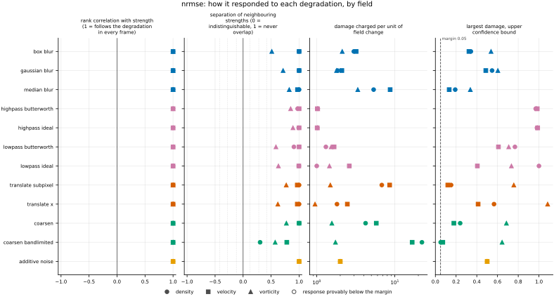
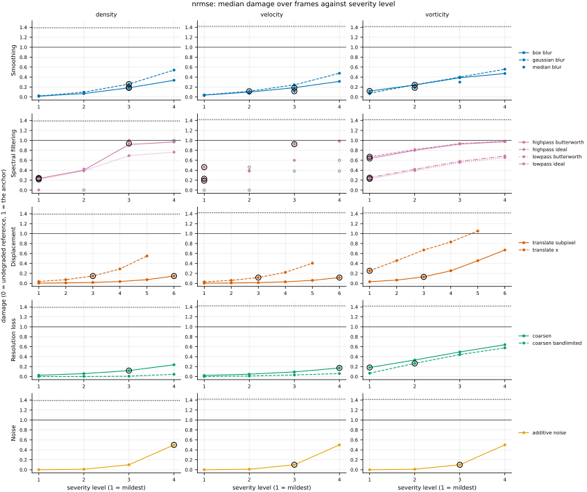
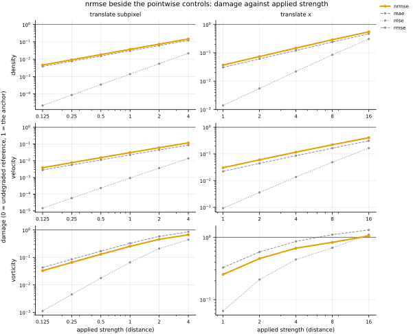

## Definition

For fields $f$ (reference) and $g$ (candidate) on the same analysis grid, write
$\bar{f}$ for the spatial mean of the reference and $f' = f - \bar{f}$ for its
fluctuation. Then

$$
\mathrm{NRMSE}(f, g) = \frac{\mathrm{RMSE}(f, g)}
{\sqrt{\langle f'^2 \rangle}} \tag{1}
$$

where the average runs over channels and cells. The denominator is the root-mean-square
*fluctuation* of the reference, not its raw root-mean-square.

That choice is not cosmetic. The kinet weakly compressible density field fluctuates by a few
thousandths of its mean of $1$, so its raw RMS is essentially one; dividing by that would leave
the value indistinguishable from RMSE and would hide two to three orders of magnitude of
relative error,
making density and velocity incomparable on the same degradation. Removing the mean first
is what puts them on one scale.

The reference alone sets the denominator, so Equation (1) is not symmetric: exchanging the
two fields changes the value. Where the reference is spatially uniform there is no
fluctuation scale to divide by, and the metric returns NaN rather than an exception or an
infinity.

### Boundary handling

None. The operation is local to each cell, and the spatial mean is taken over the whole
field, so no neighbourhood and no boundary condition enter.

## Performance

<!-- GENERATED performance: written by `python -m fmeval.cards evidence nrmse --results results/comparison_1793302178`, do not edit -->



Four measured statistics for nrmse, one row per degradation grouped by family and one marker per field. From left: the rank correlation between the metric and the applied strength within a frame, with the line showing the resampling interval; the separation of neighbouring strengths as Cliff's delta, where 0 means the metric cannot tell one strength from the next and the faint ticks at 0.12, 0.28 and 0.42 are Vargha and Delaney's small, medium and large anchors, for scale and not as grades; the damage charged per unit of field change at the harshest strength; and the upper confidence bound on the largest damage, beside the fixed margin of 0.05. A hollow marker is a field and degradation on which that bound lies below the margin, so the response is provably small. A missing marker is a statistic the analysis withheld, as the rank correlation is on an axis the metric is invariant to.



Median damage over frames against severity level for nrmse, one row per family of degradation and one column per field, on one shared scale. The solid grey line is damage 1, the anchor (by default the field's own mean); the dotted black line is the damage assigned to the fake prediction with the right spectrum, where the run included it. The hollow black ring marks the first level at which the metric has moved a tenth of the way to the anchor. Hollow grey markers are strengths excluded for repeating a milder one or for doing nothing. Degradations with three or fewer usable levels are drawn as markers only; points beyond 2 either side are drawn as triangles at the edge. Damage is negative where a degradation moves the metric away from the anchor, as noise raises a single-field quantity the field's mean sets to zero.

**Trend: does the response follow the degradation?**

| test family | field | degradations | rank correlation | fraction of frames in order | weakest gap between neighbouring strengths |
|---|---|---|---|---|---|
| Displacement | density | 2 | 1 | 1 | 1 |
| Displacement | velocity | 2 | 1 | 1 | 0.984 |
| Displacement | vorticity | 2 | 1 | 1 | 0.81 to 0.885 |
| Resolution loss | density | 2 | 1 | 0.714 to 1 | 0.652 to 1 |
| Resolution loss | velocity | 2 | 1 | 1 | 0.89 to 1 |
| Resolution loss | vorticity | 2 | 1 | 1 | 0.786 to 0.886 |
| Smoothing | density | 3 | 1 | 1 | 0.999 to 1 |
| Smoothing | velocity | 3 | 1 | 1 | 0.986 to 1 |
| Smoothing | vorticity | 3 | 1 | 1 | 0.756 to 0.912 |
| Spectral filtering | density | 4 | 1 | 1 | 0.954 to 0.998 |
| Spectral filtering | velocity | 4 | 1 | 1 | 0.998 to 1 |
| Spectral filtering | vorticity | 4 | 1 | 1 | 0.793 to 0.945 |
| Noise | density | 1 | 1 | 1 | 1 |
| Noise | velocity | 1 | 1 | 1 | 1 |
| Noise | vorticity | 1 | 1 | 1 | 1 |

**Reactivity: how far does it move?**

| test family | field | change from clean at the harshest strength | elasticity | first strength detected |
|---|---|---|---|---|
| Displacement | density | — | 0.995 to 1 | level 3 |
| Displacement | velocity | — | 0.969 to 0.999 | level 3 |
| Displacement | vorticity | — | 0.702 to 0.994 | level 1 |
| Resolution loss | density | — | 0.949 to 1.09 | level 3 |
| Resolution loss | velocity | — | 1.04 to 2.2 | level 4 |
| Resolution loss | vorticity | — | 0.72 to 1.36 | level 1 |
| Smoothing | density | — | 1.63 to 1.86 | level 3 |
| Smoothing | velocity | — | 1.08 to 1.15 | level 2 |
| Smoothing | vorticity | — | 0.821 to 1.15 | level 1 |
| Spectral filtering | density | — | 0.639 to 7.31 | level 1 |
| Spectral filtering | velocity | — | 0.643 to 0.995 | level 1 |
| Spectral filtering | vorticity | — | 0.466 to 0.536 | level 1 |
| Noise | density | — | 1 | level 4 |
| Noise | velocity | — | 1 | level 3 |
| Noise | vorticity | — | 1 | level 3 |
| trap test: fake prediction, right spectrum | density | — | — | damage 1.39 |
| trap test: fake prediction, right spectrum | velocity | — | — | damage 1.42 |
| trap test: fake prediction, right spectrum | vorticity | — | — | damage 1.42 |

**Consistency: how much does it vary from snapshot to snapshot?**

| test family | field | consistency, in the strength's units | snapshots per independent block |
|---|---|---|---|
| Displacement | density | 0.0684 to 0.395 | 20 |
| Displacement | velocity | 0.0628 to 0.317 | 14 to 18 |
| Displacement | vorticity | 0.134 to 0.814 | 21 |
| Resolution loss | density | 0.432 to 1.82 | 19 to 21 |
| Resolution loss | velocity | 0.508 to 1.5 | 22 |
| Resolution loss | vorticity | 0.838 to 1.06 | 22 |
| Smoothing | density | 0.00606 to 0.0162 | 19 to 20 |
| Smoothing | velocity | 0.00525 to 0.017 | 21 to 22 |
| Smoothing | vorticity | 0.0115 to 0.025 | 21 to 22 |
| Spectral filtering | density | 0.013 to 0.027 | 1 to 20 |
| Spectral filtering | velocity | 0.00504 to 0.0215 | 1 to 22 |
| Spectral filtering | vorticity | 0.0321 to 0.0658 | 20 to 22 |
| Noise | density | 0.00648 | 1 |
| Noise | velocity | 0.00307 | 1 |
| Noise | vorticity | 0.00519 | 21 |

One row per family of degradation and physical field; a cell gives the range over the degradations in that family. **Trend.** The rank correlation is the Spearman correlation between the strength and how far the metric has moved from its value on the undegraded field of the same frame, in the one direction it moves under that degradation, computed inside a single frame. A value of 1 means every strength moved it further than the last in every frame, whichever way it moves; a response that scatters to both sides scores near 0. The fraction of frames in order counts the frames with no exception. The weakest gap is the smallest Mann-Whitney overlap between two neighbouring strengths across frames: 1 means they never overlap, 0.5 that they cannot be told apart. **Reactivity.** The change from clean is the median, at the harshest strength, of the departure from the undegraded value of the same frame over the size of that value: 0.3 means 30%. It does not exist for this metric, whose undegraded value is exactly zero; the damage below is its relative reading. The elasticity is the percentage change of that departure per percentage change in strength over the mildest strengths. First strength detected is the mildest at which the metric has moved a tenth of the way to the anchor; **damage** reads that 0-to-1 scale as a number. A dash means the measurement is not defined there. A metric's reactivity scales with the power it is expressed in: mean squared error's elasticity is twice root-mean-square error's, though the two carry the same information, so compare magnitudes across metrics with that in mind. **Consistency** is how much the response varies from snapshot to snapshot relative to its size, in the strength's units; the snapshots of one trajectory are correlated, and the last column is how many consecutive snapshots one independent block spans.

These tables report what was measured and grade none of the measurements. What the numbers mean for this metric is written in the subsections below, beside the test that produced each number.

**Profile.**

| field | selectivity | charges most for | charges least for | response provably below 0.05 at 90% on | elasticity to a sub-pixel shift, against severity (distance) | compute cost (x cheapest in this run) |
|---|---|---|---|---|---|---|
| density | 0.637 | `coarsen_bandlimited` | `lowpass_ideal` | — | 1 | 1.95 |
| velocity | 0.478 | `coarsen_bandlimited` | `highpass_ideal` | — | 0.999 | 3.54 |
| vorticity | 0.122 | `median_blur` | `translate_x` | — | 0.994 | 1.98 |

One row per physical field. **Selectivity** is how concentrated the metric's response is on a few degradations, measured per unit of field change: 0 means it charges every degradation the same, as mean squared error does by construction, and values toward 1 that one degradation carries most of it. **Charges most and least for** name the two ends of that profile. **Response provably below** lists degradations on which the upper confidence bound of the largest damage lies below the margin -- an equivalence test, so an entry says the response is provably small, not merely not significant; a dash means no degradation met the bound. **Elasticity** is the slope of log damage against log shift over the smallest shifts: 1 means damage grows in proportion to the shift, 2 with its square. **Compute cost** is wall-clock per evaluation over the cheapest metric and field in the same run.

<!-- END GENERATED performance -->

## Intuition

Normalised root mean squared error is the root mean squared error expressed as a fraction
of how much the reference field actually varies. An error of one unit means something
quite different in a field that swings by a thousand and in one that swings by two, and
dividing by the size of the reference's own variation is what makes those two situations
produce the same number.

The variation used is the fluctuation about the spatial mean, not the raw size of the
field. This matters more than the phrase suggests. A density field sitting at one with
ripples of a ten-thousandth would, if divided by its raw size, report a tiny error no
matter how badly the ripples were predicted, because the constant background would swamp
everything. Subtracting the mean first means the ripples are compared against the ripples.

Here is the whole point on a four-by-four grid. The same displaced feature is scored
twice: once as it stands, and once with both fields multiplied by a ten-thousandth, as a
density fluctuation riding on a background of one might be.

```
                          rmse      nrmse
as it stands              0.5       1.155
both fields x 0.0001      0.00005   1.155
```

The unnormalised score falls by four orders of magnitude and says nothing about whether
the prediction got worse. The normalised one does not move, because the error and the
reference's variation shrank together.

The consequence is that this is the one cell-by-cell baseline whose value can be read
across fields: a value of 0.1 means the error is a tenth of the field's variation, whether
the field is density, velocity or vorticity. It also means the reference and the candidate
are not interchangeable, since only the reference sets the scale.

What this metric ignores is the same thing every cell-by-cell metric ignores: where the
errors sit.

## Reading the output

The value runs from zero upwards with no upper limit and is dimensionless. Lower is
better, and zero means the fields are identical. One is a useful landmark rather than a
bound: it means the error is as large as the reference's own fluctuation, which is exactly
what predicting the mean everywhere scores. That prediction is the damage anchor, so on this
metric damage and value coincide.

Because it is dimensionless, this is the cell-by-cell baseline that supports the
comparison the others cannot: across fields, and across datasets whose fields have
different magnitudes. Comparisons across models on one field are of course still valid.

Two cautions. It is asymmetric, so the reference must genuinely be the reference. And it
is undefined for a spatially uniform reference, where it returns NaN — a run reporting NaN
here is reporting that the field had no fluctuation to normalise against, not that
something failed.

## Limitations

The normalisation hides absolute magnitude, which is occasionally the thing you needed to
know. Two models with the same NRMSE on fields whose fluctuations differ by three orders
of magnitude have wildly different absolute errors, and if the downstream use is sensitive
to absolute error the number will not warn you.

The denominator is measured from the reference on each frame, so as the flow decays and
its fluctuation shrinks, the same absolute error produces a growing NRMSE. That is
usually the desired behaviour, but it means a rising NRMSE along a trajectory does not by
itself indicate a worsening prediction.

Being a positive rescaling of RMSE, it orders candidates on a single field exactly as MSE
and RMSE do, and inherits their blindness to position and their quadratic response to
sub-cell displacement.

## Results

<!-- GENERATED run: written by `python -m fmeval.cards evidence nrmse --results results/comparison_1793302178`, do not edit -->

Measured on `kinet_re5e4`, frames 2000 to 10000 (161 frames of developed flow), on the 256 analysis grid, seed 20260807, at commit `b59bbde617d1` (working tree dirty). Run `comparison_1793302178`.

Every number in this section comes from that one run. Regenerate with `python -m fmeval.cards evidence <name> --results results/comparison_1793302178`.

<!-- END GENERATED run -->

Each subsection links to the degradations that subsection reports. What those degradations
do, and what their strength numbers mean, is documented on their own pages.

### Smoothing

[gaussian_blur](../../degradations/gaussian_blur/card.md) ·
[box_blur](../../degradations/box_blur/card.md) ·
[median_blur](../../degradations/median_blur/card.md)

<!-- GENERATED results_smoothing: written by `python -m fmeval.cards evidence nrmse --results results/comparison_1793302178`, do not edit -->

| degradation | field | strengths | rank correlation | fraction of frames in the right order | weakest gap between neighbouring strengths |
|---|---|---|---|---|---|
| `box_blur` | density | 4 | 1 | 1 | 0.999 |
| `box_blur` | velocity | 4 | 1 | 1 | 1 |
| `box_blur` | vorticity | 4 | 1 | 1 | 0.756 |
| `gaussian_blur` | density | 4 | 1 | 1 | 1 |
| `gaussian_blur` | velocity | 4 | 1 | 1 | 1 |
| `gaussian_blur` | vorticity | 4 | 1 | 1 | 0.857 |
| `median_blur` | density | 3 | 1 | 1 | 1 |
| `median_blur` | velocity | 3 | 1 | 1 | 0.986 |
| `median_blur` | vorticity | 3 | 1 | 1 | 0.912 |

<!-- END GENERATED results_smoothing -->

### Spectral filtering

[lowpass_ideal](../../degradations/lowpass_ideal/card.md) ·
[lowpass_butterworth](../../degradations/lowpass_butterworth/card.md) ·
[highpass_ideal](../../degradations/highpass_ideal/card.md) ·
[highpass_butterworth](../../degradations/highpass_butterworth/card.md)

<!-- GENERATED results_spectral: written by `python -m fmeval.cards evidence nrmse --results results/comparison_1793302178`, do not edit -->

| degradation | field | strengths | rank correlation | fraction of frames in the right order | weakest gap between neighbouring strengths |
|---|---|---|---|---|---|
| `highpass_butterworth` | density | 4 | 1 | 1 | 0.987 |
| `highpass_butterworth` | velocity | 3 | 1 | 1 | 1 |
| `highpass_butterworth` | vorticity | 4 | 1 | 1 | 0.925 |
| `highpass_ideal` | density | 3 | 1 | 1 | 0.996 |
| `highpass_ideal` | velocity | 2 | 1 | 1 | 1 |
| `highpass_ideal` | vorticity | 4 | 1 | 1 | 0.945 |
| `lowpass_butterworth` | density | 4 | 1 | 1 | 0.954 |
| `lowpass_butterworth` | velocity | 3 | 1 | 1 | 1 |
| `lowpass_butterworth` | vorticity | 4 | 1 | 1 | 0.793 |
| `lowpass_ideal` | density | 3 | 1 | 1 | 0.998 |
| `lowpass_ideal` | velocity | 2 | 1 | 1 | 0.998 |
| `lowpass_ideal` | vorticity | 4 | 1 | 1 | 0.815 |

<!-- END GENERATED results_spectral -->

### Displacement

[translate_x](../../degradations/translate/card.md) ·
[translate_subpixel](../../degradations/translate_subpixel/card.md)

<!-- GENERATED results_geometric: written by `python -m fmeval.cards evidence nrmse --results results/comparison_1793302178`, do not edit -->

| degradation | field | strengths | rank correlation | fraction of frames in the right order | weakest gap between neighbouring strengths |
|---|---|---|---|---|---|
| `translate_subpixel` | density | 6 | 1 | 1 | 1 |
| `translate_subpixel` | velocity | 6 | 1 | 1 | 0.984 |
| `translate_subpixel` | vorticity | 6 | 1 | 1 | 0.885 |
| `translate_x` | density | 5 | 1 | 1 | 1 |
| `translate_x` | velocity | 5 | 1 | 1 | 0.984 |
| `translate_x` | vorticity | 5 | 1 | 1 | 0.81 |

<!-- END GENERATED results_geometric -->


### Resolution loss

[coarsen](../../degradations/coarsen/card.md) ·
[coarsen_bandlimited](../../degradations/coarsen_bandlimited/card.md)

<!-- GENERATED results_resolution: written by `python -m fmeval.cards evidence nrmse --results results/comparison_1793302178`, do not edit -->

| degradation | field | strengths | rank correlation | fraction of frames in the right order | weakest gap between neighbouring strengths |
|---|---|---|---|---|---|
| `coarsen` | density | 4 | 1 | 1 | 1 |
| `coarsen` | velocity | 4 | 1 | 1 | 1 |
| `coarsen` | vorticity | 4 | 1 | 1 | 0.886 |
| `coarsen_bandlimited` | density | 4 | 1 | 0.714 | 0.652 |
| `coarsen_bandlimited` | velocity | 4 | 1 | 1 | 0.89 |
| `coarsen_bandlimited` | vorticity | 4 | 1 | 1 | 0.786 |

<!-- END GENERATED results_resolution -->

Both coarsenings are ordered correctly on every field, with a rank correlation of 1. They differ in size. At a factor of 16, `coarsen` scores a damage of 0.24, 0.17 and 0.64 on density, velocity and vorticity, and `coarsen_bandlimited` 0.04, 0.06 and 0.58. The two operators keep the same block means, so on the smooth fields most of what `coarsen` charges is its staircase; on vorticity, whose structure the coarse grid genuinely cannot hold, they nearly agree. Under the band-limited operator density is in the right order in only 71% of frames: its damage at factors 2 and 4 is 0.0017 and 0.0023, and which of the two is larger changes from frame to frame. The other pointwise metrics, `spectrum_l2` and `h1_seminorm` show this on density too, and its
cause is not established; `issues/039` records what was ruled out.

### Noise

[additive_noise](../../degradations/additive_noise/card.md)

<!-- GENERATED results_stochastic: written by `python -m fmeval.cards evidence nrmse --results results/comparison_1793302178`, do not edit -->

| degradation | field | strengths | rank correlation | fraction of frames in the right order | weakest gap between neighbouring strengths |
|---|---|---|---|---|---|
| `additive_noise` | density | 4 | 1 | 1 | 1 |
| `additive_noise` | velocity | 4 | 1 | 1 | 1 |
| `additive_noise` | vorticity | 4 | 1 | 1 | 1 |

<!-- END GENERATED results_stochastic -->

### Trap tests

[gaussian_impostor](../../degradations/gaussian_impostor/card.md) ·
[uncorrelated](../../degradations/random_large_translation/card.md)

<!-- GENERATED results_canaries: written by `python -m fmeval.cards evidence nrmse --results results/comparison_1793302178`, do not edit -->

| field | damage assigned to the fake prediction | closest real degradation | damage of the reference moved far away | value on the anchor |
|---|---|---|---|---|
| density | 1.39 | `lowpass_ideal=1.4029` | 1.28 | 1 |
| velocity | 1.42 | `highpass_ideal=4.02293` | 1.75 | 1 |
| vorticity | 1.42 | `translate_x=16` | 1.5 | 1 |

The fake prediction here has exactly the reference field's amplitude spectrum and completely scrambled structure. Damage 1 is what the anchor scores, by default the reference's own spatial mean, a prediction that knows the mean and nothing else. The damage column therefore says how close to useless this metric considers that fake prediction: a low number means the metric was fooled. The third column translates the same number into an ordinary degradation whose damage the fake prediction matches, which is easier to picture. The fourth is the reference moved by a large random offset, the right statistics in the wrong place; where a field's energy sits in its largest scales that copy stays partly correlated with the reference, so it is not the score of an unrelated field.

<!-- END GENERATED results_canaries -->

### Compared with the other metrics

<!-- GENERATED results_summary: written by `python -m fmeval.cards evidence nrmse --results results/comparison_1793302178`, do not edit -->

| compared with | rank correlation over every degradation |
|---|---|
| `mse` | 0.974 |
| `rmse` | 0.974 |
| `mae` | 0.963 |
| `h_minus_one` | 0.946 |
| `h1_seminorm` | 0.661 |
| `increment_w1_by_separation` | 0.246 |
| `spectrum_l2` | 0.217 |
| `increment_w1` | 0.0858 |
| `increment_flatness` | -0.121 |
| `enstrophy` | -0.154 |
| `palinstrophy` | -0.158 |
| `kinetic_energy` | -0.284 |

Computed on the median value at each combination of degradation and strength, over every degradation and physical field in the run, with the undegraded reference excluded. Two metrics correlating near 1 put the degradations in the same order, but the two may still weight those degradations very differently. A correlation near 1 therefore means the two metrics are redundant for ranking models, not that the two are interchangeable as training losses.

<!-- END GENERATED results_summary -->

NRMSE correlates with MSE at 0.974 and with MAE at 0.963 across every degradation, above
the 0.95 redundancy threshold. Its distinct contribution is not a different ordering but a
comparable scale: it is the one baseline that allows a density result and a vorticity result to
be read side by side.

### Damage beside the other metrics

<!-- GENERATED results_damage_by_level: written by `python -m fmeval.cards evidence nrmse --results results/comparison_1793302178`, do not edit -->



Median damage over frames against the applied strength, log-log, for nrmse (bold, in colour) and the pointwise controls mae, mse, rmse (thin, grey), one column per displacement degradation and one row per field. The grey line is damage 1, the anchor (by default the field's own mean). Parallel lines charge in the same proportion at every strength; a steeper line charges relatively more for the larger shifts, which is what decides whether two metrics are interchangeable as training losses. These are the same numbers as the table beneath.

**Displacement, density, `translate_subpixel`** (strength: distance).

| metric | 0.125 | 0.25 | 0.5 | 1 | 2 | 4 |
|---|---|---|---|---|---|---|
| `nrmse` | 0.00463 | 0.00926 | 0.0185 | 0.037 | 0.0738 | 0.147 |
| `mae` | 0.00383 | 0.00767 | 0.0153 | 0.0306 | 0.061 | 0.121 |
| `mse` | 2.17e-05 | 8.68e-05 | 0.000347 | 0.00138 | 0.00551 | 0.0219 |
| `rmse` | 0.00466 | 0.00931 | 0.0186 | 0.0372 | 0.0743 | 0.148 |

**Displacement, density, `translate_x`** (strength: distance).

| metric | 1 | 2 | 4 | 8 | 16 |
|---|---|---|---|---|---|
| `nrmse` | 0.037 | 0.0738 | 0.147 | 0.29 | 0.55 |
| `mae` | 0.0306 | 0.061 | 0.121 | 0.24 | 0.469 |
| `mse` | 0.00138 | 0.00551 | 0.0219 | 0.0849 | 0.307 |
| `rmse` | 0.0372 | 0.0743 | 0.148 | 0.291 | 0.555 |

**Displacement, velocity, `translate_subpixel`** (strength: distance).

| metric | 0.125 | 0.25 | 0.5 | 1 | 2 | 4 |
|---|---|---|---|---|---|---|
| `nrmse` | 0.00382 | 0.00763 | 0.0153 | 0.0304 | 0.06 | 0.117 |
| `mae` | 0.00279 | 0.00559 | 0.0112 | 0.0223 | 0.0441 | 0.0859 |
| `mse` | 1.45e-05 | 5.81e-05 | 0.000232 | 0.000924 | 0.0036 | 0.0136 |
| `rmse` | 0.00381 | 0.00762 | 0.0152 | 0.0304 | 0.06 | 0.117 |

**Displacement, velocity, `translate_x`** (strength: distance).

| metric | 1 | 2 | 4 | 8 | 16 |
|---|---|---|---|---|---|
| `nrmse` | 0.0304 | 0.06 | 0.117 | 0.221 | 0.406 |
| `mae` | 0.0223 | 0.0441 | 0.0859 | 0.163 | 0.31 |
| `mse` | 0.000924 | 0.0036 | 0.0136 | 0.0489 | 0.165 |
| `rmse` | 0.0304 | 0.06 | 0.117 | 0.221 | 0.406 |

**Displacement, vorticity, `translate_subpixel`** (strength: distance).

| metric | 0.125 | 0.25 | 0.5 | 1 | 2 | 4 |
|---|---|---|---|---|---|---|
| `nrmse` | 0.0328 | 0.0654 | 0.13 | 0.253 | 0.456 | 0.67 |
| `mae` | 0.0428 | 0.0854 | 0.169 | 0.328 | 0.582 | 0.86 |
| `mse` | 0.00112 | 0.00448 | 0.0176 | 0.066 | 0.21 | 0.44 |
| `rmse` | 0.0335 | 0.0669 | 0.133 | 0.257 | 0.458 | 0.663 |

**Displacement, vorticity, `translate_x`** (strength: distance).

| metric | 1 | 2 | 4 | 8 | 16 |
|---|---|---|---|---|---|
| `nrmse` | 0.253 | 0.456 | 0.67 | 0.832 | 1.05 |
| `mae` | 0.328 | 0.582 | 0.86 | 1.1 | 1.31 |
| `mse` | 0.066 | 0.21 | 0.44 | 0.679 | 1.1 |
| `rmse` | 0.257 | 0.458 | 0.663 | 0.824 | 1.05 |

Median damage over frames at every strength, this metric in the first row and the pointwise controls beneath it, all on the same 0-to-1 scale where 0 is the undegraded reference and 1 the anchor (by default the field's own mean); a dash means no damage scale on that field. The rank correlations under *Compared with the other metrics* say whether two metrics put the strengths in the same order; this table says how much each one charges for the same strength, which decides whether two metrics are interchangeable as training losses.

<!-- END GENERATED results_damage_by_level -->

## References

\bibliography
