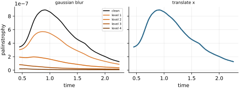
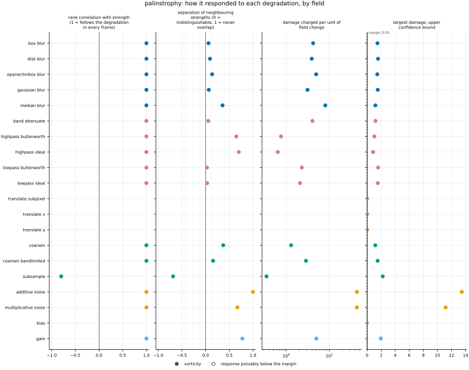
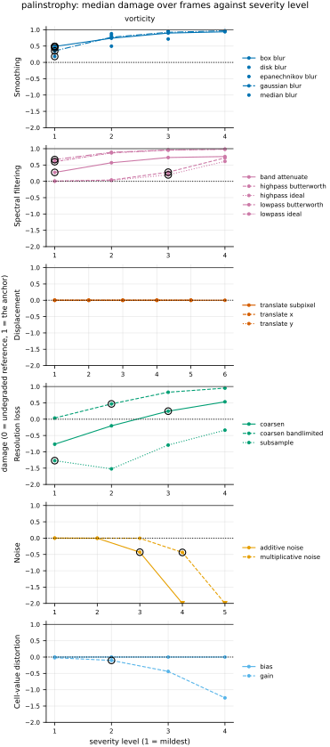
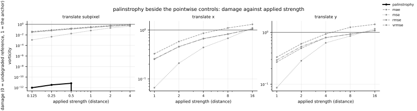
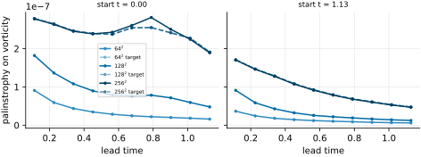

## Definition

For a vorticity field $\boldsymbol{\omega}$ with components $\omega^{(c)}$ on a periodic
grid, palinstrophy is half the mean squared gradient,

$$
P = \frac{1}{2} \Bigl\langle |\nabla \boldsymbol{\omega}|^2 \Bigr\rangle
  = \frac{1}{2} \sum_{c} \sum_{j} \Bigl\langle
    \bigl( \partial_j \omega^{(c)} \bigr)^2 \Bigr\rangle \tag{1}
$$

where $j$ runs over the spatial directions, $c$ over the components — one in 2D, three in
3D — and $\langle \cdot \rangle$ averages over cells. The factor of one half is the one
Boffetta and Ecke fix on p. 430 of their review [@boffetta2012]: they define enstrophy as
$\Omega = \tfrac12 \langle \omega^2 \rangle = \int k^2 E(k)\,dk$ and palinstrophy, with their
Equation (6) $d\Omega/dt = -2\nu P$, as $P = \int k^4 E(k)\,dk$, which together give
Equation (1). It is also the convention [enstrophy](../../metrics/enstrophy/card.md) uses, so the two
are directly comparable. Their setting is two-dimensional; in 3D Equation (1) sums all three
components, which is the direct generalisation rather than a definition taken from them.

Derivatives are spectral, $\partial_j \to i k_j$ with
$k_j = 2\pi \, \mathrm{fftfreq}(N_j, h_j)$, the convention the repository already uses
throughout [@pope2000]. This is not only a consistency preference. `fmeval/derived.py` records that the
solver's lattice-stencil vorticity and a spectral one differ by 8.1% rms, so a second
differentiation convention introduced here would stack a second discrepancy of that kind on
top of the first.

The pairing with enstrophy is what makes this worth computing. In terms of the vorticity
spectrum $E_\omega(\kappa)$, the two quantities are successive moments,

$$
\text{enstrophy} \propto \int E_\omega(\kappa) \, d\kappa,
\qquad
P \propto \int \kappa^2 \, E_\omega(\kappa) \, d\kappa \tag{2}
$$

so enstrophy asks how much rotational activity there is and palinstrophy asks how sharp it
is [@boffetta2012]. Equation (2) also orders the two under smoothing. For a filter whose
squared gain $G^2$ is a non-increasing function of $\kappa$ alone — a Gaussian, a Butterworth
or an ideal low-pass, though not a box or a median filter — Chebyshev's integral inequality,
applied under the measure $E_\omega(\kappa)\,d\kappa$ to the non-increasing $G^2$ and the
increasing $\kappa^2$, gives

$$
\frac{\int \kappa^2 G^2 E_\omega \, d\kappa}{\int \kappa^2 E_\omega \, d\kappa}
\;\le\;
\frac{\int G^2 E_\omega \, d\kappa}{\int E_\omega \, d\kappa} \tag{3}
$$

so such a filter always removes at least as large a fraction of palinstrophy as of enstrophy.
Equation (3) bounds the ordering only; how wide the gap is on real data is measured under
Results.

### Boundary handling

Periodic on every axis, inherited from the spectral derivative. The spacing is read from the
analysis grid rather than assumed, and here that matters more than it does for a first-order
quantity: the value carries an inverse length *squared*, so on a grid coarsened by a factor,
using the native spacing would inflate the result by the square of that factor.

It therefore declares `requires_periodic`, and the harness does not run it on a dataset with a
non-periodic axis, such as the Sod shock tube; it reports why in the run log.

### How its field reports it

**Turbulence theory** uses palinstrophy as the rate at which viscosity removes enstrophy: in
decaying two-dimensional turbulence without forcing or friction,
$d\Omega/dt = -2\nu P \equiv -\eta_\nu(t)$ ([@boffetta2012], p. 430, Eq. (6)), where $\Omega$
is the [enstrophy](../../metrics/enstrophy/card.md) and $\eta_\nu$ the enstrophy dissipation
rate. The object is therefore read beside the enstrophy, as the term that closes its budget,
and the review uses Eq. (6) to bound the energy dissipation as the viscosity vanishes. No
source read for this card draws palinstrophy alone against time; the learned-model papers that
draw energy and enstrophy against time with the reference overlaid (see
[enstrophy](../../metrics/enstrophy/card.md)) do not draw it. The card's first figure is that
same form, the value against time with the reference's history overlaid, and the reading is
the relative error of the integral (Reading the output).

**The experiments.** The budget closure, Eq. (6) evaluated on consecutive states of a
trajectory, is the experiment in which palinstrophy is the field's quantity; `kinet_re5e4` read at
reduction 1 holds consecutive solver steps of the reference, but no candidate trajectory has
them, so it is written up in
[EXP-enstrophy-budget-closure-from-consecutive-states](https://github.com/khegazy/pde_metrics/blob/main/proposals/EXP-enstrophy-budget-closure-from-consecutive-states.md)
and not built. Rollouts over many initial conditions are written up in
[EXP-nrmse-rollouts-over-many-initial-conditions](https://github.com/khegazy/pde_metrics/blob/main/proposals/EXP-nrmse-rollouts-over-many-initial-conditions.md).
The metric runs on the degradation ladder on `kinet_re5e4`, on the Reynolds ladder and on
`forecast_re5e4`, where the figure is the prediction's palinstrophy beside its target's at each
prediction step. `sod_shock_tube` has walls and no vorticity, and `synthetic_ensemble` no
vorticity.

## Performance

<!-- GENERATED performance: written by `python -m fmeval.cards evidence palinstrophy --results results/comparison_1793846511 --results results/comparison_1793811840 --results results/comparison_1793846600`, do not edit -->



*As this metric's own field draws it.* palinstrophy on vorticity against the frame's physical time, one line per strength of each degradation the run chose for its detailed views, or whose applied strength grows with time; the clean field in black is the quantity's own history. A degraded line is the operator applied to each frame on its own, not a rollout: it says what the operator does at each time, not how an error would grow. Median over frames at each time.



Four measured statistics for palinstrophy, one row per degradation grouped by family and one marker per field. From left: the rank correlation between the metric and the applied strength within a frame, with the line showing the resampling interval; the separation of neighbouring strengths as Cliff's delta, where 0 means the metric cannot tell one strength from the next and the faint ticks at 0.12, 0.28 and 0.42 are Vargha and Delaney's small, medium and large anchors, for scale and not as grades; the damage charged per unit of field change at the harshest strength; and the upper confidence bound on the largest damage, beside the fixed margin of 0.05. A hollow marker is a field and degradation on which that bound lies below the margin, so the response is provably small. A missing marker is a statistic the analysis withheld, as the rank correlation is on an axis the metric is invariant to.



Median damage over frames against severity level for palinstrophy, one row per family of degradation and one column per field, on one shared scale. The solid grey line is damage 1, the anchor (by default the field's own mean); the dotted black line is the damage assigned to the fake prediction with the right spectrum, where the run included it. The hollow black ring marks the first level at which the metric has moved a tenth of the way to the anchor. Hollow grey markers are strengths excluded for repeating a milder one or for doing nothing. Degradations with three or fewer usable levels are drawn as markers only; points beyond 2 either side are drawn as triangles at the edge. Damage is negative where a degradation moves the metric away from the anchor, as noise raises a single-field quantity the field's mean sets to zero.

**Trend: does the response follow the degradation?**

| test family | field | degradations | rank correlation | fraction of frames in order | weakest gap between neighbouring strengths |
|---|---|---|---|---|---|
| Displacement | vorticity | 3 | — | — | — |
| Cell-value distortion | vorticity | 2 | 1 | 1 | 0.887 |
| Resolution loss | vorticity | 3 | -0.8 to 1 | 0.0248 to 1 | 0.156 to 0.685 |
| Smoothing | vorticity | 5 | 1 | 1 | 0.531 to 0.678 |
| Spectral filtering | vorticity | 5 | 1 | 1 | 0.514 to 0.85 |
| Noise | vorticity | 2 | 1 | 0.845 to 1 | 0.835 to 1 |

**Reactivity: how far does it move?**

| test family | field | change from clean at the harshest strength | elasticity | first strength detected |
|---|---|---|---|---|
| Displacement | vorticity | 0 | — | level — |
| Cell-value distortion | vorticity | 0 to 1.25 | 1.03 | level 2 |
| Resolution loss | vorticity | -0.96 to 0.373 | -0.34 to 2.27 | level 1 |
| Smoothing | vorticity | -0.98 to -0.734 | 0.432 to 1.07 | level 1 |
| Spectral filtering | vorticity | -0.99 to -0.517 | 0.21 to 5.14 | level 1 |
| Noise | vorticity | 10.8 to 11.1 | 1.94 to 2.01 | level 3 |
| trap test: fake prediction, right spectrum | vorticity | — | — | damage 0 |

**Consistency: how much does it vary from snapshot to snapshot?**

| test family | field | consistency, in the strength's units | snapshots per independent block |
|---|---|---|---|
| Displacement | vorticity | — | 1 to 17 |
| Cell-value distortion | vorticity | 0.0536 | 1 to 22 |
| Resolution loss | vorticity | 1.42 to 2.79 | 21 to 22 |
| Smoothing | vorticity | 0.0162 to 0.0356 | 21 |
| Spectral filtering | vorticity | 0.0336 to 0.118 | 21 to 22 |
| Noise | vorticity | 0.00268 to 0.00314 | 1 to 21 |

One row per family of degradation and physical field; a cell gives the range over the degradations in that family. **Trend.** The rank correlation is the Spearman correlation between the strength and how far the metric has moved from its value on the undegraded field of the same frame, in the one direction it moves under that degradation, computed inside a single frame. A value of 1 means every strength moved it further than the last in every frame, whichever way it moves; a response that scatters to both sides scores near 0. The fraction of frames in order counts the frames with no exception. The weakest gap is the smallest Mann-Whitney overlap between two neighbouring strengths across frames: 1 means they never overlap, 0.5 that they cannot be told apart. **Reactivity.** The change from clean is the median, at the harshest strength, of the departure from the undegraded value of the same frame over the size of that value: 0.3 means 30%. The elasticity is the percentage change of that departure per percentage change in strength over the mildest strengths. First strength detected is the mildest at which the metric has moved a tenth of the way to the anchor; **damage** reads that 0-to-1 scale as a number. A dash means the measurement is not defined there. A metric's reactivity scales with the power it is expressed in: mean squared error's elasticity is twice root-mean-square error's, though the two carry the same information, so compare magnitudes across metrics with that in mind. **Consistency** is how much the response varies from snapshot to snapshot relative to its size, in the strength's units; the snapshots of one trajectory are correlated, and the last column is how many consecutive snapshots one independent block spans.

These tables report what was measured and grade none of the measurements. What the numbers mean for this metric is written in the subsections below, beside the test that produced each number.

**Profile.**

| field | selectivity | charges most for | charges least for | response provably below 0.05 at 90% on | elasticity to a sub-pixel shift, against severity (distance) | compute cost (x cheapest in this run) |
|---|---|---|---|---|---|---|
| vorticity | 0.786 | `additive_noise` | `bias` | `bias` `translate_subpixel` `translate_x` `translate_y` | — | 54.8 |

One row per physical field. **Selectivity** is how concentrated the metric's response is on a few degradations, measured per unit of field change: 0 means it charges every degradation the same, as mean squared error does by construction, and values toward 1 that one degradation carries most of it. **Charges most and least for** name the two ends of that profile. **Response provably below** lists degradations on which the upper confidence bound of the largest damage lies below the margin -- an equivalence test, so an entry says the response is provably small, not merely not significant; a dash means no degradation met the bound. **Elasticity** is the slope of log damage against log shift over the smallest shifts: 1 means damage grows in proportion to the shift, 2 with its square. **Compute cost** is wall-clock per evaluation over the cheapest metric and field in the same run.

<!-- END GENERATED performance -->

## Intuition

Vorticity says how fast the fluid is spinning at each point. Enstrophy adds up how much
spinning there is in total. This quantity instead adds up how *abruptly* the spinning changes
from place to place, so it is large when the rotation is organised into thin, sharply bounded
filaments and small when the same total amount of rotation is spread out smoothly.

That makes it a probe for a specific failure. A prediction that has blurred the flow loses
the sharp edges between one rotating region and the next before it loses the bulk of the
rotation, and this quantity weights fine detail far more heavily than coarse structure —
doubling how quickly a feature varies in space quadruples its contribution here, while leaving
its contribution to the total rotation unchanged. So a smooth blur always takes away a larger
share of this quantity than of the total rotation; how much larger on the real flow is
recorded under Results.

A worked example on an eight by eight grid. Take a vorticity field that is a single smooth
wave: one full oscillation across the box, constant in the other direction. Then squeeze the
same wave so it oscillates three times across the box, keeping its amplitude.

```
field                          enstrophy   palinstrophy
one oscillation across 8         0.25        0.1542
three oscillations across 8      0.25        1.388
```

The enstrophy is unchanged, because there is exactly as much rotation as before. The
palinstrophy rises by a factor of nine, because the field now varies three times as fast and
this quantity counts the square of that rate.

What it ignores: everything about where the structure is. Like any single-field quantity it
takes one field and returns one number, so a prediction can match it exactly while having its
vortices in entirely the wrong places.

## Reading the output

Zero and unbounded above, in the square of the vorticity units per square length. There is no
direction in which the value is better on its own: what is read is the drift away from the
reference field's value, in either direction. A prediction scoring below the reference has
smoothed the vorticity; one scoring above has sharpened or roughened it.

**The reading is the relative error of the integral**, $(P_{\mathrm{prediction}} -
P_{\mathrm{reference}}) / P_{\mathrm{reference}}$ on the same frame, which the tables give as
the *change from clean*: $-0.5$ is a prediction that has lost half the reference's
palinstrophy. On a run of real forecasts it is the relative error at each prediction step,
beside the two values against time in the figure.

Only comparisons at a fixed analysis-grid resolution are meaningful, and this metric is
stricter about that than most. Equation (2) shows the value is dominated by the highest
wavenumbers the grid carries, so changing the resolution changes which scales contribute at
all. Comparing a run at grid 128 with one at grid 256 measures the grids, not the predictions.

On the damage scale the anchor is the field's own spatial mean, a constant with zero
palinstrophy, so damage is the palinstrophy lost as a fraction of the median reference value over
snapshots: positive when the value falls, 1 when none is left, and negative when the value rises.
On `kinet_re5e4` the reference's palinstrophy runs from 1.27e-7 to 8.93e-7 over the run (the
range under the translations, which leave it unchanged), so the fraction of each snapshot's own
palinstrophy lost, the change from clean in the tables, can differ from the damage, which
exceeds 1 on the harshest blurs and filters.

## Limitations

The quantity is degenerate in the strong sense: enormously many wrong fields share any given
palinstrophy, so a matching value is no evidence of a correct prediction. It is a tripwire and
must be used as one.

The more specific trap is its resolution sensitivity working against it. Because the $\kappa^2$
weight concentrates the value at the grid scale, palinstrophy is disproportionately sensitive
to anything that changes the smallest resolved scales, including numerical artefacts that are
not physics at all. By Equation (2), energy added at wavenumber $\kappa$ raises the value by
$\kappa^2$ times that energy, so ringing near the grid scale raises palinstrophy *above* the
reference's while making the field worse, and the number alone does not distinguish that from
genuinely better-resolved filaments.

Finally, it inherits everything that is uncertain about the vorticity it is computed from.
Vorticity here is a derived field, recomputed from velocity after any remap rather than
averaged, and the calibration recorded with `comparison_1793846511` (its
`data/calibration.csv`, column `scale_spread`) gives its characteristic scale a relative spread
of 0.32 across the sampled frames, against 0.06 for density and 0.07 for velocity. A palinstrophy drift of comparable size says as much about which frames were
evaluated as about the prediction.

## Results

<!-- GENERATED run: written by `python -m fmeval.cards evidence palinstrophy --results results/comparison_1793846511 --results results/comparison_1793811840 --results results/comparison_1793846600`, do not edit -->

Measured on `kinet_re5e4`, frames 2000 to 10000 (161 frames of developed flow), on the 256 analysis grid, seed 20260807, at commit `adbdc88e4950`. Run `comparison_1793846511`.

Every number in this section comes from that run, except in the subsections headed with another experiment and in a figure whose caption names another run, each of which names its own run. Regenerate with `python -m fmeval.cards evidence <name> --results results/comparison_1793846511 --results results/comparison_1793811840 --results results/comparison_1793846600`.

<!-- END GENERATED run -->

<!-- GENERATED experiments: written by `python -m fmeval.cards catalog`, do not edit -->

**Across the experiments.**

| experiment | what a run on it is evidence of | on this card |
|---|---|---|
| `kinet_re5e4` | developed flow | measured, run `comparison_1793846511`: the main results |
| `kinet_re1e6` | developed flow at Re = 1e6, twenty times the Reynolds number of kinet_re5e4, from the same initial condition | measured, run `comparison_1793846600`: under *On `kinet_re1e6`* |
| `synthetic_ensemble` | a calibrated null: evidence that the estimator computes what it claims to compute, and nothing about turbulence | not applicable: needs vorticity, which this dataset does not provide |
| `sod_shock_tube` | an analytic check: evidence that the metric locates and scores a known shock correctly, and nothing about turbulence | not applicable: needs a periodic domain, and this dataset is not periodic; needs vorticity, which this dataset does not provide |
| `forecast_re5e4` | real predictions scored against their targets at each prediction step; who produced the predictions, a trained model or a coarser solver, is not recorded | measured, run `comparison_1793811840`: under *On `forecast_re5e4`* |

One row per dataset a card may cite (`configs/cards/default.yaml`). *Measured* names the run the card cites: the main results are `## Performance` and the subsections below, and every other run has its own subsection headed with its dataset. *Not applicable* gives the reason: one that follows from what the metric declares and what the dataset offers, or one a person wrote on the card (`not_run` in `card.yaml`) because the result would carry no information. *Not yet run* means the metric can run there and the card cites no run on it yet.

<!-- END GENERATED experiments -->

### Smoothing

[gaussian_blur](../../degradations/gaussian_blur/card.md) ·
[box_blur](../../degradations/box_blur/card.md)

<!-- GENERATED results_smoothing: written by `python -m fmeval.cards evidence palinstrophy --results results/comparison_1793846511 --results results/comparison_1793811840 --results results/comparison_1793846600`, do not edit -->

| degradation | field | strengths | rank correlation | fraction of frames in the right order | weakest gap between neighbouring strengths |
|---|---|---|---|---|---|
| `box_blur` | vorticity | 4 | 1 | 1 | 0.531 |
| `disk_blur` | vorticity | 3 | 1 | 1 | 0.546 |
| `epanechnikov_blur` | vorticity | 3 | 1 | 1 | 0.568 |
| `gaussian_blur` | vorticity | 4 | 1 | 1 | 0.533 |
| `median_blur` | vorticity | 3 | 1 | 1 | 0.678 |

<!-- END GENERATED results_smoothing -->

Smoothing removes fine detail, so palinstrophy falls as the strength rises, in order on every
frame (rank correlation 1 on all five). At the harshest strength the relative error of the
integral is $-0.980$ under `gaussian_blur`, $-0.961$ under `disk_blur`, $-0.953$ under
`box_blur`, $-0.945$ under `epanechnikov_blur` and $-0.734$ under `median_blur`: all but the
median filter leave less than a tenth of it. What this family measures is the size of that
fall beside [enstrophy](../../metrics/enstrophy/card.md)'s on the same run: under every blur,
palinstrophy loses the larger fraction at the harshest strength. Equation (3) guarantees that
ordering for the Gaussian; the box, disk, Epanechnikov and median kernels are outside its
assumptions and show the same ordering on this data. The neighbouring strengths overlap across
frames (weakest gaps 0.531 to 0.678) because the reference's own value varies across the run.

### Spectral filtering

[lowpass_ideal](../../degradations/lowpass_ideal/card.md) ·
[highpass_ideal](../../degradations/highpass_ideal/card.md)

<!-- GENERATED results_spectral: written by `python -m fmeval.cards evidence palinstrophy --results results/comparison_1793846511 --results results/comparison_1793811840 --results results/comparison_1793846600`, do not edit -->

| degradation | field | strengths | rank correlation | fraction of frames in the right order | weakest gap between neighbouring strengths |
|---|---|---|---|---|---|
| `band_attenuate` | vorticity | 4 | 1 | 1 | 0.528 |
| `highpass_butterworth` | vorticity | 4 | 1 | 1 | 0.824 |
| `highpass_ideal` | vorticity | 4 | 1 | 1 | 0.85 |
| `lowpass_butterworth` | vorticity | 4 | 1 | 1 | 0.514 |
| `lowpass_ideal` | vorticity | 4 | 1 | 1 | 0.516 |

<!-- END GENERATED results_spectral -->

Every filter lowers palinstrophy in order of strength on every frame. The two sides of the
spectrum act differently on it. A low-pass removes the modes it is built on: relative error
$-0.990$ under `lowpass_butterworth` and $-0.989$ under `lowpass_ideal` at the harshest
strength, and both move it by a tenth of the way to the anchor already at level 1. A high-pass
removes the modes it weights least: $-0.617$ under `highpass_butterworth` and $-0.517$ under
`highpass_ideal`, first detected only at level 3, with an elasticity above 5, so the mild
strengths barely move it and the harsh ones do. [Enstrophy](../../metrics/enstrophy/card.md)
on the same run shows the reverse, losing more under the high-pass than under the low-pass
filters. Read together, the two single-field quantities say which end of the spectrum a
prediction has lost, which neither says alone. `band_attenuate` lowers it by $-0.748$.

### Displacement

[translate_x](../../degradations/translate/card.md) ·
[translate_subpixel](../../degradations/translate_subpixel/card.md)

<!-- GENERATED results_geometric: written by `python -m fmeval.cards evidence palinstrophy --results results/comparison_1793846511 --results results/comparison_1793811840 --results results/comparison_1793846600`, do not edit -->

| degradation | field | strengths | rank correlation | fraction of frames in the right order | weakest gap between neighbouring strengths |
|---|---|---|---|---|---|
| `translate_subpixel` | vorticity | 6 | — | — | — |
| `translate_x` | vorticity | 5 | — | — | — |
| `translate_y` | vorticity | 5 | — | — | — |

<!-- END GENERATED results_geometric -->

Invariant, as a single-field quantity must be: translation does not change how sharp the
vorticity is. The largest damage over every frame and shift is 2.72e-11 under
`translate_subpixel` and at most 4.58e-16 under the whole-cell shifts (fingerprint), and every
ordering statistic is withheld.

### Resolution loss

[coarsen](../../degradations/coarsen/card.md) ·
[coarsen_bandlimited](../../degradations/coarsen_bandlimited/card.md)

<!-- GENERATED results_resolution: written by `python -m fmeval.cards evidence palinstrophy --results results/comparison_1793846511 --results results/comparison_1793811840 --results results/comparison_1793846600`, do not edit -->

| degradation | field | strengths | rank correlation | fraction of frames in the right order | weakest gap between neighbouring strengths |
|---|---|---|---|---|---|
| `coarsen` | vorticity | 4 | 1 | 0.901 | 0.685 |
| `coarsen_bandlimited` | vorticity | 4 | 1 | 1 | 0.578 |
| `subsample` | vorticity | 4 | -0.8 | 0.0248 | 0.156 |

<!-- END GENERATED results_resolution -->

This is the family where the number misleads, in the direction Limitations warns about.
Under `coarsen` the relative error at the harshest strength is $-0.578$, and the table's rank
correlation of 1 says the value moves steadily one way across the four strengths, read as a
departure from the clean value. The clean value is not one of those points, so the table does
not show that the two mildest strengths *raise* palinstrophy above the reference: the response
curves show them with negative damage, and the largest value recorded under `coarsen`, 1.49e-6,
is above the largest the reference reaches, 8.93e-7 (fingerprint). For the same reason the
first strength detected under `coarsen` is level 3: detection counts movement in the direction
the degradation takes the value overall, which here is down. My reading of the mechanism: the
degradation expands each block back to the fine grid as a constant, so it adds a jump at every
block edge, and a jump is exactly the steep gradient this quantity counts. `issues/039` records
the same mechanism for `h1_seminorm`.

`coarsen_bandlimited` keeps the same block means as `coarsen` without adding edges, and under
it palinstrophy falls in order on every frame, to a relative error of $-0.960$ at the harshest
strength, a larger fraction than [enstrophy](../../metrics/enstrophy/card.md) loses under the
same operator. That is the ordering Equation (3) guarantees for smooth radial filters, although
this operator is not one of them: its band is square, and it boosts the modes nearest the cut.

`subsample` *raises* palinstrophy: relative error $+0.373$ at the harshest strength, with the
departure not growing in order with the strength (rank correlation $-0.8$, 0.0248 of frames in
order, weakest gap 0.156). My reading, not a measurement: picking every few cells folds the
unresolved scales onto the grid scale, where Equation (2) weights them most.

### Noise

[additive_noise](../../degradations/additive_noise/card.md)

<!-- GENERATED results_stochastic: written by `python -m fmeval.cards evidence palinstrophy --results results/comparison_1793846511 --results results/comparison_1793811840 --results results/comparison_1793846600`, do not edit -->

| degradation | field | strengths | rank correlation | fraction of frames in the right order | weakest gap between neighbouring strengths |
|---|---|---|---|---|---|
| `additive_noise` | vorticity | 4 | 1 | 1 | 1 |
| `multiplicative_noise` | vorticity | 5 | 1 | 0.845 | 0.835 |

<!-- END GENERATED results_stochastic -->

Noise is broadband, so it adds energy at the highest wavenumbers, where Equation (2) weights
it most. At the harshest strength the relative error is $+10.8$ under `additive_noise` and
$+11.1$ under `multiplicative_noise` (fingerprint), many times the rise of
[enstrophy](../../metrics/enstrophy/card.md) under the same noise. Additive noise raises it in
order on every frame with no overlap between neighbouring strengths (weakest gap 1);
multiplicative noise keeps the order in 0.845 of frames (weakest gap 0.835).

### Cell-value distortion

[gain](../../degradations/gain/card.md) ·
[bias](../../degradations/bias/card.md)

<!-- GENERATED results_pointwise: written by `python -m fmeval.cards evidence palinstrophy --results results/comparison_1793846511 --results results/comparison_1793811840 --results results/comparison_1793846600`, do not edit -->

| degradation | field | strengths | rank correlation | fraction of frames in the right order | weakest gap between neighbouring strengths |
|---|---|---|---|---|---|
| `bias` | vorticity | 4 | — | — | — |
| `gain` | vorticity | 4 | 1 | 1 | 0.887 |

<!-- END GENERATED results_pointwise -->

`bias` leaves palinstrophy unchanged in every frame (a change from clean of 0, the low end of the
Reactivity row), which is why its row has no rank correlation: Equation (1) is built from the
gradient of the vorticity, and a constant has none. `gain` raises it in order of strength on
every frame, by $+1.25$ at the harshest strength, with an elasticity of 1.03, first detected at
level 2. Our derivation: a gain error $a$ multiplies every gradient by $1 + a$ and the
palinstrophy by $(1 + a)^2$, the same factor as the enstrophy, since the operator scales the
whole spectrum without changing its shape (Equation (2)). Neighbouring strengths overlap across
frames (weakest gap 0.887) while every frame stays in order. Our reading: the palinstrophy itself
changes along the trajectory by more than the factor between neighbouring strengths, as the
spread of vorticity's characteristic scale in *Limitations* suggests.

### Trap tests

[gaussian_impostor](../../degradations/gaussian_impostor/card.md) ·
[uncorrelated](../../degradations/random_large_translation/card.md)

<!-- GENERATED results_canaries: written by `python -m fmeval.cards evidence palinstrophy --results results/comparison_1793846511 --results results/comparison_1793811840 --results results/comparison_1793846600`, do not edit -->

| field | damage assigned to the fake prediction | closest real degradation | damage of the reference moved far away | value on the anchor |
|---|---|---|---|---|
| vorticity | 0 | `bias=0.01` | 0 | 0 |

The fake prediction here has exactly the reference field's amplitude spectrum and completely scrambled structure. Damage 1 is what the anchor scores, by default the reference's own spatial mean, a prediction that knows the mean and nothing else. The damage column therefore says how close to useless this metric considers that fake prediction: a low number means the metric was fooled. The third column translates the same number into an ordinary degradation whose damage the fake prediction matches, which is easier to picture. The fourth is the reference moved by a large random offset, the right statistics in the wrong place; where a field's energy sits in its largest scales that copy stays partly correlated with the reference, so it is not the score of an unrelated field.

<!-- END GENERATED results_canaries -->

Both score exactly the reference's palinstrophy, damage 0 to round-off. The fake prediction
has the reference's amplitude spectrum, and Equation (2) is a function of that spectrum alone,
so the two cannot differ; the moved copy is a translation of the reference. The trap therefore
records this metric as fooled, which for a single-field quantity follows from the definition
rather than from the data. The closest real degradation is `bias=0.01` because a constant
offset leaves every gradient, and so palinstrophy, unchanged: `bias` is one of the degradations
this metric is blind to.

### Compared with the other metrics

<!-- GENERATED results_summary: written by `python -m fmeval.cards evidence palinstrophy --results results/comparison_1793846511 --results results/comparison_1793811840 --results results/comparison_1793846600`, do not edit -->

| compared with | vorticity |
|---|---|
| `enstrophy` | 0.795 |
| `tail_index` | 0.609 |
| `h1_seminorm` | 0.0767 |
| `max_error` | 0.0189 |
| `max_error_channel_mean` | 0.0189 |
| `h1_relative` | -0.0389 |
| `h_minus_one` | -0.0452 |
| `vrmse` | -0.0813 |
| `nrmse` | -0.0818 |
| `rmse` | -0.0876 |
| `rmse_channel_mean` | -0.0876 |
| `mse` | -0.0876 |
| `mae` | -0.137 |
| `increment_flatness` | -0.259 |
| `persistence_distance` | -0.342 |
| `energy_distance` | -0.407 |
| `increment_w1` | -0.414 |
| `spectrum_l2` | -0.466 |
| `increment_w1_by_separation` | -0.55 |
| `tail_exceedance` | -0.615 |

Rank correlation over every degradation, computed separately for each physical field on the median value at each combination of degradation and strength, with the undegraded reference excluded. A dash marks a metric that does not run on that field. A metric with a target value enters by its distance from the target. Two metrics correlating near 1 put the degradations in the same order, but the two may still weight those degradations very differently. A correlation near 1 therefore means the two metrics are redundant for ranking models, not that the two are interchangeable as training losses.

<!-- END GENERATED results_summary -->

The closest ordering is [enstrophy](../../metrics/enstrophy/card.md)'s, then `tail_index`'s. The
first is two moments of one spectrum, and the distance from 1 is the measure of what
palinstrophy adds: the two disagree most on high-pass filtering and on coarsening, both
described above. The correlations with the metrics that compare distributions or increments
(`energy_distance`, `persistence_distance`, `spectrum_l2`, the increment metrics and
`tail_exceedance`) are negative; my reading is that this is orientation rather than
disagreement, since this quantity falls under most damage while theirs rises. With the
pointwise errors and the Sobolev norms it is close to uncorrelated.

### Damage beside the other metrics

<!-- GENERATED results_damage_by_level: written by `python -m fmeval.cards evidence palinstrophy --results results/comparison_1793846511 --results results/comparison_1793811840 --results results/comparison_1793846600`, do not edit -->



Median damage over frames against the applied strength, log-log, for palinstrophy (bold, in colour) and the pointwise controls mae, mse, rmse, vrmse (thin, grey), one column per displacement degradation and one row per field. The grey line is damage 1, the anchor (by default the field's own mean). Parallel lines charge in the same proportion at every strength; a steeper line charges relatively more for the larger shifts, which is what decides whether two metrics are interchangeable as training losses. These are the same numbers as the table beneath.

**Displacement, density, `translate_subpixel`** (strength: distance).

| metric | 0.125 | 0.25 | 0.5 | 1 | 2 | 4 |
|---|---|---|---|---|---|---|
| `palinstrophy` | — | — | — | — | — | — |
| `mae` | 0.00383 | 0.00767 | 0.0153 | 0.0306 | 0.061 | 0.121 |
| `mse` | 2.17e-05 | 8.68e-05 | 0.000347 | 0.00138 | 0.00551 | 0.0219 |
| `rmse` | 0.00466 | 0.00931 | 0.0186 | 0.0372 | 0.0743 | 0.148 |
| `vrmse` | 0.00463 | 0.00926 | 0.0185 | 0.037 | 0.0738 | 0.147 |

**Displacement, density, `translate_x`** (strength: distance).

| metric | 1 | 2 | 4 | 8 | 16 |
|---|---|---|---|---|---|
| `palinstrophy` | — | — | — | — | — |
| `mae` | 0.0306 | 0.061 | 0.121 | 0.24 | 0.469 |
| `mse` | 0.00138 | 0.00551 | 0.0219 | 0.0849 | 0.307 |
| `rmse` | 0.0372 | 0.0743 | 0.148 | 0.291 | 0.555 |
| `vrmse` | 0.037 | 0.0738 | 0.147 | 0.29 | 0.55 |

**Displacement, density, `translate_y`** (strength: distance).

| metric | 1 | 2 | 4 | 8 | 16 |
|---|---|---|---|---|---|
| `palinstrophy` | — | — | — | — | — |
| `mae` | 0.031 | 0.0616 | 0.122 | 0.244 | 0.476 |
| `mse` | 0.00142 | 0.00565 | 0.0224 | 0.0869 | 0.316 |
| `rmse` | 0.0377 | 0.0752 | 0.15 | 0.295 | 0.562 |
| `vrmse` | 0.0376 | 0.075 | 0.149 | 0.294 | 0.56 |

**Displacement, velocity, `translate_subpixel`** (strength: distance).

| metric | 0.125 | 0.25 | 0.5 | 1 | 2 | 4 |
|---|---|---|---|---|---|---|
| `palinstrophy` | — | — | — | — | — | — |
| `mae` | 0.00279 | 0.00559 | 0.0112 | 0.0223 | 0.0441 | 0.0859 |
| `mse` | 1.45e-05 | 5.81e-05 | 0.000232 | 0.000924 | 0.0036 | 0.0136 |
| `rmse` | 0.00381 | 0.00762 | 0.0152 | 0.0304 | 0.06 | 0.117 |
| `vrmse` | 0.00365 | 0.00729 | 0.0146 | 0.029 | 0.0574 | 0.111 |

**Displacement, velocity, `translate_x`** (strength: distance).

| metric | 1 | 2 | 4 | 8 | 16 |
|---|---|---|---|---|---|
| `palinstrophy` | — | — | — | — | — |
| `mae` | 0.0223 | 0.0441 | 0.0859 | 0.163 | 0.31 |
| `mse` | 0.000924 | 0.0036 | 0.0136 | 0.0489 | 0.165 |
| `rmse` | 0.0304 | 0.06 | 0.117 | 0.221 | 0.406 |
| `vrmse` | 0.029 | 0.0574 | 0.111 | 0.209 | 0.383 |

**Displacement, velocity, `translate_y`** (strength: distance).

| metric | 1 | 2 | 4 | 8 | 16 |
|---|---|---|---|---|---|
| `palinstrophy` | — | — | — | — | — |
| `mae` | 0.0223 | 0.0442 | 0.0856 | 0.16 | 0.295 |
| `mse` | 0.000935 | 0.00366 | 0.0138 | 0.0473 | 0.158 |
| `rmse` | 0.0306 | 0.0605 | 0.117 | 0.218 | 0.397 |
| `vrmse` | 0.0303 | 0.0599 | 0.115 | 0.212 | 0.384 |

**Displacement, vorticity, `translate_subpixel`** (strength: distance).

| metric | 0.125 | 0.25 | 0.5 | 1 | 2 | 4 |
|---|---|---|---|---|---|---|
| `palinstrophy` | 9.8e-13 | 3.35e-12 | 6.69e-12 | -0 | -0 | -0 |
| `mae` | 0.0428 | 0.0854 | 0.169 | 0.328 | 0.582 | 0.86 |
| `mse` | 0.00112 | 0.00448 | 0.0176 | 0.066 | 0.21 | 0.44 |
| `rmse` | 0.0335 | 0.0669 | 0.133 | 0.257 | 0.458 | 0.663 |
| `vrmse` | 0.0329 | 0.0656 | 0.13 | 0.253 | 0.455 | 0.671 |

**Displacement, vorticity, `translate_x`** (strength: distance).

| metric | 1 | 2 | 4 | 8 | 16 |
|---|---|---|---|---|---|
| `palinstrophy` | -0 | -0 | -0 | -0 | -0 |
| `mae` | 0.328 | 0.582 | 0.86 | 1.1 | 1.31 |
| `mse` | 0.066 | 0.21 | 0.44 | 0.679 | 1.1 |
| `rmse` | 0.257 | 0.458 | 0.663 | 0.824 | 1.05 |
| `vrmse` | 0.253 | 0.455 | 0.671 | 0.832 | 1.05 |

**Displacement, vorticity, `translate_y`** (strength: distance).

| metric | 1 | 2 | 4 | 8 | 16 |
|---|---|---|---|---|---|
| `palinstrophy` | -0 | -0 | -0 | -0 | -0 |
| `mae` | 0.333 | 0.603 | 0.93 | 1.25 | 1.43 |
| `mse` | 0.0858 | 0.283 | 0.628 | 0.849 | 1.17 |
| `rmse` | 0.293 | 0.532 | 0.793 | 0.922 | 1.08 |
| `vrmse` | 0.268 | 0.495 | 0.793 | 0.927 | 1.08 |

Median damage over frames at every strength, this metric in the first row and the pointwise controls beneath it, all on the same 0-to-1 scale where 0 is the undegraded reference and 1 the anchor (by default the field's own mean); a dash means no damage scale on that field. The rank correlations under *Compared with the other metrics* say whether two metrics put the strengths in the same order; this table says how much each one charges for the same strength, which decides whether two metrics are interchangeable as training losses.

<!-- END GENERATED results_damage_by_level -->

Palinstrophy has a damage scale on vorticity only. On every shift its row is zero or a
round-off residue, far below the pointwise controls, which grow with the shift: it charges
nothing for a displacement of any size.

### On `forecast_re5e4`

<!-- GENERATED results_on_forecast_re5e4: written by `python -m fmeval.cards evidence palinstrophy --results results/comparison_1793846511 --results results/comparison_1793811840 --results results/comparison_1793846600`, do not edit -->

**Real predictions scored against their targets at each prediction step; who produced the predictions, a trained model or a coarser solver, is not recorded.**

Measured on `forecast_re5e4`, frames 0 to 59 (60 frames of real predictions scored against their targets at each prediction step; who produced the predictions, a trained model or a coarser solver, is not recorded), on the 64 analysis grid, seed 20260807, at commit `adbdc88e4950`. Run `comparison_1793811840`.

[mean_field](../../degradations/mean_field/card.md)



palinstrophy on vorticity against lead time, the physical time since the forecast started, one panel per start and one line per run, darker the finer the run's grid. Dashed lighter lines are the target's own value. Each point is one prediction step of one forecast.

**vorticity, palinstrophy on the prediction, at each lead time.**

| lead time | 64², start 0 | 128², start 0 | 256², start 0 | 64², start 1.13 | 128², start 1.13 | 256², start 1.13 |
|---|---|---|---|---|---|---|
| 0.1128 | 9.08e-08 | 1.82e-07 | 2.78e-07 | 3.65e-08 | 9.12e-08 | 1.7e-07 |
| 0.2255 | 5.92e-08 | 1.36e-07 | 2.64e-07 | 2.43e-08 | 5.87e-08 | 1.46e-07 |
| 0.3383 | 4.36e-08 | 1.08e-07 | 2.46e-07 | 1.8e-08 | 4.28e-08 | 1.28e-07 |
| 0.4511 | 3.46e-08 | 8.98e-08 | 2.39e-07 | 1.45e-08 | 3.23e-08 | 1.08e-07 |
| 0.5638 | 2.87e-08 | 7.91e-08 | 2.43e-07 | 1.2e-08 | 2.57e-08 | 9.16e-08 |
| 0.6766 | 2.46e-08 | 7.66e-08 | 2.61e-07 | 1.03e-08 | 2.2e-08 | 7.87e-08 |
| 0.7893 | 2.21e-08 | 7.84e-08 | 2.82e-07 | 8.98e-09 | 1.9e-08 | 6.8e-08 |
| 0.9021 | 2.02e-08 | 7.15e-08 | 2.51e-07 | 7.55e-09 | 1.63e-08 | 6.02e-08 |
| 1.015 | 1.83e-08 | 5.94e-08 | 2.25e-07 | 6.54e-09 | 1.41e-08 | 5.29e-08 |
| 1.128 | 1.59e-08 | 4.78e-08 | 1.89e-07 | 5.91e-09 | 1.24e-08 | 4.69e-08 |

**vorticity, palinstrophy on the target, at each lead time.**

| lead time | 64², start 0 | 128², start 0 | 256², start 0 | 64², start 1.13 | 128², start 1.13 | 256², start 1.13 |
|---|---|---|---|---|---|---|
| 0.1128 | 2.79e-07 | 2.79e-07 | 2.79e-07 | 1.71e-07 | 1.71e-07 | 1.71e-07 |
| 0.2255 | 2.65e-07 | 2.65e-07 | 2.65e-07 | 1.47e-07 | 1.47e-07 | 1.47e-07 |
| 0.3383 | 2.47e-07 | 2.47e-07 | 2.47e-07 | 1.29e-07 | 1.29e-07 | 1.29e-07 |
| 0.4511 | 2.4e-07 | 2.4e-07 | 2.4e-07 | 1.09e-07 | 1.09e-07 | 1.08e-07 |
| 0.5638 | 2.38e-07 | 2.38e-07 | 2.38e-07 | 9.26e-08 | 9.26e-08 | 9.26e-08 |
| 0.6766 | 2.55e-07 | 2.55e-07 | 2.55e-07 | 7.96e-08 | 7.96e-08 | 7.96e-08 |
| 0.7893 | 2.55e-07 | 2.55e-07 | 2.55e-07 | 6.89e-08 | 6.89e-08 | 6.88e-08 |
| 0.9021 | 2.42e-07 | 2.42e-07 | 2.42e-07 | 6.1e-08 | 6.1e-08 | 6.1e-08 |
| 1.015 | 2.27e-07 | 2.27e-07 | 2.28e-07 | 5.37e-08 | 5.36e-08 | 5.36e-08 |
| 1.128 | 1.91e-07 | 1.91e-07 | 1.91e-07 | 4.76e-08 | 4.76e-08 | 4.76e-08 |

**vorticity, palinstrophy damage, at each lead time.**

| lead time | 64², start 0 | 128², start 0 | 256², start 0 | 64², start 1.13 | 128², start 1.13 | 256², start 1.13 |
|---|---|---|---|---|---|---|
| 0.1128 | 0.674 | 0.346 | 0.00175 | 0.786 | 0.467 | 0.0028 |
| 0.2255 | 0.776 | 0.484 | 0.00334 | 0.835 | 0.601 | 0.00513 |
| 0.3383 | 0.823 | 0.561 | 0.00433 | 0.86 | 0.668 | 0.00699 |
| 0.4511 | 0.856 | 0.626 | 0.00382 | 0.867 | 0.702 | 0.00901 |
| 0.5638 | 0.879 | 0.667 | -0.0233 | 0.87 | 0.723 | 0.0105 |
| 0.6766 | 0.903 | 0.699 | -0.0249 | 0.87 | 0.724 | 0.0115 |
| 0.7893 | 0.913 | 0.693 | -0.103 | 0.87 | 0.724 | 0.012 |
| 0.9021 | 0.917 | 0.704 | -0.0378 | 0.876 | 0.732 | 0.0132 |
| 1.015 | 0.919 | 0.739 | 0.0126 | 0.878 | 0.737 | 0.0137 |
| 1.128 | 0.917 | 0.75 | 0.01 | 0.876 | 0.74 | 0.015 |

Every prediction of every forecast, nothing pooled: a cell is one prediction step of one forecast, a row the lead time (the physical time since the forecast started) and a column the forecast, named by its run's native grid and its starting time (`64², start 0` is `F-906861_64_Re_50k_from_256_to_64/forecast_t0-0`; `128², start 0` is `F-906861_64_Re_50k_from_256_to128/forecast_t0-0`; `256², start 0` is `F-906861_64/forecast_t0-0`; `64², start 1.13` is `F-906861_64_Re_50k_from_256_to_64/forecast_t0-1250`; `128², start 1.13` is `F-906861_64_Re_50k_from_256_to128/forecast_t0-2500`; `256², start 1.13` is `F-906861_64/forecast_t0-5000`). **Damage** is the prediction's departure from the target as a fraction of the anchor's in the same frame, by default the target's own spatial mean, so each step is scaled by its own target. A dash means no value there.

<!-- END GENERATED results_on_forecast_re5e4 -->

On real forecasts, the field's own experiment, the figure draws each forecast's palinstrophy
against lead time with its target's dashed. The anchor has zero palinstrophy, so the damage
reads as the fraction of the target's palinstrophy the prediction lacks: the relative error of
the integral with its sign reversed.

- **The 64² and 128² forecasts lack most of it.** At the first lead time, 0.1128, the 64²
  forecasts lack 0.674 (start 0) and 0.786 (start 1.13) of their targets' palinstrophy and the
  128² forecasts 0.346 and 0.467; by lead time 1.128 these reach 0.917, 0.876, 0.75 and 0.74.
  The 64² forecast from start 1.13 levels off near 0.87 from lead time 0.4511 on.
- **The 256² forecasts are close to their targets**: within a damage of 0.015 from start 1.13,
  where the shortfall grows at every step. From start 0 the 256² forecast goes above its target
  between lead times 0.5638 and 0.9021 (damage $-0.0233$ to $-0.103$) and below it again after.
- **The target's palinstrophy is not monotone from start 0**: it falls from 2.79e-7 to 2.38e-7,
  rises to 2.55e-7 at lead times 0.6766 and 0.7893, and falls to 1.91e-7. The 256² forecast's
  excursion above its target overlaps that window. From start 1.13 the target falls at every
  step, from 1.71e-7 to 4.76e-8.

### On `kinet_re1e6`

<!-- GENERATED results_on_kinet_re1e6: written by `python -m fmeval.cards evidence palinstrophy --results results/comparison_1793846511 --results results/comparison_1793811840 --results results/comparison_1793846600`, do not edit -->

**Developed flow at Re = 1e6, twenty times the Reynolds number of kinet_re5e4, from the same initial condition.**

Measured on `kinet_re1e6`, frames 2000 to 10000 (161 frames of developed flow at Re = 1e6, twenty times the Reynolds number of kinet_re5e4, from the same initial condition), on the 128 analysis grid, seed 20260807, at commit `adbdc88e4950`. Run `comparison_1793846600`.

[additive_noise](../../degradations/additive_noise/card.md) ·
[band_attenuate](../../degradations/band_attenuate/card.md) ·
[bias](../../degradations/bias/card.md) ·
[box_blur](../../degradations/box_blur/card.md) ·
[coarsen](../../degradations/coarsen/card.md) ·
[coarsen_bandlimited](../../degradations/coarsen_bandlimited/card.md) ·
[disk_blur](../../degradations/disk_blur/card.md) ·
[epanechnikov_blur](../../degradations/epanechnikov_blur/card.md) ·
[gain](../../degradations/gain/card.md) ·
[gaussian_blur](../../degradations/gaussian_blur/card.md) ·
[gaussian_impostor](../../degradations/gaussian_impostor/card.md) ·
[highpass_butterworth](../../degradations/highpass_butterworth/card.md) ·
[highpass_ideal](../../degradations/highpass_ideal/card.md) ·
[lowpass_butterworth](../../degradations/lowpass_butterworth/card.md) ·
[lowpass_ideal](../../degradations/lowpass_ideal/card.md) ·
[mean_field](../../degradations/mean_field/card.md) ·
[median_blur](../../degradations/median_blur/card.md) ·
[multiplicative_noise](../../degradations/multiplicative_noise/card.md) ·
[subsample](../../degradations/subsample/card.md) ·
[translate_subpixel](../../degradations/translate_subpixel/card.md) ·
[translate_x](../../degradations/translate/card.md) ·
[translate_y](../../degradations/translate/card.md) ·
[uncorrelated](../../degradations/random_large_translation/card.md)

**Smoothing.**

| degradation | field | strengths | rank correlation | fraction of frames in the right order | weakest gap between neighbouring strengths |
|---|---|---|---|---|---|
| `box_blur` | vorticity | 2 | 1 | 1 | 0.608 |
| `disk_blur` | vorticity | 2 | 1 | 1 | 0.6 |
| `epanechnikov_blur` | vorticity | 2 | 1 | 1 | 0.635 |
| `gaussian_blur` | vorticity | 4 | 1 | 1 | 0.579 |
| `median_blur` | vorticity | 1 | — | — | — |

**Spectral filtering.**

| degradation | field | strengths | rank correlation | fraction of frames in the right order | weakest gap between neighbouring strengths |
|---|---|---|---|---|---|
| `band_attenuate` | vorticity | 4 | 1 | 1 | 0.55 |
| `highpass_butterworth` | vorticity | 4 | 1 | 1 | 0.95 |
| `highpass_ideal` | vorticity | 4 | 1 | 1 | 0.973 |
| `lowpass_butterworth` | vorticity | 4 | 1 | 1 | 0.529 |
| `lowpass_ideal` | vorticity | 4 | 1 | 1 | 0.533 |

**Displacement.**

| degradation | field | strengths | rank correlation | fraction of frames in the right order | weakest gap between neighbouring strengths |
|---|---|---|---|---|---|
| `translate_subpixel` | vorticity | 6 | -0.698 | 0 | 0 |
| `translate_x` | vorticity | 5 | — | — | — |
| `translate_y` | vorticity | 5 | — | — | — |

**Resolution loss.**

| degradation | field | strengths | rank correlation | fraction of frames in the right order | weakest gap between neighbouring strengths |
|---|---|---|---|---|---|
| `coarsen` | vorticity | 4 | 1 | 1 | 0.595 |
| `coarsen_bandlimited` | vorticity | 4 | 1 | 1 | 0.529 |
| `subsample` | vorticity | 4 | 0.8 | 0.168 | 0.406 |

**Noise.**

| degradation | field | strengths | rank correlation | fraction of frames in the right order | weakest gap between neighbouring strengths |
|---|---|---|---|---|---|
| `additive_noise` | vorticity | 4 | 1 | 0.944 | 0.952 |
| `multiplicative_noise` | vorticity | 5 | 0.9 | 0.398 | 0.502 |

**Cell-value distortion.**

| degradation | field | strengths | rank correlation | fraction of frames in the right order | weakest gap between neighbouring strengths |
|---|---|---|---|---|---|
| `bias` | vorticity | 4 | — | — | — |
| `gain` | vorticity | 4 | 1 | 1 | 0.999 |

**Trap tests.**

| field | damage assigned to the fake prediction | closest real degradation | damage of the reference moved far away | value on the anchor |
|---|---|---|---|---|
| vorticity | 0 | `bias=0.01` | 0 | 0 |

The fake prediction here has exactly the reference field's amplitude spectrum and completely scrambled structure. Damage 1 is what the anchor scores, by default the reference's own spatial mean, a prediction that knows the mean and nothing else. The damage column therefore says how close to useless this metric considers that fake prediction: a low number means the metric was fooled. The third column translates the same number into an ordinary degradation whose damage the fake prediction matches, which is easier to picture. The fourth is the reference moved by a large random offset, the right statistics in the wrong place; where a field's energy sits in its largest scales that copy stays partly correlated with the reference, so it is not the score of an unrelated field.

<!-- END GENERATED results_on_kinet_re1e6 -->

At twenty times the Reynolds number, on a 128² grid instead of 256², the reference's median
palinstrophy is 3.55e-9, and every blur and filter with more than one usable strength again
lowers it in order on every frame. The trap tests again score it damage 0. What differs:

- **Fewer usable blur strengths on this grid**: two for `box_blur`, `disk_blur` and
  `epanechnikov_blur`, one for `median_blur`, which therefore has no rank correlation; that one
  strength lowers it by 0.732 of its value (fingerprint).
- **`coarsen` lowers it in order on every frame** (relative error $-0.959$ at the harshest
  strength, weakest gap 0.595), and its largest value, 2.81e-9, stays below the reference's
  largest, 4.81e-9 (fingerprint): no rise above the reference is recorded under `coarsen` here.
  The grid differs between the two runs as well as the Reynolds number.
- **`subsample` lowers it** instead of raising it (relative error $-0.466$, rank correlation 0.8,
  0.168 of frames in order).
- **Noise raises it far less**: $+1.57$ under `additive_noise` and $+1.59$ under
  `multiplicative_noise`, against $+10.8$ and $+11.1$ on `kinet_re5e4`; multiplicative noise
  keeps the order in only 0.398 of frames.
- **The high-pass filters separate their strengths better** (weakest gaps 0.95 and 0.973,
  against 0.824 and 0.85 on `kinet_re5e4`).
- **`translate_subpixel` is no longer flat to round-off**: its damage reaches 0.000979 at most,
  and the departure does not grow with the shift (rank correlation $-0.698$, no frame in order).

## References

\bibliography
