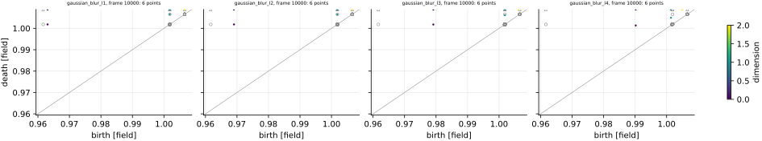
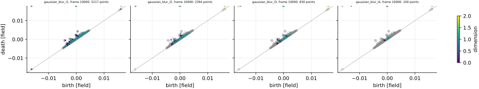
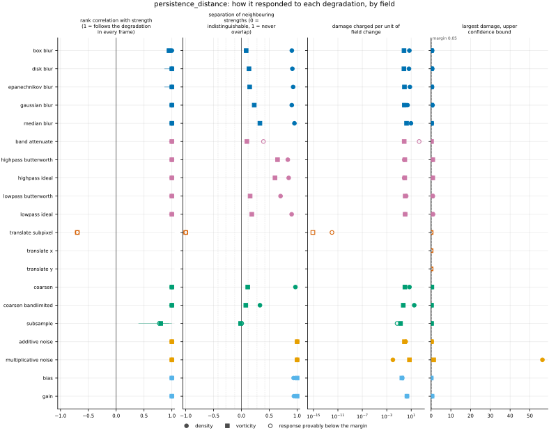
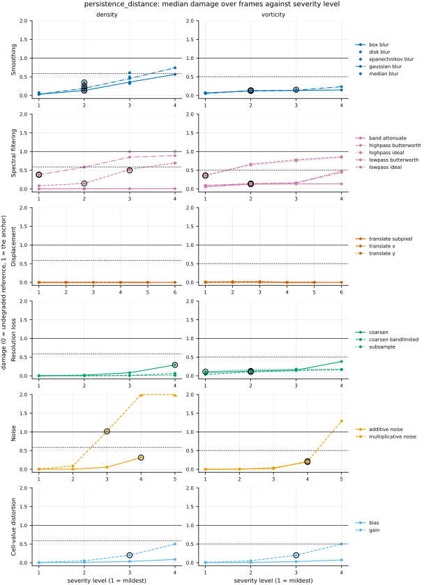
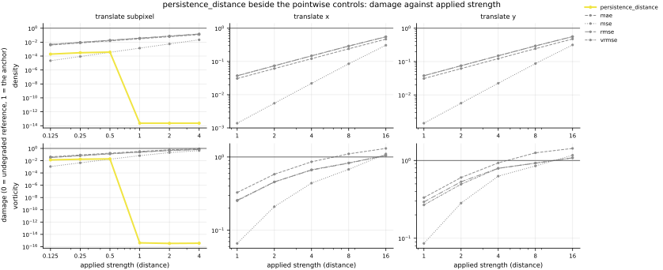
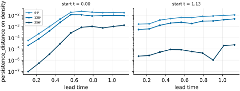
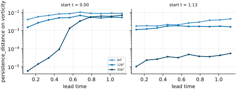

## Definition

Let $f$ be a scalar field on a grid of $N$ cells $c$. Each cell is a closed top-dimensional
cube, and each lower-dimensional face of a cube takes the smallest value of the cubes it bounds:
the T-construction [@bleile2022], Definition 4.4, "Method 1" of [@skraba2020], Sect. 5.1, which
suits cell-averaged data and connects two cells that touch only at a corner. The sublevel set at threshold $t$ is the union of the
closed cells at or below it,

$$
K_t(f) = \bigcup \bigl\{ \bar c : f(c) \le t \bigr\} \tag{1}
$$

As $t$ rises, $K_t$ grows, and in each homology dimension $k$ (connected pieces for $k = 0$,
loops for $k = 1$, enclosed cavities for $k = 2$) a feature is born at some $b$ and dies at some
$d > b$, when it merges into an older feature or is filled in. The persistence diagram
$D_k(f)$ is the multiset of these points $(b, d)$; a feature of the whole domain never dies and
has $d = +\infty$ [@cohensteiner2005], Sect. 2. Points with $d = b$ are not recorded. Each point
is an interval of the persistence module's interval decomposition, with $b$ its infimum and $d$
its supremum [@skraba2020], Sect. 2 and Theorem 2.3, and the dimension of $H_k(K_t)$ is the
number of intervals that contain $t$. Because $K_t$ holds the cells at or below $t$, a feature
is present from $b$ and gone at $d$, so each interval is $[b, d)$; that last step is ours, read
off their definitions. The Betti number of $K_t$ therefore counts the points alive at $t$:

$$
\beta_k(t) = \#\bigl\{ (b, d) \in D_k(f) : b \le t < d \bigr\} \tag{2}
$$

and $\chi(t) = \sum_k (-1)^k \beta_k(t)$ is the Euler characteristic of $K_t$. Both are
computed from the diagram by `betti_curves` and `euler_characteristic_curve`, for a metric
built on those curves to import; this metric does not use them.

Two diagrams are compared with the bottleneck distance [@cohensteiner2005], Sect. 3.1: with the
diagonal $\Delta$ added to each at infinite multiplicity, so that a point may be matched to the
diagonal instead of to a point,

$$
d_B(X, Y) = \inf_{\gamma : X \cup \Delta \to Y \cup \Delta} \;
\sup_{x \in X \cup \Delta} \lVert x - \gamma(x) \rVert_\infty \tag{3}
$$

over bijections $\gamma$, with $\lVert (p_1, p_2) - (q_1, q_2) \rVert_\infty =
\max(\lvert p_1 - q_1 \rvert, \lvert p_2 - q_2 \rvert)$. A point matched to the diagonal costs
half its lifetime, $(d - b)/2$. The registered number is the bottleneck distance between the
diagrams of all homology dimensions $k = 0, \dots, n$ of an $n$-dimensional grid, each dimension
matched on its own [@skraba2020], Eq. 1:

$$
\mathrm{PD}(f, g) = \max_{0 \le k \le n} d_B\bigl(D_k(f), D_k(g)\bigr) \tag{4}
$$

It is the limit $p \to \infty$ of their total $p$-Wasserstein distance, which sums the $p$-th
powers over dimensions [@skraba2020], Definition 2.5. Their Cellular Wasserstein Stability
Theorem [@skraba2020], Theorem 4.6(i), bounds that total distance between the diagrams of two
monotone functions on one finite complex by the $p$-norm of the functions' difference over all
cells. As $p \to \infty$ the left-hand side tends to Equation (4), as their Sect. 2 states for
Eq. 1, and on a finite complex the right-hand side tends to the largest difference over all
cells. Every face takes the minimum of the cubes it bounds, and a minimum moves by no more than
the largest move of its arguments, so that largest difference is the largest over the grid
cells. The limit and the last step are ours. Hence


$$
\mathrm{PD}(f, g) \le \max_c \lvert f(c) - g(c) \rvert \tag{5}
$$

the value of [max_error](../../metrics/max_error/card.md). The Main Theorem of
[@cohensteiner2005], Sect. 3.1 (the journal version is [@cohensteiner2007]) is the same bound for
continuous tame functions on a triangulable space; a field that is constant on each cell is not
continuous, so it is the precedent here, not the proof. `test_metric.py` checks Equation (5) on
blurred, noisy and unrelated fields, on periodic and walled grids in one, two and three
dimensions.

The diagrams come from `gudhi.PeriodicCubicalComplex` [@gudhicubical] over the coefficient field
$\mathbb{Z}/11$, gudhi's default, and Equation (3) from `gudhi.bottleneck_distance`
[@gudhibottleneck] at its default precision, an additive error of the smallest positive double
with the last two or three bits of the mantissa possibly wrong. When the two diagrams of a
dimension are equal as multisets, the term is set to exactly 0 without calling gudhi, which is
Equation (3) with the identity bijection and is the slowest case for gudhi. The classes that
never die are kept and matched among themselves; their number is fixed by the grid's topology
(on a doubly periodic grid one piece, two loops and one cavity, the torus), so both diagrams
always have the same number of them. Two points at infinity are a distance $\lvert b - b' \rvert$
apart, and a point at infinity is infinitely far from every finite point and from the diagonal
[@skraba2020], Definition 2.4, which is what gudhi computes. So their births, which include the
global minimum and the global maximum, enter Equation (3) through their own matching.

Only one-channel scalar fields are accepted: density, and vorticity on a two-dimensional grid.
A vector field, or a field holding a NaN or an infinite value, raises an error. The registry
matches fields by name, not by their number of channels, so on a three-dimensional dataset the
pipeline would hand this metric the three-component vorticity and the error would stop the
whole run; there, run it with `fields=[density]` or another list of scalar fields.

Four choices are this bundle's, not a source's. The bottleneck distance is registered rather
than a Wasserstein distance between diagrams, because it is the distance with the stability
theorem of Equation (5), which ties it to the pointwise maximum error; the 1-Wasserstein distance,
which counts every feature, is the sibling bundle
[persistence_wasserstein](../../metrics/persistence_wasserstein/card.md), on the same diagrams. The filtration is by sublevel sets of the signed
field, not of its magnitude, so that on vorticity the cores of one sign (the minima) are born as
pieces and the cores of the other sign (the maxima) are the levels at which the loops around
them fill in, and both signs enter the diagram.
Pressure and other scalar fields are not declared, only because the evidence dataset has none to
test them on. The metric is declared not differentiable: Equation (4) has a gradient almost
everywhere, but it moves only the one pair of points that sets the value, and none is computed.

### Boundary handling

The complex wraps exactly the axes the grid declares periodic, read from the context: on a
doubly periodic grid the complex of the whole domain is a torus [@bleile2022], Sect. 4.2, and a
cell on the last row is a neighbour of the cell on the first. An axis with a wall is not wrapped,
so a domain with walls on every side is a box with one piece and no loops. Nothing is padded or
extended, so the metric does not assume periodicity and is not marked `requires_periodic`.

### How its field reports it

The field is topological data analysis, where a distance between persistence diagrams compares
two functions by the features of their sublevel sets.

- **The object and the distance.** One persistence diagram per homology dimension, compared by
  the bottleneck distance of Equation (3) [@cohensteiner2005], Sect. 3.1, or by a Wasserstein
  distance of some degree $p$, which sums over matched points rather than taking the largest; the
  bottleneck distance is its limit $p \to \infty$ [@skraba2020], Definition 2.5 and Eq. 1. Both
  are the field's standard, and the second is built as
  [persistence_wasserstein](../../metrics/persistence_wasserstein/card.md), with GUDHI's default
  exponent 1 and ground norm $L^\infty$. Software differs on combining the dimensions: the maximum
  of Equation (4) is [@skraba2020], Eq. 1, while giotto-tda's `PairwiseDistance` takes a norm of
  order 2 over the dimensions by default (its documentation, read by this bundle's builder; see
  `research_notes.md`). The maximum is registered because it keeps Equation (5) exact.
- **The figure.** The persistence diagram itself: birth on one axis, death on the other, the
  diagonal drawn, points that never die placed above the largest death, coloured by dimension
  (GUDHI's `plot_persistence_diagram`). The card's first figure draws the candidate's diagram over
  the reference's in that form.
- **What is reported beside the number.** The stability theorem, the distance bounded by a norm
  of the difference of the two functions: for the bottleneck distance the largest pointwise
  difference, Equation (5) ([@cohensteiner2005], Sect. 3.1, Main Theorem, for continuous tame
  functions; [@skraba2020], Theorem 4.6, for the cell-wise constant fields here). No interval or
  decomposition is standard.
- **The experiment.** The theorems concern perturbed functions, which are the noise and smoothing
  axes of the degradation ladder on `kinet_re5e4`, with the real forecasts of `forecast_re5e4` and
  the Reynolds ladder beside them. Fields whose features are known, features injected at a known
  depth, and features removed by a known amount are not experiments here; they are written up in
  [EXP-orchestrator-20261023-known-vortex-field](https://github.com/khegazy/pde_metrics/blob/main/proposals/EXP-orchestrator-20261023-known-vortex-field.md),
  [EXP-persistence_distance-spurious-feature-injection](https://github.com/khegazy/pde_metrics/blob/main/proposals/EXP-persistence_distance-spurious-feature-injection.md)
  and
  [EXP-persistence_distance-topological-simplification](https://github.com/khegazy/pde_metrics/blob/main/proposals/EXP-persistence_distance-topological-simplification.md).
  The metric is not run on `sod_shock_tube`, whose exact density never rises along the tube, so
  that its diagram is a single point at the minimum, nor on `synthetic_ensemble`, whose axes leave
  the member mean unchanged or shift it uniformly (`card.yaml`, `not_run`).

## Performance

<!-- GENERATED performance: written by `python -m fmeval.cards evidence persistence_distance --results results/comparison_1793846511 --results results/comparison_1793811840 --results results/comparison_1793846600`, do not edit -->



*As this metric's own field draws it.* The point set behind persistence_distance on density, one panel per stored variant, on shared axes. Grey rings are the clean level's set of the same frame, the reference's, drawn under every panel. The grey diagonal is birth equal to death: a point's height above it is how long its feature persists. Triangles on a panel's edge are points with an infinite coordinate. Only the first 4 of the 10 stored sets are drawn, in time order; every set is in data/error_maps.npz.



*As this metric's own field draws it.* The point set behind persistence_distance on vorticity, one panel per stored variant, on shared axes. Grey rings are the clean level's set of the same frame, the reference's, drawn under every panel. The grey diagonal is birth equal to death: a point's height above it is how long its feature persists. Triangles on a panel's edge are points with an infinite coordinate. Only the first 4 of the 10 stored sets are drawn, in time order; every set is in data/error_maps.npz.



Four measured statistics for persistence_distance, one row per degradation grouped by family and one marker per field. From left: the rank correlation between the metric and the applied strength within a frame, with the line showing the resampling interval; the separation of neighbouring strengths as Cliff's delta, where 0 means the metric cannot tell one strength from the next and the faint ticks at 0.12, 0.28 and 0.42 are Vargha and Delaney's small, medium and large anchors, for scale and not as grades; the damage charged per unit of field change at the harshest strength; and the upper confidence bound on the largest damage, beside the fixed margin of 0.05. A hollow marker is a field and degradation on which that bound lies below the margin, so the response is provably small. A missing marker is a statistic the analysis withheld, as the rank correlation is on an axis the metric is invariant to.



Median damage over frames against severity level for persistence_distance, one row per family of degradation and one column per field, on one shared scale. The solid grey line is damage 1, the anchor (by default the field's own mean); the dotted black line is the damage assigned to the fake prediction with the right spectrum, where the run included it. The hollow black ring marks the first level at which the metric has moved a tenth of the way to the anchor. Hollow grey markers are strengths excluded for repeating a milder one or for doing nothing. Degradations with three or fewer usable levels are drawn as markers only; points beyond 2 either side are drawn as triangles at the edge. Damage is negative where a degradation moves the metric away from the anchor, as noise raises a single-field quantity the field's mean sets to zero.

**Trend: does the response follow the degradation?**

| test family | field | degradations | rank correlation | fraction of frames in order | weakest gap between neighbouring strengths |
|---|---|---|---|---|---|
| Displacement | density | 3 | -0.698 | 0 | 0 |
| Displacement | vorticity | 3 | -0.698 | 0 | 0 |
| Cell-value distortion | density | 2 | 1 | 1 | 0.969 to 0.971 |
| Cell-value distortion | vorticity | 2 | 1 | 1 | 1 |
| Resolution loss | density | 3 | 0.775 to 1 | 0 to 1 | 0.503 to 0.985 |
| Resolution loss | vorticity | 3 | 0.8 to 1 | 0.435 to 0.727 | 0.493 to 0.557 |
| Smoothing | density | 5 | 1 | 1 | 0.952 to 0.976 |
| Smoothing | vorticity | 5 | 0.949 to 1 | 0.398 to 0.994 | 0.543 to 0.666 |
| Spectral filtering | density | 5 | 1 | 0.994 to 1 | 0.698 to 0.951 |
| Spectral filtering | vorticity | 5 | 1 | 0.559 to 1 | 0.549 to 0.824 |
| Noise | density | 2 | 1 | 1 | 1 |
| Noise | vorticity | 2 | 1 | 1 | 1 |

**Reactivity: how far does it move?**

| test family | field | change from clean at the harshest strength | elasticity | first strength detected |
|---|---|---|---|---|
| Displacement | density | — | 0.478 | level — |
| Displacement | vorticity | — | 0.277 | level — |
| Cell-value distortion | density | — | 1 | level 3 |
| Cell-value distortion | vorticity | — | 1 | level 3 |
| Resolution loss | density | — | 1.16 to 2.33 | level 4 |
| Resolution loss | vorticity | — | 0.343 to 0.944 | level 1 |
| Smoothing | density | — | 1.44 to 1.81 | level 2 |
| Smoothing | vorticity | — | 0.479 to 0.703 | level 2 |
| Spectral filtering | density | — | 0.443 to 9.13 | level 1 |
| Spectral filtering | vorticity | — | 0.303 to 1.15 | level 1 |
| Noise | density | — | 1.09 to 1.1 | level 3 |
| Noise | vorticity | — | 0.914 to 0.923 | level 4 |
| trap test: fake prediction, right spectrum | density | — | — | damage 0.585 |
| trap test: fake prediction, right spectrum | vorticity | — | — | damage 0.502 |

**Consistency: how much does it vary from snapshot to snapshot?**

| test family | field | consistency, in the strength's units | snapshots per independent block |
|---|---|---|---|
| Displacement | density | 0.456 | 1 to 21 |
| Displacement | vorticity | 0.447 | 1 to 20 |
| Cell-value distortion | density | 0.0248 to 0.0277 | 17 to 20 |
| Cell-value distortion | vorticity | 0.0191 to 0.0232 | 1 to 21 |
| Resolution loss | density | 0.72 to 8.59 | 12 to 21 |
| Resolution loss | vorticity | 3.46 to 8.11 | 22 |
| Smoothing | density | 0.00834 to 0.0186 | 13 |
| Smoothing | vorticity | 0.06 to 0.133 | 22 |
| Spectral filtering | density | 0.0231 to 0.109 | 13 to 20 |
| Spectral filtering | vorticity | 0.0956 to 0.316 | 21 to 22 |
| Noise | density | 0.0039 to 0.0196 | 1 to 19 |
| Noise | vorticity | 0.00992 to 0.0172 | 1 |

One row per family of degradation and physical field; a cell gives the range over the degradations in that family. **Trend.** The rank correlation is the Spearman correlation between the strength and how far the metric has moved from its value on the undegraded field of the same frame, in the one direction it moves under that degradation, computed inside a single frame. A value of 1 means every strength moved it further than the last in every frame, whichever way it moves; a response that scatters to both sides scores near 0. The fraction of frames in order counts the frames with no exception. The weakest gap is the smallest Mann-Whitney overlap between two neighbouring strengths across frames: 1 means they never overlap, 0.5 that they cannot be told apart. **Reactivity.** The change from clean is the median, at the harshest strength, of the departure from the undegraded value of the same frame over the size of that value: 0.3 means 30%. It does not exist for this metric, whose undegraded value is exactly zero; the damage below is its relative reading. The elasticity is the percentage change of that departure per percentage change in strength over the mildest strengths. First strength detected is the mildest at which the metric has moved a tenth of the way to the anchor; **damage** reads that 0-to-1 scale as a number. A dash means the measurement is not defined there. A metric's reactivity scales with the power it is expressed in: mean squared error's elasticity is twice root-mean-square error's, though the two carry the same information, so compare magnitudes across metrics with that in mind. **Consistency** is how much the response varies from snapshot to snapshot relative to its size, in the strength's units; the snapshots of one trajectory are correlated, and the last column is how many consecutive snapshots one independent block spans.

These tables report what was measured and grade none of the measurements. What the numbers mean for this metric is written in the subsections below, beside the test that produced each number.

**Profile.**

| field | selectivity | charges most for | charges least for | response provably below 0.05 at 90% on | elasticity to a sub-pixel shift, against severity (distance) | compute cost (x cheapest in this run) |
|---|---|---|---|---|---|---|
| density | 0.911 | `band_attenuate` | `translate_x` | `band_attenuate` `subsample` `translate_subpixel` `translate_x` `translate_y` | 0.478 | 717 |
| vorticity | 0.569 | `multiplicative_noise` | `translate_x` | `translate_subpixel` `translate_x` `translate_y` | 0.277 | 5.22e+03 |

One row per physical field. **Selectivity** is how concentrated the metric's response is on a few degradations, measured per unit of field change: 0 means it charges every degradation the same, as mean squared error does by construction, and values toward 1 that one degradation carries most of it. **Charges most and least for** name the two ends of that profile. **Response provably below** lists degradations on which the upper confidence bound of the largest damage lies below the margin -- an equivalence test, so an entry says the response is provably small, not merely not significant; a dash means no degradation met the bound. **Elasticity** is the slope of log damage against log shift over the smallest shifts: 1 means damage grows in proportion to the shift, 2 with its square. **Compute cost** is wall-clock per evaluation over the cheapest metric and field in the same run.

<!-- END GENERATED performance -->

## Intuition

Imagine flooding a landscape whose height is the field. As the water rises, lakes appear in the
valleys, grow, and merge; islands of high ground shrink and finally go under. Each lake is born
at the height of its valley floor and dies at the height of the pass where it joins an older,
deeper lake. The list of these birth and death heights, for lakes and for the rings of water that
enclose islands, is the field's persistence diagram. A deep, wide valley lives long; a ripple of
noise is born and dies almost at once. The metric compares the two fields' lists: it pairs each
lake of one with a lake of the other, or with nothing, and reports the largest change of height
any pairing needs. A lake left unpaired counts as half its lifetime.

The list never records where a lake is. So a feature that is right in depth and shape but
sitting in the wrong place costs nothing, where a cell-by-cell error charges it twice, once
where it should be and once where it is.

A worked example on a four-by-four grid that wraps around at its edges. The reference is a
flat field of ones with a deep well of minus one in one corner and a shallow well of zero two
cells away diagonally. Its shallow well is a lake born at zero and dying at one, when everything
floods.

```
reference         moved well        filled well
-1  1  1  1       -1  1  1  1       -1  1  1  1
 1  1  1  1        1  1  1  1        1  1  1  1
 1  1  0  1        1  0  1  1        1  1  1  1
 1  1  1  1        1  1  1  1        1  1  1  1

persistence_distance:  0             0.5
max_error:             1             1
```

Moving the shallow well one cell leaves the list unchanged, so the metric scores 0, while the
largest cell-by-cell difference is 1. Filling the shallow well removes the lake born at zero and
dying at one; it has no partner, and pairing it with nothing costs half its lifetime, 0.5.

The metric ignores where features are, how large an area they cover and how their sizes are
distributed, and of all the differences between the two lists it reports only the largest.

## Reading the output

The value lies between 0 and the largest absolute cell-by-cell difference between the two
fields (Equation (5)), in the field's own units: density units for density, inverse time for
vorticity. Lower is better and 0 means the two diagrams are identical, which a field moved by
whole cells on a periodic grid attains exactly. The value is the size of the single worst
mismatch: a feature whose birth or death level is out by that much, or a feature of twice that
lifetime that one field has and the other lacks. Compare it with the field's own range or with
its fluctuation size, not across fields.

Values are comparable across models on the same grid. They are not comparable across
resolutions: a finer grid resolves smaller and sharper features and higher extremes, so the
diagram itself changes with the grid.

The companion is the persistence diagram of one field, stored as a point set with columns
`birth`, `death` (both in the field's units, `death` infinite for a class that never dies) and
`dimension` (0 for pieces, 1 for loops, 2 for cavities). It is computed for the candidate at
every strength, which on the clean level is the reference (the member mean, on an ensemble
dataset), and kept on the frames that
`report.error_map` names; the `companion_points` figure draws it.

## Limitations

- **Position is invisible.** Any rearrangement of the field that keeps its pattern of pieces and
  loops and their levels scores 0, including a translation by whole cells, a reflection or a
  rotation by a quarter turn on a square periodic grid. A prediction with every vortex in the
  wrong place but with the right strengths would score perfectly; this metric belongs beside a
  metric that sees position.
- **One feature sets the value.** Because Equation (3) is a largest displacement, a prediction
  that gets one strong vortex's peak wrong by some amount scores the same as one that gets every
  vortex wrong by that amount. Small noise features near the diagonal are absorbed cheaply, at
  half their lifetime each, so a field full of weak spurious features scores no worse than its
  single strongest one.
- **The extremes always count.** The classes that never die are born at the global minimum and,
  on a periodic grid, at the global maximum, so a single cell overshooting the reference's
  maximum by some amount makes the value at least that amount, even if the rest of the diagram
  matches.
- **Only scalar fields.** Velocity has no sublevel sets; a three-dimensional vorticity, with three
  channels, is refused.
- **No fluid-dynamics precedent for this exact use.** The published uses of persistence in fluids
  that this card's references cover built other objects: a filtration of the flow's trajectory
  in state space [@smith2024], a persistence-based template for locating a vortex core
  [@martinez2026], and threshold sweeps of connected regions in climate data that the authors
  call inspired by persistence [@muszynski2019]. Neither of the two read in full, Smith et al.
  and Muszynski et al., compared two fields by a diagram distance. Martinez et al. build a
  similarity field from a distance between persistence features of a template window and a
  target window, which may be the nearest precedent; only their abstract was read, so whether
  that distance is one between diagrams is not known here.
  The Topology ToolKit [@tierny2018] is an alternative implementation of the same diagrams.

## Results

<!-- GENERATED run: written by `python -m fmeval.cards evidence persistence_distance --results results/comparison_1793846511 --results results/comparison_1793811840 --results results/comparison_1793846600`, do not edit -->

Measured on `kinet_re5e4`, frames 2000 to 10000 (161 frames of developed flow), on the 256 analysis grid, seed 20260807, at commit `adbdc88e4950`. Run `comparison_1793846511`.

Every number in this section comes from that run, except in the subsections headed with another experiment and in a figure whose caption names another run, each of which names its own run. Regenerate with `python -m fmeval.cards evidence <name> --results results/comparison_1793846511 --results results/comparison_1793811840 --results results/comparison_1793846600`.

<!-- END GENERATED run -->

<!-- GENERATED experiments: written by `python -m fmeval.cards catalog`, do not edit -->

**Across the experiments.**

| experiment | what a run on it is evidence of | on this card |
|---|---|---|
| `kinet_re5e4` | developed flow | measured, run `comparison_1793846511`: the main results |
| `kinet_re1e6` | developed flow at Re = 1e6, twenty times the Reynolds number of kinet_re5e4, from the same initial condition | measured, run `comparison_1793846600`: under *On `kinet_re1e6`* |
| `synthetic_ensemble` | a calibrated null: evidence that the estimator computes what it claims to compute, and nothing about turbulence | not applicable: its dispersion axes leave the member mean, the field this metric reads, unchanged by construction, and its bias axis moves every point of the candidate's diagram by the offset, a response persistence_wasserstein's tests pin exactly |
| `sod_shock_tube` | an analytic check: evidence that the metric locates and scores a known shock correctly, and nothing about turbulence | not applicable: Sod's exact density never rises along the tube, so its diagram is one point, born at the minimum, and the distance only compares two minima |
| `forecast_re5e4` | real predictions scored against their targets at each prediction step; who produced the predictions, a trained model or a coarser solver, is not recorded | measured, run `comparison_1793811840`: under *On `forecast_re5e4`* |

One row per dataset a card may cite (`configs/cards/default.yaml`). *Measured* names the run the card cites: the main results are `## Performance` and the subsections below, and every other run has its own subsection headed with its dataset. *Not applicable* gives the reason: one that follows from what the metric declares and what the dataset offers, or one a person wrote on the card (`not_run` in `card.yaml`) because the result would carry no information. *Not yet run* means the metric can run there and the card cites no run on it yet.

<!-- END GENERATED experiments -->

### Smoothing

[gaussian_blur](../../degradations/gaussian_blur/card.md) ·
[box_blur](../../degradations/box_blur/card.md) ·
[median_blur](../../degradations/median_blur/card.md)

<!-- GENERATED results_smoothing: written by `python -m fmeval.cards evidence persistence_distance --results results/comparison_1793846511 --results results/comparison_1793811840 --results results/comparison_1793846600`, do not edit -->

| degradation | field | strengths | rank correlation | fraction of frames in the right order | weakest gap between neighbouring strengths |
|---|---|---|---|---|---|
| `box_blur` | density | 4 | 1 | 1 | 0.953 |
| `box_blur` | vorticity | 4 | 0.949 | 0.398 | 0.543 |
| `disk_blur` | density | 3 | 1 | 1 | 0.958 |
| `disk_blur` | vorticity | 3 | 1 | 0.522 | 0.568 |
| `epanechnikov_blur` | density | 3 | 1 | 1 | 0.964 |
| `epanechnikov_blur` | vorticity | 3 | 1 | 0.596 | 0.574 |
| `gaussian_blur` | density | 4 | 1 | 1 | 0.952 |
| `gaussian_blur` | vorticity | 4 | 1 | 0.77 | 0.615 |
| `median_blur` | density | 3 | 1 | 1 | 0.976 |
| `median_blur` | vorticity | 3 | 1 | 0.994 | 0.666 |

<!-- END GENERATED results_smoothing -->

Every smoothing axis moves the metric up on both fields, as was declared before the first full
run for the Gaussian, box and median blurs (`research_notes.md`, Pre-registration); the disk and
Epanechnikov blurs, added since, do the same. On density each
strength sits above the last in every frame. On vorticity the median trend still holds, but
frame by frame the order fails often, most under `box_blur` (0.398 of frames in order, rank
correlation 0.949). In this run's `results.csv` those failures are ties, not reversals: no
harsher strength ever scored below a milder one, and in many frames two neighbouring strengths
score exactly the same. An exact tie is what Equation (3) gives when its value is set by a
feature both strengths have erased, which costs half its lifetime at either; that reading is an
interpretation, not a measurement. It is the plateau the Limitations call "one feature sets the
value".

### Spectral filtering

[lowpass_ideal](../../degradations/lowpass_ideal/card.md) ·
[lowpass_butterworth](../../degradations/lowpass_butterworth/card.md) ·
[highpass_ideal](../../degradations/highpass_ideal/card.md) ·
[highpass_butterworth](../../degradations/highpass_butterworth/card.md)

<!-- GENERATED results_spectral: written by `python -m fmeval.cards evidence persistence_distance --results results/comparison_1793846511 --results results/comparison_1793811840 --results results/comparison_1793846600`, do not edit -->

| degradation | field | strengths | rank correlation | fraction of frames in the right order | weakest gap between neighbouring strengths |
|---|---|---|---|---|---|
| `band_attenuate` | density | 4 | 1 | 0.994 | 0.698 |
| `band_attenuate` | vorticity | 4 | 1 | 0.596 | 0.549 |
| `highpass_butterworth` | density | 4 | 1 | 1 | 0.917 |
| `highpass_butterworth` | vorticity | 4 | 1 | 1 | 0.824 |
| `highpass_ideal` | density | 3 | 1 | 1 | 0.925 |
| `highpass_ideal` | vorticity | 4 | 1 | 0.975 | 0.802 |
| `lowpass_butterworth` | density | 4 | 1 | 1 | 0.851 |
| `lowpass_butterworth` | vorticity | 4 | 1 | 0.559 | 0.578 |
| `lowpass_ideal` | density | 3 | 1 | 1 | 0.951 |
| `lowpass_ideal` | vorticity | 4 | 1 | 0.627 | 0.593 |

<!-- END GENERATED results_spectral -->

All five filters move the metric up with rank correlation 1 on both fields. The high-pass
filters are ordered in nearly every frame on both fields. The low-pass filters are ordered in
every frame on density but in at most 0.627 of the frames on vorticity, where the failures are
again mostly exact ties between neighbouring strengths, with a few reversals under the sharp
filter (this run's `results.csv`). The sharp filters have three usable strengths on density,
because two of the configured ones land on the same set of modes there. At its harshest the
sharp low-pass reaches damage 1.04 on density, as far from the reference as the field's own mean.
`band_attenuate` splits by field. On density it is ordered in 0.994 of frames, but its largest
damage is 0.0275 and the Profile lists it as provably small; it still heads the Profile's
"charges most for" on density, which is a ratio to the change in the field, and the operator
changes density very little. On vorticity it reaches damage 0.461, and only 0.596 of frames are
in order, the failures there split between ties and reversals.

### Displacement

[translate_x](../../degradations/translate/card.md) ·
[translate_subpixel](../../degradations/translate_subpixel/card.md)

<!-- GENERATED results_geometric: written by `python -m fmeval.cards evidence persistence_distance --results results/comparison_1793846511 --results results/comparison_1793811840 --results results/comparison_1793846600`, do not edit -->

| degradation | field | strengths | rank correlation | fraction of frames in the right order | weakest gap between neighbouring strengths |
|---|---|---|---|---|---|
| `translate_subpixel` | density | 6 | -0.698 | 0 | 0 |
| `translate_subpixel` | vorticity | 6 | -0.698 | 0 | 0 |
| `translate_x` | density | 5 | — | — | — |
| `translate_x` | vorticity | 5 | — | — | — |
| `translate_y` | density | 5 | — | — | — |
| `translate_y` | vorticity | 5 | — | — | — |

<!-- END GENERATED results_geometric -->

A whole-cell translation along either axis scores exactly 0 at every distance on both fields:
the periodic complex is the same complex relabelled, and `translate_x` and `translate_y` are
among the blind axes of both fields. The sub-pixel translation is listed as blind too, without having been declared:
its damage stays below the margin on both fields. It is not monotone (rank correlation
-0.698), because the three largest shifts in its list are whole numbers of cells, which the
Fourier shift reproduces up to round-off, while the fractional shifts resample the field and
move its extremes by a little.

### Resolution loss

[coarsen](../../degradations/coarsen/card.md) ·
[coarsen_bandlimited](../../degradations/coarsen_bandlimited/card.md)

<!-- GENERATED results_resolution: written by `python -m fmeval.cards evidence persistence_distance --results results/comparison_1793846511 --results results/comparison_1793811840 --results results/comparison_1793846600`, do not edit -->

| degradation | field | strengths | rank correlation | fraction of frames in the right order | weakest gap between neighbouring strengths |
|---|---|---|---|---|---|
| `coarsen` | density | 4 | 1 | 1 | 0.985 |
| `coarsen` | vorticity | 4 | 1 | 0.727 | 0.557 |
| `coarsen_bandlimited` | density | 4 | 1 | 0.652 | 0.667 |
| `coarsen_bandlimited` | vorticity | 4 | 1 | 0.584 | 0.539 |
| `subsample` | density | 4 | 0.775 | 0 | 0.503 |
| `subsample` | vorticity | 4 | 0.8 | 0.435 | 0.493 |

<!-- END GENERATED results_resolution -->

Both coarsenings move the metric up with rank correlation 1 on both fields. The staircase
`coarsen` is ordered in every frame on density and in 0.727 of vorticity frames; the
band-limited reconstruction is ordered in only 0.652 of density frames and 0.584 of vorticity
frames. Unlike under smoothing, these failures in this run's `results.csv` are mostly reversals,
a harsher strength scoring below a milder one, not ties; on density they sit at the mildest
strengths, where the metric has barely moved. At its harshest strength the band-limited
reconstruction does far less damage on density than the staircase does, 0.0848 against 0.325 at
most. A likely reading, not a measured one: rebuilding the block means band-limited keeps
density's large features and their extremes, which are what this metric reads, where the
staircase flattens every extreme to its block's mean. `subsample` behaves differently on the two
fields. On density its neighbouring factors tie in every frame, so no frame is in order (rank
correlation 0.775), and its largest damage, 0.0458, puts it among the provably small axes. On
vorticity it reaches damage 0.881, with 0.435 of frames in order, the failures mostly reversals.

### Noise

[additive_noise](../../degradations/additive_noise/card.md)

<!-- GENERATED results_stochastic: written by `python -m fmeval.cards evidence persistence_distance --results results/comparison_1793846511 --results results/comparison_1793811840 --results results/comparison_1793846600`, do not edit -->

| degradation | field | strengths | rank correlation | fraction of frames in the right order | weakest gap between neighbouring strengths |
|---|---|---|---|---|---|
| `additive_noise` | density | 4 | 1 | 1 | 1 |
| `additive_noise` | vorticity | 4 | 1 | 1 | 1 |
| `multiplicative_noise` | density | 5 | 1 | 1 | 1 |
| `multiplicative_noise` | vorticity | 5 | 1 | 1 | 1 |

<!-- END GENERATED results_stochastic -->

Both noises move the metric up in every frame on both fields, with neighbouring strengths never
overlapping, as was declared for additive noise before the first full run: each strength adds
short-lived features and moves every birth and death, by more at each amplitude. Multiplicative
noise reaches damage 65.6 on density, far beyond the anchor, against 1.87 on vorticity. A likely
reading, not a measured one: noise proportional to the field's value is large on density, whose
values sit far from zero, against the small fluctuations that set the anchor, while vorticity's
values centre on zero; the global extremes, which always count (Limitations), move with it.

### Cell-value distortion

[gain](../../degradations/gain/card.md) ·
[bias](../../degradations/bias/card.md)

<!-- GENERATED results_pointwise: written by `python -m fmeval.cards evidence persistence_distance --results results/comparison_1793846511 --results results/comparison_1793811840 --results results/comparison_1793846600`, do not edit -->

| degradation | field | strengths | rank correlation | fraction of frames in the right order | weakest gap between neighbouring strengths |
|---|---|---|---|---|---|
| `bias` | density | 4 | 1 | 1 | 0.969 |
| `bias` | vorticity | 4 | 1 | 1 | 1 |
| `gain` | density | 4 | 1 | 1 | 0.971 |
| `gain` | vorticity | 4 | 1 | 1 | 1 |

<!-- END GENERATED results_pointwise -->

Both axes move the metric up in every frame on both fields, in proportion to the strength
(elasticity 1 for each). The metric is in the field's own units and reads the levels at which
features appear and vanish, so neither a contrast nor a level change escapes it. `bias` is
charged far less than `gain` at the same strength: at the harshest, 0.5, the largest damage is
0.0927 on density and 0.0933 on vorticity under `bias`, against 0.523 and 0.522 under `gain`. By
our reading the two differ in how far they move each point of the diagram. An offset of $b$
moves every birth and death by exactly $b$. A feature that never dies must be matched to another
that never dies, and the nearest is its own shifted copy, $b$ away, while Equation (5) caps the
distance at $b$: the distance is $b$ and the bound is attained. A gain moves each level in
proportion to its distance from the mean, so the extremes, where the features that never die are
born, move the most. Both axes size their change as the strength times the fluctuation's rms (see
the degradation pages), so the ratio of the two damages says that the levels the gain moves most
lie several rms from the mean. Neighbouring strengths overlap in a few density frames (weakest
gaps 0.969 and 0.971). On `kinet_re1e6` the largest damage is 0.0889 and 0.088 under `bias` and 0.519 and 0.551
under `gain`.

### Trap tests

[gaussian_impostor](../../degradations/gaussian_impostor/card.md) ·
[uncorrelated](../../degradations/random_large_translation/card.md)

<!-- GENERATED results_canaries: written by `python -m fmeval.cards evidence persistence_distance --results results/comparison_1793846511 --results results/comparison_1793811840 --results results/comparison_1793846600`, do not edit -->

| field | damage assigned to the fake prediction | closest real degradation | damage of the reference moved far away | value on the anchor |
|---|---|---|---|---|
| density | 0.585 | `lowpass_ideal=2.39126` | 0 | 0.0386 |
| vorticity | 0.502 | `gain=0.5` | 0 | 0.0169 |

The fake prediction here has exactly the reference field's amplitude spectrum and completely scrambled structure. Damage 1 is what the anchor scores, by default the reference's own spatial mean, a prediction that knows the mean and nothing else. The damage column therefore says how close to useless this metric considers that fake prediction: a low number means the metric was fooled. The third column translates the same number into an ordinary degradation whose damage the fake prediction matches, which is easier to picture. The fourth is the reference moved by a large random offset, the right statistics in the wrong place; where a field's energy sits in its largest scales that copy stays partly correlated with the reference, so it is not the score of an unrelated field.

<!-- END GENERATED results_canaries -->

The metric is not fooled by the fake prediction with the right spectrum: it charges it damage
0.585 on density and 0.502 on vorticity, about half the distance to the field's own mean, because
scrambling the phases rearranges which pieces and loops exist and at which levels. The reference
moved far away scores exactly 0 on both fields: it is a whole-cell periodic shift, so its
diagram is the reference's, which is the metric's blindness to position, not a trap it fell into.

### Compared with the other metrics

<!-- GENERATED results_summary: written by `python -m fmeval.cards evidence persistence_distance --results results/comparison_1793846511 --results results/comparison_1793811840 --results results/comparison_1793846600`, do not edit -->

| compared with | density | vorticity |
|---|---|---|
| `spectrum_l2` | 0.914 | 0.88 |
| `increment_w1_by_separation` | 0.897 | 0.889 |
| `increment_w1` | 0.813 | 0.8 |
| `tail_exceedance` | 0.883 | 0.725 |
| `energy_distance` | 0.801 | 0.766 |
| `max_error` | 0.417 | 0.21 |
| `max_error_channel_mean` | 0.417 | 0.21 |
| `nrmse` | 0.377 | 0.185 |
| `vrmse` | 0.376 | 0.184 |
| `rmse` | 0.377 | 0.179 |
| `rmse_channel_mean` | 0.377 | 0.179 |
| `mse` | 0.376 | 0.179 |
| `mae` | 0.34 | 0.163 |
| `wasserstein` | 0.242 | — |
| `h_minus_one` | 0.232 | 0.188 |
| `h1_relative` | 0.32 | -0.0505 |
| `h1_seminorm` | 0.277 | -0.0445 |
| `increment_flatness` | -0.498 | 0.411 |
| `tail_index` | -0.237 | -0.312 |
| `palinstrophy` | — | -0.342 |
| `enstrophy` | — | -0.574 |

Rank correlation over every degradation, computed separately for each physical field on the median value at each combination of degradation and strength, with the undegraded reference excluded. A dash marks a metric that does not run on that field. A metric with a target value enters by its distance from the target. Two metrics correlating near 1 put the degradations in the same order, but the two may still weight those degradations very differently. A correlation near 1 therefore means the two metrics are redundant for ranking models, not that the two are interchangeable as training losses.

<!-- END GENERATED results_summary -->

The bottleneck distance orders the degradations most like the other metrics that compare
statistics rather than positions: the spectral distance `spectrum_l2`, the two increment
distances and, on density, `tail_exceedance` correlate with it most closely. Its
correlation with the pointwise errors is weak on density and weaker on vorticity, so for ranking
models it sits with the spectral and increment metrics and adds to the pointwise ones. It is
anticorrelated with the single-field totals `enstrophy` and `palinstrophy` on vorticity.

### Damage beside the other metrics

<!-- GENERATED results_damage_by_level: written by `python -m fmeval.cards evidence persistence_distance --results results/comparison_1793846511 --results results/comparison_1793811840 --results results/comparison_1793846600`, do not edit -->



Median damage over frames against the applied strength, log-log, for persistence_distance (bold, in colour) and the pointwise controls mae, mse, rmse, vrmse (thin, grey), one column per displacement degradation and one row per field. The grey line is damage 1, the anchor (by default the field's own mean). Parallel lines charge in the same proportion at every strength; a steeper line charges relatively more for the larger shifts, which is what decides whether two metrics are interchangeable as training losses. These are the same numbers as the table beneath.

**Displacement, density, `translate_subpixel`** (strength: distance).

| metric | 0.125 | 0.25 | 0.5 | 1 | 2 | 4 |
|---|---|---|---|---|---|---|
| `persistence_distance` | 0.000192 | 0.000302 | 0.000372 | 2.3e-14 | 2.3e-14 | 2.3e-14 |
| `mae` | 0.00383 | 0.00767 | 0.0153 | 0.0306 | 0.061 | 0.121 |
| `mse` | 2.17e-05 | 8.68e-05 | 0.000347 | 0.00138 | 0.00551 | 0.0219 |
| `rmse` | 0.00466 | 0.00931 | 0.0186 | 0.0372 | 0.0743 | 0.148 |
| `vrmse` | 0.00463 | 0.00926 | 0.0185 | 0.037 | 0.0738 | 0.147 |

**Displacement, density, `translate_x`** (strength: distance).

| metric | 1 | 2 | 4 | 8 | 16 |
|---|---|---|---|---|---|
| `persistence_distance` | 0 | 0 | 0 | 0 | 0 |
| `mae` | 0.0306 | 0.061 | 0.121 | 0.24 | 0.469 |
| `mse` | 0.00138 | 0.00551 | 0.0219 | 0.0849 | 0.307 |
| `rmse` | 0.0372 | 0.0743 | 0.148 | 0.291 | 0.555 |
| `vrmse` | 0.037 | 0.0738 | 0.147 | 0.29 | 0.55 |

**Displacement, density, `translate_y`** (strength: distance).

| metric | 1 | 2 | 4 | 8 | 16 |
|---|---|---|---|---|---|
| `persistence_distance` | 0 | 0 | 0 | 0 | 0 |
| `mae` | 0.031 | 0.0616 | 0.122 | 0.244 | 0.476 |
| `mse` | 0.00142 | 0.00565 | 0.0224 | 0.0869 | 0.316 |
| `rmse` | 0.0377 | 0.0752 | 0.15 | 0.295 | 0.562 |
| `vrmse` | 0.0376 | 0.075 | 0.149 | 0.294 | 0.56 |

**Displacement, velocity, `translate_subpixel`** (strength: distance).

| metric | 0.125 | 0.25 | 0.5 | 1 | 2 | 4 |
|---|---|---|---|---|---|---|
| `persistence_distance` | — | — | — | — | — | — |
| `mae` | 0.00279 | 0.00559 | 0.0112 | 0.0223 | 0.0441 | 0.0859 |
| `mse` | 1.45e-05 | 5.81e-05 | 0.000232 | 0.000924 | 0.0036 | 0.0136 |
| `rmse` | 0.00381 | 0.00762 | 0.0152 | 0.0304 | 0.06 | 0.117 |
| `vrmse` | 0.00365 | 0.00729 | 0.0146 | 0.029 | 0.0574 | 0.111 |

**Displacement, velocity, `translate_x`** (strength: distance).

| metric | 1 | 2 | 4 | 8 | 16 |
|---|---|---|---|---|---|
| `persistence_distance` | — | — | — | — | — |
| `mae` | 0.0223 | 0.0441 | 0.0859 | 0.163 | 0.31 |
| `mse` | 0.000924 | 0.0036 | 0.0136 | 0.0489 | 0.165 |
| `rmse` | 0.0304 | 0.06 | 0.117 | 0.221 | 0.406 |
| `vrmse` | 0.029 | 0.0574 | 0.111 | 0.209 | 0.383 |

**Displacement, velocity, `translate_y`** (strength: distance).

| metric | 1 | 2 | 4 | 8 | 16 |
|---|---|---|---|---|---|
| `persistence_distance` | — | — | — | — | — |
| `mae` | 0.0223 | 0.0442 | 0.0856 | 0.16 | 0.295 |
| `mse` | 0.000935 | 0.00366 | 0.0138 | 0.0473 | 0.158 |
| `rmse` | 0.0306 | 0.0605 | 0.117 | 0.218 | 0.397 |
| `vrmse` | 0.0303 | 0.0599 | 0.115 | 0.212 | 0.384 |

**Displacement, vorticity, `translate_subpixel`** (strength: distance).

| metric | 0.125 | 0.25 | 0.5 | 1 | 2 | 4 |
|---|---|---|---|---|---|---|
| `persistence_distance` | 0.0134 | 0.0173 | 0.0197 | 4.11e-16 | 3.34e-16 | 3.6e-16 |
| `mae` | 0.0428 | 0.0854 | 0.169 | 0.328 | 0.582 | 0.86 |
| `mse` | 0.00112 | 0.00448 | 0.0176 | 0.066 | 0.21 | 0.44 |
| `rmse` | 0.0335 | 0.0669 | 0.133 | 0.257 | 0.458 | 0.663 |
| `vrmse` | 0.0329 | 0.0656 | 0.13 | 0.253 | 0.455 | 0.671 |

**Displacement, vorticity, `translate_x`** (strength: distance).

| metric | 1 | 2 | 4 | 8 | 16 |
|---|---|---|---|---|---|
| `persistence_distance` | 0 | 0 | 0 | 0 | 0 |
| `mae` | 0.328 | 0.582 | 0.86 | 1.1 | 1.31 |
| `mse` | 0.066 | 0.21 | 0.44 | 0.679 | 1.1 |
| `rmse` | 0.257 | 0.458 | 0.663 | 0.824 | 1.05 |
| `vrmse` | 0.253 | 0.455 | 0.671 | 0.832 | 1.05 |

**Displacement, vorticity, `translate_y`** (strength: distance).

| metric | 1 | 2 | 4 | 8 | 16 |
|---|---|---|---|---|---|
| `persistence_distance` | 0 | 0 | 0 | 0 | 0 |
| `mae` | 0.333 | 0.603 | 0.93 | 1.25 | 1.43 |
| `mse` | 0.0858 | 0.283 | 0.628 | 0.849 | 1.17 |
| `rmse` | 0.293 | 0.532 | 0.793 | 0.922 | 1.08 |
| `vrmse` | 0.268 | 0.495 | 0.793 | 0.927 | 1.08 |

Median damage over frames at every strength, this metric in the first row and the pointwise controls beneath it, all on the same 0-to-1 scale where 0 is the undegraded reference and 1 the anchor (by default the field's own mean); a dash means no damage scale on that field. The rank correlations under *Compared with the other metrics* say whether two metrics put the strengths in the same order; this table says how much each one charges for the same strength, which decides whether two metrics are interchangeable as training losses.

<!-- END GENERATED results_damage_by_level -->

A whole-cell translation costs exactly 0 on both fields, as Displacement explains, while every
pointwise control charges it more at each larger shift. A sub-cell shift costs this metric far
less than it costs the controls, at every fractional distance and on both fields. It charges
anything only at fractional distances, which resample the field and move its extremes a little
(Displacement); at whole cells it is back to round-off. Velocity is not a field of this metric,
so its rows are empty.

### On `forecast_re5e4`

<!-- GENERATED results_on_forecast_re5e4: written by `python -m fmeval.cards evidence persistence_distance --results results/comparison_1793846511 --results results/comparison_1793811840 --results results/comparison_1793846600`, do not edit -->

**Real predictions scored against their targets at each prediction step; who produced the predictions, a trained model or a coarser solver, is not recorded.**

Measured on `forecast_re5e4`, frames 0 to 59 (60 frames of real predictions scored against their targets at each prediction step; who produced the predictions, a trained model or a coarser solver, is not recorded), on the 64 analysis grid, seed 20260807, at commit `adbdc88e4950`. Run `comparison_1793811840`.

[mean_field](../../degradations/mean_field/card.md)



persistence_distance on density against lead time, the physical time since the forecast started, one panel per start and one line per run, darker the finer the run's grid. Each point is one prediction step of one forecast.



persistence_distance on vorticity against lead time, the physical time since the forecast started, one panel per start and one line per run, darker the finer the run's grid. Each point is one prediction step of one forecast.

**density, persistence_distance on the prediction, at each lead time.**

| lead time | 64², start 0 | 128², start 0 | 256², start 0 | 64², start 1.13 | 128², start 1.13 | 256², start 1.13 |
|---|---|---|---|---|---|---|
| 0.1128 | 5.62e-05 | 2.04e-05 | 9.6e-08 | 0.00161 | 0.00053 | 2.25e-06 |
| 0.2255 | 0.000227 | 8.01e-05 | 5.28e-07 | 0.00172 | 0.000608 | 2.6e-06 |
| 0.3383 | 0.000976 | 0.000401 | 3.41e-06 | 0.00368 | 0.00126 | 5.15e-06 |
| 0.4511 | 0.00456 | 0.00231 | 2.93e-05 | 0.00502 | 0.00199 | 8.91e-06 |
| 0.5638 | 0.0183 | 0.0112 | 0.000264 | 0.00629 | 0.00234 | 8.43e-06 |
| 0.6766 | 0.0222 | 0.011 | 0.000837 | 0.0062 | 0.00183 | 5.88e-06 |
| 0.7893 | 0.0189 | 0.00861 | 0.00101 | 0.00788 | 0.00297 | 4.29e-06 |
| 0.9021 | 0.017 | 0.00913 | 0.000742 | 0.00857 | 0.00308 | 1.01e-06 |
| 1.015 | 0.0172 | 0.0098 | 0.001 | 0.00963 | 0.00397 | 2.01e-05 |
| 1.128 | 0.0169 | 0.00927 | 0.00129 | 0.0108 | 0.00473 | 2.3e-05 |

**density, persistence_distance damage, at each lead time.**

| lead time | 64², start 0 | 128², start 0 | 256², start 0 | 64², start 1.13 | 128², start 1.13 | 256², start 1.13 |
|---|---|---|---|---|---|---|
| 0.1128 | 0.0344 | 0.0126 | 5.94e-05 | 0.0414 | 0.0136 | 5.77e-05 |
| 0.2255 | 0.164 | 0.0572 | 0.000374 | 0.0466 | 0.0165 | 7.06e-05 |
| 0.3383 | 0.293 | 0.121 | 0.00103 | 0.0963 | 0.0331 | 0.000135 |
| 0.4511 | 0.483 | 0.243 | 0.00308 | 0.129 | 0.0512 | 0.000229 |
| 0.5638 | 0.713 | 0.436 | 0.0103 | 0.164 | 0.0612 | 0.00022 |
| 0.6766 | 0.617 | 0.306 | 0.0232 | 0.163 | 0.0483 | 0.000155 |
| 0.7893 | 0.509 | 0.232 | 0.0273 | 0.208 | 0.0784 | 0.000113 |
| 0.9021 | 0.443 | 0.238 | 0.0193 | 0.227 | 0.0818 | 2.68e-05 |
| 1.015 | 0.436 | 0.249 | 0.0254 | 0.249 | 0.103 | 0.000519 |
| 1.128 | 0.443 | 0.243 | 0.0339 | 0.285 | 0.125 | 0.000607 |

**vorticity, persistence_distance on the prediction, at each lead time.**

| lead time | 64², start 0 | 128², start 0 | 256², start 0 | 64², start 1.13 | 128², start 1.13 | 256², start 1.13 |
|---|---|---|---|---|---|---|
| 0.1128 | 0.00413 | 0.00153 | 5.88e-06 | 0.00179 | 0.00115 | 1.04e-05 |
| 0.2255 | 0.00588 | 0.00273 | 1.43e-05 | 0.00186 | 0.00123 | 2.36e-05 |
| 0.3383 | 0.00694 | 0.00393 | 3.11e-05 | 0.00181 | 0.0014 | 2.66e-05 |
| 0.4511 | 0.00842 | 0.00509 | 9.28e-05 | 0.00217 | 0.00181 | 3.64e-05 |
| 0.5638 | 0.00872 | 0.00524 | 0.00135 | 0.00211 | 0.00187 | 3.2e-05 |
| 0.6766 | 0.0105 | 0.00696 | 0.0034 | 0.00266 | 0.00172 | 4.85e-05 |
| 0.7893 | 0.0091 | 0.00545 | 0.00569 | 0.00296 | 0.00172 | 3.82e-05 |
| 0.9021 | 0.00876 | 0.00501 | 0.00637 | 0.00374 | 0.00167 | 3.66e-05 |
| 1.015 | 0.00923 | 0.00554 | 0.00619 | 0.00392 | 0.00176 | 4.33e-05 |
| 1.128 | 0.00889 | 0.00534 | 0.00703 | 0.00448 | 0.00162 | 5.51e-05 |

**vorticity, persistence_distance damage, at each lead time.**

| lead time | 64², start 0 | 128², start 0 | 256², start 0 | 64², start 1.13 | 128², start 1.13 | 256², start 1.13 |
|---|---|---|---|---|---|---|
| 0.1128 | 0.28 | 0.104 | 0.000399 | 0.111 | 0.0708 | 0.000643 |
| 0.2255 | 0.39 | 0.181 | 0.000951 | 0.113 | 0.075 | 0.00144 |
| 0.3383 | 0.443 | 0.251 | 0.00199 | 0.112 | 0.0863 | 0.00164 |
| 0.4511 | 0.511 | 0.309 | 0.00563 | 0.129 | 0.107 | 0.00216 |
| 0.5638 | 0.528 | 0.317 | 0.0816 | 0.129 | 0.115 | 0.00196 |
| 0.6766 | 0.581 | 0.385 | 0.188 | 0.165 | 0.107 | 0.00301 |
| 0.7893 | 0.548 | 0.329 | 0.343 | 0.186 | 0.108 | 0.0024 |
| 0.9021 | 0.541 | 0.31 | 0.394 | 0.229 | 0.102 | 0.00224 |
| 1.015 | 0.557 | 0.334 | 0.373 | 0.244 | 0.11 | 0.00269 |
| 1.128 | 0.549 | 0.33 | 0.434 | 0.275 | 0.0997 | 0.00339 |

Every prediction of every forecast, nothing pooled: a cell is one prediction step of one forecast, a row the lead time (the physical time since the forecast started) and a column the forecast, named by its run's native grid and its starting time (`64², start 0` is `F-906861_64_Re_50k_from_256_to_64/forecast_t0-0`; `128², start 0` is `F-906861_64_Re_50k_from_256_to128/forecast_t0-0`; `256², start 0` is `F-906861_64/forecast_t0-0`; `64², start 1.13` is `F-906861_64_Re_50k_from_256_to_64/forecast_t0-1250`; `128², start 1.13` is `F-906861_64_Re_50k_from_256_to128/forecast_t0-2500`; `256², start 1.13` is `F-906861_64/forecast_t0-5000`). **Damage** is the prediction's departure from the target as a fraction of the anchor's in the same frame, by default the target's own spatial mean, so each step is scaled by its own target. A dash means no value there.

<!-- END GENERATED results_on_forecast_re5e4 -->

Topological data analysis has no standard figure of a diagram distance along a rollout; what it
reports beside the number is the stability bound, Equation (5). That bound holds on every one of
the 60 prediction steps of both fields: the value never exceeds the largest cell-by-cell
difference that `max_error` reports for the same prediction, and it equals it at a few steps of
each field (compared off the card in this run's `results.csv`). Beyond the bound, the tables are
read here for growth along the rollout, the order of the runs, and the distance from damage 1,
the score of the target's own spatial mean. Every forecast is scored on the 64 analysis grid, so
the diagrams of all six columns are computed on one grid, and the caveat about comparing across
resolutions (Reading the output) does not separate them.

- **Growth.** From t = 0 on density, the 64² and 128² runs rise steeply over the first half of
  the rollout to their largest damage at lead time 0.5638, 0.713 and 0.436, and then settle,
  ending at 0.443 and 0.243; the 256² run stays far below both and ends at damage 0.0339. On
  vorticity from t = 0 the 64² and 128² runs rise to damage 0.581 and 0.385 at lead time 0.6766
  and then level off, while the 256² run rises from 0.000399 to 0.434 over the rollout. From
  t = 1.13 the two coarse runs grow over the rollout on density, with one dip at lead time
  0.6766, to 0.285 and 0.125 at the last step; the 256² run stays at or below damage 0.000607 on
  density and 0.00339 on vorticity.
- **Order.** On density the runs keep the order of their native grids, 64² above 128² above
  256², at every lead time from both starts. On vorticity from t = 0 the 256² run passes the
  128² run at lead time 0.7893 (0.00569 against 0.00545) and stays above it to the last step,
  while the 64² run stays highest throughout. It is the lead time at which the 256² run's largest
  cell error passes both coarse runs (`max_error`'s card); through the bound above, a larger
  cell error allows a larger diagram distance but does not force one, and here it passes only
  the 128² run. From t = 1.13 the order holds at every step.
- **Distance from no skill.** No prediction reaches damage 1. The largest is 0.713 on density
  and 0.581 on vorticity, both from the 64² run started at t = 0.

### On `kinet_re1e6`

<!-- GENERATED results_on_kinet_re1e6: written by `python -m fmeval.cards evidence persistence_distance --results results/comparison_1793846511 --results results/comparison_1793811840 --results results/comparison_1793846600`, do not edit -->

**Developed flow at Re = 1e6, twenty times the Reynolds number of kinet_re5e4, from the same initial condition.**

Measured on `kinet_re1e6`, frames 2000 to 10000 (161 frames of developed flow at Re = 1e6, twenty times the Reynolds number of kinet_re5e4, from the same initial condition), on the 128 analysis grid, seed 20260807, at commit `adbdc88e4950`. Run `comparison_1793846600`.

[additive_noise](../../degradations/additive_noise/card.md) ·
[band_attenuate](../../degradations/band_attenuate/card.md) ·
[bias](../../degradations/bias/card.md) ·
[box_blur](../../degradations/box_blur/card.md) ·
[coarsen](../../degradations/coarsen/card.md) ·
[coarsen_bandlimited](../../degradations/coarsen_bandlimited/card.md) ·
[disk_blur](../../degradations/disk_blur/card.md) ·
[epanechnikov_blur](../../degradations/epanechnikov_blur/card.md) ·
[gain](../../degradations/gain/card.md) ·
[gaussian_blur](../../degradations/gaussian_blur/card.md) ·
[gaussian_impostor](../../degradations/gaussian_impostor/card.md) ·
[highpass_butterworth](../../degradations/highpass_butterworth/card.md) ·
[highpass_ideal](../../degradations/highpass_ideal/card.md) ·
[lowpass_butterworth](../../degradations/lowpass_butterworth/card.md) ·
[lowpass_ideal](../../degradations/lowpass_ideal/card.md) ·
[mean_field](../../degradations/mean_field/card.md) ·
[median_blur](../../degradations/median_blur/card.md) ·
[multiplicative_noise](../../degradations/multiplicative_noise/card.md) ·
[subsample](../../degradations/subsample/card.md) ·
[translate_subpixel](../../degradations/translate_subpixel/card.md) ·
[translate_x](../../degradations/translate/card.md) ·
[translate_y](../../degradations/translate/card.md) ·
[uncorrelated](../../degradations/random_large_translation/card.md)

**Smoothing.**

| degradation | field | strengths | rank correlation | fraction of frames in the right order | weakest gap between neighbouring strengths |
|---|---|---|---|---|---|
| `box_blur` | density | 4 | 1 | 1 | 0.954 |
| `box_blur` | vorticity | 2 | 1 | 0.503 | 0.662 |
| `disk_blur` | density | 3 | 1 | 1 | 0.959 |
| `disk_blur` | vorticity | 2 | 1 | 0.497 | 0.657 |
| `epanechnikov_blur` | density | 3 | 1 | 1 | 0.965 |
| `epanechnikov_blur` | vorticity | 2 | 1 | 0.938 | 0.807 |
| `gaussian_blur` | density | 4 | 1 | 1 | 0.954 |
| `gaussian_blur` | vorticity | 4 | 0.949 | 0.323 | 0.587 |
| `median_blur` | density | 3 | 1 | 1 | 0.977 |
| `median_blur` | vorticity | 1 | — | — | — |

**Spectral filtering.**

| degradation | field | strengths | rank correlation | fraction of frames in the right order | weakest gap between neighbouring strengths |
|---|---|---|---|---|---|
| `band_attenuate` | density | 4 | 1 | 1 | 0.634 |
| `band_attenuate` | vorticity | 4 | 0.949 | 0.478 | 0.566 |
| `highpass_butterworth` | density | 4 | 1 | 1 | 0.924 |
| `highpass_butterworth` | vorticity | 4 | 1 | 1 | 0.987 |
| `highpass_ideal` | density | 3 | 1 | 1 | 0.926 |
| `highpass_ideal` | vorticity | 4 | 1 | 0.975 | 0.933 |
| `lowpass_butterworth` | density | 4 | 1 | 1 | 0.819 |
| `lowpass_butterworth` | vorticity | 4 | 1 | 0.634 | 0.688 |
| `lowpass_ideal` | density | 3 | 1 | 1 | 0.952 |
| `lowpass_ideal` | vorticity | 4 | 1 | 0.671 | 0.698 |

**Displacement.**

| degradation | field | strengths | rank correlation | fraction of frames in the right order | weakest gap between neighbouring strengths |
|---|---|---|---|---|---|
| `translate_subpixel` | density | 6 | -0.698 | 0 | 0 |
| `translate_subpixel` | vorticity | 6 | -0.698 | 0 | 0 |
| `translate_x` | density | 5 | — | — | — |
| `translate_x` | vorticity | 5 | — | — | — |
| `translate_y` | density | 5 | — | — | — |
| `translate_y` | vorticity | 5 | — | — | — |

**Resolution loss.**

| degradation | field | strengths | rank correlation | fraction of frames in the right order | weakest gap between neighbouring strengths |
|---|---|---|---|---|---|
| `coarsen` | density | 4 | 1 | 1 | 0.965 |
| `coarsen` | vorticity | 4 | 1 | 1 | 0.879 |
| `coarsen_bandlimited` | density | 4 | 1 | 0.994 | 0.986 |
| `coarsen_bandlimited` | vorticity | 4 | 0.949 | 0.416 | 0.553 |
| `subsample` | density | 4 | 0.258 | 0 | 0.484 |
| `subsample` | vorticity | 4 | 0.949 | 0.447 | 0.55 |

**Noise.**

| degradation | field | strengths | rank correlation | fraction of frames in the right order | weakest gap between neighbouring strengths |
|---|---|---|---|---|---|
| `additive_noise` | density | 4 | 1 | 1 | 1 |
| `additive_noise` | vorticity | 4 | 1 | 1 | 1 |
| `multiplicative_noise` | density | 5 | 1 | 1 | 1 |
| `multiplicative_noise` | vorticity | 5 | 1 | 1 | 1 |

**Cell-value distortion.**

| degradation | field | strengths | rank correlation | fraction of frames in the right order | weakest gap between neighbouring strengths |
|---|---|---|---|---|---|
| `bias` | density | 4 | 1 | 1 | 0.97 |
| `bias` | vorticity | 4 | 1 | 1 | 1 |
| `gain` | density | 4 | 1 | 1 | 0.972 |
| `gain` | vorticity | 4 | 1 | 1 | 1 |

**Trap tests.**

| field | damage assigned to the fake prediction | closest real degradation | damage of the reference moved far away | value on the anchor |
|---|---|---|---|---|
| density | 0.597 | `lowpass_butterworth=2.51971` | 0 | 0.0412 |
| vorticity | 0.492 | `gain=0.5` | 0 | 0.00461 |

The fake prediction here has exactly the reference field's amplitude spectrum and completely scrambled structure. Damage 1 is what the anchor scores, by default the reference's own spatial mean, a prediction that knows the mean and nothing else. The damage column therefore says how close to useless this metric considers that fake prediction: a low number means the metric was fooled. The third column translates the same number into an ordinary degradation whose damage the fake prediction matches, which is easier to picture. The fourth is the reference moved by a large random offset, the right statistics in the wrong place; where a field's energy sits in its largest scales that copy stays partly correlated with the reference, so it is not the score of an unrelated field.

<!-- END GENERATED results_on_kinet_re1e6 -->

This run is on the 128 analysis grid and the main results on the 256 grid, so a difference
between the two mixes the Reynolds number with the grid, on which the diagram itself depends
(Reading the output). With that caveat, the ladder at Re = 1e6 repeats what the main results
found for this metric:

- **The same responses.** Every smoothing, spectral, coarsening, noise and cell-value axis moves
  the metric up on both fields, with rank correlation between 0.949 and 1 wherever more than one
  strength is usable, except `subsample` on density. Noise, `bias` and `gain` are ordered in
  every frame on both fields, and the whole-cell translations score 0, listed as provably small
  on both fields. The sub-pixel shift again has rank correlation −0.698, its whole-cell shifts
  scoring round-off.
- **What differs.** On vorticity fewer blur strengths are usable: two of the box, disk and
  Epanechnikov blurs and one of the median blur, the run having marked the others as repeating
  a milder strength or doing nothing (`severity_degenerate` in its `results.csv`). `coarsen` is
  ordered in every frame on both fields, and `coarsen_bandlimited` in 0.994 of density frames.
  `subsample` on density has rank correlation 0.258 and no frame in order, and stays provably
  small. On vorticity the sub-pixel shift is no longer provably small: its largest damage is
  0.124, with an upper bound of 0.0776 above the margin.
- **Trap tests.** The fake prediction with the right spectrum scores damage 0.597 on density and
  0.492 on vorticity, close to the main results, and the reference moved far away scores 0 on
  both, its diagram being the reference's.

## References

\bibliography
