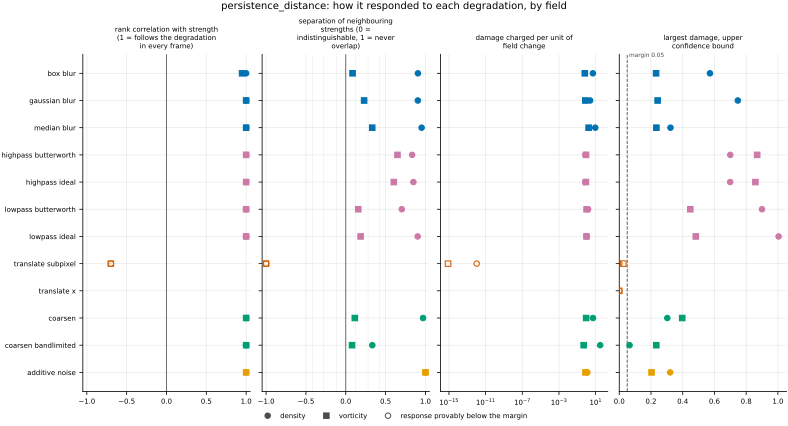
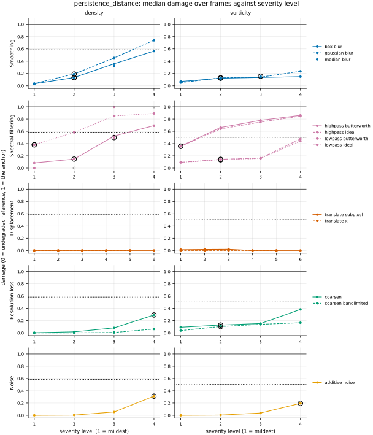
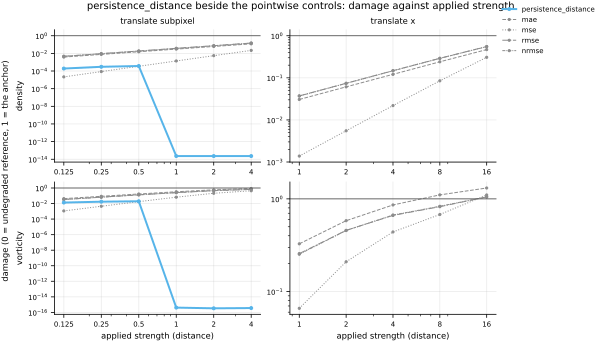

## Definition

Let $f$ be a scalar field on a grid of $N$ cells $c$. Each cell is a closed top-dimensional
cube, and each lower-dimensional face of a cube takes the smallest value of the cubes it bounds:
the T-construction [@bleile2022], Definition 4.4, "Method 1" of [@skraba2020], Sect. 5.1, which
suits cell-averaged data and connects two cells that touch only at a corner. The sublevel set at threshold $t$ is the union of the
closed cells at or below it,

$$
K_t(f) = \bigcup \bigl\{ \bar c : f(c) \le t \bigr\} \tag{1}
$$

As $t$ rises, $K_t$ grows, and in each homology dimension $k$ (connected pieces for $k = 0$,
loops for $k = 1$, enclosed cavities for $k = 2$) a feature is born at some $b$ and dies at some
$d > b$, when it merges into an older feature or is filled in. The persistence diagram
$D_k(f)$ is the multiset of these points $(b, d)$; a feature of the whole domain never dies and
has $d = +\infty$ [@cohensteiner2005], Sect. 2. Points with $d = b$ are not recorded. Each point
is an interval of the persistence module's interval decomposition, with $b$ its infimum and $d$
its supremum [@skraba2020], Sect. 2 and Theorem 2.3, and the dimension of $H_k(K_t)$ is the
number of intervals that contain $t$. Because $K_t$ holds the cells at or below $t$, a feature
is present from $b$ and gone at $d$, so each interval is $[b, d)$; that last step is ours, read
off their definitions. The Betti number of $K_t$ therefore counts the points alive at $t$:

$$
\beta_k(t) = \#\bigl\{ (b, d) \in D_k(f) : b \le t < d \bigr\} \tag{2}
$$

and $\chi(t) = \sum_k (-1)^k \beta_k(t)$ is the Euler characteristic of $K_t$. Both are
computed from the diagram by `betti_curves` and `euler_characteristic_curve`, for a metric
built on those curves to import; this metric does not use them.

Two diagrams are compared with the bottleneck distance [@cohensteiner2005], Sect. 3.1: with the
diagonal $\Delta$ added to each at infinite multiplicity, so that a point may be matched to the
diagonal instead of to a point,

$$
d_B(X, Y) = \inf_{\gamma : X \cup \Delta \to Y \cup \Delta} \;
\sup_{x \in X \cup \Delta} \lVert x - \gamma(x) \rVert_\infty \tag{3}
$$

over bijections $\gamma$, with $\lVert (p_1, p_2) - (q_1, q_2) \rVert_\infty =
\max(\lvert p_1 - q_1 \rvert, \lvert p_2 - q_2 \rvert)$. A point matched to the diagonal costs
half its lifetime, $(d - b)/2$. The registered number is the bottleneck distance between the
diagrams of all homology dimensions $k = 0, \dots, n$ of an $n$-dimensional grid, each dimension
matched on its own [@skraba2020], Eq. 1:

$$
\mathrm{PD}(f, g) = \max_{0 \le k \le n} d_B\bigl(D_k(f), D_k(g)\bigr) \tag{4}
$$

It is the limit $p \to \infty$ of their total $p$-Wasserstein distance, which sums the $p$-th
powers over dimensions [@skraba2020], Definition 2.5. Their Cellular Wasserstein Stability
Theorem [@skraba2020], Theorem 4.6(i), bounds that total distance between the diagrams of two
monotone functions on one finite complex by the $p$-norm of the functions' difference over all
cells. As $p \to \infty$ the left-hand side tends to Equation (4), as their Sect. 2 states for
Eq. 1, and on a finite complex the right-hand side tends to the largest difference over all
cells. Every face takes the minimum of the cubes it bounds, and a minimum moves by no more than
the largest move of its arguments, so that largest difference is the largest over the grid
cells. The limit and the last step are ours. Hence


$$
\mathrm{PD}(f, g) \le \max_c \lvert f(c) - g(c) \rvert \tag{5}
$$

the value of [max_error](../../metrics/max_error/card.md). The Main Theorem of
[@cohensteiner2005], Sect. 3.1 (the journal version is [@cohensteiner2007]) is the same bound for
continuous tame functions on a triangulable space; a field that is constant on each cell is not
continuous, so it is the precedent here, not the proof. `test_metric.py` checks Equation (5) on
blurred, noisy and unrelated fields, on periodic and walled grids in one, two and three
dimensions.

The diagrams come from `gudhi.PeriodicCubicalComplex` [@gudhicubical] over the coefficient field
$\mathbb{Z}/11$, gudhi's default, and Equation (3) from `gudhi.bottleneck_distance`
[@gudhibottleneck] at its default precision, an additive error of the smallest positive double
with the last two or three bits of the mantissa possibly wrong. When the two diagrams of a
dimension are equal as multisets, the term is set to exactly 0 without calling gudhi, which is
Equation (3) with the identity bijection and is the slowest case for gudhi. The classes that
never die are kept and matched among themselves; their number is fixed by the grid's topology
(on a doubly periodic grid one piece, two loops and one cavity, the torus), so both diagrams
always have the same number of them. Two points at infinity are a distance $\lvert b - b' \rvert$
apart, and a point at infinity is infinitely far from every finite point and from the diagonal
[@skraba2020], Definition 2.4, which is what gudhi computes. So their births, which include the
global minimum and the global maximum, enter Equation (3) through their own matching.

Only one-channel scalar fields are accepted: density, and vorticity on a two-dimensional grid.
A vector field, or a field holding a NaN or an infinite value, raises an error. The registry
matches fields by name, not by their number of channels, so on a three-dimensional dataset the
pipeline would hand this metric the three-component vorticity and the error would stop the
whole run; there, run it with `fields=[density]` or another list of scalar fields.

Four choices are this bundle's, not a source's. The bottleneck distance is registered rather
than a Wasserstein distance between diagrams, because it is the distance with the stability
theorem of Equation (5), which ties it to the pointwise maximum error; the Wasserstein distance
counts every feature and is the natural sibling. The filtration is by sublevel sets of the signed
field, not of its magnitude, so that on vorticity the cores of one sign (the minima) are born as
pieces and the cores of the other sign (the maxima) are the levels at which the loops around
them fill in, and both signs enter the diagram.
Pressure and other scalar fields are not declared, only because the evidence dataset has none to
test them on. The metric is declared not differentiable: Equation (4) has a gradient almost
everywhere, but it moves only the one pair of points that sets the value, and none is computed.

### Boundary handling

The complex wraps exactly the axes the grid declares periodic, read from the context: on a
doubly periodic grid the complex of the whole domain is a torus [@bleile2022], Sect. 4.2, and a
cell on the last row is a neighbour of the cell on the first. An axis with a wall is not wrapped,
so a domain with walls on every side is a box with one piece and no loops. Nothing is padded or
extended, so the metric does not assume periodicity and is not marked `requires_periodic`.

## Performance

<!-- GENERATED performance: written by `python -m fmeval.cards evidence persistence_distance --results results/comparison_1793492906`, do not edit -->



Four measured statistics for persistence_distance, one row per degradation grouped by family and one marker per field. From left: the rank correlation between the metric and the applied strength within a frame, with the line showing the resampling interval; the separation of neighbouring strengths as Cliff's delta, where 0 means the metric cannot tell one strength from the next and the faint ticks at 0.12, 0.28 and 0.42 are Vargha and Delaney's small, medium and large anchors, for scale and not as grades; the damage charged per unit of field change at the harshest strength; and the upper confidence bound on the largest damage, beside the fixed margin of 0.05. A hollow marker is a field and degradation on which that bound lies below the margin, so the response is provably small. A missing marker is a statistic the analysis withheld, as the rank correlation is on an axis the metric is invariant to.



Median damage over frames against severity level for persistence_distance, one row per family of degradation and one column per field, on one shared scale. The solid grey line is damage 1, the anchor (by default the field's own mean); the dotted black line is the damage assigned to the fake prediction with the right spectrum, where the run included it. The hollow black ring marks the first level at which the metric has moved a tenth of the way to the anchor. Hollow grey markers are strengths excluded for repeating a milder one or for doing nothing. Degradations with three or fewer usable levels are drawn as markers only; points beyond 2 either side are drawn as triangles at the edge. Damage is negative where a degradation moves the metric away from the anchor, as noise raises a single-field quantity the field's mean sets to zero.

**Trend: does the response follow the degradation?**

| test family | field | degradations | rank correlation | fraction of frames in order | weakest gap between neighbouring strengths |
|---|---|---|---|---|---|
| Displacement | density | 2 | -0.698 | 0 | 0 |
| Displacement | vorticity | 2 | -0.698 | 0 | 0 |
| Resolution loss | density | 2 | 1 | 0.652 to 1 | 0.667 to 0.985 |
| Resolution loss | vorticity | 2 | 1 | 0.584 to 0.727 | 0.539 to 0.557 |
| Smoothing | density | 3 | 1 | 1 | 0.952 to 0.976 |
| Smoothing | vorticity | 3 | 0.949 to 1 | 0.398 to 0.994 | 0.543 to 0.666 |
| Spectral filtering | density | 4 | 1 | 1 | 0.851 to 0.951 |
| Spectral filtering | vorticity | 4 | 1 | 0.559 to 1 | 0.578 to 0.824 |
| Noise | density | 1 | 1 | 1 | 1 |
| Noise | vorticity | 1 | 1 | 1 | 1 |

**Reactivity: how far does it move?**

| test family | field | change from clean at the harshest strength | elasticity | first strength detected |
|---|---|---|---|---|
| Displacement | density | — | 0.478 | level — |
| Displacement | vorticity | — | 0.277 | level — |
| Resolution loss | density | — | 1.89 to 2.33 | level 4 |
| Resolution loss | vorticity | — | 0.361 to 0.944 | level 2 |
| Smoothing | density | — | 1.59 to 1.81 | level 2 |
| Smoothing | vorticity | — | 0.479 to 0.703 | level 2 |
| Spectral filtering | density | — | 0.443 to 9.13 | level 1 |
| Spectral filtering | vorticity | — | 0.303 to 1.15 | level 1 |
| Noise | density | — | 1.1 | level 4 |
| Noise | vorticity | — | 0.914 | level 4 |
| trap test: fake prediction, right spectrum | density | — | — | damage 0.585 |
| trap test: fake prediction, right spectrum | vorticity | — | — | damage 0.502 |

**Consistency: how much does it vary from snapshot to snapshot?**

| test family | field | consistency, in the strength's units | snapshots per independent block |
|---|---|---|---|
| Displacement | density | 0.44 | 1 to 20 |
| Displacement | vorticity | 0.441 | 1 to 20 |
| Resolution loss | density | 0.626 to 2.82 | 14 to 20 |
| Resolution loss | vorticity | 3.18 to 4.63 | 21 to 22 |
| Smoothing | density | 0.00209 to 0.00643 | 19 to 20 |
| Smoothing | vorticity | 0.0602 to 0.137 | 22 |
| Spectral filtering | density | 0.00782 to 0.0183 | 20 |
| Spectral filtering | vorticity | 0.0984 to 0.105 | 21 to 22 |
| Noise | density | 0.0114 | 20 |
| Noise | vorticity | 0.0146 | 20 |

One row per family of degradation and physical field; a cell gives the range over the degradations in that family. **Trend.** The rank correlation is the Spearman correlation between the strength and how far the metric has moved from its value on the undegraded field of the same frame, in the one direction it moves under that degradation, computed inside a single frame. A value of 1 means every strength moved it further than the last in every frame, whichever way it moves; a response that scatters to both sides scores near 0. The fraction of frames in order counts the frames with no exception. The weakest gap is the smallest Mann-Whitney overlap between two neighbouring strengths across frames: 1 means they never overlap, 0.5 that they cannot be told apart. **Reactivity.** The change from clean is the median, at the harshest strength, of the departure from the undegraded value of the same frame over the size of that value: 0.3 means 30%. It does not exist for this metric, whose undegraded value is exactly zero; the damage below is its relative reading. The elasticity is the percentage change of that departure per percentage change in strength over the mildest strengths. First strength detected is the mildest at which the metric has moved a tenth of the way to the anchor; **damage** reads that 0-to-1 scale as a number. A dash means the measurement is not defined there. A metric's reactivity scales with the power it is expressed in: mean squared error's elasticity is twice root-mean-square error's, though the two carry the same information, so compare magnitudes across metrics with that in mind. **Consistency** is how much the response varies from snapshot to snapshot relative to its size, in the strength's units; the snapshots of one trajectory are correlated, and the last column is how many consecutive snapshots one independent block spans.

These tables report what was measured and grade none of the measurements. What the numbers mean for this metric is written in the subsections below, beside the test that produced each number.

**Profile.**

| field | selectivity | charges most for | charges least for | response provably below 0.05 at 90% on | elasticity to a sub-pixel shift, against severity (distance) | compute cost (x cheapest in this run) |
|---|---|---|---|---|---|---|
| density | 0.748 | `coarsen_bandlimited` | `translate_x` | `translate_subpixel` `translate_x` | 0.478 | 1.12e+03 |
| vorticity | 0.253 | `median_blur` | `translate_x` | `translate_subpixel` `translate_x` | 0.277 | 7.38e+03 |

One row per physical field. **Selectivity** is how concentrated the metric's response is on a few degradations, measured per unit of field change: 0 means it charges every degradation the same, as mean squared error does by construction, and values toward 1 that one degradation carries most of it. **Charges most and least for** name the two ends of that profile. **Response provably below** lists degradations on which the upper confidence bound of the largest damage lies below the margin -- an equivalence test, so an entry says the response is provably small, not merely not significant; a dash means no degradation met the bound. **Elasticity** is the slope of log damage against log shift over the smallest shifts: 1 means damage grows in proportion to the shift, 2 with its square. **Compute cost** is wall-clock per evaluation over the cheapest metric and field in the same run.

<!-- END GENERATED performance -->

## Intuition

Imagine flooding a landscape whose height is the field. As the water rises, lakes appear in the
valleys, grow, and merge; islands of high ground shrink and finally go under. Each lake is born
at the height of its valley floor and dies at the height of the pass where it joins an older,
deeper lake. The list of these birth and death heights, for lakes and for the rings of water that
enclose islands, is the field's persistence diagram. A deep, wide valley lives long; a ripple of
noise is born and dies almost at once. The metric compares the two fields' lists: it pairs each
lake of one with a lake of the other, or with nothing, and reports the largest change of height
any pairing needs. A lake left unpaired counts as half its lifetime.

The list never records where a lake is. So a feature that is right in depth and shape but
sitting in the wrong place costs nothing, where a cell-by-cell error charges it twice, once
where it should be and once where it is.

A worked example on a four-by-four grid that wraps around at its edges. The reference is a
flat field of ones with a deep well of minus one in one corner and a shallow well of zero two
cells away diagonally. Its shallow well is a lake born at zero and dying at one, when everything
floods.

```
reference         moved well        filled well
-1  1  1  1       -1  1  1  1       -1  1  1  1
 1  1  1  1        1  1  1  1        1  1  1  1
 1  1  0  1        1  0  1  1        1  1  1  1
 1  1  1  1        1  1  1  1        1  1  1  1

persistence_distance:  0             0.5
max_error:             1             1
```

Moving the shallow well one cell leaves the list unchanged, so the metric scores 0, while the
largest cell-by-cell difference is 1. Filling the shallow well removes the lake born at zero and
dying at one; it has no partner, and pairing it with nothing costs half its lifetime, 0.5.

The metric ignores where features are, how large an area they cover and how their sizes are
distributed, and of all the differences between the two lists it reports only the largest.

## Reading the output

The value lies between 0 and the largest absolute cell-by-cell difference between the two
fields (Equation (5)), in the field's own units: density units for density, inverse time for
vorticity. Lower is better and 0 means the two diagrams are identical, which a field moved by
whole cells on a periodic grid attains exactly. The value is the size of the single worst
mismatch: a feature whose birth or death level is out by that much, or a feature of twice that
lifetime that one field has and the other lacks. Compare it with the field's own range or with
its fluctuation size, not across fields.

Values are comparable across models on the same grid. They are not comparable across
resolutions: a finer grid resolves smaller and sharper features and higher extremes, so the
diagram itself changes with the grid.

The companion is the persistence diagram of one field, stored as a point set with columns
`birth`, `death` (both in the field's units, `death` infinite for a class that never dies) and
`dimension` (0 for pieces, 1 for loops, 2 for cavities). It is computed for the candidate at
every strength, which on the clean level is the reference (the member mean, on an ensemble
dataset), and kept on the frames that
`report.error_map` names; the `companion_points` figure draws it.

## Limitations

- **Position is invisible.** Any rearrangement of the field that keeps its pattern of pieces and
  loops and their levels scores 0, including a translation by whole cells, a reflection or a
  rotation by a quarter turn on a square periodic grid. A prediction with every vortex in the
  wrong place but with the right strengths would score perfectly; this metric belongs beside a
  metric that sees position.
- **One feature sets the value.** Because Equation (3) is a largest displacement, a prediction
  that gets one strong vortex's peak wrong by some amount scores the same as one that gets every
  vortex wrong by that amount. Small noise features near the diagonal are absorbed cheaply, at
  half their lifetime each, so a field full of weak spurious features scores no worse than its
  single strongest one.
- **The extremes always count.** The classes that never die are born at the global minimum and,
  on a periodic grid, at the global maximum, so a single cell overshooting the reference's
  maximum by some amount makes the value at least that amount, even if the rest of the diagram
  matches.
- **Only scalar fields.** Velocity has no sublevel sets; a three-dimensional vorticity, with three
  channels, is refused.
- **No fluid-dynamics precedent for this exact use.** The published uses of persistence in fluids
  that this card's references cover built other objects: a filtration of the flow's trajectory
  in state space [@smith2024], a persistence-based template for locating a vortex core
  [@martinez2026], and threshold sweeps of connected regions in climate data that the authors
  call inspired by persistence [@muszynski2019]. Neither of the two read in full, Smith et al.
  and Muszynski et al., compared two fields by a diagram distance. Martinez et al. build a
  similarity field from a distance between persistence features of a template window and a
  target window, which may be the nearest precedent; only their abstract was read, so whether
  that distance is one between diagrams is not known here.
  The Topology ToolKit [@tierny2018] is an alternative implementation of the same diagrams.

## Results

<!-- GENERATED run: written by `python -m fmeval.cards evidence persistence_distance --results results/comparison_1793492906`, do not edit -->

Measured on `kinet_re5e4`, frames 2000 to 10000 (161 frames of developed flow), on the 256 analysis grid, seed 20260807, at commit `2037a69c0492`. Run `comparison_1793492906`.

Every number in this section comes from that one run. Regenerate with `python -m fmeval.cards evidence <name> --results results/comparison_1793492906`.

<!-- END GENERATED run -->

### Smoothing

[gaussian_blur](../../degradations/gaussian_blur/card.md) ·
[box_blur](../../degradations/box_blur/card.md) ·
[median_blur](../../degradations/median_blur/card.md)

<!-- GENERATED results_smoothing: written by `python -m fmeval.cards evidence persistence_distance --results results/comparison_1793492906`, do not edit -->

| degradation | field | strengths | rank correlation | fraction of frames in the right order | weakest gap between neighbouring strengths |
|---|---|---|---|---|---|
| `box_blur` | density | 4 | 1 | 1 | 0.953 |
| `box_blur` | vorticity | 4 | 0.949 | 0.398 | 0.543 |
| `gaussian_blur` | density | 4 | 1 | 1 | 0.952 |
| `gaussian_blur` | vorticity | 4 | 1 | 0.77 | 0.615 |
| `median_blur` | density | 3 | 1 | 1 | 0.976 |
| `median_blur` | vorticity | 3 | 1 | 0.994 | 0.666 |

<!-- END GENERATED results_smoothing -->

Every smoothing axis moves the metric up on both fields, as pre-registered. On density each
strength sits above the last in every frame. On vorticity the median trend still holds, but
frame by frame the order fails often, most under `box_blur` (0.398 of frames in order, rank
correlation 0.949). In this run's `results.csv` those failures are ties, not reversals: no
harsher strength ever scored below a milder one, and in many frames two neighbouring strengths
score exactly the same. An exact tie is what Equation (3) gives when its value is set by a
feature both strengths have erased, which costs half its lifetime at either; that reading is an
interpretation, not a measurement. It is the plateau the Limitations call "one feature sets the
value".

### Spectral filtering

[lowpass_ideal](../../degradations/lowpass_ideal/card.md) ·
[lowpass_butterworth](../../degradations/lowpass_butterworth/card.md) ·
[highpass_ideal](../../degradations/highpass_ideal/card.md) ·
[highpass_butterworth](../../degradations/highpass_butterworth/card.md)

<!-- GENERATED results_spectral: written by `python -m fmeval.cards evidence persistence_distance --results results/comparison_1793492906`, do not edit -->

| degradation | field | strengths | rank correlation | fraction of frames in the right order | weakest gap between neighbouring strengths |
|---|---|---|---|---|---|
| `highpass_butterworth` | density | 4 | 1 | 1 | 0.917 |
| `highpass_butterworth` | vorticity | 4 | 1 | 1 | 0.824 |
| `highpass_ideal` | density | 3 | 1 | 1 | 0.925 |
| `highpass_ideal` | vorticity | 4 | 1 | 0.975 | 0.802 |
| `lowpass_butterworth` | density | 4 | 1 | 1 | 0.851 |
| `lowpass_butterworth` | vorticity | 4 | 1 | 0.559 | 0.578 |
| `lowpass_ideal` | density | 3 | 1 | 1 | 0.951 |
| `lowpass_ideal` | vorticity | 4 | 1 | 0.627 | 0.593 |

<!-- END GENERATED results_spectral -->

All four filters move the metric up with rank correlation 1 on both fields, as pre-registered.
The high-pass filters are ordered in nearly every frame on both fields. The low-pass filters
are ordered in every frame on density but in at most 0.627 of the frames on vorticity, where
the failures are again mostly exact ties between neighbouring strengths, with a few reversals
under the sharp filter. The sharp filters have
three usable strengths on density, because two of the configured ones land on the same set of
modes there. At
its harshest the sharp low-pass reaches damage 1.04 on density, as far from the reference as the
field's own mean.

### Displacement

[translate_x](../../degradations/translate/card.md) ·
[translate_subpixel](../../degradations/translate_subpixel/card.md)

<!-- GENERATED results_geometric: written by `python -m fmeval.cards evidence persistence_distance --results results/comparison_1793492906`, do not edit -->

| degradation | field | strengths | rank correlation | fraction of frames in the right order | weakest gap between neighbouring strengths |
|---|---|---|---|---|---|
| `translate_subpixel` | density | 6 | -0.698 | 0 | 0 |
| `translate_subpixel` | vorticity | 6 | -0.698 | 0 | 0 |
| `translate_x` | density | 5 | — | — | — |
| `translate_x` | vorticity | 5 | — | — | — |

<!-- END GENERATED results_geometric -->

A whole-cell translation scores exactly 0 at every distance on both fields, as pre-registered:
the periodic complex is the same complex relabelled, and `translate_x` is among the blind axes
of both fields. The sub-pixel translation is listed as blind too, without having been declared:
its damage stays below the margin on both fields. It is not monotone (rank correlation
-0.698), because the three largest shifts in its list are whole numbers of cells, which the
Fourier shift reproduces up to round-off, while the fractional shifts resample the field and
move its extremes by a little.

### Resolution loss

[coarsen](../../degradations/coarsen/card.md) ·
[coarsen_bandlimited](../../degradations/coarsen_bandlimited/card.md)

<!-- GENERATED results_resolution: written by `python -m fmeval.cards evidence persistence_distance --results results/comparison_1793492906`, do not edit -->

| degradation | field | strengths | rank correlation | fraction of frames in the right order | weakest gap between neighbouring strengths |
|---|---|---|---|---|---|
| `coarsen` | density | 4 | 1 | 1 | 0.985 |
| `coarsen` | vorticity | 4 | 1 | 0.727 | 0.557 |
| `coarsen_bandlimited` | density | 4 | 1 | 0.652 | 0.667 |
| `coarsen_bandlimited` | vorticity | 4 | 1 | 0.584 | 0.539 |

<!-- END GENERATED results_resolution -->

Both coarsenings move the metric up with rank correlation 1 on both fields, as pre-registered.
The staircase `coarsen` is ordered in every frame on density; the band-limited reconstruction
is ordered in only 0.652 of density frames and 0.584 of vorticity frames. Unlike under smoothing,
these failures in `results.csv` are mostly reversals, a harsher strength scoring below a milder
one, not ties; on density they sit at the mildest strengths, where the metric has barely moved.
At its harshest strength the band-limited reconstruction does far less damage on density than
the staircase does, though per unit of field change it is the degradation this metric charges
most for on density (the Profile table): it changes the field very little. A likely reading, not
a measured one: rebuilding the block means band-limited keeps density's large features and their
extremes, which are what this metric reads, where the staircase flattens every extreme to its
block's mean.

### Noise

[additive_noise](../../degradations/additive_noise/card.md)

<!-- GENERATED results_stochastic: written by `python -m fmeval.cards evidence persistence_distance --results results/comparison_1793492906`, do not edit -->

| degradation | field | strengths | rank correlation | fraction of frames in the right order | weakest gap between neighbouring strengths |
|---|---|---|---|---|---|
| `additive_noise` | density | 4 | 1 | 1 | 1 |
| `additive_noise` | vorticity | 4 | 1 | 1 | 1 |

<!-- END GENERATED results_stochastic -->

Noise moves the metric up in every frame on both fields, with neighbouring strengths never
overlapping, as pre-registered: each strength adds short-lived features and moves every birth
and death, by more at each amplitude.

### Trap tests

[gaussian_impostor](../../degradations/gaussian_impostor/card.md) ·
[uncorrelated](../../degradations/random_large_translation/card.md)

<!-- GENERATED results_canaries: written by `python -m fmeval.cards evidence persistence_distance --results results/comparison_1793492906`, do not edit -->

| field | damage assigned to the fake prediction | closest real degradation | damage of the reference moved far away | value on the anchor |
|---|---|---|---|---|
| density | 0.585 | `lowpass_ideal=2.39126` | 0 | 0.0386 |
| vorticity | 0.502 | `lowpass_ideal=4.71416` | 0 | 0.0169 |

The fake prediction here has exactly the reference field's amplitude spectrum and completely scrambled structure. Damage 1 is what the anchor scores, by default the reference's own spatial mean, a prediction that knows the mean and nothing else. The damage column therefore says how close to useless this metric considers that fake prediction: a low number means the metric was fooled. The third column translates the same number into an ordinary degradation whose damage the fake prediction matches, which is easier to picture. The fourth is the reference moved by a large random offset, the right statistics in the wrong place; where a field's energy sits in its largest scales that copy stays partly correlated with the reference, so it is not the score of an unrelated field.

<!-- END GENERATED results_canaries -->

The metric is not fooled by the fake prediction with the right spectrum: it charges it damage
0.585 on density and 0.502 on vorticity, about half the distance to the field's own mean, because
scrambling the phases rearranges which pieces and loops exist and at which levels. The reference
moved far away scores exactly 0 on both fields: it is a whole-cell periodic shift, so its
diagram is the reference's, which is the metric's blindness to position, not a trap it fell into.

### Compared with the other metrics

<!-- GENERATED results_summary: written by `python -m fmeval.cards evidence persistence_distance --results results/comparison_1793492906`, do not edit -->

| compared with | rank correlation over every degradation |
|---|---|
| `spectrum_l2` | 0.919 |
| `increment_w1_by_separation` | 0.918 |
| `spectral_energy_flux` | 0.917 |
| `energy_distance` | 0.821 |
| `increment_w1` | 0.809 |
| `max_error` | 0.289 |
| `nrmse` | 0.257 |
| `rmse` | 0.227 |
| `mse` | 0.227 |
| `h_minus_one` | 0.212 |
| `mae` | 0.207 |
| `h1_seminorm` | -0.0434 |
| `tail_index` | -0.131 |
| `increment_flatness` | -0.322 |
| `palinstrophy` | -0.693 |
| `enstrophy` | -0.794 |
| `kinetic_energy` | -0.799 |

Computed on the median value at each combination of degradation and strength, over every degradation and physical field in the run, with the undegraded reference excluded. Two metrics correlating near 1 put the degradations in the same order, but the two may still weight those degradations very differently. A correlation near 1 therefore means the two metrics are redundant for ranking models, not that the two are interchangeable as training losses.

<!-- END GENERATED results_summary -->

The bottleneck distance orders the degradations most like the other metrics that compare
statistics rather than positions: `spectrum_l2` at 0.919, `increment_w1_by_separation` at 0.918
and `spectral_energy_flux` at 0.917. Its correlation with the pointwise errors is between 0.207
(`mae`) and 0.289 (`max_error`), so for ranking models it is close to the spectral and increment
metrics and adds to the pointwise ones. It is anticorrelated with the single-field totals
`kinetic_energy` (-0.799) and `enstrophy` (-0.794).

### Damage beside the other metrics

<!-- GENERATED results_damage_by_level: written by `python -m fmeval.cards evidence persistence_distance --results results/comparison_1793492906`, do not edit -->



Median damage over frames against the applied strength, log-log, for persistence_distance (bold, in colour) and the pointwise controls mae, mse, rmse, nrmse (thin, grey), one column per displacement degradation and one row per field. The grey line is damage 1, the anchor (by default the field's own mean). Parallel lines charge in the same proportion at every strength; a steeper line charges relatively more for the larger shifts, which is what decides whether two metrics are interchangeable as training losses. These are the same numbers as the table beneath.

**Displacement, density, `translate_subpixel`** (strength: distance).

| metric | 0.125 | 0.25 | 0.5 | 1 | 2 | 4 |
|---|---|---|---|---|---|---|
| `persistence_distance` | 0.000192 | 0.000302 | 0.000372 | 2.3e-14 | 2.3e-14 | 2.3e-14 |
| `mae` | 0.00383 | 0.00767 | 0.0153 | 0.0306 | 0.061 | 0.121 |
| `mse` | 2.17e-05 | 8.68e-05 | 0.000347 | 0.00138 | 0.00551 | 0.0219 |
| `rmse` | 0.00466 | 0.00931 | 0.0186 | 0.0372 | 0.0743 | 0.148 |
| `nrmse` | 0.00463 | 0.00926 | 0.0185 | 0.037 | 0.0738 | 0.147 |

**Displacement, density, `translate_x`** (strength: distance).

| metric | 1 | 2 | 4 | 8 | 16 |
|---|---|---|---|---|---|
| `persistence_distance` | 0 | 0 | 0 | 0 | 0 |
| `mae` | 0.0306 | 0.061 | 0.121 | 0.24 | 0.469 |
| `mse` | 0.00138 | 0.00551 | 0.0219 | 0.0849 | 0.307 |
| `rmse` | 0.0372 | 0.0743 | 0.148 | 0.291 | 0.555 |
| `nrmse` | 0.037 | 0.0738 | 0.147 | 0.29 | 0.55 |

**Displacement, velocity, `translate_subpixel`** (strength: distance).

| metric | 0.125 | 0.25 | 0.5 | 1 | 2 | 4 |
|---|---|---|---|---|---|---|
| `persistence_distance` | — | — | — | — | — | — |
| `mae` | 0.00279 | 0.00559 | 0.0112 | 0.0223 | 0.0441 | 0.0859 |
| `mse` | 1.45e-05 | 5.81e-05 | 0.000232 | 0.000924 | 0.0036 | 0.0136 |
| `rmse` | 0.00381 | 0.00762 | 0.0152 | 0.0304 | 0.06 | 0.117 |
| `nrmse` | 0.00382 | 0.00763 | 0.0153 | 0.0304 | 0.06 | 0.117 |

**Displacement, velocity, `translate_x`** (strength: distance).

| metric | 1 | 2 | 4 | 8 | 16 |
|---|---|---|---|---|---|
| `persistence_distance` | — | — | — | — | — |
| `mae` | 0.0223 | 0.0441 | 0.0859 | 0.163 | 0.31 |
| `mse` | 0.000924 | 0.0036 | 0.0136 | 0.0489 | 0.165 |
| `rmse` | 0.0304 | 0.06 | 0.117 | 0.221 | 0.406 |
| `nrmse` | 0.0304 | 0.06 | 0.117 | 0.221 | 0.406 |

**Displacement, vorticity, `translate_subpixel`** (strength: distance).

| metric | 0.125 | 0.25 | 0.5 | 1 | 2 | 4 |
|---|---|---|---|---|---|---|
| `persistence_distance` | 0.0134 | 0.0173 | 0.0197 | 4.11e-16 | 3.34e-16 | 3.6e-16 |
| `mae` | 0.0428 | 0.0854 | 0.169 | 0.328 | 0.582 | 0.86 |
| `mse` | 0.00112 | 0.00448 | 0.0176 | 0.066 | 0.21 | 0.44 |
| `rmse` | 0.0335 | 0.0669 | 0.133 | 0.257 | 0.458 | 0.663 |
| `nrmse` | 0.0328 | 0.0654 | 0.13 | 0.253 | 0.456 | 0.67 |

**Displacement, vorticity, `translate_x`** (strength: distance).

| metric | 1 | 2 | 4 | 8 | 16 |
|---|---|---|---|---|---|
| `persistence_distance` | 0 | 0 | 0 | 0 | 0 |
| `mae` | 0.328 | 0.582 | 0.86 | 1.1 | 1.31 |
| `mse` | 0.066 | 0.21 | 0.44 | 0.679 | 1.1 |
| `rmse` | 0.257 | 0.458 | 0.663 | 0.824 | 1.05 |
| `nrmse` | 0.253 | 0.456 | 0.67 | 0.832 | 1.05 |

Median damage over frames at every strength, this metric in the first row and the pointwise controls beneath it, all on the same 0-to-1 scale where 0 is the undegraded reference and 1 the anchor (by default the field's own mean); a dash means no damage scale on that field. The rank correlations under *Compared with the other metrics* say whether two metrics put the strengths in the same order; this table says how much each one charges for the same strength, which decides whether two metrics are interchangeable as training losses.

<!-- END GENERATED results_damage_by_level -->

A whole-cell translation costs exactly 0 on both fields, as Displacement explains, and a
sub-cell shift costs far less than it does the pointwise controls: at half a cell, damage 0.000372
on density against 0.0153 for `mae`, and 0.0197 on vorticity against 0.169. The sub-cell shift
charges anything only at fractional distances, which resample the field and move its extremes a
little (Displacement); at whole cells it is back to round-off. Velocity is not a field of this metric, so its rows are empty.

## References

\bibliography
