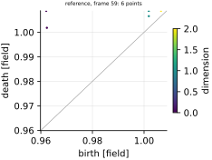
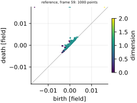

## Definition

The diagrams are those of [persistence_distance](../../metrics/persistence_distance/card.md),
computed by the same function: the sublevel-set persistence diagrams $D_k(f)$, $k = 0, \dots, n$,
of a scalar field on the cubical complex whose top cubes are the grid cells and whose faces take
the smallest value of the cubes they bound [@bleile2022], Definition 4.4, with every axis the grid
declares periodic wrapped. That card's Definition gives the construction; nothing here differs.

Two diagrams of one dimension are compared by the 1-Wasserstein distance with the $L^\infty$
ground norm: with the diagonal $\Delta$ added to each at infinite multiplicity, so that a point
may be matched to the diagonal instead of to a point,

$$
W_1(X, Y) = \inf_{\gamma : X \cup \Delta \to Y \cup \Delta} \;
\sum_{x \in X \cup \Delta} \lVert x - \gamma(x) \rVert_\infty \tag{1}
$$

over bijections $\gamma$, where a point matched to the diagonal costs half its lifetime,
$(d - b)/2$. This is the degree-$p$ Wasserstein distance of [@cohensteiner2010], Sect. 3
(paragraph "Wasserstein distance"), at $p = 1$. A point that never dies, $(b, \infty)$, is matched
only to another such point, at cost $\lvert b - b' \rvert$, and is infinitely far from every
finite point and from the diagonal [@skraba2020], Definition 2.4. The registered number sums the
dimensions, each matched on its own:

$$
\mathrm{PW}(f, g) = \sum_{k=0}^{n} W_1\bigl(D_k(f), D_k(g)\bigr) \tag{2}
$$

which is the total $p$-Wasserstein distance of [@skraba2020], Definition 2.5, the $p$-th root of
the sum over dimensions of the $p$-th powers, at $p = 1$, and the sum over all dimensions in the
definition of [@cohensteiner2010]. Its limit $p \to \infty$ is the bottleneck distance that
`persistence_distance` registers.

**A bound.** The Cellular Wasserstein Stability Theorem [@skraba2020], Theorem 4.6(i), bounds the
$p$-Wasserstein distance with the $L^p$ ground norm between the diagrams of two monotone functions
on one finite complex by the $p$-norm of their difference over all cells of the complex. An
$L^\infty$ distance between two points is at most their $L^1$ distance, so at $p = 1$

$$
\mathrm{PW}(f, g) \le \sum_{\sigma} \bigl\lvert f(\sigma) - g(\sigma) \bigr\rvert \tag{3}
$$

with the sum over every cube, edge and vertex of the complex, each face carrying the minimum of
its cubes; that the theorem applies to this cubical complex is this bundle's reading of its
hypotheses, as on `persistence_distance`'s card, and `test_metric.py` checks Equation (3) on
periodic and walled grids. Unlike the bottleneck distance, which the largest cell-wise difference
bounds, Equation (2) grows with the number of features, so it has no bound in the largest
difference alone.

**Computation.** Equation (1) is computed by Hera through `gudhi.hera.wasserstein_distance`
[@gudhiwasserstein], an approximation whose value is at most $1 + \delta$ times the exact distance,
here with $\delta = 10^{-6}$; GUDHI and giotto-tda default to $10^{-2}$. The exact
optimal-transport route of the same library builds a dense cost matrix over both diagrams, which
on a 256 by 256 vorticity field holds about 15000 points each. Hera is called on the finite points
and on the points at infinity separately, and the two parts are added: an optimal matching never
pairs the two kinds, so this is Equation (1) exactly, and Hera given one diagram with two or more
finite points and another with points at infinity only stops the process with a segmentation fault
(measured with gudhi 3.13.0; `test_metric.py` keeps the case). Two diagrams equal as multisets are
at distance exactly 0 without a call, and the two are handed to Hera in an order fixed by their
contents, so the value is the same whichever field is the reference.

Only one-channel scalar fields are accepted, density and vorticity on a two-dimensional grid,
for the reasons on `persistence_distance`'s card. The exponent $p = 1$ and the $L^\infty$ ground
norm are the defaults of GUDHI, the library the diagrams come from; why $p = 2$, giotto-tda's
default, is not registered as well is in
`judgements/018`.

### Boundary handling

As for `persistence_distance`: the complex wraps exactly the axes the grid declares periodic,
read from the context, so on a doubly periodic grid the complex of the whole domain is a torus
[@bleile2022], Sect. 4.2, and an axis with a wall is not wrapped. Nothing is padded or extended,
so the metric does not assume periodicity and is not marked `requires_periodic`.

### How its field reports it

The field is topological data analysis, where the distance between persistence diagrams is a
standard way to compare two functions.

- **The object and its normalisation.** The persistence diagram of each homology dimension, a
  multiset of (birth, death) points, compared by a Wasserstein distance of some degree $p$ in which
  unmatched points go to the diagonal [@cohensteiner2010], Sect. 3. The ground norm differs
  between sources: $L^\infty$ in [@cohensteiner2010] and in GUDHI's default (`internal_p=inf`,
  [@gudhiwasserstein]); $L^p$ with the same $p$ in [@skraba2020], whose Remark 2.6 notes the
  discrepancy in the literature and chooses $p = q$ for the sharpest stability bounds. Every
  choice is the same number for a single matched point at infinity, and for $p = 1$ the two
  ground norms differ only in how far apart two finite points are taken to be. This bundle uses
  $L^\infty$, GUDHI's default.
- **The exponent.** GUDHI's `wasserstein_distance` defaults to `order=1.0`, and so does the R
  package TDA's `wasserstein` [@rtda]. giotto-tda's `PairwiseDistance`
  defaults to $p = 2$ and combines the homology dimensions by a 2-norm rather than a sum
  [@giottotda], and [@cohensteiner2010], Sect. 4, suggest $W_2$ for clustering gene-expression
  profiles. This bundle registers $p = 1$ with the sum over dimensions of Equation (2); $p = 2$ is
  written up in
  [MTR-persistence_distance-wasserstein-diagram-distance](https://github.com/khegazy/pde_metrics/blob/main/proposals/MTR-persistence_distance-wasserstein-diagram-distance.md).
- **The figure.** The persistence diagram itself, birth against death with the diagonal drawn,
  points that never die placed above the largest death, coloured by dimension (GUDHI's
  `plot_persistence_diagram`). The card's first figure draws it the same way for the candidate
  over the reference.
- **What is reported beside the number.** A stability theorem bounding the distance by a norm of
  the functions' difference: Equation (3) here, [@skraba2020], Theorem 4.6, and, for tame
  Lipschitz functions, the Wasserstein Stability Theorem of [@cohensteiner2010], Sect. 3. No
  interval or decomposition is standard.
- **The experiment.** The theorems are tested on perturbed functions, which here are the noise
  and smoothing axes of the degradation ladder on `kinet_re5e4`, with the real forecasts of
  `forecast_re5e4` and the Reynolds ladder beside them. Fields with a known feature population,
  features injected at a known depth, and features removed by a known amount do not exist here:
  [EXP-orchestrator-20261023-known-vortex-field](https://github.com/khegazy/pde_metrics/blob/main/proposals/EXP-orchestrator-20261023-known-vortex-field.md),
  [EXP-persistence_distance-spurious-feature-injection](https://github.com/khegazy/pde_metrics/blob/main/proposals/EXP-persistence_distance-spurious-feature-injection.md)
  and
  [EXP-persistence_distance-topological-simplification](https://github.com/khegazy/pde_metrics/blob/main/proposals/EXP-persistence_distance-topological-simplification.md)
  write them up. The metric is not run on `sod_shock_tube` or `synthetic_ensemble`, for the
  reasons in the Results table.

## Performance

<!-- GENERATED performance: written by `python -m fmeval.cards evidence persistence_wasserstein --results results/comparison_1793811840`, do not edit -->



*As this metric's own field draws it.* The point set behind persistence_wasserstein on density, one panel per stored variant, on shared axes. Grey rings are the clean level's set of the same frame, the reference's, drawn under every panel. The grey diagonal is birth equal to death: a point's height above it is how long its feature persists. Triangles on a panel's edge are points with an infinite coordinate.



*As this metric's own field draws it.* The point set behind persistence_wasserstein on vorticity, one panel per stored variant, on shared axes. Grey rings are the clean level's set of the same frame, the reference's, drawn under every panel. The grey diagonal is birth equal to death: a point's height above it is how long its feature persists. Triangles on a panel's edge are points with an infinite coordinate.

No sensitivity profile figure: no ordinal axes for persistence_wasserstein.

No response to each family of degradation figure: no ordinal ladder axes.

**Trend: does the response follow the degradation?**

| test family | field | degradations | rank correlation | fraction of frames in order | weakest gap between neighbouring strengths |
|---|---|---|---|---|---|

**Reactivity: how far does it move?**

| test family | field | change from clean at the harshest strength | elasticity | first strength detected |
|---|---|---|---|---|

**Consistency: how much does it vary from snapshot to snapshot?**

| test family | field | consistency, in the strength's units | snapshots per independent block |
|---|---|---|---|

One row per family of degradation and physical field; a cell gives the range over the degradations in that family. **Trend.** The rank correlation is the Spearman correlation between the strength and how far the metric has moved from its value on the undegraded field of the same frame, in the one direction it moves under that degradation, computed inside a single frame. A value of 1 means every strength moved it further than the last in every frame, whichever way it moves; a response that scatters to both sides scores near 0. The fraction of frames in order counts the frames with no exception. The weakest gap is the smallest Mann-Whitney overlap between two neighbouring strengths across frames: 1 means they never overlap, 0.5 that they cannot be told apart. **Reactivity.** The change from clean is the median, at the harshest strength, of the departure from the undegraded value of the same frame over the size of that value: 0.3 means 30%. It does not exist for this metric, whose undegraded value is exactly zero; the damage below is its relative reading. The elasticity is the percentage change of that departure per percentage change in strength over the mildest strengths. First strength detected is the mildest at which the metric has moved a tenth of the way to the anchor; **damage** reads that 0-to-1 scale as a number. A dash means the measurement is not defined there. A metric's reactivity scales with the power it is expressed in: mean squared error's elasticity is twice root-mean-square error's, though the two carry the same information, so compare magnitudes across metrics with that in mind. **Consistency** is how much the response varies from snapshot to snapshot relative to its size, in the strength's units; the snapshots of one trajectory are correlated, and the last column is how many consecutive snapshots one independent block spans.

These tables report what was measured and grade none of the measurements. What the numbers mean for this metric is written in the subsections below, beside the test that produced each number.

<!-- END GENERATED performance -->

## Intuition

Flood a landscape whose height is the field. Lakes appear in the valleys at the height of their
floors and vanish when they merge with an older lake at the height of a pass; rings of water
around islands appear and fill in the same way. The list of these birth and death heights is
the field's persistence diagram. This metric pairs every lake and ring of one field with one of
the other's, or with nothing, and adds up how far each pairing has to move a birth or death
height. A feature left without a partner costs half its lifetime. Where the bottleneck distance
reports only the worst pairing, this one counts them all, so many small mismatches add up.

A worked example on a four-by-four grid that wraps around at its edges. The reference is a flat
field of ones with a deep well of minus one in one corner and two shallow wells of zero, none
touching another. Each shallow well is a lake born at zero and gone at one, when everything
floods.

```
reference          one well filled    both filled        reference + 0.25
-1  1  0  1        -1  1  1  1        -1  1  1  1        -0.75 1.25 0.25 1.25
 1  1  1  1         1  1  1  1         1  1  1  1         1.25 1.25 1.25 1.25
 1  1  0  1         1  1  0  1         1  1  1  1         1.25 1.25 0.25 1.25
 1  1  1  1         1  1  1  1         1  1  1  1         1.25 1.25 1.25 1.25

persistence_wasserstein:   0.5                1.0                1.5
persistence_distance:      0.5                0.5                0.25
```

Filling one shallow well leaves one lake without a partner, which costs half its lifetime, 0.5,
in both distances. Filling both leaves two: the bottleneck distance still reports 0.5, while this
metric adds them, 1.0. Raising the whole field by 0.25 moves every one of the diagram's six
points by 0.25, the two lakes and the four features of the whole wrapped domain that never die;
the bottleneck distance reports 0.25, and this metric six times that. Moving a shallow well to
another cell changes nothing in either.

The metric ignores where features are and how large an area they cover, and it charges a field
with many faint spurious features in proportion to how many there are.

## Reading the output

The value is zero or positive, in the field's own units: density units for density, inverse
time for vorticity. Lower is better, and 0 means the two diagrams are identical, which a field
moved by whole cells on a periodic grid attains exactly. The value is a sum over every matched
feature, so it grows with the number of features that differ: it is at least the bottleneck
distance of `persistence_distance` and at most that distance times the number of points in
the two diagrams, since the bottleneck's own matching costs no more than that. Compare it with the same metric on other candidates, not with the field's range.

Values are comparable across models on one grid. They are not comparable across resolutions,
and less so than the bottleneck distance's: a finer grid holds more and sharper features, and
every one of them enters the sum. Nor are they comparable across fields.

The companion is the persistence diagram of one field, the same point set as
`persistence_distance` stores, with columns `birth`, `death` (both in the field's units, `death`
infinite for a class that never dies) and `dimension` (0 for pieces, 1 for loops, 2 for
cavities), computed for the candidate at every strength and kept on the frames `report.error_map`
names; the `companion_points` figure draws it over the reference's.

## Limitations

- **Position is invisible.** As for the bottleneck distance, any rearrangement that keeps the
  pattern of pieces and loops and their levels scores 0, including a whole-cell translation on a
  periodic grid. The metric belongs beside one that sees position.
- **Faint features add up.** A candidate with noise carries many short-lived pieces and loops,
  each costing half its lifetime; their number, not their size, then sets the value, so a noisy
  candidate can score worse than one with a strong vortex missing. That is the intended contrast
  with the bottleneck distance, and a reason to read the two together.
- **The value depends on the grid as well as on the error.** The number of features, and so the
  sum, grows with resolution; two models on different grids cannot be ranked by it.
- **The extremes always count.** The classes that never die are born at the global minimum and,
  on a periodic grid, at the global maximum, so a single cell overshooting the reference's
  extreme adds its overshoot to the value.
- **An approximation, and an expensive one.** The value is within a relative $10^{-6}$ of the
  exact distance, and one comparison of two 256 by 256 vorticity fields took 5 to 25 s
  (measured on one frame of `kinet_re5e4`, blurred and noisy candidates), tens of times as long
  as the bottleneck distance; on 128 by 128 it took 0.2 to 3 s.
- **Only scalar fields, and no fluid-dynamics precedent.** The limits stated on
  `persistence_distance`'s card hold here too.

## Results

<!-- GENERATED run: written by `python -m fmeval.cards evidence persistence_wasserstein --results results/comparison_1793811840`, do not edit -->

Measured on `forecast_re5e4`, frames 0 to 59 (60 frames of real predictions scored against their targets at each prediction step; who produced the predictions, a trained model or a coarser solver, is not recorded), on the 64 analysis grid, seed 20260807, at commit `adbdc88e4950`. Run `comparison_1793811840`.

Every number in this section comes from that one run. Regenerate with `python -m fmeval.cards evidence <name> --results results/comparison_1793811840`.

<!-- END GENERATED run -->

Each subsection links to the degradations that subsection reports. What those degradations
do, and what their strength numbers mean, is documented on their own pages.

<!-- GENERATED experiments: written by `python -m fmeval.cards catalog`, do not edit -->

**Across the experiments.**

| experiment | what a run on it is evidence of | on this card |
|---|---|---|
| `kinet_re5e4` | developed flow | not yet run |
| `kinet_re1e6` | developed flow at Re = 1e6, twenty times the Reynolds number of kinet_re5e4, from the same initial condition | not yet run |
| `synthetic_ensemble` | a calibrated null: evidence that the estimator computes what it claims to compute, and nothing about turbulence | not applicable: its dispersion axes leave the member mean, the field this metric reads, unchanged by construction, and its bias axis moves every point of the candidate's diagram by the offset, a response test_metric.py pins exactly |
| `sod_shock_tube` | an analytic check: evidence that the metric locates and scores a known shock correctly, and nothing about turbulence | not applicable: Sod's exact density never rises along the tube, so its diagram is one point, born at the minimum, and the distance only compares two minima |
| `forecast_re5e4` | real predictions scored against their targets at each prediction step; who produced the predictions, a trained model or a coarser solver, is not recorded | measured, run `comparison_1793811840`: the main results |

One row per dataset a card may cite (`configs/cards/default.yaml`). *Measured* names the run the card cites: the main results are `## Performance` and the subsections below, and every other run has its own subsection headed with its dataset. *Not applicable* gives the reason: one that follows from what the metric declares and what the dataset offers, or one a person wrote on the card (`not_run` in `card.yaml`) because the result would carry no information. *Not yet run* means the metric can run there and the card cites no run on it yet.

<!-- END GENERATED experiments -->

### Smoothing

[gaussian_blur](../../degradations/gaussian_blur/card.md) ·
[box_blur](../../degradations/box_blur/card.md) ·
[median_blur](../../degradations/median_blur/card.md)

<!-- GENERATED results_smoothing: written by `python -m fmeval.cards evidence persistence_wasserstein --results results/comparison_1793811840`, do not edit -->

No measurements for this test in the recorded run.

<!-- END GENERATED results_smoothing -->

### Spectral filtering

[lowpass_ideal](../../degradations/lowpass_ideal/card.md) ·
[lowpass_butterworth](../../degradations/lowpass_butterworth/card.md) ·
[highpass_ideal](../../degradations/highpass_ideal/card.md) ·
[highpass_butterworth](../../degradations/highpass_butterworth/card.md)

<!-- GENERATED results_spectral: written by `python -m fmeval.cards evidence persistence_wasserstein --results results/comparison_1793811840`, do not edit -->

No measurements for this test in the recorded run.

<!-- END GENERATED results_spectral -->

### Displacement

[translate_x](../../degradations/translate/card.md) ·
[translate_subpixel](../../degradations/translate_subpixel/card.md)

<!-- GENERATED results_geometric: written by `python -m fmeval.cards evidence persistence_wasserstein --results results/comparison_1793811840`, do not edit -->

No measurements for this test in the recorded run.

<!-- END GENERATED results_geometric -->

### Resolution loss

[coarsen](../../degradations/coarsen/card.md) ·
[coarsen_bandlimited](../../degradations/coarsen_bandlimited/card.md)

<!-- GENERATED results_resolution: written by `python -m fmeval.cards evidence persistence_wasserstein --results results/comparison_1793811840`, do not edit -->

No measurements for this test in the recorded run.

<!-- END GENERATED results_resolution -->

### Noise

[additive_noise](../../degradations/additive_noise/card.md)

<!-- GENERATED results_stochastic: written by `python -m fmeval.cards evidence persistence_wasserstein --results results/comparison_1793811840`, do not edit -->

No measurements for this test in the recorded run.

<!-- END GENERATED results_stochastic -->

### Cell-value distortion

[gain](../../degradations/gain/card.md) ·
[bias](../../degradations/bias/card.md)

<!-- GENERATED results_pointwise: written by `python -m fmeval.cards evidence persistence_wasserstein`, do not edit -->

Not generated yet. Run `python -m fmeval.cards evidence persistence_wasserstein`.

<!-- END GENERATED results_pointwise -->

### Trap tests

[gaussian_impostor](../../degradations/gaussian_impostor/card.md) ·
[uncorrelated](../../degradations/random_large_translation/card.md)

<!-- GENERATED results_canaries: written by `python -m fmeval.cards evidence persistence_wasserstein --results results/comparison_1793811840`, do not edit -->

| field | damage assigned to the fake prediction | closest real degradation | damage of the reference moved far away | value on the anchor |
|---|---|---|---|---|
| density | — | — | — | 0.0702 |
| vorticity | — | — | — | 0.196 |

The fake prediction here has exactly the reference field's amplitude spectrum and completely scrambled structure. Damage 1 is what the anchor scores, by default the reference's own spatial mean, a prediction that knows the mean and nothing else. The damage column therefore says how close to useless this metric considers that fake prediction: a low number means the metric was fooled. The third column translates the same number into an ordinary degradation whose damage the fake prediction matches, which is easier to picture. The fourth is the reference moved by a large random offset, the right statistics in the wrong place; where a field's energy sits in its largest scales that copy stays partly correlated with the reference, so it is not the score of an unrelated field.

<!-- END GENERATED results_canaries -->

### Compared with the other metrics

<!-- GENERATED results_summary: written by `python -m fmeval.cards evidence persistence_wasserstein --results results/comparison_1793811840`, do not edit -->

No measurements for this test in the recorded run.

<!-- END GENERATED results_summary -->

## References

\bibliography
