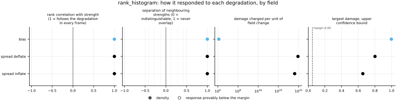
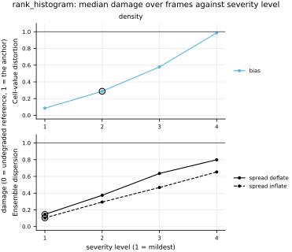

## Definition

At every channel and cell, sort the $M$ ensemble members and record where the reference
falls among them. The rank is the number of members below it,

$$
r_{c,i} = \#\{ m : x_{m,c,i} < y_{c,i} \} \in \{0, 1, \dots, M\} \tag{1}
$$

giving $M+1$ possible outcomes, one for each gap in the sorted ensemble including the two
open ends. Collect these over all channels and cells of the frame into a histogram with
$M+1$ bins and let $f_k$ be the fraction in bin $k$. The reported scalar is the
**reliability index**, the total absolute departure from flat [@dellemonache2006]:

$$
\Delta = \sum_{k=1}^{M+1} \Bigl| f_k - \frac{1}{M+1} \Bigr| \tag{2}
$$

If the ensemble is a genuine sample from the distribution the reference was drawn from, then
the reference is exchangeable with the members and equally likely to occupy any of the
$M+1$ positions, so $\mathbb{E} f_k = 1/(M+1)$ and $\Delta$ is zero up to sampling noise
[@anderson1996; @hamill2001]. The index is bounded: $\Delta = 0$ for a flat histogram and
$\Delta = 2M/(M+1)$ when every draw lands in a single bin, which approaches 2 for a large
ensemble.

**Ties are broken at random.** Where several members equal the reference exactly, Equation
(1) is ambiguous, and resolving it by counting only members strictly below would place every
tied draw in the lowest bin and manufacture a spike that reads as bias. The rank is instead
drawn uniformly from the range the tie spans [@hamill2001], using the seeded generator the
pipeline supplies, so a run remains reproducible. This matters for a collapsed ensemble and
for any coarsely quantised field.

The histogram is formed **per frame**, not pooled across frames. Pooling would average away
a calibration failure that changes sign along the trajectory, and it is the same rule the
rank correlations in this suite follow for the same reason.

A chi-square goodness-of-fit statistic would be the other natural summary, and is used in
this bundle's tests where the draws really are independent. It is not what is reported: its
scale depends on the bin count and the sample size, so it cannot be compared across ensemble
sizes or grids, and interpreting it as a test would need an independence assumption these
spatially correlated fields do not satisfy. Equation (2) is descriptive, bounded, and reads
the same way at any ensemble size.

### Boundary handling

None in space: the rank at a cell uses only that cell's values across the ensemble. The
"boundary" that does need a rule is at the ends of the rank ordering, and ties are handled
as described above.

## Performance

<!-- GENERATED performance: written by `python -m fmeval.cards evidence rank_histogram --results results/rank_histogram_1787800137`, do not edit -->



Four measured statistics for rank_histogram, one row per degradation grouped by family and one marker per field. From left: the rank correlation between the metric and the applied strength within a frame, with the line showing the resampling interval; the separation of neighbouring strengths as Cliff's delta, where 0 means the metric cannot tell one strength from the next and the faint ticks at 0.12, 0.28 and 0.42 are Vargha and Delaney's small, medium and large anchors, for scale and not as grades; the damage charged per unit of field change at the harshest strength; and the upper confidence bound on the largest damage, beside the fixed margin of 0.05. A hollow marker is a field and degradation on which that bound lies below the margin, so the response is provably small. A missing marker is a statistic the analysis withheld, as the rank correlation is on an axis the metric is invariant to.



Median damage over frames against severity level for rank_histogram, one row per family of degradation and one column per field, on one shared scale. The solid grey line is damage 1, the anchor (by default the field's own mean); the dotted black line is the damage assigned to the fake prediction with the right spectrum, where the run included it. The hollow black ring marks the first level at which the metric has moved a tenth of the way to the anchor. Hollow grey markers are strengths excluded for repeating a milder one or for doing nothing. Degradations with three or fewer usable levels are drawn as markers only; points above 2 are drawn as triangles at the top.

**Trend: does the response follow the degradation?**

| test family | field | degradations | rank correlation | fraction of frames in order | weakest gap between neighbouring strengths |
|---|---|---|---|---|---|
| Ensemble dispersion | density | 2 | 1 | 1 | 1 |
| Cell-value distortion | density | 1 | 1 | 1 | 1 |

**Reactivity: how far does it move?**

| test family | field | change from clean at the harshest strength | elasticity | first strength detected |
|---|---|---|---|---|
| Ensemble dispersion | density | 21.4 to 26.6 | 0.85 to 1.41 | level 1 |
| Cell-value distortion | density | 32.5 | 1.07 | level 2 |

**Consistency: how much does it vary from snapshot to snapshot?**

| test family | field | consistency, in the strength's units | snapshots per independent block |
|---|---|---|---|
| Ensemble dispersion | density | 0.00528 to 0.0197 | 1 |
| Cell-value distortion | density | 0.00321 | 1 |

One row per family of degradation and physical field; a cell gives the range over the degradations in that family. **Trend.** The rank correlation is the Spearman correlation between the strength and how far the metric has moved from its value on the undegraded field of the same frame, in the one direction it moves under that degradation, computed inside a single frame. A value of 1 means every strength moved it further than the last in every frame, whichever way it moves; a response that scatters to both sides scores near 0. The fraction of frames in order counts the frames with no exception. The weakest gap is the smallest Mann-Whitney overlap between two neighbouring strengths across frames: 1 means they never overlap, 0.5 that they cannot be told apart. **Reactivity.** The change from clean is the median, at the harshest strength, of the departure from the undegraded value of the same frame over the size of that value: 0.3 means 30%. The elasticity is the percentage change of that departure per percentage change in strength over the mildest strengths. First strength detected is the mildest at which the metric has moved a tenth of the way to the anchor; **damage** reads that 0-to-1 scale as a number. A dash means the measurement is not defined there. A metric's reactivity scales with the power it is expressed in: mean squared error's elasticity is twice root-mean-square error's, though the two carry the same information, so compare magnitudes across metrics with that in mind. **Consistency** is how much the response varies from snapshot to snapshot relative to its size, in the strength's units; the snapshots of one trajectory are correlated, and the last column is how many consecutive snapshots one independent block spans.

These tables report what was measured and grade none of the measurements. What the numbers mean for this metric is written in the subsections below, beside the test that produced each number.

**Profile.**

| field | selectivity | charges most for | charges least for | response provably below 0.05 at 90% on | elasticity to a sub-pixel shift | compute cost (x cheapest in this run) |
|---|---|---|---|---|---|---|
| density | 0.634 | `spread_deflate` | `bias` | — | — | 1 |

One row per physical field. **Selectivity** is how concentrated the metric's response is on a few degradations, measured per unit of field change: 0 means it charges every degradation the same, as mean squared error does by construction, and values toward 1 that one degradation carries most of it. **Charges most and least for** name the two ends of that profile. **Response provably below** lists degradations on which the upper confidence bound of the largest damage lies below the margin -- an equivalence test, so an entry says the response is provably small, not merely not significant; a dash means no degradation met the bound. **Elasticity** is the slope of log damage against log shift over the smallest shifts: 1 means damage grows in proportion to the shift, 2 with its square. **Compute cost** is wall-clock per evaluation over the cheapest metric and field in the same run.

<!-- END GENERATED performance -->

## Intuition

Line the ensemble members up in order at one point in the field and ask where the true value
sits among them. Repeat that everywhere and count how often the truth came last, second to
last, and so on down to first. If the ensemble is honest, the truth is just one more draw
from the same distribution, so it is equally likely to land in any of the slots and the
counts come out flat. This metric measures how far from flat they came out.

What makes the diagnostic worth more than a single ratio is that the *shape* of the
departure names the fault. If the members huddle too closely together, the truth keeps
falling outside them and the counts pile up at both ends — a U. If they are spread too
widely, the truth is usually caught somewhere in the middle and the counts pile up there — a
dome. If the whole ensemble is offset, the counts slope to one side. The reported number
collapses that shape to a single magnitude, so it says how badly without saying which; the
histogram itself, if you plot it, says which.

The property that earns this metric its place beside the others is that it responds to
changes nothing built on the ensemble mean can see. Squeezing an ensemble toward its own
centre leaves that centre exactly where it was, so any mean-based score is unchanged, while
the truth starts falling outside the members and this index rises immediately. A test in
this bundle pins that contrast directly.

A worked example with three members and four cells, arranged so the reference takes each
possible rank exactly once:

```
reference        members (three per cell)      result
0 0 0 0          per cell, one rank each        0.0
```

Four cells and four bins with one draw each is a perfectly flat histogram, so the index is
zero.

It ignores magnitude entirely. Only the ordering matters, so an ensemble can be wrong by any
amount and still be perfectly calibrated by this measure.

## Reading the output

The value is dimensionless and runs from zero to just under 2, with zero the best. There is
no target other than zero, so unlike the spread-to-skill ratio this reads like an ordinary
error metric: lower is better and the ordering statistics apply directly.

What counts as small depends on the sample, and this is the number people get wrong. Even a
perfectly calibrated ensemble produces a non-zero index, because a finite histogram is never
exactly flat; the floor scales roughly as the square root of the bin count over the number
of draws. On the synthetic ensemble here, with a few thousand cells and eight members, that
floor is around 0.1. Compare a measured value against that floor rather than against zero,
and the cheapest way to establish the floor is to read this metric at the clean severity
level of the same run.

Because ranks are invariant to any monotone rescaling of the field, the metric is scale free
and comparable across fields of wildly different magnitude. Comparison across ensemble sizes
is meaningful in the sense that the bound is nearly the same, but the sampling floor is not,
so a small index on a four-member ensemble is weaker evidence than the same index on fifty.
Comparison across resolutions changes the number of draws and therefore the floor.

## Limitations

The index says how far from calibrated an ensemble is but not in which direction, and the two
directions have opposite remedies: a U-shaped histogram means widen the ensemble, a dome
means narrow it. Reading only this number, a user cannot tell which. `spread_skill`, whose
sign carries exactly that information, is its natural companion.

The aggregate hides spatial structure. An ensemble that is overconfident in one region and
overdispersed in another can produce a histogram that is flat overall, and this metric will
report a well-calibrated prediction. The failure is invisible to any whole-field summary.

The sampling floor is a trap in the other direction. Because the index is bounded below by
the noise of a finite histogram rather than by zero, a small positive value proves nothing
on its own, and comparing a value measured on a coarse grid against one from a fine grid
compares two different floors. The effective number of independent draws is also far smaller
than the cell count on these fields, since neighbouring cells of a turbulent flow are
strongly correlated — so the true floor is higher than an independence assumption would
suggest, and the value is noisier frame to frame than the raw count of cells implies.

## Results

<!-- GENERATED run: written by `python -m fmeval.cards evidence rank_histogram --results results/rank_histogram_1787800137`, do not edit -->

Measured on `synthetic_ensemble`, frames 0 to 11 (12 frames of a calibrated null: evidence that the estimator computes what it claims to compute, and nothing about turbulence), on the 64 analysis grid, seed 20260807, at commit `c49b363765d7` (working tree dirty). Run `rank_histogram_1787800137`.

Every number in this section comes from that one run. Regenerate with `python -m fmeval.cards evidence <name> --results results/rank_histogram_1787800137`.

<!-- END GENERATED run -->

**What these numbers are evidence of, and what they are not.** The run behind them is on
`synthetic_ensemble`, which is generated rather than simulated: the reference is drawn from
the same process as the members, with the same dispersion, so the two are exchangeable and
every quantity below has a value derivable in advance. That is what makes the run worth
citing — an estimator agreeing with arithmetic it could not have fitted to is a real
result, and it is the claim a first implementation has to establish.

It is not evidence about turbulence. The fields have no shocks, no intermittency and no
coherent structure, so nothing here says how this metric behaves on the flows this
repository exists to evaluate. The degradation families a physical run would exercise —
smoothing, spectral filtering, displacement, resolution loss — are absent from these
tables for that reason, and so are the trap tests. When an ensemble of real runs exists
([issue 004](https://github.com/khegazy/pde_metrics/blob/main/issues/004-independent-realizations.md)), this card should be
regenerated against it and this section will say something different.

### Ensemble dispersion

[spread_inflate](../../degradations/spread_inflate/card.md) ·
[spread_deflate](../../degradations/spread_deflate/card.md)

<!-- GENERATED results_ensemble: written by `python -m fmeval.cards evidence rank_histogram --results results/rank_histogram_1787800137`, do not edit -->

| degradation | field | strengths | rank correlation | fraction of frames in the right order | weakest gap between neighbouring strengths |
|---|---|---|---|---|---|
| `spread_deflate` | density | 4 | 1 | 1 | 1 |
| `spread_inflate` | density | 4 | 1 | 1 | 1 |

<!-- END GENERATED results_ensemble -->

The clean ensemble reads 0.049, which is the sampling floor rather than zero: 16 members
over a 64x64 grid give 17 bins and a finite histogram is never exactly flat. Every measured
departure below should be read against 0.049, not against zero.

Both directions rise well clear of it — to 1.239 at the harshest deflation and 1.009 at the
harshest inflation, a factor of 20 or more — with a rank correlation of 1 on each. The
index cannot say which direction it saw, and that is the limitation stated above made
concrete: 1.0 could be either fault, and only `spread_skill`'s side of one distinguishes
them.

Deflation registers more strongly than inflation at comparable severity, which follows from
the shapes: an over-narrow ensemble pushes the truth outside the members entirely, piling
draws into the two end bins, while an over-wide one merely concentrates them toward the
middle and leaves every bin occupied.

## References

\bibliography
