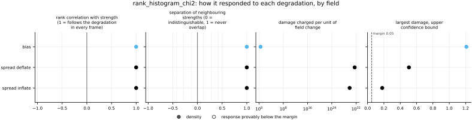
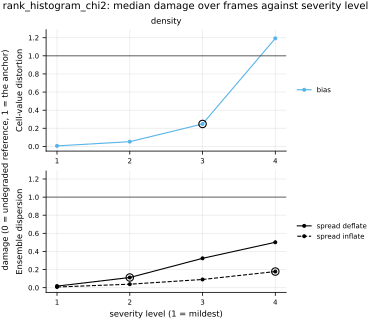

## Definition

At every channel and cell the rank of the reference among the $M$ ensemble members is the
number of members below it, an integer from $0$ to $M$, with ties broken at random; the
histogram of those ranks over the frame is the companion of
[rank_histogram](../../metrics/rank_histogram/card.md), which defines it. With $n_k$ the number of draws
at rank $k$, $K = M + 1$ bins and $n$ draws in all, one per channel and cell, the reported
value is Pearson's chi-square statistic against the flat histogram [@jolliffeprimo2008]:

$$
T = \sum_{k=1}^{K} \frac{(n_k - e)^2}{e}, \qquad e = \frac{n}{K} \tag{1}
$$

which is Jolliffe and Primo's Equation (1), their $e_i = n p_0$ with $p_0 = 1/K$. In terms of
the fractions $f_k = n_k / n$ that the histogram companion stores,

$$
T = n K \sum_{k=1}^{K} \Bigl( f_k - \frac{1}{K} \Bigr)^2 \tag{2}
$$

which is how it is computed. It is zero for a flat histogram and at most $n(K - 1) = nM$, when
every draw lands in one bin.

If the draws are independent and the reference is exchangeable with the members, $T$ is
approximately chi-square distributed with $K - 1 = M$ degrees of freedom, so its expectation is
$M$ whatever the number of draws (Jolliffe and Primo, Section 2) [@jolliffeprimo2008]. At a
fixed histogram shape away from flat, Equation (2) grows in proportion to $n$: the statistic
measures how surely the histogram departs from flat, not how far. The
reliability index of `rank_histogram`, $\sum_k |f_k - 1/K|$, is the size of the departure,
independent of $n$. The two are reported side by side because the field reports both.

No p-value is computed. The chi-square distribution of $T$ assumes independent draws, and the
cells of a field are not independent: neighbouring cells of a flow are strongly correlated, so
the effective number of draws is far smaller than $n$, and a p-value computed from $n$ would be
far too small. On `synthetic_ensemble` the noise is drawn independently at every cell, so there
the draws are independent and $M$ is the null expectation; on any physical field it is not.

### Boundary handling

None in space: each rank uses only that cell's values across the ensemble, and the histogram
pools every cell without regard to position.

### How its field reports it

The field is ensemble forecast verification in meteorology.

- **The object.** Pearson's chi-square statistic of the rank counts against uniform, with
  $K - 1$ degrees of freedom (Jolliffe and Primo, Section 2, Equation (1)) [@jolliffeprimo2008].
  Anderson applies "the traditional chi-square test" to his binned ranks (Section 2c)
  [@anderson1996], and Hamill names it as the test of uniformity (Section 4) [@hamill2001].
- **The statistics reported beside it.** The test's significance: Anderson plots the
  significance of chi-square against forecast lead time (Figures 1 to 4) and maps it by grid
  point (Figures 5, 6, 9 and 10), and stresses that "the chi-square test is measuring the
  statistical significance of the difference between the distributions, not the strength of the
  difference" and that it is "sensitive to the number of samples" [@anderson1996]. Jolliffe and
  Primo decompose $T$ into one-degree-of-freedom components for a slope (Linear) and for a U or
  dome shape (Ends, or V-shape), plus a residual, by orthogonal contrasts (Section 2, Appendix
  Table A1), and report each with its p-value (Tables 1 and 2) [@jolliffeprimo2008]. That
  decomposition is not built here: Jolliffe and Primo present it as "a valuable additional tool"
  (Section 4) without claiming it is routinely reported, they offer two alternative shape
  contrasts that are not orthogonal to each other and say the decomposition "should be decided
  before looking at the rank histogram" (Section 4), and every component's p-value rests on the
  same independence assumption as $T$'s.
- **Independence, which the field insists on.** Hamill: "If samples used to populate the rank
  histogram are independent, then a $\chi^2$ hypothesis test ... may be performed ... However,
  the statistical hypothesis test may produce misleading results if samples have correlated
  errors, as may happen if two adjacent grid points are both used as samples" (Section 4); his
  Figures 7 and 8 measure the correlation of ranks between grid points and conclude that
  "samples must often be located far apart in space and in time" [@hamill2001]. Jolliffe and
  Primo, on a real ensemble: "the observations should be independent. Clearly they are not
  here", and they shrink 290 304 draws to about 420 effective ones before testing (Section 3b)
  [@jolliffeprimo2008]. This bundle does neither; it reports $T$ on all $n$ draws, as a
  statistic, and states the assumption instead.
- **The figure.** The rank histogram itself, bars of relative frequency against rank (Hamill,
  Figure 1; Jolliffe and Primo, Figures 1 and 2), is drawn on the `rank_histogram` card from its
  companion; this bundle stores no curve of its own.
- **The experiment.** Many forecasts of one variable at grid points over a season, at each lead
  time (Anderson, Figures 1 to 4), and synthetic ensembles of known miscalibration, including flat
  histograms from unreliable ensembles (Hamill, Section 3, Figures 2 to 4). Here only the
  calibrated null of `synthetic_ensemble` exists, with its miscalibration ladder; real
  ensembles wait on
  [issue 004](https://github.com/khegazy/pde_metrics/blob/main/issues/004-independent-realizations.md).
  The missing experiments are
  [EXP-spread_skill-heteroscedastic-synthetic-ensemble](https://github.com/khegazy/pde_metrics/blob/main/proposals/EXP-spread_skill-heteroscedastic-synthetic-ensemble.md)
  (Hamill's flat-but-unreliable mixture),
  [EXP-crps-gneiting-forecaster-suite](https://github.com/khegazy/pde_metrics/blob/main/proposals/EXP-crps-gneiting-forecaster-suite.md)
  and
  [EXP-spread_skill-perturbed-initial-condition-ensemble](https://github.com/khegazy/pde_metrics/blob/main/proposals/EXP-spread_skill-perturbed-initial-condition-ensemble.md)
  (forecasts against lead time).

## Performance

<!-- GENERATED performance: written by `python -m fmeval.cards evidence rank_histogram_chi2 --results results/comparison_1793812401`, do not edit -->

No field-standard figure: an ensemble score with no curve or point set behind it; its field draws it against lead time, which the synthetic ensemble, one spread at every frame, cannot show.



Four measured statistics for rank_histogram_chi2, one row per degradation grouped by family and one marker per field. From left: the rank correlation between the metric and the applied strength within a frame, with the line showing the resampling interval; the separation of neighbouring strengths as Cliff's delta, where 0 means the metric cannot tell one strength from the next and the faint ticks at 0.12, 0.28 and 0.42 are Vargha and Delaney's small, medium and large anchors, for scale and not as grades; the damage charged per unit of field change at the harshest strength; and the upper confidence bound on the largest damage, beside the fixed margin of 0.05. A hollow marker is a field and degradation on which that bound lies below the margin, so the response is provably small. A missing marker is a statistic the analysis withheld, as the rank correlation is on an axis the metric is invariant to.



Median damage over frames against severity level for rank_histogram_chi2, one row per family of degradation and one column per field, on one shared scale. The solid grey line is damage 1, the anchor (by default the field's own mean); the dotted black line is the damage assigned to the fake prediction with the right spectrum, where the run included it. The hollow black ring marks the first level at which the metric has moved a tenth of the way to the anchor. Hollow grey markers are strengths excluded for repeating a milder one or for doing nothing. Degradations with three or fewer usable levels are drawn as markers only; points beyond 2 either side are drawn as triangles at the edge. Damage is negative where a degradation moves the metric away from the anchor, as noise raises a single-field quantity the field's mean sets to zero.

**Trend: does the response follow the degradation?**

| test family | field | degradations | rank correlation | fraction of frames in order | weakest gap between neighbouring strengths |
|---|---|---|---|---|---|
| Ensemble dispersion | density | 2 | 1 | 1 | 1 |
| Cell-value distortion | density | 1 | 1 | 1 | 1 |

**Reactivity: how far does it move?**

| test family | field | change from clean at the harshest strength | elasticity | first strength detected |
|---|---|---|---|---|
| Ensemble dispersion | density | 439 to 1.21e+03 | 1.4 to 2.79 | level 2 |
| Cell-value distortion | density | 2.95e+03 | 2.07 | level 3 |

**Consistency: how much does it vary from snapshot to snapshot?**

| test family | field | consistency, in the strength's units | snapshots per independent block |
|---|---|---|---|
| Ensemble dispersion | density | 0.00803 to 0.0229 | 1 |
| Cell-value distortion | density | 0.00343 | 1 |

One row per family of degradation and physical field; a cell gives the range over the degradations in that family. **Trend.** The rank correlation is the Spearman correlation between the strength and how far the metric has moved from its value on the undegraded field of the same frame, in the one direction it moves under that degradation, computed inside a single frame. A value of 1 means every strength moved it further than the last in every frame, whichever way it moves; a response that scatters to both sides scores near 0. The fraction of frames in order counts the frames with no exception. The weakest gap is the smallest Mann-Whitney overlap between two neighbouring strengths across frames: 1 means they never overlap, 0.5 that they cannot be told apart. **Reactivity.** The change from clean is the median, at the harshest strength, of the departure from the undegraded value of the same frame over the size of that value: 0.3 means 30%. The elasticity is the percentage change of that departure per percentage change in strength over the mildest strengths. First strength detected is the mildest at which the metric has moved a tenth of the way to the anchor; **damage** reads that 0-to-1 scale as a number. A dash means the measurement is not defined there. A metric's reactivity scales with the power it is expressed in: mean squared error's elasticity is twice root-mean-square error's, though the two carry the same information, so compare magnitudes across metrics with that in mind. **Consistency** is how much the response varies from snapshot to snapshot relative to its size, in the strength's units; the snapshots of one trajectory are correlated, and the last column is how many consecutive snapshots one independent block spans.

These tables report what was measured and grade none of the measurements. What the numbers mean for this metric is written in the subsections below, beside the test that produced each number.

**Profile.**

| field | selectivity | charges most for | charges least for | response provably below 0.05 at 90% on | elasticity to a sub-pixel shift | compute cost (x cheapest in this run) |
|---|---|---|---|---|---|---|
| density | 0.652 | `spread_deflate` | `bias` | — | — | 26 |

One row per physical field. **Selectivity** is how concentrated the metric's response is on a few degradations, measured per unit of field change: 0 means it charges every degradation the same, as mean squared error does by construction, and values toward 1 that one degradation carries most of it. **Charges most and least for** name the two ends of that profile. **Response provably below** lists degradations on which the upper confidence bound of the largest damage lies below the margin -- an equivalence test, so an entry says the response is provably small, not merely not significant; a dash means no degradation met the bound. **Elasticity** is the slope of log damage against log shift over the smallest shifts: 1 means damage grows in proportion to the shift, 2 with its square. **Compute cost** is wall-clock per evaluation over the cheapest metric and field in the same run.

<!-- END GENERATED performance -->

## Intuition

Line the ensemble members up in order at each point and note where the truth falls among them;
count how often it falls in each slot. An honest ensemble gives equal counts. This number adds
up, slot by slot, the squared gap between the count seen and the count expected, each divided by
the count expected. It is the classical statistic for asking whether counts in categories could
have come from equal chances.

What distinguishes it from a plain measure of how uneven the counts are is that it grows with
the number of counts. The same uneven shape seen over a hundred times as many points gives a
statistic a hundred times larger, because the evidence that the shape is real is a hundred times
stronger. With independent points and an honest ensemble its typical value is the number of
slots minus one, whatever the number of points.

A worked example with two members, so three slots, at six points against a reference of 0:

```
reference        member 1               member 2               result
0 at all six     1  1  1 -1 -1 -1       2  2  2  1 -2 -2       1.0
```

The truth is below both members at the first three points, between them at the fourth, and above
both at the last two: counts of 3, 1 and 2 against an expected 2 each. The statistic is
(1 + 1 + 0) / 2 = 1.0.

It ignores the shape of the unevenness: a slope, a U and a dome with the same squared gaps give
the same number.

## Reading the output

The value is dimensionless, from zero up to the number of draws times the number of members;
lower is better and there is no target. With independent draws from an honest ensemble its
expectation is the number of members, so a value near that is consistent with calibration and a
value many times larger is not.

Because it grows with the number of draws, it compares two ensembles only on the same grid and
the same field: on a finer grid the same miscalibration reads larger. Across ensemble sizes the
null expectation changes with the number of bins. For a size that does not grow with the sample,
read the reliability index of `rank_histogram`.

On a physical field the independence behind the null expectation fails, so a value above the
number of members is not, by itself, evidence of miscalibration: correlated neighbouring cells
inflate it. On `synthetic_ensemble`, whose cells are independent, the comparison holds.

## Limitations

On any grid of thousands of cells, every real miscalibration is overwhelming in this statistic:
Jolliffe and Primo report a value "over 33 000" on a real ensemble, where every departure is
extremely significant [@jolliffeprimo2008]. Read as a test, it then says only that the
ensemble is not perfect, which was known.

It cannot say which way the ensemble is wrong. Jolliffe and Primo's own example has four
histograms of different shapes with the same statistic, 19.467, which only their decomposition
tells apart (Figure 1) [@jolliffeprimo2008]. A U-shaped histogram means the ensemble is
too narrow and a dome that it is too wide, opposite remedies the number does not separate;
`spread_skill`'s side of one does.

Like the reliability index, it pools every cell, so an ensemble overconfident in one region
and overdispersed in another can give a flat histogram and a small statistic; Hamill shows that
a flat histogram does not imply a reliable ensemble (Section 3a) [@hamill2001].

## Results

<!-- GENERATED run: written by `python -m fmeval.cards evidence rank_histogram_chi2 --results results/comparison_1793812401`, do not edit -->

Measured on `synthetic_ensemble`, frames 0 to 11 (12 frames of a calibrated null: evidence that the estimator computes what it claims to compute, and nothing about turbulence), on the 64 analysis grid, seed 20260807, at commit `adbdc88e4950`. Run `comparison_1793812401`.

Every number in this section comes from that one run. Regenerate with `python -m fmeval.cards evidence <name> --results results/comparison_1793812401`.

<!-- END GENERATED run -->

<!-- GENERATED experiments: written by `python -m fmeval.cards catalog`, do not edit -->

**Across the experiments.**

| experiment | what a run on it is evidence of | on this card |
|---|---|---|
| `kinet_re5e4` | developed flow | not applicable: needs an ensemble, and this dataset has one realisation per frame |
| `kinet_re1e6` | developed flow at Re = 1e6, twenty times the Reynolds number of kinet_re5e4, from the same initial condition | not applicable: needs an ensemble, and this dataset has one realisation per frame |
| `synthetic_ensemble` | a calibrated null: evidence that the estimator computes what it claims to compute, and nothing about turbulence | measured, run `comparison_1793812401`: the main results |
| `sod_shock_tube` | an analytic check: evidence that the metric locates and scores a known shock correctly, and nothing about turbulence | not applicable: needs an ensemble, and this dataset has one realisation per frame |
| `forecast_re5e4` | real predictions scored against their targets at each prediction step; who produced the predictions, a trained model or a coarser solver, is not recorded | not applicable: needs an ensemble, and this dataset has one realisation per frame |

One row per dataset a card may cite (`configs/cards/default.yaml`). *Measured* names the run the card cites: the main results are `## Performance` and the subsections below, and every other run has its own subsection headed with its dataset. *Not applicable* gives the reason: one that follows from what the metric declares and what the dataset offers, or one a person wrote on the card (`not_run` in `card.yaml`) because the result would carry no information. *Not yet run* means the metric can run there and the card cites no run on it yet.

<!-- END GENERATED experiments -->

The statistic scores an ensemble, so the synthetic ensemble is the one experiment in this
repository it can run on; the experiments its field relies on are listed in the Definition.

### Ensemble dispersion

[spread_inflate](../../degradations/spread_inflate/card.md) ·
[spread_deflate](../../degradations/spread_deflate/card.md)

<!-- GENERATED results_ensemble: written by `python -m fmeval.cards evidence rank_histogram_chi2 --results results/comparison_1793812401`, do not edit -->

| degradation | field | strengths | rank correlation | fraction of frames in the right order | weakest gap between neighbouring strengths |
|---|---|---|---|---|---|
| `spread_deflate` | density | 4 | 1 | 1 | 1 |
| `spread_inflate` | density | 4 | 1 | 1 | 1 |

<!-- END GENERATED results_ensemble -->

The calibrated ensemble reads 12.4 (median over frames). This dataset's cells are independent
and its ranks are drawn from 16 members, so under calibration the statistic follows a
chi-square distribution with 16 degrees of freedom, whose mean is 16 and standard deviation
√32 ≈ 5.7; the clean median lies inside that scatter, which is the check on the estimator that
this calibrated null can give (this card's arithmetic, from Jolliffe and Primo's Equation (1)
[@jolliffeprimo2008]).

Both directions raise the statistic far above it, with a rank correlation of 1 on each: at the
harshest strengths it has risen by 1.21e3 times its clean value under deflation and by 439
times under inflation (the reactivity table), with the largest single values 1.58e4 and 5.61e3.
Read as a test, every degraded strength is overwhelmingly significant (the smallest value on
either dispersion axis in any frame, 205, is more than thirty standard deviations of the null
above its mean), which is the
Limitations section's point made concrete on 4096 draws per frame: the statistic separates
these strengths through their size, not through a p-value. The deflation side grows faster,
with an elasticity of 2.79 against inflation's 1.40 over the mildest strengths, and is
detected one strength earlier (level 2 against level 4): an over-narrow ensemble moves draws
into two end bins, a large departure from flat in few bins, while an over-wide one spreads its
excess over the middle bins (this card's reasoning; the shapes are drawn on the
`rank_histogram` card). The statistic, like the index it accompanies, does not say which of
the two it saw.

On the damage scale the anchor, each member replaced by its own spatial mean, reads 3.03e4.
Against it the harshest deflation reaches a damage of 0.520 and the harshest inflation 0.184
(the largest in any frame). The `bias` axis is read under Cell-value distortion below.

The profile row above ranks the degradations by damage per unit of field change, but the two
dispersion axes leave the ensemble mean, and so the measured field change, unchanged to
round-off; its "charges most for", "charges least for" and selectivity are therefore not
meaningful for this metric ([issue 111](https://github.com/khegazy/pde_metrics/blob/main/issues/111-damage-per-change-divides-by-round-off-on-ensemble-axes.md)).

### Cell-value distortion

[bias](../../degradations/bias/card.md)

<!-- GENERATED results_pointwise: written by `python -m fmeval.cards evidence rank_histogram_chi2 --results results/comparison_1793812401`, do not edit -->

| degradation | field | strengths | rank correlation | fraction of frames in the right order | weakest gap between neighbouring strengths |
|---|---|---|---|---|---|
| `bias` | density | 4 | 1 | 1 | 1 |

<!-- END GENERATED results_pointwise -->

Only the offset ran here: the synthetic ensemble's ladder
(`configs/degradation/ensemble_miscalibration.yaml`) carries `bias` as its one axis that moves
the ensemble mean, and no `gain`. The statistic is not invariant to an offset of the members
alone: moving every member the same way moves the truth's rank toward one end of the
histogram, and Equation (1) charges the departure from flat. It rises in every frame and at
every strength, with a rank correlation of 1 and no overlap between neighbouring strengths.
No value on this axis in any frame is below 152, against the clean median of 12.4, so even
the mildest offset lies far outside the null's scatter given in the dispersion section above;
it is first detected only at level 3 because the damage is read against the anchor's 3.03e4.
The change from clean at the harshest offset is 2.95e3 times the clean value, and the
elasticity over the mildest offsets is 2.07.

The axis goes beyond the anchor: its harshest offset reaches a damage of 1.23, with a largest
single value of 3.72e4. That follows from Equation (1) (this card's arithmetic): with $n$
draws in $K$ bins, all of them in one bin gives $n(K - 1)$, while half in each of two bins,
which is about what the anchor produces, gives $n(K/2 - 1)$, so the one-sided pile-up of a
biased ensemble scores higher than the two-sided pile-up of a collapsed one.

### Compared with the other metrics

<!-- GENERATED results_summary: written by `python -m fmeval.cards evidence rank_histogram_chi2 --results results/comparison_1793812401`, do not edit -->

| compared with | density |
|---|---|
| `rank_histogram` | 0.967 |
| `crps` | 0.929 |
| `energy_score` | 0.929 |
| `spread_skill` | 0.83 |
| `max_error` | 0.698 |
| `variogram_score` | 0.462 |
| `ensemble_mean_rmse` | 0.392 |
| `h1_relative` | 0.392 |
| `mae` | 0.392 |
| `mse` | 0.392 |
| `nrmse` | 0.392 |
| `rmse` | 0.392 |
| `vrmse` | 0.358 |
| `crps_skill_score` | -0.929 |

Rank correlation over every degradation, computed separately for each physical field on the median value at each combination of degradation and strength, with the undegraded reference excluded. A dash marks a metric that does not run on that field. A metric with a target value enters by its distance from the target. Two metrics correlating near 1 put the degradations in the same order, but the two may still weight those degradations very differently. A correlation near 1 therefore means the two metrics are redundant for ranking models, not that the two are interchangeable as training losses.

<!-- END GENERATED results_summary -->

The synthetic ensemble has one field, density, and the comparison runs over its three axes,
`bias` and the two dispersion axes, and the anchor. `rank_histogram`, the flatness index of
the same histogram, orders the degradations most like this statistic (0.967), then `crps` and
`energy_score` (0.929 each) and `spread_skill` (0.83); `crps_skill_score` reads −0.929, the
same agreement as `crps` with the sign of a higher-is-better score. `max_error` (0.698) agrees
less, and `variogram_score` (0.462) and the errors of the ensemble mean least: `mse`, `rmse`,
`mae`, `nrmse`, `h1_relative` and `ensemble_mean_rmse` at 0.392 each and `vrmse` at 0.358. In
the run's `results.csv` those errors give all eight dispersion strengths the same value, to
round-off, because neither dispersion axis moves the member mean they receive, and
`variogram_score` does not move under the offset (its card); each shares only part of this
statistic's ordering.

## References

\bibliography
