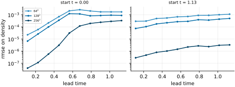
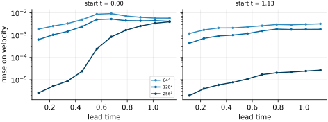
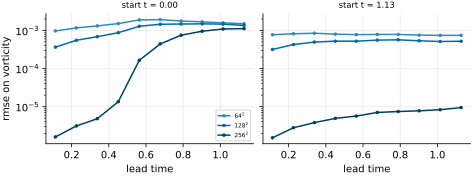
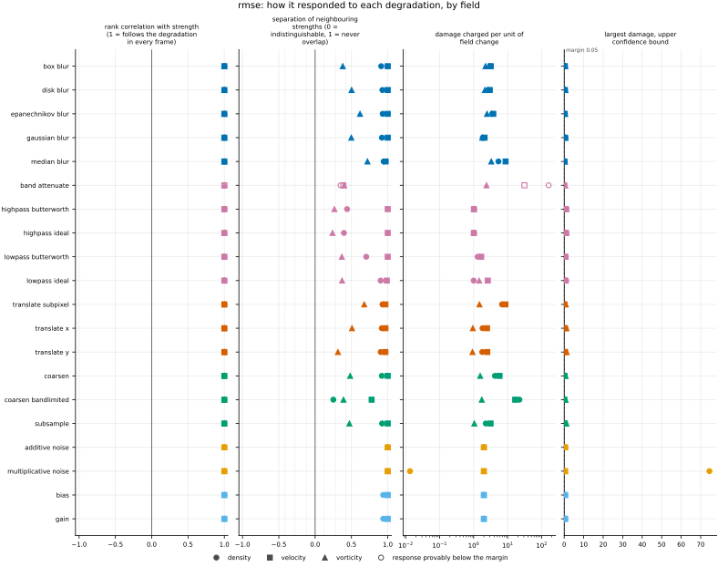
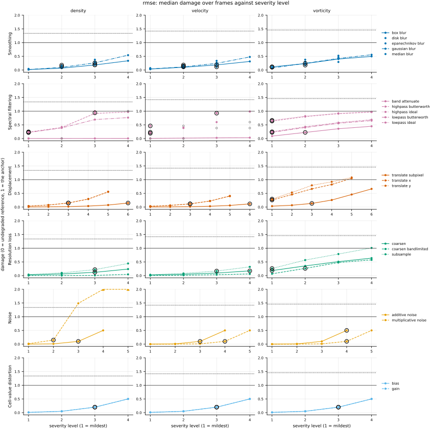
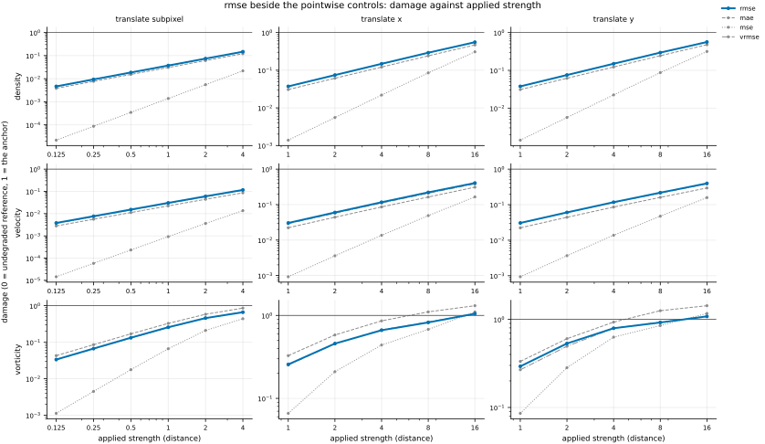

## Definition

For fields $f$ (reference) and $g$ (candidate) on the same analysis grid, with $C$
channels and $N$ cells per channel,

$$
\mathrm{RMSE}(f, g) = \sqrt{\frac{1}{CN} \sum_{c=1}^{C} \sum_{i=1}^{N}
\bigl( f_{c,i} - g_{c,i} \bigr)^2} \tag{1}
$$

that is, the square root of the mean squared error. For a vector field the channels are
pooled rather than reduced separately, and the uniform analysis grid gives every cell
equal weight.

The square root is a monotone function, so Equation (1) orders any set of candidates
exactly as the mean squared error does. It changes the units and the spacing between
scores, never the ranking.

The per-cell map stored beside the scalar is the *squared* error, and the declared
reduction is therefore `sqrt_mean` rather than `mean`: averaging the map gives the mean
squared error, and the metric is the square root of that.

### Boundary handling

None. The operation is local to each cell, so no neighbourhood is ever consulted and no
boundary condition can enter.

### How its field reports it

Three fields report a root mean squared error. They agree on a one-channel field and reduce a
vector field differently; this bundle is the pooled form, and the per-channel form of the
machine-learning benchmarks is [rmse_channel_mean](../../metrics/rmse_channel_mean/card.md).

- **Numerical analysis and code verification** [@roy2005]. The object is the discrete $L^2$ norm
  of the discretisation error, $\bigl(\sum_n |f_{k,n} - f_{\mathrm{exact},n}|^2 / N\bigr)^{1/2}$
  over the $N$ mesh nodes of grid $k$, defined beside the $L^\infty$ norm (Sect. 2.5, Eq. 7) and
  applied to one variable at a time; it is Equation (1) on a one-channel field. The figure is the
  norm against the grid spacing $h$ on logarithmic axes, with first- and second-order slopes
  drawn for reference (Fig. 3, for mass density), and the statistic reported beside it is the
  observed order of accuracy, $p = \ln(L_{k+1}/L_k) / \ln r$ from two grids refined by the ratio
  $r$ against an exact solution (Eq. 8, plotted against $h$ in Fig. 4), or from three grids
  without one (Sect. 3.3.3, Eq. 18). The experiment is a manufactured or exact solution on
  systematically refined grids (Sect. 2.5; Table 1, five grids at $r = 2$). Roy gives no
  reduction for a vector unknown.
- **Weather verification** [@rasp2024]. The object is the RMSE of each variable and pressure
  level, area-weighted by latitude, with the mean over forecast initialisations inside the square
  root, which the paper notes agrees with the WMO and ECMWF definition (Sect. 4.3.1, Eq. 2). Wind
  is pooled: the vector RMSE sums the squared errors of the two components without dividing by
  two (Eq. 3), so it is the root mean square of the error vector's length. On velocity that is
  $\sqrt{2}$ times this bundle's value, which divides by the channel count in Equation (1). The
  figure is the RMSE against lead time, one panel per variable and one line per model (Fig. 4),
  with headline scorecards beside it (Figs. 1-2). The experiment is forecasts from every 00 and
  12 UTC initialisation of 2020 against ERA5, regridded conservatively to a common 1.5° grid
  (Sects. 4.1-4.2).
- **Machine-learning benchmarks for PDEs** [@takamoto2022; @ohana2024]. PDEBench tabulates the
  per-channel mean (`metric_func`), which is [rmse_channel_mean](../../metrics/rmse_channel_mean/card.md),
  but its curve of RMSE against the unrolled time step (Sect. 4.3, Fig. 5a and 5c) is computed in
  its code over a batch, space and channels pooled (`metrics`, `val_l2_time`): this bundle's
  object, one value per step. The Well keeps one RMSE per field (App. E.3) and averages over
  fields.

**The experiments here.** A refinement study against a known solution does not exist: the three
runs of `forecast_re5e4` are not a refinement sequence as they stand
(`docs/datasets/reynolds_ladder_2d.md`, "Can the three runs be read as a grid-refinement
sequence?"), and the study is written up in
[EXP-max_error-grid-convergence-with-a-known-solution](https://github.com/khegazy/pde_metrics/blob/main/proposals/EXP-max_error-grid-convergence-with-a-known-solution.md).
The error against lead time is drawn on `forecast_re5e4` (same page, "Forecast pairs"): one
model's predictions at ten prediction steps from two starting times, not the many
initialisations a verification year or a test set averages over, which
[EXP-nrmse-rollouts-over-many-initial-conditions](https://github.com/khegazy/pde_metrics/blob/main/proposals/EXP-nrmse-rollouts-over-many-initial-conditions.md)
writes up. Neither benchmark's mean over cases is applied here: each row is one frame, and the
harness summarises frames by medians. The metric also runs on the degradation ladder on
`kinet_re5e4`, on `sod_shock_tube`, on the member mean of `synthetic_ensemble` and on the Reynolds
ladder: it needs nothing but two fields on one grid.

## Performance

<!-- GENERATED performance: written by `python -m fmeval.cards evidence rmse --results results/comparison_1793829127 --results results/comparison_1793812304 --results results/comparison_1793812401 --results results/comparison_1793811840 --results results/comparison_1793829231`, do not edit -->



*As this metric's own field draws it, from run `comparison_1793811840`.* rmse on density against lead time, the physical time since the forecast started, one panel per start and one line per run, darker the finer the run's grid. Each point is one prediction step of one forecast.



*As this metric's own field draws it, from run `comparison_1793811840`.* rmse on velocity against lead time, the physical time since the forecast started, one panel per start and one line per run, darker the finer the run's grid. Each point is one prediction step of one forecast.



*As this metric's own field draws it, from run `comparison_1793811840`.* rmse on vorticity against lead time, the physical time since the forecast started, one panel per start and one line per run, darker the finer the run's grid. Each point is one prediction step of one forecast.



Four measured statistics for rmse, one row per degradation grouped by family and one marker per field. From left: the rank correlation between the metric and the applied strength within a frame, with the line showing the resampling interval; the separation of neighbouring strengths as Cliff's delta, where 0 means the metric cannot tell one strength from the next and the faint ticks at 0.12, 0.28 and 0.42 are Vargha and Delaney's small, medium and large anchors, for scale and not as grades; the damage charged per unit of field change at the harshest strength; and the upper confidence bound on the largest damage, beside the fixed margin of 0.05. A hollow marker is a field and degradation on which that bound lies below the margin, so the response is provably small. A missing marker is a statistic the analysis withheld, as the rank correlation is on an axis the metric is invariant to.



Median damage over frames against severity level for rmse, one row per family of degradation and one column per field, on one shared scale. The solid grey line is damage 1, the anchor (by default the field's own mean); the dotted black line is the damage assigned to the fake prediction with the right spectrum, where the run included it. The hollow black ring marks the first level at which the metric has moved a tenth of the way to the anchor. Hollow grey markers are strengths excluded for repeating a milder one or for doing nothing. Degradations with three or fewer usable levels are drawn as markers only; points beyond 2 either side are drawn as triangles at the edge. Damage is negative where a degradation moves the metric away from the anchor, as noise raises a single-field quantity the field's mean sets to zero.

**Trend: does the response follow the degradation?**

| test family | field | degradations | rank correlation | fraction of frames in order | weakest gap between neighbouring strengths |
|---|---|---|---|---|---|
| Displacement | density | 3 | 1 | 1 | 0.952 to 0.964 |
| Displacement | velocity | 3 | 1 | 1 | 0.984 |
| Displacement | vorticity | 3 | 1 | 1 | 0.657 to 0.838 |
| Cell-value distortion | density | 2 | 1 | 1 | 0.969 |
| Cell-value distortion | velocity | 2 | 1 | 1 | 1 |
| Cell-value distortion | vorticity | 2 | 1 | 1 | 1 |
| Resolution loss | density | 3 | 1 | 0.714 to 1 | 0.625 to 0.961 |
| Resolution loss | velocity | 3 | 1 | 1 | 0.889 to 1 |
| Resolution loss | vorticity | 3 | 1 | 1 | 0.695 to 0.741 |
| Smoothing | density | 5 | 1 | 1 | 0.955 to 0.972 |
| Smoothing | velocity | 5 | 1 | 1 | 0.986 to 1 |
| Smoothing | vorticity | 5 | 1 | 1 | 0.69 to 0.86 |
| Spectral filtering | density | 5 | 1 | 1 | 0.676 to 0.951 |
| Spectral filtering | velocity | 5 | 1 | 1 | 0.694 to 1 |
| Spectral filtering | vorticity | 5 | 1 | 1 | 0.62 to 0.7 |
| Noise | density | 2 | 1 | 1 | 1 |
| Noise | velocity | 2 | 1 | 1 | 1 |
| Noise | vorticity | 2 | 1 | 1 | 1 |

**Reactivity: how far does it move?**

| test family | field | change from clean at the harshest strength | elasticity | first strength detected |
|---|---|---|---|---|
| Displacement | density | — | 0.995 to 1 | level 3 |
| Displacement | velocity | — | 0.969 to 0.999 | level 3 |
| Displacement | vorticity | — | 0.684 to 0.993 | level 1 |
| Cell-value distortion | density | — | 1 | level 3 |
| Cell-value distortion | velocity | — | 1 | level 3 |
| Cell-value distortion | vorticity | — | 1 | level 3 |
| Resolution loss | density | — | 0.942 to 1.27 | level 3 |
| Resolution loss | velocity | — | 1.04 to 2.2 | level 3 |
| Resolution loss | vorticity | — | 0.737 to 1.43 | level 1 |
| Smoothing | density | — | 1.55 to 1.86 | level 2 |
| Smoothing | velocity | — | 1.08 to 1.15 | level 2 |
| Smoothing | vorticity | — | 0.876 to 1.15 | level 1 |
| Spectral filtering | density | — | 0.636 to 7.3 | level 1 |
| Spectral filtering | velocity | — | 0.643 to 1 | level 1 |
| Spectral filtering | vorticity | — | 0.47 to 1 | level 1 |
| Noise | density | — | 1 | level 2 |
| Noise | velocity | — | 1 | level 3 |
| Noise | vorticity | — | 0.999 to 1 | level 4 |
| trap test: fake prediction, right spectrum | density | — | — | damage 1.34 |
| trap test: fake prediction, right spectrum | velocity | — | — | damage 1.42 |
| trap test: fake prediction, right spectrum | vorticity | — | — | damage 1.46 |

**Consistency: how much does it vary from snapshot to snapshot?**

| test family | field | consistency, in the strength's units | snapshots per independent block |
|---|---|---|---|
| Displacement | density | 0.074 to 0.498 | 15 to 18 |
| Displacement | velocity | 0.0628 to 0.648 | 14 to 22 |
| Displacement | vorticity | 0.134 to 0.927 | 21 to 22 |
| Cell-value distortion | density | 0.0265 | 20 |
| Cell-value distortion | velocity | 0.00512 | 1 |
| Cell-value distortion | vorticity | 0.00868 | 21 |
| Resolution loss | density | 0.616 to 1.41 | 17 to 20 |
| Resolution loss | velocity | 0.483 to 1.5 | 22 |
| Resolution loss | vorticity | 0.838 to 1.06 | 22 |
| Smoothing | density | 0.00777 to 0.017 | 14 |
| Smoothing | velocity | 0.00525 to 0.017 | 21 to 22 |
| Smoothing | vorticity | 0.0115 to 0.0264 | 21 to 22 |
| Spectral filtering | density | 0.025 to 0.0976 | 15 to 20 |
| Spectral filtering | velocity | 0.00504 to 0.0938 | 1 to 22 |
| Spectral filtering | vorticity | 0.0321 to 0.0671 | 20 to 22 |
| Noise | density | 0.00022 to 0.0159 | 1 to 20 |
| Noise | velocity | 0.00168 to 0.00307 | 1 |
| Noise | vorticity | 0.00297 to 0.00519 | 21 |

One row per family of degradation and physical field; a cell gives the range over the degradations in that family. **Trend.** The rank correlation is the Spearman correlation between the strength and how far the metric has moved from its value on the undegraded field of the same frame, in the one direction it moves under that degradation, computed inside a single frame. A value of 1 means every strength moved it further than the last in every frame, whichever way it moves; a response that scatters to both sides scores near 0. The fraction of frames in order counts the frames with no exception. The weakest gap is the smallest Mann-Whitney overlap between two neighbouring strengths across frames: 1 means they never overlap, 0.5 that they cannot be told apart. **Reactivity.** The change from clean is the median, at the harshest strength, of the departure from the undegraded value of the same frame over the size of that value: 0.3 means 30%. It does not exist for this metric, whose undegraded value is exactly zero; the damage below is its relative reading. The elasticity is the percentage change of that departure per percentage change in strength over the mildest strengths. First strength detected is the mildest at which the metric has moved a tenth of the way to the anchor; **damage** reads that 0-to-1 scale as a number. A dash means the measurement is not defined there. A metric's reactivity scales with the power it is expressed in: mean squared error's elasticity is twice root-mean-square error's, though the two carry the same information, so compare magnitudes across metrics with that in mind. **Consistency** is how much the response varies from snapshot to snapshot relative to its size, in the strength's units; the snapshots of one trajectory are correlated, and the last column is how many consecutive snapshots one independent block spans.

These tables report what was measured and grade none of the measurements. What the numbers mean for this metric is written in the subsections below, beside the test that produced each number.

**Profile.**

| field | selectivity | charges most for | charges least for | response provably below 0.05 at 90% on | elasticity to a sub-pixel shift, against severity (distance) | compute cost (x cheapest in this run) |
|---|---|---|---|---|---|---|
| density | 0.903 | `band_attenuate` | `multiplicative_noise` | `band_attenuate` | 1 | 1.6 |
| velocity | 0.635 | `band_attenuate` | `highpass_ideal` | `band_attenuate` | 0.999 | 2.48 |
| vorticity | 0.104 | `median_blur` | `translate_y` | — | 0.993 | 1.36 |

One row per physical field. **Selectivity** is how concentrated the metric's response is on a few degradations, measured per unit of field change: 0 means it charges every degradation the same, as mean squared error does by construction, and values toward 1 that one degradation carries most of it. **Charges most and least for** name the two ends of that profile. **Response provably below** lists degradations on which the upper confidence bound of the largest damage lies below the margin -- an equivalence test, so an entry says the response is provably small, not merely not significant; a dash means no degradation met the bound. **Elasticity** is the slope of log damage against log shift over the smallest shifts: 1 means damage grows in proportion to the shift, 2 with its square. **Compute cost** is wall-clock per evaluation over the cheapest metric and field in the same run.

<!-- END GENERATED performance -->

## Intuition

Root mean squared error is the mean squared error carried back into the units of the
field. Squaring the differences, averaging, then taking the square root gives a number
that reads like a typical error size rather than a typical error size squared, which is
the only reason to prefer it to the squared form.

Because the square root is monotone, it can never disagree with the mean squared error
about which of two candidates is better. Whatever ranking one produces, the other
produces too. What changes is the spacing: on a four-by-four grid, with one candidate
that moved a bright square by a cell and another that halved its brightness,

```
reference        moved one cell    half brightness
0 0 0 0          0 0 0 0           0    0    0    0
0 1 1 0          0 0 1 1           0   0.5  0.5   0
0 1 1 0          0 0 1 1           0   0.5  0.5   0
0 0 0 0          0 0 0 0           0    0    0    0

                 rmse = 0.5        rmse = 0.25
```

the displaced candidate scores twice the damped one, where the squared error made it four
times. The underlying preference is identical; the square root simply compresses it.

What this metric ignores is everything the squared error ignores: the arrangement of the
errors, and therefore position.

## Reading the output

The value runs from zero upwards with no upper limit, in the field's own units, so
numbers from a density field and a vorticity field cannot be compared. Lower is better,
and zero means the fields are identical cell for cell. It is directly readable as an error
size, which is what recommends it over the squared form for reporting.

There is no value that counts as good in the abstract; it depends on the variance of the
field being predicted, which is why the suite reports damage alongside it.

Comparisons across models on the same field, dataset and analysis grid are the intended
use. Comparisons across fields need normalising — that is what `vrmse` and `nrmse` are for. Comparisons
across resolutions are invalid as they stand, because the mean over cells reweights the
small scales when the grid is refined; compare on a common analysis grid.

One comparison to make carefully: ranking models by RMSE and by MSE always agrees, so
reporting both adds no information about which model is better.

## Limitations

Sharing an ordering with mean squared error means sharing every blind spot mean squared
error has. A displaced feature is penalised twice, once where it should be and once where
it is, and the response to sub-cell displacement is quadratic — RMSE inherits that even
though its own numbers look linear, because the square root is applied after the average,
not per cell. Reading the score as though it responded linearly to displacement is the
mistake this metric invites.

It also cannot be compared across fields with different units, and the stored per-cell map
does not average to the metric value, which will silently mislead any consumer that
assumes it does.

## Results

<!-- GENERATED run: written by `python -m fmeval.cards evidence rmse --results results/comparison_1793829127 --results results/comparison_1793812304 --results results/comparison_1793812401 --results results/comparison_1793811840 --results results/comparison_1793829231`, do not edit -->

Measured on `kinet_re5e4`, frames 2000 to 10000 (161 frames of developed flow), on the 256 analysis grid, seed 20260807, at commit `adbdc88e4950`. Run `comparison_1793829127`.

Every number in this section comes from that run, except in the subsections headed with another experiment and in a figure whose caption names another run, each of which names its own run. Regenerate with `python -m fmeval.cards evidence <name> --results results/comparison_1793829127 --results results/comparison_1793812304 --results results/comparison_1793812401 --results results/comparison_1793811840 --results results/comparison_1793829231`.

<!-- END GENERATED run -->

Each subsection links to the degradations that subsection reports. What those degradations
do, and what their strength numbers mean, is documented on their own pages.

<!-- GENERATED experiments: written by `python -m fmeval.cards catalog`, do not edit -->

**Across the experiments.**

| experiment | what a run on it is evidence of | on this card |
|---|---|---|
| `kinet_re5e4` | developed flow | measured, run `comparison_1793829127`: the main results |
| `kinet_re1e6` | developed flow at Re = 1e6, twenty times the Reynolds number of kinet_re5e4, from the same initial condition | measured, run `comparison_1793829231`: under *On `kinet_re1e6`* |
| `synthetic_ensemble` | a calibrated null: evidence that the estimator computes what it claims to compute, and nothing about turbulence | measured, run `comparison_1793812401`: under *On `synthetic_ensemble`*; on this dataset the metric scores the member mean of the ensemble |
| `sod_shock_tube` | an analytic check: evidence that the metric locates and scores a known shock correctly, and nothing about turbulence | measured, run `comparison_1793812304`: under *On `sod_shock_tube`* |
| `forecast_re5e4` | real predictions scored against their targets at each prediction step; who produced the predictions, a trained model or a coarser solver, is not recorded | measured, run `comparison_1793811840`: under *On `forecast_re5e4`* |

One row per dataset a card may cite (`configs/cards/default.yaml`). *Measured* names the run the card cites: the main results are `## Performance` and the subsections below, and every other run has its own subsection headed with its dataset. *Not applicable* gives the reason: one that follows from what the metric declares and what the dataset offers, or one a person wrote on the card (`not_run` in `card.yaml`) because the result would carry no information. *Not yet run* means the metric can run there and the card cites no run on it yet.

<!-- END GENERATED experiments -->

### Smoothing

[gaussian_blur](../../degradations/gaussian_blur/card.md) ·
[box_blur](../../degradations/box_blur/card.md) ·
[median_blur](../../degradations/median_blur/card.md)

<!-- GENERATED results_smoothing: written by `python -m fmeval.cards evidence rmse --results results/comparison_1793829127 --results results/comparison_1793812304 --results results/comparison_1793812401 --results results/comparison_1793811840 --results results/comparison_1793829231`, do not edit -->

| degradation | field | strengths | rank correlation | fraction of frames in the right order | weakest gap between neighbouring strengths |
|---|---|---|---|---|---|
| `box_blur` | density | 4 | 1 | 1 | 0.955 |
| `box_blur` | velocity | 4 | 1 | 1 | 1 |
| `box_blur` | vorticity | 4 | 1 | 1 | 0.69 |
| `disk_blur` | density | 3 | 1 | 1 | 0.963 |
| `disk_blur` | velocity | 3 | 1 | 1 | 1 |
| `disk_blur` | vorticity | 3 | 1 | 1 | 0.751 |
| `epanechnikov_blur` | density | 3 | 1 | 1 | 0.965 |
| `epanechnikov_blur` | velocity | 3 | 1 | 1 | 1 |
| `epanechnikov_blur` | vorticity | 3 | 1 | 1 | 0.809 |
| `gaussian_blur` | density | 4 | 1 | 1 | 0.96 |
| `gaussian_blur` | velocity | 4 | 1 | 1 | 1 |
| `gaussian_blur` | vorticity | 4 | 1 | 1 | 0.749 |
| `median_blur` | density | 3 | 1 | 1 | 0.972 |
| `median_blur` | velocity | 3 | 1 | 1 | 0.986 |
| `median_blur` | vorticity | 3 | 1 | 1 | 0.86 |

<!-- END GENERATED results_smoothing -->

The ordering statistics in this and the next four tables are those of
[mse](../../metrics/mse/card.md) exactly: the square root is monotone, so it changes no rank and no
overlap. Every blur is ordered in every frame on every field, with a rank correlation of 1; on
vorticity neighbouring strengths overlap more, with weakest gaps from 0.69 to 0.86. The sizes are
square roots of `mse`'s: the largest damage is 0.566 on density and 0.758 on vorticity under
`gaussian_blur`, and the elasticity on density is 1.55 to 1.86 in the Reactivity table, half of
the squared error's.

### Spectral filtering

[lowpass_ideal](../../degradations/lowpass_ideal/card.md) ·
[lowpass_butterworth](../../degradations/lowpass_butterworth/card.md) ·
[highpass_ideal](../../degradations/highpass_ideal/card.md) ·
[highpass_butterworth](../../degradations/highpass_butterworth/card.md)

<!-- GENERATED results_spectral: written by `python -m fmeval.cards evidence rmse --results results/comparison_1793829127 --results results/comparison_1793812304 --results results/comparison_1793812401 --results results/comparison_1793811840 --results results/comparison_1793829231`, do not edit -->

| degradation | field | strengths | rank correlation | fraction of frames in the right order | weakest gap between neighbouring strengths |
|---|---|---|---|---|---|
| `band_attenuate` | density | 4 | 1 | 1 | 0.676 |
| `band_attenuate` | velocity | 4 | 1 | 1 | 0.694 |
| `band_attenuate` | vorticity | 4 | 1 | 1 | 0.7 |
| `highpass_butterworth` | density | 4 | 1 | 1 | 0.72 |
| `highpass_butterworth` | velocity | 3 | 1 | 1 | 1 |
| `highpass_butterworth` | vorticity | 4 | 1 | 1 | 0.633 |
| `highpass_ideal` | density | 3 | 1 | 1 | 0.698 |
| `highpass_ideal` | velocity | 2 | 1 | 1 | 1 |
| `highpass_ideal` | vorticity | 4 | 1 | 1 | 0.62 |
| `lowpass_butterworth` | density | 4 | 1 | 1 | 0.852 |
| `lowpass_butterworth` | velocity | 3 | 1 | 1 | 1 |
| `lowpass_butterworth` | vorticity | 4 | 1 | 1 | 0.684 |
| `lowpass_ideal` | density | 3 | 1 | 1 | 0.951 |
| `lowpass_ideal` | velocity | 2 | 1 | 1 | 0.993 |
| `lowpass_ideal` | vorticity | 4 | 1 | 1 | 0.685 |

<!-- END GENERATED results_spectral -->

Every filter is ordered in every frame, with a rank correlation of 1, but neighbouring strengths
overlap more than under the blurs: the weakest gaps are 0.62 to 0.7 on vorticity and down to
0.676 on density under `band_attenuate`. At
their harshest the ideal and Butterworth filters reach about the damage of the field's mean: the
largest damage is 1.06 on density under `lowpass_ideal` and 1.27 on vorticity under
`highpass_ideal`. `band_attenuate` is the one degradation on which the response is provably below
0.05 on density and velocity (Profile table), with a largest damage of 0.01 and 0.0446; on
vorticity it reaches 0.605.

### Displacement

[translate_x](../../degradations/translate/card.md) ·
[translate_subpixel](../../degradations/translate_subpixel/card.md)

<!-- GENERATED results_geometric: written by `python -m fmeval.cards evidence rmse --results results/comparison_1793829127 --results results/comparison_1793812304 --results results/comparison_1793812401 --results results/comparison_1793811840 --results results/comparison_1793829231`, do not edit -->

| degradation | field | strengths | rank correlation | fraction of frames in the right order | weakest gap between neighbouring strengths |
|---|---|---|---|---|---|
| `translate_subpixel` | density | 6 | 1 | 1 | 0.964 |
| `translate_subpixel` | velocity | 6 | 1 | 1 | 0.984 |
| `translate_subpixel` | vorticity | 6 | 1 | 1 | 0.838 |
| `translate_x` | density | 5 | 1 | 1 | 0.959 |
| `translate_x` | velocity | 5 | 1 | 1 | 0.984 |
| `translate_x` | vorticity | 5 | 1 | 1 | 0.754 |
| `translate_y` | density | 5 | 1 | 1 | 0.952 |
| `translate_y` | velocity | 5 | 1 | 1 | 0.984 |
| `translate_y` | vorticity | 5 | 1 | 1 | 0.657 |

<!-- END GENERATED results_geometric -->

The ordering is identical to mean squared error, by construction. The numbers are its square
root, so the elasticity to a sub-pixel shift in the Profile table is 1, 0.999 and 0.993 on
density, velocity and vorticity: the value grows in proportion to the shift because the squared
error underneath grows with its square. Over whole-cell shifts on vorticity the elasticity falls
to 0.684, and the largest damage under `translate_y` is 1.79, beyond the field's mean.

### Resolution loss

[coarsen](../../degradations/coarsen/card.md) ·
[coarsen_bandlimited](../../degradations/coarsen_bandlimited/card.md)

<!-- GENERATED results_resolution: written by `python -m fmeval.cards evidence rmse --results results/comparison_1793829127 --results results/comparison_1793812304 --results results/comparison_1793812401 --results results/comparison_1793811840 --results results/comparison_1793829231`, do not edit -->

| degradation | field | strengths | rank correlation | fraction of frames in the right order | weakest gap between neighbouring strengths |
|---|---|---|---|---|---|
| `coarsen` | density | 4 | 1 | 1 | 0.96 |
| `coarsen` | velocity | 4 | 1 | 1 | 1 |
| `coarsen` | vorticity | 4 | 1 | 1 | 0.741 |
| `coarsen_bandlimited` | density | 4 | 1 | 0.714 | 0.625 |
| `coarsen_bandlimited` | velocity | 4 | 1 | 1 | 0.889 |
| `coarsen_bandlimited` | vorticity | 4 | 1 | 1 | 0.695 |
| `subsample` | density | 4 | 1 | 1 | 0.961 |
| `subsample` | velocity | 4 | 1 | 1 | 1 |
| `subsample` | vorticity | 4 | 1 | 1 | 0.736 |

<!-- END GENERATED results_resolution -->

Every coarsening is ordered with a rank correlation of 1. They differ in size. The largest
damage under `coarsen` is 0.249, 0.239 and 0.892 on density, velocity and vorticity, and under
`coarsen_bandlimited` 0.0575, 0.132 and 0.874. The two operators keep the same block means, so on
the smooth fields most of what `coarsen` charges is its staircase; on vorticity, whose structure
the coarse grid cannot hold, they nearly agree. Under the band-limited operator density is in the
right order in only 0.714 of frames, with a weakest gap of 0.625: its mildest strengths are
nearly free, and which of two neighbours is larger changes from frame to frame. The other
pointwise metrics, `spectrum_l2` and `h1_seminorm` show this on density too, and its cause is not
established; `issues/039` records what was ruled out.

### Noise

[additive_noise](../../degradations/additive_noise/card.md)

<!-- GENERATED results_stochastic: written by `python -m fmeval.cards evidence rmse --results results/comparison_1793829127 --results results/comparison_1793812304 --results results/comparison_1793812401 --results results/comparison_1793811840 --results results/comparison_1793829231`, do not edit -->

| degradation | field | strengths | rank correlation | fraction of frames in the right order | weakest gap between neighbouring strengths |
|---|---|---|---|---|---|
| `additive_noise` | density | 4 | 1 | 1 | 1 |
| `additive_noise` | velocity | 4 | 1 | 1 | 1 |
| `additive_noise` | vorticity | 4 | 1 | 1 | 1 |
| `multiplicative_noise` | density | 5 | 1 | 1 | 1 |
| `multiplicative_noise` | velocity | 5 | 1 | 1 | 1 |
| `multiplicative_noise` | vorticity | 5 | 1 | 1 | 1 |

<!-- END GENERATED results_stochastic -->

Both noises are ordered in every frame on every field, and neighbouring strengths never overlap
(weakest gap 1). The elasticity is 1: either noise adds an error proportional to its amplitude,
and this metric is in the field's units. Multiplicative noise on density reaches a largest damage
of 75.1, because it scales the whole density, mean of about 1 included, while the anchor measures
only the fluctuation about that mean (our reading, as on `mse`'s card).

### Trap tests

[gaussian_impostor](../../degradations/gaussian_impostor/card.md) ·
[uncorrelated](../../degradations/random_large_translation/card.md)

<!-- GENERATED results_canaries: written by `python -m fmeval.cards evidence rmse --results results/comparison_1793829127 --results results/comparison_1793812304 --results results/comparison_1793812401 --results results/comparison_1793811840 --results results/comparison_1793829231`, do not edit -->

| field | damage assigned to the fake prediction | closest real degradation | damage of the reference moved far away | value on the anchor |
|---|---|---|---|---|
| density | 1.34 | `multiplicative_noise=0.01` | 1.21 | 0.00672 |
| velocity | 1.42 | `highpass_ideal=4.02293` | 1.75 | 0.0396 |
| vorticity | 1.46 | `translate_y=16` | 1.54 | 0.00248 |

The fake prediction here has exactly the reference field's amplitude spectrum and completely scrambled structure. Damage 1 is what the anchor scores, by default the reference's own spatial mean, a prediction that knows the mean and nothing else. The damage column therefore says how close to useless this metric considers that fake prediction: a low number means the metric was fooled. The third column translates the same number into an ordinary degradation whose damage the fake prediction matches, which is easier to picture. The fourth is the reference moved by a large random offset, the right statistics in the wrong place; where a field's energy sits in its largest scales that copy stays partly correlated with the reference, so it is not the score of an unrelated field.

<!-- END GENERATED results_canaries -->

The phase-scrambled fake prediction scores worse than the field's mean on every field, with
damage 1.34, 1.42 and 1.46 on density, velocity and vorticity. Here damage is the error over the
root mean square of the reference's fluctuation, so a field with the reference's mean and
variance and no relation to it would score about $\sqrt{2} \approx 1.41$ (our derivation: its
mean squared error is twice the variance). The fake prediction sits near that value. As on
`mse`'s card, this trap test is aimed at metrics that depend only on the amplitude spectrum, and
a cell-by-cell error is not one of them.

### Compared with the other metrics

<!-- GENERATED results_summary: written by `python -m fmeval.cards evidence rmse --results results/comparison_1793829127 --results results/comparison_1793812304 --results results/comparison_1793812401 --results results/comparison_1793811840 --results results/comparison_1793829231`, do not edit -->

| compared with | density | velocity | vorticity |
|---|---|---|---|
| `rmse_channel_mean` | 1 | 0.999 | 1 |
| `mse` | 1 | 1 | 1 |
| `vrmse` | 1 | 0.999 | 0.999 |
| `nrmse` | 1 | 0.999 | 0.998 |
| `mae` | 0.988 | 0.995 | 0.973 |
| `max_error` | 0.956 | 0.933 | 0.947 |
| `max_error_channel_mean` | 0.956 | 0.937 | 0.947 |
| `wasserstein` | 0.886 | — | — |
| `h_minus_one` | 0.861 | 0.852 | 0.903 |
| `h1_relative` | 0.814 | 0.726 | 0.755 |
| `h1_seminorm` | 0.705 | 0.608 | 0.7 |
| `spectral_energy_flux` | — | 0.399 | — |
| `persistence_distance` | 0.377 | — | 0.179 |
| `spectrum_l2` | 0.26 | 0.361 | 0.171 |
| `increment_w1_by_separation` | 0.338 | 0.248 | 0.11 |
| `energy_distance` | 0.253 | 0.16 | -0.0148 |
| `increment_w1` | 0.262 | 0.146 | 0.00882 |
| `tail_exceedance` | 0.221 | 0.121 | -0.0606 |
| `palinstrophy` | — | — | -0.0876 |
| `increment_flatness` | -0.208 | -0.0934 | 0.114 |
| `tail_index` | 0.0219 | -0.16 | -0.112 |
| `kinetic_energy` | — | -0.249 | — |
| `enstrophy` | — | — | -0.252 |

Rank correlation over every degradation, computed separately for each physical field on the median value at each combination of degradation and strength, with the undegraded reference excluded. A dash marks a metric that does not run on that field. A metric with a target value enters by its distance from the target. Two metrics correlating near 1 put the degradations in the same order, but the two may still weight those degradations very differently. A correlation near 1 therefore means the two metrics are redundant for ranking models, not that the two are interchangeable as training losses.

<!-- END GENERATED results_summary -->

RMSE agrees with MSE on every ordering across every degradation, and correlates with it at
exactly 1. The other cell-by-cell errors sit just below 1 on every field and the two maximum
errors a little lower, while the metrics that compare spectra, increments or distributions order
the degradations differently. Reporting both RMSE and MSE is redundant for ranking; the choice
between them is a choice of units.

### Damage beside the other metrics

<!-- GENERATED results_damage_by_level: written by `python -m fmeval.cards evidence rmse --results results/comparison_1793829127 --results results/comparison_1793812304 --results results/comparison_1793812401 --results results/comparison_1793811840 --results results/comparison_1793829231`, do not edit -->



Median damage over frames against the applied strength, log-log, for rmse (bold, in colour) and the pointwise controls mae, mse, vrmse (thin, grey), one column per displacement degradation and one row per field. The grey line is damage 1, the anchor (by default the field's own mean). Parallel lines charge in the same proportion at every strength; a steeper line charges relatively more for the larger shifts, which is what decides whether two metrics are interchangeable as training losses. These are the same numbers as the table beneath.

**Displacement, density, `translate_subpixel`** (strength: distance).

| metric | 0.125 | 0.25 | 0.5 | 1 | 2 | 4 |
|---|---|---|---|---|---|---|
| `rmse` | 0.00466 | 0.00931 | 0.0186 | 0.0372 | 0.0743 | 0.148 |
| `mae` | 0.00383 | 0.00767 | 0.0153 | 0.0306 | 0.061 | 0.121 |
| `mse` | 2.17e-05 | 8.68e-05 | 0.000347 | 0.00138 | 0.00551 | 0.0219 |
| `vrmse` | 0.00463 | 0.00926 | 0.0185 | 0.037 | 0.0738 | 0.147 |

**Displacement, density, `translate_x`** (strength: distance).

| metric | 1 | 2 | 4 | 8 | 16 |
|---|---|---|---|---|---|
| `rmse` | 0.0372 | 0.0743 | 0.148 | 0.291 | 0.555 |
| `mae` | 0.0306 | 0.061 | 0.121 | 0.24 | 0.469 |
| `mse` | 0.00138 | 0.00551 | 0.0219 | 0.0849 | 0.307 |
| `vrmse` | 0.037 | 0.0738 | 0.147 | 0.29 | 0.55 |

**Displacement, density, `translate_y`** (strength: distance).

| metric | 1 | 2 | 4 | 8 | 16 |
|---|---|---|---|---|---|
| `rmse` | 0.0377 | 0.0752 | 0.15 | 0.295 | 0.562 |
| `mae` | 0.031 | 0.0616 | 0.122 | 0.244 | 0.476 |
| `mse` | 0.00142 | 0.00565 | 0.0224 | 0.0869 | 0.316 |
| `vrmse` | 0.0376 | 0.075 | 0.149 | 0.294 | 0.56 |

**Displacement, velocity, `translate_subpixel`** (strength: distance).

| metric | 0.125 | 0.25 | 0.5 | 1 | 2 | 4 |
|---|---|---|---|---|---|---|
| `rmse` | 0.00381 | 0.00762 | 0.0152 | 0.0304 | 0.06 | 0.117 |
| `mae` | 0.00279 | 0.00559 | 0.0112 | 0.0223 | 0.0441 | 0.0859 |
| `mse` | 1.45e-05 | 5.81e-05 | 0.000232 | 0.000924 | 0.0036 | 0.0136 |
| `vrmse` | 0.00365 | 0.00729 | 0.0146 | 0.029 | 0.0574 | 0.111 |

**Displacement, velocity, `translate_x`** (strength: distance).

| metric | 1 | 2 | 4 | 8 | 16 |
|---|---|---|---|---|---|
| `rmse` | 0.0304 | 0.06 | 0.117 | 0.221 | 0.406 |
| `mae` | 0.0223 | 0.0441 | 0.0859 | 0.163 | 0.31 |
| `mse` | 0.000924 | 0.0036 | 0.0136 | 0.0489 | 0.165 |
| `vrmse` | 0.029 | 0.0574 | 0.111 | 0.209 | 0.383 |

**Displacement, velocity, `translate_y`** (strength: distance).

| metric | 1 | 2 | 4 | 8 | 16 |
|---|---|---|---|---|---|
| `rmse` | 0.0306 | 0.0605 | 0.117 | 0.218 | 0.397 |
| `mae` | 0.0223 | 0.0442 | 0.0856 | 0.16 | 0.295 |
| `mse` | 0.000935 | 0.00366 | 0.0138 | 0.0473 | 0.158 |
| `vrmse` | 0.0303 | 0.0599 | 0.115 | 0.212 | 0.384 |

**Displacement, vorticity, `translate_subpixel`** (strength: distance).

| metric | 0.125 | 0.25 | 0.5 | 1 | 2 | 4 |
|---|---|---|---|---|---|---|
| `rmse` | 0.0335 | 0.0669 | 0.133 | 0.257 | 0.458 | 0.663 |
| `mae` | 0.0428 | 0.0854 | 0.169 | 0.328 | 0.582 | 0.86 |
| `mse` | 0.00112 | 0.00448 | 0.0176 | 0.066 | 0.21 | 0.44 |
| `vrmse` | 0.0329 | 0.0656 | 0.13 | 0.253 | 0.455 | 0.671 |

**Displacement, vorticity, `translate_x`** (strength: distance).

| metric | 1 | 2 | 4 | 8 | 16 |
|---|---|---|---|---|---|
| `rmse` | 0.257 | 0.458 | 0.663 | 0.824 | 1.05 |
| `mae` | 0.328 | 0.582 | 0.86 | 1.1 | 1.31 |
| `mse` | 0.066 | 0.21 | 0.44 | 0.679 | 1.1 |
| `vrmse` | 0.253 | 0.455 | 0.671 | 0.832 | 1.05 |

**Displacement, vorticity, `translate_y`** (strength: distance).

| metric | 1 | 2 | 4 | 8 | 16 |
|---|---|---|---|---|---|
| `rmse` | 0.293 | 0.532 | 0.793 | 0.922 | 1.08 |
| `mae` | 0.333 | 0.603 | 0.93 | 1.25 | 1.43 |
| `mse` | 0.0858 | 0.283 | 0.628 | 0.849 | 1.17 |
| `vrmse` | 0.268 | 0.495 | 0.793 | 0.927 | 1.08 |

Median damage over frames at every strength, this metric in the first row and the pointwise controls beneath it, all on the same 0-to-1 scale where 0 is the undegraded reference and 1 the anchor (by default the field's own mean); a dash means no damage scale on that field. The rank correlations under *Compared with the other metrics* say whether two metrics put the strengths in the same order; this table says how much each one charges for the same strength, which decides whether two metrics are interchangeable as training losses.

<!-- END GENERATED results_damage_by_level -->

On the log-log figure RMSE's line runs parallel to `mae`'s over the sub-cell shifts, both growing
in proportion to the shift, while `mse` climbs at twice the slope. `vrmse` lies close to this
metric's line but not on top of it: it scales each frame, and on velocity each component, by its
own spread. On vorticity the four lines converge near the anchor at the largest whole-cell
shifts.

### On `sod_shock_tube`

<!-- GENERATED results_on_sod_shock_tube: written by `python -m fmeval.cards evidence rmse --results results/comparison_1793829127 --results results/comparison_1793812304 --results results/comparison_1793812401 --results results/comparison_1793811840 --results results/comparison_1793829231`, do not edit -->

**An analytic check: evidence that the metric locates and scores a known shock correctly, and nothing about turbulence.**

Measured on `sod_shock_tube`, frames 0 to 9 (10 frames of an analytic check: evidence that the metric locates and scores a known shock correctly, and nothing about turbulence), on the 2048 analysis grid, seed 20260807, at commit `adbdc88e4950`. Run `comparison_1793812304`.

[additive_noise](../../degradations/additive_noise/card.md) ·
[band_attenuate](../../degradations/band_attenuate/card.md) ·
[bias](../../degradations/bias/card.md) ·
[box_blur](../../degradations/box_blur/card.md) ·
[coarsen](../../degradations/coarsen/card.md) ·
[coarsen_bandlimited](../../degradations/coarsen_bandlimited/card.md) ·
[disk_blur](../../degradations/disk_blur/card.md) ·
[epanechnikov_blur](../../degradations/epanechnikov_blur/card.md) ·
[gain](../../degradations/gain/card.md) ·
[gaussian_blur](../../degradations/gaussian_blur/card.md) ·
[gaussian_impostor](../../degradations/gaussian_impostor/card.md) ·
[highpass_butterworth](../../degradations/highpass_butterworth/card.md) ·
[highpass_ideal](../../degradations/highpass_ideal/card.md) ·
[lowpass_butterworth](../../degradations/lowpass_butterworth/card.md) ·
[lowpass_ideal](../../degradations/lowpass_ideal/card.md) ·
[mean_field](../../degradations/mean_field/card.md) ·
[median_blur](../../degradations/median_blur/card.md) ·
[multiplicative_noise](../../degradations/multiplicative_noise/card.md) ·
[subsample](../../degradations/subsample/card.md) ·
[translate_subpixel](../../degradations/translate_subpixel/card.md) ·
[translate_x](../../degradations/translate/card.md) ·
[uncorrelated](../../degradations/random_large_translation/card.md)

**Smoothing.**

| degradation | field | strengths | rank correlation | fraction of frames in the right order | weakest gap between neighbouring strengths |
|---|---|---|---|---|---|
| `box_blur` | density | 4 | 1 | 1 | 1 |
| `box_blur` | pressure | 4 | 1 | 1 | 1 |
| `box_blur` | velocity | 4 | 1 | 1 | 1 |
| `disk_blur` | density | 3 | 1 | 1 | 1 |
| `disk_blur` | pressure | 3 | 1 | 1 | 1 |
| `disk_blur` | velocity | 3 | 1 | 1 | 1 |
| `epanechnikov_blur` | density | 3 | 1 | 1 | 1 |
| `epanechnikov_blur` | pressure | 3 | 1 | 1 | 1 |
| `epanechnikov_blur` | velocity | 3 | 1 | 1 | 1 |
| `gaussian_blur` | density | 4 | 1 | 1 | 1 |
| `gaussian_blur` | pressure | 4 | 1 | 1 | 1 |
| `gaussian_blur` | velocity | 4 | 1 | 1 | 1 |

**Spectral filtering.**

| degradation | field | strengths | rank correlation | fraction of frames in the right order | weakest gap between neighbouring strengths |
|---|---|---|---|---|---|
| `band_attenuate` | density | 4 | 1 | 1 | 0.97 |
| `band_attenuate` | pressure | 4 | 1 | 1 | 1 |
| `band_attenuate` | velocity | 4 | 1 | 1 | 1 |
| `highpass_butterworth` | density | 2 | 1 | 1 | 1 |
| `highpass_butterworth` | pressure | 2 | 1 | 1 | 1 |
| `highpass_butterworth` | velocity | 4 | 1 | 1 | 0.78 |
| `highpass_ideal` | density | 1 | — | — | — |
| `highpass_ideal` | pressure | 1 | — | — | — |
| `highpass_ideal` | velocity | 4 | 1 | 1 | 0.78 |
| `lowpass_butterworth` | density | 1 | — | — | — |
| `lowpass_butterworth` | pressure | 2 | 1 | 1 | 1 |
| `lowpass_butterworth` | velocity | 4 | 1 | 1 | 1 |
| `lowpass_ideal` | density | 1 | — | — | — |
| `lowpass_ideal` | pressure | 2 | 1 | 1 | 1 |
| `lowpass_ideal` | velocity | 4 | 1 | 1 | 1 |

**Displacement.**

| degradation | field | strengths | rank correlation | fraction of frames in the right order | weakest gap between neighbouring strengths |
|---|---|---|---|---|---|
| `translate_subpixel` | density | 6 | 1 | 1 | 1 |
| `translate_subpixel` | pressure | 6 | 1 | 1 | 1 |
| `translate_subpixel` | velocity | 6 | 1 | 1 | 1 |
| `translate_x` | density | 5 | 1 | 1 | 1 |
| `translate_x` | pressure | 5 | 1 | 1 | 1 |
| `translate_x` | velocity | 5 | 1 | 1 | 1 |

**Resolution loss.**

| degradation | field | strengths | rank correlation | fraction of frames in the right order | weakest gap between neighbouring strengths |
|---|---|---|---|---|---|
| `coarsen` | density | 4 | 1 | 1 | 0.92 |
| `coarsen` | pressure | 4 | 1 | 1 | 1 |
| `coarsen` | velocity | 4 | 1 | 1 | 0.79 |
| `coarsen_bandlimited` | density | 4 | 1 | 1 | 1 |
| `coarsen_bandlimited` | pressure | 4 | 1 | 1 | 1 |
| `coarsen_bandlimited` | velocity | 4 | 1 | 1 | 1 |
| `subsample` | density | 4 | 1 | 1 | 0.81 |
| `subsample` | pressure | 4 | 1 | 1 | 0.79 |
| `subsample` | velocity | 4 | 1 | 1 | 0.79 |

**Noise.**

| degradation | field | strengths | rank correlation | fraction of frames in the right order | weakest gap between neighbouring strengths |
|---|---|---|---|---|---|
| `additive_noise` | density | 4 | 1 | 1 | 1 |
| `additive_noise` | pressure | 4 | 1 | 1 | 1 |
| `additive_noise` | velocity | 4 | 1 | 1 | 1 |
| `multiplicative_noise` | density | 5 | 1 | 1 | 1 |
| `multiplicative_noise` | pressure | 5 | 1 | 1 | 1 |
| `multiplicative_noise` | velocity | 5 | 1 | 1 | 1 |

**Cell-value distortion.**

| degradation | field | strengths | rank correlation | fraction of frames in the right order | weakest gap between neighbouring strengths |
|---|---|---|---|---|---|
| `bias` | density | 4 | 1 | 1 | 1 |
| `bias` | pressure | 4 | 1 | 1 | 1 |
| `bias` | velocity | 4 | 1 | 1 | 1 |
| `gain` | density | 4 | 1 | 1 | 1 |
| `gain` | pressure | 4 | 1 | 1 | 1 |
| `gain` | velocity | 4 | 1 | 1 | 1 |

**Trap tests.**

| field | damage assigned to the fake prediction | closest real degradation | damage of the reference moved far away | value on the anchor |
|---|---|---|---|---|
| density | 1.39 | `highpass_butterworth=2.77538` | 1.81 | 0.357 |
| pressure | 1.36 | `highpass_butterworth=3.73482` | 1.81 | 0.369 |
| velocity | 1.45 | `highpass_ideal=17.1163` | 1.47 | 0.416 |

The fake prediction here has exactly the reference field's amplitude spectrum and completely scrambled structure. Damage 1 is what the anchor scores, by default the reference's own spatial mean, a prediction that knows the mean and nothing else. The damage column therefore says how close to useless this metric considers that fake prediction: a low number means the metric was fooled. The third column translates the same number into an ordinary degradation whose damage the fake prediction matches, which is easier to picture. The fourth is the reference moved by a large random offset, the right statistics in the wrong place; where a field's energy sits in its largest scales that copy stays partly correlated with the reference, so it is not the score of an unrelated field.

<!-- END GENERATED results_on_sod_shock_tube -->

On the exact Sod solution the ordering statistics are again those of `mse`: every degradation
that keeps two or more distinct strengths is ordered with a rank correlation of 1 on density,
pressure and velocity, and the narrowest gaps are on velocity, 0.78 under both high-pass filters
and 0.79 under `coarsen` and `subsample`. The rows with one strength and no correlation are
spectral strengths that resolve to the same cutoff on a profile whose energy sits in its lowest
wavenumbers, as `mse`'s card describes.

A whole-cell shift of a jump changes a number of cells proportional to the shift, so the squared
error grows linearly with it and this metric with its square root (our derivation, set out on
`mse`'s card). The elasticity under `translate_x` is 0.522, 0.537 and 0.503 on density, pressure
and velocity, against 0.995 on density in the developed flow; under the sub-cell
`translate_subpixel` it is 0.972 on all three. The damage stays small, at most 0.0649, 0.0664 and
0.204 under `translate_x` and 0.0281, 0.0274 and 0.0988 under `coarsen`, because only the cells
near the shock, the contact and the rarefaction change while the anchor, the field's spatial mean,
is wrong along the whole tube. The phase-scrambled fake prediction is scored worse than the mean,
at 1.39, 1.36 and 1.45.

### On `synthetic_ensemble`

<!-- GENERATED results_on_synthetic_ensemble: written by `python -m fmeval.cards evidence rmse --results results/comparison_1793829127 --results results/comparison_1793812304 --results results/comparison_1793812401 --results results/comparison_1793811840 --results results/comparison_1793829231`, do not edit -->

**A calibrated null: evidence that the estimator computes what it claims to compute, and nothing about turbulence.**

Measured on `synthetic_ensemble`, frames 0 to 11 (12 frames of a calibrated null: evidence that the estimator computes what it claims to compute, and nothing about turbulence), on the 64 analysis grid, seed 20260807, at commit `adbdc88e4950`. Run `comparison_1793812401`.

[bias](../../degradations/bias/card.md) ·
[mean_field](../../degradations/mean_field/card.md) ·
[spread_deflate](../../degradations/spread_deflate/card.md) ·
[spread_inflate](../../degradations/spread_inflate/card.md)

**Cell-value distortion.**

| degradation | field | strengths | rank correlation | fraction of frames in the right order | weakest gap between neighbouring strengths |
|---|---|---|---|---|---|
| `bias` | density | 4 | 1 | 1 | 1 |

**Ensemble dispersion.**

| degradation | field | strengths | rank correlation | fraction of frames in the right order | weakest gap between neighbouring strengths |
|---|---|---|---|---|---|
| `spread_deflate` | density | 4 | — | — | — |
| `spread_inflate` | density | 4 | — | — | — |

**Trap tests.**

| field | damage assigned to the fake prediction | closest real degradation | damage of the reference moved far away | value on the anchor |
|---|---|---|---|---|
| density | — | — | — | 0.629 |

The fake prediction here has exactly the reference field's amplitude spectrum and completely scrambled structure. Damage 1 is what the anchor scores, by default the reference's own spatial mean, a prediction that knows the mean and nothing else. The damage column therefore says how close to useless this metric considers that fake prediction: a low number means the metric was fooled. The third column translates the same number into an ordinary degradation whose damage the fake prediction matches, which is easier to picture. The fourth is the reference moved by a large random offset, the right statistics in the wrong place; where a field's energy sits in its largest scales that copy stays partly correlated with the reference, so it is not the score of an unrelated field.

<!-- END GENERATED results_on_synthetic_ensemble -->

On the synthetic ensemble this metric scores the member mean against the reference, so it is
already 0.156 before any degradation: the mean of a finite ensemble is not the reference. A bias
raises it in order in every frame, with a rank correlation of 1 and no overlap between
neighbouring strengths, to a largest damage of 0.542. Narrowing or widening the members
(`spread_deflate`, `spread_inflate`) leaves the value unchanged in every frame, a largest
relative change of 0, which is why those rows carry no correlation: the dispersion of an ensemble
does not reach a metric of its mean. The ensemble metrics, such as `crps` and `spread_skill`, are
the ones that read it. The trap tests are not run on this dataset.

### On `forecast_re5e4`

<!-- GENERATED results_on_forecast_re5e4: written by `python -m fmeval.cards evidence rmse --results results/comparison_1793829127 --results results/comparison_1793812304 --results results/comparison_1793812401 --results results/comparison_1793811840 --results results/comparison_1793829231`, do not edit -->

**Real predictions scored against their targets at each prediction step; who produced the predictions, a trained model or a coarser solver, is not recorded.**

Measured on `forecast_re5e4`, frames 0 to 59 (60 frames of real predictions scored against their targets at each prediction step; who produced the predictions, a trained model or a coarser solver, is not recorded), on the 64 analysis grid, seed 20260807, at commit `adbdc88e4950`. Run `comparison_1793811840`.

[mean_field](../../degradations/mean_field/card.md)


rmse on density against lead time, the physical time since the forecast started, one panel per start and one line per run, darker the finer the run's grid. Each point is one prediction step of one forecast.


rmse on velocity against lead time, the physical time since the forecast started, one panel per start and one line per run, darker the finer the run's grid. Each point is one prediction step of one forecast.


rmse on vorticity against lead time, the physical time since the forecast started, one panel per start and one line per run, darker the finer the run's grid. Each point is one prediction step of one forecast.

**density, rmse on the prediction, at each lead time.**

| lead time | 64², start 0 | 128², start 0 | 256², start 0 | 64², start 1.13 | 128², start 1.13 | 256², start 1.13 |
|---|---|---|---|---|---|---|
| 0.1128 | 2.24e-05 | 6.76e-06 | 3.99e-08 | 0.00029 | 7.41e-05 | 2.83e-07 |
| 0.2255 | 6.05e-05 | 2.6e-05 | 1.14e-07 | 0.000302 | 0.000105 | 4.69e-07 |
| 0.3383 | 0.000214 | 9.9e-05 | 5.72e-07 | 0.000489 | 0.000176 | 7.97e-07 |
| 0.4511 | 0.000692 | 0.000351 | 3.06e-06 | 0.000543 | 0.000219 | 1.03e-06 |
| 0.5638 | 0.0021 | 0.00124 | 3.09e-05 | 0.000677 | 0.000268 | 1.44e-06 |
| 0.6766 | 0.00261 | 0.00117 | 0.000119 | 0.000718 | 0.000286 | 2.21e-06 |
| 0.7893 | 0.00206 | 0.000817 | 0.000193 | 0.00089 | 0.000389 | 2.72e-06 |
| 0.9021 | 0.00173 | 0.000861 | 0.000241 | 0.000899 | 0.000361 | 2.35e-06 |
| 1.015 | 0.00172 | 0.000925 | 0.000286 | 0.00101 | 0.000434 | 3.05e-06 |
| 1.128 | 0.00172 | 0.000877 | 0.00033 | 0.00111 | 0.000498 | 3.29e-06 |

**density, rmse damage, at each lead time.**

| lead time | 64², start 0 | 128², start 0 | 256², start 0 | 64², start 1.13 | 128², start 1.13 | 256², start 1.13 |
|---|---|---|---|---|---|---|
| 0.1128 | 0.0345 | 0.0105 | 6.21e-05 | 0.0408 | 0.0104 | 3.99e-05 |
| 0.2255 | 0.13 | 0.0552 | 0.000241 | 0.0451 | 0.0157 | 7.01e-05 |
| 0.3383 | 0.227 | 0.105 | 0.000611 | 0.0717 | 0.0258 | 0.000117 |
| 0.4511 | 0.327 | 0.165 | 0.00144 | 0.0778 | 0.0314 | 0.000147 |
| 0.5638 | 0.584 | 0.343 | 0.00858 | 0.103 | 0.0407 | 0.000218 |
| 0.6766 | 0.466 | 0.209 | 0.0212 | 0.103 | 0.0409 | 0.000316 |
| 0.7893 | 0.342 | 0.136 | 0.032 | 0.133 | 0.058 | 0.000405 |
| 0.9021 | 0.264 | 0.132 | 0.0368 | 0.133 | 0.0533 | 0.000348 |
| 1.015 | 0.247 | 0.132 | 0.0409 | 0.144 | 0.0619 | 0.000435 |
| 1.128 | 0.259 | 0.132 | 0.0499 | 0.169 | 0.0756 | 0.000499 |

**velocity, rmse on the prediction, at each lead time.**

| lead time | 64², start 0 | 128², start 0 | 256², start 0 | 64², start 1.13 | 128², start 1.13 | 256², start 1.13 |
|---|---|---|---|---|---|---|
| 0.1128 | 0.00184 | 0.000628 | 2.58e-06 | 0.00117 | 0.000431 | 1.95e-06 |
| 0.2255 | 0.00252 | 0.00103 | 5.12e-06 | 0.00169 | 0.00071 | 3.97e-06 |
| 0.3383 | 0.00329 | 0.00145 | 8.74e-06 | 0.00208 | 0.000914 | 5.84e-06 |
| 0.4511 | 0.00491 | 0.00241 | 2.39e-05 | 0.00209 | 0.000994 | 7.6e-06 |
| 0.5638 | 0.00863 | 0.00497 | 0.000241 | 0.00232 | 0.00117 | 1.08e-05 |
| 0.6766 | 0.00917 | 0.00523 | 0.000837 | 0.00261 | 0.00153 | 1.69e-05 |
| 0.7893 | 0.00718 | 0.00442 | 0.00165 | 0.00298 | 0.00185 | 2.04e-05 |
| 0.9021 | 0.00627 | 0.00434 | 0.00254 | 0.00288 | 0.00177 | 2.21e-05 |
| 1.015 | 0.00577 | 0.00442 | 0.0034 | 0.00304 | 0.00179 | 2.43e-05 |
| 1.128 | 0.00573 | 0.00413 | 0.00393 | 0.00318 | 0.00181 | 2.67e-05 |

**velocity, rmse damage, at each lead time.**

| lead time | 64², start 0 | 128², start 0 | 256², start 0 | 64², start 1.13 | 128², start 1.13 | 256², start 1.13 |
|---|---|---|---|---|---|---|
| 0.1128 | 0.0464 | 0.0158 | 6.5e-05 | 0.0296 | 0.0109 | 4.94e-05 |
| 0.2255 | 0.0635 | 0.0259 | 0.000129 | 0.0428 | 0.018 | 0.0001 |
| 0.3383 | 0.0828 | 0.0366 | 0.00022 | 0.0526 | 0.0231 | 0.000148 |
| 0.4511 | 0.124 | 0.0608 | 0.000603 | 0.0529 | 0.0252 | 0.000192 |
| 0.5638 | 0.218 | 0.125 | 0.00609 | 0.0587 | 0.0295 | 0.000275 |
| 0.6766 | 0.231 | 0.132 | 0.0211 | 0.0662 | 0.0387 | 0.000429 |
| 0.7893 | 0.181 | 0.112 | 0.0417 | 0.0755 | 0.0468 | 0.000517 |
| 0.9021 | 0.158 | 0.11 | 0.0641 | 0.073 | 0.0447 | 0.000559 |
| 1.015 | 0.146 | 0.112 | 0.0859 | 0.077 | 0.0453 | 0.000616 |
| 1.128 | 0.145 | 0.104 | 0.0993 | 0.0806 | 0.0459 | 0.000677 |

**vorticity, rmse on the prediction, at each lead time.**

| lead time | 64², start 0 | 128², start 0 | 256², start 0 | 64², start 1.13 | 128², start 1.13 | 256², start 1.13 |
|---|---|---|---|---|---|---|
| 0.1128 | 0.000974 | 0.000365 | 1.6e-06 | 0.000771 | 0.000317 | 1.52e-06 |
| 0.2255 | 0.00117 | 0.000553 | 3.11e-06 | 0.000818 | 0.000426 | 2.79e-06 |
| 0.3383 | 0.00132 | 0.000686 | 4.83e-06 | 0.000845 | 0.000496 | 3.81e-06 |
| 0.4511 | 0.00151 | 0.000873 | 1.35e-05 | 0.0008 | 0.000524 | 4.92e-06 |
| 0.5638 | 0.00189 | 0.00129 | 0.000164 | 0.000777 | 0.000524 | 5.67e-06 |
| 0.6766 | 0.00193 | 0.00145 | 0.000443 | 0.000786 | 0.000557 | 7.04e-06 |
| 0.7893 | 0.00177 | 0.00148 | 0.000752 | 0.000787 | 0.000568 | 7.45e-06 |
| 0.9021 | 0.00168 | 0.00149 | 0.000954 | 0.000756 | 0.000536 | 7.77e-06 |
| 1.015 | 0.00159 | 0.00146 | 0.00109 | 0.000743 | 0.000513 | 8.33e-06 |
| 1.128 | 0.0015 | 0.00136 | 0.00112 | 0.000743 | 0.000521 | 9.46e-06 |

**vorticity, rmse damage, at each lead time.**

| lead time | 64², start 0 | 128², start 0 | 256², start 0 | 64², start 1.13 | 128², start 1.13 | 256², start 1.13 |
|---|---|---|---|---|---|---|
| 0.1128 | 0.313 | 0.117 | 0.000515 | 0.328 | 0.135 | 0.000647 |
| 0.2255 | 0.378 | 0.179 | 0.00101 | 0.356 | 0.185 | 0.00121 |
| 0.3383 | 0.432 | 0.225 | 0.00158 | 0.376 | 0.22 | 0.00169 |
| 0.4511 | 0.5 | 0.288 | 0.00445 | 0.362 | 0.237 | 0.00223 |
| 0.5638 | 0.636 | 0.434 | 0.0553 | 0.357 | 0.241 | 0.0026 |
| 0.6766 | 0.676 | 0.511 | 0.156 | 0.366 | 0.26 | 0.00328 |
| 0.7893 | 0.651 | 0.542 | 0.276 | 0.371 | 0.268 | 0.00351 |
| 0.9021 | 0.646 | 0.574 | 0.367 | 0.359 | 0.255 | 0.00369 |
| 1.015 | 0.633 | 0.585 | 0.436 | 0.356 | 0.246 | 0.00399 |
| 1.128 | 0.621 | 0.562 | 0.463 | 0.358 | 0.251 | 0.00455 |

Every prediction of every forecast, nothing pooled: a cell is one prediction step of one forecast, a row the lead time (the physical time since the forecast started) and a column the forecast, named by its run's native grid and its starting time (`64², start 0` is `F-906861_64_Re_50k_from_256_to_64/forecast_t0-0`; `128², start 0` is `F-906861_64_Re_50k_from_256_to128/forecast_t0-0`; `256², start 0` is `F-906861_64/forecast_t0-0`; `64², start 1.13` is `F-906861_64_Re_50k_from_256_to_64/forecast_t0-1250`; `128², start 1.13` is `F-906861_64_Re_50k_from_256_to128/forecast_t0-2500`; `256², start 1.13` is `F-906861_64/forecast_t0-5000`). **Damage** is the prediction's departure from the target as a fraction of the anchor's in the same frame, by default the target's own spatial mean, so each step is scaled by its own target. A dash means no value there.

<!-- END GENERATED results_on_forecast_re5e4 -->

This is the figure two of this metric's fields draw: RMSE against lead time, one line per model
(weather verification, Fig. 4 of [@rasp2024]), and RMSE against the unrolled time step
(PDEBench, Fig. 5a of [@takamoto2022]). Such a figure is read, in our summary, for three things:
how fast the error grows along the forecast, whether the models keep their order at every lead
time or their curves cross, and how far the error stays from that of a forecast with no skill.
The damage tables give the last directly. On a forecast row the damage is this metric's value
over the value of the target's own spatial mean, that is the error over the target's
fluctuation, which on a one-channel field is The Well's VRMSE without its constant and its $N-1$.
A field with the target's mean and variance and no relation to it would score about
$\sqrt{2} \approx 1.41$ (our derivation, as under *Trap tests*).

- **Order.** The square root changes no ordering, so the runs keep `mse`'s order: on every field,
  at every lead time and from both starts, 64² above 128² above 256², in value and in damage;
  no two curves cross. The 256² run predicts on the reference grid itself, with a first-step
  error from t = 0 of 3.99e-08 on density against 6.76e-06 at 128² and 2.24e-05 at 64², so it is
  not a coarser solve, and the three runs are not a refinement sequence (issue 126).
- **Growth.** From t = 0, while the flow develops out of its initial state, the error grows by
  orders of magnitude: on density at 64² from 2.24e-05 to a peak of 0.00261 at lead time 0.6766,
  then back to 0.00172 at 1.128; at 256² from 3.99e-08 to 0.00033 at the last step. From t = 1.13,
  in the developed flow, the coarse runs grow slowly: on vorticity at 64² the damage stays between
  0.328 and 0.376 over all ten steps.
- **Distance from no skill.** No prediction reaches damage 1. The largest damage is 0.676, on
  vorticity at 64² from t = 0, against 0.584 on density and 0.231 on velocity in the same
  forecast; the damage peaks one step earlier than the raw error on density (lead time 0.5638
  against 0.6766), because the target's own fluctuation grows over the same steps.

Both sources average each lead time over many cases before drawing it, over a year of
initialisations inside the square root (Rasp et al., Eq. 2) or over a test batch (PDEBench); here
each cell is one forecast of one model from one of two starts
([EXP-nrmse-rollouts-over-many-initial-conditions](https://github.com/khegazy/pde_metrics/blob/main/proposals/EXP-nrmse-rollouts-over-many-initial-conditions.md)).
On velocity this bundle divides the pooled squared error by the two components, so its value is
$1/\sqrt{2}$ of WeatherBench 2's wind RMSE (Eq. 3), as the field subsection above sets out.

### On `kinet_re1e6`

<!-- GENERATED results_on_kinet_re1e6: written by `python -m fmeval.cards evidence rmse --results results/comparison_1793829127 --results results/comparison_1793812304 --results results/comparison_1793812401 --results results/comparison_1793811840 --results results/comparison_1793829231`, do not edit -->

**Developed flow at Re = 1e6, twenty times the Reynolds number of kinet_re5e4, from the same initial condition.**

Measured on `kinet_re1e6`, frames 2000 to 10000 (161 frames of developed flow at Re = 1e6, twenty times the Reynolds number of kinet_re5e4, from the same initial condition), on the 128 analysis grid, seed 20260807, at commit `adbdc88e4950`. Run `comparison_1793829231`.

[additive_noise](../../degradations/additive_noise/card.md) ·
[band_attenuate](../../degradations/band_attenuate/card.md) ·
[bias](../../degradations/bias/card.md) ·
[box_blur](../../degradations/box_blur/card.md) ·
[coarsen](../../degradations/coarsen/card.md) ·
[coarsen_bandlimited](../../degradations/coarsen_bandlimited/card.md) ·
[disk_blur](../../degradations/disk_blur/card.md) ·
[epanechnikov_blur](../../degradations/epanechnikov_blur/card.md) ·
[gain](../../degradations/gain/card.md) ·
[gaussian_blur](../../degradations/gaussian_blur/card.md) ·
[gaussian_impostor](../../degradations/gaussian_impostor/card.md) ·
[highpass_butterworth](../../degradations/highpass_butterworth/card.md) ·
[highpass_ideal](../../degradations/highpass_ideal/card.md) ·
[lowpass_butterworth](../../degradations/lowpass_butterworth/card.md) ·
[lowpass_ideal](../../degradations/lowpass_ideal/card.md) ·
[mean_field](../../degradations/mean_field/card.md) ·
[median_blur](../../degradations/median_blur/card.md) ·
[multiplicative_noise](../../degradations/multiplicative_noise/card.md) ·
[subsample](../../degradations/subsample/card.md) ·
[translate_subpixel](../../degradations/translate_subpixel/card.md) ·
[translate_x](../../degradations/translate/card.md) ·
[translate_y](../../degradations/translate/card.md) ·
[uncorrelated](../../degradations/random_large_translation/card.md)

**Smoothing.**

| degradation | field | strengths | rank correlation | fraction of frames in the right order | weakest gap between neighbouring strengths |
|---|---|---|---|---|---|
| `box_blur` | density | 4 | 1 | 1 | 0.957 |
| `box_blur` | velocity | 4 | 1 | 1 | 1 |
| `box_blur` | vorticity | 2 | 1 | 1 | 0.92 |
| `disk_blur` | density | 3 | 1 | 1 | 0.963 |
| `disk_blur` | velocity | 3 | 1 | 1 | 1 |
| `disk_blur` | vorticity | 2 | 1 | 1 | 0.881 |
| `epanechnikov_blur` | density | 3 | 1 | 1 | 0.966 |
| `epanechnikov_blur` | velocity | 3 | 1 | 1 | 1 |
| `epanechnikov_blur` | vorticity | 2 | 1 | 1 | 0.964 |
| `gaussian_blur` | density | 4 | 1 | 1 | 0.961 |
| `gaussian_blur` | velocity | 4 | 1 | 1 | 1 |
| `gaussian_blur` | vorticity | 4 | 1 | 1 | 0.907 |
| `median_blur` | density | 3 | 1 | 1 | 0.976 |
| `median_blur` | velocity | 3 | 1 | 1 | 0.98 |
| `median_blur` | vorticity | 1 | — | — | — |

**Spectral filtering.**

| degradation | field | strengths | rank correlation | fraction of frames in the right order | weakest gap between neighbouring strengths |
|---|---|---|---|---|---|
| `band_attenuate` | density | 4 | 1 | 1 | 0.692 |
| `band_attenuate` | velocity | 4 | 1 | 1 | 0.75 |
| `band_attenuate` | vorticity | 4 | 1 | 1 | 0.816 |
| `highpass_butterworth` | density | 4 | 1 | 1 | 0.728 |
| `highpass_butterworth` | velocity | 3 | 1 | 1 | 1 |
| `highpass_butterworth` | vorticity | 4 | 1 | 1 | 0.643 |
| `highpass_ideal` | density | 3 | 1 | 1 | 0.705 |
| `highpass_ideal` | velocity | 2 | 1 | 1 | 1 |
| `highpass_ideal` | vorticity | 4 | 1 | 1 | 0.628 |
| `lowpass_butterworth` | density | 4 | 1 | 1 | 0.852 |
| `lowpass_butterworth` | velocity | 3 | 1 | 1 | 1 |
| `lowpass_butterworth` | vorticity | 4 | 1 | 1 | 0.742 |
| `lowpass_ideal` | density | 3 | 1 | 1 | 0.957 |
| `lowpass_ideal` | velocity | 3 | 1 | 1 | 0.695 |
| `lowpass_ideal` | vorticity | 4 | 1 | 1 | 0.74 |

**Displacement.**

| degradation | field | strengths | rank correlation | fraction of frames in the right order | weakest gap between neighbouring strengths |
|---|---|---|---|---|---|
| `translate_subpixel` | density | 6 | 1 | 1 | 0.965 |
| `translate_subpixel` | velocity | 6 | 1 | 1 | 0.983 |
| `translate_subpixel` | vorticity | 6 | 1 | 1 | 0.774 |
| `translate_x` | density | 5 | 1 | 1 | 0.952 |
| `translate_x` | velocity | 5 | 1 | 1 | 0.976 |
| `translate_x` | vorticity | 5 | 1 | 1 | 0.774 |
| `translate_y` | density | 5 | 1 | 1 | 0.942 |
| `translate_y` | velocity | 5 | 1 | 1 | 0.989 |
| `translate_y` | vorticity | 5 | 1 | 1 | 0.671 |

**Resolution loss.**

| degradation | field | strengths | rank correlation | fraction of frames in the right order | weakest gap between neighbouring strengths |
|---|---|---|---|---|---|
| `coarsen` | density | 4 | 1 | 1 | 0.961 |
| `coarsen` | velocity | 4 | 1 | 1 | 1 |
| `coarsen` | vorticity | 4 | 1 | 1 | 0.798 |
| `coarsen_bandlimited` | density | 4 | 1 | 1 | 0.992 |
| `coarsen_bandlimited` | velocity | 4 | 1 | 1 | 0.948 |
| `coarsen_bandlimited` | vorticity | 4 | 1 | 1 | 0.745 |
| `subsample` | density | 4 | 1 | 1 | 0.965 |
| `subsample` | velocity | 4 | 1 | 1 | 1 |
| `subsample` | vorticity | 4 | 1 | 1 | 0.808 |

**Noise.**

| degradation | field | strengths | rank correlation | fraction of frames in the right order | weakest gap between neighbouring strengths |
|---|---|---|---|---|---|
| `additive_noise` | density | 4 | 1 | 1 | 1 |
| `additive_noise` | velocity | 4 | 1 | 1 | 1 |
| `additive_noise` | vorticity | 4 | 1 | 1 | 1 |
| `multiplicative_noise` | density | 5 | 1 | 1 | 1 |
| `multiplicative_noise` | velocity | 5 | 1 | 1 | 1 |
| `multiplicative_noise` | vorticity | 5 | 1 | 1 | 1 |

**Cell-value distortion.**

| degradation | field | strengths | rank correlation | fraction of frames in the right order | weakest gap between neighbouring strengths |
|---|---|---|---|---|---|
| `bias` | density | 4 | 1 | 1 | 0.97 |
| `bias` | velocity | 4 | 1 | 1 | 1 |
| `bias` | vorticity | 4 | 1 | 1 | 1 |
| `gain` | density | 4 | 1 | 1 | 0.97 |
| `gain` | velocity | 4 | 1 | 1 | 1 |
| `gain` | vorticity | 4 | 1 | 1 | 1 |

**Trap tests.**

| field | damage assigned to the fake prediction | closest real degradation | damage of the reference moved far away | value on the anchor |
|---|---|---|---|---|
| density | 1.36 | `multiplicative_noise=0.01` | 1.22 | 0.00686 |
| velocity | 1.34 | `highpass_ideal=4.08281` | 1.74 | 0.0397 |
| vorticity | 1.43 | `subsample=16` | 1.51 | 0.000676 |

The fake prediction here has exactly the reference field's amplitude spectrum and completely scrambled structure. Damage 1 is what the anchor scores, by default the reference's own spatial mean, a prediction that knows the mean and nothing else. The damage column therefore says how close to useless this metric considers that fake prediction: a low number means the metric was fooled. The third column translates the same number into an ordinary degradation whose damage the fake prediction matches, which is easier to picture. The fourth is the reference moved by a large random offset, the right statistics in the wrong place; where a field's energy sits in its largest scales that copy stays partly correlated with the reference, so it is not the score of an unrelated field.

<!-- END GENERATED results_on_kinet_re1e6 -->

At twenty times the Reynolds number, on a 128 analysis grid rather than 256, the ordering
statistics are again those of `mse`: every degradation with two or more usable strengths is
ordered in every frame with a rank correlation of 1, including `coarsen_bandlimited` on density,
in order in every frame here with a weakest gap of 0.992. On vorticity several strengths of the
blurs are excluded as repeats or no-ops. The fake prediction with the right spectrum is scored
worse than the field's mean, at damage 1.36, 1.34 and 1.43 on density, velocity and vorticity,
against 1.34, 1.42 and 1.46 on `kinet_re5e4`. On density the displacements cost more here: the
largest damage under `translate_y` is 1.03, against 0.592 on `kinet_re5e4`; on vorticity it is
1.7 against 1.79. The two runs differ in both Reynolds number and analysis grid, so this card does
not separate the two causes.

## References

\bibliography
