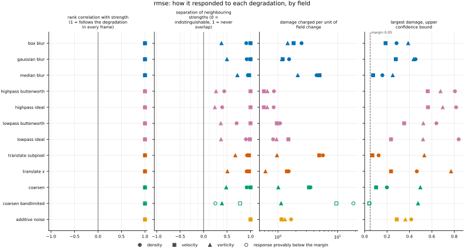
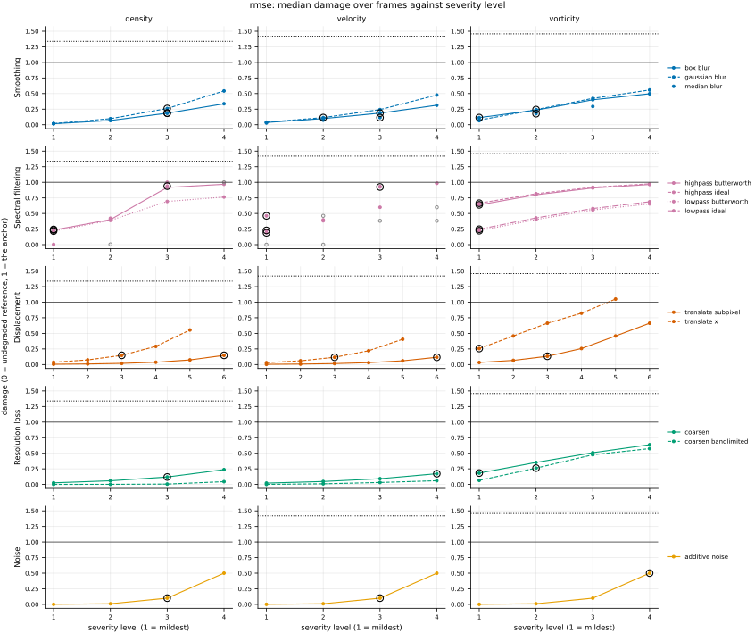
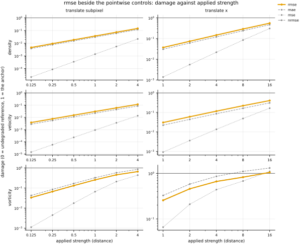

## Definition

For fields $f$ (reference) and $g$ (candidate) on the same analysis grid, with $C$
channels and $N$ cells per channel,

$$
\mathrm{RMSE}(f, g) = \sqrt{\frac{1}{CN} \sum_{c=1}^{C} \sum_{i=1}^{N}
\bigl( f_{c,i} - g_{c,i} \bigr)^2} \tag{1}
$$

that is, the square root of the mean squared error. For a vector field the channels are
pooled rather than reduced separately, and the uniform analysis grid gives every cell
equal weight.

The square root is a monotone function, so Equation (1) orders any set of candidates
exactly as the mean squared error does. It changes the units and the spacing between
scores, never the ranking.

The per-cell map stored beside the scalar is the *squared* error, and the declared
reduction is therefore `sqrt_mean` rather than `mean`: averaging the map gives the mean
squared error, and the metric is the square root of that.

### Boundary handling

None. The operation is local to each cell, so no neighbourhood is ever consulted and no
boundary condition can enter.

## Performance

<!-- GENERATED performance: written by `python -m fmeval.cards evidence rmse --results results/comparison_1790639359`, do not edit -->



Four measured statistics for rmse, one row per degradation grouped by family and one marker per field. From left: the rank correlation between the metric and the applied strength within a frame, with the line showing the resampling interval; the separation of neighbouring strengths as Cliff's delta, where 0 means the metric cannot tell one strength from the next and the faint ticks at 0.12, 0.28 and 0.42 are Vargha and Delaney's small, medium and large anchors, for scale and not as grades; the damage charged per unit of field change at the harshest strength; and the upper confidence bound on the largest damage, beside the fixed margin of 0.05. A hollow marker is a field and degradation on which that bound lies below the margin, so the response is provably small. A missing marker is a statistic the analysis withheld, as the rank correlation is on an axis the metric is invariant to.



Median damage over frames against severity level for rmse, one row per family of degradation and one column per field, on one shared scale. The solid grey line is damage 1, an unrelated field; the dotted black line is the damage assigned to the fake prediction with the right spectrum, where the run included it. The hollow black ring marks the first level at which the metric has moved a tenth of the way to an unrelated field. Hollow grey markers are strengths excluded for repeating a milder one or for doing nothing. Degradations with three or fewer usable levels are drawn as markers only; points above 2 are drawn as triangles at the top.

**Trend: does the response follow the degradation?**

| test family | field | degradations | rank correlation | fraction of frames in order | weakest gap between neighbouring strengths |
|---|---|---|---|---|---|
| Displacement | density | 2 | 1 | 1 | 0.959 to 0.964 |
| Displacement | velocity | 2 | 1 | 1 | 0.984 |
| Displacement | vorticity | 2 | 1 | 1 | 0.754 to 0.838 |
| Resolution loss | density | 2 | 1 | 0.714 to 1 | 0.625 to 0.96 |
| Resolution loss | velocity | 2 | 1 | 1 | 0.889 to 1 |
| Resolution loss | vorticity | 2 | 1 | 1 | 0.695 to 0.741 |
| Smoothing | density | 3 | 1 | 1 | 0.955 to 0.972 |
| Smoothing | velocity | 3 | 1 | 1 | 0.986 to 1 |
| Smoothing | vorticity | 3 | 1 | 1 | 0.69 to 0.86 |
| Spectral filtering | density | 4 | 1 | 1 | 0.698 to 0.951 |
| Spectral filtering | velocity | 4 | 1 | 1 | 0.993 to 1 |
| Spectral filtering | vorticity | 4 | 1 | 1 | 0.62 to 0.685 |
| Noise | density | 1 | 1 | 1 | 1 |
| Noise | velocity | 1 | 1 | 1 | 1 |
| Noise | vorticity | 1 | 1 | 1 | 1 |

**Reactivity: how far does it move?**

| test family | field | change from clean at the harshest strength | elasticity | first strength detected |
|---|---|---|---|---|
| Displacement | density | — | 0.995 to 1 | level 3 |
| Displacement | velocity | — | 0.969 to 0.999 | level 4 |
| Displacement | vorticity | — | 0.684 to 0.993 | level 1 |
| Resolution loss | density | — | 0.942 to 1.09 | level 4 |
| Resolution loss | velocity | — | 1.04 to 2.2 | level — |
| Resolution loss | vorticity | — | 0.737 to 1.43 | level 1 |
| Smoothing | density | — | 1.63 to 1.86 | level 3 |
| Smoothing | velocity | — | 1.08 to 1.15 | level 3 |
| Smoothing | vorticity | — | 0.876 to 1.15 | level 2 |
| Spectral filtering | density | — | 0.636 to 7.3 | level 1 |
| Spectral filtering | velocity | — | 0.643 to 0.995 | level 1 |
| Spectral filtering | vorticity | — | 0.47 to 0.51 | level 1 |
| Noise | density | — | 1 | level 4 |
| Noise | velocity | — | 1 | level 4 |
| Noise | vorticity | — | 0.999 | level 4 |
| trap test: fake prediction, right spectrum | density | — | — | damage 1.11 |
| trap test: fake prediction, right spectrum | velocity | — | — | damage 0.813 |
| trap test: fake prediction, right spectrum | vorticity | — | — | damage 0.95 |

**Consistency: how much does it vary from snapshot to snapshot?**

| test family | field | consistency, in the strength's units | snapshots per independent block |
|---|---|---|---|
| Displacement | density | 0.0684 to 0.395 | 20 |
| Displacement | velocity | 0.0628 to 0.317 | 14 to 18 |
| Displacement | vorticity | 0.134 to 0.814 | 21 |
| Resolution loss | density | 0.432 to 1.82 | 19 to 21 |
| Resolution loss | velocity | 0.508 to 1.5 | 22 |
| Resolution loss | vorticity | 0.838 to 1.06 | 22 |
| Smoothing | density | 0.00606 to 0.0162 | 19 to 20 |
| Smoothing | velocity | 0.00525 to 0.017 | 21 to 22 |
| Smoothing | vorticity | 0.0115 to 0.025 | 21 to 22 |
| Spectral filtering | density | 0.013 to 0.027 | 1 to 20 |
| Spectral filtering | velocity | 0.00504 to 0.0215 | 1 to 22 |
| Spectral filtering | vorticity | 0.0321 to 0.0658 | 20 to 22 |
| Noise | density | 0.00648 | 1 |
| Noise | velocity | 0.00307 | 1 |
| Noise | vorticity | 0.00519 | 21 |

One row per family of degradation and physical field; a cell gives the range over the degradations in that family. **Trend.** The rank correlation is the Spearman correlation between the strength and how far the metric has moved from its value on the undegraded field of the same frame, in the one direction it moves under that degradation, computed inside a single frame. A value of 1 means every strength moved it further than the last in every frame, whichever way it moves; a response that scatters to both sides scores near 0. The fraction of frames in order counts the frames with no exception. The weakest gap is the smallest Mann-Whitney overlap between two neighbouring strengths across frames: 1 means they never overlap, 0.5 that they cannot be told apart. **Reactivity.** The change from clean is the median, at the harshest strength, of the departure from the undegraded value of the same frame over the size of that value: 0.3 means 30%. It does not exist for this metric, whose undegraded value is exactly zero; the damage below is its relative reading. The elasticity is the percentage change of that departure per percentage change in strength over the mildest strengths. First strength detected is the mildest at which the metric has moved a tenth of the way to a field with no relation to the truth; **damage** reads that 0-to-1 scale as a number. A dash means the measurement is not defined there. A metric's reactivity scales with the power it is expressed in: mean squared error's elasticity is twice root-mean-square error's, though the two carry the same information, so compare magnitudes across metrics with that in mind. **Consistency** is how much the response varies from snapshot to snapshot relative to its size, in the strength's units; the snapshots of one trajectory are correlated, and the last column is how many consecutive snapshots one independent block spans.

These tables report what was measured and grade none of the measurements. What the numbers mean for this metric is written in the subsections below, beside the test that produced each number.

**Profile.**

| field | selectivity | charges most for | charges least for | response provably below 0.05 at 90% on | elasticity to a sub-pixel shift, against severity (distance) | compute cost (x cheapest in this run) |
|---|---|---|---|---|---|---|
| density | 0.636 | `coarsen_bandlimited` | `lowpass_ideal` | `coarsen_bandlimited` | 1 | 1 |
| velocity | 0.478 | `coarsen_bandlimited` | `highpass_ideal` | `coarsen_bandlimited` | 0.999 | 1.92 |
| vorticity | 0.12 | `median_blur` | `translate_x` | — | 0.993 | 1 |

One row per physical field. **Selectivity** is how concentrated the metric's response is on a few degradations, measured per unit of field change: 0 means it charges every degradation the same, as mean squared error does by construction, and values toward 1 that one degradation carries most of it. **Charges most and least for** name the two ends of that profile. **Response provably below** lists degradations on which the upper confidence bound of the largest damage lies below the margin -- an equivalence test, so an entry says the response is provably small, not merely not significant; a dash means no degradation met the bound. **Elasticity** is the slope of log damage against log shift over the smallest shifts: 1 means damage grows in proportion to the shift, 2 with its square. **Compute cost** is wall-clock per evaluation over the cheapest metric and field in the same run.

<!-- END GENERATED performance -->

## Intuition

Root mean squared error is the mean squared error carried back into the units of the
field. Squaring the differences, averaging, then taking the square root gives a number
that reads like a typical error size rather than a typical error size squared, which is
the only reason to prefer it to the squared form.

Because the square root is monotone, it can never disagree with the mean squared error
about which of two candidates is better. Whatever ranking one produces, the other
produces too. What changes is the spacing: on a four-by-four grid, with one candidate
that moved a bright square by a cell and another that halved its brightness,

```
reference        moved one cell    half brightness
0 0 0 0          0 0 0 0           0    0    0    0
0 1 1 0          0 0 1 1           0   0.5  0.5   0
0 1 1 0          0 0 1 1           0   0.5  0.5   0
0 0 0 0          0 0 0 0           0    0    0    0

                 rmse = 0.5        rmse = 0.25
```

the displaced candidate scores twice the damped one, where the squared error made it four
times. The underlying preference is identical; the square root simply compresses it.

What this metric ignores is everything the squared error ignores: the arrangement of the
errors, and therefore position.

## Reading the output

The value runs from zero upwards with no upper limit, in the field's own units, so
numbers from a density field and a vorticity field cannot be compared. Lower is better,
and zero means the fields are identical cell for cell. It is directly readable as an error
size, which is what recommends it over the squared form for reporting.

There is no value that counts as good in the abstract; it depends on the variance of the
field being predicted, which is why the suite reports damage alongside it.

Comparisons across models on the same field, dataset and analysis grid are the intended
use. Comparisons across fields need normalising — that is what NRMSE is for. Comparisons
across resolutions are invalid as they stand, because the mean over cells reweights the
small scales when the grid is refined; compare on a common analysis grid.

One comparison to make carefully: ranking models by RMSE and by MSE always agrees, so
reporting both adds no information about which model is better.

## Limitations

Sharing an ordering with mean squared error means sharing every blind spot mean squared
error has. A displaced feature is penalised twice, once where it should be and once where
it is, and the response to sub-cell displacement is quadratic — RMSE inherits that even
though its own numbers look linear, because the square root is applied after the average,
not per cell. Reading the score as though it responded linearly to displacement is the
mistake this metric invites.

It also cannot be compared across fields with different units, and the stored per-cell map
does not average to the metric value, which will silently mislead any consumer that
assumes it does.

## Results

<!-- GENERATED run: written by `python -m fmeval.cards evidence rmse --results results/comparison_1790639359`, do not edit -->

Measured on `kinet_re5e4`, frames 2000 to 10000 (161 frames of developed flow), on the 256 analysis grid, seed 20260807, at commit `ce78cb2d30d8` (working tree dirty). Run `comparison_1790639359`.

Every number in this section comes from that one run. Regenerate with `python -m fmeval.cards evidence <name> --results results/comparison_1790639359`.

<!-- END GENERATED run -->

Each subsection links to the degradations that subsection reports. What those degradations
do, and what their strength numbers mean, is documented on their own pages.

### Smoothing

[gaussian_blur](../../degradations/gaussian_blur/card.md) ·
[box_blur](../../degradations/box_blur/card.md) ·
[median_blur](../../degradations/median_blur/card.md)

<!-- GENERATED results_smoothing: written by `python -m fmeval.cards evidence rmse --results results/comparison_1790639359`, do not edit -->

| degradation | field | strengths | rank correlation | fraction of frames in the right order | weakest gap between neighbouring strengths |
|---|---|---|---|---|---|
| `box_blur` | density | 4 | 1 | 1 | 0.955 |
| `box_blur` | velocity | 4 | 1 | 1 | 1 |
| `box_blur` | vorticity | 4 | 1 | 1 | 0.69 |
| `gaussian_blur` | density | 4 | 1 | 1 | 0.96 |
| `gaussian_blur` | velocity | 4 | 1 | 1 | 1 |
| `gaussian_blur` | vorticity | 4 | 1 | 1 | 0.749 |
| `median_blur` | density | 3 | 1 | 1 | 0.972 |
| `median_blur` | velocity | 3 | 1 | 1 | 0.986 |
| `median_blur` | vorticity | 3 | 1 | 1 | 0.86 |

<!-- END GENERATED results_smoothing -->

### Spectral filtering

[lowpass_ideal](../../degradations/lowpass_ideal/card.md) ·
[lowpass_butterworth](../../degradations/lowpass_butterworth/card.md) ·
[highpass_ideal](../../degradations/highpass_ideal/card.md) ·
[highpass_butterworth](../../degradations/highpass_butterworth/card.md)

<!-- GENERATED results_spectral: written by `python -m fmeval.cards evidence rmse --results results/comparison_1790639359`, do not edit -->

| degradation | field | strengths | rank correlation | fraction of frames in the right order | weakest gap between neighbouring strengths |
|---|---|---|---|---|---|
| `highpass_butterworth` | density | 4 | 1 | 1 | 0.72 |
| `highpass_butterworth` | velocity | 3 | 1 | 1 | 1 |
| `highpass_butterworth` | vorticity | 4 | 1 | 1 | 0.633 |
| `highpass_ideal` | density | 3 | 1 | 1 | 0.698 |
| `highpass_ideal` | velocity | 2 | 1 | 1 | 1 |
| `highpass_ideal` | vorticity | 4 | 1 | 1 | 0.62 |
| `lowpass_butterworth` | density | 4 | 1 | 1 | 0.852 |
| `lowpass_butterworth` | velocity | 3 | 1 | 1 | 1 |
| `lowpass_butterworth` | vorticity | 4 | 1 | 1 | 0.684 |
| `lowpass_ideal` | density | 3 | 1 | 1 | 0.951 |
| `lowpass_ideal` | velocity | 2 | 1 | 1 | 0.993 |
| `lowpass_ideal` | vorticity | 4 | 1 | 1 | 0.685 |

<!-- END GENERATED results_spectral -->

### Displacement

[translate_x](../../degradations/translate/card.md) ·
[translate_subpixel](../../degradations/translate_subpixel/card.md)

<!-- GENERATED results_geometric: written by `python -m fmeval.cards evidence rmse --results results/comparison_1790639359`, do not edit -->

| degradation | field | strengths | rank correlation | fraction of frames in the right order | weakest gap between neighbouring strengths |
|---|---|---|---|---|---|
| `translate_subpixel` | density | 6 | 1 | 1 | 0.964 |
| `translate_subpixel` | velocity | 6 | 1 | 1 | 0.984 |
| `translate_subpixel` | vorticity | 6 | 1 | 1 | 0.838 |
| `translate_x` | density | 5 | 1 | 1 | 0.959 |
| `translate_x` | velocity | 5 | 1 | 1 | 0.984 |
| `translate_x` | vorticity | 5 | 1 | 1 | 0.754 |

<!-- END GENERATED results_geometric -->

The ordering is identical to mean squared error, by construction. The numbers are its
square root, so the response to sub-cell displacement is still quadratic underneath even
though the reported values change more gently.

### Resolution loss

[coarsen](../../degradations/coarsen/card.md) ·
[coarsen_bandlimited](../../degradations/coarsen_bandlimited/card.md)

<!-- GENERATED results_resolution: written by `python -m fmeval.cards evidence rmse --results results/comparison_1790639359`, do not edit -->

| degradation | field | strengths | rank correlation | fraction of frames in the right order | weakest gap between neighbouring strengths |
|---|---|---|---|---|---|
| `coarsen` | density | 4 | 1 | 1 | 0.96 |
| `coarsen` | velocity | 4 | 1 | 1 | 1 |
| `coarsen` | vorticity | 4 | 1 | 1 | 0.741 |
| `coarsen_bandlimited` | density | 4 | 1 | 0.714 | 0.625 |
| `coarsen_bandlimited` | velocity | 4 | 1 | 1 | 0.889 |
| `coarsen_bandlimited` | vorticity | 4 | 1 | 1 | 0.695 |

<!-- END GENERATED results_resolution -->

Both coarsenings are ordered correctly on every field, with a rank correlation of 1. They differ in size. At a factor of 16, `coarsen` costs 0.20, 0.10 and 0.42 of the unrelated-field value on density, velocity and vorticity, and `coarsen_bandlimited` 0.04, 0.03 and 0.37. The two operators keep the same block means, so on the smooth fields most of what `coarsen` charges is its staircase; on vorticity, whose structure the coarse grid genuinely cannot hold, they nearly agree. Under the band-limited operator density is in the right order in only 71% of frames: its damage at factors 2 and 4 is 0.001 and 0.002, and which of the two is larger changes from frame to frame. The other pointwise metrics, `spectrum_l2` and `h1_seminorm` show this on density too, and its
cause is not established; `issues/039` records what was ruled out.

### Noise

[additive_noise](../../degradations/additive_noise/card.md)

<!-- GENERATED results_stochastic: written by `python -m fmeval.cards evidence rmse --results results/comparison_1790639359`, do not edit -->

| degradation | field | strengths | rank correlation | fraction of frames in the right order | weakest gap between neighbouring strengths |
|---|---|---|---|---|---|
| `additive_noise` | density | 4 | 1 | 1 | 1 |
| `additive_noise` | velocity | 4 | 1 | 1 | 1 |
| `additive_noise` | vorticity | 4 | 1 | 1 | 1 |

<!-- END GENERATED results_stochastic -->

### Trap tests

[gaussian_impostor](../../degradations/gaussian_impostor/card.md) ·
[uncorrelated](../../degradations/random_large_translation/card.md)

<!-- GENERATED results_canaries: written by `python -m fmeval.cards evidence rmse --results results/comparison_1790639359`, do not edit -->

| field | damage assigned to the fake prediction | closest real degradation | value on an unrelated field |
|---|---|---|---|
| density | 1.11 | `lowpass_ideal=1.4029` | 0.0081 |
| velocity | 0.813 | `highpass_ideal=4.02293` | 0.0691 |
| vorticity | 0.95 | `translate_x=16` | 0.00381 |

The fake prediction here has exactly the reference field's amplitude spectrum and completely scrambled structure. Damage of 1 is what a field with no relation to the truth scores, so the damage column says how close to useless this metric considers that fake prediction: a low number means the metric was fooled. The third column translates the same number into an ordinary degradation whose damage the fake prediction matches, which is easier to picture.

<!-- END GENERATED results_canaries -->

### Compared with the other metrics

<!-- GENERATED results_summary: written by `python -m fmeval.cards evidence rmse --results results/comparison_1790639359`, do not edit -->

| compared with | rank correlation over every degradation |
|---|---|
| `mse` | 1 |
| `mae` | 0.986 |
| `nrmse` | 0.974 |
| `h_minus_one` | 0.937 |
| `h1_seminorm` | 0.708 |
| `spectrum_l2` | 0.147 |
| `increment_w1` | 0.0846 |
| `enstrophy` | -0.116 |
| `increment_flatness` | -0.135 |
| `palinstrophy` | -0.158 |
| `kinetic_energy` | -0.23 |

Computed on the median value at each combination of degradation and strength, over every degradation and physical field in the run, with the undegraded reference excluded. Two metrics correlating near 1 put the degradations in the same order, but the two may still weight those degradations very differently. A correlation near 1 therefore means the two metrics are redundant for ranking models, not that the two are interchangeable as training losses.

<!-- END GENERATED results_summary -->

RMSE agrees with MSE on every ordering across every degradation, which is what the
near-unit rank correlation between the cell-by-cell baselines reflects. Reporting both is
redundant for ranking; the choice between them is a choice of units.

### Damage beside the other metrics

<!-- GENERATED results_damage_by_level: written by `python -m fmeval.cards evidence rmse --results results/comparison_1790639359`, do not edit -->



Median damage over frames against the applied strength, log-log, for rmse (bold, in colour) and the pointwise controls mae, mse, nrmse (thin, grey), one column per displacement degradation and one row per field. The grey line is damage 1, an unrelated field. Parallel lines charge in the same proportion at every strength; a steeper line charges relatively more for the larger shifts, which is what decides whether two metrics are interchangeable as training losses. These are the same numbers as the table beneath.

**Displacement, density, `translate_subpixel`** (strength: distance).

| metric | 0.125 | 0.25 | 0.5 | 1 | 2 | 4 |
|---|---|---|---|---|---|---|
| `rmse` | 0.00386 | 0.00772 | 0.0154 | 0.0309 | 0.0616 | 0.123 |
| `mae` | 0.00328 | 0.00655 | 0.0131 | 0.0262 | 0.0521 | 0.103 |
| `mse` | 1.49e-05 | 5.97e-05 | 0.000238 | 0.000952 | 0.00379 | 0.015 |
| `nrmse` | 0.00362 | 0.00723 | 0.0145 | 0.0289 | 0.0576 | 0.115 |

**Displacement, density, `translate_x`** (strength: distance).

| metric | 1 | 2 | 4 | 8 | 16 |
|---|---|---|---|---|---|
| `rmse` | 0.0309 | 0.0616 | 0.123 | 0.242 | 0.46 |
| `mae` | 0.0262 | 0.0521 | 0.103 | 0.205 | 0.401 |
| `mse` | 0.000952 | 0.00379 | 0.015 | 0.0584 | 0.211 |
| `nrmse` | 0.0289 | 0.0576 | 0.115 | 0.226 | 0.43 |

**Displacement, velocity, `translate_subpixel`** (strength: distance).

| metric | 0.125 | 0.25 | 0.5 | 1 | 2 | 4 |
|---|---|---|---|---|---|---|
| `rmse` | 0.00218 | 0.00437 | 0.00873 | 0.0174 | 0.0344 | 0.0667 |
| `mae` | 0.00163 | 0.00325 | 0.0065 | 0.013 | 0.0257 | 0.05 |
| `mse` | 4.76e-06 | 1.91e-05 | 7.61e-05 | 0.000303 | 0.00118 | 0.00445 |
| `nrmse` | 0.00219 | 0.00437 | 0.00873 | 0.0174 | 0.0343 | 0.0667 |

**Displacement, velocity, `translate_x`** (strength: distance).

| metric | 1 | 2 | 4 | 8 | 16 |
|---|---|---|---|---|---|
| `rmse` | 0.0174 | 0.0344 | 0.0667 | 0.127 | 0.233 |
| `mae` | 0.013 | 0.0257 | 0.05 | 0.0951 | 0.18 |
| `mse` | 0.000303 | 0.00118 | 0.00445 | 0.016 | 0.0541 |
| `nrmse` | 0.0174 | 0.0343 | 0.0667 | 0.127 | 0.232 |

**Displacement, vorticity, `translate_subpixel`** (strength: distance).

| metric | 0.125 | 0.25 | 0.5 | 1 | 2 | 4 |
|---|---|---|---|---|---|---|
| `rmse` | 0.0218 | 0.0436 | 0.0865 | 0.167 | 0.298 | 0.432 |
| `mae` | 0.0225 | 0.045 | 0.0892 | 0.172 | 0.306 | 0.453 |
| `mse` | 0.000476 | 0.0019 | 0.00747 | 0.028 | 0.0889 | 0.187 |
| `nrmse` | 0.0219 | 0.0437 | 0.0868 | 0.169 | 0.304 | 0.447 |

**Displacement, vorticity, `translate_x`** (strength: distance).

| metric | 1 | 2 | 4 | 8 | 16 |
|---|---|---|---|---|---|
| `rmse` | 0.167 | 0.298 | 0.432 | 0.537 | 0.684 |
| `mae` | 0.172 | 0.306 | 0.453 | 0.581 | 0.69 |
| `mse` | 0.028 | 0.0889 | 0.187 | 0.288 | 0.468 |
| `nrmse` | 0.169 | 0.304 | 0.447 | 0.555 | 0.702 |

Median damage over frames at every strength, this metric in the first row and the pointwise controls beneath it, all on the same 0-to-1 scale where 0 is the undegraded reference and 1 an unrelated field; a dash means no damage scale on that field. The rank correlations under *Compared with the other metrics* say whether two metrics put the strengths in the same order; this table says how much each one charges for the same strength, which decides whether two metrics are interchangeable as training losses.

<!-- END GENERATED results_damage_by_level -->

## References

\bibliography
