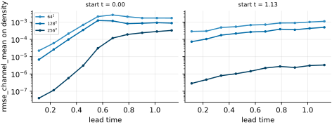
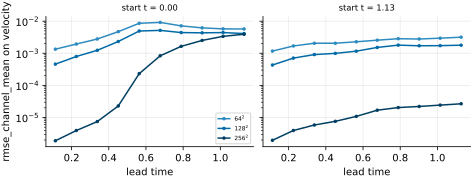
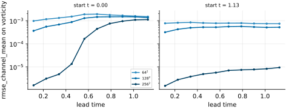
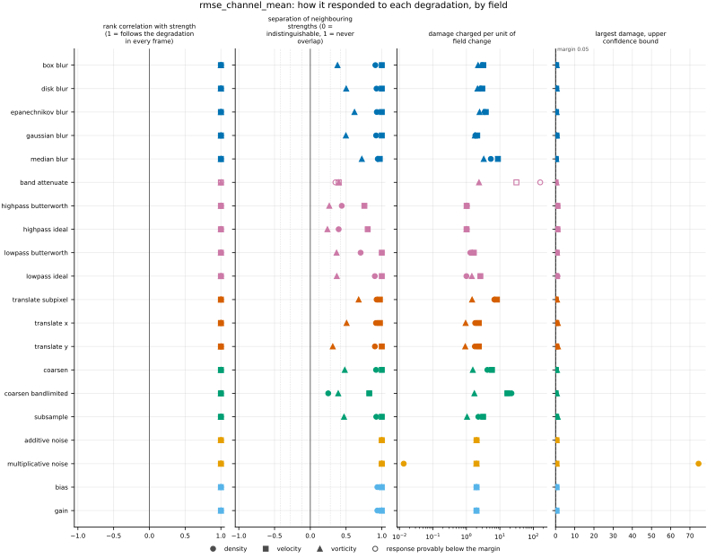
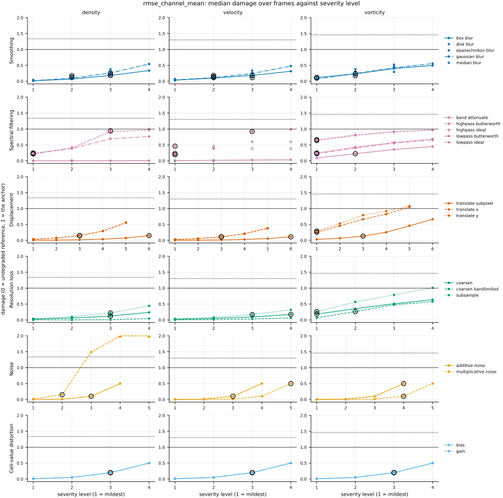
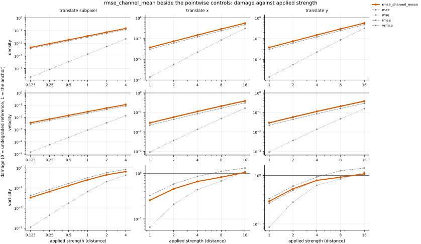

## Definition

For fields $f$ (reference) and $g$ (candidate) on the same analysis grid, with $C$ channels and
$N$ cells per channel, the root mean squared error of channel $c$ is

$$
\mathrm{RMSE}_c(f, g) = \sqrt{\frac{1}{N} \sum_{i=1}^{N} \bigl( f_{c,i} - g_{c,i} \bigr)^2} \tag{1}
$$

and this bundle reports their mean over channels,

$$
\mathrm{RMSE}_{\mathrm{ch}}(f, g) = \frac{1}{C} \sum_{c=1}^{C} \mathrm{RMSE}_c(f, g) \tag{2}
$$

which is how PDEBench's code reduces its RMSE [@takamoto2022]: the root mean square over space
for each sample, channel and time step, then the mean over samples, and then over channels and
time steps (`pdebench/models/metrics.py`, `metric_func`, `err_mean` and `err_RMSE`). The harness
scores one frame of one field at a time, so the mean over channels is the reduction that remains.
The Well computes the same per-channel RMSE and averages it over its fields [@ohana2024]
(App. E.3; `the_well/benchmark/metrics/spatial.py`, `RMSE`).

[rmse](../../metrics/rmse/card.md) pools the channels before the square root,
$\sqrt{\frac{1}{C} \sum_c \mathrm{RMSE}_c^2}$. On a one-channel field (density, vorticity) the two
are the same number. On several channels a mean of square roots is never larger than the square
root of their mean, and never smaller than that over $\sqrt{C}$:

$$
\frac{\mathrm{RMSE}}{\sqrt{C}} \le \mathrm{RMSE}_{\mathrm{ch}} \le \mathrm{RMSE} \tag{3}
$$

with equality on the right when every channel is equally wrong and on the left when all the error
is in one channel. The two bundles therefore differ on velocity only through how unequally its
components are predicted.

No per-cell map is stored. A mean of per-channel square roots cannot be recovered from a map
summed over channels, which is the form every stored map takes; `rmse`'s map, the squared error,
is the object behind both numbers.

### Boundary handling

None. The operation is local to each cell, so no neighbourhood is ever consulted and no boundary
condition can enter.

### How its field reports it

This is the reduction of the machine-learning benchmarks for PDEs. The numerical-analysis and
weather-verification forms are pooled and live in [rmse](../../metrics/rmse/card.md), whose card sets the
three side by side.

- **PDEBench** [@takamoto2022]. The object is Equation (2) per sample and time step, averaged over
  the test samples and then over channels and time steps (code above), reported in tables of
  RMSE, nRMSE and maximum error per PDE and model (App. E) and named as one of three data-view
  metrics (Sect. 3.3). Its figure is the RMSE against the unrolled time step (Sect. 4.3, Fig. 5a
  and 5c). In its code that curve is the root mean square over a batch, space and channels pooled
  (`metrics`, `val_l2_time`), so the curve is `rmse`'s object and the table entry is this one.
  The experiment is autoregressive rollouts on a held-out tenth of each dataset's samples
  (Sect. 4.1).
- **The Well** [@ohana2024]. The object is the RMSE of each field over space (App. E.3), kept per
  field and also averaged over fields (`the_well/benchmark/trainer/training.py`,
  `split_up_losses`, the `full` entry); its headline metric is the normalised form, which is
  [vrmse](../../metrics/vrmse/card.md).

**The experiments here.** Rollouts against the solver over many initial conditions do not
exist. The nearest is `forecast_re5e4` (`docs/datasets/reynolds_ladder_2d.md`, "Forecast
pairs"): one model's predictions at ten prediction steps from two starting times, in three
runs, on which the error is drawn against lead time. A test set of many initial conditions is
written up in
[EXP-nrmse-rollouts-over-many-initial-conditions](https://github.com/khegazy/pde_metrics/blob/main/proposals/EXP-nrmse-rollouts-over-many-initial-conditions.md).
The metric runs on the degradation ladder on `kinet_re5e4` and on the Reynolds ladder, where
velocity has two components. It is not run on `sod_shock_tube` or `synthetic_ensemble`: every
field there has one channel, where Equation (2) is `rmse` exactly (`card.yaml`, `not_run`).

## Performance

<!-- GENERATED performance: written by `python -m fmeval.cards evidence rmse_channel_mean --results results/comparison_1793829127 --results results/comparison_1793811840 --results results/comparison_1793829231`, do not edit -->



*As this metric's own field draws it, from run `comparison_1793811840`.* rmse_channel_mean on density against lead time, the physical time since the forecast started, one panel per start and one line per run, darker the finer the run's grid. Each point is one prediction step of one forecast.



*As this metric's own field draws it, from run `comparison_1793811840`.* rmse_channel_mean on velocity against lead time, the physical time since the forecast started, one panel per start and one line per run, darker the finer the run's grid. Each point is one prediction step of one forecast.



*As this metric's own field draws it, from run `comparison_1793811840`.* rmse_channel_mean on vorticity against lead time, the physical time since the forecast started, one panel per start and one line per run, darker the finer the run's grid. Each point is one prediction step of one forecast.



Four measured statistics for rmse_channel_mean, one row per degradation grouped by family and one marker per field. From left: the rank correlation between the metric and the applied strength within a frame, with the line showing the resampling interval; the separation of neighbouring strengths as Cliff's delta, where 0 means the metric cannot tell one strength from the next and the faint ticks at 0.12, 0.28 and 0.42 are Vargha and Delaney's small, medium and large anchors, for scale and not as grades; the damage charged per unit of field change at the harshest strength; and the upper confidence bound on the largest damage, beside the fixed margin of 0.05. A hollow marker is a field and degradation on which that bound lies below the margin, so the response is provably small. A missing marker is a statistic the analysis withheld, as the rank correlation is on an axis the metric is invariant to.



Median damage over frames against severity level for rmse_channel_mean, one row per family of degradation and one column per field, on one shared scale. The solid grey line is damage 1, the anchor (by default the field's own mean); the dotted black line is the damage assigned to the fake prediction with the right spectrum, where the run included it. The hollow black ring marks the first level at which the metric has moved a tenth of the way to the anchor. Hollow grey markers are strengths excluded for repeating a milder one or for doing nothing. Degradations with three or fewer usable levels are drawn as markers only; points beyond 2 either side are drawn as triangles at the edge. Damage is negative where a degradation moves the metric away from the anchor, as noise raises a single-field quantity the field's mean sets to zero.

**Trend: does the response follow the degradation?**

| test family | field | degradations | rank correlation | fraction of frames in order | weakest gap between neighbouring strengths |
|---|---|---|---|---|---|
| Displacement | density | 3 | 1 | 1 | 0.952 to 0.964 |
| Displacement | velocity | 3 | 1 | 1 | 0.986 to 1 |
| Displacement | vorticity | 3 | 1 | 1 | 0.657 to 0.838 |
| Cell-value distortion | density | 2 | 1 | 1 | 0.969 |
| Cell-value distortion | velocity | 2 | 1 | 1 | 1 |
| Cell-value distortion | vorticity | 2 | 1 | 1 | 1 |
| Resolution loss | density | 3 | 1 | 0.714 to 1 | 0.625 to 0.961 |
| Resolution loss | velocity | 3 | 1 | 1 | 0.912 to 1 |
| Resolution loss | vorticity | 3 | 1 | 1 | 0.695 to 0.741 |
| Smoothing | density | 5 | 1 | 1 | 0.955 to 0.972 |
| Smoothing | velocity | 5 | 1 | 1 | 0.986 to 1 |
| Smoothing | vorticity | 5 | 1 | 1 | 0.69 to 0.86 |
| Spectral filtering | density | 5 | 1 | 1 | 0.676 to 0.951 |
| Spectral filtering | velocity | 5 | 1 | 1 | 0.699 to 1 |
| Spectral filtering | vorticity | 5 | 1 | 1 | 0.62 to 0.7 |
| Noise | density | 2 | 1 | 1 | 1 |
| Noise | velocity | 2 | 1 | 1 | 1 |
| Noise | vorticity | 2 | 1 | 1 | 1 |

**Reactivity: how far does it move?**

| test family | field | change from clean at the harshest strength | elasticity | first strength detected |
|---|---|---|---|---|
| Displacement | density | — | 0.995 to 1 | level 3 |
| Displacement | velocity | — | 0.967 to 0.999 | level 3 |
| Displacement | vorticity | — | 0.684 to 0.993 | level 1 |
| Cell-value distortion | density | — | 1 | level 3 |
| Cell-value distortion | velocity | — | 1 | level 3 |
| Cell-value distortion | vorticity | — | 1 | level 3 |
| Resolution loss | density | — | 0.942 to 1.27 | level 3 |
| Resolution loss | velocity | — | 1.04 to 2.2 | level 3 |
| Resolution loss | vorticity | — | 0.737 to 1.43 | level 1 |
| Smoothing | density | — | 1.55 to 1.86 | level 2 |
| Smoothing | velocity | — | 1.08 to 1.14 | level 2 |
| Smoothing | vorticity | — | 0.876 to 1.15 | level 1 |
| Spectral filtering | density | — | 0.636 to 7.3 | level 1 |
| Spectral filtering | velocity | — | 0.643 to 1 | level 1 |
| Spectral filtering | vorticity | — | 0.47 to 1 | level 1 |
| Noise | density | — | 1 | level 2 |
| Noise | velocity | — | 1 | level 3 |
| Noise | vorticity | — | 0.999 to 1 | level 4 |
| trap test: fake prediction, right spectrum | density | — | — | damage 1.34 |
| trap test: fake prediction, right spectrum | velocity | — | — | damage 1.3 |
| trap test: fake prediction, right spectrum | vorticity | — | — | damage 1.46 |

**Consistency: how much does it vary from snapshot to snapshot?**

| test family | field | consistency, in the strength's units | snapshots per independent block |
|---|---|---|---|
| Displacement | density | 0.074 to 0.498 | 15 to 18 |
| Displacement | velocity | 0.054 to 0.743 | 14 to 21 |
| Displacement | vorticity | 0.134 to 0.927 | 21 to 22 |
| Cell-value distortion | density | 0.0265 | 20 |
| Cell-value distortion | velocity | 0.00563 to 0.00984 | 10 to 21 |
| Cell-value distortion | vorticity | 0.00868 | 21 |
| Resolution loss | density | 0.616 to 1.41 | 17 to 20 |
| Resolution loss | velocity | 0.582 to 1.5 | 22 |
| Resolution loss | vorticity | 0.838 to 1.06 | 22 |
| Smoothing | density | 0.00777 to 0.017 | 14 |
| Smoothing | velocity | 0.00508 to 0.0187 | 21 to 22 |
| Smoothing | vorticity | 0.0115 to 0.0264 | 21 to 22 |
| Spectral filtering | density | 0.025 to 0.0976 | 15 to 20 |
| Spectral filtering | velocity | 0.00738 to 0.094 | 1 to 22 |
| Spectral filtering | vorticity | 0.0321 to 0.0671 | 20 to 22 |
| Noise | density | 0.00022 to 0.0159 | 1 to 20 |
| Noise | velocity | 0.00185 to 0.00588 | 10 to 21 |
| Noise | vorticity | 0.00297 to 0.00519 | 21 |

One row per family of degradation and physical field; a cell gives the range over the degradations in that family. **Trend.** The rank correlation is the Spearman correlation between the strength and how far the metric has moved from its value on the undegraded field of the same frame, in the one direction it moves under that degradation, computed inside a single frame. A value of 1 means every strength moved it further than the last in every frame, whichever way it moves; a response that scatters to both sides scores near 0. The fraction of frames in order counts the frames with no exception. The weakest gap is the smallest Mann-Whitney overlap between two neighbouring strengths across frames: 1 means they never overlap, 0.5 that they cannot be told apart. **Reactivity.** The change from clean is the median, at the harshest strength, of the departure from the undegraded value of the same frame over the size of that value: 0.3 means 30%. It does not exist for this metric, whose undegraded value is exactly zero; the damage below is its relative reading. The elasticity is the percentage change of that departure per percentage change in strength over the mildest strengths. First strength detected is the mildest at which the metric has moved a tenth of the way to the anchor; **damage** reads that 0-to-1 scale as a number. A dash means the measurement is not defined there. A metric's reactivity scales with the power it is expressed in: mean squared error's elasticity is twice root-mean-square error's, though the two carry the same information, so compare magnitudes across metrics with that in mind. **Consistency** is how much the response varies from snapshot to snapshot relative to its size, in the strength's units; the snapshots of one trajectory are correlated, and the last column is how many consecutive snapshots one independent block spans.

These tables report what was measured and grade none of the measurements. What the numbers mean for this metric is written in the subsections below, beside the test that produced each number.

**Profile.**

| field | selectivity | charges most for | charges least for | response provably below 0.05 at 90% on | elasticity to a sub-pixel shift, against severity (distance) | compute cost (x cheapest in this run) |
|---|---|---|---|---|---|---|
| density | 0.903 | `band_attenuate` | `multiplicative_noise` | `band_attenuate` | 1 | 1.45 |
| velocity | 0.637 | `band_attenuate` | `highpass_ideal` | `band_attenuate` | 0.999 | 2.78 |
| vorticity | 0.104 | `median_blur` | `translate_y` | — | 0.993 | 1.67 |

One row per physical field. **Selectivity** is how concentrated the metric's response is on a few degradations, measured per unit of field change: 0 means it charges every degradation the same, as mean squared error does by construction, and values toward 1 that one degradation carries most of it. **Charges most and least for** name the two ends of that profile. **Response provably below** lists degradations on which the upper confidence bound of the largest damage lies below the margin -- an equivalence test, so an entry says the response is provably small, not merely not significant; a dash means no degradation met the bound. **Elasticity** is the slope of log damage against log shift over the smallest shifts: 1 means damage grows in proportion to the shift, 2 with its square. **Compute cost** is wall-clock per evaluation over the cheapest metric and field in the same run.

<!-- END GENERATED performance -->

## Intuition

This is the root mean squared error taken separately for each component of a field and then
averaged. A velocity field has two components; the error in each is measured on its own, and the
two sizes are averaged with equal weight.

The difference from pooling every component into one root mean square shows when the components
are predicted unequally. On a four-by-four grid with two components, one in which a bright square
moved by one cell and one predicted exactly:

```
first component                second component
reference      candidate       reference      candidate
0 0 0 0        0 0 0 0         0 0 0 0        0 0 0 0
0 1 1 0        0 0 1 1         0 1 1 0        0 1 1 0
0 1 1 0        0 0 1 1         0 1 1 0        0 1 1 0
0 0 0 0        0 0 0 0         0 0 0 0        0 0 0 0

per component: 0.5             per component: 0

rmse_channel_mean = 0.25       rmse (pooled) = 0.354
```

The first component has a root mean squared error of one half and the second none, so their
average is a quarter. Pooling all thirty-two entries first gives the square root of an eighth,
0.354: the square root is taken after the averaging, so the bad component counts for more. On a
field with one component the two are identical.

What this metric ignores is everything a root mean squared error ignores: where in the domain the
errors sit, and therefore whether a feature is displaced or wrong.

## Reading the output

The value runs from zero upwards with no upper limit, in the field's own units, so values on
different fields cannot be compared. Lower is better, and zero means the two fields are identical
cell for cell. There is no good value in the abstract: it depends on how much the field varies,
which is why the suite reports damage beside it, the value over what the reference's own spatial
mean scores.

On density and vorticity it equals `rmse` exactly, so on those fields it adds nothing. On velocity
it is the number to set beside a PDEBench table entry; compare it with `rmse` to see how unequally
the two components are predicted. Comparisons across models on one field, dataset and analysis
grid are the intended use; comparisons across resolutions are invalid as they stand, because the
mean over cells reweights the small scales when the grid is refined.

## Limitations

Averaging after the square root rewards improving the better-predicted component more than
pooling does. With one component wrong by an RMSE of $a$ and the other by $b$ much smaller,
removing the second error lowers Equation (2) by $b/2$, linearly in $b$, while it lowers `rmse`
only by about $b^2 / (2\sqrt{2}\,a)$, quadratically. A model can therefore lower this number by
perfecting a component that was already nearly right while the badly predicted one does not move.
That follows from Equation (2); it is not a measurement. Reading `rmse` beside it shows when
that is happening.

It also inherits every limitation of `rmse`: a displaced feature is charged twice, once where it
should be and once where it is, and the response to a sub-cell displacement is quadratic in the
squared error underneath.

## Results

<!-- GENERATED run: written by `python -m fmeval.cards evidence rmse_channel_mean --results results/comparison_1793829127 --results results/comparison_1793811840 --results results/comparison_1793829231`, do not edit -->

Measured on `kinet_re5e4`, frames 2000 to 10000 (161 frames of developed flow), on the 256 analysis grid, seed 20260807, at commit `adbdc88e4950`. Run `comparison_1793829127`.

Every number in this section comes from that run, except in the subsections headed with another experiment and in a figure whose caption names another run, each of which names its own run. Regenerate with `python -m fmeval.cards evidence <name> --results results/comparison_1793829127 --results results/comparison_1793811840 --results results/comparison_1793829231`.

<!-- END GENERATED run -->

Each subsection links to the degradations that subsection reports. What those degradations
do, and what their strength numbers mean, is documented on their own pages.

<!-- GENERATED experiments: written by `python -m fmeval.cards catalog`, do not edit -->

**Across the experiments.**

| experiment | what a run on it is evidence of | on this card |
|---|---|---|
| `kinet_re5e4` | developed flow | measured, run `comparison_1793829127`: the main results |
| `kinet_re1e6` | developed flow at Re = 1e6, twenty times the Reynolds number of kinet_re5e4, from the same initial condition | measured, run `comparison_1793829231`: under *On `kinet_re1e6`* |
| `synthetic_ensemble` | a calibrated null: evidence that the estimator computes what it claims to compute, and nothing about turbulence | not applicable: the dataset holds density alone, one channel, where this metric is rmse exactly |
| `sod_shock_tube` | an analytic check: evidence that the metric locates and scores a known shock correctly, and nothing about turbulence | not applicable: every field of the one-dimensional tube has one channel, where this metric is rmse exactly |
| `forecast_re5e4` | real predictions scored against their targets at each prediction step; who produced the predictions, a trained model or a coarser solver, is not recorded | measured, run `comparison_1793811840`: under *On `forecast_re5e4`* |

One row per dataset a card may cite (`configs/cards/default.yaml`). *Measured* names the run the card cites: the main results are `## Performance` and the subsections below, and every other run has its own subsection headed with its dataset. *Not applicable* gives the reason: one that follows from what the metric declares and what the dataset offers, or one a person wrote on the card (`not_run` in `card.yaml`) because the result would carry no information. *Not yet run* means the metric can run there and the card cites no run on it yet.

<!-- END GENERATED experiments -->

### Smoothing

[gaussian_blur](../../degradations/gaussian_blur/card.md) ·
[box_blur](../../degradations/box_blur/card.md) ·
[median_blur](../../degradations/median_blur/card.md)

<!-- GENERATED results_smoothing: written by `python -m fmeval.cards evidence rmse_channel_mean --results results/comparison_1793829127 --results results/comparison_1793811840 --results results/comparison_1793829231`, do not edit -->

| degradation | field | strengths | rank correlation | fraction of frames in the right order | weakest gap between neighbouring strengths |
|---|---|---|---|---|---|
| `box_blur` | density | 4 | 1 | 1 | 0.955 |
| `box_blur` | velocity | 4 | 1 | 1 | 1 |
| `box_blur` | vorticity | 4 | 1 | 1 | 0.69 |
| `disk_blur` | density | 3 | 1 | 1 | 0.963 |
| `disk_blur` | velocity | 3 | 1 | 1 | 1 |
| `disk_blur` | vorticity | 3 | 1 | 1 | 0.751 |
| `epanechnikov_blur` | density | 3 | 1 | 1 | 0.965 |
| `epanechnikov_blur` | velocity | 3 | 1 | 1 | 1 |
| `epanechnikov_blur` | vorticity | 3 | 1 | 1 | 0.809 |
| `gaussian_blur` | density | 4 | 1 | 1 | 0.96 |
| `gaussian_blur` | velocity | 4 | 1 | 1 | 1 |
| `gaussian_blur` | vorticity | 4 | 1 | 1 | 0.749 |
| `median_blur` | density | 3 | 1 | 1 | 0.972 |
| `median_blur` | velocity | 3 | 1 | 1 | 0.986 |
| `median_blur` | vorticity | 3 | 1 | 1 | 0.86 |

<!-- END GENERATED results_smoothing -->

### Spectral filtering

[lowpass_ideal](../../degradations/lowpass_ideal/card.md) ·
[lowpass_butterworth](../../degradations/lowpass_butterworth/card.md) ·
[highpass_ideal](../../degradations/highpass_ideal/card.md) ·
[highpass_butterworth](../../degradations/highpass_butterworth/card.md)

<!-- GENERATED results_spectral: written by `python -m fmeval.cards evidence rmse_channel_mean --results results/comparison_1793829127 --results results/comparison_1793811840 --results results/comparison_1793829231`, do not edit -->

| degradation | field | strengths | rank correlation | fraction of frames in the right order | weakest gap between neighbouring strengths |
|---|---|---|---|---|---|
| `band_attenuate` | density | 4 | 1 | 1 | 0.676 |
| `band_attenuate` | velocity | 4 | 1 | 1 | 0.699 |
| `band_attenuate` | vorticity | 4 | 1 | 1 | 0.7 |
| `highpass_butterworth` | density | 4 | 1 | 1 | 0.72 |
| `highpass_butterworth` | velocity | 3 | 1 | 1 | 0.878 |
| `highpass_butterworth` | vorticity | 4 | 1 | 1 | 0.633 |
| `highpass_ideal` | density | 3 | 1 | 1 | 0.698 |
| `highpass_ideal` | velocity | 2 | 1 | 1 | 0.901 |
| `highpass_ideal` | vorticity | 4 | 1 | 1 | 0.62 |
| `lowpass_butterworth` | density | 4 | 1 | 1 | 0.852 |
| `lowpass_butterworth` | velocity | 3 | 1 | 1 | 1 |
| `lowpass_butterworth` | vorticity | 4 | 1 | 1 | 0.684 |
| `lowpass_ideal` | density | 3 | 1 | 1 | 0.951 |
| `lowpass_ideal` | velocity | 2 | 1 | 1 | 1 |
| `lowpass_ideal` | vorticity | 4 | 1 | 1 | 0.685 |

<!-- END GENERATED results_spectral -->

### Displacement

[translate_x](../../degradations/translate/card.md) ·
[translate_subpixel](../../degradations/translate_subpixel/card.md)

<!-- GENERATED results_geometric: written by `python -m fmeval.cards evidence rmse_channel_mean --results results/comparison_1793829127 --results results/comparison_1793811840 --results results/comparison_1793829231`, do not edit -->

| degradation | field | strengths | rank correlation | fraction of frames in the right order | weakest gap between neighbouring strengths |
|---|---|---|---|---|---|
| `translate_subpixel` | density | 6 | 1 | 1 | 0.964 |
| `translate_subpixel` | velocity | 6 | 1 | 1 | 0.986 |
| `translate_subpixel` | vorticity | 6 | 1 | 1 | 0.838 |
| `translate_x` | density | 5 | 1 | 1 | 0.959 |
| `translate_x` | velocity | 5 | 1 | 1 | 0.987 |
| `translate_x` | vorticity | 5 | 1 | 1 | 0.754 |
| `translate_y` | density | 5 | 1 | 1 | 0.952 |
| `translate_y` | velocity | 5 | 1 | 1 | 1 |
| `translate_y` | vorticity | 5 | 1 | 1 | 0.657 |

<!-- END GENERATED results_geometric -->

### Resolution loss

[coarsen](../../degradations/coarsen/card.md) ·
[coarsen_bandlimited](../../degradations/coarsen_bandlimited/card.md)

<!-- GENERATED results_resolution: written by `python -m fmeval.cards evidence rmse_channel_mean --results results/comparison_1793829127 --results results/comparison_1793811840 --results results/comparison_1793829231`, do not edit -->

| degradation | field | strengths | rank correlation | fraction of frames in the right order | weakest gap between neighbouring strengths |
|---|---|---|---|---|---|
| `coarsen` | density | 4 | 1 | 1 | 0.96 |
| `coarsen` | velocity | 4 | 1 | 1 | 1 |
| `coarsen` | vorticity | 4 | 1 | 1 | 0.741 |
| `coarsen_bandlimited` | density | 4 | 1 | 0.714 | 0.625 |
| `coarsen_bandlimited` | velocity | 4 | 1 | 1 | 0.912 |
| `coarsen_bandlimited` | vorticity | 4 | 1 | 1 | 0.695 |
| `subsample` | density | 4 | 1 | 1 | 0.961 |
| `subsample` | velocity | 4 | 1 | 1 | 1 |
| `subsample` | vorticity | 4 | 1 | 1 | 0.736 |

<!-- END GENERATED results_resolution -->

### Noise

[additive_noise](../../degradations/additive_noise/card.md)

<!-- GENERATED results_stochastic: written by `python -m fmeval.cards evidence rmse_channel_mean --results results/comparison_1793829127 --results results/comparison_1793811840 --results results/comparison_1793829231`, do not edit -->

| degradation | field | strengths | rank correlation | fraction of frames in the right order | weakest gap between neighbouring strengths |
|---|---|---|---|---|---|
| `additive_noise` | density | 4 | 1 | 1 | 1 |
| `additive_noise` | velocity | 4 | 1 | 1 | 1 |
| `additive_noise` | vorticity | 4 | 1 | 1 | 1 |
| `multiplicative_noise` | density | 5 | 1 | 1 | 1 |
| `multiplicative_noise` | velocity | 5 | 1 | 1 | 1 |
| `multiplicative_noise` | vorticity | 5 | 1 | 1 | 1 |

<!-- END GENERATED results_stochastic -->

### Trap tests

[gaussian_impostor](../../degradations/gaussian_impostor/card.md) ·
[uncorrelated](../../degradations/random_large_translation/card.md)

<!-- GENERATED results_canaries: written by `python -m fmeval.cards evidence rmse_channel_mean --results results/comparison_1793829127 --results results/comparison_1793811840 --results results/comparison_1793829231`, do not edit -->

| field | damage assigned to the fake prediction | closest real degradation | damage of the reference moved far away | value on the anchor |
|---|---|---|---|---|
| density | 1.34 | `multiplicative_noise=0.01` | 1.21 | 0.00672 |
| velocity | 1.3 | `highpass_ideal=4.02293` | 1.71 | 0.0393 |
| vorticity | 1.46 | `translate_y=16` | 1.54 | 0.00248 |

The fake prediction here has exactly the reference field's amplitude spectrum and completely scrambled structure. Damage 1 is what the anchor scores, by default the reference's own spatial mean, a prediction that knows the mean and nothing else. The damage column therefore says how close to useless this metric considers that fake prediction: a low number means the metric was fooled. The third column translates the same number into an ordinary degradation whose damage the fake prediction matches, which is easier to picture. The fourth is the reference moved by a large random offset, the right statistics in the wrong place; where a field's energy sits in its largest scales that copy stays partly correlated with the reference, so it is not the score of an unrelated field.

<!-- END GENERATED results_canaries -->

### Compared with the other metrics

<!-- GENERATED results_summary: written by `python -m fmeval.cards evidence rmse_channel_mean --results results/comparison_1793829127 --results results/comparison_1793811840 --results results/comparison_1793829231`, do not edit -->

| compared with | density | velocity | vorticity |
|---|---|---|---|
| `rmse` | 1 | 0.999 | 1 |
| `mse` | 1 | 0.999 | 1 |
| `nrmse` | 1 | 1 | 0.998 |
| `vrmse` | 1 | 1 | 0.999 |
| `mae` | 0.988 | 0.995 | 0.973 |
| `max_error` | 0.956 | 0.93 | 0.947 |
| `max_error_channel_mean` | 0.956 | 0.935 | 0.947 |
| `wasserstein` | 0.886 | — | — |
| `h_minus_one` | 0.861 | 0.848 | 0.903 |
| `h1_relative` | 0.814 | 0.723 | 0.755 |
| `h1_seminorm` | 0.705 | 0.604 | 0.7 |
| `spectral_energy_flux` | — | 0.41 | — |
| `persistence_distance` | 0.377 | — | 0.179 |
| `spectrum_l2` | 0.26 | 0.37 | 0.171 |
| `increment_w1_by_separation` | 0.338 | 0.258 | 0.11 |
| `energy_distance` | 0.253 | 0.17 | -0.0148 |
| `increment_w1` | 0.262 | 0.155 | 0.00882 |
| `tail_exceedance` | 0.221 | 0.134 | -0.0606 |
| `palinstrophy` | — | — | -0.0876 |
| `increment_flatness` | -0.208 | -0.103 | 0.114 |
| `tail_index` | 0.0219 | -0.167 | -0.112 |
| `enstrophy` | — | — | -0.252 |
| `kinetic_energy` | — | -0.259 | — |

Rank correlation over every degradation, computed separately for each physical field on the median value at each combination of degradation and strength, with the undegraded reference excluded. A dash marks a metric that does not run on that field. A metric with a target value enters by its distance from the target. Two metrics correlating near 1 put the degradations in the same order, but the two may still weight those degradations very differently. A correlation near 1 therefore means the two metrics are redundant for ranking models, not that the two are interchangeable as training losses.

<!-- END GENERATED results_summary -->

### Damage beside the other metrics

<!-- GENERATED results_damage_by_level: written by `python -m fmeval.cards evidence rmse_channel_mean --results results/comparison_1793829127 --results results/comparison_1793811840 --results results/comparison_1793829231`, do not edit -->



Median damage over frames against the applied strength, log-log, for rmse_channel_mean (bold, in colour) and the pointwise controls mae, mse, rmse, vrmse (thin, grey), one column per displacement degradation and one row per field. The grey line is damage 1, the anchor (by default the field's own mean). Parallel lines charge in the same proportion at every strength; a steeper line charges relatively more for the larger shifts, which is what decides whether two metrics are interchangeable as training losses. These are the same numbers as the table beneath.

**Displacement, density, `translate_subpixel`** (strength: distance).

| metric | 0.125 | 0.25 | 0.5 | 1 | 2 | 4 |
|---|---|---|---|---|---|---|
| `rmse_channel_mean` | 0.00466 | 0.00931 | 0.0186 | 0.0372 | 0.0743 | 0.148 |
| `mae` | 0.00383 | 0.00767 | 0.0153 | 0.0306 | 0.061 | 0.121 |
| `mse` | 2.17e-05 | 8.68e-05 | 0.000347 | 0.00138 | 0.00551 | 0.0219 |
| `rmse` | 0.00466 | 0.00931 | 0.0186 | 0.0372 | 0.0743 | 0.148 |
| `vrmse` | 0.00463 | 0.00926 | 0.0185 | 0.037 | 0.0738 | 0.147 |

**Displacement, density, `translate_x`** (strength: distance).

| metric | 1 | 2 | 4 | 8 | 16 |
|---|---|---|---|---|---|
| `rmse_channel_mean` | 0.0372 | 0.0743 | 0.148 | 0.291 | 0.555 |
| `mae` | 0.0306 | 0.061 | 0.121 | 0.24 | 0.469 |
| `mse` | 0.00138 | 0.00551 | 0.0219 | 0.0849 | 0.307 |
| `rmse` | 0.0372 | 0.0743 | 0.148 | 0.291 | 0.555 |
| `vrmse` | 0.037 | 0.0738 | 0.147 | 0.29 | 0.55 |

**Displacement, density, `translate_y`** (strength: distance).

| metric | 1 | 2 | 4 | 8 | 16 |
|---|---|---|---|---|---|
| `rmse_channel_mean` | 0.0377 | 0.0752 | 0.15 | 0.295 | 0.562 |
| `mae` | 0.031 | 0.0616 | 0.122 | 0.244 | 0.476 |
| `mse` | 0.00142 | 0.00565 | 0.0224 | 0.0869 | 0.316 |
| `rmse` | 0.0377 | 0.0752 | 0.15 | 0.295 | 0.562 |
| `vrmse` | 0.0376 | 0.075 | 0.149 | 0.294 | 0.56 |

**Displacement, velocity, `translate_subpixel`** (strength: distance).

| metric | 0.125 | 0.25 | 0.5 | 1 | 2 | 4 |
|---|---|---|---|---|---|---|
| `rmse_channel_mean` | 0.00364 | 0.00727 | 0.0145 | 0.029 | 0.0573 | 0.111 |
| `mae` | 0.00279 | 0.00559 | 0.0112 | 0.0223 | 0.0441 | 0.0859 |
| `mse` | 1.45e-05 | 5.81e-05 | 0.000232 | 0.000924 | 0.0036 | 0.0136 |
| `rmse` | 0.00381 | 0.00762 | 0.0152 | 0.0304 | 0.06 | 0.117 |
| `vrmse` | 0.00365 | 0.00729 | 0.0146 | 0.029 | 0.0574 | 0.111 |

**Displacement, velocity, `translate_x`** (strength: distance).

| metric | 1 | 2 | 4 | 8 | 16 |
|---|---|---|---|---|---|
| `rmse_channel_mean` | 0.029 | 0.0573 | 0.111 | 0.21 | 0.387 |
| `mae` | 0.0223 | 0.0441 | 0.0859 | 0.163 | 0.31 |
| `mse` | 0.000924 | 0.0036 | 0.0136 | 0.0489 | 0.165 |
| `rmse` | 0.0304 | 0.06 | 0.117 | 0.221 | 0.406 |
| `vrmse` | 0.029 | 0.0574 | 0.111 | 0.209 | 0.383 |

**Displacement, velocity, `translate_y`** (strength: distance).

| metric | 1 | 2 | 4 | 8 | 16 |
|---|---|---|---|---|---|
| `rmse_channel_mean` | 0.0292 | 0.0577 | 0.111 | 0.208 | 0.374 |
| `mae` | 0.0223 | 0.0442 | 0.0856 | 0.16 | 0.295 |
| `mse` | 0.000935 | 0.00366 | 0.0138 | 0.0473 | 0.158 |
| `rmse` | 0.0306 | 0.0605 | 0.117 | 0.218 | 0.397 |
| `vrmse` | 0.0303 | 0.0599 | 0.115 | 0.212 | 0.384 |

**Displacement, vorticity, `translate_subpixel`** (strength: distance).

| metric | 0.125 | 0.25 | 0.5 | 1 | 2 | 4 |
|---|---|---|---|---|---|---|
| `rmse_channel_mean` | 0.0335 | 0.0669 | 0.133 | 0.257 | 0.458 | 0.663 |
| `mae` | 0.0428 | 0.0854 | 0.169 | 0.328 | 0.582 | 0.86 |
| `mse` | 0.00112 | 0.00448 | 0.0176 | 0.066 | 0.21 | 0.44 |
| `rmse` | 0.0335 | 0.0669 | 0.133 | 0.257 | 0.458 | 0.663 |
| `vrmse` | 0.0329 | 0.0656 | 0.13 | 0.253 | 0.455 | 0.671 |

**Displacement, vorticity, `translate_x`** (strength: distance).

| metric | 1 | 2 | 4 | 8 | 16 |
|---|---|---|---|---|---|
| `rmse_channel_mean` | 0.257 | 0.458 | 0.663 | 0.824 | 1.05 |
| `mae` | 0.328 | 0.582 | 0.86 | 1.1 | 1.31 |
| `mse` | 0.066 | 0.21 | 0.44 | 0.679 | 1.1 |
| `rmse` | 0.257 | 0.458 | 0.663 | 0.824 | 1.05 |
| `vrmse` | 0.253 | 0.455 | 0.671 | 0.832 | 1.05 |

**Displacement, vorticity, `translate_y`** (strength: distance).

| metric | 1 | 2 | 4 | 8 | 16 |
|---|---|---|---|---|---|
| `rmse_channel_mean` | 0.293 | 0.532 | 0.793 | 0.922 | 1.08 |
| `mae` | 0.333 | 0.603 | 0.93 | 1.25 | 1.43 |
| `mse` | 0.0858 | 0.283 | 0.628 | 0.849 | 1.17 |
| `rmse` | 0.293 | 0.532 | 0.793 | 0.922 | 1.08 |
| `vrmse` | 0.268 | 0.495 | 0.793 | 0.927 | 1.08 |

Median damage over frames at every strength, this metric in the first row and the pointwise controls beneath it, all on the same 0-to-1 scale where 0 is the undegraded reference and 1 the anchor (by default the field's own mean); a dash means no damage scale on that field. The rank correlations under *Compared with the other metrics* say whether two metrics put the strengths in the same order; this table says how much each one charges for the same strength, which decides whether two metrics are interchangeable as training losses.

<!-- END GENERATED results_damage_by_level -->

### On `forecast_re5e4`

<!-- GENERATED results_on_forecast_re5e4: written by `python -m fmeval.cards evidence rmse_channel_mean --results results/comparison_1793829127 --results results/comparison_1793811840 --results results/comparison_1793829231`, do not edit -->

**Real predictions scored against their targets at each prediction step; who produced the predictions, a trained model or a coarser solver, is not recorded.**

Measured on `forecast_re5e4`, frames 0 to 59 (60 frames of real predictions scored against their targets at each prediction step; who produced the predictions, a trained model or a coarser solver, is not recorded), on the 64 analysis grid, seed 20260807, at commit `adbdc88e4950`. Run `comparison_1793811840`.

[mean_field](../../degradations/mean_field/card.md)


rmse_channel_mean on density against lead time, the physical time since the forecast started, one panel per start and one line per run, darker the finer the run's grid. Each point is one prediction step of one forecast.


rmse_channel_mean on velocity against lead time, the physical time since the forecast started, one panel per start and one line per run, darker the finer the run's grid. Each point is one prediction step of one forecast.


rmse_channel_mean on vorticity against lead time, the physical time since the forecast started, one panel per start and one line per run, darker the finer the run's grid. Each point is one prediction step of one forecast.

**density, rmse_channel_mean on the prediction, at each lead time.**

| lead time | 64², start 0 | 128², start 0 | 256², start 0 | 64², start 1.13 | 128², start 1.13 | 256², start 1.13 |
|---|---|---|---|---|---|---|
| 0.1128 | 2.24e-05 | 6.76e-06 | 3.99e-08 | 0.00029 | 7.41e-05 | 2.83e-07 |
| 0.2255 | 6.05e-05 | 2.6e-05 | 1.14e-07 | 0.000302 | 0.000105 | 4.69e-07 |
| 0.3383 | 0.000214 | 9.9e-05 | 5.72e-07 | 0.000489 | 0.000176 | 7.97e-07 |
| 0.4511 | 0.000692 | 0.000351 | 3.06e-06 | 0.000543 | 0.000219 | 1.03e-06 |
| 0.5638 | 0.0021 | 0.00124 | 3.09e-05 | 0.000677 | 0.000268 | 1.44e-06 |
| 0.6766 | 0.00261 | 0.00117 | 0.000119 | 0.000718 | 0.000286 | 2.21e-06 |
| 0.7893 | 0.00206 | 0.000817 | 0.000193 | 0.00089 | 0.000389 | 2.72e-06 |
| 0.9021 | 0.00173 | 0.000861 | 0.000241 | 0.000899 | 0.000361 | 2.35e-06 |
| 1.015 | 0.00172 | 0.000925 | 0.000286 | 0.00101 | 0.000434 | 3.05e-06 |
| 1.128 | 0.00172 | 0.000877 | 0.00033 | 0.00111 | 0.000498 | 3.29e-06 |

**density, rmse_channel_mean damage, at each lead time.**

| lead time | 64², start 0 | 128², start 0 | 256², start 0 | 64², start 1.13 | 128², start 1.13 | 256², start 1.13 |
|---|---|---|---|---|---|---|
| 0.1128 | 0.0345 | 0.0105 | 6.21e-05 | 0.0408 | 0.0104 | 3.99e-05 |
| 0.2255 | 0.13 | 0.0552 | 0.000241 | 0.0451 | 0.0157 | 7.01e-05 |
| 0.3383 | 0.227 | 0.105 | 0.000611 | 0.0717 | 0.0258 | 0.000117 |
| 0.4511 | 0.327 | 0.165 | 0.00144 | 0.0778 | 0.0314 | 0.000147 |
| 0.5638 | 0.584 | 0.343 | 0.00858 | 0.103 | 0.0407 | 0.000218 |
| 0.6766 | 0.466 | 0.209 | 0.0212 | 0.103 | 0.0409 | 0.000316 |
| 0.7893 | 0.342 | 0.136 | 0.032 | 0.133 | 0.058 | 0.000405 |
| 0.9021 | 0.264 | 0.132 | 0.0368 | 0.133 | 0.0533 | 0.000348 |
| 1.015 | 0.247 | 0.132 | 0.0409 | 0.144 | 0.0619 | 0.000435 |
| 1.128 | 0.259 | 0.132 | 0.0499 | 0.169 | 0.0756 | 0.000499 |

**velocity, rmse_channel_mean on the prediction, at each lead time.**

| lead time | 64², start 0 | 128², start 0 | 256², start 0 | 64², start 1.13 | 128², start 1.13 | 256², start 1.13 |
|---|---|---|---|---|---|---|
| 0.1128 | 0.00134 | 0.00046 | 1.89e-06 | 0.00117 | 0.000431 | 1.95e-06 |
| 0.2255 | 0.00194 | 0.000795 | 3.93e-06 | 0.00169 | 0.000709 | 3.94e-06 |
| 0.3383 | 0.00279 | 0.00124 | 7.48e-06 | 0.00205 | 0.000911 | 5.84e-06 |
| 0.4511 | 0.00472 | 0.00233 | 2.29e-05 | 0.00206 | 0.000993 | 7.59e-06 |
| 0.5638 | 0.00859 | 0.00494 | 0.000232 | 0.00228 | 0.00116 | 1.08e-05 |
| 0.6766 | 0.00916 | 0.00517 | 0.000836 | 0.00256 | 0.00152 | 1.69e-05 |
| 0.7893 | 0.00714 | 0.00442 | 0.00165 | 0.00284 | 0.00179 | 2.04e-05 |
| 0.9021 | 0.00619 | 0.00434 | 0.00252 | 0.00278 | 0.00172 | 2.21e-05 |
| 1.015 | 0.00576 | 0.00442 | 0.00337 | 0.00295 | 0.00173 | 2.43e-05 |
| 1.128 | 0.00572 | 0.00412 | 0.00392 | 0.00317 | 0.00179 | 2.67e-05 |

**velocity, rmse_channel_mean damage, at each lead time.**

| lead time | 64², start 0 | 128², start 0 | 256², start 0 | 64², start 1.13 | 128², start 1.13 | 256², start 1.13 |
|---|---|---|---|---|---|---|
| 0.1128 | 0.0461 | 0.0158 | 6.47e-05 | 0.0297 | 0.0109 | 4.94e-05 |
| 0.2255 | 0.0658 | 0.027 | 0.000134 | 0.043 | 0.018 | 0.0001 |
| 0.3383 | 0.0915 | 0.0407 | 0.000245 | 0.0522 | 0.0232 | 0.000148 |
| 0.4511 | 0.145 | 0.0717 | 0.000704 | 0.0524 | 0.0253 | 0.000194 |
| 0.5638 | 0.24 | 0.138 | 0.00649 | 0.0582 | 0.0297 | 0.000276 |
| 0.6766 | 0.244 | 0.138 | 0.0223 | 0.0654 | 0.0389 | 0.000431 |
| 0.7893 | 0.185 | 0.114 | 0.0426 | 0.0724 | 0.0457 | 0.000519 |
| 0.9021 | 0.158 | 0.11 | 0.0641 | 0.0708 | 0.0436 | 0.000561 |
| 1.015 | 0.146 | 0.112 | 0.0854 | 0.0749 | 0.0439 | 0.000616 |
| 1.128 | 0.145 | 0.104 | 0.099 | 0.0805 | 0.0453 | 0.000677 |

**vorticity, rmse_channel_mean on the prediction, at each lead time.**

| lead time | 64², start 0 | 128², start 0 | 256², start 0 | 64², start 1.13 | 128², start 1.13 | 256², start 1.13 |
|---|---|---|---|---|---|---|
| 0.1128 | 0.000974 | 0.000365 | 1.6e-06 | 0.000771 | 0.000317 | 1.52e-06 |
| 0.2255 | 0.00117 | 0.000553 | 3.11e-06 | 0.000818 | 0.000426 | 2.79e-06 |
| 0.3383 | 0.00132 | 0.000686 | 4.83e-06 | 0.000845 | 0.000496 | 3.81e-06 |
| 0.4511 | 0.00151 | 0.000873 | 1.35e-05 | 0.0008 | 0.000524 | 4.92e-06 |
| 0.5638 | 0.00189 | 0.00129 | 0.000164 | 0.000777 | 0.000524 | 5.67e-06 |
| 0.6766 | 0.00193 | 0.00145 | 0.000443 | 0.000786 | 0.000557 | 7.04e-06 |
| 0.7893 | 0.00177 | 0.00148 | 0.000752 | 0.000787 | 0.000568 | 7.45e-06 |
| 0.9021 | 0.00168 | 0.00149 | 0.000954 | 0.000756 | 0.000536 | 7.77e-06 |
| 1.015 | 0.00159 | 0.00146 | 0.00109 | 0.000743 | 0.000513 | 8.33e-06 |
| 1.128 | 0.0015 | 0.00136 | 0.00112 | 0.000743 | 0.000521 | 9.46e-06 |

**vorticity, rmse_channel_mean damage, at each lead time.**

| lead time | 64², start 0 | 128², start 0 | 256², start 0 | 64², start 1.13 | 128², start 1.13 | 256², start 1.13 |
|---|---|---|---|---|---|---|
| 0.1128 | 0.313 | 0.117 | 0.000515 | 0.328 | 0.135 | 0.000647 |
| 0.2255 | 0.378 | 0.179 | 0.00101 | 0.356 | 0.185 | 0.00121 |
| 0.3383 | 0.432 | 0.225 | 0.00158 | 0.376 | 0.22 | 0.00169 |
| 0.4511 | 0.5 | 0.288 | 0.00445 | 0.362 | 0.237 | 0.00223 |
| 0.5638 | 0.636 | 0.434 | 0.0553 | 0.357 | 0.241 | 0.0026 |
| 0.6766 | 0.676 | 0.511 | 0.156 | 0.366 | 0.26 | 0.00328 |
| 0.7893 | 0.651 | 0.542 | 0.276 | 0.371 | 0.268 | 0.00351 |
| 0.9021 | 0.646 | 0.574 | 0.367 | 0.359 | 0.255 | 0.00369 |
| 1.015 | 0.633 | 0.585 | 0.436 | 0.356 | 0.246 | 0.00399 |
| 1.128 | 0.621 | 0.562 | 0.463 | 0.358 | 0.251 | 0.00455 |

Every prediction of every forecast, nothing pooled: a cell is one prediction step of one forecast, a row the lead time (the physical time since the forecast started) and a column the forecast, named by its run's native grid and its starting time (`64², start 0` is `F-906861_64_Re_50k_from_256_to_64/forecast_t0-0`; `128², start 0` is `F-906861_64_Re_50k_from_256_to128/forecast_t0-0`; `256², start 0` is `F-906861_64/forecast_t0-0`; `64², start 1.13` is `F-906861_64_Re_50k_from_256_to_64/forecast_t0-1250`; `128², start 1.13` is `F-906861_64_Re_50k_from_256_to128/forecast_t0-2500`; `256², start 1.13` is `F-906861_64/forecast_t0-5000`). **Damage** is the prediction's departure from the target as a fraction of the anchor's in the same frame, by default the target's own spatial mean, so each step is scaled by its own target. A dash means no value there.

<!-- END GENERATED results_on_forecast_re5e4 -->

### On `kinet_re1e6`

<!-- GENERATED results_on_kinet_re1e6: written by `python -m fmeval.cards evidence rmse_channel_mean --results results/comparison_1793829127 --results results/comparison_1793811840 --results results/comparison_1793829231`, do not edit -->

**Developed flow at Re = 1e6, twenty times the Reynolds number of kinet_re5e4, from the same initial condition.**

Measured on `kinet_re1e6`, frames 2000 to 10000 (161 frames of developed flow at Re = 1e6, twenty times the Reynolds number of kinet_re5e4, from the same initial condition), on the 128 analysis grid, seed 20260807, at commit `adbdc88e4950`. Run `comparison_1793829231`.

[additive_noise](../../degradations/additive_noise/card.md) ·
[band_attenuate](../../degradations/band_attenuate/card.md) ·
[bias](../../degradations/bias/card.md) ·
[box_blur](../../degradations/box_blur/card.md) ·
[coarsen](../../degradations/coarsen/card.md) ·
[coarsen_bandlimited](../../degradations/coarsen_bandlimited/card.md) ·
[disk_blur](../../degradations/disk_blur/card.md) ·
[epanechnikov_blur](../../degradations/epanechnikov_blur/card.md) ·
[gain](../../degradations/gain/card.md) ·
[gaussian_blur](../../degradations/gaussian_blur/card.md) ·
[gaussian_impostor](../../degradations/gaussian_impostor/card.md) ·
[highpass_butterworth](../../degradations/highpass_butterworth/card.md) ·
[highpass_ideal](../../degradations/highpass_ideal/card.md) ·
[lowpass_butterworth](../../degradations/lowpass_butterworth/card.md) ·
[lowpass_ideal](../../degradations/lowpass_ideal/card.md) ·
[mean_field](../../degradations/mean_field/card.md) ·
[median_blur](../../degradations/median_blur/card.md) ·
[multiplicative_noise](../../degradations/multiplicative_noise/card.md) ·
[subsample](../../degradations/subsample/card.md) ·
[translate_subpixel](../../degradations/translate_subpixel/card.md) ·
[translate_x](../../degradations/translate/card.md) ·
[translate_y](../../degradations/translate/card.md) ·
[uncorrelated](../../degradations/random_large_translation/card.md)

**Smoothing.**

| degradation | field | strengths | rank correlation | fraction of frames in the right order | weakest gap between neighbouring strengths |
|---|---|---|---|---|---|
| `box_blur` | density | 4 | 1 | 1 | 0.957 |
| `box_blur` | velocity | 4 | 1 | 1 | 1 |
| `box_blur` | vorticity | 2 | 1 | 1 | 0.92 |
| `disk_blur` | density | 3 | 1 | 1 | 0.963 |
| `disk_blur` | velocity | 3 | 1 | 1 | 1 |
| `disk_blur` | vorticity | 2 | 1 | 1 | 0.881 |
| `epanechnikov_blur` | density | 3 | 1 | 1 | 0.966 |
| `epanechnikov_blur` | velocity | 3 | 1 | 1 | 1 |
| `epanechnikov_blur` | vorticity | 2 | 1 | 1 | 0.964 |
| `gaussian_blur` | density | 4 | 1 | 1 | 0.961 |
| `gaussian_blur` | velocity | 4 | 1 | 1 | 1 |
| `gaussian_blur` | vorticity | 4 | 1 | 1 | 0.907 |
| `median_blur` | density | 3 | 1 | 1 | 0.976 |
| `median_blur` | velocity | 3 | 1 | 1 | 0.981 |
| `median_blur` | vorticity | 1 | — | — | — |

**Spectral filtering.**

| degradation | field | strengths | rank correlation | fraction of frames in the right order | weakest gap between neighbouring strengths |
|---|---|---|---|---|---|
| `band_attenuate` | density | 4 | 1 | 1 | 0.692 |
| `band_attenuate` | velocity | 4 | 1 | 1 | 0.764 |
| `band_attenuate` | vorticity | 4 | 1 | 1 | 0.816 |
| `highpass_butterworth` | density | 4 | 1 | 1 | 0.728 |
| `highpass_butterworth` | velocity | 3 | 1 | 1 | 0.879 |
| `highpass_butterworth` | vorticity | 4 | 1 | 1 | 0.643 |
| `highpass_ideal` | density | 3 | 1 | 1 | 0.705 |
| `highpass_ideal` | velocity | 2 | 1 | 1 | 0.902 |
| `highpass_ideal` | vorticity | 4 | 1 | 1 | 0.628 |
| `lowpass_butterworth` | density | 4 | 1 | 1 | 0.852 |
| `lowpass_butterworth` | velocity | 3 | 1 | 1 | 1 |
| `lowpass_butterworth` | vorticity | 4 | 1 | 1 | 0.742 |
| `lowpass_ideal` | density | 3 | 1 | 1 | 0.957 |
| `lowpass_ideal` | velocity | 3 | 1 | 1 | 0.707 |
| `lowpass_ideal` | vorticity | 4 | 1 | 1 | 0.74 |

**Displacement.**

| degradation | field | strengths | rank correlation | fraction of frames in the right order | weakest gap between neighbouring strengths |
|---|---|---|---|---|---|
| `translate_subpixel` | density | 6 | 1 | 1 | 0.965 |
| `translate_subpixel` | velocity | 6 | 1 | 1 | 0.985 |
| `translate_subpixel` | vorticity | 6 | 1 | 1 | 0.774 |
| `translate_x` | density | 5 | 1 | 1 | 0.952 |
| `translate_x` | velocity | 5 | 1 | 1 | 0.981 |
| `translate_x` | vorticity | 5 | 1 | 1 | 0.774 |
| `translate_y` | density | 5 | 1 | 1 | 0.942 |
| `translate_y` | velocity | 5 | 1 | 1 | 1 |
| `translate_y` | vorticity | 5 | 1 | 1 | 0.671 |

**Resolution loss.**

| degradation | field | strengths | rank correlation | fraction of frames in the right order | weakest gap between neighbouring strengths |
|---|---|---|---|---|---|
| `coarsen` | density | 4 | 1 | 1 | 0.961 |
| `coarsen` | velocity | 4 | 1 | 1 | 1 |
| `coarsen` | vorticity | 4 | 1 | 1 | 0.798 |
| `coarsen_bandlimited` | density | 4 | 1 | 1 | 0.992 |
| `coarsen_bandlimited` | velocity | 4 | 1 | 1 | 0.973 |
| `coarsen_bandlimited` | vorticity | 4 | 1 | 1 | 0.745 |
| `subsample` | density | 4 | 1 | 1 | 0.965 |
| `subsample` | velocity | 4 | 1 | 1 | 1 |
| `subsample` | vorticity | 4 | 1 | 1 | 0.808 |

**Noise.**

| degradation | field | strengths | rank correlation | fraction of frames in the right order | weakest gap between neighbouring strengths |
|---|---|---|---|---|---|
| `additive_noise` | density | 4 | 1 | 1 | 1 |
| `additive_noise` | velocity | 4 | 1 | 1 | 1 |
| `additive_noise` | vorticity | 4 | 1 | 1 | 1 |
| `multiplicative_noise` | density | 5 | 1 | 1 | 1 |
| `multiplicative_noise` | velocity | 5 | 1 | 1 | 1 |
| `multiplicative_noise` | vorticity | 5 | 1 | 1 | 1 |

**Cell-value distortion.**

| degradation | field | strengths | rank correlation | fraction of frames in the right order | weakest gap between neighbouring strengths |
|---|---|---|---|---|---|
| `bias` | density | 4 | 1 | 1 | 0.97 |
| `bias` | velocity | 4 | 1 | 1 | 1 |
| `bias` | vorticity | 4 | 1 | 1 | 1 |
| `gain` | density | 4 | 1 | 1 | 0.97 |
| `gain` | velocity | 4 | 1 | 1 | 1 |
| `gain` | vorticity | 4 | 1 | 1 | 1 |

**Trap tests.**

| field | damage assigned to the fake prediction | closest real degradation | damage of the reference moved far away | value on the anchor |
|---|---|---|---|---|
| density | 1.36 | `multiplicative_noise=0.01` | 1.22 | 0.00686 |
| velocity | 1.29 | `highpass_ideal=4.08281` | 1.7 | 0.0395 |
| vorticity | 1.43 | `subsample=16` | 1.51 | 0.000676 |

The fake prediction here has exactly the reference field's amplitude spectrum and completely scrambled structure. Damage 1 is what the anchor scores, by default the reference's own spatial mean, a prediction that knows the mean and nothing else. The damage column therefore says how close to useless this metric considers that fake prediction: a low number means the metric was fooled. The third column translates the same number into an ordinary degradation whose damage the fake prediction matches, which is easier to picture. The fourth is the reference moved by a large random offset, the right statistics in the wrong place; where a field's energy sits in its largest scales that copy stays partly correlated with the reference, so it is not the score of an unrelated field.

<!-- END GENERATED results_on_kinet_re1e6 -->

## References

\bibliography
