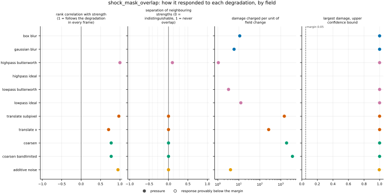
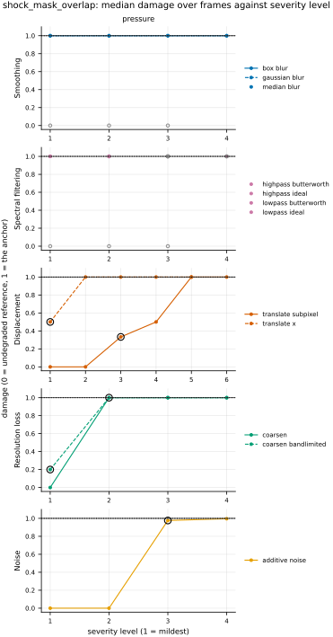

## Definition

The metric runs in two steps: a detector marks the shocked cells of each pressure field, and
the overlap of the two marked sets is reported.

**The detector** is the one of
[shock_set_distance](../../metrics/shock_set_distance/card.md), imported and not restated,
with its thresholds fixed there: a cell is shocked when, along some grid axis, the pressures
of its two neighbours differ by at least the Rankine-Hugoniot ratio of a Mach 1.3 shock,
1.805 at $\gamma = 1.4$ (the pressure half of criterion (iii) of [@schaal2015], Sect. 2.3.2,
with their Eq. (2); its Equation (1)). A cell beside a zero or negative pressure is never
flagged, and the detector's other conventions are stated on that card.

**The overlap.** Let $A$ and $B$ be the shocked cells of the reference and of the candidate.
The registered number is the Dice coefficient, [@taha2015], Eq. (6):

$$
\mathrm{DICE}(A, B) = \frac{2\,|A \cap B|}{|A| + |B|}, \tag{1}
$$

the number of cells flagged in both fields over the mean number flagged in each, introduced
by [@dice1945] to measure how often two species occur together. It is the F1 score of the
candidate's flags read as a prediction of the reference's ([@taha2015], Table 1). The
Jaccard index, or intersection over union, $|A \cap B| / |A \cup B|$ ([@jaccard1912];
[@taha2015], Eq. (7)), is not registered: it is the monotone function
$\mathrm{DICE} / (2 - \mathrm{DICE})$ of Equation (1) ([@taha2015], Eq. (8)), so it ranks
every set of candidates the same way, which Taha and Hanbury state in so many words.
[@maierhein2024], Suppl. Note 2.3, recommends "the DSC or IoU" as the default overlap score
and calls the choice between them a community preference; Dice is registered because it is
also the boundary F-score of the idea this bundle comes from at zero matching tolerance (my
derivation: at zero tolerance a flagged cell is matched only by the same cell, so precision
and recall are $|A \cap B|/|B|$ and $|A \cap B|/|A|$, whose harmonic mean is Equation (1)).

**Empty sets.** When one set is empty, Equation (1) gives 0. When both are, it is $0/0$, and
the metric returns 1: both fields agree there is no shock (my convention,
[issue 120](https://github.com/khegazy/pde_metrics/blob/main/issues/120-shock-mask-overlap-both-empty-convention.md)).
[@maierhein2024], Suppl. Note 2.3, would instead set an undefined value to the worst possible
one, 0, which charges a smooth prediction of a smooth reference as heavily as a missed shock.
Channels, of which pressure has one, are averaged. A field that is NaN or infinite anywhere
scores NaN.

The metric has no companion. The object behind the number is a per-cell map of which cells
both fields flag, which only the reference flags and which only the candidate flags; it is a
map of three classes, and none of the registry's reductions (a mean, a sum, a root mean or a
maximum of one map) turns it into the ratio of Equation (1).

### Boundary handling

The overlap counts cells and never looks beyond one. The detector's stencil reaches one cell
beyond the domain, and there the field is extended by repeating its edge value, a
zero-gradient wall, so nothing wraps around; a jump that sits exactly on the seam of a
periodic grid is missed. The metric takes no Fourier transform, does not declare
`requires_periodic`, and runs on the bounded `sod_shock_tube`.

## Performance

<!-- GENERATED performance: written by `python -m fmeval.cards evidence shock_mask_overlap --results results/shock_mask_overlap_1793494245`, do not edit -->



Four measured statistics for shock_mask_overlap, one row per degradation grouped by family and one marker per field. From left: the rank correlation between the metric and the applied strength within a frame, with the line showing the resampling interval; the separation of neighbouring strengths as Cliff's delta, where 0 means the metric cannot tell one strength from the next and the faint ticks at 0.12, 0.28 and 0.42 are Vargha and Delaney's small, medium and large anchors, for scale and not as grades; the damage charged per unit of field change at the harshest strength; and the upper confidence bound on the largest damage, beside the fixed margin of 0.05. A hollow marker is a field and degradation on which that bound lies below the margin, so the response is provably small. A missing marker is a statistic the analysis withheld, as the rank correlation is on an axis the metric is invariant to.



Median damage over frames against severity level for shock_mask_overlap, one row per family of degradation and one column per field, on one shared scale. The solid grey line is damage 1, the anchor (by default the field's own mean); the dotted black line is the damage assigned to the fake prediction with the right spectrum, where the run included it. The hollow black ring marks the first level at which the metric has moved a tenth of the way to the anchor. Hollow grey markers are strengths excluded for repeating a milder one or for doing nothing. Degradations with three or fewer usable levels are drawn as markers only; points beyond 2 either side are drawn as triangles at the edge. Damage is negative where a degradation moves the metric away from the anchor, as noise raises a single-field quantity the field's mean sets to zero.

**Trend: does the response follow the degradation?**

| test family | field | degradations | rank correlation | fraction of frames in order | weakest gap between neighbouring strengths |
|---|---|---|---|---|---|
| Displacement | pressure | 2 | 0.707 to 0.971 | 0 | 0.5 |
| Resolution loss | pressure | 2 | 0.775 | 0 | 0.5 |
| Smoothing | pressure | 2 | — | — | — |
| Spectral filtering | pressure | 4 | 1 | 0.1 | 0.55 |
| Noise | pressure | 1 | 0.949 | 0 | 0.5 |

**Reactivity: how far does it move?**

| test family | field | change from clean at the harshest strength | elasticity | first strength detected |
|---|---|---|---|---|
| Displacement | pressure | -1 | 0.5 | level 1 |
| Resolution loss | pressure | -1 | 1.16 | level 1 |
| Smoothing | pressure | -1 | — | level — |
| Spectral filtering | pressure | -1 | — | level — |
| Noise | pressure | -0.996 | — | level 3 |
| trap test: fake prediction, right spectrum | pressure | — | — | damage 1 |

**Consistency: how much does it vary from snapshot to snapshot?**

| test family | field | consistency, in the strength's units | snapshots per independent block |
|---|---|---|---|
| Displacement | pressure | 0 | 1 |
| Resolution loss | pressure | 0.408 to 9.12 | 1 |
| Smoothing | pressure | — | 1 |
| Spectral filtering | pressure | 1.64 | 1 |
| Noise | pressure | 0.113 | 1 |

One row per family of degradation and physical field; a cell gives the range over the degradations in that family. **Trend.** The rank correlation is the Spearman correlation between the strength and how far the metric has moved from its value on the undegraded field of the same frame, in the one direction it moves under that degradation, computed inside a single frame. A value of 1 means every strength moved it further than the last in every frame, whichever way it moves; a response that scatters to both sides scores near 0. The fraction of frames in order counts the frames with no exception. The weakest gap is the smallest Mann-Whitney overlap between two neighbouring strengths across frames: 1 means they never overlap, 0.5 that they cannot be told apart. **Reactivity.** The change from clean is the median, at the harshest strength, of the departure from the undegraded value of the same frame over the size of that value: 0.3 means 30%. The elasticity is the percentage change of that departure per percentage change in strength over the mildest strengths. First strength detected is the mildest at which the metric has moved a tenth of the way to the anchor; **damage** reads that 0-to-1 scale as a number. A dash means the measurement is not defined there. A metric's reactivity scales with the power it is expressed in: mean squared error's elasticity is twice root-mean-square error's, though the two carry the same information, so compare magnitudes across metrics with that in mind. **Consistency** is how much the response varies from snapshot to snapshot relative to its size, in the strength's units; the snapshots of one trajectory are correlated, and the last column is how many consecutive snapshots one independent block spans.

These tables report what was measured and grade none of the measurements. What the numbers mean for this metric is written in the subsections below, beside the test that produced each number.

**Profile.**

| field | selectivity | charges most for | charges least for | response provably below 0.05 at 90% on | elasticity to a sub-pixel shift, against severity (distance) | compute cost (x cheapest in this run) |
|---|---|---|---|---|---|---|
| pressure | 0.719 | `coarsen_bandlimited` | `highpass_butterworth` | — | — | 1 |

One row per physical field. **Selectivity** is how concentrated the metric's response is on a few degradations, measured per unit of field change: 0 means it charges every degradation the same, as mean squared error does by construction, and values toward 1 that one degradation carries most of it. **Charges most and least for** name the two ends of that profile. **Response provably below** lists degradations on which the upper confidence bound of the largest damage lies below the margin -- an equivalence test, so an entry says the response is provably small, not merely not significant; a dash means no degradation met the bound. **Elasticity** is the slope of log damage against log shift over the smallest shifts: 1 means damage grows in proportion to the shift, 2 with its square. **Compute cost** is wall-clock per evaluation over the cheapest metric and field in the same run.

<!-- END GENERATED performance -->

## Intuition

The metric asks whether a prediction puts its shocks in exactly the right cells. A shock is a
thin layer across which the pressure jumps; the detector marks the cells on either side of
every jump steep enough to be a shock, in both fields. The metric then counts the marked cells
the two fields have in common and divides by the average number each field marked. A
prediction with every shock in the right cells scores 1; one whose shocks share no cell with
the true ones scores 0.

A worked example on eight cells, one row each:

```
reference   1    1    1    1    0.1  0.1  0.1  0.1     shocked cells: 4th and 5th
candidate   1    1    1    1    1    0.1  0.1  0.1     shocked cells: 5th and 6th
```

The jump of a factor ten marks the two cells beside it. The fields share one marked cell, the
5th, and each marked two, so the result is 2 times 1 over 2 plus 2, which is 0.5. Moved two
cells instead, the two pairs share no cell and the result is 0; moved three cells, it is
still 0.

That last line is the metric's character. A shock occupies two cells, so once it has moved two
cells the overlap is gone, and a miss by two cells scores the same as a miss across the whole
domain. The metric ignores how far apart non-coinciding shocks are, how strong a shock is,
and every smooth part of the field.

## Reading the output

- **Range and units.** From 0 to 1, dimensionless. NaN when either field is NaN or infinite
  anywhere.
- **Direction.** Higher is better; 1 means the two fields have their shocks in the same cells,
  or both have none.
- **What a value means.** For one sharp shock in each field, which the detector marks as two
  cells, 1 means the same cells, 0.5 a shift of one cell, and 0 a shift of two cells or more,
  or a shock in one field only. Values between those come from shocks the detector marks with
  a different number of cells, or from cells marked away from any shock, as noise can mark
  them. A value of 0 does not say whether the shock was a few cells off, far off, or missing.
- **Valid comparisons.** Values on one grid compare directly. Across grids they do not: a
  sharp shock is marked as two cells whatever the cell size, so the same displacement in length is
  more cells, and a lower score, on a finer grid. That holds for a sharp shock, which the
  detector marks as two cells on any grid; a shock a solver spreads over a few cells is marked
  over a number of cells that also depends on the grid.
- **The damage scale.** The repository's damage 1 is the score of the field's spatial mean,
  which has no shock and so scores 0 against a reference that has one; damage is then one
  minus the value.

## Limitations

- **A near miss scores the same as a far miss.** Two cells of displacement drive the value to
  0, and every larger displacement leaves it there; overlap scores "provide the same value
  regardless of how far the segments are from each other" ([@taha2015]). On a shock-tube
  translation the metric distinguishes no shift of two cells or more, so it cannot rank two
  predictions whose shocks are both a few cells off, the case a model-selection score most
  needs to rank. [shock_set_distance](../../metrics/shock_set_distance/card.md) measures how
  far.
- **A smeared shock disappears.** The detector compares only the two neighbours of a cell, so
  a shock spread over more than about four cells is not marked at all and the value drops to
  0 as for a missing shock (the estimate is on the detector's card). A prediction that
  captures the shock a little diffusely therefore scores the same as one with no shock.
- **Two empty sets score 1.** A prediction that smooths away every shock of a reference that
  has none scores perfectly, which is right; but on a frame with a shock the same prediction
  scores 0, so the value can jump from 1 to 0 between frames of one trajectory according to
  whether the reference happens to hold a shock
  ([issue 120](https://github.com/khegazy/pde_metrics/blob/main/issues/120-shock-mask-overlap-both-empty-convention.md)).
- **False detections and missed shocks count alike.** A marked cell away from any shock in the
  candidate costs the same as a true shocked cell the candidate missed, and many false marks
  can push a value with the right shock in the right cells well below 1.
- **The detector's limits carry over.** No compression gate, a fixed ratio of specific heats,
  and nothing defined for a gauge pressure; each is stated on the detector's card.
- **Only one dimension is evidenced.** The only dataset with a shock is the one-dimensional
  Sod tube, with one shock per field. Many shocklets in two or three dimensions are untested
  ([issue 002](https://github.com/khegazy/pde_metrics/blob/main/issues/002-shocklet-dataset.md)).

## Results

<!-- GENERATED run: written by `python -m fmeval.cards evidence shock_mask_overlap --results results/shock_mask_overlap_1793494245`, do not edit -->

Measured on `sod_shock_tube`, frames 0 to 9 (10 frames of an analytic check: evidence that the metric locates and scores a known shock correctly, and nothing about turbulence), on the 2048 analysis grid, seed 20260807, at commit `b63f93ace534`. Run `shock_mask_overlap_1793494245`.

Every number in this section comes from that one run. Regenerate with `python -m fmeval.cards evidence <name> --results results/shock_mask_overlap_1793494245`.

<!-- END GENERATED run -->

### Smoothing

[gaussian_blur](../../degradations/gaussian_blur/card.md) ·
[box_blur](../../degradations/box_blur/card.md)

<!-- GENERATED results_smoothing: written by `python -m fmeval.cards evidence shock_mask_overlap --results results/shock_mask_overlap_1793494245`, do not edit -->

| degradation | field | strengths | rank correlation | fraction of frames in the right order | weakest gap between neighbouring strengths |
|---|---|---|---|---|---|
| `box_blur` | pressure | 4 | — | — | — |
| `gaussian_blur` | pressure | 4 | — | — | — |

<!-- END GENERATED results_smoothing -->

Every calibrated blur smears Sod's shock beyond the detector's reach, so the candidate has no
shock and every strength of both blurs scores 0, the formula's value for one empty set. The
values are equal across strengths, so no rank correlation is defined. This axis tests only
whether the metric notices that the shock is gone, which it does at the mildest strength.

### Spectral filtering

[lowpass_ideal](../../degradations/lowpass_ideal/card.md) ·
[highpass_ideal](../../degradations/highpass_ideal/card.md)

<!-- GENERATED results_spectral: written by `python -m fmeval.cards evidence shock_mask_overlap --results results/shock_mask_overlap_1793494245`, do not edit -->

| degradation | field | strengths | rank correlation | fraction of frames in the right order | weakest gap between neighbouring strengths |
|---|---|---|---|---|---|
| `highpass_butterworth` | pressure | 2 | 1 | 0.1 | 0.55 |
| `highpass_ideal` | pressure | 1 | — | — | — |
| `lowpass_butterworth` | pressure | 2 | — | — | — |
| `lowpass_ideal` | pressure | 2 | — | — | — |

<!-- END GENERATED results_spectral -->

The low-pass filters smear the shock away at every distinct strength and score 0 throughout,
so they carry no ranking. The rank correlation of 1 under `highpass_butterworth` comes from a
single frame, the only one in which the milder distinct strength leaves the shocked cells in
place (fraction of frames in order 0.1); in every other frame both strengths remove the shock
and tie at 0. The metric therefore reads these filters as "shock kept" or "shock lost" and
nothing in between.

### Displacement

[translate_x](../../degradations/translate/card.md) ·
[translate_subpixel](../../degradations/translate_subpixel/card.md)

<!-- GENERATED results_geometric: written by `python -m fmeval.cards evidence shock_mask_overlap --results results/shock_mask_overlap_1793494245`, do not edit -->

| degradation | field | strengths | rank correlation | fraction of frames in the right order | weakest gap between neighbouring strengths |
|---|---|---|---|---|---|
| `translate_subpixel` | pressure | 6 | 0.971 | 0 | 0.5 |
| `translate_x` | pressure | 5 | 0.707 | 0 | 0.5 |

<!-- END GENERATED results_geometric -->

This is the test the metric is built for, and both translations lower it in every frame,
the way Equation (1) predicts for a shock the detector marks as two cells. The whole-cell
translation scores 0.5 at a shift of one cell, the largest value on that axis
(`value_max` in `_generated/fingerprint.json`), and 0 from two cells on: the four harsher
strengths tie, which is why its rank correlation is 0.707 in every frame, below the report's
advisory threshold. That tie is the near-miss limitation measured: a shift of two cells and a shift of
sixteen are scored alike. The sub-pixel translation ranks at 0.971 in every frame: its two
smallest shifts leave the shocked cells where they were and tie at 1, and from two cells on it
ties at 0. The damage scale is not the problem it is for
[shock_set_distance](../../metrics/shock_set_distance/card.md): the anchor scores 0 and a lost
overlap scores the same 0, so a misplaced shock reads as full damage, and the profile lists no
axis as provably small.

### Resolution loss

[coarsen](../../degradations/coarsen/card.md)

<!-- GENERATED results_resolution: written by `python -m fmeval.cards evidence shock_mask_overlap --results results/shock_mask_overlap_1793494245`, do not edit -->

| degradation | field | strengths | rank correlation | fraction of frames in the right order | weakest gap between neighbouring strengths |
|---|---|---|---|---|---|
| `coarsen` | pressure | 4 | 0.775 | 0 | 0.5 |
| `coarsen_bandlimited` | pressure | 4 | 0.775 | 0 | 0.5 |

<!-- END GENERATED results_resolution -->

Block averaging moves the shock to a block edge, by an amount set by where the block
boundaries fall rather than by the factor alone: at the mildest factor the staircase
reconstruction scores 1 in some frames and 0.5 in others, and in most frames every harsher factor ties at 0, so the rank correlation is 0.775 on
both reconstructions. The
band-limited reconstruction keeps the shocked cells only at the mildest factor, where it
scores at most 0.8 (`value_max`); from the next factor on it smears the shock away and scores
0, which is why the profile names `coarsen_bandlimited` as the degradation the metric charges
most for.

### Noise

[additive_noise](../../degradations/additive_noise/card.md)

<!-- GENERATED results_stochastic: written by `python -m fmeval.cards evidence shock_mask_overlap --results results/shock_mask_overlap_1793494245`, do not edit -->

| degradation | field | strengths | rank correlation | fraction of frames in the right order | weakest gap between neighbouring strengths |
|---|---|---|---|---|---|
| `additive_noise` | pressure | 4 | 0.949 | 0 | 0.5 |

<!-- END GENERATED results_stochastic -->

The two weakest noise amplitudes leave the detector's output unchanged and score 1; from the
third, the noise's cell-to-cell pressure ratio passes the threshold in many places, and the
candidate's falsely marked cells so outnumber the reference's two that the value collapses: the
change from clean at the harshest strength is -0.996 in the Reactivity table, and the first
strength detected is level 3. Every frame ranks the four amplitudes the same way, and the
worst frame's rank correlation is 0.949, the ties at the two weakest amplitudes being all
that keeps it below 1. The fall measures how many cells the detector marks falsely, not
whether the true shock was found.

### Trap tests

[gaussian_impostor](../../degradations/gaussian_impostor/card.md) ·
[uncorrelated](../../degradations/random_large_translation/card.md)

<!-- GENERATED results_canaries: written by `python -m fmeval.cards evidence shock_mask_overlap --results results/shock_mask_overlap_1793494245`, do not edit -->

| field | damage assigned to the fake prediction | closest real degradation | damage of the reference moved far away | value on the anchor |
|---|---|---|---|---|
| pressure | 1 | `box_blur=171.772` | 1 | 0 |

The fake prediction here has exactly the reference field's amplitude spectrum and completely scrambled structure. Damage 1 is what the anchor scores, by default the reference's own spatial mean, a prediction that knows the mean and nothing else. The damage column therefore says how close to useless this metric considers that fake prediction: a low number means the metric was fooled. The third column translates the same number into an ordinary degradation whose damage the fake prediction matches, which is easier to picture. The fourth is the reference moved by a large random offset, the right statistics in the wrong place; where a field's energy sits in its largest scales that copy stays partly correlated with the reference, so it is not the score of an unrelated field.

<!-- END GENERATED results_canaries -->

Both trap tests score 0, the anchor's value, and so a damage of 1: the fake prediction with
the right spectrum and the reference moved far away share no shocked cell with the reference
in any frame. The metric is not fooled by either; it scores them exactly like a prediction
with no shock at all, which is also the limit of what it can say about them.

## References

\bibliography
